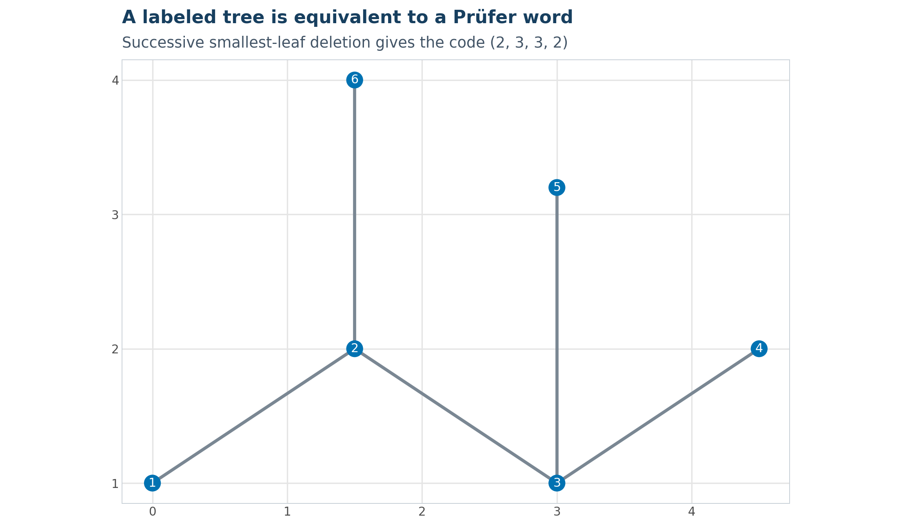

# Trees and spanning trees {#sec-comb-trees}

Trees are graphs with just enough edges for connectivity. Their equivalent
descriptions make them simultaneously recursive objects, minimal networks, and
the backbone of many algorithms.

## Preparation from this book

Use Chapter 11's paths, components, and degrees. Chapter 5 explains recursive
decomposition.

## Equivalent characterizations

For a finite simple graph, any two of “connected,” “acyclic,” and “has one
fewer edge than vertices” force the third. A tree has a unique path between
each pair of vertices. Removing any edge disconnects it; adding any missing
edge creates exactly one cycle. Every nontrivial tree has at least two leaves,
which enables induction by deleting a leaf.

A rooted tree gives parent, child, depth, and subtree structure. Ordered rooted
trees distinguish sibling order; binary trees constrain child positions.
These are different combinatorial classes even when their drawings look
similar.

<figure id="fig-comb-prufer">


<figcaption>

Figure C.1: A Prüfer sequence records successive leaf deletions and reconstructs a labeled tree.

</figcaption>
</figure>

## Labeled trees and determinants

Prüfer encoding repeatedly removes the smallest leaf and records its neighbor.
The resulting sequence has length $n-2$ over $n$ labels; decoding is unique.
This bijection proves Cayley's formula. A label occurs in the code one fewer
time than its vertex degree.

For an arbitrary graph, the matrix-tree theorem counts spanning trees by any
cofactor of its Laplacian matrix. The determinant's signed permutation sum
undergoes cancellation that leaves tree contributions. Numerically computing
a floating determinant can round an integer; exact elimination is preferable.

**Nonexample.** A connected graph with $n-1$ edges is a tree, but a graph with
$n-1$ edges alone need not be: it may contain a cycle and an isolated vertex.
The missing hypothesis matters.

<!-- inline-formula-code:start -->
## Formula and finite computation

The number of labeled trees on $n\ge2$ vertices is

$$
T_n=n^{n-2}.
$$

```python
from itertools import product

def prufer_sequence_count(order: int) -> int:
    if order < 2:
        raise ValueError("Pruefer codes here require order at least two")
    enumerated = sum(1 for _ in product(range(order), repeat=order - 2))
    formula = order ** (order - 2)
    if enumerated != formula:
        raise RuntimeError("word enumeration and power disagree")
    return formula

print([prufer_sequence_count(order) for order in range(2, 8)])
```

**What the computation establishes.** It enumerates all finite code words
through order seven and matches the power count. It does not establish that
codes and trees are bijective; encoding and decoding proofs supply that step.
<!-- inline-formula-code:end -->

## Spanning-tree algorithms

Depth-first and breadth-first search produce spanning trees of connected
graphs. Kruskal and Prim find minimum-weight spanning trees by safe edge
choices. Their correctness is an exchange argument, later abstracted by
matroids: a locally light edge can replace a heavier one across an appropriate
cut.

## Tree decompositions beyond trees

Many hard graph problems become tractable when a graph is close to a tree.
Tree decompositions place vertices into overlapping bags whose running-
intersection property preserves where dependencies meet. Their width measures
the largest bag rather than the number of cycles alone. Dynamic programming
over a decomposition can be efficient at bounded width, but finding or
certifying a narrow decomposition is itself part of the algorithmic task.

## Summary

Trees unite recursive leaf structure, unique paths, minimal connectivity,
Prüfer codes, determinants, and greedy optimization. Always specify labels,
rooting, and sibling order before importing an enumeration.

## Exercises

<div class="exercise" id="combinatorics-12-trees-ex-1">
<p class="exercise-title"><strong>Exercise 1</strong></p>

Prove a longest path in a tree ends at leaves.

</div>

<div class="exercise" id="combinatorics-12-trees-ex-2">
<p class="exercise-title"><strong>Exercise 2</strong></p>

Derive the edge count by deleting a leaf.

</div>

<div class="exercise" id="combinatorics-12-trees-ex-3">
<p class="exercise-title"><strong>Exercise 3</strong></p>

Encode and decode a five-vertex Prüfer sequence.

</div>

<div class="exercise" id="combinatorics-12-trees-ex-4">
<p class="exercise-title"><strong>Exercise 4</strong></p>

Recover degrees from a code.

</div>

<div class="exercise" id="combinatorics-12-trees-ex-5">
<p class="exercise-title"><strong>Exercise 5</strong></p>

Find spanning trees of a cycle.

</div>

<div class="exercise" id="combinatorics-12-trees-ex-6">
<p class="exercise-title"><strong>Exercise 6</strong></p>

Explain why weights require a minimum-tree algorithm.

</div>

### Selected solution

For Exercise 5, deleting any one edge of an $n$-cycle produces a spanning tree,
and every spanning tree must delete one edge to break the unique cycle. Hence
there are $n$.
