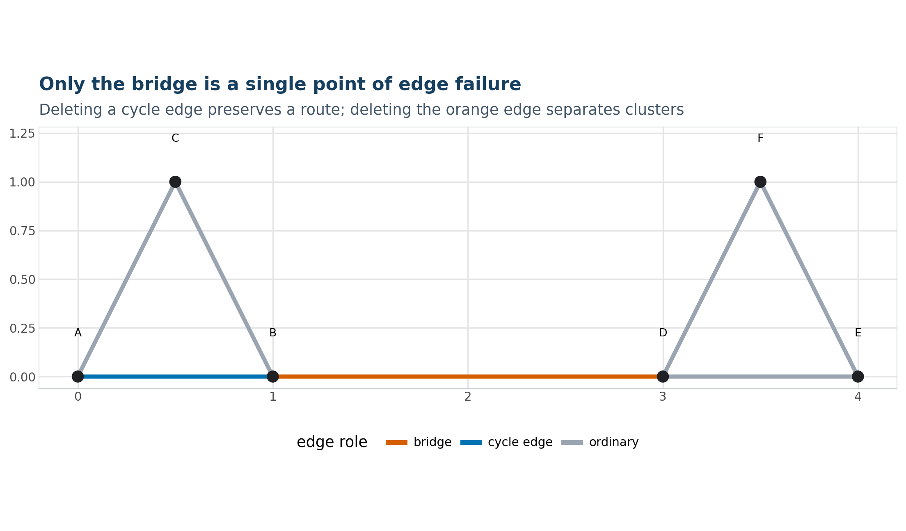

# Connectivity, Euler tours, and Hamilton cycles {#sec-comb-connectivity}

Connectivity asks whether a network remains navigable; Euler and Hamilton
questions ask for global traversals. Similar wording hides a decisive
difference: Euler tours use every edge, while Hamilton cycles visit every
vertex.

## Preparation from this book

Chapter 11 supplies graph searches and Chapter 12 supplies trees and bridges.

## Cuts and disjoint paths {#sec-comb-local-menger}

A bridge is an edge whose deletion increases the number of components. A cut
separates vertices into two sides and records crossing edges. Fix a finite
undirected **simple** graph $G=(V,E)$ and distinct terminals $s,t$. Paths
are simple: they repeat no vertex. Paths in a family must be distinct.

An **internal vertex separator** is a set $S\subseteq V\setminus\{s,t\}$
whose deletion leaves no $s$–$t$ path. The terminals are protected. Paths
are **internally vertex-disjoint** if their only shared vertices can be $s,t$.
For **nonadjacent** terminals, the vertex version of Menger's theorem states

$$
\begin{aligned}
&\max\{\text{number of internally vertex-disjoint }s\text{--}t\text{ paths}\}\\
&\qquad=\min\{|S|:S\text{ is an internal vertex separator}\}.
\end{aligned}
$$

The edge version counts **edge-disjoint** paths and deletes edges instead.
For all distinct terminals, including adjacent ones, their maximum number
equals the minimum number of edges separating $s$ from $t$. Equivalently,
minimize the size of $\delta(A)$, the edges with one endpoint in $A$ and one
outside, over $s\in A,t\notin A$
([Diestel 2025](bibliography.md#ref-diestel2025connectivity), Corollary 3.3.5). Edge-disjoint paths may share
internal vertices. For already disconnected terminals both versions have
value zero: the empty family and empty separator/cut certify it.

**Why nonadjacency matters.** In the triangle with edges $st,sa,at$, paths
$st$ and $sat$ are internally vertex-disjoint. No deletion of internal
vertices destroys the direct edge, so no permitted vertex separator exists.
Allowing terminal deletion gives a minimum of one, which also does not equal
two. The edge version still has value two. These are local statements for
fixed terminals, not definitions of global graph connectivity. A
[flow derivation in Chapter 14](14-matching-flows.md#sec-comb-menger-flow)
proves their equality under the stated hypotheses.

<figure id="fig-comb-bridges">


<figcaption>

Figure D.1: Deleting a bridge separates two dense regions, whereas deleting a cycle edge does not.

</figcaption>
</figure>

## Matching path and separator certificates {#sec-comb-path-certificates}

Every internal separator meets every terminal path. For internally
vertex-disjoint paths these intersections use different internal vertices,
so $k$ such paths imply $|S|\ge k$. A separator of size $k$ gives the matching
upper bound and proves optimality. Similarly, every path crosses a terminal
cut, and edge-disjoint paths use different cut edges. Matching path and cut
sizes certify the edge optimum. These certificate bounds need no optimization
algorithm; Menger guarantees matching witnesses under its hypotheses.

### Worked example: two triangles sharing a vertex

This is a separate graph from the bridge illustration. Take vertices
$s,a,v,b,t$ and edges $sa,av,vs,vb,bt,tv$. Every terminal path uses $v$,
so path $svt$ and separator $\{v\}$ certify vertex optimum one. But $svt$
and $savbt$ are edge-disjoint, and cut $\delta(\{s\})=\{sa,sv\}$ certifies
edge optimum two. The two edge-disjoint paths share $v$ internally.

### Checking supplied witnesses {#sec-comb-menger-code}

The checker takes integer vertices $0,\ldots,n-1$, simple edge pairs, and
supplied simple paths. Malformed or unsuccessful candidates raise
`ValueError`; success returns the certified optimum. A rejected candidate
does not assert nonexistence of other certificates. The vertex function
requires nonadjacent protected terminals; the edge function accepts adjacency
and a source-side set defining its cut. Neither searches for an optimum.

```python
Edge = tuple[int, int]
VertexPath = tuple[int, ...]

def _menger_data(
    order: int, edges: list[Edge], source: int, target: int,
    paths: list[VertexPath],
) -> tuple[list[set[int]], set[Edge], tuple[VertexPath, ...]]:
    if type(order) is not int or order < 2:
        raise ValueError("order must be an integer at least two")

    def valid_vertex(vertex: int) -> bool:
        return type(vertex) is int and 0 <= vertex < order

    if not valid_vertex(source) or not valid_vertex(target) or source == target:
        raise ValueError("need distinct known terminals")
    if not isinstance(edges, (list, tuple)) or not isinstance(paths, (list, tuple)):
        raise ValueError("edges and paths must be finite lists or tuples")
    adjacency = [set() for _ in range(order)]
    graph_edges: set[Edge] = set()
    for edge in edges:
        if not isinstance(edge, (list, tuple)) or len(edge) != 2:
            raise ValueError("an edge needs two endpoints")
        left, right = edge
        if not valid_vertex(left) or not valid_vertex(right) or left == right:
            raise ValueError("invalid simple edge")
        canonical = (min(left, right), max(left, right))
        if canonical in graph_edges:
            raise ValueError("repeated or parallel edge")
        graph_edges.add(canonical)
        adjacency[left].add(right)
        adjacency[right].add(left)
    checked: list[VertexPath] = []
    for path in paths:
        if not isinstance(path, (list, tuple)) or len(path) < 2:
            raise ValueError("a terminal path needs at least two vertices")
        route = tuple(path)
        if any(not valid_vertex(vertex) for vertex in route):
            raise ValueError("unknown path vertex")
        if route[0] != source or route[-1] != target or len(set(route)) != len(route):
            raise ValueError("path must be simple and run from source to target")
        if any(right not in adjacency[left] for left, right in zip(route, route[1:])):
            raise ValueError("path uses an absent edge")
        if route in checked:
            raise ValueError("supplied paths must be distinct")
        checked.append(route)
    return adjacency, graph_edges, tuple(checked)

def vertex_path_certificate(
    order: int, edges: list[Edge], source: int, target: int,
    paths: list[VertexPath], separator: list[int],
) -> int:
    adjacency, graph_edges, routes = _menger_data(order, edges, source, target, paths)
    if target in adjacency[source]:
        raise ValueError("vertex theorem requires nonadjacent terminals")
    if not isinstance(separator, (list, tuple)) or any(
        type(vertex) is not int or not 0 <= vertex < order for vertex in separator
    ):
        raise ValueError("invalid separator vertices")
    removed = set(separator)
    if len(removed) != len(separator) or source in removed or target in removed:
        raise ValueError("separator must be distinct and protect both terminals")
    used: set[int] = set()
    for route in routes:
        interior = set(route[1:-1])
        if used & interior:
            raise ValueError("paths share an internal vertex")
        used.update(interior)
    reached = {source}
    stack = [source]
    while stack:
        vertex = stack.pop()
        for neighbor in adjacency[vertex] - removed - reached:
            reached.add(neighbor)
            stack.append(neighbor)
    if target in reached or len(routes) != len(removed):
        raise ValueError("separator and path bounds do not match")
    return len(routes)

def edge_path_certificate(
    order: int, edges: list[Edge], source: int, target: int,
    paths: list[VertexPath], cut_side: list[int],
) -> int:
    adjacency, graph_edges, routes = _menger_data(order, edges, source, target, paths)
    if not isinstance(cut_side, (list, tuple)) or any(
        type(vertex) is not int or not 0 <= vertex < order for vertex in cut_side
    ):
        raise ValueError("invalid cut-side vertices")
    side = set(cut_side)
    if len(side) != len(cut_side) or source not in side or target in side:
        raise ValueError("cut side must be distinct, contain source and exclude target")
    used: set[Edge] = set()
    for route in routes:
        path_edges = {(min(left, right), max(left, right))
                      for left, right in zip(route, route[1:])}
        if used & path_edges:
            raise ValueError("paths share an undirected edge")
        used.update(path_edges)
    cut_size = sum((left in side) != (right in side) for left, right in graph_edges)
    if len(routes) != cut_size:
        raise ValueError("cut and path bounds do not match")
    return len(routes)

bowtie = [(0, 1), (1, 2), (2, 0), (2, 3), (3, 4), (4, 2)]
vertex_value = vertex_path_certificate(5, bowtie, 0, 4, [(0, 2, 4)], [2])
edge_value = edge_path_certificate(
    5, bowtie, 0, 4, [(0, 2, 4), (0, 1, 2, 3, 4)], [0],
)
if (vertex_value, edge_value) != (1, 2):
    raise RuntimeError("bowtie certificate check failed")
print(vertex_value, edge_value)
```

Repeated paths are rejected explicitly: copies of a direct edge have empty
interiors but are not distinct paths. The original Euler checker below
solves a different problem and is unchanged.

### Changed task: three routes need not be three disjoint routes {#sec-comb-menger-task}

Take vertices $s,a,b,c,d,t$ and edges $sa,at,sb,bc,ct,bd,dt$. List every
simple terminal path. Find matching vertex and edge certificates, then add
$st$ and determine which conclusions change. Does an internal separator
still exist? With labels $s,a,b,c,d,t=0,1,2,3,4,5$, exercise the actual
certificate functions. Explain why giving the direct edge capacity $M=n=6$
in the [split network](14-matching-flows.md#sec-comb-menger-flow) no longer
counts distinct paths. The [separate explanation](#sec-comb-menger-solution)
gives both valid certificates and this boundary failure.

## Euler's criterion

In a closed traversal, every arrival at a vertex pairs with a departure, so
all degrees are even. Conversely, in a connected graph with every non-isolated
degree even, following unused edges cannot get stuck away from the start;
splicing closed circuits yields an Euler tour. Exactly two odd-degree vertices
give an open Euler trail between them.

Hamilton cycles have no analogous complete degree test. Necessary conditions
include connectivity after deleting vertices; sufficient conditions such as
Dirac's theorem use strong minimum degree. Determining Hamiltonicity is
computationally hard in general.

**Nonexample.** A graph may have an Euler tour and no Hamilton cycle, or the
reverse. Replacing “edges” with “vertices” in Euler's parity argument is
invalid because vertex visits do not pair all incident edges.

<!-- inline-formula-code:start -->
## Formula and finite computation

For a connected finite graph after ignoring isolated vertices,

$$
\text{an Euler circuit exists}\quad\Longleftrightarrow\quad
d(v)\equiv0\pmod 2\text{ for every }v.
$$

```python
def has_euler_circuit(order: int, edges: list[tuple[int, int]]) -> bool:
    if order < 0:
        raise ValueError("order must be nonnegative")
    adjacency = [set() for _ in range(order)]
    seen: set[tuple[int, int]] = set()
    for left, right in edges:
        if not 0 <= left < order or not 0 <= right < order or left == right:
            raise ValueError("invalid simple edge")
        edge = (min(left, right), max(left, right))
        if edge in seen:
            raise ValueError("parallel or repeated edge supplied to a simple graph")
        seen.add(edge)
        adjacency[left].add(right)
        adjacency[right].add(left)
    active = {vertex for vertex in range(order) if adjacency[vertex]}
    if not active:
        return True
    reached: set[int] = set()
    stack = [next(iter(active))]
    while stack:
        vertex = stack.pop()
        if vertex not in reached:
            reached.add(vertex)
            stack.extend(adjacency[vertex] - reached)
    return reached == active and all(len(adjacency[vertex]) % 2 == 0 for vertex in active)

print(has_euler_circuit(4, [(0, 1), (1, 2), (2, 3), (3, 0)]))
```

**What the computation establishes.** Search and parity test the criterion on
the supplied finite graph. The program relies on the theorem; it does not prove
the circuit-splicing argument or decide Hamiltonicity.
<!-- inline-formula-code:end -->

## Algorithms and certificates

Hierholzer's algorithm constructs an Euler tour in linear time. A returned
tour is easily verified by checking adjacency and one-time edge use. A
Hamilton cycle is also an efficiently checked positive certificate, but a
failed backtracking search is convincing only if the search is demonstrably
exhaustive.

## Directed variants

For directed Euler circuits, every active vertex needs equal incoming and
outgoing degree, together with the appropriate directed connectivity. Strong
connectivity, weak connectivity, and reachability are distinct. Directed
Hamilton problems remain difficult, and degree conditions change form. When a
road or workflow is modeled, state whether traversal may reverse an arc and
whether returning to the start is required before selecting a theorem or
algorithm.

## Summary

Cuts and disjoint paths measure resilience. Euler tours admit a complete
connectivity-and-parity criterion; Hamilton cycles require separate necessary,
sufficient, and algorithmic tools.

## Exercises

<div class="exercise" id="combinatorics-13-connectivity-euler-hamilton-ex-1">
<p class="exercise-title"><strong>Exercise 1</strong></p>

Identify all bridges in a small graph.

</div>

<div class="exercise" id="combinatorics-13-connectivity-euler-hamilton-ex-2">
<p class="exercise-title"><strong>Exercise 2</strong></p>

Prove necessity of even Euler degrees.

</div>

<div class="exercise" id="combinatorics-13-connectivity-euler-hamilton-ex-3">
<p class="exercise-title"><strong>Exercise 3</strong></p>

Construct a graph separating Euler and Hamilton properties.

</div>

<div class="exercise" id="combinatorics-13-connectivity-euler-hamilton-ex-4">
<p class="exercise-title"><strong>Exercise 4</strong></p>

Run circuit splicing by hand.

</div>

<div class="exercise" id="combinatorics-13-connectivity-euler-hamilton-ex-5">
<p class="exercise-title"><strong>Exercise 5</strong></p>

Test a Dirac-degree hypothesis.

</div>

<div class="exercise" id="combinatorics-13-connectivity-euler-hamilton-ex-6">
<p class="exercise-title"><strong>Exercise 6</strong></p>

Explain positive versus negative certificates.

</div>

<div class="exercise" id="combinatorics-13-connectivity-euler-hamilton-ex-7">
<p class="exercise-title"><strong>Exercise 7</strong></p>

Complete the [changed path/separator task](#sec-comb-menger-task), keeping
vertex and edge witnesses separate.

</div>

### Selected solution

For Exercise 2, each visit to a vertex in a closed edge tour uses one entering
and one leaving edge. Pairing all used incident edges makes its degree even.

### Explanation of the changed path task {#sec-comb-menger-solution}

The complete simple-path list is $sat,sbct,sbdt$. The last two share $b$,
so three routes do not give three internally disjoint ones. Paths $sat,sbct$
and separator $\{a,b\}$ certify vertex optimum two. The same paths are
edge-disjoint, and $\delta(\{s\})=\{sa,sb\}$ certifies edge optimum two.
Supply program paths $(0,1,5),(0,2,3,5)$, separator $[1,2]$, or cut side
$[0]$; both functions return two.

After adding $st$, the only new simple terminal path is that direct edge.
Any simple terminal path using it must be precisely $st$: using it later
would repeat $s$, or reaching $t$ earlier would end the path. Thus, for a
simple graph with $st\in E$,

$$
\nu_G(s,t)=1+\nu_{G-st}(s,t),
$$

where $\nu$ counts distinct internally vertex-disjoint paths. Here the
maximum is three, witnessed by $st,sat,sbct$. No internal separator exists:
the direct edge survives every permitted deletion. The vertex verifier
rejects this input as outside its nonadjacent-terminal domain. The edge
verifier returns three using those paths and side $[0]$, whose cut is
$\{st,sa,sb\}$.

In the split network, the direct arc carries six units, plus one along
$sat$ and one along $sbct$: value eight. A cut crossing that direct arc
and the unit split links for $a,b$ has capacity $6+1+1=8$. Thus the network
optimum is eight while the distinct internally disjoint path optimum is
three. Nonadjacency in the [flow proof](14-matching-flows.md#sec-comb-menger-flow)
excludes this capacity-$M$ direct-path multiplicity.
