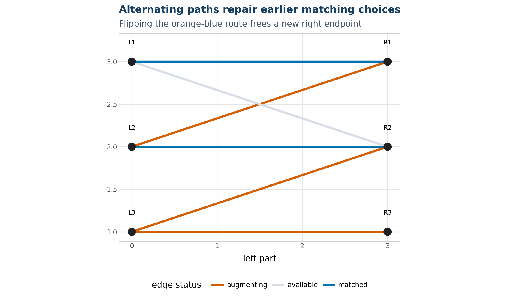

# Matchings and network flows {#sec-comb-matching}

Matching pairs compatible agents without reuse. Flow sends divisible quantity
through capacitated arcs. Augmenting paths connect the two subjects and turn
local improvement into exact global optimization.

## Preparation from this book

Use bipartite graphs from Chapter 11 and cuts from Chapter 13. No continuous
optimization is assumed.

## Hall's condition

In a bipartite graph with left part $L$, a matching saturating $L$ requires
every subset $S\subseteq L$ to have at least $|S|$ distinct neighbors. Hall's
theorem says this condition is sufficient. Individual degree checks cannot see
a crowd competing for the same neighbors.

An augmenting path alternates between unmatched and matched edges, beginning
and ending unmatched. Flipping its status increases matching size by one.
Berge's lemma says a matching is maximum exactly when no augmenting path
exists.

<figure id="fig-comb-matching">


<figcaption>

Figure E.1: An augmenting path flips alternating edges to increase a bipartite matching by one.

</figcaption>
</figure>

## Flow and cuts

A feasible flow respects capacities and conserves quantity at internal
vertices. Its value is net flow from the source. Every source–sink cut bounds
the value by the capacity crossing forward. The max-flow min-cut theorem says
an augmenting algorithm terminates with equality for finite rational capacities.

Bipartite matching reduces to unit-capacity flow: source to left vertices,
compatibility arcs across, and right vertices to sink. Integral capacities
admit an integral maximum flow, so the result really is a matching rather than
fractional pairs.

**Nonexample.** A greedy choice of any available edge can block a larger
matching. Augmentation succeeds because it may undo earlier choices along an
alternating path.

## Deriving local path theorems from integral flow {#sec-comb-menger-flow}

The [certificates in Chapter 13](13-connectivity-euler-hamilton.md#sec-comb-local-menger)
give matching bounds when witnesses are known. Integral max-flow min-cut
explains why optimal witnesses exist. Keep a finite undirected simple graph
and distinct terminals $s,t$ throughout.

**Integral path extraction.** An integral flow of nonnegative value decomposes into simple directed
$s$–$t$ paths with positive integer multiplicities, plus directed cycles.
While the value is positive, consider vertices reachable from $s$ by
positive-flow arcs. If $t$ were not reachable, conservation summed over this
set would give nonpositive value, a contradiction. Shorten a reachable walk
to a simple path, subtract one unit along it, and repeat. Remaining zero-value
flow consists of circulations and contributes no paths. Cycles can be removed
by subtracting their minimum positive arc flow around the **whole** cycle.
These operations preserve conservation, integrality and nonnegative flows;
the finite total arc flow decreases, so extraction terminates.

### Edge-disjoint paths: cancel opposite directed flows

Replace each undirected edge $uv$ by arcs $u\to v,v\to u$, each of capacity
one. A directed cut has one forward arc per original crossing edge, so its
capacity is the size of the undirected cut. An integral maximum flow may
initially use both orientations. Subtract $\min(f(u,v),f(v,u))$ from both:
this removes a two-arc circulation, preserving conservation and flow value.
Do this for every edge before extracting paths.

At most one orientation of each original edge now has positive flow, at
most one unit. Extracted paths therefore project to edge-disjoint undirected
simple paths. They are **distinct**: copies would share an edge, contradicting
capacity one. Conversely, edge-disjoint paths give a feasible integral flow
of their cardinality. Max-flow min-cut proves the edge version, including
adjacent and already disconnected terminals.

### Internal vertex capacity: nonadjacent protected terminals

Assume $st\notin E$ and write $n=|V|$. Keep $s,t$ unsplit. Replace every
other vertex $v$ by $v^-\to v^+$ of capacity one. An internal vertex's
input/output are $v^-,v^+$; for a terminal both are the unchanged vertex.
Every undirected $uv$ gives arcs from the output of $u$ to the input of
$v$ and conversely, each of capacity $M=n$.

Removing all $n-2$ internal split links destroys every terminal path,
because there is no direct edge. A minimum directed cut therefore has
capacity at most $n-2<M$ and crosses no capacity-$M$ arc. Its crossed unit
links identify a set $S\subseteq V\setminus\{s,t\}$ of the same cardinality.
Every original terminal path lifts to a directed path and must cross one
of these links, so $S$ is a genuine protected-terminal separator.

Decompose an integral maximum flow into simple directed paths and cycles,
discarding the cycles. Every path uses an internal unit link, so its integer
multiplicity is one. Capacity one prevents shared internal vertices. Projected
paths are simple: an internal vertex can only be entered at its input and
left through its split link, so revisiting it repeats directed vertices.
They are **distinct**: duplicate projections would share an internal unit
link. Conversely, internally vertex-disjoint paths give a feasible flow of
their cardinality, at most $n-2$, so capacity $M=n$ suffices on original-edge
arcs. Equality with the minimum cut proves vertex Menger.

The two original-edge arcs in a **split** network are not antiparallel:
their endpoints are different input/output nodes. Cancelling just these
two flows would generally break conservation at split nodes. Use whole-cycle
decomposition there; two-arc cancellation belongs to the unsplit edge proof.

With a direct edge, a path lacking an internal unit link can carry $M$
copies of one edge. In the [changed six-vertex task](13-connectivity-euler-hamilton.md#sec-comb-menger-task),
adding $st$ gives split-network optimum eight but only three distinct
internally vertex-disjoint paths. Its separate answer exhibits the flow
and matching cut. The construction is proved under nonadjacency, rather
than used as an adjacent-terminal counting rule
([Grinberg 2026](bibliography.md#ref-grinberg2026menger), Theorems 1.1.22 and 1.1.42).

<!-- inline-formula-code:start -->
## Formula and finite computation

Hall's condition is

$$
|N(S)|\ge |S|\qquad\text{for every }S\subseteq L.
$$

```python
from itertools import combinations

def hall_obstruction(adjacency: list[set[int]]) -> tuple[int, ...] | None:
    left_vertices = range(len(adjacency))
    for size in range(1, len(adjacency) + 1):
        for subset in combinations(left_vertices, size):
            neighbors = set().union(*(adjacency[left] for left in subset))
            if len(neighbors) < len(subset):
                return subset
    return None

feasible = [{0, 1}, {1, 2}, {0, 2}]
blocked = [{0}, {0}, {1, 2}]
if hall_obstruction(feasible) is not None:
    raise RuntimeError("unexpected Hall obstruction")
print(hall_obstruction(blocked))
```

**What the computation establishes.** Exhaustive subsets find a Hall
obstruction in one small graph and none in another. It does not prove Hall's
theorem, and exponential subset checking is not the efficient matching
algorithm.
<!-- inline-formula-code:end -->

## Dual certificates

A maximum matching comes with a minimum vertex cover in bipartite graphs;
maximum flow comes with a minimum cut. Such primal–dual certificates make
optimality independently checkable. Weighted matching, assignment, and
min-cost flow extend the model while requiring new dual variables or path
weights.

## Modeling fairness and time

A maximum cardinality matching treats all compatible pairs alike. Applications
may instead need priorities, costs, capacities, stability against blocking
pairs, or fairness across groups. These are new objective functions and
constraints, not details to attach after optimization. In time-varying systems,
accepting an early match can alter later availability. Report whether the model
is static, online, stochastic, or adversarial before interpreting an optimality
claim.

## Summary

Hall characterizes when every left demand can be paired. Augmenting paths
construct maximum matchings and flows, while cuts and covers certify that no
better solution exists.

## Exercises {#exercises}

<div class="exercise" id="combinatorics-14-matching-flows-ex-1">
<p class="exercise-title"><strong>Exercise 1</strong></p>

Find a Hall obstruction invisible to minimum degree.

</div>

<div class="exercise" id="combinatorics-14-matching-flows-ex-2">
<p class="exercise-title"><strong>Exercise 2</strong></p>

Flip an augmenting path.

</div>

<div class="exercise" id="combinatorics-14-matching-flows-ex-3">
<p class="exercise-title"><strong>Exercise 3</strong></p>

Reduce a matching instance to flow.

</div>

<div class="exercise" id="combinatorics-14-matching-flows-ex-4">
<p class="exercise-title"><strong>Exercise 4</strong></p>

Prove every cut bounds every flow.

</div>

<div class="exercise" id="combinatorics-14-matching-flows-ex-5">
<p class="exercise-title"><strong>Exercise 5</strong></p>

Extract a matching from integral unit flow.

</div>

<div class="exercise" id="combinatorics-14-matching-flows-ex-6">
<p class="exercise-title"><strong>Exercise 6</strong></p>

Give a greedy matching failure.

</div>

### Selected solution

For Exercise 4, sum conservation over vertices on the source side. Internal
arcs cancel, leaving flow value as forward crossing flow minus backward
crossing flow, which cannot exceed forward cut capacity.

<!-- uni-34-matching-flow-completion:start -->
## Finite matchings and the full augmenting-path proof {#sec-comb-berge-proof}

The proof clinic below supplies the matching and flow arguments used earlier
in this chapter, including the input to the
[local path derivation](#sec-comb-menger-flow). It concerns finite objects;
weighted matching, infinite graphs, and min-cost flow need other statements.

Let $G=(V,E)$ be a finite undirected simple graph. A **matching** $M$ is a
set of edges no two of which share a vertex. A vertex is **exposed** if no
edge of $M$ meets it. A matching is **maximal** if no edge can simply be
added; it is **maximum** if its cardinality is largest among all matchings.
These are different conditions.

An **$M$-augmenting path** is a simple path whose endpoints are exposed and
whose edges alternate between $E\setminus M$ and $M$, starting and ending
outside $M$. Having an unmatched first and last edge alone is not enough:
the endpoints must also be exposed.

**Lemma 17.1 (Berge's).** A matching $M$ is maximum if and only if there is no
$M$-augmenting path.

**Proof.** If $P$ is augmenting, replace $M$ by

$$
M'=M\mathbin{\triangle}E(P)
   =(M\setminus E(P))\cup(E(P)\setminus M).
$$

Every internal path vertex loses its one matched path edge and gains the
other path edge. The endpoints were exposed and each gains one edge.
No matching edge outside the path meets an internal path vertex, because
that vertex already had its matched edge on the path. Thus $M'$ is a
matching. There is one more unmatched than matched edge on $P$, so
$|M'|=|M|+1$. A maximum matching therefore has no augmenting path.

Conversely, suppose a matching $N$ has $|N|>|M|$. Consider the graph with
edge set $M\triangle N$. Its vertices have degree at most two. Whenever a
vertex has degree two, one incident edge is in $M$ and the other in $N$.
Consequently every nontrivial component is an alternating path or an
alternating cycle. Each cycle has even length and equally many edges from
the two matchings. A path has either equal numbers, one extra $M$ edge,
or one extra $N$ edge. Since the total number of $N$ edges exceeds the
total number of $M$ edges, some component is a path with one extra $N$
edge. It starts and ends with edges of $N\setminus M$.

Each endpoint of that path is exposed in $M$. Otherwise its $M$ edge
would either belong to $M\triangle N$, contradicting that it is an endpoint,
or belong to $M\cap N$, contradicting the matching condition for $N$ at
that endpoint. The component is therefore an $M$-augmenting path.
This proves the converse. $\square$

The lemma does not assume that $G$ is bipartite. An odd cycle may occur in
$G$, but cannot occur as an alternating cycle in the symmetric difference
of two matchings.

### Worked matching: undo two earlier choices {#sec-comb-matching-worked}

Take left vertices $a,b,c$, right vertices $1,2,3$, and neighborhoods

$$
N(a)=\{1,2\},\qquad N(b)=\{1\},\qquad N(c)=\{2,3\}.
$$

The matching $M=\{a1,c2\}$ is maximal: the exposed vertices $b$ and $3$
are not adjacent. It is not maximum. The path

$$
b,\ 1,\ a,\ 2,\ c,\ 3
$$

has unmatched edges $b1,a2,c3$ alternating with matched edges $a1,c2$.
Its endpoints are exposed. Remove $a1,c2$ and insert $b1,a2,c3$.
The resulting matching has size three, saturates both parts, and is maximum
because no matching can use more than three left vertices. A greedy choice
has been undone without reusing any vertex.

## Hall's theorem with both induction cases {#sec-comb-hall-proof}

Let $G$ be a finite bipartite graph with disjoint parts $L,R$. For
$S\subseteq L$, write $N(S)$ for the set of vertices in $R$ adjacent to
at least one vertex of $S$. The parts need not have equal size.

**Theorem 17.2 (Hall's).** There is a matching saturating $L$ if and only if

$$
|N(S)|\ge |S|\quad\text{for every }S\subseteq L.
$$

**Necessity.** In a matching saturating $L$, the partners of the vertices
of $S$ are $|S|$ distinct members of $N(S)$. Hence the inequality holds.

**Sufficiency.** Induct on $n=|L|$, assuming Hall's inequalities. If $n=0$,
the empty matching works. If $n=1$, the inequality for its single vertex
provides a neighbor and hence an edge. Suppose $n\ge2$.

**Case 1: a nonempty proper subset is tight.** Suppose
$\varnothing\ne S\subsetneq L$ and $|N(S)|=|S|$. In the graph on
$S$ and $N(S)$, every $T\subseteq S$ has exactly its original neighbors,
so Hall's inequalities hold. Induction gives a matching saturating $S$.

Delete $S$ and $N(S)$. For any $T\subseteq L\setminus S$, its neighbors
in the remaining graph are $N(T)\setminus N(S)$. Apply Hall's inequality
in the original graph to $S\cup T$:

$$
|S|+|T|
\le |N(S\cup T)|
=|N(S)|+|N(T)\setminus N(S)|
=|S|+|N(T)\setminus N(S)|.
$$

Thus $|N(T)\setminus N(S)|\ge|T|$. The remaining graph also satisfies
Hall's inequalities and has fewer than $n$ left vertices. Induction matches
$L\setminus S$ into $R\setminus N(S)$. The two matchings use disjoint
vertex sets, so their union saturates $L$.

**Case 2: no nonempty proper subset is tight.** Every nonempty proper
$T\subsetneq L$ then satisfies

$$
|N(T)|\ge |T|+1,
$$

because the cardinalities are integers. Choose any $\ell\in L$. Hall's
inequality for $\{\ell\}$ supplies a neighbor $r$. Delete $\ell$ and $r$.
If $\varnothing\ne T\subseteq L\setminus\{\ell\}$, it was a proper subset
of $L$, and deleting $r$ removes at most one of its neighbors. Therefore

$$
|N(T)\setminus\{r\}|\ge |N(T)|-1\ge |T|.
$$

The empty subset also satisfies the inequality. By induction the remaining
graph has a matching saturating $L\setminus\{\ell\}$. Add the edge
$\ell r$. This saturates $L$ and completes the proof. $\square$

For example, with $N(a)=\{1\}$, $N(b)=\{1,2\}$,
$N(c)=\{3,4\}$, the tight set $\{a\}$ uses neighbor $1$.
The remaining vertices can be matched as $b2,c3$, giving $a1,b2,c3$.
By contrast, in the three-by-three graph with $N(a)=\{1,2\}$,
$N(b)=\{2,3\}$, and $N(c)=\{1,3\}$, each nonempty proper subset has one spare
neighbor. Deleting the endpoints of $a1$ leaves the matching $b2,c3$.
These illustrate the two cases; the induction establishes the theorem
for every finite size.

## Integral flow, labelled residual arcs, and cuts {#sec-comb-integral-flow-proof}

### The network and the cut identity {#sec-comb-flow-conventions}

A network here has a finite vertex set $V$, a finite set $A$ of **labeled**
directed arcs, distinct source $s$ and sink $t$, and a finite nonnegative
capacity $c(a)$ on each arc. There are no self-loops. Parallel arcs and
original arcs in both directions between a pair of vertices are allowed.
Arcs entering $s$ or leaving $t$ are also allowed. An arc's identity is
more than its pair of endpoints.

A flow assigns a real number $f(a)$ to each original arc such that

$$
0\le f(a)\le c(a),\qquad
\sum_{\substack{a\in A\\\operatorname{head}(a)=v}}f(a)
= \sum_{\substack{a\in A\\\operatorname{tail}(a)=v}}f(a)
\quad(v\notin\{s,t\}).
$$

Its value $|f|$ is flow leaving $s$ minus flow entering $s$. Summing
conservation over all vertices other than $s,t$ shows that the same value
is flow entering $t$ minus flow leaving $t$.

A source–sink cut is a set $S\subseteq V$ with $s\in S$ and $t\notin S$.
Write $A^+(S)$ for original arcs leaving $S$ and $A^-(S)$ for original
arcs entering $S$. Summing net outflow over $S$ cancels all internal arcs
and gives the exact identity

$$
|f|=\sum_{a\in A^+(S)}f(a)-\sum_{a\in A^-(S)}f(a)
\le \sum_{a\in A^+(S)}c(a)=c(S).
$$

Only forward capacities define the cut capacity. Backward **flow** is
subtracted in the identity; backward capacities are not added to $c(S)$.
Thus every feasible flow value is at most every cut capacity.

### Residual paths and a correct update with antiparallel arcs {#sec-comb-residual-proof}

For each original arc $a:u\to v$, make two possible residual arcs:

- a labeled forward copy $(a,+):u\to v$, with residual capacity $c(a)-f(a)$;
- a labeled backward copy $(a,-):v\to u$, with residual capacity $f(a)$.

Keep only copies with strictly positive residual capacity. A backward
residual step cancels some flow on its own original arc. It is not a new
negative flow, and it is not automatically the original arc $v\to u$.

If both original arcs $a:u\to v$ and $b:v\to u$ exist, the residual
direction $v\to u$ may contain **two** copies: $(a,-)$ and $(b,+)$.
They have different capacities and require different updates. Keep their
labels even though their endpoints agree.

If there is a residual $s$–$t$ walk, deleting repeated-vertex portions
gives a simple residual $s$–$t$ path $P$. Choose its particular labeled
copies and let

$$
\delta=\min_{e\in E(P)}c_f(e)>0.
$$

For each forward copy $(a,+)$ on $P$, increase $f(a)$ by $\delta$; for
each backward copy $(a,-)$, decrease $f(a)$ by $\delta$.
Leave all other original arc flows unchanged. A simple path cannot use
both copies of the same original arc, since that would repeat its
endpoints. The residual bounds therefore keep every updated flow in
$[0,c(a)]$. At every internal path vertex one residual step enters and
one leaves, so the changes in net outflow cancel, including when a step
cancels original flow. At $s$ net outflow increases by $\delta$; at $t$
it decreases by $\delta$. The updated flow is feasible and has value
$|f|+\delta$.

### A missing residual path supplies an optimality certificate {#sec-comb-maxflow-certificate}

Suppose there is no residual $s$–$t$ path. Let $S$ be the set reachable
from $s$ through positive-capacity residual arcs. Then $s\in S$ and
$t\notin S$. Every original arc leaving $S$ is saturated: otherwise its
forward residual copy would reach outside $S$. Every original arc entering
$S$ has zero flow: otherwise its backward residual copy would reach
outside $S$. The cut identity now gives

$$
|f|=\sum_{a\in A^+(S)}c(a)=c(S).
$$

Every flow is bounded by this cut, and every cut bounds this flow. Thus
$f$ is a maximum flow, $S$ is a minimum cut, and their values agree.
This argument applies to any finite nonnegative capacities once a feasible
flow with no residual path is available.

### Integral and rational termination; real-capacity existence {#sec-comb-flow-termination}

**Integral max-flow min-cut.** Suppose all capacities are nonnegative
integers. Start with the zero flow. Repeatedly find a simple residual
$s$–$t$ path and augment by its **full bottleneck** $\delta$ as above.
By induction all flow values and residual capacities on arcs are integers.
Every augmentation therefore increases the flow value by at least one.

On the other hand,

$$
|f|\le C:=\sum_{\substack{a\in A\\\operatorname{tail}(a)=s}}c(a).
$$

The integer $C$ is finite. There can be at most $C$ augmentations, so
the procedure stops with no residual path. The preceding cut argument
proves maximum flow equals minimum cut, and constructs an **integral**
maximum flow. This is a finite-termination proof, not a claim of polynomial
time in the binary encoding of $C$.

For finite rational capacities, choose a positive integer $D$ that clears
all denominators. Apply the integral argument to capacities $Dc(a)$ and
divide the resulting flow by $D$. Equivalently, the full-bottleneck
algorithm from zero keeps all flows in multiples of $1/D$; it makes at
most $DC$ augmentations. The optimum need not itself be an integer
in the original units.

For arbitrary finite nonnegative **real** capacities, the integer-increase
argument is unavailable in general. Nevertheless the feasible flows form
a nonempty closed subset of the finite box
$\prod_{a\in A}[0,c(a)]$: the zero flow is feasible, and conservation
imposes finitely many closed linear equalities. The feasible set is compact.
The continuous linear function $|f|$ therefore attains a maximum $f^*$.
A positive residual path at $f^*$ would admit the preceding augmentation
and increase its value, a contradiction. Its reachable set gives an
equal-capacity cut. This proves existence and max-flow min-cut for real
capacities, without asserting finite termination of an arbitrary choice
of augmenting paths. With irrational capacities that path procedure
need not terminate.

### Why unit flow really gives a bipartite matching {#sec-comb-matching-flow-reduction}

For a finite bipartite graph with parts $L,R$, add new vertices $s,t$.
Give capacity one to each arc $s\to\ell$ for $\ell\in L$, each
compatibility arc $\ell\to r$, and each arc $r\to t$ for $r\in R$.
There are no other arcs. A matching gives a flow of its cardinality by
sending one unit along each corresponding $s,\ell,r,t$ path.

Conversely, an integral flow in this network uses only zero or one on
each arc. Conservation at $\ell$ says that its total compatibility
outflow is at most one; conservation at $r$ says that its total
compatibility inflow is at most one. The compatibility arcs carrying
one therefore form a matching. Their number equals the flow value,
by summing over the left layer. An integral maximum flow hence gives
a maximum matching, with the same cardinality. Arbitrary fractional
flows cannot be read as disjoint pairs in this way.

## Worked residual rerouting and a matching cut {#sec-comb-flow-worked}

Use vertices $s,u,v,t$ and the following original capacities:

| Arc | $su$ | $sv$ | $uv$ | $vu$ | $ut$ | $vt$ |
|---|---:|---:|---:|---:|---:|---:|
| Capacity | 3 | 2 | 2 | 1 | 2 | 3 |

Start from zero. First augment along $s,u,v,t$ by two. In the resulting
residual graph, the direction $v\to u$ contains the backward copy of
$uv$ with capacity two and the forward copy of the original $vu$ with
capacity one. Choose the **backward copy of $uv$** on $s,v,u,t$.
Its bottleneck is two, so this augmentation cancels both units on $uv$.
Finally augment $s,u,v,t$ by one.

| After augmentation | $f(su)$ | $f(sv)$ | $f(uv)$ | $f(vu)$ | $f(ut)$ | $f(vt)$ | Value |
|---|---:|---:|---:|---:|---:|---:|---:|
| $s,u,v,t$ by 2 | 2 | 0 | 2 | 0 | 0 | 2 | 2 |
| $s,v,u,t$ by 2, cancelling $uv$ | 2 | 2 | 0 | 0 | 2 | 2 | 4 |
| $s,u,v,t$ by 1 | 3 | 2 | 1 | 0 | 2 | 3 | 5 |

At the end, conservation reads $3=1+2$ at $u$ and $2+1=3$ at $v$.
The cut $\{s\}$ has capacity $3+2=5$, equal to the flow value.
It certifies optimality without searching through all flows.
The original arc $vu$ carries zero throughout. Treating its capacity one
as the cancellation capacity would miss a valid two-unit augmentation;
updating both original arcs for the same residual step would also be wrong.

## Changed matching and flow tasks {#sec-comb-matching-flow-tasks}

These tasks change the graphs, capacities, or applicability conditions.
Give the witnesses and the argument that makes them certificates.
The [complete answers](app-c-solutions.md#sec-comb-matching-flow-answers)
also cover the chapter's original six exercises.

### Task A: a tight set and a fresh augmentation {#sec-comb-matching-task-a}

Let $L=\{a,b,c,d\}$, $R=\{1,2,3,4\}$, with neighborhoods

$$
N(a)=N(b)=\{1,2\},\qquad N(c)=\{2,3\},\qquad N(d)=\{3,4\}.
$$

Find a nonempty proper tight set. Verify the Hall inequalities needed on
its two smaller graphs, and use the tight-set case to construct a matching
saturating $L$. Independently augment $M=\{a2,c3,d4\}$ and certify the
result is maximum.
[Answer A](app-c-solutions.md#sec-comb-matching-answer-a).

### Task B: balanced parts and substantial degrees still fail {#sec-comb-matching-task-b}

Let $L=\{a,b,c,d,e,f\}$ and $R=\{1,2,3,4,5,6\}$. Each of
$a,b,c,d$ is adjacent to exactly $1,2,3$; each of $e,f$ is adjacent
to exactly $4,5,6$. Show that every left degree is three and every
vertex of the graph has degree at least two, yet $L$ cannot be saturated.
Determine the maximum matching size using an explicit matching and an
upper-bound certificate.
[Answer B](app-c-solutions.md#sec-comb-matching-answer-b).

### Task C: reroute through a labelled cancellation {#sec-comb-matching-task-c}

Use vertices $s,p,q,r,t$ and no original arcs other than these:

| Arc | $sp$ | $sq$ | $pq$ | $qp$ | $pr$ | $qr$ | $rt$ | $pt$ | $qt$ |
|---|---:|---:|---:|---:|---:|---:|---:|---:|---:|
| Capacity | 4 | 3 | 2 | 1 | 3 | 2 | 5 | 1 | 1 |

After sending two units along $s,p,q,r,t$, find an augmentation that
cancels all flow on $pq$. Complete a maximum flow and exhibit an
equal-capacity cut. Explain why the original capacity of $qp$ must not
be used as the capacity for cancelling $pq$.
[Answer C](app-c-solutions.md#sec-comb-matching-answer-c).

### Task D: what a capacity change does to the proof {#sec-comb-matching-task-d}

First divide every capacity in Task C by six. Give the exact optimum,
a denominator-clearing factor, and a bound on the number of full-bottleneck
augmentations from zero. Next multiply the original integer capacities
of Task C by $\sqrt2$ instead. Does the unit-integer-increase argument
apply in those unscaled units? Can the common factor still give finite
termination? Finally, for arbitrary finite nonnegative real capacities
with no common positive unit making them all integer multiples, identify
what the compactness
proof establishes and what it does not establish.
[Answer D](app-c-solutions.md#sec-comb-matching-answer-d).

### Task E: Berge without bipartiteness {#sec-comb-matching-task-e}

Take vertices $a,b,c,d,e,f$ and edges

$$
E=\{ab,bc,ca,ad,de,ef\}.
$$

Let $M=\{ab,de\}$ and $N=\{bc,ad,ef\}$. Find the components of
$M\triangle N$, locate an $M$-augmenting path, and prove the augmented
matching is maximum. Explain why the triangle in $G$ does not contradict
the alternating-cycle step in Berge's proof, and why Hall's bipartite
hypothesis does not hold for this graph.
[Answer E](app-c-solutions.md#sec-comb-matching-answer-e).
<!-- uni-34-matching-flow-completion:end -->
