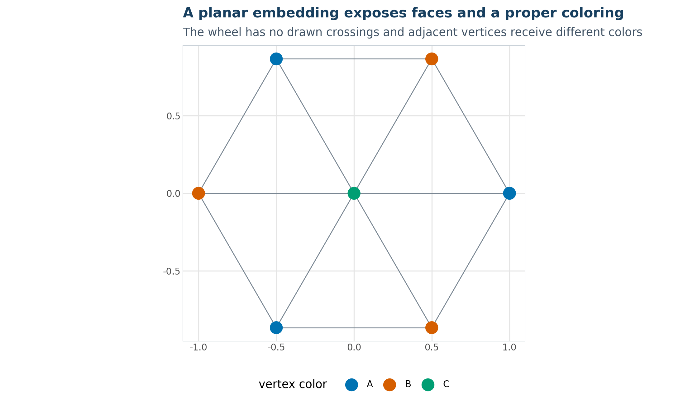

# Coloring and planarity {#sec-comb-coloring}

Coloring separates conflicting objects; planarity asks whether edges can be
drawn without crossings. Together they connect local adjacency, global
topology, algorithms, and unavoidable obstructions.

## Preparation from this book

Chapter 11 defines simple graphs. Chapter 13's cycles and cuts help with planar
arguments.

## Vertex coloring

A proper coloring assigns different colors to adjacent vertices. The least
number needed is the chromatic number. A greedy algorithm uses at most one more
than the maximum earlier-neighbor count, so vertex ordering matters. Degeneracy
ordering improves the guarantee for sparse graphs.

Cliques give lower bounds, but the clique number can be much smaller than the
chromatic number. Bipartite graphs are exactly those with no odd cycle and can
be two-colored by breadth-first parity.

<figure id="fig-comb-coloring">


<figcaption>

Figure F.1: A proper coloring separates adjacent vertices while a planar embedding records faces rather than decorative crossings.

</figcaption>
</figure>

## Planar embeddings

A planar graph admits some crossing-free drawing; a plane graph comes with one
chosen embedding. Euler's relation connects vertices, edges, faces, and
components. For a connected simple planar graph with at least three vertices,
each face boundary has length at least three, yielding an edge bound. Triangle-
free planar graphs receive a stronger bound because face lengths are at least
four.

Kuratowski's theorem characterizes nonplanarity through subdivisions of
$K_5$ and $K_{3,3}$. The four-color theorem guarantees four colors for every
planar graph, but its proof is far deeper than the elementary six-color
argument from average degree.

**Nonexample.** A particular drawing with crossings does not prove a graph
nonplanar; edges may be rerouted. Conversely, treating a crossing as a vertex
changes the graph and can make the picture planar for the wrong object.

<!-- inline-formula-code:start -->
## Formula and finite computation

For a connected plane graph,

$$
|V|-|E|+|F|=2.
$$

```python
def planar_face_count(vertices: int, edges: int) -> int:
    if vertices < 1 or edges < vertices - 1:
        raise ValueError("inputs cannot describe a connected graph")
    faces = 2 - vertices + edges
    if faces < 1:
        raise ValueError("Euler-derived face count is invalid")
    return faces

cube_vertices, cube_edges = 8, 12
cube_faces = planar_face_count(cube_vertices, cube_edges)
if cube_faces != 6:
    raise RuntimeError("Euler face count check failed")
print(cube_faces)
```

**What the computation establishes.** Euler's relation yields the expected
face count for a cube graph if a connected planar embedding exists. It does not
prove planarity, identify the faces, or prove Euler's theorem.
<!-- inline-formula-code:end -->

## Coloring polynomials and duality

The chromatic polynomial counts proper colorings using a labeled palette and
satisfies deletion–contraction. For a connected plane graph, face coloring
relates to flows on the graph itself, and vertex coloring to flows on the
planar dual. These correspondences foreshadow the
Tutte polynomial, which unifies several graph and matroid invariants.

## Variants that change the problem

Edge coloring assigns colors to incident edges, list coloring restricts each
vertex's palette, and fractional coloring permits weighted independent sets.
Geometric map coloring introduces an embedding, while abstract graph coloring
does not. Planarity testing can return an embedding or a nonplanarity
certificate; a force-directed drawing returns neither. Keeping these variants
separate prevents an algorithm for one coloring notion from being claimed for
another.

## Summary

Coloring turns conflicts into partitions, while planarity constrains density
through faces and forbidden subdivisions. Greedy bounds, exact invariants, and
embedding-sensitive claims must remain distinct.

## Exercises

<div class="exercise" id="combinatorics-15-coloring-planarity-ex-1">
<p class="exercise-title"><strong>Exercise 1</strong></p>

Greedily color a cycle in two different orders.

</div>

<div class="exercise" id="combinatorics-15-coloring-planarity-ex-2">
<p class="exercise-title"><strong>Exercise 2</strong></p>

Prove bipartite graphs have no odd cycle.

</div>

<div class="exercise" id="combinatorics-15-coloring-planarity-ex-3">
<p class="exercise-title"><strong>Exercise 3</strong></p>

Derive the simple-planar edge bound.

</div>

<div class="exercise" id="combinatorics-15-coloring-planarity-ex-4">
<p class="exercise-title"><strong>Exercise 4</strong></p>

Show $K_{3,3}$ violates the bipartite planar bound.

</div>

<div class="exercise" id="combinatorics-15-coloring-planarity-ex-5">
<p class="exercise-title"><strong>Exercise 5</strong></p>

Apply deletion–contraction to a path.

</div>

<div class="exercise" id="combinatorics-15-coloring-planarity-ex-6">
<p class="exercise-title"><strong>Exercise 6</strong></p>

Explain graph versus drawing crossings.

</div>

### Selected solution

For Exercise 3, sum face-boundary lengths to obtain at least $3F$ and exactly
$2E$ edge-sides. Combine $3F\le2E$ with Euler's relation and rearrange to get
$E\le3V-6$.
