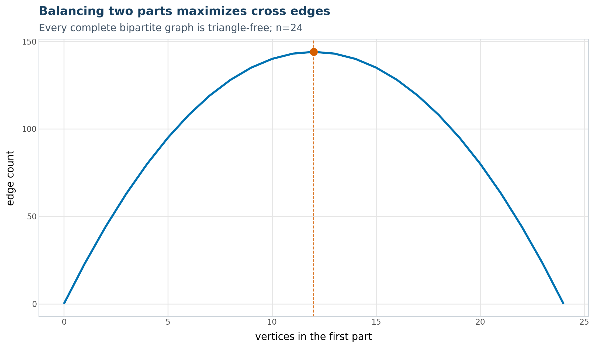

# Extremal combinatorics {#sec-comb-extremal}

Extremal questions ask how large a finite structure can be while avoiding a
forbidden pattern. The answer is often a sharp threshold: one additional edge
or set forces the pattern to appear.

## Preparation from this book

Use double counting from Chapter 3 and graph language from Chapter 11.

## Turán's problem

Among graphs containing no triangle, the largest edge count is achieved by a
complete bipartite graph whose parts are as equal as possible. Symmetrization
can transform any extremal candidate into a multipartite graph without
decreasing edges or creating the forbidden clique. The general Turán theorem
uses an almost balanced complete $(r-1)$-partite graph to avoid $K_r$.

The extremal number records the maximum edge count avoiding a fixed subgraph.
For bipartite forbidden graphs the growth can be subtler than quadratic, and
exact constants may remain difficult. An extremal construction supplies a
lower bound; a proof that every denser object contains the pattern supplies the
matching upper bound.

<figure id="fig-comb-turan">


<figcaption>

Figure 10.1: Balanced multipartite graphs maximize edge density while excluding a prescribed clique.

</figcaption>
</figure>

## Families of sets

Sperner's theorem is extremal: the largest subset family with no containment is
a middle layer of the Boolean lattice. The LYM inequality weights sets by the
reciprocal of their rank size. Shadows map a family to immediate smaller
subsets; compression replaces sets with lexicographically earlier ones while
preserving size and controlling shadows.

Stability theorems say nearly extremal objects resemble an extremal
construction. Supersaturation says exceeding the threshold forces not merely
one forbidden copy but many. These strengthen a single extremal number into a
structural description.

**Nonexample.** A dense construction with no observed triangle is only a lower
bound. It cannot establish optimality without a universal upper-bound argument.

<!-- inline-formula-code:start -->
## Formula and finite computation

The balanced complete bipartite graph gives

$$
\operatorname{ex}(n,K_3)=\left\lfloor\frac{n^2}{4}\right\rfloor.
$$

```python
def complete_bipartite_edges(left: int, right: int) -> int:
    if left < 0 or right < 0:
        raise ValueError("part sizes must be nonnegative")
    return left * right

def best_bipartition_edges(order: int) -> int:
    if order < 0:
        raise ValueError("order must be nonnegative")
    candidates = [complete_bipartite_edges(left, order - left) for left in range(order + 1)]
    optimum = max(candidates, default=0)
    if optimum != order * order // 4:
        raise RuntimeError("bipartition optimization check failed")
    return optimum

print([best_bipartition_edges(order) for order in range(2, 11)])
```

**What the computation establishes.** It optimizes within complete bipartite
graphs for small orders and verifies the floor expression. It does not prove
that every triangle-free graph is bounded by this construction; that is the
content of Mantel's theorem.
<!-- inline-formula-code:end -->

## Proof strategies

Common strategies delete a low-degree vertex and induct, average over local
configurations, symmetrize nonadjacent vertices, or assign weights to maximal
chains. Each method needs an equality analysis to identify all extremizers,
not just the maximum value.

## Hypergraphs and limits

Replacing edges by fixed-size vertex subsets creates hypergraph extremal
problems. Many graph arguments no longer transfer: pairwise neighborhoods and
simple symmetrization can lose essential intersection data. Flag algebras and
graph limits convert large finite density constraints into analytic or
semidefinite problems, often producing rigorous numerical bounds. A computer-
assisted bound still needs a reproducible certificate linking finite
optimization to the universal extremal statement.

## A construction is only half a theorem

**Definition 10.1 (Extremal number).** For a fixed simple graph $H$, let $\operatorname{ex}(n,H)$ be the greatest number of edges in a simple graph on $n$ vertices containing no subgraph isomorphic to $H$. Subgraph here does not mean induced subgraph: extra edges among the selected vertices are permitted.

A construction proves $\operatorname{ex}(n,H)\ge m$ by exhibiting an $H$-free graph with $m$ edges. The reverse inequality must cover every $H$-free graph. These are logically different tasks, and equality requires both. A complete bipartite graph with part sizes $a,b$ has $ab$ edges and contains no triangle because every three vertices include two in the same part. This gives a lower bound without assuming that all triangle-free graphs are bipartite; a five-cycle is an immediate counterexample to that assumption.

**Worked example 10.2 (Balancing a bipartition).** For nine vertices the complete bipartite graph with parts four and five has twenty edges. The choices three and six give eighteen, while two and seven give fourteen. In general,
\[
a(n-a)=\frac{n^2}{4}-\left(a-\frac n2\right)^2.
\]
The maximum over integer $a$ is therefore $\lfloor n^2/4\rfloor$. This optimizes the stated construction family. A separate theorem is needed to show that a nonbipartite triangle-free graph cannot do better.

**Theorem 10.3 (Mantel).** Every triangle-free simple graph on $n$ vertices has at most $\lfloor n^2/4\rfloor$ edges. Equality is attained by, and only by, complete bipartite graphs with parts differing in size by at most one, including the trivial cases $n=0,1$.

*Proof.* For an edge $uv$, the neighborhoods $N(u)$ and $N(v)$ are disjoint, since a common neighbor would make a triangle. Hence $d(u)+d(v)\le n$. Induct on $n$, with $n=0,1$ immediate. If there are no edges the upper bound holds. Otherwise delete endpoints of an edge. At most $d(u)+d(v)-1\le n-1$ edges disappear, and the remaining graph is triangle free. Induction gives
\[
e(G)\le\left\lfloor\frac{(n-2)^2}{4}\right\rfloor+n-1
=\left\lfloor\frac{n^2}{4}\right\rfloor.
\]
Balanced complete bipartite graphs attain this number.

For equality with $n\ge2$, the graph has an edge, and equality in the displayed estimates forces $d(u)+d(v)=n$. Thus its two disjoint neighborhoods cover all vertices. Each neighborhood is independent, again by triangle-freeness, so the graph is bipartite with these two parts. Its edge count is at most their size product, which is at most $\lfloor n^2/4\rfloor$. Equality forces all cross edges to be present and the sizes to be balanced. The graphs on zero or one vertex also have the asserted form. ∎

There is a useful noninductive degree-sum version of the upper bound. Summing $d(u)+d(v)\le n$ over all edges gives $\sum_vd(v)^2\le ne(G)$. The inequality $(\sum_vd(v))^2\le n\sum_vd(v)^2$, obtained by expanding the sum of squared deviations from the mean, then gives $e(G)\le n^2/4$. Since the edge count is integral, the floor follows. The inductive argument above additionally handles equality uniformly for odd and even orders.

## The general clique theorem

**Definition 10.4 (Turán graph).** For integers $r\ge1$ and $n\ge0$, the graph $T_r(n)$ is complete $r$-partite with part sizes differing by at most one; empty parts are permitted. Write $t_r(n)$ for its edge count. If $n=qr+s$ with $0\le s<r$, the part sizes are $q+1$ repeated $s$ times and $q$ repeated $r-s$ times.

**Theorem 10.5 (Turán).** For $r\ge1$, every $K_{r+1}$-free simple graph on $n$ vertices has at most $t_r(n)$ edges. Thus
\[
\operatorname{ex}(n,K_{r+1})=t_r(n).
\]

*Proof.* Among the finitely many $K_{r+1}$-free graphs of order $n$, choose one maximizing edges, and among those choose one maximizing $\sum_vd(v)^2$. If nonadjacent vertices $u,v$ have unequal degrees, replace the neighbors of the smaller-degree vertex by exactly the neighbors of the larger-degree vertex. This cloning creates no forbidden clique: a clique using the changed vertex can replace it by its nonadjacent twin in the old graph. The number of edges increases, contradicting maximality. Thus nonadjacent vertices have equal degrees.

Suppose now nonadjacent $u,v$ have equal degree but different neighborhoods. Put $A=N(u)\setminus N(v)$ and $B=N(v)\setminus N(u)$. Cloning $u$ to $v$ preserves the edge count. The degrees of vertices in $A$ decrease by one, and those in $B$ increase by one; the degrees of $u,v$ stay equal to their old values. Consequently the change in the sum of squared degrees is
\[
2\left(\sum_{x\in B}d(x)-\sum_{x\in A}d(x)\right)+|A|+|B|.
\]
Cloning in the opposite direction reverses the first term and retains the second. The two changes sum to $2(|A|+|B|)>0$, so at least one is positive. This contradicts the secondary maximality. Therefore nonadjacent vertices have identical neighborhoods.

The relation “equal or nonadjacent” is now an equivalence relation. To check transitivity, if distinct $u,v,w$ satisfy $u\nsim v$ and $v\nsim w$, then $N(u)=N(v)$; adjacency of $u,w$ would force adjacency of $v,w$, a contradiction. Each equivalence class is independent, and different classes have all cross edges. The extremal graph is complete multipartite, with at most $r$ nonempty parts because choosing one vertex from each part gives a clique.

For part sizes $a_1,\ldots,a_r$, allowing zeros, the edge count is
$\frac12(n^2-\sum_i a_i^2)$. If $a_i\ge a_j+2$, moving one vertex from the larger part to the smaller reduces the square sum by $2(a_i-a_j-1)>0$. Iterating leaves all sizes differing by at most one and cannot reduce the edge count. Hence the maximum is $t_r(n)$. Finally $T_r(n)$ has no $(r+1)$-clique because a clique uses at most one vertex from each part, so the bound is attained. ∎

**Worked example 10.6 (Forbidding a four-clique).** For $n=10$, $T_3(10)$ has parts $4,3,3$. Its edges number $4\cdot3+4\cdot3+3\cdot3=33$. The theorem says that thirty-four edges force a $K_4$, whereas thirty-three need not. This statement is about containing four mutually adjacent vertices; it does not forbid other four-vertex subgraphs. The parameter is easy to shift incorrectly: three parts avoid $K_4$, while two parts avoid $K_3$.

## Antichains through random chains

**Theorem 10.7 (LYM inequality).** If $\mathcal A$ is an antichain of subsets of $[n]=\{1,\ldots,n\}$, then
\[
\sum_{A\in\mathcal A}\frac1{\binom n{|A|}}\le1.
\]

*Proof.* Each permutation $(x_1,\ldots,x_n)$ determines the chain of its initial sets, including the empty set and $[n]$. A chain meets an antichain in at most one member. A fixed $k$-set occurs as an initial set in exactly $k!(n-k)!$ permutations: arrange its entries first and all other entries last. Counting pairs consisting of a permutation and an antichain member on its chain gives
$\sum_{A\in\mathcal A}|A|!(n-|A|)!\le n!$. Divide by $n!$. The same argument works for $n=0$, where there is one empty permutation. ∎

**Theorem 10.8 (Sperner).** An antichain of subsets of $[n]$ has size at most $\binom n{\lfloor n/2\rfloor}$, and a middle layer attains the bound.

*Proof.* The ratio $\binom n{k+1}/\binom nk=(n-k)/(k+1)$ shows that the largest binomial coefficient is a middle one; symmetry handles the two equal middle coefficients when $n$ is odd. Let this maximum be $M$. Every summand of the LYM inequality is at least $1/M$, so $|\mathcal A|/M\le1$. All subsets of size $\lfloor n/2\rfloor$ form an antichain, since strict containment increases size, and there are $M$ of them. ∎

**Worked example 10.9 (Different-sized forbidden choices).** On a six-element ground set, all three-element subsets form an antichain of size twenty. If an antichain instead includes six two-element sets, their LYM contribution is $6/15=2/5$. Any three-element members each consume another $1/20$, so there can be at most twelve such members. This is an upper bound from the inequality, not an existence claim: containment restrictions may reduce the achievable number further. The weighted inequality can therefore convey more information than Sperner's total-size bound.

## Intersecting uniform families

**Definition 10.10 (Intersecting family).** A family $\mathcal F$ of $k$-element subsets is intersecting if any two distinct members have nonempty intersection. A star consists of all $k$-sets containing a fixed element. For $1\le k\le n$ its size is $\binom{n-1}{k-1}$.

**Lemma 10.11 (Katona's circle bound).** Arrange $n\ge2k$, $k\ge1$, distinct elements cyclically. An intersecting family of intervals of length $k$ contains at most $k$ intervals.

*Proof.* If the family is empty there is nothing to prove. Rotate the position names so that a chosen interval ends at position $n$ and occupies $n-k+1,\ldots,n$. An interval ending at $j$ with $k\le j\le n-k$ is disjoint from it, so cannot be selected. The remaining possible endpoints, other than $n$, are $1,\ldots,k-1$ and $n-k+1,\ldots,n-1$.

For each $i=1,\ldots,k-1$, pair the interval ending at $i$ with the interval ending at $n-k+i$. The first wraps around and occupies $n-k+i+1,\ldots,n,1,\ldots,i$. The second occupies $n-2k+i+1,\ldots,n-k+i$. These are disjoint because $n\ge2k$, so the family contains at most one from each pair. Together with the chosen interval, this gives at most $1+(k-1)=k$. The case $k=1$ has no pairs and is included. ∎

**Theorem 10.12 (Erdős–Ko–Rado).** If $n\ge2k$ and $k\ge1$, an intersecting family $\mathcal F\subseteq\binom{[n]}k$ satisfies
\[
|\mathcal F|\le\binom{n-1}{k-1}.
\]
A star attains the bound.

*Proof.* Use all $n!$ permutations as arrangements in fixed cyclic positions. The circle lemma bounds the number of family members occurring as intervals in each arrangement by $k$. For a fixed $k$-set and a fixed cyclic starting position, exactly $k!(n-k)!$ permutations place that set in the interval. There are $n$ starting positions, and a proper nonempty interval has a unique starting position, so each set contributes $n k!(n-k)!$ arrangements. Double counting gives
$|\mathcal F|n k!(n-k)!\le k n!$, which rearranges to the stated bound. All members of a star meet in its center, and choosing its other $k-1$ elements gives the claimed size. ∎

The restriction $n\ge2k$ is essential. If $n<2k$, every two $k$-sets intersect, so the entire layer is intersecting and usually exceeds a star. At $n=2k$, maximum families need not be stars: selecting exactly one member from each complementary pair gives an intersecting family of half the layer. The theorem proves the maximum value in the stated range without asserting an equality classification that would require further hypotheses.

## Summary

Extremal combinatorics pairs constructions with universal bounds. Turán-type
graphs, antichains, compression, stability, and supersaturation reveal both
the threshold and the structure near it.

## Exercises

<div class="exercise" id="comb-extremal-combinatorics-ex-1">

### Exercise 10.1

1. Maximize $a(n-a)$ over integers.

Assume $0\le a\le n$.

<details><summary>Hint 1</summary>

Complete the square.

</details>
<details><summary>Hint 2</summary>

Choose integers nearest $n/2$.

</details>
<details><summary>Solution</summary>

For Exercise 1, write $a(n-a)=n^2/4-(a-n/2)^2$. The integer maximum occurs at the nearest integers to $n/2$ and equals the displayed floor. If $n$ is even the unique part size is $n/2$; if it is odd the two maximizing choices exchange the part names.

</details>

</div>

<div class="exercise" id="comb-extremal-combinatorics-ex-2">

### Exercise 10.2

2. Prove Mantel's upper bound by degree sums.

<details><summary>Hint 1</summary>

For each edge, its endpoint neighborhoods are disjoint.

</details>
<details><summary>Hint 2</summary>

Sum $d(u)+d(v)\le n$ over edges, then bound the sum of squared degrees below.

</details>
<details><summary>Solution</summary>

Writing $m=e(G)$ gives $\sum_vd(v)^2\le nm$. The squared-deviation inequality gives $\sum_vd(v)^2\ge(2m)^2/n$ for $n>0$. If $m>0$, division yields $m\le n^2/4$; if $m=0$ the bound is immediate. Taking the integer floor proves the assertion, and $n=0$ is handled separately.

</details>

</div>

<div class="exercise" id="comb-extremal-combinatorics-ex-3">

### Exercise 10.3

3. Identify equality cases.

Use Mantel's theorem.

<details><summary>Hint 1</summary>

Use the proof deleting the endpoints of an edge.

</details>
<details><summary>Hint 2</summary>

Equality forces their two neighborhoods to cover all vertices.

</details>
<details><summary>Solution</summary>

For $n\ge2$, an extremal graph has an edge $uv$. Equality in the deletion proof forces $d(u)+d(v)=n$. The neighborhoods are disjoint independent sets covering all vertices. Thus the graph is bipartite, and equality in $e(G)\le|N(u)||N(v)|\le\lfloor n^2/4\rfloor$ forces all cross edges and balanced parts. The cases zero and one are the corresponding trivial complete bipartite graphs.

</details>

</div>

<div class="exercise" id="comb-extremal-combinatorics-ex-4">

### Exercise 10.4

4. Construct a large $K_r$-free graph.

Assume $r\ge2$.

<details><summary>Hint 1</summary>

A clique can use at most one vertex from each independent part.

</details>
<details><summary>Hint 2</summary>

Balance $r-1$ parts.

</details>
<details><summary>Solution</summary>

Take $T_{r-1}(n)$. Any $r$ vertices contain two in the same part, so cannot form a clique. Its edge count is $\frac12(n^2-\sum_i a_i^2)$ for balanced sizes $a_i$. Turán's theorem proves that this construction is optimal, rather than merely a large example.

</details>

</div>

<div class="exercise" id="comb-extremal-combinatorics-ex-5">

### Exercise 10.5

5. Interpret Sperner's theorem as extremal.

<details><summary>Hint 1</summary>

Specify the forbidden pattern in a family of subsets.

</details>
<details><summary>Hint 2</summary>

Separate the middle-layer construction from the universal bound.

</details>
<details><summary>Solution</summary>

The forbidden pattern is a distinct pair $A\subset B$. A middle layer avoids it and supplies $\binom n{\lfloor n/2\rfloor}$ members. The LYM argument proves that every family avoiding it has at most that many members. These matching construction and universal-bound statements establish the exact extremal value.

</details>

</div>

<div class="exercise" id="comb-extremal-combinatorics-ex-6">

### Exercise 10.6

6. Distinguish stability from exact extremality.

<details><summary>Hint 1</summary>

One statement concerns the maximum value; the other concerns near-maximizers.

</details>
<details><summary>Hint 2</summary>

Describe how a distance from a complete bipartite graph could be measured.

</details>
<details><summary>Solution</summary>

Exact extremality determines the greatest permitted edge count and examples attaining it. Stability asks whether graphs whose counts are close to that value can be changed into an extremal construction by few edge additions or deletions. The latter requires a quantified relation between the edge deficit and the allowed changes. The maximum-value theorem alone does not establish that relation.

</details>

</div>

<div class="exercise" id="comb-extremal-combinatorics-ex-7">

### Exercise 10.7

Compute $t_4(11)$ and state the clique forced by one additional edge.

<details><summary>Hint 1</summary>

Distribute eleven vertices as evenly as possible among four parts.

</details>
<details><summary>Hint 2</summary>

Subtract within-part pairs from all vertex pairs.

</details>
<details><summary>Solution</summary>

The sizes are $3,3,3,2$. There are $\binom{11}{2}=55$ pairs, and the forbidden within-part pairs number $3+3+3+1=10$. Thus $t_4(11)=45$. Turán's theorem forces a $K_5$ in every eleven-vertex graph with forty-six edges.

</details>

</div>

<div class="exercise" id="comb-extremal-combinatorics-ex-8">

### Exercise 10.8

Find the maximum size of an intersecting family of three-element subsets of $[8]$.

<details><summary>Hint 1</summary>

Check the range required by Erdős–Ko–Rado.

</details>
<details><summary>Hint 2</summary>

Count the triples containing a specified element.

</details>
<details><summary>Solution</summary>

Since $8\ge2\cdot3$, the theorem gives maximum $\binom72=21$. The family of all triples containing one attains it: choose the remaining two entries from the other seven. This verifies both the hypothesis and the construction, so twenty-one is an exact answer.

</details>

</div>

<div class="exercise" id="comb-extremal-combinatorics-ex-9">

### Exercise 10.9

Show that the hypothesis $n\ge2k$ cannot simply be removed from Erdős–Ko–Rado.

<details><summary>Hint 1</summary>

Take $n=5$ and $k=3$.

</details>
<details><summary>Hint 2</summary>

Two disjoint triples would require six elements.

</details>
<details><summary>Solution</summary>

Every two triples of $[5]$ intersect, so all $\binom53=10$ triples form an intersecting family. A star has only $\binom42=6$ triples. Thus the star bound would be false outside its stated range, even in a small finite example.

</details>

</div>

<div class="exercise" id="comb-extremal-combinatorics-ex-10">

### Exercise 10.10

For $n=2k$, construct a maximum intersecting family by choosing one set from each complementary pair.

<details><summary>Hint 1</summary>

Two $k$-sets are disjoint exactly when they are complementary.

</details>
<details><summary>Hint 2</summary>

Count pairs, noting that no nonempty subset equals its complement.

</details>
<details><summary>Solution</summary>

Complementation partitions the $k$-sets into pairs $\{A,[2k]\setminus A\}$. Choose one member from each pair. No two chosen sets are complementary, so none are disjoint; the family is intersecting. Its size is $\frac12\binom{2k}{k}=\binom{2k-1}{k-1}$, meeting the theorem's bound. Different choices show why maximum size does not by itself force a common center at this boundary.

</details>

</div>

### Selected solution

For Exercise 1, write $a(n-a)=n^2/4-(a-n/2)^2$. The integer maximum occurs at
the nearest integers to $n/2$ and equals the displayed floor.

## Summary {#comb-extremal-combinatorics-summary}

Extremal combinatorics pairs constructions with universal bounds. Turán-type
graphs, antichains, compression, stability, and supersaturation reveal both
the threshold and the structure near it. The complete proofs here establish
Mantel and Turán for graphs, LYM and Sperner for containment-free families,
and Erdős–Ko–Rado for intersecting uniform families. Ramsey theory next changes
the question: instead of forbidding one pattern, it asks how large a structure
can remain while avoiding that pattern in every color.
