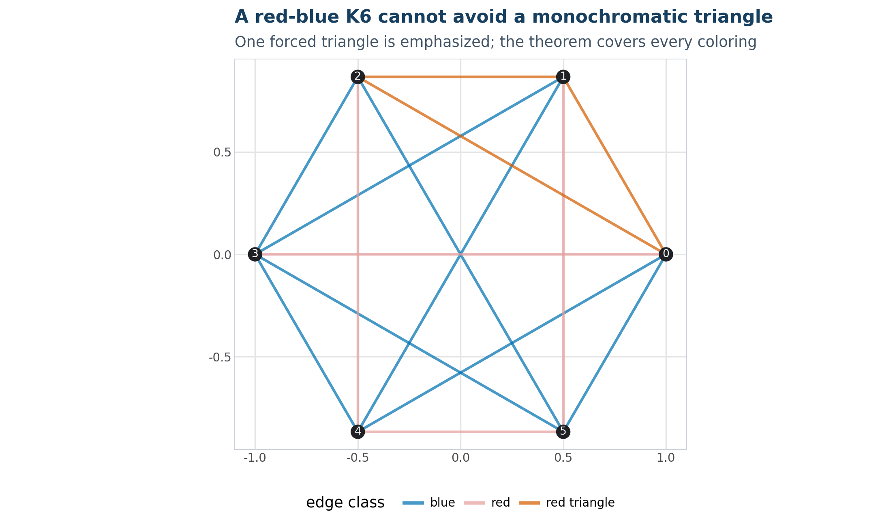

# Ramsey theory {#sec-comb-ramsey}

Ramsey theory says sufficiently large disorder contains prescribed order.
Every red–blue coloring of the edges of a large enough complete graph has a
monochromatic clique, although the required size can be enormous.

## Preparation from this book

Chapter 2 supplies binomial coefficients; Chapters 11 and 16 supply complete
graphs and forbidden configurations.

## The neighborhood split

Fix a vertex in a two-colored complete graph. Enough incident edges share a
color by pigeonhole. Within that same-color neighborhood, either an edge of the
same color completes a clique through the fixed vertex, or the opposite-color
edges contain the desired alternative. This gives the standard recursive upper
bound for two-parameter Ramsey numbers.

Boundary values encode that a one-vertex clique is unavoidable. Symmetry
exchanges colors. The diagonal Ramsey number grows exponentially within known
bounds, and exact values are known only for small cases.

<figure id="fig-comb-ramsey">


<figcaption>

Figure 11.1: Every red-blue coloring of six complete-graph vertices contains a monochromatic triangle.

</figcaption>
</figure>

## Infinite and structural forms

The infinite Ramsey theorem states that every finite coloring of fixed-size
subsets of an infinite set has an infinite monochromatic subset. Compactness
can recover finite statements from infinite ones, but quantitative bounds may
be terrible. Van der Waerden's theorem forces monochromatic arithmetic
progressions; Hales–Jewett treats combinatorial lines in high-dimensional
words.

Canonical Ramsey theory allows several unavoidable structured color patterns
rather than demanding one color. These results show that “order” depends on
the equivalence notion and configuration being sought.

**Nonexample.** Ramsey's theorem does not say a typical large coloring is
visually uniform, nor does it provide a practical method for exact Ramsey
numbers. Existence, bounds, and algorithms are separate questions.

<!-- inline-formula-code:start -->
## Formula and finite computation

For $s,t\ge2$,

$$
R(s,t)\le R(s-1,t)+R(s,t-1).
$$

```python
from functools import lru_cache

@lru_cache(maxsize=None)
def ramsey_recursive_bound(red_size: int, blue_size: int) -> int:
    if red_size < 1 or blue_size < 1:
        raise ValueError("clique sizes must be positive")
    if red_size == 1 or blue_size == 1:
        return 1
    return ramsey_recursive_bound(red_size - 1, blue_size) + ramsey_recursive_bound(red_size, blue_size - 1)

if ramsey_recursive_bound(3, 3) != 6:
    raise RuntimeError("Ramsey recurrence boundary check failed")
print([ramsey_recursive_bound(size, size) for size in range(2, 7)])
```

**What the computation establishes.** The recurrence yields valid recursive
upper bounds and the sharp value in the $(3,3)$ case. It does not show later
bounds are exact or construct extremal colorings for the lower bounds.
<!-- inline-formula-code:end -->

## Lower bounds

To prove $R(s,t)>n$, exhibit a coloring of $K_n$ with neither forbidden clique.
Explicit constructions work for small cases; random coloring gives powerful
general lower bounds by showing the expected number of monochromatic cliques
can be less than one. Chapter 18 develops this proof method.

## Computation and exact values

Exact searches encode each edge color as a Boolean choice and prune partial
colorings when a forbidden clique appears. Symmetry breaking fixes equivalent
initial choices; satisfiability solvers can return a coloring witness or an
unsatisfiability certificate. The latter is trustworthy only with a checkable
proof trace and a complete encoding. Heuristic failure, even after extensive
search, is not an upper bound on a Ramsey number.

## What a Ramsey number asserts

**Definition 11.1 (Two-colour Ramsey number).** For positive integers $s,t$, $R(s,t)$ is the least positive integer $N$ such that every colouring of the edges of $K_N$ red or blue contains either a red $K_s$ or a blue $K_t$, provided such an integer exists. A one-vertex clique requires no edges, so it qualifies in either color.

The graph is complete before colouring: every distinct pair receives exactly one color. A monochromatic clique need not be isolated from the rest of the graph, and the surrounding edges may have arbitrary colors. The quantifier “every colouring” is what makes an upper bound difficult. For a lower bound it is enough to produce one exceptional colouring.

Colour exchange gives $R(s,t)=R(t,s)$. Boundary values are $R(1,t)=R(s,1)=1$, and $R(2,t)=t$: either some edge is red or every edge is blue, while the all-blue colouring on $t-1$ vertices avoids both alternatives. These elementary cases make the recursion below an actual finite bound rather than a circular statement.

**Theorem 11.2 (Neighbourhood recursion).** For integers $s,t\ge2$,
\[
R(s,t)\le R(s-1,t)+R(s,t-1).
\]
In particular all two-colour Ramsey numbers exist.

*Proof.* Induct on $s+t$, starting with the boundary cases just given, so that the quantities on the right already exist. Put $a=R(s-1,t)$, $b=R(s,t-1)$ and color $K_{a+b}$. Fix a vertex $v$. Its $a+b-1$ neighbours cannot include fewer than $a$ red neighbours and fewer than $b$ blue neighbours, because those two inequalities would allow at most $a+b-2$ neighbours.

If at least $a$ are red neighbours, the definition of $a$ gives either a red $K_{s-1}$ among them, which extends through $v$ to a red $K_s$, or a blue $K_t$. If at least $b$ are blue neighbours, the analogous argument gives a red $K_s$ or a blue $K_t$ through $v$. Thus every colouring has a required clique, proving the bound and completing the induction. ∎

**Corollary 11.3 (A binomial upper bound).** For positive $s,t$,
\[
R(s,t)\le\binom{s+t-2}{s-1}.
\]

*Proof.* The formula equals one when either parameter is one. For larger parameters substitute the inductive bounds into the recursion and apply Pascal's identity:
$\binom{s+t-3}{s-2}+\binom{s+t-3}{s-1}=\binom{s+t-2}{s-1}$. Induction proves the assertion. ∎

**Worked example 11.4 (A bound is a certificate of existence).** Applying the formula to $(s,t)=(3,4)$ gives $R(3,4)\le\binom52=10$. The recursive computation above produces this same bound from its boundary values. It does not produce a colouring on nine vertices, so it cannot by itself establish equality. A smaller universal argument could improve the bound, and a separate exceptional colouring is needed for a matching lower bound. Keeping these two directions separate is as important here as in extremal enumeration.

## The first exact triangle result

**Theorem 11.5.** The triangle Ramsey number is $R(3,3)=6$.

*Proof.* In any red–blue colouring of $K_6$, choose a vertex $v$. Among its five incident edges, at least three have one color; interchange color names if necessary and call that color red. Let their other endpoints be $a,b,c$. If any edge among $a,b,c$ is red, it forms a red triangle with $v$. If none is red, all three are blue and $a,b,c$ form a blue triangle. Therefore $R(3,3)\le6$.

For the reverse bound, put five vertices around a cycle, color the five cycle edges red, and color the other five edges blue. The red graph is a five-cycle, which contains no triangle. The complementary blue graph is also a five-cycle: naming vertices modulo five, its edges connect differences of two rather than one, and the order $0,2,4,1,3,0$ displays that cycle. Hence neither color has a triangle, proving $R(3,3)>5$. Together the inequalities give equality. ∎

**Worked example 11.6 (Following the forcing argument).** Suppose $v$ has red edges to $a,b,c$ and blue edges to its other two neighbours. It is unnecessary to inspect the entire fifteen-edge colouring. First inspect $ab,ac,bc$. A red edge among them supplies the required triangle immediately; if all are blue they supply the opposite triangle. This is a short exhaustive argument because the alternatives are “at least one red” and “none red”. It is not a random search through a convenient subset of colourings.

The six-vertex conclusion includes unbalanced colourings, such as one red edge and fourteen blue edges, just as fully as apparently mixed ones. Nor does it say every vertex belongs to a monochromatic triangle of every color. The proof finds one suitable local configuration somewhere in every colouring; stronger distributional statements need additional arguments.

## Order hidden in a sequence

Ramsey reasoning also appears when there are no visible colored graphs. A sequence can encode many pairwise comparisons. The next theorem has a much better quantitative bound than a generic application of clique Ramsey theory because it uses the transitivity of numerical order.

**Theorem 11.7 (Erdős–Szekeres monotone subsequence bound).** Let $r,s\ge1$ be integers. Every sequence of $rs+1$ distinct real numbers contains an increasing subsequence of length $r+1$ or a decreasing subsequence of length $s+1$. Here a subsequence preserves original positions, but its terms need not be consecutive.

*Proof.* For the term in position $i$, let $I_i$ and $D_i$ be the lengths of longest increasing and decreasing subsequences ending at that term. Such longest lengths exist because the prefix is finite. If neither conclusion holds, then $1\le I_i\le r$ and $1\le D_i\le s$, so there are only $rs$ possible pairs $(I_i,D_i)$.

The pairs for distinct positions cannot coincide. If $i<j$ and the $i$th value is smaller, append the $j$th value to a longest increasing subsequence ending at $i$; this gives $I_j\ge I_i+1$. If it is larger, the same argument for decreasing subsequences gives $D_j\ge D_i+1$. Distinctness of the values ensures that one of these cases applies. Thus $rs+1$ positions require $rs+1$ distinct pairs in a set of size $rs$, a contradiction. ∎

The theorem is often written with target lengths $a,b\ge2$ and sequence length $(a-1)(b-1)+1$. These are the same parameters after setting $r=a-1$, $s=b-1$. A nondecreasing version allows repeated values if the opposite alternative remains strictly decreasing, but changing both alternatives to strict while retaining repeated entries would make the statement false: a constant sequence has neither strict pattern of length two.

**Worked example 11.8 (Tracking the labels).** For the sequence $3,1,4,2,5$, the increasing-ending lengths are $1,1,2,2,3$, and the decreasing-ending lengths are $1,2,1,2,1$. The last entry has increasing label three, witnessed by $1,2,5$ or $3,4,5$. With $r=s=2$, the theorem predicts a monotone subsequence of length three among any five distinct values. The labels show not merely that a pattern exists but how to recover it: retain a predecessor each time a longest-ending length is improved.

**Proposition 11.9 (Sharpness).** There is a sequence of $rs$ distinct numbers with no increasing subsequence of length $r+1$ and no decreasing subsequence of length $s+1$.

*Proof.* Write $r$ consecutive blocks of $s$ integers, decreasing inside each block and with every value in a later block larger than every value in an earlier block:
\[
s,s-1,\ldots,1;\quad 2s,2s-1,\ldots,s+1;\quad\ldots.
\]
An increasing subsequence uses at most one entry from each decreasing block, so has length at most $r$. A decreasing subsequence cannot cross from an earlier block to a later one, so lies inside a single block and has length at most $s$. ∎

This bound can also be viewed through posets. Put $i\prec j$ when $i<j$ and the $i$th value is smaller than the $j$th. Chains correspond to increasing subsequences; antichains, listed by position, correspond to decreasing subsequences. The inequality $|P|\le h(P)w(P)$ from the poset chapter therefore gives the same contradiction. The direct label proof makes all the required comparisons explicit.

## Infinite homogeneity and finite consequences

**Theorem 11.10 (Infinite Ramsey theorem).** For any integers $k\ge1$ and $c\ge1$, every colouring of the $k$-element subsets of the positive integers with $c$ colors has an infinite subset whose $k$-subsets all have the same color.

*Proof.* Induct on $k$. For $k=1$, at least one color class is infinite, since a finite union of finite sets is finite. Suppose the result holds for $k-1$, where $k\ge2$. Build distinct increasing integers $x_1,x_2,\ldots$ and nested infinite reservoirs $S_1\supseteq S_2\supseteq\cdots$, with every element of $S_i$ greater than $x_i$. At stage $i$, take $x_i$ to be the smallest element of the preceding reservoir (start with all positive integers). Colour each $(k-1)$-subset $B$ of the remaining reservoir by the color of $\{x_i\}\cup B$. The inductive hypothesis supplies an infinite homogeneous reservoir $S_i$ and a color $d_i$.

Some color $d$ occurs for infinitely many indices $i$, by the $k=1$ case. Retain exactly the corresponding $x_i$. In any $k$-subset of the retained sequence, let $x_i$ be its first element. All later elements belong to $S_i$ by nestedness, so the subset has color $d_i=d$. The retained infinite set is therefore homogeneous. ∎

The proof produces nested infinite subsets, not a useful finite numerical bound. It also does not claim that the whole original colouring eventually becomes constant. Homogeneity is found on a subsequence selected from it.

**Proposition 11.11 (Finite subset version).** For fixed positive integers $k,c,m$, there is an $N$ such that every $c$-colouring of the $k$-subsets of $[N]$ has a homogeneous $m$-subset.

*Proof.* If not, there are avoiding colourings for arbitrarily large $N$. Restrict them to initial intervals, obtaining a tree whose level $N$ consists of avoiding colourings on $[N]$, with restriction as parent. Every level is finite and some node has descendants at arbitrarily large levels. From such a node choose a child with the same property; one exists because there are finitely many children. Repetition constructs a compatible infinite branch. Its union colors all $k$-subsets of the positive integers while avoiding a homogeneous $m$-subset. The infinite theorem gives an infinite homogeneous set, hence such an $m$-subset, a contradiction. ∎

Van der Waerden's arithmetic-progression theorem and Hales–Jewett's theorem about combinatorial lines are further structural results, rather than consequences proved by the short recursion here. Their configurations and hypotheses differ. Canonical variants likewise permit a specified family of structured color patterns. These outlooks broaden the subject, while the proved finite and infinite statements above supply its present foundation.

## Summary

Ramsey theory finds inevitable homogeneous substructures through pigeonhole,
recursion, compactness, and random lower bounds. Its guarantees are universal,
but quantitative sharpness remains difficult.

## Exercises

<div class="exercise" id="comb-ramsey-theory-ex-1">

### Exercise 11.1

1. Prove $R(3,3)\le6$ by the neighborhood split.

<details><summary>Hint 1</summary>

Inspect the five edges incident to one vertex.

</details>
<details><summary>Hint 2</summary>

Three share a color; inspect the edges among their other endpoints.

</details>
<details><summary>Solution</summary>

At least three incident edges share a color, say red. If a red edge joins two of their endpoints, those endpoints and the chosen vertex make a red triangle. Otherwise all three edges among the endpoints are blue, making a blue triangle. Every colouring falls into one case, so six vertices suffice.

</details>

</div>

<div class="exercise" id="comb-ramsey-theory-ex-2">

### Exercise 11.2

2. Color $K_5$ without a monochromatic triangle.

<details><summary>Hint 1</summary>

Use a cycle for one color.

</details>
<details><summary>Hint 2</summary>

The complement of a five-cycle is another five-cycle.

</details>
<details><summary>Solution</summary>

For Exercise 2, color a five-cycle red and its complementary five-cycle blue.
Neither color class contains a triangle, proving $R(3,3)>5$. Explicitly, label vertices modulo five, make differences $\pm1$ red and differences $\pm2$ blue. Each color graph is a cycle of length five and hence has no three mutually adjacent vertices.

</details>

</div>

<div class="exercise" id="comb-ramsey-theory-ex-3">

### Exercise 11.3

3. Derive the two-parameter recurrence.

<details><summary>Hint 1</summary>

Use $N=R(s-1,t)+R(s,t-1)$ vertices.

</details>
<details><summary>Hint 2</summary>

The red and blue neighbourhoods together have size $N-1$.

</details>
<details><summary>Solution</summary>

Put $a=R(s-1,t)$ and $b=R(s,t-1)$. A vertex has at least $a$ red neighbours or at least $b$ blue neighbours; otherwise its degree is at most $a+b-2$. In the first case a red $(s-1)$-clique extends through it or a blue $t$-clique already exists. The second case is symmetric. Thus $R(s,t)\le a+b$.

</details>

</div>

<div class="exercise" id="comb-ramsey-theory-ex-4">

### Exercise 11.4

4. State the role of boundary values.

<details><summary>Hint 1</summary>

A one-vertex clique has no edges to color.

</details>
<details><summary>Hint 2</summary>

A recurrence needs starting values to supply a finite bound.

</details>
<details><summary>Solution</summary>

The values $R(1,t)=R(s,1)=1$ initiate induction on $s+t$ and make the recursive upper bound computable. They follow because a singleton qualifies vacuously as a monochromatic clique. Without boundary values the recurrence would merely relate unknown quantities and would not establish their existence.

</details>

</div>

<div class="exercise" id="comb-ramsey-theory-ex-5">

### Exercise 11.5

5. Compare finite and infinite conclusions.

<details><summary>Hint 1</summary>

Specify what is homogeneous in each statement.

</details>
<details><summary>Hint 2</summary>

An infinite homogeneous subset is stronger than an arbitrarily large collection of unrelated finite witnesses.

</details>
<details><summary>Solution</summary>

The finite theorem guarantees a homogeneous subset of prescribed finite size once the ambient finite set is sufficiently large. The infinite theorem guarantees one infinite homogeneous subset inside a single colouring of an infinite set. Finite witnesses for each size need not be nested. The compactness argument constructs compatible colourings to relate the two statements, without giving an efficient quantitative bound.

</details>

</div>

<div class="exercise" id="comb-ramsey-theory-ex-6">

### Exercise 11.6

6. Explain why an upper bound need not be exact.

<details><summary>Hint 1</summary>

An upper bound proves that a certain size is sufficient.

</details>
<details><summary>Hint 2</summary>

Exactness also needs a colouring one vertex below the claimed value.

</details>
<details><summary>Solution</summary>

An argument showing that every colouring on $N$ vertices has a required clique establishes only $R(s,t)\le N$. A smaller number could already suffice. To prove equality at $N$, one must additionally exhibit an avoiding colouring on $N-1$ vertices, or otherwise prove the matching lower bound. The recurrence supplies no such witness by itself.

</details>

</div>

<div class="exercise" id="comb-ramsey-theory-ex-7">

### Exercise 11.7

Show that seventeen distinct real numbers contain an increasing or decreasing subsequence of length five, and show that sixteen need not.

<details><summary>Hint 1</summary>

Use $r=s=4$.

</details>
<details><summary>Hint 2</summary>

For sharpness use four decreasing blocks of four.

</details>
<details><summary>Solution</summary>

The theorem gives a length-five alternative from $4\cdot4+1=17$ entries. The sequence $4,3,2,1,8,7,6,5,12,11,10,9,16,15,14,13$ has neither pattern: increasing subsequences use at most one entry per block, and decreasing ones stay in one block. Hence sixteen entries do not suffice.

</details>

</div>

<div class="exercise" id="comb-ramsey-theory-ex-8">

### Exercise 11.8

Explain exactly where distinctness is used in the monotone-subsequence proof, and give a counterexample without it.

<details><summary>Hint 1</summary>

Look at the comparison between values in positions $i<j$.

</details>
<details><summary>Hint 2</summary>

A constant sequence has no strict change in either direction.

</details>
<details><summary>Solution</summary>

Distinctness ensures either the earlier value is smaller or it is larger, so one of the two ending labels strictly increases. Equal values need not increase either label. A constant sequence of arbitrarily large size has no strictly increasing or strictly decreasing subsequence of length two, disproving the unmodified strict statement.

</details>

</div>

<div class="exercise" id="comb-ramsey-theory-ex-9">

### Exercise 11.9

Prove $R(s,t)=R(t,s)$ and $R(2,t)=t$.

<details><summary>Hint 1</summary>

Exchange the color names for symmetry.

</details>
<details><summary>Hint 2</summary>

For the second identity separate the existence and absence of any red edge.

</details>
<details><summary>Solution</summary>

Exchanging red and blue is a bijection on colourings, interchanging the two required clique sizes and proving symmetry. On $t$ vertices either there is a red edge or all edges form a blue $K_t$, giving the upper bound. On $t-1$ vertices the all-blue colouring has neither a red edge nor a blue $K_t$, giving the lower bound for $t\ge2$. For $t=1$ the boundary value is one.

</details>

</div>

<div class="exercise" id="comb-ramsey-theory-ex-10">

### Exercise 11.10

Explain why the infinite proof needs a final infinite pigeonhole step after constructing nested reservoirs.

<details><summary>Hint 1</summary>

Each selected vertex has its own reservoir color.

</details>
<details><summary>Hint 2</summary>

Those colors may vary with the index.

</details>
<details><summary>Solution</summary>

The construction ensures that a $k$-subset whose first selected vertex is $x_i$ has color $d_i$, provided its other vertices lie later in the sequence. It does not ensure that all $d_i$ agree. Since only finitely many colors occur, one color appears for infinitely many indices. Restricting to those indices makes every $k$-subset have that same color, completing the homogeneity argument.

</details>

</div>

### Selected solution

For Exercise 2, color a five-cycle red and its complementary five-cycle blue.
Neither color class contains a triangle, proving $R(3,3)>5$.

## Summary {#comb-ramsey-theory-summary}

Ramsey theory finds inevitable homogeneous substructures through pigeonhole,
recursion, compactness, and random lower bounds. Its guarantees are universal,
but quantitative sharpness remains difficult. The exact triangle case pairs a
six-vertex forcing argument with a five-vertex counterexample. Ending labels
give the sharp Erdős–Szekeres bound, while nested infinite reservoirs establish
infinite homogeneity. The probabilistic method next supplies lower bounds by
proving that some avoiding colouring exists without naming it in advance.
