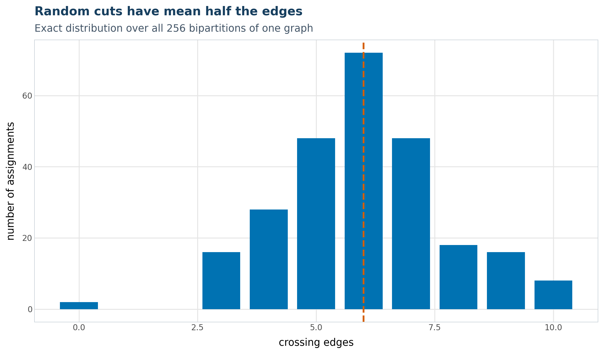

# The probabilistic method {#sec-comb-probabilistic-method}

The probabilistic method proves a deterministic object exists by sampling from
a declared distribution and showing failure is not certain. The random
experiment is a proof device; no physical randomness is required in the final
object.

## Preparation from this book

The primer defines expectation and indicators. Chapter 17 supplies a natural
Ramsey application.

## First moment and alterations

Let $X$ count bad features. If its expectation is below one, some outcome has
none. Even when the expectation is larger, deleting one element from each bad
feature can leave a large valid object; optimize the sampling probability to
balance retained size against repairs.

Linearity of expectation allows dependent indicators. Random cuts illustrate
the point: independently assign each vertex to one of two sides. Every edge
crosses with probability one half, so some cut contains at least half the
edges, regardless of dependence among crossing events.

<figure id="fig-comb-probabilistic-cuts">


<figcaption>

Figure 12.1: A distribution of random cut sizes has its mean at half the edges and guarantees at least one cut reaches that value.

</figcaption>
</figure>

## Beyond expectation

The second moment controls whether a count is positive through its variance.
Concentration inequalities bound deviation of Lipschitz or weakly dependent
statistics. The Lovász local lemma handles many bad events when each has small
probability and limited dependence; algorithmic versions can resample violated
constraints to construct an object.

Random greedy processes update probabilities as constraints accumulate.
Entropy and martingale methods capture information or exposure over time.
Every method depends on a precisely specified sample space; “choose randomly”
is incomplete.

**Nonexample.** A simulation that finds a successful object is a construction,
not the probabilistic proof of a general bound. A simulation that finds none
does not prove nonexistence.

<!-- inline-formula-code:start -->
## Formula and finite computation

For a uniformly random vertex bipartition of a graph with edge set $E$,

$$
\mathbb E[X]=\sum_{e\in E}\Pr(e\text{ crosses})=\frac{|E|}{2}.
$$

```python
from itertools import product

def exact_cut_distribution(order: int, edges: list[tuple[int, int]]) -> list[int]:
    if order < 0:
        raise ValueError("order must be nonnegative")
    normalized_edges: set[tuple[int, int]] = set()
    for left, right in edges:
        if not 0 <= left < order or not 0 <= right < order or left == right:
            raise ValueError("edges must be loopless pairs of known vertices")
        edge = (min(left, right), max(left, right))
        if edge in normalized_edges:
            raise ValueError("repeated edge supplied to a simple graph")
        normalized_edges.add(edge)
    sizes = []
    for side in product((0, 1), repeat=order):
        sizes.append(sum(side[left] != side[right] for left, right in normalized_edges))
    if sum(sizes) / len(sizes) != len(normalized_edges) / 2:
        raise RuntimeError("cut expectation check failed")
    return sizes

cuts = exact_cut_distribution(4, [(0, 1), (1, 2), (2, 3), (3, 0), (0, 2)])
print(max(cuts), sum(cuts) / len(cuts))
```

**What the computation establishes.** Exhaustive assignments verify the mean
and exhibit a large cut in one graph. The universal proof is linearity of
expectation and the per-edge crossing probability, not finite enumeration.
<!-- inline-formula-code:end -->

## Derandomization

Conditional expectation fixes random choices one at a time while never
decreasing the remaining expected objective. Limited-independence sample
spaces and pessimistic estimators can reduce randomness further. Thus an
existence proof may conceal a deterministic algorithm, but efficiency must be
analyzed separately.

<!-- quota-cut-clinic:start -->
## Constructing a cut by conditional means {#sec-comb-quota-cuts}

The finite averages in the [starting toolkit](00i-combinatorics-bridge.md),
the allocation counts in [Chapter 2](02-binomial-multinomial.md), and
[conditional probability](app-a-readiness.md#probability-essentials) turn
an existence argument into a construction. Use the
[simple-graph convention](11-graphs-walks-degrees.md#graph-models) and
[Chapter 5's state discipline](05-recurrences.md#state-design): every
partial assignment must describe exactly its possible completions.

### Start with the original fair choices {#sec-comb-quota-fair}

Let $G=(V,E)$ be a finite simple graph, and let $X$ count crossing edges.
For disjoint vertex sets $A,B$, write $e(A,B)$ for the number of unordered
edges between them, each counted once; $e(A)$ counts internal edges once.
Suppose vertices in $L$ and $R$ have been assigned to the two sides, while
$U$ remains undecided. Under the original independent fair choices,

$$
F_{\mathrm{fair}}
=\mathbb E[X\mid L,R]
=e(L,R)+\frac12\bigl(e(L,U)+e(R,U)+e(U)\bigr).
$$

A completely fixed edge contributes its known crossing indicator.
An edge with one or two undecided endpoints still crosses with probability
one half. The two choices for the next vertex therefore have conditional
means whose average is $F_{\mathrm{fair}}$. Choose a side with mean at least
that average. Continue until every vertex is assigned; the terminal mean
is the actual cut size and is at least the starting conditional mean.
At the empty state $L=R=\varnothing$, that mean is $|E|/2$, so starting
there constructs a cut of at least that size. An imposed partial
assignment preserves its own conditional mean, which can be smaller.

This is the conditional-expectation operation behind the fair-bit
experiment and its two-choice exercise. Computing the conditional means,
rather than merely knowing that one is large, makes the rule usable.
The general weighted averaging principle and this unrestricted-cut
calculation are developed in
[Chan's notes, Sections 1.1–1.2](https://i.cs.hku.hk/~hubert/teaching/c8601_2013/notes2.pdf)
and [Vadhan, Section 3.4](https://people.seas.harvard.edu/~salil/pseudorandomness/pseudorandomness-published-Dec12.pdf).

### Fix the class sizes before choosing {#sec-comb-quota-proof}

Now require the final left side to contain exactly $k$ vertices, with
$0\le k\le n=|V|$. Choose that side uniformly among the $\binom nk$
subsets of size $k$. Equivalently, condition the fair-bit experiment on
exactly $k$ left assignments. Every allowed $k$ gives a positive-probability
event, including $k=0,n$. The earlier figure describes the original
fair-bit distribution; the counts below use this new distribution.

A feasible state is a disjoint partition $V=L\sqcup R\sqcup U$, where

$$
t=|U|,\qquad r=k-|L|,\qquad s=t-r,\qquad 0\le r\le t.
$$

There are $\binom tr$ equally likely completions: choose the $r$ undecided
labels still needed on the left. Conditioning a uniform finite experiment
on a nonempty set retains uniformity. For a particular next vertex $v$,
the left and right completion counts are $\binom{t-1}{r-1}$ and
$\binom{t-1}{r}$ when those branches exist. Hence their probabilities are
$r/t$ and $s/t$. A zero-quota branch is absent; its conditional mean is
undefined, not zero.

For $t\ge2$, the conditional mean is

$$
F=e(L,R)+\frac{s}{t}e(L,U)+\frac{r}{t}e(R,U)
+\frac{2rs}{t(t-1)}e(U).
$$

To prove the formula, partition edges by their endpoint locations.
Edges inside $L$ or $R$ contribute zero; $LR$ edges already cross.
An $LU$ edge crosses when its unknown endpoint goes right, with probability
$s/t$; an $RU$ edge uses probability $r/t$. For an edge with two distinct
unknown endpoints, the two opposite-side placements each have probability
$rs/[t(t-1)]$. This samples without replacement. The factor is
$2rs/[t(t-1)]$, rather than $2(r/t)(s/t)$.

**The construction invariant.** Partition the completion set according to
the next vertex's side. Summing only over legal children $a$ gives

$$
F=\sum_{\text{legal }a}\Pr(a\mid L,R,U)\,F_a.
$$

When both sides are legal, this reads
$F=(r/t)F_L+(s/t)F_R$; when one is forced, its probability is one.
A weighted average of numbers all strictly below $F$ cannot equal $F$.
Choose a maximum legal child mean, breaking ties by a declared rule.
Feasibility persists, $t$ decreases, and the mean never decreases.
At $t=0$ there is one completed cut, whose score equals its mean.

Handle the small states before using any denominator:

- If $t=0$, use $F=e(L,R)$.
- If $t=1$, the last vertex is forced, with $r,s\in\{0,1\}$ and $r+s=1$.
  Use $F=e(L,R)+s\,e(L,U)+r\,e(R,U)$; there is no internal $U$ edge.
- A residual quota of zero allows only the other branch. In particular,
  $k=0,n$ are valid forced constructions.
- Empty and singleton simple graphs have no edges and score zero.
  Every edgeless graph retains mean zero.

Starting with $L=R=\varnothing$ and $n\ge2$, each edge crosses with probability
$2k(n-k)/[n(n-1)]$. The resulting cut therefore satisfies

$$
|\delta(L)|\ge
\left\lceil\frac{2k(n-k)}{n(n-1)}\,|E|\right\rceil,
$$

where $\delta(L)$ is the set of crossing edges. Balanced
$k=\lfloor n/2\rfloor$ gives a factor strictly above one half:
$n/[2(n-1)]$ for even $n$ and $(n+1)/(2n)$ for odd $n$.
That comparison does not hold for arbitrary quotas. The guarantee is a
baseline for a constructed cut, not a claim that the rule always optimizes it.
Scanning edges for each child takes $O(n|E|)$ arithmetic operations, and
assigning vertices adds $O(n)$: total $O(n(|E|+1))$, with constant work for
$n=0$. Exact rational bit cost is a separate consideration.

### A six-vertex investigation {#sec-comb-quota-worked}

On labels $0,\ldots,5$, take a star centered at $0$ and join the leaves
in the path $1$–$2$–$3$–$4$–$5$. Writing $ij$ for the unordered pair
$\{i,j\}$, the nine edges are

$$
E=\{01,02,03,04,05,12,23,34,45\}.
$$

Require three vertices per side, process vertices numerically, and put
ties on the left. Each edge initially crosses with probability $3/5$,
so the starting mean is $27/5$.

Here v is the current vertex; Left and Right give its legal-child conditional completion means.

| v | Left | Right | Side |
|---|---:|---:|---|
| 0 | $27/5$ | $27/5$ | Left |
| 1 | $21/4$ | $11/2$ | Right |
| 2 | $6$ | $5$ | Left |
| 3 | $5$ | $13/2$ | Right |
| 4 | $7$ | $6$ | Left |
| 5 | undefined | $7$ | Right |

After $0$ goes left, the branch probabilities are $2/5$ and $3/5$:

$$
\frac25\frac{21}{4}+\frac35\frac{11}{2}=\frac{27}{5}.
$$

The incorrect equal average is $43/8$. At the next nontrivial unequal
split, vertex $3$ has left/right probabilities $1/3,2/3$.
The maintained means are

$$
27/5,\quad 27/5,\quad 11/2,\quad 6,\quad 13/2,\quad 7,\quad 7.
$$

The result $L=\{0,2,4\}$, $R=\{1,3,5\}$ cuts three star edges and all
four path edges. It is optimal for this instance: every balanced cut
cuts exactly three star edges and at most four path edges.

Check the initial mean independently by supported subsets. If $0$ is
left, choose its two left-side leaf companions. Pairs $12,45$ give score
$4$; $15,23,34$ give $5$; $13,14,25,35$ give $6$; and $24$ gives $7$.
Complements supply the ten cases with $0$ right. Across all twenty
subsets, scores $4,5,6,7$ have multiplicities $4,6,8,2$ and mean
$108/20=27/5$.

### Exact conditional means and a finite trace {#sec-comb-quota-code}

The program uses vertex labels $0,\ldots,n-1$ and two or three
distinguishable color roles $0,1,2$. It accepts exact tuples of simple
edges and nonnegative integer quotas summing to $n$. Integer types are
exact: booleans and integer subclasses are rejected. Its limit is $64$
vertices; that finite contract does not restrict the theorem.

An optional prefix fixes the first numbered vertices' colors.
Then the returned initial mean is conditional on that feasible prefix;
the original baseline applies to an empty prefix. Each step records
only legal colors, their positive probabilities and exact rational
means. The smallest color breaks ties. The program scans edges and
never materializes its completion set.

```python
from fractions import Fraction
from typing import NamedTuple

class QuotaChoice(NamedTuple):
    colour: int
    probability: Fraction
    mean: Fraction

class QuotaStep(NamedTuple):
    vertex: int
    remaining: tuple[int, ...]
    mean: Fraction
    choices: tuple[QuotaChoice, ...]
    chosen: int

class QuotaRun(NamedTuple):
    initial_mean: Fraction
    colouring: tuple[int, ...]
    score: int
    steps: tuple[QuotaStep, ...]

def quota_cut_trace(
    order: int,
    edges: tuple[tuple[int, int], ...],
    quotas: tuple[int, ...],
    prefix: tuple[int, ...] = (),
) -> QuotaRun:
    """Extend a feasible numerical prefix, preserving its conditional baseline.

    Colours are labelled 0, 1, and optionally 2. Vertices are exposed in
    numerical order; equal legal means choose the smallest colour. Each step's
    remaining quotas and mean describe its pre-choice state. Its choices record
    only positive-probability children. The root baseline applies to prefix=().
    """
    if type(order) is not int:
        raise TypeError("order must be an exact integer")
    if not 0 <= order <= 64:
        raise ValueError("order must be between zero and 64")
    if any(type(value) is not tuple for value in (edges, quotas, prefix)):
        raise TypeError("edges, quotas and prefix must be exact tuples")
    if len(quotas) not in (2, 3):
        raise ValueError("supply two or three labelled quotas")
    if any(type(quota) is not int for quota in quotas):
        raise TypeError("quotas must be exact integers")
    if any(not 0 <= quota <= order for quota in quotas):
        raise ValueError("each quota must be between zero and order")
    if sum(quotas) != order:
        raise ValueError("quotas must sum to order")
    if len(edges) > order * (order - 1) // 2:
        raise ValueError("too many edges for a simple graph")

    checked_edges: list[tuple[int, int]] = []
    seen: set[tuple[int, int]] = set()
    for edge in edges:
        if type(edge) is not tuple:
            raise TypeError("each edge must be an exact tuple")
        if len(edge) != 2:
            raise ValueError("each edge must contain two endpoints")
        left, right = edge
        if type(left) is not int or type(right) is not int:
            raise TypeError("endpoints must be exact integers")
        if not 0 <= left < order or not 0 <= right < order:
            raise ValueError("endpoint outside the vertex set")
        if left == right:
            raise ValueError("loops are forbidden")
        normalized = (min(left, right), max(left, right))
        if normalized in seen:
            raise ValueError("duplicate unordered edge")
        seen.add(normalized)
        checked_edges.append(normalized)

    if len(prefix) > order:
        raise ValueError("prefix is longer than the vertex set")
    remaining = list(quotas)
    for colour in prefix:
        if type(colour) is not int:
            raise TypeError("prefix colours must be exact integers")
        if not 0 <= colour < len(quotas):
            raise ValueError("unknown colour")
        remaining[colour] -= 1
        if remaining[colour] < 0:
            raise ValueError("prefix exceeds a quota")

    colours = list(prefix) + [-1] * (order - len(prefix))

    def conditional_mean(
        residual: tuple[int, ...], undecided: int,
    ) -> Fraction:
        fixed = 0
        boundary = [0] * len(quotas)
        unknown_edges = 0
        for left, right in checked_edges:
            left_colour, right_colour = colours[left], colours[right]
            if left_colour == -1 and right_colour == -1:
                unknown_edges += 1
            elif left_colour == -1:
                boundary[right_colour] += 1
            elif right_colour == -1:
                boundary[left_colour] += 1
            elif left_colour != right_colour:
                fixed += 1

        value = Fraction(fixed)
        if undecided == 0:
            return value
        for colour, count in enumerate(boundary):
            value += Fraction(
                count * (undecided - residual[colour]), undecided
            )
        if undecided >= 2:
            denominator = undecided * (undecided - 1)
            different = denominator - sum(
                quota * (quota - 1) for quota in residual
            )
            value += Fraction(unknown_edges * different, denominator)
        return value

    undecided = order - len(prefix)
    current_mean = conditional_mean(tuple(remaining), undecided)
    initial_mean = current_mean
    steps: list[QuotaStep] = []

    for vertex in range(len(prefix), order):
        candidates: list[QuotaChoice] = []
        for colour, quota in enumerate(remaining):
            if quota == 0:
                continue
            colours[vertex] = colour
            child_remaining = tuple(
                count - int(index == colour)
                for index, count in enumerate(remaining)
            )
            child_mean = conditional_mean(child_remaining, undecided - 1)
            candidates.append(
                QuotaChoice(colour, Fraction(quota, undecided), child_mean)
            )
        colours[vertex] = -1

        options = tuple(candidates)
        if not options:
            raise RuntimeError("feasible state has no legal child")
        best = max(options, key=lambda choice: (choice.mean, -choice.colour))
        weighted_mean = sum(
            (choice.probability * choice.mean for choice in options),
            Fraction(0),
        )
        if weighted_mean != current_mean or best.mean < current_mean:
            raise RuntimeError("conditional-mean invariant failed")

        steps.append(
            QuotaStep(vertex, tuple(remaining), current_mean, options, best.colour)
        )
        colours[vertex] = best.colour
        remaining[best.colour] -= 1
        undecided -= 1
        current_mean = best.mean

    score = sum(colours[left] != colours[right] for left, right in checked_edges)
    if any(remaining) or Fraction(score) != current_mean:
        raise RuntimeError("terminal colouring does not match its mean")
    return QuotaRun(initial_mean, tuple(colours), score, tuple(steps))

fan_edges = (
    (0, 1), (0, 2), (0, 3), (0, 4), (0, 5),
    (1, 2), (2, 3), (3, 4), (4, 5),
)
fan = quota_cut_trace(6, fan_edges, (3, 3))
if (fan.initial_mean, fan.colouring, fan.score) != (
    Fraction(27, 5), (0, 1, 0, 1, 0, 1), 7
):
    raise RuntimeError("the balanced fan example is wrong")

task_edges = ((0, 1), (1, 2), (2, 3), (3, 4), (4, 0), (0, 2))
task = quota_cut_trace(5, task_edges, (2, 1, 2))
if (task.initial_mean, task.colouring, task.score) != (
    Fraction(24, 5), (1, 0, 2, 0, 2), 6
):
    raise RuntimeError("the three-colour task example is wrong")
print(fan.colouring, fan.score, fan.initial_mean)
print(task.colouring, task.score, task.initial_mean)
```

**What the computation establishes.** Exact traces can be compared with
the completed witnesses and the small counts above. The universal
guarantee comes from the completion-set partition and invariant.
The larger finite input limit does not prove an assertion for every graph.

### Changed task: three prescribed colour classes {#sec-comb-quota-task}

Take the five-cycle with edges $01,12,23,34,40$, add chord $02$, and use
three labeled color classes $A,B,C$ of sizes $(2,1,2)$. Count an edge
when its endpoints have different colors.

1. Declare the uniform quota-respecting sample space and derive its mean.
2. Derive the legal next-colour probabilities and a conditional mean
   for any feasible partial colouring. Explain why choosing uniformly
   among currently available colors changes the model.
3. Construct a colouring by maximum conditional means, processing
   vertices numerically and breaking ties alphabetically.
4. Prove the guarantee, including zero quotas and empty/one-vertex
   boundaries. Separate that guarantee from an optimum claim.

This task changes the sample space and branching structure, rather
than only substituting another graph into the two-side calculation.

### Hint for the changed task {#sec-comb-quota-hint}

Count residual completions with a multinomial coefficient. For two
unknown endpoints, subtract the disjoint same-colour cases from one.
For a known-to-unknown edge, subtract the probability that the unknown
endpoint receives the known color.

### Explanation of the changed task {#sec-comb-quota-solution}

Let $A_i$ be the already assigned classes, let $q_i\ge0$ be their residual
quotas, and put $t=|U|=\sum_iq_i$. Colour roles stay labeled even when
quotas agree. There are $t!/\prod_iq_i!$ completions. Assigning the next
vertex to a color with $q_i>0$ leaves

$$
\frac{(t-1)!}{(q_i-1)!\prod_{j\ne i}q_j!}
$$

completions, so its branch probability is $q_i/t$. Fixed empty color
roles cause no ambiguity: their number is prescribed, and $0!=1$.

Let $C$ count fixed edges whose endpoint colors already differ.
For $t\ge2$, the conditional mean is

$$
F=C+\sum_i\left(1-\frac{q_i}{t}\right)e(A_i,U)
+\left(1-\frac{\sum_iq_i(q_i-1)}{t(t-1)}\right)e(U).
$$

A known-colour-$i$ edge fails to cross with probability $q_i/t$.
An unknown pair has both endpoints of color $i$ with probability
$q_i(q_i-1)/[t(t-1)]$; those same-colour events are disjoint.
Fixed same-colour edges contribute zero. The multinomial completion
sets partition into legal children, so the mean is their probability-
weighted average. A maximum legal child preserves the invariant and
terminates at an actual colouring whose score is at least the starting
mean. This proof works for any finite list of color roles.

At $t=0$, use $C$. At $t=1$, exactly one quota is one: assign that
forced color and count its crossings directly, without dividing by
$t(t-1)$. Zero-quota branches remain absent. Empty and singleton graphs
have score zero, so no initial $n(n-1)$ expression is evaluated.

Here there are $5!/(2!1!2!)=30$ assignments. The initial crossing
probability is $1-(2+0+2)/(5\cdot4)=4/5$. Six edges give mean $24/5$,
hence a guaranteed integer score of at least $5$.

The first child means for $A,B,C$ are $19/4,5,19/4$, with probabilities
$2/5,1/5,2/5$; choose $B$. At vertex $1$, the legal $A,C$ means tie at
$5$; choose $A$. At vertex $2$, they are $4,11/2$, with probabilities
$1/3,2/3$; choose $C$. At vertex $3$, they are $6,5$, with equal
probabilities; choose $A$. The last vertex is forced to $C$.
The mean chain is

$$
24/5,\quad 5,\quad 5,\quad 11/2,\quad 6,\quad 6.
$$

Thus $A=\{1,3\}$, $B=\{0\}$, $C=\{2,4\}$ cuts all six edges.
It is optimal here because it reaches the total edge count; the
conditional-mean method's general claim is its baseline guarantee.
<!-- quota-cut-clinic:end -->

## Dependency audits

When a proof uses a product probability, identify the independent primitive
choices that justify it. When it uses only linearity, say that independence is
unnecessary. For a local-lemma application, a dependency graph must dominate
all genuine dependencies; omitting an edge can invalidate the conclusion,
while adding edges merely weakens the condition. Conditional distributions
after alterations should be recomputed rather than assumed to retain the
original independence.

## Elementary probability statements that the method actually uses

**Definition 12.1 (Finite probability space and indicator).** A finite probability space assigns nonnegative probabilities \(p(\omega)\) to outcomes of a finite set \(\Omega\), summing to one. For a real-valued variable \(X\), define \(\mathbb E X=\sum_\omega p(\omega)X(\omega)\). The indicator \(1_A\) equals one on event \(A\) and zero elsewhere.

**Theorem 12.2 (Linearity, union bound, and the first-moment test).** Finite expectation is linear without an independence assumption. For events \(A_i\), \(\Pr(\bigcup_iA_i)\le\sum_i\Pr(A_i)\). If \(X\) is nonnegative and integer-valued with \(\mathbb EX<1\), some positive-probability outcome has \(X=0\).

*Proof.* Expand the expectation of a linear combination and interchange two finite sums. Since \(\mathbb E1_A=\Pr(A)\) and \(1_{\cup A_i}\le\sum_i1_{A_i}\) pointwise, taking expectations proves the union bound. If every positive-probability outcome had \(X\ge1\), its expectation would be at least \(\sum_\omega p(\omega)=1\), a contradiction. ∎

The integer-valued hypothesis in the last statement cannot be discarded: a variable constantly equal to one half has expectation below one but never equals zero. To prove absence of bad features, define \(X\) as their integer count. To prove a large objective exists, use that some value is at least its expectation, which follows because a weighted average cannot exceed every value in its support.

### Worked example 12.1: dependent crossings in a triangle

Assign each vertex of a triangle to one of two sides using independent fair bits, and let \(X\) count crossing edges. Each of the three edge indicators has mean one half, giving \(\mathbb EX=3/2\). A cut therefore has at least two edges, since its size is an integer.

The three crossing events are not jointly independent: it is impossible for all three triangle edges to cross, whereas multiplying their marginal probabilities would give one eighth. Directly, two assignments place every vertex on one side and have \(X=0\); the other six assignments have \(X=2\). Their average is \(12/8=3/2\). Dependence does not invalidate linearity, but it would invalidate that product calculation.

**Theorem 12.3 (Deletion alteration for independence).** A simple graph with \(n\) vertices and \(m\) edges has an independent set of size at least \(pn-p^2m\) for every \(0\le p\le1\).

*Proof.* Retain vertices independently with probability \(p\), obtaining \(S\). Its expected size is \(pn\). Each edge has both endpoints retained with probability \(p^2\), so the expected internal edge count is \(p^2m\). For each edge of the retained graph, delete an endpoint if that edge still survives. At most one vertex is removed per original retained edge, and the remainder is independent. Its size is at least \(|S|-e(S)\). Some outcome has this difference at least its mean \(pn-p^2m\), proving the claim. ∎

If \(m=0\), take all \(n\) vertices rather than dividing by \(m\). For \(m>0\), the unconstrained quadratic maximum occurs at \(p=n/(2m)\), but that is usable only when it is at most one. Otherwise the permitted endpoint \(p=1\) gives \(n-m\). Optimisation must remain inside the probability domain.

### Worked example 12.2: a small alteration with an integer conclusion

For a five-cycle, \(n=m=5\). Choose \(p=1/2\). The bound is \(5/2-5/4=5/4\), so some independent set has at least two vertices. For example, vertices one and three in cyclic order are nonadjacent. The altered outcome may have several different retained sizes; the proof needs only one with the guaranteed difference.

This is not a claim that the random subset is always independent or that every deletion strategy retains the optimum. The pointwise deletion bound and the expectation of its input score are enough for existence. The algorithmic cost of finding a good retained subset or maintaining a deletion procedure is a separate question.

### Worked example 12.3: a finite Ramsey lower certificate

Colour every edge of \(K_6\) red or blue independently and fairly. A fixed four-vertex set has six edges, and its probability of being monochromatic is \(2/2^6=1/32\). Let \(X\) count monochromatic four-sets. Then \(\mathbb EX=\binom64/32=15/32<1\), so some colouring contains none. This proves \(R(4,4)>6\).

Different four-sets overlap and their bad events are dependent. Only the six primitive edge choices within one fixed set were multiplied. Afterwards linearity summed their probabilities without assuming independence between the bad events. The obtained lower bound is modest, but every quantifier and probability in it has been justified.

**Theorem 12.4 (Second-moment lower bound).** For a nonnegative finite random variable with \(\mathbb EX^2>0\),
\[
\Pr(X>0)\ge\frac{(\mathbb EX)^2}{\mathbb EX^2}.
\]

*Proof.* Apply the finite weighted Cauchy–Schwarz inequality to \(X\) and \(1_{\{X>0\}}\):
\((\mathbb EX)^2=(\mathbb E[X1_{\{X>0\}}])^2\le\mathbb EX^2\,\Pr(X>0)\).
The inequality itself follows by expanding the nonnegative weighted square \(\mathbb E[(X-t1_{\{X>0\}})^2]\) and minimising the quadratic, or by the usual finite square-sum argument. Division by the positive denominator gives the result. ∎

## Conditional choices and the distribution contract

For a partially exposed finite experiment, the current conditional mean is the probability-weighted average of the conditional means after the next legal choice. At least one positive-probability branch therefore has mean at least the current one. Repeating that choice until the outcome is fixed produces an objective no smaller than the initial expectation. The preserved cut clinic establishes how to calculate those branch means for both free and prescribed-size parts.

The branch weights need not be equal. Under a fixed-size sampling condition, the remaining quota changes the probability of the next assignment. Taking a simple half-and-half average would then describe the old fair-bit experiment rather than the conditioned one. A correct derandomisation proof maintains the current distribution and feasibility state, not just a numerical score.

Higher tools mentioned in the original outlook, such as concentration and local lemmas, require their own additional hypotheses. A dependency graph must control dependence on collections of other events, not merely report pairwise correlations. The elementary conclusions proved here use only finite sums, explicitly justified products of primitive probabilities, and the stated moment bounds.

## Summary

Expectation, alterations, concentration, and local dependence convert random
models into deterministic existence. The distribution, bad-event count, and
evidence boundary must always be explicit.

## Exercises

<div class="exercise" id="comb-probabilistic-method-ex-1-exercise">

### Exercise 12.1 {#comb-probabilistic-method-ex-1}

1. Prove the half-edge cut guarantee.

<details>
<summary>Hint 1</summary>

**Hint.** Use independent fair vertex-side choices.

</details>
<details>
<summary>Hint 2</summary>
**Hint.** Each edge crosses in two of the four endpoint assignments.

</details>
<details>
<summary>Solution</summary>
**Solution.** For a finite simple graph, each edge indicator has expectation one half. Linearity gives expected cut size $m/2$, even though the indicators need not be independent. Some cut has size at least its mean; integrality gives at least $\lceil m/2\rceil$ edges.

</details>

</div>

<div class="exercise" id="comb-probabilistic-method-ex-2-exercise">

### Exercise 12.2 {#comb-probabilistic-method-ex-2}

2. Use indicators without assuming independence.

<details>
<summary>Hint 1</summary>

**Hint.** Use a triangle's crossing-edge indicators.

</details>
<details>
<summary>Hint 2</summary>

**Hint.** Their sum can be averaged without multiplying event probabilities.

</details>
<details>
<summary>Solution</summary>

**Solution.** In a triangle under fair independent vertex sides, each edge crosses with probability one half, so the sum has expectation $3/2$. The three events cannot all occur, showing they are not jointly independent. Linearity remains valid because expectation expands into a finite sum of weighted indicator values.

</details>

</div>

<div class="exercise" id="comb-probabilistic-method-ex-3-exercise">

### Exercise 12.3 {#comb-probabilistic-method-ex-3}

3. Design a deletion alteration.

Use independent vertex retention with probability $0\le p\le1$ to obtain an independent set.

<details>
<summary>Hint 1</summary>

**Hint.** Use independent vertex retention in a given graph.

</details>
<details>
<summary>Hint 2</summary>

**Hint.** Remove at most one endpoint per retained internal edge.

</details>
<details>
<summary>Solution</summary>

**Solution.** For retention probability $p$, the expectations of retained vertices and retained edges are $pn$ and $p^2m$. After deleting endpoints from surviving edges, at least $|S|-e(S)$ vertices remain and are independent. One sample attains a difference at least $pn-p^2m$, proving the stated existence bound.

</details>

</div>

<div class="exercise" id="comb-probabilistic-method-ex-4-exercise">

### Exercise 12.4 {#comb-probabilistic-method-ex-4}

4. State a second-moment goal.

<details>
<summary>Hint 1</summary>

**Hint.** Choose an event of a nonnegative count being positive.

</details>
<details>
<summary>Hint 2</summary>

**Hint.** Use its first and second moments, not only its variance name.

</details>
<details>
<summary>Solution</summary>

**Solution.** For $X\ge0$ with $\mathbb EX^2>0$, a useful goal is $\Pr(X>0)\ge(\mathbb EX)^2/\mathbb EX^2$. The weighted Cauchy–Schwarz argument in the theorem proves it. If the ratio tends to one in a sequence of models, positivity has probability tending to one. A first moment alone need not establish that conclusion.

</details>

</div>

<div class="exercise" id="comb-probabilistic-method-ex-5-exercise">

### Exercise 12.5 {#comb-probabilistic-method-ex-5}

5. Draw a bad-event dependency graph.

Let $Z_1,Z_2,Z_3,Z_4$ be independent fair bits, and use events $A_1=\{Z_1=Z_2=1\}$, $A_2=\{Z_2=Z_3=1\}$, $A_3=\{Z_3=Z_4=1\}$.

<details>
<summary>Hint 1</summary>

**Hint.** Use the specified primitive independent bits.

</details>
<details>
<summary>Hint 2</summary>

**Hint.** Connect events whose sets of determining bits overlap.

</details>
<details>
<summary>Solution</summary>

**Solution.** For $A_1=\{Z_1=Z_2=1\}$, $A_2=\{Z_2=Z_3=1\}$, and $A_3=\{Z_3=Z_4=1\}$, the path $A_1-A_2-A_3$ is a valid dependency graph. Nonneighbour events use disjoint independent bit sets. This checks independence from the relevant collection of nonneighbours, not merely pairwise numerical covariance.

</details>

</div>

<div class="exercise" id="comb-probabilistic-method-ex-6-exercise">

### Exercise 12.6 {#comb-probabilistic-method-ex-6}

6. Derandomize a two-choice expectation argument.

<details>
<summary>Hint 1</summary>

**Hint.** The current mean is a weighted average of the two branch means.

</details>
<details>
<summary>Hint 2</summary>

**Hint.** Choose a feasible positive-probability branch no worse than that mean.

</details>
<details>
<summary>Solution</summary>

**Solution.** At each state, at least one branch has conditional mean at least the current one. Fix that choice and continue. Finitely many choices terminate at a fixed outcome, whose conditional mean is its actual objective and is at least the original expectation. Computing those means is necessary for an explicit algorithm; knowing their existence alone gives a nonconstructive choice.

</details>

</div>

<div class="exercise" id="comb-probabilistic-method-ex-7-exercise">

### Exercise 12.7 {#comb-probabilistic-method-ex-7}

For $X$ the number of heads in $n\ge1$ independent fair flips, compute the second-moment lower bound on $\Pr(X>0)$.

<details>
<summary>Hint 1</summary>

**Hint.** Expand the square of the sum of the head indicators.

</details>
<details>
<summary>Hint 2</summary>

**Hint.** Each individual mean is one half and each two-distinct-head probability is one quarter.

</details>
<details>
<summary>Solution</summary>

**Solution.** We have $\mathbb EX=n/2$ and $\mathbb EX^2=n/2+2\binom n2/4=n(n+1)/4$. The bound is therefore $n/(n+1)$. The exact probability is $1-2^{-n}$, since only the all-tail outcome fails. The bound is valid but not generally exact.

</details>

</div>

<div class="exercise" id="comb-probabilistic-method-ex-8-exercise">

### Exercise 12.8 {#comb-probabilistic-method-ex-8}

Explain why a simulation failing to find a desired object cannot establish nonexistence, while an explicit successful finite object can prove existence.

<details>
<summary>Hint 1</summary>

**Hint.** Separate an exhaustive proof from a sample.

</details>
<details>
<summary>Hint 2</summary>

**Hint.** A concrete object can be checked against every defining condition.

</details>
<details>
<summary>Solution</summary>

**Solution.** A failed sample omits unexamined possibilities and may have used a biased or undersupported distribution. It therefore cannot rule out existence. A displayed object satisfying all defining conditions is a direct existence witness for that finite instance. Neither fact alone proves a theorem for every size; the general probabilistic argument has different quantifiers.

</details>

</div>

<div class="exercise" id="comb-probabilistic-method-ex-9-exercise">

### Exercise 12.9 {#comb-probabilistic-method-ex-9}

For a uniform $k$-subset as the left side of a cut on $n\ge2$ vertices, find an edge's crossing probability.

<details>
<summary>Hint 1</summary>

**Hint.** Choose which endpoint is left and then the remaining left vertices.

</details>
<details>
<summary>Hint 2</summary>

**Hint.** The sample space has $\binom nk$ equally likely subsets.

</details>
<details>
<summary>Solution</summary>

**Solution.** For $1\le k\le n-1$, the probability is $2\binom{n-2}{k-1}/\binom nk=2k(n-k)/(n(n-1))$. At $k=0,n$ it is zero, matching the final expression. Thus the expected cut size is this factor times $m$. For $K_4$ with $k=2$, it equals four, the size of every balanced cut.

</details>

</div>

<div class="exercise" id="comb-probabilistic-method-ex-10-exercise">

### Exercise 12.10 {#comb-probabilistic-method-ex-10}

Give a side-assignment distribution for which the half-edge expectation fails, and explain the missing hypothesis.

<details>
<summary>Hint 1</summary>

**Hint.** Force all vertices to share one side.

</details>
<details>
<summary>Hint 2</summary>

**Hint.** The marginal side probability of each vertex can still be one half.

</details>
<details>
<summary>Solution</summary>

**Solution.** Choose all vertices left or all right, each with probability one half. Each vertex individually has fair sides, but no edge ever crosses, so the cut expectation is zero. Independent primitive side choices, or another joint distribution giving crossing probability one half per edge, are needed for the half-edge calculation. Fair marginals alone do not supply it.

</details>

</div>

### Selected solution

For Exercise 1, each edge's endpoints receive different sides in two of four
assignments. The expected crossing count is half the edges, so the maximum cut
is at least the mean.

## Sources for the expanded chapter {#sec-comb-probabilistic-method-sources}

All earlier cut investigations, conditional quota proofs, code, references, changed tasks, and solutions are retained. The finite indicator, alteration, and moment statements are proved here directly. Existing primary citations in the conditional-mean clinic supply further reading on the constructive method; the new examples and exercises are original.

## Summary and next connection {#sec-comb-probabilistic-method-summary}

Finite expectations prove existence by comparing an average with the values in its support. Linearity needs no independence, but product probabilities require a justified joint model; integer counts are essential to the below-one test. Alteration and second moments add distinct guarantees, while conditional means preserve the distribution after each choice. [Designs and error-correcting codes](19-designs-codes.md) next combines incidence and distance arguments with explicit finite constructions.
