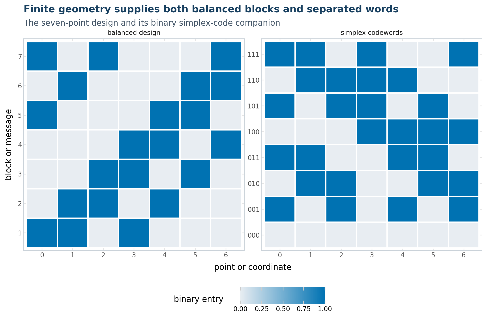

# Designs and error-correcting codes {#sec-comb-designs-codes}

Designs distribute subsets uniformly; codes distribute words far apart.
Both turn local intersection or distance constraints into global finite
structures with arithmetic feasibility conditions.

## Preparation from this book {#sec-comb-plane-preparation}

Use double counting from Chapter 3, binomial coefficients from Chapter 2, and
basic finite probability from the primer.

The construction below also uses a **finite field** $F$: a finite set whose
addition and multiplication obey the commutative, associative, and
distributive laws, with distinct identities $0,1$, additive inverses, and
multiplicative inverses for every nonzero element. Thus subtraction and
division by nonzero elements are available. Write $q=|F|\ge2$. For a prime $p$, the
residues modulo $p$ form the field $\mathbb F_p$: a nonzero residue has a
multiplicative inverse because it is relatively prime to $p$. All divisions
below take place in the declared field.

Finite fields also exist with prime-power sizes, but arithmetic modulo the
integer $p^e$ is not that field when $e>1$. For example, modulo four the
nonzero element two has no inverse and $2\cdot2=0$. The general proof assumes
a supplied field; the small exact program implements prime fields only.

## Balanced block designs

A block design chooses $k$-subsets of a $v$-point set so each point occurs in
the same number $r$ of blocks and each pair in the same number $\lambda$.
Counting point–block incidences and pair–block incidences in two ways gives
necessary divisibility equations. They are not always sufficient for a design
to exist.

If there are $b$ blocks, the equations are

$$
vr=bk,\qquad r(k-1)=\lambda(v-1).
$$

For the second equation, fix a point and count pairs consisting of a block
through it and another point in that block. A **symmetric design** means a
balanced design with $b=v$; the term does not assert an automorphism taking
any point to any other. Orthogonal arrays and Latin squares express related
balance conditions for experiments and communication.

<figure id="fig-comb-design-code">


<figcaption>

Figure 13.1: Blocks spread pair incidences evenly while codewords occupy separated points in a Hamming cube.

</figcaption>
</figure>

## A field construction is not a classification {#sec-comb-projective-plane}

A **projective plane** is a collection of points, lines, and incidences with
three properties: two distinct points lie on exactly one line; two distinct
lines meet in exactly one point; and there are four points with no three on
one line. The last property excludes degenerate examples. The incidence
axioms are the definition; field coordinates supply a particular construction
([Cameron n.d.](bibliography.md#ref-cameron1991projective), Section 2.1).

Start with the $q^2$ affine points $(x,y)\in F^2$. Add a direction point $D_m$
for every slope $m\in F$ and a vertical direction point $D_v$. Define lines

$$
\begin{aligned}
L_{m,c}&=\{(x,mx+c):x\in F\}\cup\{D_m\},&&m,c\in F,\\
V_a&=\{(a,y):y\in F\}\cup\{D_v\},&&a\in F,\\
L_\infty&=\{D_m:m\in F\}\cup\{D_v\}.
\end{aligned}
$$

These indexed lines are distinct. A nonvertical line determines its intercept
at $x=0$ and its slope from the values at $x=0,1$. A vertical line has constant
$x$, whereas a nonvertical line contains every $x$-value and $q\ge2$.
Different verticals have different constants. Finally, $L_\infty$ has no
affine point. Thus there are $q^2+q+1$ points and the same number of lines.
Each line contains $q+1$ points. An affine point lies on one line of each
slope and one vertical; a direction point lies on the $q$ parallel lines of
its direction and on $L_\infty$. Hence every point lies on $q+1$ lines.

**Why the axioms hold.** For distinct affine points with different
$x$-coordinates, their joining line has the unique slope
$(y_2-y_1)/(x_2-x_1)$ and then the unique intercept. If the $x$-coordinates
agree, the joining line is the unique vertical. An affine point and a
direction determine the unique line through that point with that direction;
two distinct direction points determine $L_\infty$.

For two nonvertical lines of distinct slopes, solving
$(m-m')x=c'-c$ gives their unique intersection; division is valid because
$m-m'\ne0$ in the field. Lines with the same slope and different intercepts
have no affine intersection and meet at their common direction point.
Distinct verticals meet at $D_v$. A vertical and a nonvertical line meet at
the unique affine point obtained by substitution. The infinity line meets
each other line at its own direction point. These exhaust the line pairs.
The four affine points $(0,0),(1,0),(0,1),(1,1)$ have no collinear triple,
including in characteristic two. This proves all three axioms for every
supplied finite field.

The construction is therefore a symmetric balanced design with

$$
v=b=q^2+q+1,\qquad k=r=q+1,\qquad \lambda=1.
$$

### Homogeneous coordinates and the scope of the construction

A homogeneous point $[X:Y:Z]$ is a nonzero triple, with triples identified
when one is a nonzero scalar multiple of the other. Affine points become
$[x:y:1]$, slope directions become $[1:m:0]$, and the vertical direction is
$[0:1:0]$. These give every point class: scale to $Z=1$ when $Z\ne0$;
otherwise scale to $X=1$ when $X\ne0$; the remaining class is $[0:1:0]$.

A line has a nonzero coefficient triple $(A,B,C)$, also up to nonzero scalar,
and incidence means $AX+BY+CZ=0$. The lines above have coefficients
$(-m,1,-c)$, $(1,0,-a)$, and $(0,0,1)$ respectively. Conversely, a coefficient
triple with $B\ne0$ scales to a slope line; with $B=0,A\ne0$ it scales to a
vertical; otherwise it gives the infinity line. Thus this is precisely the
plane $PG(2,q)$: its points are one-dimensional subspaces of $F^3$, and its
lines are two-dimensional subspaces, the kernels of nonzero linear equations.
The latter have two free coordinates after solving for a coordinate with
nonzero coefficient.

These are the **Desarguesian** examples. Finite non-Desarguesian projective
planes also exist, as described in the authored references
([Cameron n.d.](bibliography.md#ref-cameron1991projective), Section 2.1; [Nation n.d.](bibliography.md#ref-nation2018planes), Section 1). That
existence is a cited result, not a consequence of the finite checks below.
The parameter identities, even together with verified plane incidence, do
not classify all planes as $PG(2,q)$ or establish automorphism transitivity.

### Seven points: the Fano worked example {#sec-comb-fano-plane}

For $F=\mathbb F_2$, label the homogeneous points
$100,010,110,001,101,011,111$ by $1,\ldots,7$. There is no nontrivial scalar
identification, since one is the only nonzero scalar. The seven lines, written
as triples of point labels, are

$$
\begin{aligned}
123,\quad145,\quad167,\quad246,\\
257,\quad347,\quad356.
\end{aligned}
$$

Each label appears three times, every point pair occurs in one triple, and
every two triples intersect once. There are 21 incidences and
$\binom72=21$ pairs of each kind. The preceding construction supplies the
proof; the list makes Exercise 2 concrete.

Parameter equations alone would be weaker: the seven cyclic translates of
$\{0,1,2\}$ modulo seven also have $v=b=7$ and $k=r=3$, satisfying the two
equations with the candidate $\lambda=1$. But $\{0,1\}$ lies in two blocks
and $\{0,3\}$ in none, so this family is not a balanced design.

### An exact prime-field incidence certificate {#sec-comb-plane-code}

The first function uses ordinary integer residues only after a genuine prime
check. It normalizes every nonzero triple by making its first nonzero entry
one. Point coordinates and line coefficients use separate roles even though
their sets of normalized triples are numerically equal. The second function
checks all point pairs, all line pairs, uniform incidence counts, and an
actual four-point quadrangle. It accepts finite distinct hashable point labels
and blocks of those labels; it does not assume field coordinates.

```python
from collections.abc import Hashable, Iterable
from itertools import combinations, product
from math import isqrt

Vector = tuple[int, int, int]

def prime_projective_plane(
    prime: int,
) -> tuple[tuple[Vector, ...], dict[Vector, frozenset[Vector]]]:
    if type(prime) is not int:
        raise TypeError("p must be an integer, excluding bool")
    if prime < 2 or any(
        prime % divisor == 0 for divisor in range(2, isqrt(prime) + 1)
    ):
        raise ValueError("p must be prime")

    def normalize(vector: Vector) -> Vector:
        first = next(value for value in vector if value != 0)
        inverse = pow(first, -1, prime)
        return tuple(value * inverse % prime for value in vector)

    points = tuple(sorted({
        normalize(vector)
        for vector in product(range(prime), repeat=3) if any(vector)
    }))
    line_points = {
        normal: frozenset(
            point for point in points
            if sum(a * x for a, x in zip(normal, point)) % prime == 0
        )
        for normal in points
    }
    return points, line_points

def plane_incidence_certificate(
    points: Iterable[Hashable], blocks: Iterable[Iterable[Hashable]],
) -> dict[str, int | tuple[Hashable, ...]]:
    points = tuple(points)
    point_set = frozenset(points)
    blocks = tuple(frozenset(block) for block in blocks)
    if len(point_set) != len(points) or len(point_set) < 4:
        raise ValueError("need at least four distinct points")
    if not blocks or len(set(blocks)) != len(blocks):
        raise ValueError("need distinct nonempty lines")
    if any(not block or not block <= point_set for block in blocks):
        raise ValueError("line contains no points or unknown points")
    if any(
        sum(a in block and b in block for block in blocks) != 1
        for a, b in combinations(points, 2)
    ):
        raise ValueError("point pair has no unique joining line")
    if any(len(a & b) != 1 for a, b in combinations(blocks, 2)):
        raise ValueError("line pair has no unique meeting point")
    quadrangle = next((
        quad for quad in combinations(points, 4)
        if all(len(frozenset(quad) & block) <= 2 for block in blocks)
    ), None)
    if quadrangle is None:
        raise ValueError("no four-point quadrangle")
    sizes = {len(block) for block in blocks}
    degrees = {sum(point in block for block in blocks) for point in points}
    if len(sizes) != 1 or len(degrees) != 1:
        raise ValueError("incidence sizes are not uniform")
    return {
        "points": len(points), "lines": len(blocks),
        "points_per_line": sizes.pop(), "lines_per_point": degrees.pop(),
        "incidences": sum(len(block) for block in blocks),
        "join_pairs": len(points) * (len(points) - 1) // 2,
        "meet_pairs": len(blocks) * (len(blocks) - 1) // 2,
        "quadrangle": quadrangle,
    }

points, line_points = prime_projective_plane(2)
certificate = plane_incidence_certificate(points, line_points.values())
names = ("points", "lines", "points_per_line", "lines_per_point",
         "incidences", "join_pairs", "meet_pairs")
if tuple(certificate[name] for name in names) != (7, 7, 3, 3, 21, 21, 21):
    raise RuntimeError("Fano incidence check failed")
print({name: certificate[name] for name in names})
```

**What this certifies.** Every join, meet, and the nondegeneracy axiom is
checked for the returned finite incidence structure. Exhaustive enumeration
is intended for small primes; it is not the general construction proof.
Rejecting $p=4$ does not rule out $PG(2,4)$: the latter needs a genuine field
with four elements, not arithmetic modulo four. Neither this certificate nor
the Fano parameters proves that every plane has field coordinates.

### Changed task: the field with three elements {#sec-comb-plane-task}

Work over $\mathbb F_3$, retaining the distinction between point coordinates
and line coefficients. Derive the numbers of points, lines, incidences,
unique point-pair joins, and unique line-pair meets. Find the line joining
$P=[1:0:1]$ and $Q=[0:1:1]$, list all its points in the program's normalized
form, and intersect it with the line whose coefficient triple is $(1,2,0)$.
Run the actual checker with $p=3$ and reconcile its output with the proof.
Explain why replacing the modulus by four would not implement the same
construction over a four-element field. Compare your answer with the
[separate explanation](#sec-comb-plane-solution).

## Hamming space

A $q$-ary code is a subset of fixed-length words. Hamming distance counts
coordinates that differ. If minimum distance is at least $2t+1$, nearest-
neighbor decoding corrects up to $t$ substitutions because radius-$t$ balls
around codewords are disjoint. Packing these balls gives the Hamming bound;
covering and Gilbert–Varshamov arguments point in the other direction.

A linear code is a vector subspace over a finite field. A generator matrix
constructs codewords; a parity-check matrix defines valid words as a kernel.
Minimum distance then equals the smallest nonzero codeword weight.

**Nonexample.** Necessary parameter equations do not construct a design. A
code with large average pairwise distance may still have one dangerously close
pair; error correction depends on the minimum.

<!-- inline-formula-code:start -->
## Formula and finite computation

The size of a radius-$t$ Hamming ball in $q$-ary length $n$ is

$$
V_q(n,t)=\sum_{i=0}^{t}\binom ni(q-1)^i.
$$

```python
from math import comb

def hamming_ball_volume(length: int, radius: int, alphabet_size: int) -> int:
    if length < 0 or not 0 <= radius <= length or alphabet_size < 2:
        raise ValueError("invalid Hamming-space parameters")
    return sum(comb(length, changed) * (alphabet_size - 1) ** changed for changed in range(radius + 1))

volume = hamming_ball_volume(7, 1, 2)
if volume != 8:
    raise RuntimeError("Hamming-ball check failed")
print(volume, 2**7 // volume)
```

**What the computation establishes.** The program counts choices of changed
coordinates and replacement symbols and evaluates one sphere-packing bound.
It does not prove that a code meeting the bound exists or supply a decoder.
<!-- inline-formula-code:end -->

## Bounds and constructions

Sphere packing gives universal upper bounds; greedy selection gives lower
bounds. Algebraic codes use polynomial evaluation, cyclic ideals, or finite
geometry to achieve strong parameters with efficient decoding. Always report
alphabet, block length, code size or dimension, and minimum distance together.

## Noise models and decoding claims

Minimum distance gives a worst-case substitution guarantee. Probabilistic
channels motivate likelihood-based decoding and error rates that can be much
better on typical noise, but depend on a declared channel model. Erasures,
insertions, and deletions require different metrics and codes. A decoder's
failure probability combines code structure, noise, and algorithm; it cannot
be inferred from distance alone without specifying which errors occur and how
ties are resolved.

## Design parameters as consequences of exact incidences

**Definition 13.1 (Balanced pair design).** A pair design has a finite point set of size \(v\), blocks of a fixed size \(k\), and a number \(\lambda\) such that each pair of distinct points lies in exactly \(\lambda\) blocks. Blocks can be treated as indexed records if repetitions are allowed; every incidence count then counts those records separately. In the simple constructions here, the blocks are distinct subsets.

**Theorem 13.2 (Parameter equations).** Suppose \(v\ge k\ge2\). Every point lies in the same number \(r\) of blocks, with \(r(k-1)=\lambda(v-1)\). If there are \(b\) blocks, then \(vr=bk\).

*Proof.* Fix a point \(x\) and count records \((y,B)\) where \(y\ne x\) and \(B\) contains both. Choosing \(y\) first gives \(\lambda(v-1)\). Each block through \(x\) contributes \(k-1\), so its number of blocks is \(\lambda(v-1)/(k-1)\), independent of \(x\). This proves the first identity and uniformity. Counting all point-block incidences by points or by blocks gives \(vr=bk\). ∎

### Worked example 13.1: parameters that fail and parameters with a witness

For \(v=6,k=3,\lambda=1\), the first equation would require \(r=5/2\), impossible because incidence counts are integers. Thus no such design exists, without needing to inspect proposed block lists.

For \(v=7,k=3,\lambda=1\), the equations give \(r=3\) and \(b=7\). These are feasible integers, but the equations alone have not constructed a design. The seven-point field construction above supplies that additional existence witness, with the incidence axioms proved rather than inferred from the parameters. Necessary arithmetic conditions and an explicit construction answer different logical questions.

## Hamming distance and disjoint error balls

**Theorem 13.3 (Distance and unique correction).** Hamming distance on \(q\)-ary words of fixed length \(n\) is a metric. If every two distinct codewords have distance at least \(2t+1\), their radius-\(t\) balls are disjoint and all substitutions affecting at most \(t\) coordinates can be uniquely corrected.

*Proof.* Distance is nonnegative and zero exactly for identical words, and symmetry is immediate. At a coordinate where \(x\) differs from \(z\), at least one of \(x\) and \(y\), or \(y\) and \(z\), differs there. Summing this coordinatewise inequality proves the triangle inequality.

If a received word lay within distance \(t\) of codewords \(c,c'\), that inequality would give \(d(c,c')\le2t\), a contradiction. Thus at most one codeword is compatible with an allowed error. The transmitted codeword is within the ball by the error assumption, so there is exactly one. ∎

Conversely, if two codewords have distance \(d\le2t\), choose a received word agreeing with one on some of their differing coordinates and with the other on the rest. Split the \(d\) differing coordinates into two sets of sizes at most \(t\). The resulting word is within \(t\) of both codewords, so no decoder can always identify the original under that error budget. This proves that the pairwise separation requirement is exact for worst-case unique correction.

**Theorem 13.4 (Hamming packing bound).** For \(0\le t\le n\), a radius-\(t\) ball has
\[
V_q(n,t)=\sum_{i=0}^t\binom ni(q-1)^i
\]
words. A code with pairwise distance at least \(2t+1\) satisfies \(|C|V_q(n,t)\le q^n\).

*Proof.* A word at distance exactly \(i\) chooses its \(i\) changed coordinates and one of \(q-1\) replacement symbols at each. Distinct distances form disjoint classes, giving the volume. All codeword balls have that volume and are disjoint by Theorem 13.3, so their union occupies at most the \(q^n\) words in the entire space. ∎

### Worked example 13.2: a perfect three-bit example

The binary repetition code \(C=\{000,111\}\) has distance three. Each radius-one ball contains \(1+\binom31=4\) words. Their disjoint union has eight words, the whole binary cube, so the packing bound is attained.

Majority decoding is explicit: any word obtained from \(000\) by at most one change has at most one one, and any obtained from \(111\) has at least two ones. The received word \(001\) also shows why two-error correction is impossible: it is one change from \(000\) and two from \(111\). A decoder cannot promise both interpretations are always recoverable.

## A constructive lower bound by maximal packing

**Theorem 13.5 (Greedy covering bound).** For \(q\ge2\) and \(1\le d\le n+1\), some length-\(n\) code with pairwise distance at least \(d\) has
\[
|C|\ge\frac{q^n}{V_q(n,d-1)}.
\]

*Proof.* Starting with the empty code, repeatedly add a word whose distance from every chosen word is at least \(d\), until none is available. The finite ambient space makes the process terminate. Its code has the required distance. Maximality means every word is at distance at most \(d-1\) from some codeword; otherwise it could be added. These covering balls may overlap, so their union size is at most the sum of their sizes. Hence \(q^n\le |C|V_q(n,d-1)\), proving the bound. ∎

This is a lower existence bound, whereas the disjoint-ball argument is an upper bound. The radii differ: \(d-1\) for maximal-code covering and \(\lfloor(d-1)/2\rfloor\) for guaranteed disjoint correction balls. Confusing the radii reverses the logic. The finite greedy construction also need not be computationally efficient in the block length, since its ambient word set grows exponentially.

### Worked example 13.3: separate upper and lower estimates

For binary length five and required distance at least three, greedy covering gives \(|C|\ge32/(1+5+10)=2\). Packing with radius one gives \(|C|\le\lfloor32/(1+5)\rfloor=5\). These bounds need not coincide.

The two words \(00000,11111\) provide one simple witness meeting the lower estimate, because their distance is five and therefore at least three. This does not prove the maximum size is two. A lower-bound witness, an upper bound for every code, and a complete optimality proof must be reported separately.

For a linear code over a field, \(d(x,y)\) equals the weight of \(x-y\), because a coordinate differs exactly when its difference is nonzero. Closure under subtraction therefore makes the minimum pairwise distance equal to the smallest nonzero codeword weight when the code has at least two words. This reduction uses linearity; an arbitrary code cannot replace all pair comparisons by distances from zero.

## Summary

Designs regularize incidence and codes separate words in Hamming space. Double
counts and packing bounds constrain parameters, while finite-field algebra
provides constructions and algorithms.

## Exercises

<div class="exercise" id="comb-designs-codes-ex-1-exercise">

### Exercise 13.1 {#comb-designs-codes-ex-1}

1. Derive both design parameter equations.

<details>
<summary>Hint 1</summary>

**Hint.** Fix one point before counting pair incidences.

</details>
<details>
<summary>Hint 2</summary>
**Hint.** Then count point-block incidences globally.

</details>
<details>
<summary>Solution</summary>
**Solution.** For fixed $x$, records $(y,B)$ with $y\ne x$ and both in $B$ number $\lambda(v-1)$ by $y$ and $r(k-1)$ by blocks. Thus $r(k-1)=\lambda(v-1)$. Counting all pairs $(x,B)$ gives $vr=bk$. Each count refers to the same indexed blocks; repeated blocks, if allowed, must retain their multiplicity.

</details>

</div>

<div class="exercise" id="comb-designs-codes-ex-2-exercise">

### Exercise 13.2 {#comb-designs-codes-ex-2}

2. Check a seven-point projective-plane design using the
   [Fano worked example](#sec-comb-fano-plane).

<details>
<summary>Hint 1</summary>

**Hint.** Substitute the two-element field into the supplied coordinate construction.

</details>
<details>
<summary>Hint 2</summary>

**Hint.** Use its affine points and three direction points.

</details>
<details>
<summary>Solution</summary>

**Solution.** There are four affine points and three directions, seven points total. Two slopes with two intercepts give four nonvertical lines, two vertical lines and the infinity line give seven lines. Each has three points and each point lies on three lines. The coordinate case proof gives one joining line per point pair, so $\lambda=1$. The incidence count is twenty-one and the pair count $7\binom32=21$ agrees.

</details>

</div>

<div class="exercise" id="comb-designs-codes-ex-3-exercise">

### Exercise 13.3 {#comb-designs-codes-ex-3}

3. Prove Hamming distance is a metric.

<details>
<summary>Hint 1</summary>

**Hint.** Check the triangle inequality coordinate by coordinate.

</details>
<details>
<summary>Hint 2</summary>

**Hint.** If the first and third symbols differ, at least one of the two intermediate comparisons differs.

</details>
<details>
<summary>Solution</summary>

**Solution.** The coordinate indicators satisfy $1_{\{x_i\ne z_i\}}\le1_{\{x_i\ne y_i\}}+1_{\{y_i\ne z_i\}}$. Summing proves the triangle inequality. Nonnegativity and symmetry follow from counting differing positions, and zero differences mean identical words. Thus all metric axioms hold on a fixed-length word space.

</details>

</div>

<div class="exercise" id="comb-designs-codes-ex-4-exercise">

### Exercise 13.4 {#comb-designs-codes-ex-4}

4. Derive the ball-volume formula.

<details>
<summary>Hint 1</summary>

**Hint.** Partition by the exact number of changed coordinates.

</details>
<details>
<summary>Hint 2</summary>

**Hint.** Each chosen coordinate has $q-1$ replacements.

</details>
<details>
<summary>Solution</summary>

**Solution.** At exact distance $i$, choose the changed coordinates in $\binom ni$ ways and their replacements in $(q-1)^i$ ways. These choices uniquely recover the received word. Summing disjoint distance classes from zero through $t$ gives $V_q(n,t)=\sum_{i=0}^t\binom ni(q-1)^i$.

</details>

</div>

<div class="exercise" id="comb-designs-codes-ex-5-exercise">

### Exercise 13.5 {#comb-designs-codes-ex-5}

5. State the correction radius from minimum distance.

Assume the code has at least two words and minimum distance $\delta$.

<details>
<summary>Hint 1</summary>

**Hint.** Assume at least two codewords so the finite minimum distance is defined.

</details>
<details>
<summary>Hint 2</summary>

**Hint.** Use the condition $2t<\delta$.

</details>
<details>
<summary>Solution</summary>

**Solution.** A code of minimum distance $\delta$ guarantees unique correction of up to $\lfloor(\delta-1)/2\rfloor$ substitutions. Radius-$t$ balls are disjoint when $2t<\delta$. If $2t\ge\delta$, splitting the differing coordinates of a closest pair produces a word within $t$ of both, so no universal decoder can correct all such errors.

</details>

</div>

<div class="exercise" id="comb-designs-codes-ex-6-exercise">

### Exercise 13.6 {#comb-designs-codes-ex-6}

6. Distinguish an upper bound from a construction.

<details>
<summary>Hint 1</summary>

**Hint.** A universal inequality does not supply a code attaining it.

</details>
<details>
<summary>Hint 2</summary>

**Hint.** Use the existing length-seven ball calculation as an example.

</details>
<details>
<summary>Solution</summary>

**Solution.** For binary length seven and one-error correction, packing gives $|C|\le128/8=16$. That inequality applies to every qualifying code but does not construct sixteen words or prove attainability. The explicit three-bit repetition example elsewhere is an actual witness for its own parameters. A complete optimality claim requires both a matching construction and upper bound.

</details>

</div>

<div class="exercise" id="comb-designs-codes-ex-7-exercise">

### Exercise 13.7 {#comb-designs-codes-ex-7}

7. Complete the [three-element-field task](#sec-comb-plane-task), including
   the distinction between a finite incidence certificate and a classification.

<details>
<summary>Hint 1</summary>

**Hint.** Use the supplied finite-field coordinate formulas.

</details>
<details>
<summary>Hint 2</summary>

**Hint.** Modulo four is not a field because two has no inverse.

</details>
<details>
<summary>Solution</summary>

**Solution.** For $q=3$ the construction has thirteen points, thirteen lines, four points per line and fifty-two incidences; every point pair has a unique joining line. The line through $[1:0:1]$ and $[0:1:1]$ is $X+Y+2Z=0$, and its intersection with $X+2Y=0$ is $[1:1:2]$. The retained detailed explanation lists its points. This certifies the constructed plane, not a classification of all planes. Modulo four the necessary division hypotheses fail.

</details>

</div>

<div class="exercise" id="comb-designs-codes-ex-8-exercise">

### Exercise 13.8 {#comb-designs-codes-ex-8}

Prove that majority decoding corrects one error in the binary three-bit repetition code and cannot promise two-error correction.

<details>
<summary>Hint 1</summary>

**Hint.** Compare the number of ones after the two possible transmissions.

</details>
<details>
<summary>Hint 2</summary>

**Hint.** Find one received word compatible with both transmissions under the larger budget.

</details>
<details>
<summary>Solution</summary>

**Solution.** A word within one change of $000$ has at most one one; a word within one change of $111$ has at least two. Majority therefore identifies the transmitted codeword. The word $001$ is within one of $000$ and two of $111$, so under a two-error budget the original is ambiguous. This is a worst-case statement, independent of a noise probability model.

</details>

</div>

<div class="exercise" id="comb-designs-codes-ex-9-exercise">

### Exercise 13.9 {#comb-designs-codes-ex-9}

Derive the greedy covering lower bound for distance-$d$ codes.

<details>
<summary>Hint 1</summary>

**Hint.** A maximal code has no word at distance at least $d$ from every codeword.

</details>
<details>
<summary>Hint 2</summary>

**Hint.** Its radius-$(d-1)$ balls therefore cover the whole word space.

</details>
<details>
<summary>Solution</summary>

**Solution.** Greedily add admissible words until maximality. Every remaining word is within $d-1$ of some selected word, so $q^n\le |C|V_q(n,d-1)$ by the union bound on ball sizes. Thus some code has at least the displayed ratio. The covering balls may overlap, and the construction's time cost is not supplied by this cardinality bound.

</details>

</div>

<div class="exercise" id="comb-designs-codes-ex-10-exercise">

### Exercise 13.10 {#comb-designs-codes-ex-10}

For the binary span of $110$ and $011$, list the codewords, minimum distance, and guaranteed correction radius.

<details>
<summary>Hint 1</summary>

**Hint.** Add vectors modulo two.

</details>
<details>
<summary>Hint 2</summary>

**Hint.** For a linear code it suffices to find the least nonzero weight.

</details>
<details>
<summary>Solution</summary>

**Solution.** The code is $\{000,110,011,101\}$. Every nonzero word has weight two, so its minimum distance is two and its guaranteed unique correction radius is zero. It detects every single substitution because no two codewords are distance one apart, but detection is different from identifying which original codeword to return.

</details>

</div>

### Selected solution

For Exercise 4, a word at distance $i$ chooses the $i$ changed positions and
then one of $q-1$ replacement symbols independently at each; sum over allowed
distances.

### Explanation of the changed plane task {#sec-comb-plane-solution}

For $q=3$, there are $3^2+3+1=13$ points and 13 lines, four points on each
line and four lines through each point. The total is $13\cdot4=52$
incidences. Both the point-pair and line-pair checks have
$\binom{13}{2}=78$ cases, each with exactly one incidence witness.

For a line $(A,B,C)$ through $P,Q$, the equations are $A+C=B+C=0$ in
$\mathbb F_3$. Scaling the nonzero solution gives the normalized coefficient
triple $(1,1,2)$, so its equation is $X+Y+2Z=0$. Its four normalized points
are

$$
(0,1,1),\quad(1,0,1),\quad(1,1,2),\quad(1,2,0).
$$

Intersect with $X+2Y=0$: the latter says $X=Y$, and substitution into the
first equation gives $Z=2X$. The intersection is therefore $[1:1:2]$.
In the affine chart $Z=1$, the two lines are $y=2x+1$ and $y=x$, meeting
at $(2,2)$. The equality of this point's normalized triple and the first
line's coefficient triple is a numerical coincidence, not an identification
of their roles.

The checker returns $(13,13,4,4,52,78,78)$ in the displayed field order and
an actual quadrangle. Its complete finite incidence checks certify this
constructed plane; they do not classify all finite projective planes.
The [affine construction proof](#sec-comb-projective-plane) applies to every
supplied finite field.
Modulo four, two is nonzero but cannot be divided by, so the slope proof
and inverse-based normalization would not have their field hypotheses.

## Sources for the expanded chapter {#sec-comb-designs-codes-sources}

All original projective-plane proofs, Fano and three-element-field calculations, finite-field limitations, references, code, task anchors, and selected solutions are retained. The new incidence, packing, covering, and decoding arguments are original expositions of the stated finite models. The original primary geometry references remain beside their precise construction/classification claims; no new classification claim is made.

## Summary and next connection {#sec-comb-designs-codes-summary}

Design equations follow from exact pair and point incidences and give necessary arithmetic tests. Finite-field constructions supply additional existence witnesses without classifying all designs. Hamming distance proves disjoint-ball correction bounds, while greedy maximality gives a different covering lower bound. Explicit codewords and a decoder remain separate from either inequality. [Matroids and greedy structure](20-matroids.md) next studies the exchange property that supports universal greedy guarantees.
