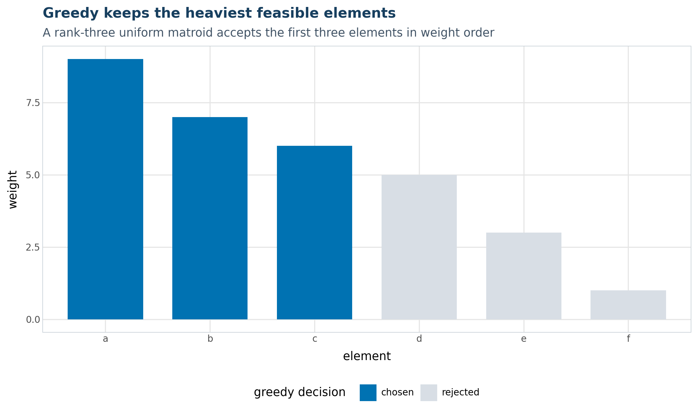

# Matroids and greedy structure {#sec-comb-matroids}

Matroids isolate the exchange property that makes greedy optimization exact.
Linear independence, forests in a graph, and subsets of bounded size become
instances of one finite theory.

## Preparation from this book

Chapter 12 motivates greedy spanning trees. Sets and maximality are reviewed in
the primer; linear dependence is introduced here only as an example.

## Independence axioms

A matroid has a finite ground set and a nonempty family of independent subsets.
Every subset of an independent set remains independent. If one independent set
is larger than another, exchange guarantees an element of the larger can be
added to the smaller while preserving independence. Maximal independent sets,
called bases, consequently all have equal size.

In a graphic matroid, independent edge sets are forests and bases of a
connected graph are spanning trees. In a vector matroid, independent elements
are linearly independent columns. A uniform matroid declares every subset up
to a fixed size independent.

<figure id="fig-comb-matroid">


<figcaption>

Figure 14.1: The matroid exchange property lets a greedy basis trade elements without losing independence.

</figcaption>
</figure>

## Rank, closure, and duality

The rank of a subset is the size of its largest independent subset. Rank is
monotone and submodular. Closure adds elements that do not increase rank;
circuits are minimal dependent sets. Taking complements of bases defines the
dual matroid, exchanging deletion with contraction and circuits with cocircuits.

Not every matroid is representable by vectors over a given field. Regular
matroids are representable over every field and admit deep decomposition
theorems. The Tutte polynomial packages ranks of all subsets and specializes
to spanning-tree, coloring, and flow information.

**Nonexample.** A downward-closed family alone need not support greedy
optimization. Without exchange, a locally heavy choice may block two slightly
lighter compatible choices.

<!-- inline-formula-code:start -->
## Formula and finite computation

For weights $w(e)$, matroid greedy processes elements in decreasing weight and
returns a basis $B$ maximizing

$$
w(B)=\sum_{e\in B}w(e).
$$

```python
from collections.abc import Callable, Hashable
from math import isfinite
from typing import TypeVar

T = TypeVar("T", bound=Hashable)

def greedy_independent_set(weights: dict[T, float], independent: Callable[[set[T]], bool]) -> set[T]:
    if any(not isfinite(weight) for weight in weights.values()):
        raise ValueError("weights must be finite")
    if not independent(set()):
        raise ValueError("a matroid independence oracle must accept the empty set")
    chosen: set[T] = set()
    for element in sorted(weights, key=lambda candidate: weights[candidate], reverse=True):
        candidate = chosen | {element}
        if independent(candidate):
            chosen = candidate
    return chosen

weights = {"a": 7.0, "b": 5.0, "c": 4.0, "d": 1.0}

def uniform_rank_two(subset: set[str]) -> bool:
    return len(subset) <= 2

answer = greedy_independent_set(weights, uniform_rank_two)
if answer != {"a", "b"}:
    raise RuntimeError("uniform-matroid greedy check failed")
print(answer)
```

**What the computation establishes.** Greedy selects the heaviest basis in
one uniform matroid. It does not prove optimality for every matroid or test that
an arbitrary independence oracle satisfies exchange.
<!-- inline-formula-code:end -->

## What greedy optimizes {#sec-comb-greedy-contract}

The word *independent* in the function name describes feasibility, not the
optimization domain. Full scanning returns a maximal independent set. In a
matroid this is a basis, so the displayed theorem allows arbitrary real
weights, including negative ones. If stopping short of a basis is allowed,
the best independent set can have a different weight.

For this clinic, revisit subsets and inclusion-maximal versus maximum in the
primer, finite sums in [sec-comb-binomial](02-binomial-multinomial.md#sec-comb-binomial), and forests and components in
[sec-comb-graphs](11-graphs-walks-degrees.md#sec-comb-graphs) and [sec-comb-trees](12-trees.md#sec-comb-trees). No linear representation is needed.
Write $\mathcal I$ for a nonempty hereditary family on a finite ground set
$E$. Thus $\varnothing\in\mathcal I$, and $J\subseteq I\in\mathcal I$ implies
$J\in\mathcal I$. An independence oracle must describe this same declared
ground set throughout; the weight dictionary must contain every element of
$E$, not merely the elements that look useful.

**Three precise guarantees.** If $\mathcal I$ also satisfies augmentation,
then decreasing-weight greedy, with any order among equal weights:

1. maximizes weight over bases for every real weighting;
2. maximizes weight over all independent sets when all weights are nonnegative;
3. maximizes weight over all independent sets for arbitrary real weights if
   negative-weight elements are omitted.

The third version may accept or omit elements of weight zero. Full scanning
can include negative elements because a basis must reach the common rank.
These guarantees concern exact mathematical comparisons; floating-point
rounding in another implementation is a separate issue.

### Prefix ranks give the complete proof {#sec-comb-greedy-prefix}

Choose an order $e_1,\ldots,e_n$ with
$w_1\ge\cdots\ge w_n$, where $w_i=w(e_i)$, and put
$P_k=\{e_1,\ldots,e_k\}$. Let $G$ be the final greedy set. Rejection is
permanent: if $H\cup\{e_i\}$ was infeasible when considered, no later larger
chosen set $H'$ can make $H'\cup\{e_i\}$ feasible, since heredity would then
make its subset $H\cup\{e_i\}$ feasible.

It follows that $G\cap P_k$ is maximal among independent subsets of $P_k$.
If another independent subset of $P_k$ were larger, augmentation would add
one of its elements to $G\cap P_k$, a contradiction. Therefore

$$
|G\cap P_k|=r(P_k)\ge |S\cap P_k|
\qquad(S\in\mathcal I).
$$

This is stronger than saying that each accepted element looked locally best:
greedy saturates the maximum feasible cardinality at every ordered prefix.

If $n=0$, the empty set is the only feasible set and all the optimization
claims are immediate. For $n\ge1$, write $s_k=|S\cap P_k|$. The finite identity

$$
w(S)=w_n s_n+\sum_{k=1}^{n-1}(w_k-w_{k+1})s_k
$$

follows by telescoping: the coefficient of a selected $e_i$ on the right is
$w_n+\sum_{k=i}^{n-1}(w_k-w_{k+1})=w_i$. In particular, it needs no
positivity assumption.

All bases have the same size: augmentation would otherwise enlarge a smaller
maximal member. For a competing basis $B$, the terms $w_n|G|$ and $w_n|B|$
cancel. The remaining coefficients $w_k-w_{k+1}$ are nonnegative, and the
prefix inequalities prove $w(G)\ge w(B)$ even if $w_n<0$. Ties cause zero
coefficients and require no special choice.

For an arbitrary independent competitor $S$, its cardinality need not equal
$|G|$. If all weights are nonnegative, $w_n\ge0$ and the same identity proves
$w(G)\ge w(S)$. With signed weights, an optimum cannot contain a
negative-weight element: removing it preserves independence and improves
weight. Restrict to $R=\{e:w(e)\ge0\}$. The family
$\{I\in\mathcal I:I\subseteq R\}$ inherits heredity and augmentation, since an
augmenting element lies in the larger set, hence in $R$. Apply the
nonnegative result there. This proves all three guarantees, including loops
(elements never in an independent singleton), rank zero and ties.

An equivalent signed-weight method chooses the best accepted prefix, including
$S_0=\varnothing$. To justify it, fix an integer $0\le j\le r(E)$ and truncate the family to
sets of size at most $j$. Augmentation survives because
$|I|+1\le |J|\le j$ whenever it is needed. Its bases have size $j$, and its
greedy result is the first $j$ accepted elements of the full scan. The basis
theorem therefore proves optimality at each cardinality. Taking the best of
these results, with the empty set included, optimizes over all independent
sets. Omitting that empty candidate would fail for all-negative weights.

### Failed exchange manufactures bad weights {#sec-comb-greedy-converse}

Can universal greedy success itself diagnose the matroid axiom? For a
nonempty hereditary family, yes, provided the hypothesis covers **every
nonnegative weighting**, rather than one successful example.

Suppose augmentation fails for $I,J\in\mathcal I$:
$|I|<|J|$, but $I\cup\{e\}\notin\mathcal I$ for every $e\in J\setminus I$.
Put $n=|E|$ and assign the exact integer weights

$$
w(e)=
\begin{cases}
n+2,&e\in I,\\
n+1,&e\in J\setminus I,\\
0,&e\notin I\cup J.
\end{cases}
$$

Every tie order accepts all of $I$ first, because every subset of $I$ is
feasible. It rejects every element of $J\setminus I$ permanently. Later
zero-weight additions cannot change its value. Thus

$$
w(J)-w(G)
=(n+1)(|J|-|I|)-|I\setminus J|\ge1,
$$

since $|J|-|I|\ge1$ and $|I\setminus J|\le n$. Greedy loses to a declared
independent competitor. If the comparison is with maximal members, extend
$J$ to one; nonnegative weights cannot decrease its value.

Together with the forward proof, this establishes: among nonempty hereditary
families on a finite ground set, full-scan greedy is optimal over independent
sets for every nonnegative weighting **if and only if** augmentation holds.
It supplies a counterexample weighting whenever augmentation fails.

A related diagnostic needs restrictions, not just one global size check.
Augmentation implies that all maximal members of every restriction have equal
size. Conversely, a failed pair $I,J$ makes $I$ maximal in the restriction
$I\cup J$, while $J$ extends to a strictly larger maximal member there.
Equal sizes of maximal members only on $E$ are therefore insufficient.

### Exact investigation: a signed complete graph {#sec-comb-greedy-worked}

Use $K_4$ on vertices $0,1,2,3$, with the following edge labels and weights.

| Label | Endpoints | Weight |
|---|---|---:|
| $a$ | $01$ | $9$ |
| $b$ | $12$ | $8$ |
| $c$ | $02$ | $7$ |
| $d$ | $03$ | $-2$ |
| $e$ | $13$ | $-3$ |
| $f$ | $23$ | $-5$ |

First justify the model. Forests are hereditary. If forests $F,H$ satisfy
$|F|<|H|$ and every edge of $H$ stayed inside a component of $F$, acyclicity
would give at most $|V_i|-1$ edges of $H$ in each component $V_i$. Summing gives
$|H|\le |V|-c(F)=|F|$, a contradiction. Some edge of $H$ joins two
components of $F$ and can be added without a cycle. This proves graphic
augmentation, including isolated vertices.

There are $1,6,15,16$ forests of cardinalities $0,1,2,3$, respectively.
Every pair of distinct edges is acyclic. Of the $\binom63=20$ triples,
exactly four are triangles, leaving sixteen trees. Larger forests are
impossible on four vertices. Thus the family has exactly $38$ members.

Greedy accepts $a,b$, rejects $c$ because it completes the positive triangle,
then accepts $d$ to reach vertex $3$. It rejects $e,f$ because each would
create a cycle. The resulting basis $abd$ has weight $15$. Every spanning
tree needs a negative edge; its other two edges weigh at most $9+8$ and its
negative edge at most $-2$. Equality forces $abd$, so the optimum basis is
unique.

The independent-set optimum is instead $ab$, weight $17$. The full trace
has the following prefix certificate.

| Prefix | Rank | Greedy intersection |
|---|---:|---|
| $a$ | $1$ | $a$ |
| $ab$ | $2$ | $ab$ |
| $abc$ | $2$ | $ab$ |
| $abcd$ | $3$ | $abd$ |
| $abcde$ | $3$ | $abd$ |
| $abcdef$ | $3$ | $abd$ |

The exact maximum weights at cardinalities $0,1,2,3$ are $0,9,17,15$.
A singleton cannot beat $a$, a pair cannot beat $ab$, and the preceding
tree bound handles cardinality three. Negative edges are not an error in
the basis computation; the two questions have different feasible domains.

Now add the same constant $C\ge0$ to every edge weight. A set of size $j$
gains $jC$. Comparisons between bases are unchanged, but the unrestricted
optimum becomes

$$
\max\{0,\ 9+C,\ 17+2C,\ 15+3C\}.
$$

It is attained uniquely by $ab$ for $0\le C<2$, by both $ab$ and $abd$ at
$C=2$, and uniquely by $abd$ for $C>2$. At $C=6$, the basis weighs $33$ and
$ab$ weighs $29$. A uniform shift preserves comparisons at a fixed
cardinality; it can change which cardinality wins.

### A bounded checker for a declared family {#sec-comb-greedy-code}

The formula to check is the prefix certificate
$|G\cap P_k|=r(P_k)$, together with exact optimization over the supplied
finite family. The following standalone listing also searches every required
augmentation pair and constructs the integer counterweight above on failure.

Its input is deliberately concrete: a tuple of at most eight distinct exact
string labels, a set of frozenset members, and a dictionary with exactly those
labels and exact Python integer weights. Booleans, floats and subclasses of
the declared types are outside this contract. Integers may be arbitrarily
large; no conversion to floating point occurs. The fixed eight-element
limit bounds the family by $256$ subsets and rejects a large request before
exponential checking. Arbitrary iterables and unknown oracles are not inputs.

Invalid representation, missing empty set or failed heredity raises an
exception. A valid hereditary family returns either `"failed exchange"`,
with a witness and strict counterweight loss, or `"finite matroid"`, after
all augmentation pairs pass. The latter verifies exactly this fully supplied
family. It cannot certify an unqueried oracle or an infinite class.
Ties are processed in the declared ground-tuple order. Returned set tuples
use ground order; the separate order entry gives the processing order.

```python
from itertools import combinations

def finite_greedy_audit(
    ground: tuple[str, ...],
    family: set[frozenset[str]],
    weights: dict[str, int],
) -> dict[str, object]:
    """Check a declared small family, not an unknown oracle."""
    if type(ground) is not tuple:
        raise TypeError("ground must be a concrete tuple")
    if len(ground) > 8:
        raise ValueError("at most eight ground elements are allowed")
    if any(type(label) is not str for label in ground):
        raise TypeError("ground labels must be exact strings")
    if len(set(ground)) != len(ground):
        raise ValueError("ground labels must be distinct")
    if type(family) is not set or type(weights) is not dict:
        raise TypeError("family must be a set and weights a dictionary")
    if not family or len(family) > 2 ** len(ground):
        raise ValueError("family must be nonempty and bounded by the power set")
    if any(type(label) is not str for label in weights):
        raise TypeError("weight labels must be exact strings")
    if set(weights) != set(ground):
        raise ValueError("weights must cover exactly the ground set")
    if any(type(value) is not int for value in weights.values()):
        raise TypeError("weights must be exact integers, not booleans or floats")
    positions = {label: index for index, label in enumerate(ground)}
    masks: set[int] = set()
    for member in family:
        if type(member) is not frozenset:
            raise TypeError("each family member must be a frozenset")
        if any(type(label) is not str for label in member):
            raise TypeError("family labels must be exact strings")
        if not member <= set(ground):
            raise ValueError("a family member lies outside the ground set")
        masks.add(sum(1 << positions[label] for label in member))
    if 0 not in masks:
        raise ValueError("the empty set must be feasible")
    for member in masks:
        for index in range(len(ground)):
            bit = 1 << index
            if member & bit and member ^ bit not in masks:
                raise ValueError("family is not hereditary")
    ordered = sorted(masks, key=lambda mask: (mask.bit_count(), mask))

    def labels(mask: int) -> tuple[str, ...]:
        return tuple(label for index, label in enumerate(ground)
                     if mask & (1 << index))

    def value(mask: int, values: dict[str, int]) -> int:
        return sum(values[label] for label in labels(mask))

    def scan(values: dict[str, int], omit_negative: bool = False) -> int:
        chosen = 0
        for index in sorted(range(len(ground)),
                            key=lambda i: values[ground[i]], reverse=True):
            if omit_negative and values[ground[index]] < 0:
                continue
            candidate = chosen | (1 << index)
            if candidate in masks:
                chosen = candidate
        return chosen

    witness: tuple[int, int] | None = None
    for smaller in ordered:
        for larger in ordered:
            if smaller.bit_count() >= larger.bit_count():
                continue
            additions = larger & ~smaller
            if not any(smaller | (1 << index) in masks
                       for index in range(len(ground))
                       if additions & (1 << index)):
                witness = (smaller, larger)
                break
        if witness is not None:
            break
    chosen = scan(weights)
    filtered = scan(weights, omit_negative=True)
    maximal = [member for member in masks
               if not any(member | (1 << index) in masks
                          for index in range(len(ground))
                          if not member & (1 << index))]
    prefix = 0
    ranks: list[int] = []
    counts: list[int] = []
    order = sorted(range(len(ground)),
                   key=lambda index: weights[ground[index]], reverse=True)
    for index in order:
        prefix |= 1 << index
        ranks.append(max(member.bit_count() for member in masks
                         if member & prefix == member))
        counts.append((chosen & prefix).bit_count())
    result: dict[str, object] = {
        "status": "finite matroid" if witness is None else "failed exchange",
        "order": tuple(ground[index] for index in order),
        "full_scan": labels(chosen),
        "full_weight": value(chosen, weights),
        "maximum_maximal_weight": max(value(member, weights)
                                      for member in maximal),
        "maximum_independent_weight": max(value(member, weights)
                                          for member in masks),
        "nonnegative_scan": labels(filtered),
        "nonnegative_weight": value(filtered, weights),
        "prefix_ranks": tuple(ranks),
        "prefix_counts": tuple(counts),
        "exchange_witness": None,
        "counterweights": None,
    }
    if witness is not None:
        smaller, larger = witness
        n = len(ground)
        bad = {label: n + 2 if smaller & (1 << index)
               else n + 1 if larger & (1 << index) else 0
               for index, label in enumerate(ground)}
        bad_chosen = scan(bad)
        gap = value(larger, bad) - value(bad_chosen, bad)
        if gap <= 0:
            raise RuntimeError("the exchange counterweight check failed")
        result.update({
            "exchange_witness": (labels(smaller), labels(larger)),
            "counterweights": bad,
            "counterweight_scan": labels(bad_chosen),
            "counterweight_greedy_weight": value(bad_chosen, bad),
            "counterweight_competitor_weight": value(larger, bad),
        })
    return result

edges = {"a": (0, 1), "b": (1, 2), "c": (0, 2),
         "d": (0, 3), "e": (1, 3), "f": (2, 3)}

def is_forest(edge_names: frozenset[str]) -> bool:
    parent = list(range(4))

    def root(vertex: int) -> int:
        while parent[vertex] != vertex:
            vertex = parent[vertex]
        return vertex

    for label in edge_names:
        left, right = (root(vertex) for vertex in edges[label])
        if left == right:
            return False
        parent[left] = right
    return True

ground = tuple(edges)
forests = {frozenset(subset) for size in range(7)
           for subset in combinations(ground, size)
           if is_forest(frozenset(subset))}
report = finite_greedy_audit(
    ground, forests, dict(zip(ground, (9, 8, 7, -2, -3, -5)))
)
if (len(forests), report["status"], report["full_weight"],
        report["maximum_independent_weight"]) != (38, "finite matroid", 15, 17):
    raise RuntimeError("the K4 finite audit failed")
print(report["full_scan"], report["full_weight"],
      report["nonnegative_scan"], report["nonnegative_weight"])
```

The example constructs all $64$ edge subsets and tests cycles by joining
components; it finds the $38$ forests, the full-scan tree $abd$ of weight
$15$, and the nonnegative scan $ab$ of weight $17$. Direct enumeration
cross-checks the graph calculation; the prefix proof supplies the universal
theorem. In particular, a successful weighting alone never sets the
`"finite matroid"` status: the augmentation audit does.

The entry `maximum_maximal_weight` compares all inclusion-maximal members.
Only after exchange has passed may these all be called matroid bases.
The entry `maximum_independent_weight` includes every supplied member,
including the empty set. The nonnegative scan has the latter optimum
guaranteed when the family is a matroid; a nonmatroid can fail despite all
weights being positive.

### Changed task: equal maximal sizes {#sec-comb-greedy-task}

Let $E=\{a,b,c,d\}$, and let $\mathcal I$ contain exactly the subsets of
$ab$, $ac$ or $bd$. Assign
$w(c)=6$, $w(b)=5$, $w(d)=4$, $w(a)=1$.

1. List every feasible member and every maximal member. Does equality of
   their maximal sizes settle the matroid question?
2. Run full-scan greedy and optimize directly over the entire family.
   Find a failed augmentation pair.
3. In weight order, compute every prefix rank and greedy prefix size.
   Locate the first strict inequality and a restriction with unequal
   maximal sizes.
4. Explain why sign filtering, another tie rule and a uniform shift of
   the weights of maximal pairs do not repair this failure.
5. From your failed pair, construct the general integer counterweight
   using $n=4$. Check its strict loss for every tie order.

This changes the cause of failure: every weight is positive, and every
maximal member has the same size. Diagnosing the objective alone no longer
suffices; the feasible family itself must be examined.

### Hint {#sec-comb-greedy-hint}

Start with the heaviest singleton. Test both possible extensions from the
pair $bd$. For the prefix audit, distinguish a largest feasible set inside
the prefix from the set that the greedy scan has actually retained.

### Full explanation {#sec-comb-greedy-solution}

The eight feasible sets are $\varnothing$, the four singletons, and
$ab,ac,bd$. The three pairs are exactly the maximal members, all of size two.
Greedy accepts $c$, rejects $b,d$, then accepts $a$, giving $ac$ of weight
$7$. Direct optimization gives $bd$ of weight $9$; the remaining pair $ab$
weighs $6$, and no singleton exceeds $6$.

Take $I=\{c\}$ and $J=\{b,d\}$. Neither $bc$ nor $cd$ is feasible, so this
pair violates augmentation. In order $c,b,d,a$, the prefix ranks are
$(1,1,2,2)$ while greedy prefix sizes are $(1,1,1,2)$. The first strict
inequality occurs at the third prefix $\{c,b,d\}$: its maximal members are
$\{c\}$ and $\{b,d\}$, with sizes one and two. This is the failed restriction
that a global size check missed.

Sign filtering removes nothing, and distinct weights leave no tie choice.
A uniform shift of weights adds $2C$ to both $ac$ and $bd$, preserving their
gap. It therefore cannot make the chosen maximal pair beat $bd$ in the
fixed-cardinality problem.

The general construction gives $w(c)=6$, $w(b)=w(d)=5$, $w(a)=0$.
Every tie order takes $c$ first, rejects $b,d$, and may then add $a$ without
increasing weight. Greedy weighs $6$, while $bd$ weighs $10$. The exact
loss $4$ equals $5(2-1)-1$ from the converse proof. Feeding this declared
family to the finite checker reports the failed pair and such a
counterweight; its integer construction is distinct from merely observing
the original $7<9$ loss.

For the underlying optimization theorem and cardinality-specific greedy
argument, see [Michel X. Goemans, MIT 18.433 Handout 9, Section 4.2,
printed pages 5–6](https://math.mit.edu/~goemans/18433S09/matroid-notes.pdf).
The signed $K_4$ investigation and changed task here have been developed
from the stated axioms.

## Minors and algorithms

Deletion removes an element; contraction treats it as already used. Many
structural classes are characterized by excluded minors. Independence oracles
support greedy optimization, while matroid intersection generalizes bipartite
matching. Matroid union and submodular optimization extend the algorithmic
reach.

## Oracle boundaries

Abstract algorithms often assume an independence or rank oracle. Their query
complexity does not include the hidden cost of answering a query. For a matrix,
independence requires field-aware rank computation; for a graph, cycle tests
can be maintained incrementally. An oracle returning inconsistent answers may
violate the axioms and invalidate greedy correctness. In applications, state
both the abstract oracle model and the concrete representation used to realize
it.

## Axioms and extension before optimisation

**Definition 14.1 (Finite matroid).** A matroid is a finite ground set \(E\) with a family \(\mathcal I\) satisfying: \(\varnothing\in\mathcal I\); every subset of an independent set is independent; and if \(I,J\in\mathcal I\) with \(|I|<|J|\), some \(e\in J\setminus I\) has \(I\cup\{e\}\in\mathcal I\). A basis of \(S\subseteq E\) is an inclusion-maximal independent subset of \(S\), and its common size is its rank \(r(S)\).

**Theorem 14.2 (Extension and equal basis sizes).** Every independent subset of \(S\) extends to a basis of \(S\), and every basis of \(S\) has the same size.

*Proof.* Add permissible elements of \(S\) until none remains; finiteness makes this terminate at a maximal independent set. If two such sets had different sizes, augmentation would add an element to the smaller while remaining inside \(S\), contradicting maximality. Thus the common rank is defined and the extension contains the starting independent set. ∎

These statements apply to every restriction \(S\), not just the full ground set. Equality of all maximal feasible sizes only on \(E\) is weaker than the matroid axioms, as a later exercise demonstrates. Maximality means no single addition remains feasible; maximum cardinality means no larger independent set exists. Augmentation is what makes the two coincide here.

**Theorem 14.3 (Graphic independence).** For a fixed finite simple graph, its acyclic edge sets form the independent sets of a matroid on its edge set.

*Proof.* The empty edge set is acyclic, and deleting edges cannot create a cycle. Let forests \(I,J\) satisfy \(|I|<|J|\), and consider the components of the spanning forest \((V,I)\). If every edge of \(J\) stayed within one such component, its restriction there would have at most one fewer edge than that component's order. Summing gives \(|J|\le |V|-c(V,I)=|I|\), a contradiction. Hence some edge of \(J\setminus I\) crosses two \(I\)-components. Adding it merges components and creates no cycle, giving augmentation. ∎

The fixed vertex set includes isolated vertices, so the forest component formula remains valid. A disconnected original graph has bases that span each original component, not one spanning tree across missing connections. The graphic matroid uses edge subsets; treating its vertices as the ground set would define another problem.

### Worked example 14.1: a triangle with a compulsory branch

For edges \(12,23,31,34\), the only circuit is the triangle \(\{12,23,31\}\): it is dependent and every proper subset is a forest. A basis must contain \(34\), since otherwise vertex four remains disconnected, and choose exactly two triangle edges. Thus there are three bases, each of size three.

The edge \(34\) is in every basis, a coloop, while a loop in an abstract matroid is an element whose singleton is dependent. These matroid words concern independence, not a drawing convention. In a graphic matroid a graph bridge is a coloop. This example supplies an exact finite interpretation of the terminology.

## Rank and closure from the axioms

**Theorem 14.4 (Rank submodularity).** For all \(A,B\subseteq E\),
\[
r(A)+r(B)\ge r(A\cup B)+r(A\cap B).
\]

*Proof.* Extend a basis \(I\) of \(A\cap B\) to a basis \(J\) of \(A\), then extend \(J\) to a basis \(K\) of \(A\cup B\). Every element of \(K\setminus J\) lies in \(B\setminus A\): an additional element of \(A\) would make \(J\) nonmaximal in \(A\). The set \(I\cup(K\setminus J)\) is an independent subset of \(B\), since it is a subset of \(K\). Therefore
\(r(A\cap B)+r(A\cup B)-r(A)\le r(B)\), proving the inequality. ∎

**Definition 14.5 (Closure).** Put \(\operatorname{cl}(A)=\{e\in E:r(A\cup\{e\})=r(A)\}\).

Closure contains \(A\) and is monotone. To prove monotonicity, suppose \(A\subseteq B\) and \(e\in\operatorname{cl}(A)\setminus B\). Apply submodularity to \(A\cup\{e\}\) and \(B\); their intersection is \(A\), giving \(r(B\cup\{e\})\le r(B)\), hence equality by rank monotonicity. Thus \(e\in\operatorname{cl}(B)\).

Adding elements of \(\operatorname{cl}(A)\) one at a time therefore leaves rank unchanged, so \(r(\operatorname{cl}(A))=r(A)\). If \(e\in\operatorname{cl}(\operatorname{cl}(A))\), rank monotonicity gives \(r(A\cup\{e\})\le r(\operatorname{cl}(A)\cup\{e\})=r(A)\), proving \(e\in\operatorname{cl}(A)\). Consequently closure is idempotent as well as extensive and monotone. These conclusions are derived from exchange through rank, not assumed from a geometric picture.

### Worked example 14.2: a uniform matroid and its dual

The uniform matroid \(U_{2,4}\) declares all subsets of a four-element set of size at most two independent. Heredity is immediate; if \(|I|<|J|\le2\), any element of \(J\setminus I\) can be added to \(I\). Its rank function is \(\min(2,|S|)\), its six bases are all pairs, and its four circuits are all triples.

The closure of a singleton is itself, because adding another element raises rank to two. The closure of a pair is the whole ground set, because the rank is already saturated. Complements of its pair bases are again all pairs, so its dual in this example is another \(U_{2,4}\). This direct calculation illustrates duality without using a general representation theorem.

## Two different ways greedy can fail outside its contract

### Worked example 14.3: hereditary feasibility without augmentation

Let feasible sets be all subsets of \(\{a\}\) or of \(\{b,c\}\). With weights \(w(a)=3,w(b)=w(c)=2\), decreasing-weight greedy accepts \(a\), then rejects both other elements, giving weight three. The feasible set \(\{b,c\}\) has weight four.

The obstruction is exact: \(\{a\}\) is smaller than \(\{b,c\}\), but neither member of the larger set can augment it. Downward closure by itself therefore cannot prove the universal greedy guarantee. The preserved prefix-rank proof above establishes which extra property prevents this failure.

### Worked example 14.4: signed weights in a genuine matroid

In \(U_{2,3}\), give the three elements weights seven, negative one, and negative three. Full scanning returns the two-element basis of weight six. That is maximum among bases, but the one-element independent set of weight seven is better if stopping before a basis is allowed.

Omitting negative elements gives that latter optimum. This is not a counterexample to the basis theorem: it changes the optimization domain. Equal rank cancels the potentially negative last term in the proof's telescoping identity, whereas comparison against smaller independent sets needs the additional weight condition or stopping rule stated in the original clinic.

The later structural subjects in the overview—representation over different fields, excluded minors, and polynomial specialisations—need their own developments beyond these elementary proofs. They should not be inferred from a successful greedy run on one example. The present chapter's complete guarantees concern the finite independence axioms and the explicitly stated weight domains.

## Summary

Matroids explain why greedy works through hereditary independence plus
exchange. Rank, circuits, closure, duality, minors, and the Tutte polynomial
transfer results among graphs, vectors, and abstract independence systems.

## Exercises

<div class="exercise" id="comb-matroids-ex-1-exercise">

### Exercise 14.1 {#comb-matroids-ex-1}

1. Verify the uniform-matroid axioms.

Use $U_{r,n}$ for $0\le r\le n$.

<details>
<summary>Hint 1</summary>

**Hint.** Use independent sets of size at most $r$ in an $n$-element ground set, with $0\le r\le n$.

</details>
<details>
<summary>Hint 2</summary>
**Hint.** A smaller independent set still has room for one member of a larger one.

</details>
<details>
<summary>Solution</summary>
**Solution.** The empty set has permitted size, and every subset of a permitted set does too. If $|I|<|J|\le r$, choose any $e\in J\setminus I$; then $|I|+1\le r$, so augmentation holds. Thus the family is a matroid and its rank is $r$.

</details>

</div>

<div class="exercise" id="comb-matroids-ex-2-exercise">

### Exercise 14.2 {#comb-matroids-ex-2}

2. Show graphic independent sets are forests.

<details>
<summary>Hint 1</summary>

**Hint.** Use edge sets on a fixed vertex set.

</details>
<details>
<summary>Hint 2</summary>

**Hint.** If every larger forest edge stays inside smaller-forest components, compare their edge capacities.

</details>
<details>
<summary>Solution</summary>

**Solution.** Empty and hereditary conditions follow from acyclicity. For forests $I,J$ with $|I|<|J|$, some $J$-edge joins different $I$-components, since otherwise the forest count inside each component would give $|J|\le|I|$. Adding that edge to $I$ makes no cycle. This proves augmentation and the graphic-matroid claim.

</details>

</div>

<div class="exercise" id="comb-matroids-ex-3-exercise">

### Exercise 14.3 {#comb-matroids-ex-3}

3. Find circuits in a small graph.

Use edges $12,23,31,34$ on vertex set $[4]$.

<details>
<summary>Hint 1</summary>

**Hint.** Use the supplied triangle-with-branch graph.

</details>
<details>
<summary>Hint 2</summary>

**Hint.** A circuit is minimally dependent, not merely any set containing a cycle.

</details>
<details>
<summary>Solution</summary>

**Solution.** For edges $12,23,31,34$, the only circuit is $\{12,23,31\}$. It contains the triangle, and deleting any one edge makes it acyclic. Edge $34$ lies on no cycle, so no circuit includes it. Supersets of the triangle are dependent but not minimally so.

</details>

</div>

<div class="exercise" id="comb-matroids-ex-4-exercise">

### Exercise 14.4 {#comb-matroids-ex-4}

4. Give a downward-closed non-matroid.

<details>
<summary>Hint 1</summary>

**Hint.** Use the retained family formed from one singleton and a disjoint pair.

</details>
<details>
<summary>Hint 2</summary>

**Hint.** Check augmentation on its two differently sized maximal sets.

</details>
<details>
<summary>Solution</summary>

**Solution.** Take all subsets of $\{a\}$ or $\{b,c\}$. It is nonempty and hereditary. The independent sets $\{a\}$ and $\{b,c\}$ violate augmentation because adding either $b$ or $c$ to $\{a\}$ is forbidden. Thus it is not a matroid despite downward closure.

</details>

</div>

<div class="exercise" id="comb-matroids-ex-5-exercise">

### Exercise 14.5 {#comb-matroids-ex-5}

5. Run weighted greedy on a graphic example.

Use edges $ab,bc,ca,cd,ad$ with weights five, four, three, two, one in that order.

<details>
<summary>Hint 1</summary>

**Hint.** Process the specified edges by decreasing weight.

</details>
<details>
<summary>Hint 2</summary>

**Hint.** Reject an edge exactly when it would complete a cycle.

</details>
<details>
<summary>Solution</summary>

**Solution.** For $ab:5,bc:4,ca:3,cd:2,ad:1$, accept $ab,bc$, reject $ca$ because it closes the triangle, and accept $cd$. The resulting tree has weight eleven and rank three; $ad$ is then rejected. The graphic family is a matroid, so the proved greedy basis theorem makes this a maximum-weight spanning tree for these weights.

</details>

</div>

<div class="exercise" id="comb-matroids-ex-6-exercise">

### Exercise 14.6 {#comb-matroids-ex-6}

6. Compute the dual of a small uniform matroid.

Compute the dual of $U_{2,5}$.

<details>
<summary>Hint 1</summary>

**Hint.** The bases of $U_{2,5}$ are all pairs.

</details>
<details>
<summary>Hint 2</summary>

**Hint.** Take their complements in the fixed five-element ground set.

</details>
<details>
<summary>Solution</summary>

**Solution.** Their complements are exactly all three-element subsets, the bases of $U_{3,5}$. Thus this dual is $U_{3,5}$. There are $\binom52=\binom53=10$ bases in either description. Ground-set complementation, not changing the element labels or reversing a graph drawing, defines the calculation.

</details>

</div>

<div class="exercise" id="comb-matroids-ex-7-exercise">

### Exercise 14.7 {#comb-matroids-ex-7}

Prove rank submodularity using extensions of independent sets.

<details>
<summary>Hint 1</summary>

**Hint.** Start with a basis of $A\cap B$.

</details>
<details>
<summary>Hint 2</summary>

**Hint.** Extend first inside $A$ and then inside $A\cup B$.

</details>
<details>
<summary>Solution</summary>

**Solution.** Let those nested bases be $I\subseteq J\subseteq K$. All elements of $K\setminus J$ lie outside $A$ and hence in $B$. Therefore $I\cup(K\setminus J)$ is independent in $B$, giving $r(A\cap B)+r(A\cup B)-r(A)\le r(B)$. Rearranging proves the inequality and identifies where extension and heredity are used.

</details>

</div>

<div class="exercise" id="comb-matroids-ex-8-exercise">

### Exercise 14.8 {#comb-matroids-ex-8}

In $U_{2,3}$ with weights seven, negative one, and negative three, compare the best basis and best independent set.

<details>
<summary>Hint 1</summary>

**Hint.** A basis must have two elements.

</details>
<details>
<summary>Hint 2</summary>

**Hint.** An independent set may stop after the positive element.

</details>
<details>
<summary>Solution</summary>

**Solution.** The maximum-weight basis has the two largest weights and total six. The best independent set is the singleton of weight seven; adding either negative element decreases its value. Full scanning is correct for the basis objective, while omitting negative elements gives the independent-set optimum. This separates two valid greedy contracts.

</details>

</div>

<div class="exercise" id="comb-matroids-ex-9-exercise">

### Exercise 14.9 {#comb-matroids-ex-9}

Compute the closures of a singleton and a pair in $U_{2,4}$ and check idempotence directly.

<details>
<summary>Hint 1</summary>

**Hint.** Its rank is the smaller of two and the subset size.

</details>
<details>
<summary>Hint 2</summary>

**Hint.** Ask which added elements fail to raise that rank.

</details>
<details>
<summary>Solution</summary>

**Solution.** A singleton closes to itself because each different element raises its rank from one to two. A pair closes to the whole four-element set because rank remains two under any addition. Applying closure again changes neither result, so idempotence holds in both examples. Their different closures reflect saturation, not geometric distance.

</details>

</div>

<div class="exercise" id="comb-matroids-ex-10-exercise">

### Exercise 14.10 {#comb-matroids-ex-10}

Give a hereditary non-matroid whose maximal sets all have the same size on the whole ground set, and a nonnegative greedy failure.

<details>
<summary>Hint 1</summary>

**Hint.** Use just two disjoint allowed pair bases and all their subsets.

</details>
<details>
<summary>Hint 2</summary>

**Hint.** Global equal maximal sizes do not ensure equal maximal sizes inside every restriction.

</details>
<details>
<summary>Solution</summary>

**Solution.** On $\{a,b,c,d\}$, allow all subsets of $ab$ or $cd$. Both maximal sets have size two, but $\{a\}$ cannot be augmented from $\{c,d\}$. With weights $a:3,b:0,c:2,d:2$, greedy accepts $a$, rejects $c,d$, then accepts $b$, giving three instead of the feasible value four of $cd$. Thus equal global maximal sizes are insufficient.

</details>

</div>

### Selected solution

For Exercise 4, allow subsets of $\{a,b,c\}$ contained in either $\{a\}$ or
$\{b,c\}$. The independent sets $\{a\}$ and $\{b,c\}$ violate exchange because
neither $b$ nor $c$ can be added to $\{a\}$.

## Sources for the expanded chapter {#sec-comb-matroids-sources}

Every original greedy-contract proof, prefix-rank argument, converse construction, signed-weight investigation, code block, task anchor, and selected solution is retained. The new rank, closure, and example developments are original and proved directly from the finite axioms. The original bibliography remains the reference route for the advanced structural outlook; no representation or classification claim is inferred from these finite examples.

## Summary and next connection {#sec-comb-matroids-summary}

Matroid augmentation turns every maximal independent subset of a restriction into a maximum one, making rank well-defined. Graphic forests satisfy it, rank is submodular, and closure follows from rank. Greedy's universal guarantee depends both on these axioms and on whether bases or arbitrary independent sets are being optimized. [Algebraic and enumerative combinatorics](21-algebraic-enumerative.md) next uses symmetry actions to track another source of changing multiplicity.
