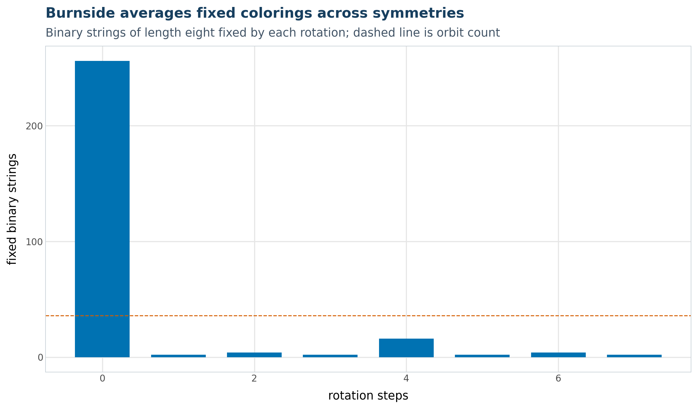

# Algebraic and enumerative combinatorics {#sec-comb-algebraic}

Algebra acts as a compression language for symmetry and enumeration. Group
actions identify equivalent objects, symmetric functions organize tableaux,
and matrix spectra constrain graphs.

## Preparation from this book

Use bijections from Chapter 1, generating functions from Chapters 6–7, and
graphs from Chapter 11. Groups are introduced operationally as reversible
symmetries closed under composition.

## Orbits and fixed points

A group action applies each symmetry to each object. The orbit contains all
representations considered equivalent; the stabilizer contains symmetries
fixing one object. Orbit–stabilizer relates their sizes. Burnside's lemma
counts orbits by averaging fixed-point counts over group elements.

For necklaces, rotations partition positions into cycles. A coloring fixed by a
rotation must be constant on each cycle. Reflections introduce different cycle
types, so bracelets require the full dihedral group. Pólya enumeration records
color multiplicities rather than only the total number of orbits.

<figure id="fig-comb-burnside">


<figcaption>

Figure 15.1: Burnside averaging groups binary strings into rotation orbits and weights each symmetry by its fixed strings.

</figcaption>
</figure>

## Symmetric functions and spectra

Symmetric polynomials are invariant under variable permutation. Several bases
emphasize different structures: monomial, elementary, complete, power-sum, and
Schur functions. Schur coefficients connect tableaux, representations, and
geometry; positivity often signals an underlying decomposition still seeking
a bijective explanation.

Graph adjacency and Laplacian eigenvalues encode walk counts, connectivity, and
expansion. Cospectral graphs need not be isomorphic, so a spectrum is a strong
but incomplete invariant. Linear algebra can bound independent sets and
chromatic number through eigenvalue inequalities.

**Nonexample.** Dividing the total number of colorings by the group order works
only when every orbit has full size. Symmetric objects have nontrivial
stabilizers, precisely the issue Burnside corrects.

<!-- inline-formula-code:start -->
## Formula and finite computation

For a finite group $G$ acting on $X$, the number of orbits is

$$
|X/G|=\frac{1}{|G|}\sum_{g\in G}|\operatorname{Fix}(g)|.
$$

```python
from math import gcd

def rotation_necklaces(length: int, colors: int) -> int:
    if length < 1 or colors < 1:
        raise ValueError("length and colors must be positive")
    fixed_total = sum(colors ** gcd(length, shift) for shift in range(length))
    if fixed_total % length != 0:
        raise RuntimeError("Burnside average is unexpectedly nonintegral")
    return fixed_total // length

print([rotation_necklaces(length, 2) for length in range(1, 9)])
```

**What the computation establishes.** Cycle counts of rotations evaluate
Burnside's average for binary necklaces of several lengths. It does not prove
Burnside's lemma or count reflection equivalence.
<!-- inline-formula-code:end -->

## Root choices are orbits, not always atoms {#sec-comb-root-orbits}

Chapter 6 distinguished $A'(x)$ from the size-preserving series $xA'(x)$.
The coefficient $na_n$ in the latter counts $n$ separately recorded choices
for each of $a_n$ objects. It need not count **rooted unlabeled types**.
Here a root is a distinguished atom, and isomorphisms must preserve that
root. An **automorphism** is an isomorphism from an object to itself.

Fix an unrooted object $T$ with atom set $V(T)$. Two choices $v,w$ produce
the same rooted type precisely when an automorphism of $T$ takes $v$ to
$w$. Indeed such an automorphism is exactly an isomorphism of the two
rooted objects. Its different rooted types are therefore the orbits
$V(T)/\operatorname{Aut}(T)$. If $a_n$ counts unrooted isomorphism types,
the actual rooted count is

$$
r_n=\sum_{[T]:\,|T|=n}
\left|V(T)/\operatorname{Aut}(T)\right|.
$$

This equals $na_n$ only when every atom is in its own orbit for every
size-$n$ object. Rigid objects, which have only the identity automorphism,
are one such case. Distinct labels on all atoms, fixed by isomorphisms,
also distinguish all root choices. In general, multiplication of an ordinary generating
function's coefficients by size is a weighting operation, not a theorem
about rooted isomorphism types. The symmetry obstruction is discussed in
([Bodirsky et al. 2007](bibliography.md#ref-bodirsky2007pointing), author version, p. 2); its more advanced
cycle-pointing construction is not needed for this elementary orbit proof.

### Complete case: oriented colored necklaces

Take $n\ge1$ beads and $q\ge1$ fixed, distinguishable colors. Necklaces
are oriented: we identify rotations, but do **not** identify reflections or
permutations of color names. A rooted isomorphism preserves both the root
and this orientation. These conventions matter; bracelets are a different
counting problem.

For the six binary necklaces of length four, root choices give:

| Representative | Rotations fixing the coloring | Rooted types |
|:--|--:|--:|
| `0000` | 4 | 1 |
| `0001` | 1 | 4 |
| `0011` | 1 | 4 |
| `0101` | 2 | 2 |
| `0111` | 1 | 4 |
| `1111` | 4 | 1 |
| Total | | 16 |

For `0000`, rotations identify all four possible roots. For `0101`, roots
on zero beads form one orbit and roots on one beads form another. For
`0001`, no nonidentity rotation fixes the coloring, so its four roots
remain distinct. Thus the total is sixteen, whereas naive multiplication
of the six unrooted types by four gives twenty-four.

More generally, let a necklace have least rotational period $d$, so $d$
divides $n$. Its stabilizer consists of shifts by multiples of $d$ and has
size $n/d$. No nonidentity rotation fixes an individual bead position, so
each root orbit has $n/d$ positions. This necklace has exactly $d$ rooted
types. The effect of symmetry depends on the object, not just its size.
For the period claim, divide any fixing shift, including $n$, by the least
positive period $d$: a nonzero remainder would be a smaller positive period.
Thus every fixing shift is a multiple of $d$, and $d$ divides $n$.

### A bijection valid for every positive length

Read the colors in the chosen orientation, starting at the marked bead.
This produces a linear word of length $n$. Rotating the necklace and its
root together does not change that word. Conversely, place any linear word
around the oriented circle and mark its first bead. Reading from the root
recovers the word, so these operations are inverse on isomorphism types.
Consequently

$$
r_n=q^n\quad(n\ge1),\qquad
\sum_{n\ge1}r_nx^n=\frac{qx}{1-qx}.
$$

The generating-function identity is formal. There is no rooted empty
necklace, so the formula is deliberately stated only for positive $n$.
If reflections or color-name permutations are also identified, the reading
word need not remain an invariant of the resulting equivalence classes.

### Exact checking with the root transported

Represent a coloring by a tuple $w$ and its marked position by $r$.
Left rotation by $k$ sends the pair to

$$
(w,r)\longmapsto
\bigl((w_k,\ldots,w_{n-1},w_0,\ldots,w_{k-1}),\ (r-k)\bmod n\bigr).
$$

Rotating the word while leaving its root index unchanged is a different
action and can identify the wrong rooted objects. This standalone program
canonicalizes the complete pair under every simultaneous rotation. It
returns one row per unrooted representative, with its stabilizer size and
number of rooted types. Exhaustive generation is intended for small
parameters; its running time grows with the $q^n$ input words.

```python
from itertools import product

def canonical_rooted_necklace(
    word: tuple[int, ...], root: int
) -> tuple[tuple[int, ...], int]:
    """Canonicalize a coloring and root together under left rotations."""
    if type(word) is not tuple or any(type(color) is not int for color in word):
        raise TypeError("word must be a tuple of integer colors, excluding bool")
    if not word or any(color < 0 for color in word):
        raise ValueError("use a nonempty word of nonnegative color labels")
    if type(root) is not int:
        raise TypeError("root must be an integer, excluding bool")
    if not 0 <= root < len(word):
        raise ValueError("root must index a bead in the word")
    return min(
        (word[shift:] + word[:shift], (root - shift) % len(word))
        for shift in range(len(word))
    )

def rooted_necklace_inventory(
    length: int, colors: int
) -> list[tuple[tuple[int, ...], int, int]]:
    """Return (representative, stabilizer size, rooted-type count) rows."""
    if type(length) is not int or type(colors) is not int:
        raise TypeError("length and colors must be integers, excluding bool")
    if length < 1 or colors < 1:
        raise ValueError("length and colors must be positive")
    representatives = {
        min(word[shift:] + word[:shift] for shift in range(length))
        for word in product(range(colors), repeat=length)
    }
    rows = []
    for word in sorted(representatives):
        stabilizer_size = sum(
            word[shift:] + word[:shift] == word for shift in range(length)
        )
        rooted_types = {
            canonical_rooted_necklace(word, root)
            for root in range(length)
        }
        rows.append((word, stabilizer_size, len(rooted_types)))
    return rows

for representative, stabilizer, rooted_count in rooted_necklace_inventory(4, 2):
    print("".join(map(str, representative)), stabilizer, rooted_count)
```

The output is the displayed six-row table. The orbit calculation checks this
finite instance; the reading bijection proves $r_n=q^n$ for all stated
parameters. The original Burnside program counts unrooted necklaces and
therefore answers a different question from the new rooted inventory.

### Changed task: three colors and prime length {#sec-comb-root-orbit-task}

Use $q=3$ distinguishable colors and $n=5$ oriented beads, with rotations
as the only identifications. Compute the number of unrooted necklaces by
Burnside's lemma, and the number of rooted types by the reading bijection.
Then partition the unrooted necklaces by their stabilizer size and recover
the rooted total from those classes. Explain exactly where multiplying the
unrooted count by five overcounts, and by how much. Check your finite
answer with simultaneous pair rotations, not by canonicalizing the word
and discarding the root. The
[separate explanation](#sec-comb-root-orbit-solution) gives both counts
and the symmetry classes causing the difference.

## Representation as explanation

An algebraic formula becomes combinatorial when its basis elements correspond
to objects and multiplication or decomposition has a structural meaning.
Character theory, incidence algebras, and Hopf algebras extend this principle.
Computation can expand expressions, but nonnegative coefficients deserve an
explanation rather than only a printout.

## Weighted orbit inventory

Pólya's cycle-index substitution can retain how many times each color occurs,
not merely count all colorings. This distinction matters for chemical isomers,
inventory constraints, and unlabeled graphs. The acting group and color
permutation action must both be stated. If colors themselves are interchangeable,
there is an additional action beyond position symmetry, and applying only the
necklace group leaves too many orbits.

## A finite action and its equal-size fibres

**Definition 15.1 (Finite group action).** A group \(G\) has an associative operation, an identity \(1\), and an inverse for every element. An action on a finite set \(X\) assigns \(gx\in X\) with \(1x=x\) and \(g(hx)=(gh)x\). The orbit of \(x\) is \(\{gx:g\in G\}\), its stabiliser is \(G_x=\{g:gx=x\}\), and \(\operatorname{Fix}(g)=\{x:gx=x\}\).

Every action map is bijective, with inverse supplied by the inverse group element. Being in the same orbit is an equivalence relation: identity gives reflexivity, inverses give symmetry, and composition gives transitivity. Thus orbits partition the set of records being identified. The group and its action must be specified before an orbit count has a definite meaning.

**Theorem 15.2 (Orbit–stabiliser).** For finite \(G\), \(|Gx|\,|G_x|=|G|\).

*Proof.* The map \(g\mapsto gx\) is onto the orbit. For any \(y=g_0x\), its fibre consists exactly of the elements \(g_0h\) with \(h\in G_x\): the equation \(gx=g_0x\) is equivalent to \(g_0^{-1}g\in G_x\). Multiplication by \(g_0\) is a bijection, so every fibre has size \(|G_x|\). Constant-fibre division proves the identity. ∎

**Theorem 15.3 (Burnside's orbit formula).** For a finite group acting on a finite set,
\[
|X/G|=\frac1{|G|}\sum_{g\in G}|\operatorname{Fix}(g)|.
\]

*Proof.* Count pairs \((g,x)\) with \(gx=x\). Grouping by \(g\) gives the displayed numerator. Grouping by \(x\) gives \(\sum_x|G_x|\). Inside an orbit \(O\), orbit–stabiliser makes each term \(|G|/|O|\), so that orbit's total is \(|G|\). Summing over orbits and dividing by the positive integer \(|G|\) proves the formula. ∎

The average is an integer because it has been proved to count orbits; it is not a numerical rounding prescription. Faithfulness of the action is unnecessary: different group elements may act identically, and they are still separate terms in the pair count. On the other hand, forgetting part of a record, such as its transported root, changes the action set and can change the answer, as the original clinic shows.

### Worked example 15.1: three colours on an oriented three-bead necklace

Identify rotations only, with three fixed color names. The identity fixes all \(3^3=27\) words. Each nonidentity rotation has one position cycle and fixes the three constant words. Burnside gives \((27+3+3)/3=11\) necklaces.

The three constant necklaces each have a stabiliser of size three and orbit size one; the other twenty-four words form eight orbits of size three. This independently accounts for the eleven. Dividing all twenty-seven words by three would give nine, losing the smaller constant orbits.

### Worked example 15.2: adding reflections changes the equivalence

For the same three beads and colors, identify rotations and reflections. The acting dihedral group has six permutations of the positions. The three rotations contribute \(27+3+3\) fixed words. Each of the three reflections fixes one position and swaps the other two, giving two cycles and \(3^2=9\) fixed words. Thus the bracelet count is \((27+6+27)/6=10\).

In this special three-position case every permutation of positions is allowed, so a bracelet is simply a multiset of three colors from three types. Stars and bars gives \(\binom52=10\), matching the action calculation. For longer bracelets, the dihedral group is not every position permutation, so this multiset shortcut cannot be imported unchanged.

## Weighted fixed points retain inventory constraints

**Theorem 15.4 (Finite colour-inventory formula).** Let a finite group permute \(n\) positions and let \(q\ge1\) fixed colors have markers \(x_1,\ldots,x_q\). The polynomial counting colouring orbits by their color multiplicities is
\[
\frac1{|G|}\sum_{g\in G}
\prod_{\gamma\text{ a position cycle of }g}
\left(x_1^{|\gamma|}+\cdots+x_q^{|\gamma|}\right).
\]

*Proof.* A colouring fixed by \(g\) must be constant on each position cycle, and that condition is sufficient. Choosing color \(i\) on a cycle contributes \(x_i^{|\gamma|}\); choices on different cycles multiply. Thus the product is the inventory of fixed colourings. Position permutations preserve every multiplicity vector, so restrict the action to the colourings of any fixed inventory and apply Burnside there. Equality of each inventory coefficient proves the polynomial formula. ∎

### Worked example 15.3: a prescribed number of black beads

For binary oriented necklaces of length four with exactly two black beads, the identity fixes \(\binom42=6\) colourings. Quarter-turn rotations fix only constant colourings, so contribute zero at this inventory. The half-turn has two cycles of length two; exactly one cycle must be black, giving two fixed colourings. The count is \((6+0+2+0)/4=2\).

The two types are adjacent black beads, represented by \(0011\), and opposite black beads, represented by \(0101\). Their orbit sizes are four and two. The inventory polynomial is
\[
\frac14\left((a+b)^4+2(a^4+b^4)+(a^2+b^2)^2\right),
\]
whose \(a^2b^2\) coefficient is two. This example explains why a weighted fixed-point calculation, not a uniform division of six by four, handles the constraint.

## Matrix entries also require a counted family

The spectral overview uses a further algebraic language. Its basic walk-count identity can be proved directly before any eigenvalue theorem is used. For adjacency matrix \(A\) of a simple graph, let \(A^0\) be the identity matrix and use the finite multiplication rule \((BC)_{ij}=\sum_kB_{ik}C_{kj}\). Then \((A^r)_{ij}\) counts length-\(r\) walks from \(i\) to \(j\).

The proof is induction. At \(r=0\), there is one empty walk when endpoints agree and none otherwise. A length-\(r+1\) walk has a unique penultimate vertex \(k\); its prefix is a length-\(r\) walk and its last edge contributes \(A_{kj}\). Summing over \(k\) gives precisely the matrix product. The intermediate vertices may repeat, so these are walks rather than paths.

In a loopless simple graph, a closed three-step walk uses three distinct vertices and traverses a triangle. Each triangle has three start vertices and two directions, so its count is \(\operatorname{tr}(A^3)/6\). This proves one exact graph invariant from the algebra. Deeper eigenvalue bounds mentioned in the original overview require linear algebra, for which [Linear Algebra: Structure and Proofs](#/books/linear-algebra-structure-proofs) is a separate preparation route; they are not proved by agreement of one finite spectrum.

The common theme is that algebra compresses a precisely defined family. A symmetry average counts fixed records, a polynomial coefficient counts inventory, and a matrix product counts concatenated walks. None automatically classifies structures up to isomorphism or removes the need to specify what an object remembers.

## Summary

Group actions correct symmetry overcounting through fixed points. Symmetric
functions and spectral methods encode deeper structure, while their invariants
must not be mistaken for complete classifications.

## Exercises

<div class="exercise" id="comb-algebraic-enumerative-ex-1-exercise">

### Exercise 15.1 {#comb-algebraic-enumerative-ex-1}

1. Find rotation orbits of binary words of length four.

<details>
<summary>Hint 1</summary>

**Hint.** Classify by the number of ones, then by whether two ones are adjacent or opposite.

</details>
<details>
<summary>Hint 2</summary>
**Hint.** Constant words have smaller orbits.

</details>
<details>
<summary>Solution</summary>
**Solution.** Representatives are $0000,0001,0011,0101,0111,1111$. Their orbit sizes are one, four, four, two, four, one, summing to sixteen words. Thus there are six orbits. The two weight-two orbits distinguish adjacency patterns, not merely multiplicity.

</details>

</div>

<div class="exercise" id="comb-algebraic-enumerative-ex-2-exercise">

### Exercise 15.2 {#comb-algebraic-enumerative-ex-2}

2. Derive the fixed-coloring count from cycle decomposition.

<details>
<summary>Hint 1</summary>

**Hint.** A fixed colouring must be constant along each position cycle.

</details>
<details>
<summary>Hint 2</summary>

**Hint.** Different cycles choose colors independently.

</details>
<details>
<summary>Solution</summary>

**Solution.** If a position permutation has $c$ cycles, its fixed colourings number $q^c$. Necessity follows by repeatedly applying the permutation along a cycle; sufficiency holds because a constant cycle colouring is unchanged. Independent color choices here are finite product choices, not an unstated random sampling model.

</details>

</div>

<div class="exercise" id="comb-algebraic-enumerative-ex-3-exercise">

### Exercise 15.3 {#comb-algebraic-enumerative-ex-3}

3. Extend the calculation to one reflection type.

Use the reflection of four positions fixing one and three and exchanging two and four.

<details>
<summary>Hint 1</summary>

**Hint.** Use the specified four-position reflection.

</details>
<details>
<summary>Hint 2</summary>

**Hint.** Count its fixed positions and transposed pair as separate cycles.

</details>
<details>
<summary>Solution</summary>

**Solution.** The permutation fixing positions one and three and exchanging two and four has three cycles, so it fixes $q^3$ colourings. A reflection exchanging two pairs instead has two cycles and fixes $q^2$. The reflection type must be stated because even-length bracelets have these different cycle structures.

</details>

</div>

<div class="exercise" id="comb-algebraic-enumerative-ex-4-exercise">

### Exercise 15.4 {#comb-algebraic-enumerative-ex-4}

4. Explain why naive division fails.

<details>
<summary>Hint 1</summary>

**Hint.** Compare two orbit sizes.

</details>
<details>
<summary>Hint 2</summary>

**Hint.** A constant colouring is fixed by every rotation.

</details>
<details>
<summary>Solution</summary>

**Solution.** At length four, $0000$ has orbit size one while $0001$ has size four. Thus the forgetful classes are unequal and dividing all sixteen words by four is invalid. Burnside averages fixed-point counts, with stabilisers accounting for precisely these variable orbit sizes.

</details>

</div>

<div class="exercise" id="comb-algebraic-enumerative-ex-5-exercise">

### Exercise 15.5 {#comb-algebraic-enumerative-ex-5}

5. Relate adjacency traces to closed walks.

<details>
<summary>Hint 1</summary>

**Hint.** First prove matrix powers count walks.

</details>
<details>
<summary>Hint 2</summary>

**Hint.** The trace sums equal-endpoint entries.

</details>
<details>
<summary>Solution</summary>

**Solution.** Induction on length with the penultimate-vertex decomposition proves $(A^r)_{ij}$ counts length-$r$ walks. Therefore $\operatorname{tr}(A^r)$ counts closed such walks with a recorded starting vertex. For $r=3$ in a simple graph each triangle is counted six times, giving triangle count $\operatorname{tr}(A^3)/6$.

</details>

</div>

<div class="exercise" id="comb-algebraic-enumerative-ex-6-exercise">

### Exercise 15.6 {#comb-algebraic-enumerative-ex-6}

6. Give two invariants that do not determine isomorphism.

<details>
<summary>Hint 1</summary>

**Hint.** Use graphs with the same order and degrees.

</details>
<details>
<summary>Hint 2</summary>

**Hint.** Compare a six-cycle with two disjoint triangles.

</details>
<details>
<summary>Solution</summary>

**Solution.** Both graphs have six vertices, six edges, and degree sequence $(2,2,2,2,2,2)$. One has no triangles and is connected; the other has two triangles and two components. Thus order and size, or even order and degree sequence, do not determine isomorphism.

</details>

</div>

<div class="exercise" id="comb-algebraic-enumerative-ex-7-exercise">

### Exercise 15.7 {#comb-algebraic-enumerative-ex-7}

7. Solve the [three-color root-orbit task](#sec-comb-root-orbit-task).

<details>
<summary>Hint 1</summary>

**Hint.** Separate the constant necklaces from the other prime-length necklaces.

</details>
<details>
<summary>Hint 2</summary>

**Hint.** A nonconstant length-five word has no nonidentity fixing rotation.

</details>
<details>
<summary>Solution</summary>

**Solution.** There are $(3^5+4\cdot3)/5=51$ unrooted necklaces and $3^5=243$ rooted types. Three constant necklaces have stabiliser size five and one rooted type each; forty-eight others have five rooted types each. Their total is $3+48\cdot5=243$. Naively multiplying 51 by five gives 255, an excess of twelve, all from the constant necklaces.

</details>

</div>

<div class="exercise" id="comb-algebraic-enumerative-ex-8-exercise">

### Exercise 15.8 {#comb-algebraic-enumerative-ex-8}

Compare three-colour oriented necklaces and bracelets of length three.

<details>
<summary>Hint 1</summary>

**Hint.** For rotations, use one identity and two three-cycles.

</details>
<details>
<summary>Hint 2</summary>

**Hint.** For bracelets, add the three reflections with two position cycles each.

</details>
<details>
<summary>Solution</summary>

**Solution.** The rotation count is $(27+3+3)/3=11$. The bracelet count is $(27+3+3+3\cdot9)/6=10$. Reflections identify an additional pair of oriented types. The three color names remain distinguishable in both models; permuting color names would define a further quotient.

</details>

</div>

<div class="exercise" id="comb-algebraic-enumerative-ex-9-exercise">

### Exercise 15.9 {#comb-algebraic-enumerative-ex-9}

Count binary oriented necklaces of length four with exactly two ones.

<details>
<summary>Hint 1</summary>

**Hint.** Restrict every fixed-point count to that inventory.

</details>
<details>
<summary>Hint 2</summary>

**Hint.** Only the identity and half-turn contribute.

</details>
<details>
<summary>Solution</summary>

**Solution.** The identity fixes six such words, quarter-turns none, and the half-turn two, giving $(6+0+2+0)/4=2$. Representatives are adjacent ones $0011$ and opposite ones $0101$. Their different orbit sizes explain why six divided by four is not the correct count.

</details>

</div>

<div class="exercise" id="comb-algebraic-enumerative-ex-10-exercise">

### Exercise 15.10 {#comb-algebraic-enumerative-ex-10}

For an unlabelled star $K_{1,3}$, count rooted types and compare with the count for one fixed labeled star.

<details>
<summary>Hint 1</summary>

**Hint.** Automorphisms fix the center and permute the leaves.

</details>
<details>
<summary>Hint 2</summary>

**Hint.** A rooted isomorphism must preserve its distinguished vertex.

</details>
<details>
<summary>Solution</summary>

**Solution.** The unlabelled star has two vertex orbits, center and leaves, hence two rooted types. A fixed labeled star whose isomorphisms preserve all labels has four distinct root choices. Multiplication by four is valid for the labeled record model but overcounts unlabelled rooted types. The root must be transported with the object under every symmetry.

</details>

</div>

### Selected solution

For Exercise 2, every position in one permutation cycle must share a color in a
fixed coloring. Cycles choose colors independently, yielding colors raised to
the number of cycles.

### Changed-task explanation: three colors, five beads {#sec-comb-root-orbit-solution}

The identity rotation fixes all $3^5=243$ words. Each of the other four
rotations has one cycle of positions and fixes only the three constant
colorings. Burnside's average is therefore

$$
a_5=\frac{3^5+4\cdot3}{5}=51.
$$

The reading-from-root bijection gives $r_5=3^5=243$. Because five is prime,
a coloring fixed by any nonidentity rotation is constant. There are three
constant necklaces, each with stabilizer size five and just one rooted
type. The other $51-3=48$ necklaces have trivial stabilizer and five rooted
types each. Summing by these classes gives

$$
r_5=3\cdot1+48\cdot5=243.
$$

The coefficient of $x^5$ in $xA'(x)$ is instead $5\cdot51=255$.
It overcounts by twelve: each of the three constant necklaces contributes
five marked positions but only one rooted isomorphism type, an excess of
four each. No nonconstant necklace contributes an excess at this prime
length. This identifies the exact lost distinction between weighting atom
choices and counting their symmetry orbits. Return to the
[formal-series explanation](06-ordinary-generating-functions.md#sec-comb-formal-pointing)
for the separate exponent change in $A'(x)$.

## Sources for the expanded chapter {#sec-comb-algebraic-enumerative-sources}

Every original root-orbit theorem, necklace investigation, source citation, code block, changed-task anchor, and detailed solution is retained. The finite group-action, fixed-point, inventory, and matrix-walk arguments are original expositions with complete proofs. Primary comparison reading is Richard P. Stanley's [Enumerative Combinatorics author materials](https://math.mit.edu/~rstan/ec/); the original pointing reference remains beside the stronger symmetry discussion.

## Summary and next connection {#sec-comb-algebraic-enumerative-summary}

Finite actions partition records into orbits whose sizes are controlled by stabilisers. Counting fixed pairs proves Burnside's average, and restricting it by inventory gives weighted orbit counts. Root choices and matrix walks retain their own exact record conventions; neither a derivative nor a spectrum automatically counts or classifies unlabelled structures. [Algorithms and random structures](22-algorithms-random-structures.md) next connects those specifications to finite generation and carefully stated distributions.
