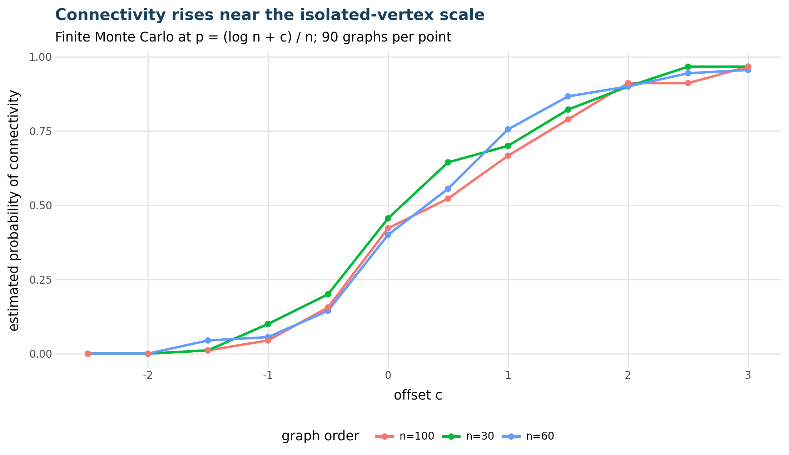

# Algorithms and random structures {#sec-comb-algorithms-random}

Combinatorics supplies both the search space and the structure that makes
search feasible. Random structures then reveal properties that appear abruptly
at scale and provide average-case tests for deterministic intuitions.

## Preparation from this book

Chapter 5 supplies dynamic programming, Chapter 11 graph representations, and
Chapter 18 probability. The Python laboratory gives a complete small random-
graph experiment.

## Exact and parameterized algorithms

Brute force is a specification for tiny instances, not a scalability plan.
Backtracking prunes partial objects that cannot extend. Dynamic programming
merges equivalent subproblems; meet-in-the-middle trades memory for a square-
root reduction in exponent; inclusion–exclusion and transforms accelerate
subset-state computations.

Polynomial-time algorithms for matching, flow, and spanning trees exploit
exchange or duality. Many counting problems remain hard even when finding one
object is easy. Parameterized analysis isolates a small structural quantity
such as treewidth, solution size, or feedback set and seeks running time that
is exponential only in that parameter.

## Random graphs and thresholds

In the Erdős–Rényi model $G(n,p)$, each possible edge appears independently
with probability $p$. Expected edges vary smoothly, but properties such as the
absence of isolated vertices, a giant component, connectivity, and Hamilton
cycles emerge in narrow probability windows as $n$ grows.

<figure id="fig-comb-random-threshold">


<figcaption>

Figure 16.1: Connectivity in finite random graphs rises sharply near the isolated-vertex scale.

</figcaption>
</figure>

The expected number of copies of a fixed graph gives a first threshold guess.
Proving a threshold may require variance, branching-process comparison,
coupling, or concentration. A finite plot can suggest scaling but cannot prove
sharpness or a limiting law.

**Nonexample.** An average running time on random inputs is not a worst-case
guarantee. Likewise, an algorithm that usually finds a witness does not decide
the property unless failure has a certified interpretation.

<!-- inline-formula-code:start -->
## Formula and finite computation

The expected number of isolated vertices in $G(n,p)$ is

$$
\mathbb E[I]=n(1-p)^{n-1}.
$$

```python
from math import log

def expected_isolated_vertices(order: int, edge_probability: float) -> float:
    if order < 1 or not 0.0 <= edge_probability <= 1.0:
        raise ValueError("invalid random-graph parameters")
    return order * (1.0 - edge_probability) ** (order - 1)

for order in (20, 100, 500):
    probability = log(order) / order
    print(order, round(expected_isolated_vertices(order, probability), 4))
```

**What the computation establishes.** The exact expectation is evaluated at
three finite points near the connectivity scale. It does not prove
connectivity, independence among isolation events, or convergence to a
particular limiting distribution.
<!-- inline-formula-code:end -->

## Approximation and sampling

When exact counting is intractable, randomized approximation may estimate a
partition function or nearly sample objects. Markov-chain methods require a
stationary distribution and a mixing-time argument; observing a stable trace
is not such a proof. Self-reducibility can connect approximate counting and
sampling. Deterministic approximation schemes are available for some bounded
or correlation-decay regimes.

## Reproducible evidence

Report input distribution, instance sizes, implementation, seed policy,
runtime statistic, and uncertainty. Verify small cases against exhaustive
answers and include adversarial instances. Complexity theory classifies
families as size grows; benchmarks describe only the tested regime.

## End-to-end case-study protocol

Begin with a canonical serializer for instances and solutions. Use exhaustive
search as an oracle only below a documented size, then compare optimized and
randomized methods on exactly the same inputs. Validate every returned witness
independently. Record timeouts separately from negative answers, plot scaling
against more than one candidate growth law, and retain raw measurements. For
random structures, vary both size and the rescaled threshold parameter rather
than only raw edge probability.

## Specifications, states, and exact answers

**Definition 16.1 (Finite counting problem).** A counting problem assigns to each finite input $x$ a finite set $\Omega(x)$ of valid objects and asks for its cardinality. An enumeration algorithm emits every member exactly once. An exact sampler returns each member with probability $1/|\Omega(x)|$ when the set is nonempty. Finding one member, counting all members, and sampling uniformly are distinct tasks.

The representation belongs to the specification. A subset stored as an increasing sequence has one representation, whereas the same subset stored in arbitrary order has many. A backtracking program that emits every ordering has enumerated representations, not necessarily objects. Before discussing running time, identify what constitutes one output and how duplicate representations are prevented.

**Worked example 16.2 (Enumerating fixed-size subsets).** To enumerate the three-element subsets of $[5]$, choose increasing entries $a<b<c$. After choosing $a$, require $b>a$, and after choosing $b$, require $c>b$. This gives exactly the ten triples counted by $\binom53$. The inequalities prove validity and uniqueness. Choosing three distinct entries in arbitrary order would instead generate $5\cdot4\cdot3=60$ sequences, six per subset. Sorting and deduplicating can recover the same answer, but wastes work and obscures the direct combinatorial specification.

Backtracking becomes useful when a prefix can be rejected before it is complete. For example, when choosing a subset with a prescribed sum, a partial sum exceeding the target can be rejected if all remaining choices are positive. That qualification matters: with negative entries, the sum could fall again. A pruning rule needs a proof that no completion of the discarded prefix is valid.

## Dynamic programming as a proved decomposition

**Definition 16.3 (Sufficient state).** A state records the information needed to determine the valid completions of a partial construction. Two partial constructions may share a state only when their possible completions are counted in the same way. A dynamic program evaluates a recurrence on these states and reuses the resulting values.

A state need not remember every detail of the past. However, discarding information is justified by the constraints, not by a desire for a smaller table. For subsets with a target sum and bounded entries, a useful state records the next available entry, remaining number of choices, and remaining sum. Remembering only the remaining sum would merge prefixes with different available elements and generally give a wrong answer.

**Theorem 16.4 (Path counting on a finite state graph).** Let a finite directed acyclic graph describe a construction, with terminal states each representing one completed object. Suppose the outgoing branches at each state divide its completions into disjoint classes and every object has a unique path. Then the number $C(v)$ of completions satisfies $C(v)=\sum_{v\to w}C(w)$ at nonterminal states, with value one at successful terminals and zero at dead ends.

*Proof.* At a nonterminal state, every completion chooses one outgoing branch. Disjointness means no completion belongs to two branches; exhaustiveness means none is omitted. Thus the sum rule gives the recurrence. Since the state graph is finite and acyclic, reverse topological order starts with terminal values and reaches every state. Induction in that order proves that the computed values equal the defined numbers of completions. ∎

**Worked example 16.5 (Monomer–domino tilings).** Tile a board of length $n$ with pieces of lengths one and two, and let $T_n$ be the count. The first piece is either a monomer, leaving length $n-1$, or a domino, leaving length $n-2$. These classes are disjoint and the remainder determines the tiling uniquely, so $T_n=T_{n-1}+T_{n-2}$ for $n\ge2$, with $T_0=T_1=1$. Thus $T_2=2$, $T_3=3$, $T_4=5$. For length four the objects, written as piece lengths, are $1111$, $112$, $121$, $211$, and $22$. The state “remaining length” is sufficient because no constraint depends on the earlier pieces.

A naive recursion recomputes the same remaining lengths repeatedly. A table evaluates each of the $n+1$ states once, using a linear number of additions, or stores only the last two values when only the final count is needed. This is an arithmetic-operation count. Exact integers grow with $n$, so constant-cost addition is an explicit computational model, not a literal machine-time guarantee. Enumerating all tilings also requires time proportional to the number and length of outputs, even when the count itself is obtained by a short recurrence.

Parameterized algorithms refine the same question of state size. A bound $f(k)n^c$ with constant exponent $c$ separates dependence on a chosen parameter $k$ from dependence on input size $n$. A bound $n^k$ has a different form, because the exponent grows with the parameter. Naming a useful parameter is only a first step; the state space and transition count must justify the claimed running time.

## From exact counts to exact random objects

**Theorem 16.6 (Branch-weighted sampling).** Under the hypotheses of Theorem 16.4, suppose a state $v$ has $C(v)>0$. Choose its next branch $v\to w$ with probability $C(w)/C(v)$, ignoring zero-count branches, and repeat until a terminal state is reached. The resulting completed object is uniform among the $C(v)$ possibilities.

*Proof.* Induct backwards through the state graph. A terminal state has one object and is already uniform. A specific completion in the branch through $w$ is selected with probability $C(w)/C(v)$ times $1/C(w)$ by the inductive hypothesis. The product is $1/C(v)$, independent of both the branch and the particular object. The probabilities sum to one because the branch counts sum to $C(v)$. ∎

**Worked example 16.7 (Why fair branch choices can be biased).** At remaining length three, there are two first-piece types. If each is chosen with probability one half, the tiling $21$ has probability one half, while $111$ and $12$ each have probability one quarter. Equal choice among branches is not equal choice among objects. The correct probabilities are $T_2/T_3=2/3$ for a monomer and $T_1/T_3=1/3$ for a domino. In the monomer branch, its two completions each then receive probability $(2/3)(1/2)=1/3$, matching the domino branch.

At length four, the first-piece probabilities are $3/5$ and $2/5$. Any one tiling beginning with a monomer has probability $(3/5)(1/3)=1/5$; any one beginning with a domino has probability $(2/5)(1/2)=1/5$. This finite example connects a recurrence, an exact count, and an exact probability guarantee.

Integer counts allow exact branch probabilities without floating-point rounding. Generate a uniform integer from $0$ to $C(v)-1$, give each branch a consecutive interval of length $C(w)$, and take the branch whose interval contains the integer. Every possible integer has exactly one destination, and interval lengths give the desired probabilities.

**Proposition 16.8 (Uniform integer by rejection).** For $M\ge2$, let $b$ be the least integer with $2^b\ge M$. Draw $b$ independent fair bits as an integer $U$ in $\{0,\ldots,2^b-1\}$. Reject when $U\ge M$ and repeat. The accepted integer is uniform on $\{0,\ldots,M-1\}$, and the expected number of trials is less than two.

*Proof.* Each trial accepts with probability $a=M/2^b>1/2$. For any fixed permitted $u$, the probability it is the eventual answer is
$\sum_{j\ge0}(1-a)^j2^{-b}=2^{-b}/a=1/M$.
The probability of never accepting is $\lim_j(1-a)^j=0$. The expected trial count is $\sum_{j\ge0}(1-a)^j=1/a<2$. For $M=1$, return zero without drawing bits. ∎

A pseudorandom generator and a recorded seed are practical ways to reproduce a run, but the mathematical guarantee above assumes independent fair bits. Reproducibility and distributional correctness answer different questions. Likewise, choosing uniformly among currently minimal elements of a poset is generally biased; the correct branch weights are the numbers of extensions of the remaining posets.

## What random-graph calculations prove

**Definition 16.9 (Independent-edge model).** In $G(n,p)$, $n$ labeled vertices are fixed and each of the $\binom n2$ possible edges is present independently with probability $p\in[0,1]$. Thus a particular graph with $m$ edges has probability $p^m(1-p)^{\binom n2-m}$, interpreted directly by independent edge choices at the endpoints $p=0,1$.

This model differs from choosing uniformly among graphs with exactly $m$ edges. In $G(n,p)$ the edge count varies and has a binomial distribution; conditional on that count being $m$, all graphs with that count have equal probability. The distinction affects dependencies and must be kept visible when transferring an argument between models.

**Proposition 16.10 (Edges, triangles, and isolated vertices).** In $G(n,p)$,
\[
\mathbb E[E]=\binom n2p,\qquad
\mathbb E[T]=\binom n3p^3,\qquad
\mathbb E[I]=n(1-p)^{n-1}
\]
for $n\ge1$, where $E,T,I$ count edges, triangles, and isolated vertices.

*Proof.* Introduce an indicator for each potential edge, each three-vertex set, and each vertex respectively. Their expectations are $p$, $p^3$, and $(1-p)^{n-1}$: a triangle needs its three independent edges, and isolation needs all incident edges absent. Summing expectations proves all formulas. Independence among the indicators themselves is unnecessary; only the specified edge choices used to evaluate an individual indicator need independence. For $n=1$ the empty set of incident-edge conditions has probability one. ∎

**Worked example 16.11 (A finite model and a threshold guess).** In $G(10,1/5)$ the expected edge count is $45/5=9$, while the expected triangle count is $120/125=0.96$. Since a nonnegative integer variable $X$ satisfies $\Pr(X\ge1)\le\mathbb E[X]$, the probability of any triangle is at most $0.96$. This is a valid but weak upper bound. It does not show the probability equals $0.96$ or that triangles are independent. More generally $\binom n3p^3$ becomes order one around $p=1/n$, suggesting the triangle scale. The expectation alone proves only the sparse direction: if $np\to0$, then $\Pr(T>0)\le\mathbb E[T]\to0$. Establishing the other direction requires additional reasoning.

Isolation indicators are positively correlated. For distinct vertices $u,v$ and $n\ge2$, simultaneous isolation requires absence of $2n-3$ edges, because the edge $uv$ was counted in both incident lists. Thus
\[
\Pr(u,v\text{ both isolated})=(1-p)^{2n-3},
\]
rather than $(1-p)^{2n-2}$. For $0<p<1$ these differ, so multiplying the individual isolation probabilities would be wrong. The exact identity also gives
$\mathbb E[I(I-1)]=n(n-1)(1-p)^{2n-3}$, a starting point for second-moment analysis.

For fixed real $c$ and $p=(\log n+c)/n$, the expectation tends to $e^{-c}$. Indeed, for $0\le x<1$, integrating $1/(1-x)$ gives
$|\log(1-x)+x|\le x^2/[2(1-x)]$.
Here $np^2\to0$, so
$\log\mathbb E[I]=\log n+(n-1)\log(1-p)\to-c$.
This proves a limit of expectations, not a limiting distribution. At $p=(\log n+\omega(n))/n$ with $\omega(n)\to\infty$ and $0\le p\le1$, the simpler bound
\[
\mathbb E[I]\le n e^{-p(n-1)}
=\exp(-\omega(n)+p)\le e^{1-\omega(n)}
\]
implies that isolated vertices are absent with probability tending to one. A graph can have two nontrivial components and no isolated vertices, so connectivity still needs a separate theorem.

## Certificates and empirical limits

A returned witness can often be checked cheaply: verify a matching has disjoint endpoints, a colouring avoids its forbidden clique, or a tableau has the correct entries and inequalities. Failure to find a witness does not normally certify its absence. An exhaustive search can certify absence only when the search space and pruning rules are complete. A timeout certifies only that the chosen computation did not finish.

The same discipline applies to Markov-chain sampling. A proposed stationary distribution is not enough: one needs irreducibility on the intended state space, appropriate periodicity control, and a quantitative convergence bound before claiming nearly uniform samples after a stated number of steps. Stable traces can be useful diagnostics but do not replace those arguments. Exact branch-weighted sampling avoids a mixing question at the cost of requiring exact completion counts, which may be prohibitively expensive.

## Summary

Algorithms exploit decomposition, exchange, and parameters; random structures
expose typical behavior and phase transitions. Both demand a sharp separation
among exact proof, asymptotic theorem, randomized guarantee, and finite
experiment.

## Exercises

<div class="exercise" id="comb-algorithms-random-structures-ex-1">

### Exercise 16.1

1. Compare brute force and dynamic programming state counts.

<details><summary>Hint 1</summary>

Use monomer–domino tilings as a concrete model.

</details>
<details><summary>Hint 2</summary>

Distinguish the number of completed tilings from the number of remaining-length states.

</details>
<details><summary>Solution</summary>

A direct search emits $T_n$ tilings and must do at least that much output work. The counting dynamic program uses states $0,\ldots,n$ and a constant number of additions per state, so needs $O(n)$ arithmetic operations. It computes a count rather than emitting every tiling. Exact integer size still affects bit complexity, so the arithmetic-operation bound is not a claim of constant-time large-integer addition.

</details>

</div>

<div class="exercise" id="comb-algorithms-random-structures-ex-2">

### Exercise 16.2

2. Identify a useful graph parameter.

<details><summary>Hint 1</summary>

Choose a parameter that controls what a partial computation needs to remember.

</details>
<details><summary>Hint 2</summary>

A small vertex cover leaves an independent set outside it.

</details>
<details><summary>Solution</summary>

If a vertex cover $C$ of size $k$ is supplied, every vertex outside it is adjacent only to vertices in $C$. For maximum independent set, enumerate independent subsets $S\subseteq C$ and extend each by all outside vertices with no neighbour in $S$. Every independent set is contained in one of these extensions, so taking the largest gives the exact optimum. There are at most $2^k$ choices and each extension is checked in polynomial time, yielding the required parameter dependence.

</details>

</div>

<div class="exercise" id="comb-algorithms-random-structures-ex-3">

### Exercise 16.3

3. Derive the isolated-vertex expectation.

<details><summary>Hint 1</summary>

Use one indicator per vertex.

</details>
<details><summary>Hint 2</summary>

There are $n-1$ incident potential edges at each vertex.

</details>
<details><summary>Solution</summary>

For Exercise 3, each vertex is isolated exactly when its $n-1$ incident
potential edges are absent, which has probability $(1-p)^{n-1}$. Sum the $n$
indicator expectations without assuming the indicators are independent.
This gives $\mathbb E[I]=n(1-p)^{n-1}$, including $n=1$ by the empty-product convention.

</details>

</div>

<div class="exercise" id="comb-algorithms-random-structures-ex-4">

### Exercise 16.4

4. Estimate an edge threshold for a fixed triangle.

<details><summary>Hint 1</summary>

Count three-vertex sets and require all three edges.

</details>
<details><summary>Hint 2</summary>

Solve for the scale where the expected triangle count is order one.

</details>
<details><summary>Solution</summary>

The expectation is $\binom n3p^3$, approximately $(np)^3/6$. This suggests $p$ of order $1/n$. If $np\to0$, Markov's inequality proves triangle absence with probability tending to one. The expectation becoming large does not alone prove triangle presence with probability tending to one, so the proposed scale is a threshold estimate until the complementary probabilistic argument is supplied.

</details>

</div>

<div class="exercise" id="comb-algorithms-random-structures-ex-5">

### Exercise 16.5

5. Distinguish mixing evidence from a mixing proof.

<details><summary>Hint 1</summary>

Ask whether a finite trajectory could miss a slow transition.

</details>
<details><summary>Hint 2</summary>

A proof bounds distance from the target law over the stated initial conditions.

</details>
<details><summary>Solution</summary>

A stable trace or agreement across a few runs describes observed trajectories. A mixing proof gives a bound on the difference between the chain's distribution after $t$ steps and its target distribution, with initial-state and parameter assumptions stated. A chain can look stable inside one region while rarely crossing to another. Thus the empirical observation does not establish the quantitative guarantee.

</details>

</div>

<div class="exercise" id="comb-algorithms-random-structures-ex-6">

### Exercise 16.6

6. Design a reproducible benchmark table.

<details><summary>Hint 1</summary>

Include enough information to reconstruct each input and interpret failures.

</details>
<details><summary>Hint 2</summary>

Separate certified negative answers from timeouts.

</details>
<details><summary>Solution</summary>

Include instance identifier, generation rule or stored input, size, structural parameter, seed, algorithm version, runtime statistic and unit, memory measure, and outcome. Record witness-check result for positive answers and the certificate type for negative answers. Give timeouts their own outcome. For randomized repetitions also record repetition count and uncertainty. These fields describe the experiment without turning finite measurements into an asymptotic proof.

</details>

</div>

<div class="exercise" id="comb-algorithms-random-structures-ex-7">

### Exercise 16.7

Find the correct first-piece probabilities for an exact uniform tiling of length five.

<details><summary>Hint 1</summary>

Compute $T_3,T_4,T_5$.

</details>
<details><summary>Hint 2</summary>

Each branch probability is its completion count divided by the total.

</details>
<details><summary>Solution</summary>

The recurrence gives $T_3=3$, $T_4=5$, $T_5=8$. The monomer branch has five completions and probability $5/8$; the domino branch has three and probability $3/8$. Recursively using the same rule gives every complete tiling probability $1/8$, by cancellation of successive completion-count ratios.

</details>

</div>

<div class="exercise" id="comb-algorithms-random-structures-ex-8">

### Exercise 16.8

Use fair bits to sample uniformly from five objects, and find the expected number of trials.

<details><summary>Hint 1</summary>

Three bits give eight equally likely integers.

</details>
<details><summary>Hint 2</summary>

Reject three of the eight outcomes.

</details>
<details><summary>Solution</summary>

Draw a three-bit integer from zero through seven and accept only zero through four. The acceptance probability is $5/8$, so the expected number of trials is $8/5$. For each accepted value the eventual probability is $\sum_{j\ge0}(3/8)^j(1/8)=1/5$. Relabel the five values by the five objects.

</details>

</div>

<div class="exercise" id="comb-algorithms-random-structures-ex-9">

### Exercise 16.9

Show explicitly that isolation indicators for distinct vertices are not independent when $n\ge2$ and $0<p<1$.

<details><summary>Hint 1</summary>

Their lists of incident edges share exactly one edge.

</details>
<details><summary>Hint 2</summary>

Compare the joint absence exponent with the product exponent.

</details>
<details><summary>Solution</summary>

The joint probability is $(1-p)^{2n-3}$, while the product of the marginal probabilities is $(1-p)^{2n-2}$. Their difference is $p(1-p)^{2n-3}>0$, so the covariance is positive and independence fails. The expected sum of indicators is nevertheless the sum of their expectations, because linearity does not require independence.

</details>

</div>

<div class="exercise" id="comb-algorithms-random-structures-ex-10">

### Exercise 16.10

Prove that conditioning $G(n,p)$ on exactly $m$ edges gives the uniform distribution on $m$-edge graphs, assuming $0<p<1$ and $0\le m\le\binom n2$.

<details><summary>Hint 1</summary>

Write the probability of any specified graph with $m$ edges.

</details>
<details><summary>Hint 2</summary>

Every graph in the conditioning event has the same probability.

</details>
<details><summary>Solution</summary>

Put $N=\binom n2$. Each specified $m$-edge graph has probability $p^m(1-p)^{N-m}$. There are $\binom Nm$ such graphs, so the probability of the conditioning event is their number times that common positive value. Dividing gives conditional probability $1/\binom Nm$ for each graph. Positivity of $p$ and $1-p$ ensures the conditional distribution is defined for every permitted $m$.

</details>

</div>

### Selected solution

For Exercise 3, each vertex is isolated exactly when its $n-1$ incident
potential edges are absent, which has probability $(1-p)^{n-1}$. Sum the $n$
indicator expectations without assuming the indicators are independent.

## Summary {#comb-algorithms-random-structures-summary}

Algorithms exploit decomposition, exchange, and parameters; random structures
expose typical behavior and phase transitions. Both demand a sharp separation
among exact proof, asymptotic theorem, randomized guarantee, and finite
experiment. A proved completion recurrence gives exact counts, and its branch
weights give exact uniform samples when the random-integer source is exact.
Indicator calculations supply rigorous finite expectations and some one-sided
probability bounds; threshold pictures and benchmark traces require further
arguments before becoming universal conclusions.
