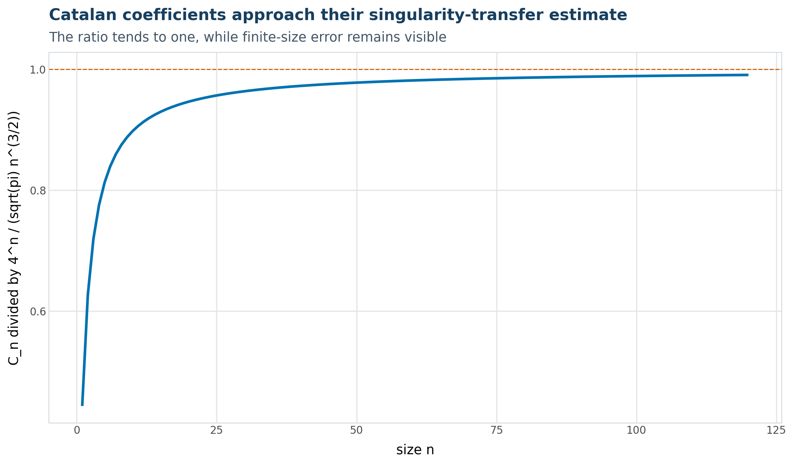

# Analytic combinatorics and coefficient transfer {#sec-comb-analytic}

Formal generating functions answer exact counting questions without asking
whether a series converges. Analytic combinatorics adds complex-analytic
information: where a generating function first becomes singular, and what the
local shape of that singularity says about distant coefficients. This chapter
builds that bridge carefully. It also marks the boundary at which a short
Python calculation is evidence rather than a proof of an asymptotic theorem.

## Preparation from this book

Read Chapters 6 and 8 for ordinary generating functions and asymptotic
notation. Chapter 5 explains how recurrences arise. The only new analytic idea
needed at first is that a power series has a disk on which it represents an
ordinary function; the real-analysis volume develops convergence in greater
depth.

## From formal identities to analytic estimates

For a sequence of nonnegative counts, write

$$
A(z)=\sum_{n\ge 0}a_nz^n,
\qquad a_n=[z^n]A(z).
$$

The coefficient notation on the right is formal. If $A$ is analytic on a
circle of radius $r$, Cauchy's coefficient formula also gives

$$
a_n=\frac{1}{2\pi i}\int_{|z|=r}\frac{A(z)}{z^{n+1}}\,dz.
$$

The integral is not included as a recipe for elementary numerical quadrature.
Its value is conceptual: the factor $z^{-n-1}$ makes points near the smallest-
modulus singularities increasingly influential as $n$ grows. Deforming the
contour toward those singularities turns local analytic expansions into
coefficient estimates.

The **radius of convergence** is the distance from the origin to the nearest
singularity, unless a displayed expression has a removable singularity that
cancels. Thus “find the smallest denominator root” is only a candidate rule;
one must check the numerator, branches, and all singularities of the same
modulus.

## The basic transfer pattern

<!-- inline-formula-code:start -->
A model singularity has an exact coefficient formula

$$
[z^n](1-z)^{-\alpha}
=\frac{\Gamma(n+\alpha)}{\Gamma(\alpha)\Gamma(n+1)},
$$

when $\alpha$ is not a nonpositive integer. For fixed $\alpha$, Stirling's
formula yields the leading transfer

$$
[z^n](1-z)^{-\alpha}
\sim \frac{n^{\alpha-1}}{\Gamma(\alpha)}.
$$

Replacing $z$ by $z/\rho$ multiplies the coefficient by $\rho^{-n}$. A local
term $c(1-z/\rho)^{-\alpha}$ therefore suggests
$c\rho^{-n}n^{\alpha-1}/\Gamma(\alpha)$. A transfer theorem makes that
suggestion rigorous only under a specified analytic continuation and an error
estimate for the remainder. The exponent of $n$ is as important as the
exponential scale $\rho^{-n}$ ([Flajolet and Sedgewick 2009](bibliography.md#ref-flajolet2009analytic)).

```python
from math import exp, gamma, lgamma, log

def generalized_binomial_coefficient(index: int, alpha: float) -> float:
    """Return [z^index] (1-z)^(-alpha) for alpha > 0."""
    if index < 0 or alpha <= 0.0:
        raise ValueError("index must be nonnegative and alpha positive")
    log_value = lgamma(index + alpha) - lgamma(alpha) - lgamma(index + 1.0)
    return exp(log_value)

def transfer_leading_term(index: int, alpha: float) -> float:
    """Return the fixed-alpha leading transfer approximation."""
    if index < 1 or alpha <= 0.0:
        raise ValueError("index and alpha must be positive")
    return exp((alpha - 1.0) * log(index) - log(gamma(alpha)))

alpha = 1.5
ratios = [
    generalized_binomial_coefficient(index, alpha)
    / transfer_leading_term(index, alpha)
    for index in (10, 100, 1_000)
]
print([round(ratio, 6) for ratio in ratios])
```

**What the computation establishes.** Here `index` is the symbolic $n$ and
`alpha` is $\alpha$. The ratios approach
one for this fixed positive value. That is a diagnostic of the stated theorem,
not a proof of convergence or a uniform result when `alpha` changes with
`index`.
<!-- inline-formula-code:end -->

## A complete running example: Catalan objects

Many recursively decomposable objects are counted by the Catalan numbers:
balanced parenthesis strings, full binary plane trees, triangulations of a
convex polygon, and monotone lattice paths that stay on one side of a diagonal.
For a binary plane tree, remove the root. Its ordered left and right subtrees
have sizes $k$ and $n-1-k$, so the generating function $C(z)$ satisfies

$$
C(z)=1+zC(z)^2.
$$

The branch with constant term one is

$$
C(z)=\frac{1-\sqrt{1-4z}}{2z},
\qquad
C_n=\frac{1}{n+1}\binom{2n}{n}.
$$

The square-root singularity at $\rho=1/4$ produces

$$
C_n\sim\frac{4^n}{\sqrt{\pi}\,n^{3/2}}.
$$

This derivation has three separate proof obligations. The root decomposition
must be bijective. The correct algebraic branch must be chosen by its constant
term. Finally, the local square-root expansion must meet the hypotheses of a
transfer theorem. Algebra alone does not justify the last step.

<figure id="fig-comb-analytic-transfer">


<figcaption>

Figure G.1: The Catalan asymptotic ratio approaches one slowly enough that its finite error remains visible.

</figcaption>
</figure>

```python
from math import comb, exp, lgamma, log, pi

def catalan_exact(size: int) -> int:
    if size < 0:
        raise ValueError("size must be nonnegative")
    return comb(2 * size, size) // (size + 1)

def catalan_leading_asymptotic(size: int) -> float:
    if size < 1:
        raise ValueError("the leading asymptotic requires positive size")
    log_value = size * log(4.0) - 0.5 * log(pi) - 1.5 * log(size)
    return exp(log_value)

for size in (5, 20, 100):
    ratio = catalan_exact(size) / catalan_leading_asymptotic(size)
    print(size, round(ratio, 6))
```

The names translate $C_n$ to `catalan_exact(size)` and its leading term to
`catalan_leading_asymptotic(size)`. Exact integer evaluation verifies the
closed form at chosen sizes if it is compared with the recurrence. It cannot
verify the phrase “as $n$ tends to infinity.”

## Poles, rational functions, and periodicity

If a rational generating function has a unique simple pole at positive
$\rho$, its coefficients commonly have leading form $c\rho^{-n}$. A pole of
order $m$ contributes an additional polynomial factor of degree $m-1$.
Partial fractions make this exact rather than merely asymptotic.

Multiple singularities on the same circle can interfere. For example,
$1/(1-z^2)$ has singularities at $1$ and $-1$ and coefficients alternating
between one and zero. Looking only at the positive singularity predicts the
right exponential scale but misses periodic cancellation. In combinatorial
classes, a greatest common divisor among attainable sizes often signals this
periodicity.

```python
def even_size_coefficients(limit: int) -> list[int]:
    """Coefficients of 1/(1-z^2) through z^limit."""
    if limit < 0:
        raise ValueError("limit must be nonnegative")
    return [int(index % 2 == 0) for index in range(limit + 1)]

print(even_size_coefficients(12))
```

No finite list proves the singularity analysis. It does expose the failure of
a one-singularity approximation that would predict nonzero coefficients at
every large index.

## Saddle points and moving parameters

Singularity transfer is best when a fixed local singular expansion controls
the coefficients. Some coefficient problems instead have an integrand whose
largest contribution moves with $n$. The saddle-point method chooses a contour
through a stationary point of the logarithm of that integrand and approximates
the local peak by a Gaussian. This underlies precise estimates for partitions,
permutations with restrictions, and large powers of generating functions.

When a second parameter grows, a theorem proved for fixed parameter may cease
to be uniform. Central binomial coefficients, rare-event Poisson limits, and
large deviations occupy different scaling regimes. State what is fixed, what
tends to infinity, and over which index range the error bound holds.

## Computational coefficient extraction

For a polynomial product, direct convolution is exact with integer arithmetic.
For thousands of coefficients, fast Fourier transforms reduce arithmetic
operations but use floating point unless a number-theoretic transform is
chosen. Rounding an FFT result to an integer is safe only with a proved error
margin. Recurrences derived from a rational or algebraic function may be more
stable and preserve exactness.

Symbolic systems can expand an algebraic generating function, but the branch
and truncation order remain mathematical inputs. A useful audit compares
three independently motivated routes on small sizes: direct object generation,
a recurrence, and coefficient extraction. Agreement can catch implementation
errors; it still does not replace a structural proof.

## Failure modes and scope boundaries

- The nearest visible denominator zero may cancel with the numerator.
- Equal-modulus singularities can create oscillation or zero subsequences.
- A pointwise asymptotic in one parameter need not be uniform in another.
- A leading term can have large finite relative error even when its limit is
  correct.
- Numeric coefficients do not establish that the generating function models
  the intended objects.
- Deep transfer and saddle-point theorems are stated here with their proof
  obligations; full contour estimates belong in a complex-analysis treatment.

## Summary

Analytic combinatorics turns local singular behavior into global coefficient
growth. The method begins with an exact combinatorial specification, separates
formal algebra from analytic hypotheses, accounts for every dominant
singularity, and keeps finite computation in its proper role as a check.

## Exercises

<div class="exercise" id="combinatorics-23-analytic-combinatorics-ex-1">
<p class="exercise-title"><strong>Exercise 1</strong></p>

Extract the coefficients of $(1-z)^{-3}$ exactly and identify their growth.

</div>

<div class="exercise" id="combinatorics-23-analytic-combinatorics-ex-2">
<p class="exercise-title"><strong>Exercise 2</strong></p>

Derive the Catalan functional equation from rooted binary plane trees.

</div>

<div class="exercise" id="combinatorics-23-analytic-combinatorics-ex-3">
<p class="exercise-title"><strong>Exercise 3</strong></p>

Explain why the minus square-root branch is selected for $C(z)$.

</div>

<div class="exercise" id="combinatorics-23-analytic-combinatorics-ex-4">
<p class="exercise-title"><strong>Exercise 4</strong></p>

Find the nonzero coefficient indices of $1/(1-z^3)$ and identify all
dominant singularities.

</div>

<div class="exercise" id="combinatorics-23-analytic-combinatorics-ex-5">
<p class="exercise-title"><strong>Exercise 5</strong></p>

Compare the exact Catalan number with its leading approximation at three
sizes and report relative, not absolute, error.

</div>

<div class="exercise" id="combinatorics-23-analytic-combinatorics-ex-6">
<p class="exercise-title"><strong>Exercise 6</strong></p>

Give an example in which a denominator zero is removable.

</div>

<div class="exercise" id="combinatorics-23-analytic-combinatorics-ex-7">
<p class="exercise-title"><strong>Exercise 7</strong></p>

Describe what an FFT coefficient calculation must prove before rounding is
certified.

</div>

<div class="exercise" id="combinatorics-23-analytic-combinatorics-ex-8">
<p class="exercise-title"><strong>Exercise 8</strong></p>

State which parameters are fixed in the basic transfer formula.

</div>

### Selected solutions

For Exercise 1, the generalized binomial formula with $\alpha=3$ gives
$[z^n](1-z)^{-3}=\binom{n+2}{2}$. Its leading term is $n^2/2$; the omitted
linear and constant terms explain the finite error.

For Exercise 4, only multiples of three have coefficient one. The singularities
are the three cube roots of unity, all on the unit circle. Their contributions
combine to create the periodic zeros, so retaining only $z=1$ loses essential
information.
