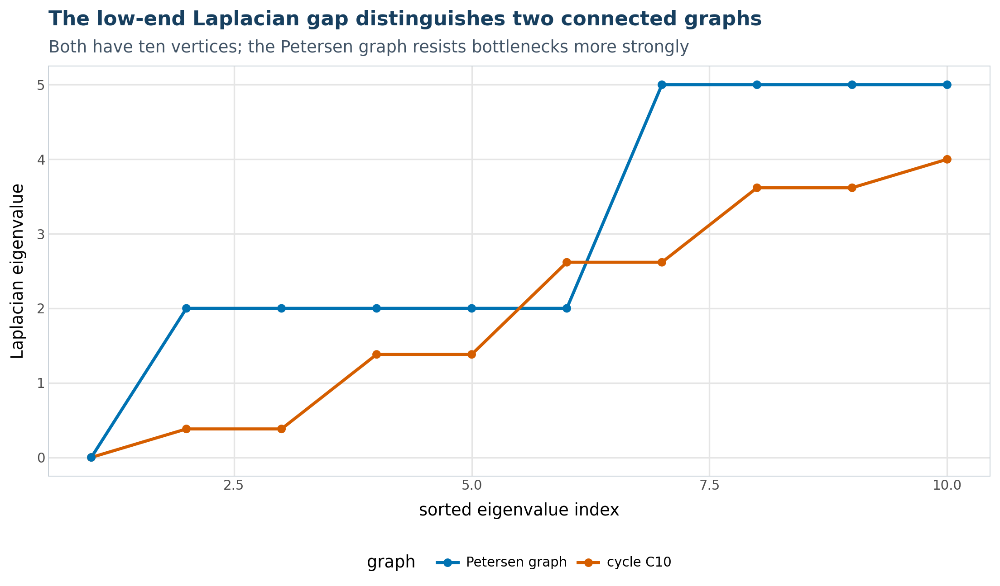

# Spectral graph theory and expanders {#sec-comb-spectral-graphs}

Spectral graph theory replaces a graph by linear operators whose eigenvalues
measure connectivity, bottlenecks, walk behavior, and pseudorandomness. The
replacement is not lossless: nonisomorphic graphs may have the same spectrum.
Its value is that a global combinatorial question can sometimes be bounded by
a quadratic form or one exceptional eigenvalue.

## Preparation from this book

Chapter 11 defines adjacency matrices and walks; Chapters 12–14 develop
connectivity, cuts, and flows. The starting toolkit introduces matrix
multiplication. This chapter defines the eigenvalue facts it uses, but a reader
who wants proofs of the spectral theorem can consult the linear-algebra route
in the calculus volume.

## Adjacency and Laplacian operators

<!-- inline-formula-code:start -->
For a simple graph with symmetric adjacency matrix $A$, let $D$ be the diagonal
matrix of vertex degrees. The **combinatorial Laplacian** is

$$
L=D-A.
$$

For a real vector $x$ indexed by vertices, expanding both sides gives the
energy identity

$$
x^{\mathsf T}Lx=\sum_{\{u,v\}\in E}(x_u-x_v)^2.
$$

The right side is nonnegative, so every Laplacian eigenvalue is nonnegative.
It vanishes exactly when $x$ is constant on every connected component.
Consequently, the multiplicity of eigenvalue zero is the number of components,
and a graph with at least two vertices is connected exactly when its second
smallest eigenvalue $\mu_2$ is positive.

The identity is worth deriving rather than memorizing. The diagonal term sums
$d(u)x_u^2$, so each edge contributes $x_u^2+x_v^2$. The two symmetric
off-diagonal entries contribute $-2x_ux_v$. Their sum is
$(x_u-x_v)^2$. This also explains why a weighted graph with nonnegative edge
weights has the same identity with weighted squares.

```python
from collections.abc import Sequence

import numpy as np
from numpy.typing import NDArray

def laplacian_matrix(adjacency: Sequence[Sequence[float]]) -> NDArray[np.float64]:
    """Validate an undirected weighted adjacency matrix and return D - A."""
    matrix = np.asarray(adjacency, dtype=float)
    if matrix.ndim != 2 or matrix.shape[0] != matrix.shape[1]:
        raise ValueError("adjacency must be a square matrix")
    if not np.all(np.isfinite(matrix)) or np.any(matrix < 0.0):
        raise ValueError("edge weights must be finite and nonnegative")
    if not np.allclose(matrix, matrix.T) or not np.allclose(np.diag(matrix), 0.0):
        raise ValueError("require symmetric adjacency with no loops")
    degrees = matrix.sum(axis=1)
    return np.diag(degrees) - matrix

def laplacian_energy(
    adjacency: Sequence[Sequence[float]], values: Sequence[float]
) -> float:
    """Return x^T L x after checking the vertex-value vector."""
    laplacian = laplacian_matrix(adjacency)
    vector = np.asarray(values, dtype=float)
    if vector.shape != (laplacian.shape[0],) or not np.all(np.isfinite(vector)):
        raise ValueError("values must contain one finite number per vertex")
    return float(vector @ laplacian @ vector)

triangle_adjacency = [[0, 1, 1], [1, 0, 1], [1, 1, 0]]
print(laplacian_matrix(triangle_adjacency))
print(laplacian_energy(triangle_adjacency, [0.0, 1.0, 3.0]))
```

**What the computation establishes.** In the program, `adjacency` is $A$,
`degrees` is the diagonal of $D$, `values`
is $x$, and the returned matrix is $L$. Floating-point eigensolvers later in
the chapter estimate spectra; the energy evaluation itself checks one finite
identity, not positive semidefiniteness for every vector.
<!-- inline-formula-code:end -->

## Variational meaning and bottlenecks

For a connected graph, $\mu_2$ can be characterized by minimizing the energy
over unit vectors orthogonal to the constant vector. A slowly varying vector
across two dense regions connected by few edges has small energy, so a small
$\mu_2$ signals a bottleneck. This is the algebra behind spectral partitioning:
compute an eigenvector for $\mu_2$ and sweep thresholds through its ordered
coordinates to propose cuts.

The sweep is an algorithm; its guarantee comes from a Cheeger inequality.
For the normalized Laplacian
$\mathcal L=I-D^{-1/2}AD^{-1/2}$, one common formulation bounds the conductance
$\Phi$ by

$$
\frac{\lambda_2(\mathcal L)}{2}
\le \Phi
\le \sqrt{2\lambda_2(\mathcal L)}.
$$

Isolated vertices require a convention because $D^{-1/2}$ is undefined there.
Different sources normalize conductance and edge boundaries differently, which
changes constants. The displayed inequality is therefore codeable only after
choosing those conventions. The next function instead computes the unambiguous
combinatorial spectrum used in the visual.

<figure id="fig-comb-spectral-gap">


<figcaption>

Figure H.1: The Petersen graph has a much larger low-end Laplacian gap than a cycle of the same order.

</figcaption>
</figure>

```python
from collections.abc import Sequence

import numpy as np

def laplacian_eigenvalues(
    adjacency: Sequence[Sequence[float]],
) -> list[float]:
    """Return sorted eigenvalues of a validated graph Laplacian."""
    matrix = np.asarray(adjacency, dtype=float)
    if matrix.ndim != 2 or matrix.shape[0] != matrix.shape[1]:
        raise ValueError("adjacency must be square")
    if (
        not np.all(np.isfinite(matrix))
        or np.any(matrix < 0.0)
        or not np.allclose(matrix, matrix.T)
        or not np.allclose(np.diag(matrix), 0.0)
    ):
        raise ValueError("require finite nonnegative symmetric loopless adjacency")
    laplacian = np.diag(matrix.sum(axis=1)) - matrix
    return np.linalg.eigvalsh(laplacian).tolist()

path_adjacency = [
    [0, 1, 0, 0],
    [1, 0, 1, 0],
    [0, 1, 0, 1],
    [0, 0, 1, 0],
]
eigenvalues = laplacian_eigenvalues(path_adjacency)
component_count = sum(abs(value) < 1e-10 for value in eigenvalues)
print([round(value, 6) for value in eigenvalues], component_count)
```

Numerical zero needs a tolerance because eigensolvers round. The theoretical
component count is exact; for integer graphs, exact symbolic rank or a graph
search is a better certificate when the distinction is high stakes.

## Regular graphs and the expander mixing lemma

Suppose a graph is $d$-regular on $n$ vertices. The all-ones vector is an
adjacency eigenvector with eigenvalue $d$. Let $\lambda$ be the largest
absolute value among the remaining eigenvalues. For disjoint vertex sets
$S,T$, the expander mixing lemma states

$$
\left|e(S,T)-\frac{d|S||T|}{n}\right|
\le \lambda\sqrt{|S||T|}.
$$

Here $e(S,T)$ counts edges with one endpoint in each of the disjoint sets.
The middle term is what a uniform edge distribution would suggest. Decompose
the indicator vectors of $S$ and $T$ into their constant components and
orthogonal remainders. The constant pieces yield the predicted term; the
spectral theorem bounds the remaining bilinear form by $\lambda$ times the two
Euclidean norms. Replacing those norms by $\sqrt{|S|}$ and $\sqrt{|T|}$ gives
the displayed bound. Further operator conventions and proofs follow the
standard spectral-graph treatment ([Chung 1997](bibliography.md#ref-chung1997spectral)).

An **expander family** has growing order, uniformly bounded degree, and a
spectral or edge-expansion gap bounded away from zero. One impressive finite
graph is not a family. Dense complete graphs mix well but do not satisfy the
bounded-degree requirement that makes expanders sparse substitutes for dense
connectivity.

```python
from collections.abc import Sequence

import numpy as np

def crossing_edge_count(
    adjacency: Sequence[Sequence[int]], left: set[int], right: set[int]
) -> int:
    """Count crossing edges between validated disjoint vertex sets."""
    matrix = np.asarray(adjacency, dtype=float)
    if (
        matrix.ndim != 2
        or matrix.shape[0] != matrix.shape[1]
        or not np.all(np.isin(matrix, (0.0, 1.0)))
        or not np.array_equal(matrix, matrix.T)
        or np.any(np.diag(matrix) != 0.0)
    ):
        raise ValueError("require square symmetric 0-1 adjacency without loops")
    order = matrix.shape[0]
    if left & right or any(vertex < 0 or vertex >= order for vertex in left | right):
        raise ValueError("sets must be disjoint subsets of the vertex set")
    return int(matrix[np.ix_(sorted(left), sorted(right))].sum())

cycle_four = [
    [0, 1, 0, 1],
    [1, 0, 1, 0],
    [0, 1, 0, 1],
    [1, 0, 1, 0],
]
print(crossing_edge_count(cycle_four, {0, 1}, {2, 3}))
```

The function computes the left side's graph statistic. Verifying the spectral
upper bound also requires checking regularity and calculating the nontrivial
eigenvalue bound; testing a few subsets never proves the lemma for all subsets.

## Random walks and mixing

On a $d$-regular graph, the simple random-walk transition matrix is $P=A/d$.
A bipartite graph has eigenvalue $-1$ and the walk alternates sides forever.
The **lazy** walk, which stays put with probability one half, uses
$(I+P)/2$ and removes this period-two obstruction. If the absolute nontrivial
eigenvalues are below one, repeated multiplication damps every component
orthogonal to the stationary distribution geometrically.

This conclusion depends on connectivity and aperiodicity. In irregular graphs
the stationary mass is proportional to degree, not uniform. Directed chains
need not be self-adjoint, so eigenvalues alone can behave less cleanly and
singular values or reversibility become relevant.

## What spectra do not determine

Cospectral graphs can differ in isomorphism, local arrangement, and some
subgraph counts. A large spectral gap implies several forms of expansion, but
the converse constants depend on normalization and degree hypotheses. A
spectral clustering plot is not evidence that a social or biological division
is causally real; it is a property of the recorded weighted graph and chosen
operator.

The Alon–Boppana phenomenon limits how small nontrivial adjacency eigenvalues
can be in large regular graphs. Ramanujan graphs meet the optimal asymptotic
scale. Their construction and the full proof of the bound require algebra and
number theory beyond this chapter; the concepts are included so that “good
expander” is not mistaken for an arbitrarily perfect finite object.

## Summary

Laplacian energy converts edge differences into a positive quadratic form.
Low eigenvalues diagnose components and bottlenecks; nontrivial adjacency
eigenvalues control discrepancy and random-walk mixing. Every claim must name
the graph operator, normalization, regularity assumptions, and numerical
tolerance.

## Exercises

<div class="exercise" id="combinatorics-24-spectral-graph-theory-ex-1">
<p class="exercise-title"><strong>Exercise 1</strong></p>

Derive the Laplacian energy identity by grouping terms edge by edge.

</div>

<div class="exercise" id="combinatorics-24-spectral-graph-theory-ex-2">
<p class="exercise-title"><strong>Exercise 2</strong></p>

Compute the Laplacian spectrum of a complete graph on four vertices.

</div>

<div class="exercise" id="combinatorics-24-spectral-graph-theory-ex-3">
<p class="exercise-title"><strong>Exercise 3</strong></p>

Show that component-indicator vectors lie in the kernel of the Laplacian.

</div>

<div class="exercise" id="combinatorics-24-spectral-graph-theory-ex-4">
<p class="exercise-title"><strong>Exercise 4</strong></p>

Find a cut vector with small energy in two triangles joined by one edge.

</div>

<div class="exercise" id="combinatorics-24-spectral-graph-theory-ex-5">
<p class="exercise-title"><strong>Exercise 5</strong></p>

Explain why a simple walk on a connected bipartite graph need not mix.

</div>

<div class="exercise" id="combinatorics-24-spectral-graph-theory-ex-6">
<p class="exercise-title"><strong>Exercise 6</strong></p>

Verify the expander-mixing inequality for every pair of disjoint sets in a
four-cycle.

</div>

<div class="exercise" id="combinatorics-24-spectral-graph-theory-ex-7">
<p class="exercise-title"><strong>Exercise 7</strong></p>

Give two reasons that a spectrum does not certify graph isomorphism.

</div>

<div class="exercise" id="combinatorics-24-spectral-graph-theory-ex-8">
<p class="exercise-title"><strong>Exercise 8</strong></p>

Contrast a single expanding graph with an expander family.

</div>

### Selected solutions

For Exercise 3, a component indicator has equal values across every edge, so
every squared edge difference in the energy identity is zero. Nonnegativity
then gives $Lx=0$. Indicators of distinct components are independent; the
reverse inequality follows because a zero-energy vector is constant across
each path.

For Exercise 5, each step crosses the bipartition. Starting on one side puts
all probability on alternating sides, so the distributions cannot converge to
a stationary law that assigns mass to both on every step. Adding a holding
probability breaks the parity.
