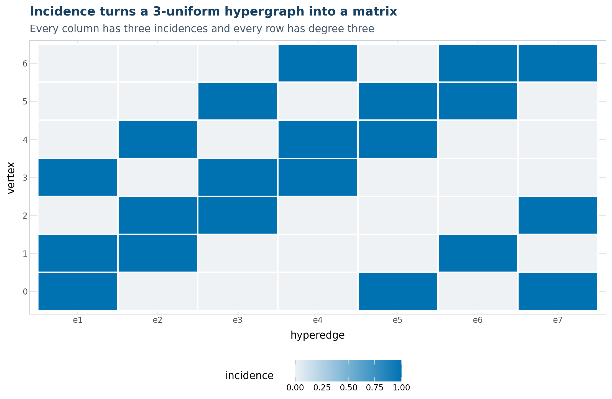

# Hypergraphs and set systems {#sec-comb-hypergraphs}

A graph edge relates two vertices. A hypergraph edge may relate any number, or
exactly $r$ vertices in an $r$-uniform hypergraph. This modest change is enough
to break many familiar graph intuitions. Hypergraphs are the natural language
for block designs, constraint systems, database joins, uniform set families,
and higher-order interactions.

## Preparation from this book

Use subsets and binomial coefficients from Chapters 1–2, incidence double
counting from Chapter 3, and matchings from Chapter 14. Chapter 16 introduces
extremal set families. No graph theorem should be transferred to hypergraphs
until its two-vertex-edge hypothesis has been rechecked.

## Uniformity, degrees, and links

<!-- inline-formula-code:start -->
A finite hypergraph $H=(V,\mathcal E)$ has a vertex set and a family of
nonempty subsets called hyperedges. Some authors allow repeated hyperedges;
this chapter treats $\mathcal E$ as a set unless it explicitly says
**multihypergraph**. It is **$r$-uniform** when every edge has size $r$.

The degree $d(v)$ counts edges containing $v$. Counting incident pairs
$(v,e)$ gives the uniform handshake identity

$$
\sum_{v\in V}d(v)=r|\mathcal E|.
$$

The **link** of a vertex $v$ in an $r$-uniform hypergraph consists of the
$(r-1)$-sets $e\setminus\{v\}$ from edges containing $v$. Links reduce a
higher-order question by one uniformity level, but links at different vertices
overlap and cannot usually be optimized independently.

<figure id="fig-comb-hypergraph-incidence">


<figcaption>

Figure I.1: An incidence matrix exposes hyperedge size, vertex degree, and repeated overlap patterns at once.

</figcaption>
</figure>

```python
from collections.abc import Iterable

def uniform_hypergraph_degrees(
    vertex_count: int, hyperedges: Iterable[frozenset[int]], uniformity: int
) -> list[int]:
    """Return vertex degrees after validating a simple r-uniform hypergraph."""
    if vertex_count < 0 or uniformity < 1:
        raise ValueError("vertex_count must be nonnegative and uniformity positive")
    edges = list(hyperedges)
    if len(edges) != len(set(edges)):
        raise ValueError("repeated hyperedges require a multihypergraph model")
    if any(
        len(edge) != uniformity
        or any(vertex < 0 or vertex >= vertex_count for vertex in edge)
        for edge in edges
    ):
        raise ValueError("every hyperedge must be an r-subset of the vertex set")
    degrees = [0] * vertex_count
    for edge in edges:
        for vertex in edge:
            degrees[vertex] += 1
    if sum(degrees) != uniformity * len(edges):
        raise RuntimeError("incidence identity failed")
    return degrees

example_edges = [frozenset({0, 1, 2}), frozenset({0, 3, 4}), frozenset({1, 3, 5})]
print(uniform_hypergraph_degrees(6, example_edges, 3))
```

**What the computation establishes.** The names translate $|V|$ to
`vertex_count`, $r$ to `uniformity`,
$\mathcal E$ to `hyperedges`, and $d(v)$ to one entry of `degrees`. The final
check is an executable instance of the double count. The proof is still the
fact that every uniform edge contributes exactly `uniformity` incidences.
<!-- inline-formula-code:end -->

## Matchings, transversals, and duality gaps

A hypergraph matching is a family of pairwise disjoint edges; its maximum size
is $\nu(H)$. A **transversal** or vertex cover meets every edge; its minimum
size is $\tau(H)$. Every cover must meet each edge in a matching, so
$\nu(H)\le\tau(H)$. In a graph that is bipartite, König's theorem gives
equality. General hypergraphs can have a genuine gap.

For an $r$-uniform hypergraph, take any maximal matching and collect all of its
vertices. Maximality says this vertex set meets every edge, giving the useful
but potentially loose bound

$$
\nu(H)\le\tau(H)\le r\nu(H).
$$

“Maximal” means no edge can be added; it does not mean largest possible. The
argument works with any maximal matching, which is why it yields an easy
approximation certificate. Weighted covers, fractional matchings, and linear-
programming duality sharpen the picture. Unlike bipartite matching, the
integral hypergraph matching polytope need not equal its fractional relaxation.

```python
def greedy_transversal_from_matching(
    hyperedges: list[frozenset[int]], uniformity: int
) -> tuple[list[frozenset[int]], set[int]]:
    """Build a maximal matching and its r-approximate transversal."""
    if uniformity < 1 or any(len(edge) != uniformity for edge in hyperedges):
        raise ValueError("require nonempty r-uniform hyperedges")
    matching: list[frozenset[int]] = []
    covered_vertices: set[int] = set()
    for edge in hyperedges:
        if edge.isdisjoint(covered_vertices):
            matching.append(edge)
            covered_vertices.update(edge)
    if any(edge.isdisjoint(covered_vertices) for edge in hyperedges):
        raise RuntimeError("constructed vertex set is not a transversal")
    return matching, covered_vertices

example_edges = [
    frozenset({0, 1, 2}),
    frozenset({0, 3, 4}),
    frozenset({1, 3, 5}),
]
matching, transversal = greedy_transversal_from_matching(example_edges, 3)
print(matching, transversal)
```

The edge order can change the maximal matching and resulting cover. The code
proves neither optimality nor the best approximation factor for a specialized
class; it constructs the certificate used in the general inequality.

## Shadows and compression

For a family $\mathcal F$ of $r$-sets, its lower shadow is

$$
\partial\mathcal F
=\{B:|B|=r-1\text{ and }B\subset A\text{ for some }A\in\mathcal F\}.
$$

Every member has $r$ immediate subsets, but overlaps mean that the shadow need
not have size $r|\mathcal F|$. The Kruskal–Katona theorem gives the smallest
possible shadow for a family of a given size, described by an initial segment
in colexicographic order and an associated binomial representation. This is a
sharp theorem, not a claim that every compressed family is uniquely determined
([Frankl and Tokushige 2018](bibliography.md#ref-frankl2018extremal)).

Compression replaces a set containing a later element by a corresponding set
with an earlier element when that replacement is absent. Carefully chosen
compressions preserve family size and do not enlarge the shadow. Repeating
them moves the extremal problem toward a canonical family. The proof must show
termination and preservation; “left-shifted looks optimal” is not enough.

```python
from itertools import combinations

def lower_shadow(family: set[frozenset[int]], uniformity: int) -> set[frozenset[int]]:
    """Return all immediate subsets of an r-uniform family."""
    if uniformity < 1 or any(len(member) != uniformity for member in family):
        raise ValueError("family must be r-uniform")
    return {
        frozenset(subset)
        for member in family
        for subset in combinations(sorted(member), uniformity - 1)
    }

triple_family = {frozenset({0, 1, 2}), frozenset({0, 1, 3})}
print(sorted(map(tuple, lower_shadow(triple_family, 3))))
```

The code exactly implements the displayed set definition for a finite family.
It does not implement the binomial representation or prove the sharp
Kruskal–Katona lower bound.

## Intersecting families

A family is **intersecting** if every two members meet. A star—all $r$-sets
containing one fixed vertex—is intersecting and has
$\binom{n-1}{r-1}$ members. The Erdős–Ko–Rado theorem says that for
$n\ge2r$, no intersecting family of $r$-subsets of an $n$-set is larger.
At $n=2r$ there are other extremizers; for $n>2r$, the equality structure is
more rigid.

The condition $n\ge2r$ matters. If $n<2r$, every two $r$-sets intersect, so
the entire layer is an intersecting family and is larger than a star. This is
a standard example of a theorem whose parameter regime is part of its content.

```python
from math import comb

def erdos_ko_rado_maximum(ground_size: int, subset_size: int) -> int:
    """Return the EKR maximum in its valid n >= 2r regime."""
    if subset_size < 1 or ground_size < 2 * subset_size:
        raise ValueError("the stated EKR formula requires n >= 2r >= 2")
    return comb(ground_size - 1, subset_size - 1)

print(erdos_ko_rado_maximum(8, 3))
```

This function deliberately rejects parameters outside the theorem. It returns
the sharp value but does not construct every extremizer or prove the cyclic-
permutation argument commonly used for the bound.

## Antichains and Lubell mass

An antichain may contain sets from different uniform layers. Choose a uniformly
random maximal chain in the Boolean lattice. A fixed $k$-set occurs on that
chain with probability $1/\binom nk$. Because a chain meets an antichain in at
most one member, taking expectations gives the LYM inequality

$$
\sum_{A\in\mathcal F}\frac{1}{\binom n{|A|}}\le1.
$$

The left side is the **Lubell mass**. It is a weighted size, not the ordinary
cardinality of the family. Sperner's theorem follows because every denominator
is at most the largest binomial coefficient.

```python
from itertools import combinations
from math import comb

def lubell_mass(ground_size: int, family: set[frozenset[int]]) -> float:
    """Compute the LYM weight after validating an antichain candidate."""
    if ground_size < 0 or any(
        any(vertex < 0 or vertex >= ground_size for vertex in member)
        for member in family
    ):
        raise ValueError("family members must lie in the ground set")
    for first, second in combinations(family, 2):
        if first < second or second < first:
            raise ValueError("the supplied family is not an antichain")
    return sum(1.0 / comb(ground_size, len(member)) for member in family)

middle_layer = {frozenset(pair) for pair in combinations(range(4), 2)}
print(lubell_mass(4, middle_layer))
```

Floating output near one is not an exact certificate; rational arithmetic
would be preferable for automated proof checking. The probabilistic chain
argument proves the inequality for every antichain.

## Shattering and dimension

A set family $\mathcal F\subseteq2^V$ **shatters** $S\subseteq V$ if every
subset of $S$ appears as $F\cap S$ for some $F\in\mathcal F$. Its VC dimension
is the largest shattered size. The Sauer–Shelah lemma states that a family on
an $n$-element ground set with VC dimension at most $d$ has size at most
$\sum_{i=0}^d\binom ni$. This connects extremal set theory to statistical
learning: bounded dimension limits how many distinct label patterns a class
can realize.

The theorem is finite and combinatorial. Statistical generalization results
add a sampling model, confidence level, and loss function. A computed VC
dimension on one finite feature universe does not automatically describe a
continuous hypothesis class.

## Failure modes and scope boundaries

- A list containing a repeated hyperedge is a multihypergraph, so degree and
  sampling formulas must retain multiplicity.
- Pairwise intersection does not imply one common vertex belongs to every
  edge.
- A maximal matching need not have maximum cardinality.
- Graph coloring, matching, and planarity theorems often fail or change form
  for $r\ge3$.
- Uniformity and ground-set size conditions in extremal theorems cannot be
  dropped silently.
- The hypergraph regularity and removal lemmas are deep tools; this book uses
  their conclusions later but does not disguise finite experiments as proofs.

## Summary

Hypergraphs record higher-order incidence. Uniform degree sums, links,
matchings and transversals, shadows, intersection theorems, Lubell mass, and VC
dimension supply complementary tools. The price of generality is that many
graph equalities become inequalities and many efficient graph algorithms
become hard optimization problems.

## Exercises

<div class="exercise" id="combinatorics-25-hypergraphs-set-systems-ex-1">
<p class="exercise-title"><strong>Exercise 1</strong></p>

Prove the uniform hypergraph handshake identity by double counting.

</div>

<div class="exercise" id="combinatorics-25-hypergraphs-set-systems-ex-2">
<p class="exercise-title"><strong>Exercise 2</strong></p>

Give a maximal matching that is not maximum.

</div>

<div class="exercise" id="combinatorics-25-hypergraphs-set-systems-ex-3">
<p class="exercise-title"><strong>Exercise 3</strong></p>

Prove that vertices of a maximal $r$-uniform matching form a transversal.

</div>

<div class="exercise" id="combinatorics-25-hypergraphs-set-systems-ex-4">
<p class="exercise-title"><strong>Exercise 4</strong></p>

Compute the lower shadow of all triples on four vertices.

</div>

<div class="exercise" id="combinatorics-25-hypergraphs-set-systems-ex-5">
<p class="exercise-title"><strong>Exercise 5</strong></p>

Show directly why the EKR formula fails as a maximum when $n<2r$.

</div>

<div class="exercise" id="combinatorics-25-hypergraphs-set-systems-ex-6">
<p class="exercise-title"><strong>Exercise 6</strong></p>

Compute the Lubell mass of a full uniform layer.

</div>

<div class="exercise" id="combinatorics-25-hypergraphs-set-systems-ex-7">
<p class="exercise-title"><strong>Exercise 7</strong></p>

Find a pairwise-intersecting family with empty total intersection.

</div>

<div class="exercise" id="combinatorics-25-hypergraphs-set-systems-ex-8">
<p class="exercise-title"><strong>Exercise 8</strong></p>

Determine the VC dimension of all subsets of size at most two.

</div>

### Selected solutions

For Exercise 3, if some hyperedge avoided every vertex used by the matching,
that edge could be added, contradicting maximality. The union has at most $r$
vertices per matching edge, proving $\tau\le r\nu$ after choosing a maximum
matching and observing that it is maximal.

For Exercise 7, the three two-element subsets of $\{1,2,3\}$ meet pairwise,
but their three-way intersection is empty. Pairwise overlap is therefore not a
Helly property for arbitrary set systems.
