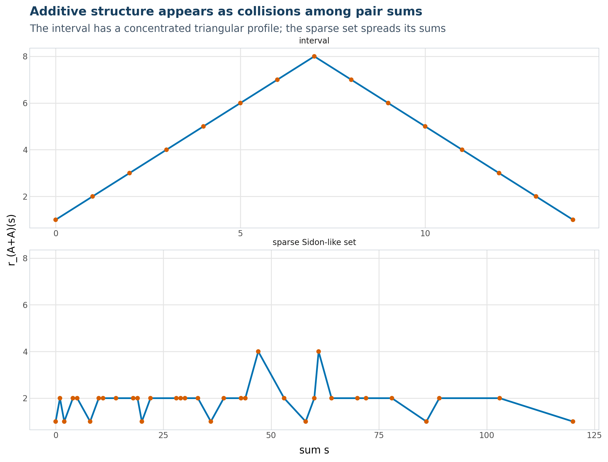

# Additive combinatorics {#sec-comb-additive}

Additive combinatorics studies how a finite set interacts with addition. A set
may be large but additively unstructured, producing many distinct sums, or it
may resemble an arithmetic progression or subgroup, producing many repeated
sums. The central theme is a quantitative dialogue between **structure** and
**pseudorandomness**.

## Preparation from this book

Chapter 2 supplies subset counting, Chapter 3 double counting, Chapter 16
extremal language, and Chapter 18 probabilistic reasoning. Congruence notation
is introduced here: $\mathbb Z/N\mathbb Z$ is the cyclic group of residues
with addition modulo $N$.

## Sumsets and the first lower bounds

<!-- inline-formula-code:start -->
For finite subsets $A,B$ of an abelian group, their sumset is

$$
A+B=\{a+b:a\in A,\ b\in B\}.
$$

There are $|A||B|$ ordered pairs but possibly far fewer sums because many pairs
can collide. For nonempty finite integer sets,
$|A+B|\ge |A|+|B|-1$. To see the bound, order both sets and trace the strictly
increasing chain
$a_1+b_1<a_1+b_2<\cdots<a_1+b_m<a_2+b_m<\cdots<a_n+b_m$.
Intervals attain equality.

In the prime cyclic group $\mathbb Z/p\mathbb Z$, wraparound changes the
statement. The Cauchy–Davenport theorem gives

$$
|A+B|\ge \min\{p,|A|+|B|-1\}.
$$

Primality matters. In a composite cyclic group, a proper subgroup can satisfy
$H+H=H$, contradicting the prime formula whenever $2|H|-1>|H|$. Proofs of
Cauchy–Davenport can use induction, polynomial coefficients, or group
transformations; enumerating subsets for small primes is not a proof.

```python
from collections.abc import Iterable

def integer_sumset(left: Iterable[int], right: Iterable[int]) -> set[int]:
    """Return A+B for two nonempty finite integer sets."""
    left_set, right_set = set(left), set(right)
    if not left_set or not right_set:
        raise ValueError("the stated lower bound assumes nonempty sets")
    return {left_value + right_value for left_value in left_set for right_value in right_set}

def modular_sumset(
    left: Iterable[int], right: Iterable[int], modulus: int
) -> set[int]:
    """Return A+B in the cyclic group Z/modulus Z."""
    if modulus < 2:
        raise ValueError("modulus must be at least two")
    left_set = {value % modulus for value in left}
    right_set = {value % modulus for value in right}
    if not left_set or not right_set:
        raise ValueError("sumsets here require nonempty sets")
    return {
        (left_value + right_value) % modulus
        for left_value in left_set
        for right_value in right_set
    }

interval = set(range(7))
print(len(integer_sumset(interval, interval)))
print(modular_sumset({0, 1, 4}, {0, 2, 4}, 7))
```

**What the computation establishes.** The code translates $A+B$ directly to a
set comprehension, so collisions are
discarded exactly once. It verifies examples of the bound, not the universal
integer or prime-cyclic theorems.
<!-- inline-formula-code:end -->

## Representation functions and additive energy

To retain collisions, define the ordered representation count

$$
r_{A+B}(s)=|\{(a,b)\in A\times B:a+b=s\}|.
$$

Summing $r_{A+B}$ gives $|A||B|$. For one set, the **additive energy** is

$$
E(A)=|\{(a,b,c,d)\in A^4:a+b=c+d\}|
=\sum_s r_{A+A}(s)^2.
$$

Cauchy–Schwarz compares the first and second moments of the representation
counts:

$$
E(A)\ge\frac{|A|^4}{|A+A|}.
$$

This is a complete short proof. The sum of the representation counts is
$|A|^2$ and there are $|A+A|$ possibly nonzero terms; applying
$(\sum r_s)^2\le |A+A|\sum r_s^2$ and rearranging gives the result. High
energy means many additive coincidences, although turning that signal into a
precise structural description requires deeper inverse theorems.

<figure id="fig-comb-sumset-representations">


<figcaption>

Figure J.1: An interval concentrates many pair sums while a sparse Sidon-like set spreads representations across a larger sumset.

</figcaption>
</figure>

```python
from collections import Counter
from collections.abc import Iterable

def sum_representations(values: Iterable[int]) -> Counter[int]:
    """Count ordered representations of every sum from a finite set A."""
    value_set = set(values)
    if not value_set:
        raise ValueError("values must be nonempty")
    return Counter(left + right for left in value_set for right in value_set)

def additive_energy(values: Iterable[int]) -> int:
    """Return E(A) = sum_s r_{A+A}(s)^2."""
    representations = sum_representations(values)
    return sum(count * count for count in representations.values())

sample = {0, 1, 2, 3, 4}
representations = sum_representations(sample)
energy = additive_energy(sample)
lower_bound = len(sample) ** 4 / len(representations)
if energy < lower_bound:
    raise RuntimeError("Cauchy--Schwarz energy bound failed")
print(energy, lower_bound)
```

Here `representations[sum_value]` is $r_{A+A}(s)$ and `energy` is $E(A)$.
Because Python integers are exact, the identity is exact for the supplied set.
One instance cannot establish an inverse theorem about every high-energy set.

## Small doubling and approximate structure

The doubling constant is $K=|A+A|/|A|$. Arithmetic progressions have bounded
doubling, whereas a generic sparse set can have close to the maximum
$|A|(|A|+1)/2$ unordered sums. Subgroups have doubling one, so the surrounding
group changes which structured examples are possible.

Freiman-type theorems say, roughly, that a finite set with small doubling is
contained efficiently in a generalized arithmetic progression or a related
coset progression. “Efficiently” hides quantitative dependence on $K$, and
the exact conclusion varies among integers, finite fields, and general abelian
groups. The theorem is not the false statement that every small-doubling set
is itself an interval.

The Ruzsa triangle inequality is a fundamental comparison tool. For nonempty
finite subsets $A,B,C$ of an abelian group,

$$
|A-C|\,|B|\le |A-B|\,|B-C|.
$$

A proof chooses, for each $x\in A-C$, one representation $x=a_x-c_x$ and maps
$(x,b)$ to $(a_x-b,b-c_x)$. The image determines $x$ by adding its two
coordinates and then recovers the chosen representation and $b$, so the map is
injective. Choosing one representation consistently is part of the proof.

```python
from collections.abc import Iterable

def difference_set(left: Iterable[int], right: Iterable[int]) -> set[int]:
    left_set, right_set = set(left), set(right)
    if not left_set or not right_set:
        raise ValueError("difference sets here require nonempty sets")
    return {left_value - right_value for left_value in left_set for right_value in right_set}

set_a, set_b, set_c = {0, 1, 4}, {0, 2}, {1, 3, 8}
left_side = len(difference_set(set_a, set_c)) * len(set_b)
right_side = len(difference_set(set_a, set_b)) * len(difference_set(set_b, set_c))
print(left_side, right_side)
```

The calculation is a finite check. The injection, not the inequality printed
for one triple, proves the Ruzsa triangle inequality.

## Arithmetic progressions and Fourier analysis {#arithmetic-progressions-and-fourier-analysis}

A three-term arithmetic progression in $\mathbb Z/N\mathbb Z$ is an ordered
pair $(x,d)$ for which $x,x+d,x+2d$ lie in $A$. The case $d=0$ is called
trivial; whether it is included must be stated. If $1_A$ is the indicator and
the unnormalized discrete Fourier transform is

$$
\widehat{1_A}(r)=\sum_{x\in\mathbb Z/N\mathbb Z}
1_A(x)e^{-2\pi i rx/N},
$$

then character orthogonality gives the ordered progression count

$$
T_3(A)=\frac1N\sum_{r=0}^{N-1}
\widehat{1_A}(r)^2\widehat{1_A}(-2r).
$$

The zero-frequency contribution is $|A|^3/N$; nonzero Fourier coefficients
measure deviation from this uniform baseline. Roth's theorem says every
positive-density subset of sufficiently large integer intervals contains a
nontrivial three-term progression. Its proof and modern quantitative bounds
are much deeper than the finite transform identity.

```python
from collections.abc import Iterable

def three_term_progression_count(values: Iterable[int], modulus: int) -> int:
    """Count ordered (start, step), including step zero, in Z/modulus Z."""
    if modulus < 2:
        raise ValueError("modulus must be at least two")
    value_set = {value % modulus for value in values}
    return sum(
        (start + step) % modulus in value_set
        and (start + 2 * step) % modulus in value_set
        for start in value_set
        for step in range(modulus)
    )

print(three_term_progression_count({0, 1, 2, 4}, 7))
```

The function names the two quantified variables and explicitly includes zero
step. Computing the Fourier expression with complex floating point would
require rounding; direct enumeration is safer for this small exact count.

## Sum-free sets and the graph bridge

A set is sum-free if it contains no solution $x+y=z$ with all three elements
inside, under a declared convention about whether $x=y$ is allowed. Odd
integers in $[n]$ form a large example. Schur's theorem says every finite
coloring of the positive integers contains a monochromatic solution to
$x+y=z$.

Additive configurations can be encoded as graph or hypergraph patterns. This
bridge lets removal lemmas transfer statements between triangles and
three-term progressions. The encoding must preserve degeneracies and
multiplicities: a homomorphism count, a labeled copy count, and a set of
distinct-variable solutions are not automatically the same statistic. The
modern structure-versus-pseudorandomness route is developed systematically in
([Tao and Vu 2006](bibliography.md#ref-taovu2006additive)) and the MIT course notes ([Zhao 2023](bibliography.md#ref-zhao2023graphadditive)).

The [triangle-removal transfer clinic](28-pseudorandom-graphs.md#sec-comb-roth-transfer)
constructs the exact graph, tracks every multiplicity, and proves the
conditional route from triangle removal to Roth's theorem.

## Computation and honest evidence

Exact sumsets and energies take quadratic time in the set size with the direct
code above. Convolution with FFTs can accelerate dense interval-supported data,
but floating rounding and modular wraparound need explicit control. Random-set
experiments should use a fixed generator and report the ambient group and
density. They can reveal typical collision profiles; they cannot prove Roth,
Freiman, or Cauchy–Davenport.

## Failure modes and scope boundaries

- Set addition differs from integer addition when calculations occur modulo a
  modulus.
- Composite cyclic groups contain subgroups, so prime-group lower bounds can
  fail.
- Ordered representation counts differ from unordered pair counts.
- Small doubling suggests approximate structure, not necessarily one ordinary
  progression.
- Progression counts must state whether zero step and repeated values count.
- A small Fourier coefficient observed numerically is not a uniform bound over
  all characters or sizes.

## Summary

Sumsets measure additive growth, representation functions and energy measure
collisions, and Fourier coefficients detect structured deviations from
uniformity. Direct inequalities already reveal much; inverse and progression
theorems explain the deeper structure, with hypotheses tied to the ambient
group.

## Exercises

<div class="exercise" id="combinatorics-26-additive-combinatorics-ex-1">
<p class="exercise-title"><strong>Exercise 1</strong></p>

Prove the integer sumset lower bound using the increasing chain in the text.

</div>

<div class="exercise" id="combinatorics-26-additive-combinatorics-ex-2">
<p class="exercise-title"><strong>Exercise 2</strong></p>

Show why a proper subgroup disproves the Cauchy–Davenport formula for some
composite moduli.

</div>

<div class="exercise" id="combinatorics-26-additive-combinatorics-ex-3">
<p class="exercise-title"><strong>Exercise 3</strong></p>

Compute the energy of an interval of length four.

</div>

<div class="exercise" id="combinatorics-26-additive-combinatorics-ex-4">
<p class="exercise-title"><strong>Exercise 4</strong></p>

Derive the energy lower bound from Cauchy–Schwarz.

</div>

<div class="exercise" id="combinatorics-26-additive-combinatorics-ex-5">
<p class="exercise-title"><strong>Exercise 5</strong></p>

Prove the injectivity used in the Ruzsa triangle inequality.

</div>

<div class="exercise" id="combinatorics-26-additive-combinatorics-ex-6">
<p class="exercise-title"><strong>Exercise 6</strong></p>

Count trivial and nontrivial progressions separately in a small cyclic
group.

</div>

<div class="exercise" id="combinatorics-26-additive-combinatorics-ex-7">
<p class="exercise-title"><strong>Exercise 7</strong></p>

Compare doubling for an interval and powers of two.

</div>

<div class="exercise" id="combinatorics-26-additive-combinatorics-ex-8">
<p class="exercise-title"><strong>Exercise 8</strong></p>

Explain which Fourier-transform normalization produces the factor $1/N$.

</div>

### Selected solutions

For Exercise 2, take the even residues $H=\{0,2,4\}$ in
$\mathbb Z/6\mathbb Z$. Then $H+H=H$ has size three, whereas the prime-style
right side would be $\min(6,3+3-1)=5$.

For Exercise 4, write $r_s=r_{A+A}(s)$. Since $\sum_s r_s=|A|^2$ and exactly
$|A+A|$ indices can be nonzero, Cauchy–Schwarz gives
$|A|^4\le |A+A|\sum_s r_s^2=|A+A|E(A)$.
