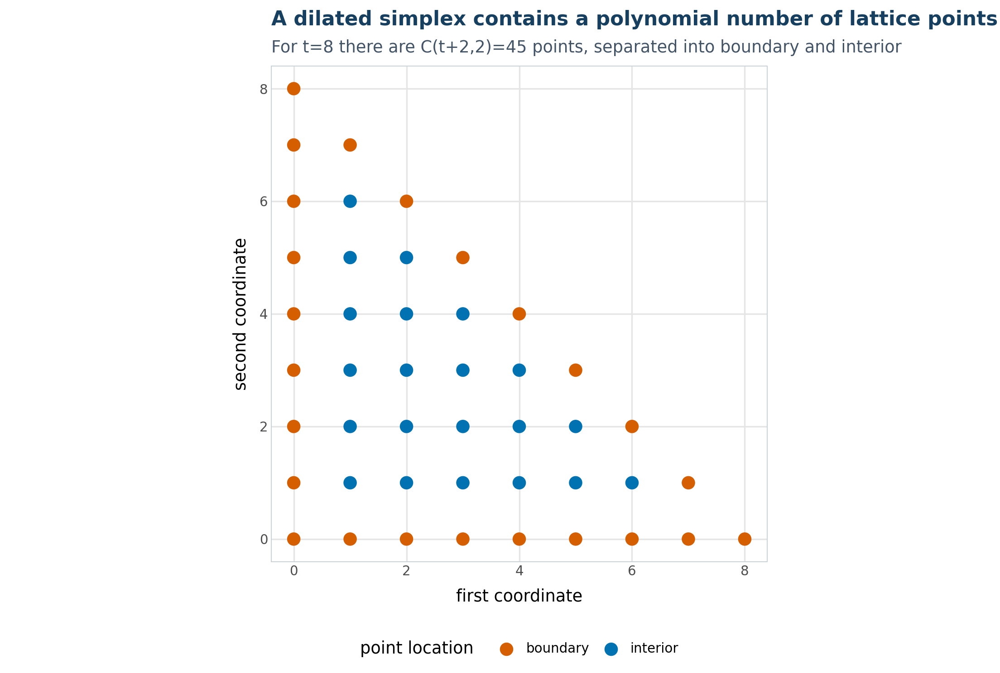

# Geometric and polyhedral combinatorics {#sec-comb-polyhedral}

Geometric combinatorics asks discrete questions about points, convex sets,
polytopes, lattices, and arrangements. Coordinates make pictures possible, but
the central objects are incidence patterns: which vertices form a face, which
sets intersect, and how integer points populate a dilated region.

## Preparation from this book

Chapter 2 supplies binomial coefficients, Chapter 3 double counting, Chapter
10 partial orders, Chapter 15 planar Euler theory, and Chapter 20 matroids. This
chapter defines convex combinations as weighted averages with nonnegative
weights summing to one. No multivariable integration is required for the
finite arguments.

## Convex hulls and dimension witnesses

<!-- inline-formula-code:start -->
The convex hull of a finite point set $X\subset\mathbb R^d$ is the set of all
convex combinations of its points. A point of $X$ is a vertex of the hull when
it cannot be written as a convex combination of the others. Collinear or
coplanar input may have affine dimension below the ambient coordinate count,
so algorithms should compute affine rank rather than equate “number of
columns” with dimension.

With one point chosen as an origin, this becomes the computable formula

$$
\dim\operatorname{aff}(X)
=\operatorname{rank}\begin{bmatrix}x_2-x_1\\ \vdots\\ x_n-x_1\end{bmatrix}.
$$

Carathéodory's theorem says every point in $\operatorname{conv}(X)$ already
lies in the hull of at most $d+1$ points of $X$. The proof removes redundant
support: if more than $d+1$ coefficients are positive, their augmented vectors
$(x,1)$ are linearly dependent. Move the coefficient vector along that
dependence until one positive coefficient becomes zero while preserving the
represented point and total weight. Repeat.

Radon's theorem divides $d+2$ indexed points into two nonempty groups with
intersecting convex hulls. Helly's theorem converts this affine dependence
into a bound on the size of an obstruction to intersection. The next section
proves both statements and handles families with fewer than $d+1$ members.

```python
from collections.abc import Sequence

import numpy as np
from numpy.typing import NDArray

def affine_dimension(points: Sequence[Sequence[float]]) -> int:
    """Return the numerical affine dimension of finite coordinate data."""
    matrix = np.asarray(points, dtype=float)
    if matrix.ndim != 2 or matrix.shape[0] == 0 or matrix.shape[1] == 0:
        raise ValueError("points must be a nonempty rectangular coordinate table")
    if not np.all(np.isfinite(matrix)):
        raise ValueError("coordinates must be finite")
    if matrix.shape[0] == 1:
        return 0
    translated = matrix[1:] - matrix[0]
    return int(np.linalg.matrix_rank(translated))

square_with_center = [[0, 0], [1, 0], [1, 1], [0, 1], [0.5, 0.5]]
print(affine_dimension(square_with_center))
```

**What the computation establishes.** The result estimates affine rank using
floating arithmetic. It does not decide
which points are hull vertices, and nearly dependent exact data may require
rational arithmetic or a tolerance chosen from measurement error.
<!-- inline-formula-code:end -->

## Helly's theorem and exact infeasibility certificates {#sec-helly-certificates}

**Theorem 2.7 (Finite Helly).** For a finite family of convex sets in
$\mathbb R^d$, the whole family has nonempty intersection if every subfamily
of **at most** $d+1$ sets has nonempty intersection. Equivalently, if the
whole intersection is empty, some subfamily of at most $d+1$ sets has empty
intersection. We use the
convention that the intersection of no sets is $\mathbb R^d$.

The words “at most” matter. Two disjoint singletons in $\mathbb R^2$ have
empty intersection but no three-member subfamily at all, so a test of only
triples would pass vacuously. If there are at least $d+1$ sets, testing all
$(d+1)$-member subfamilies suffices: extend any smaller subfamily to that
size, then use containment of intersections. For smaller families, the
correct hypothesis includes the whole family. An empty member is already a
one-set obstruction. Closedness and boundedness are not required for this
finite theorem.

### Affine dependence gives Radon's partition

For indexed points $p_1,\ldots,p_{d+2}\in\mathbb R^d$, the $d+2$ vectors
$(p_i,1)$ in $\mathbb R^{d+1}$ have a nonzero linear dependence. Thus there
are real coefficients, not all zero, with

$$
\sum_i\alpha_i p_i=0,\qquad \sum_i\alpha_i=0.
$$

There are both positive and negative coefficients. Put
$I_+=\{i:\alpha_i>0\}$, $I_-=\{i:\alpha_i<0\}$, and
$s=\sum_{i\in I_+}\alpha_i=-\sum_{i\in I_-}\alpha_i>0$. Then

$$
q=\sum_{i\in I_+}\frac{\alpha_i}{s}p_i
 =\sum_{i\in I_-}\frac{-\alpha_i}{s}p_i
$$

is a convex combination on each side. Assign zero-coefficient indices to
either group to partition all indices. Each group remains nonempty and
their hulls still contain $q$. The points need not be distinct.

### A minimal obstruction proves Helly's theorem

Suppose a finite family has empty intersection, and choose an
inclusion-minimal empty subfamily $C_1,\ldots,C_m$. If $m\le d+1$, we
already have the claimed obstruction. Otherwise, deleting each $C_i$ leaves
a nonempty intersection, so choose

$$
p_i\in\bigcap_{j\ne i} C_j,\qquad 1\le i\le m.
$$

Apply Radon's partition to any $d+2$ of these witnesses. Let $q$ belong to
the hull of each of the two groups. For every $k$, at least one group omits
the index $k$. All points in that group then belong to $C_k$, and convexity
puts their hull, hence $q$, in $C_k$. This also applies when $k$ was not
among the selected indices. Thus $q$ belongs to every $C_k$, a
contradiction. This proves the bound. See ([Basu 2017](bibliography.md#ref-basu2017convexity), Theorems 2.59
and 2.62) for the wider convexity setting.

Finiteness has a role: the intervals $[n,\infty)$, $n=1,2,\ldots$, have
nonempty intersections for every finite subfamily and empty intersection
altogether. A finite proof does not establish an unrestricted infinite
version.

### Worked example: pairwise feasible, jointly impossible

Consider three half-planes in $\mathbb R^2$:

$$
C_1=\{(x,y):x\ge0\},\quad
C_2=\{(x,y):y\ge0\},\quad
C_3=\{(x,y):x+y\le-1\}.
$$

Deleting $C_1$, $C_2$, or $C_3$ leaves respectively the witnesses
$(-1,0)$, $(0,-1)$, or $(0,0)$. Every pair intersects, but adding the three
inequalities in the form $-x\le0$, $-y\le0$, $x+y\le-1$ yields
$0\le-1$. This is a sharp three-set obstruction in dimension two, and
the sum itself can be checked without drawing the sets.

For a general system $A x\le b$, write its $i$th row as
$a_i\cdot x\le b_i$. A supplied vector $\lambda$ is an
**infeasibility certificate** if

$$
\lambda_i\ge0\ \text{for all }i,\qquad
\sum_i\lambda_i a_i=0,\qquad
\sum_i\lambda_i b_i<0.
$$

If a feasible $x$ existed, multiplying each inequality by its nonnegative
weight and summing would give $0\le\sum_i\lambda_i b_i<0$. Each of the
three conditions is needed; a nearly zero coefficient sum does not cancel
the variable $x$, which may be unbounded. Farkas' theorem also gives the
converse for finite real linear systems: every infeasible system has such a
certificate ([Basu 2017](bibliography.md#ref-basu2017convexity), Theorem 2.87). That existence theorem is
separate from checking a supplied vector. Helly bounds the number of
inequalities needed for an empty intersection by $d+1$; it does not by
itself produce their numerical weights.

The following checker uses integers and `Fraction` values only. It checks
the supplied weights exactly; `False` means that this candidate fails, so
it does not decide that the system is feasible. Malformed dimensions and
inexact numeric input raise errors rather than become feasibility verdicts.

```python
from collections.abc import Sequence
from fractions import Fraction

def check_infeasibility_certificate(
    coefficient_rows: Sequence[Sequence[int | Fraction]],
    bounds: Sequence[int | Fraction],
    weights: Sequence[int | Fraction],
) -> bool:
    """Check one exact certificate for A x <= b; do not search for one."""
    rows = tuple(tuple(row) for row in coefficient_rows)
    right_sides = tuple(bounds)
    multipliers = tuple(weights)
    if not rows or not rows[0]:
        raise ValueError("provide at least one inequality and one variable")
    dimension = len(rows[0])
    if any(len(row) != dimension for row in rows):
        raise ValueError("coefficient rows must have equal length")
    if len(right_sides) != len(rows) or len(multipliers) != len(rows):
        raise ValueError("one bound and one weight are needed per inequality")
    entries = [value for row in rows for value in row]
    entries.extend(right_sides)
    entries.extend(multipliers)
    if any(type(value) not in (int, Fraction) for value in entries):
        raise TypeError("use exact int or Fraction values, excluding bool")
    if any(weight < 0 for weight in multipliers):
        return False
    coefficient_sums = [
        sum(
            (weight * row[column] for weight, row in zip(multipliers, rows)),
            Fraction(0),
        )
        for column in range(dimension)
    ]
    bound_sum = sum(
        (weight * bound for weight, bound in zip(multipliers, right_sides)),
        Fraction(0),
    )
    return all(total == 0 for total in coefficient_sums) and bound_sum < 0

plane_rows = [(-1, 0), (0, -1), (1, 1)]
print(check_infeasibility_certificate(plane_rows, [0, 0, -1], [1, 1, 1]))
print(check_infeasibility_certificate(plane_rows, [0, 0, -1], [1, 1, 0]))
```

The output is `True`, then `False`. The second vector fails to certify the
same infeasible system: its coefficient sum is $(-1,-1)$ and its bound sum
is zero. Changing its last weight to one supplies the missing inequality.
The checker verifies a finite exact identity. The proof above explains why
that identity rules out **every** real solution.

### Changed task: sharpness and a rescaled certificate {#sec-helly-sharpness-task}

In $\mathbb R^3$, consider $x,y,z\ge0$ and $x+y+z\le-1$.
Find a feasible point after deleting each one of the four inequalities,
give an exact certificate for the whole system, and explain why testing
only triples misses this obstruction. Extend the construction to
$\mathbb R^d$ for every $d\ge1$ to prove that Helly's bound $d+1$ cannot
be reduced.

Then keep the same four half-spaces but write their inequalities as

$$
-2x\le0,\qquad -3y\le0,\qquad -5z\le0,\qquad
7x+7y+7z\le-7.
$$

Find rational weights whose coefficient sum is exactly zero and whose
bound sum is $-1$. Explain why using weight one for every row fails to
certify this unchanged infeasible region. Check both vectors with the
published function. The [separate explanation](#sec-helly-sharpness-solution)
gives the witnesses and exact arithmetic.

## Polytopes, faces, and $f$-vectors

A polytope is the convex hull of finitely many points; equivalently, it is a
bounded intersection of finitely many closed half-spaces. Passing between
these vertex and inequality descriptions is fundamental and can be
computationally expensive in high dimension.

A face is the set on which some valid linear functional is maximized. Faces
ordered by inclusion form a graded lattice containing the empty face and the
whole polytope. If a $d$-polytope has $f_i$ faces of dimension $i$, the Euler
relation for its proper nonempty faces is

$$
\sum_{i=0}^{d-1}(-1)^if_i=1-(-1)^d.
$$

For $d=3$ this is $f_0-f_1+f_2=2$, the familiar vertex-edge-face formula.
The relation is necessary but far from sufficient for a proposed sequence to
be a polytope $f$-vector. Dehn–Sommerville relations constrain simplicial
polytopes further, and the $g$-theorem gives a deep characterization in that
case.

```python
from collections.abc import Sequence

def polytope_euler_residual(face_counts: Sequence[int]) -> int:
    """Return left minus right in the d-polytope Euler relation."""
    if not face_counts or any(count < 0 for count in face_counts):
        raise ValueError("provide nonnegative counts f_0 through f_(d-1)")
    dimension = len(face_counts)
    alternating_sum = sum(
        (-1) ** face_dimension * count
        for face_dimension, count in enumerate(face_counts)
    )
    expected = 1 - (-1) ** dimension
    return alternating_sum - expected

cube_face_counts = [8, 12, 6]
print(polytope_euler_residual(cube_face_counts))
```

The function checks one necessary invariant. A zero residual does not prove
that the counts are realizable, that a supplied incidence table is a sphere,
or that coordinates form a convex polytope.

## Lattice points and Ehrhart polynomials

A **lattice polytope** has integer-coordinate vertices. For a nonnegative
integer dilation factor $t$, let $L_P(t)$ count lattice points in $tP$.
Ehrhart's theorem states that for a $d$-dimensional lattice polytope,
$L_P(t)$ is a polynomial in $t$ of degree $d$, with constant term one and
leading coefficient equal to Euclidean volume in the lattice normalization.
Face-lattice background and lattice enumeration are treated in
([Ziegler 1995](bibliography.md#ref-ziegler1995polytopes)) and ([Beck and Robins 2015](bibliography.md#ref-beck2015computing)).

For the standard $d$-simplex
$\Delta_d=\{x_i\ge0:\sum_i x_i\le1\}$, lattice points in $t\Delta_d$ are
nonnegative integer solutions of $x_1+\cdots+x_d\le t$. Adding a slack
variable and using stars and bars gives

$$
L_{\Delta_d}(t)=\binom{t+d}{d}.
$$

<figure id="fig-comb-ehrhart">


<figcaption>

Figure K.1: Dilating the standard triangle turns its Ehrhart polynomial into a visible count of boundary and interior lattice points.

</figcaption>
</figure>

```python
from math import comb

def standard_simplex_lattice_count(dimension: int, dilation: int) -> int:
    """Return the Ehrhart count of the standard d-simplex."""
    if dimension < 1 or dilation < 0:
        raise ValueError("dimension must be positive and dilation nonnegative")
    return comb(dilation + dimension, dimension)

def enumerate_standard_triangle(dilation: int) -> list[tuple[int, int]]:
    """List lattice points (x,y) with x,y >= 0 and x+y <= dilation."""
    if dilation < 0:
        raise ValueError("dilation must be nonnegative")
    return [
        (horizontal, vertical)
        for horizontal in range(dilation + 1)
        for vertical in range(dilation - horizontal + 1)
    ]

for dilation in range(6):
    enumerated = len(enumerate_standard_triangle(dilation))
    formula = standard_simplex_lattice_count(2, dilation)
    if enumerated != formula:
        raise RuntimeError("simplex enumeration disagrees with stars and bars")
print([standard_simplex_lattice_count(2, dilation) for dilation in range(6)])
```

The symbols $d,t,L_{\Delta_d}(t)$ become `dimension`, `dilation`, and the
returned integer. Enumeration verifies a two-dimensional finite range. Stars
and bars proves the formula in all dimensions and Ehrhart's theorem explains
why other lattice polytopes also produce polynomials.

## Reciprocity and boundary information

Let $L_{P^\circ}(t)$ count lattice points in the relative interior of $tP$.
Ehrhart–Macdonald reciprocity states

$$
L_P(-t)=(-1)^dL_{P^\circ}(t),\qquad t>0.
$$

The left side evaluates the Ehrhart polynomial at a negative integer; it does
not count points in a negatively reflected polytope. For the standard
two-simplex, interior points satisfy positive coordinates and strict slack, so
their count is $\binom{t-1}{2}$ for $t\ge3$.

```python
from math import comb

def standard_triangle_interior_count(dilation: int) -> int:
    """Count relative-interior lattice points in t times the standard triangle."""
    if dilation < 1:
        raise ValueError("reciprocity is stated here for positive dilation")
    return comb(dilation - 1, 2) if dilation >= 3 else 0

for dilation in range(1, 7):
    polynomial_at_negative = ((-dilation) + 1) * ((-dilation) + 2) // 2
    if polynomial_at_negative != standard_triangle_interior_count(dilation):
        raise RuntimeError("two-dimensional reciprocity check failed")
print([standard_triangle_interior_count(dilation) for dilation in range(1, 7)])
```

Dimension two has positive reciprocity sign. The computation tests one
polynomial family; it does not prove reciprocity for arbitrary lattice
polytopes.

For a simple lattice polygon, Pick's theorem gives
$\operatorname{area}=I+B/2-1$, where $I$ and $B$ count interior and boundary
lattice points. Simplicity and lattice vertices are required. A self-crossing
polygon uses a different signed-area interpretation, so feeding its vertex
list into the formula is a modeling error rather than a counterexample.

## Hyperplane arrangements

A finite set of affine hyperplanes cuts space into regions. If $m$ hyperplanes
are in general position in $\mathbb R^d$—no unexpected parallelisms and no
more than $d$ meeting at one point—the maximum region count is

$$
R(m,d)=\sum_{k=0}^{d}\binom mk.
$$

Add the last hyperplane. Regions it splits correspond to regions of the
arrangement induced on that hyperplane, which has dimension $d-1$. Thus
$R(m,d)=R(m-1,d)+R(m-1,d-1)$, and Pascal's identity proves the formula from
the boundary cases. Degenerate arrangements have fewer regions.

```python
from math import comb

def generic_hyperplane_region_count(hyperplanes: int, dimension: int) -> int:
    """Return the maximum regions from m hyperplanes in general position."""
    if hyperplanes < 0 or dimension < 0:
        raise ValueError("counts and dimension must be nonnegative")
    return sum(comb(hyperplanes, rank) for rank in range(min(hyperplanes, dimension) + 1))

print([generic_hyperplane_region_count(lines, 2) for lines in range(7)])
```

The word `generic` in the function name is an assumption, not something the
two integer inputs can verify. Zaslavsky's theorem handles arbitrary real
arrangements using the characteristic polynomial of their intersection
poset, connecting this topic back to Möbius inversion.

## Triangulations and subdivisions

A triangulation subdivides a polytope or point configuration into simplices
that meet face to face. Different triangulations can have different numbers of
simplices. Flips replace one local triangulation by another; flip graphs encode
their relationships. Regular triangulations arise by lifting points, taking
lower faces of a convex hull, and projecting back.

Triangulation supports volume computation and piecewise-linear approximation,
but orientation and boundary consistency must be validated. A list of
simplices whose union looks correct in a plot may overlap in positive volume or
leave a hidden gap. Abstract simplicial complexes and geometric realizations
are related but not interchangeable.

## Computational geometry boundaries

Convex hull and orientation tests on floating data are sensitive near
degeneracy. Exact integer or rational predicates can decide signs reliably;
filtered algorithms first use fast floating arithmetic and fall back to exact
evaluation when necessary. Worst-case output size can be exponential in
dimension, so an algorithm polynomial in input plus output may still generate
an enormous face lattice.

Random perturbation can remove degeneracies for benchmarking but changes the
instance. If collinearity or repeated points carry meaning, symbolic
perturbation or explicit lower-dimensional handling is preferable.

## Failure modes and scope boundaries

- Ambient coordinate dimension need not equal affine dimension.
- Helly tests subfamilies of at most $d+1$ sets; testing only exactly $d+1$
  is vacuous for a smaller family.
- A failed proposed infeasibility certificate does not prove feasibility.
- Euler's relation is necessary, not a realization theorem for $f$-vectors.
- Ehrhart polynomiality requires lattice vertices; rational polytopes generally
  produce quasipolynomials.
- Reciprocity evaluates a polynomial at negative arguments; it is not literal
  geometric dilation by a negative factor.
- General-position region counts are maxima, not counts for every arrangement.
- A rendered hull or triangulation is not an exact incidence certificate.

## Summary

Convexity gives small witnesses, face lattices turn geometry into order,
Ehrhart theory converts dilation into polynomial counting, and arrangements
turn intersections into region counts. Exact predicates and explicit
genericity assumptions keep geometric intuition honest.

## Exercises

<div class="exercise" id="combinatorics-27-geometric-polyhedral-ex-1">
<p class="exercise-title"><strong>Exercise 1</strong></p>

Find the affine dimension of four coplanar points in $\mathbb R^3$.

</div>

<div class="exercise" id="combinatorics-27-geometric-polyhedral-ex-2">
<p class="exercise-title"><strong>Exercise 2</strong></p>

Prove the coefficient-elimination step in Carathéodory's theorem.

</div>

<div class="exercise" id="combinatorics-27-geometric-polyhedral-ex-3">
<p class="exercise-title"><strong>Exercise 3</strong></p>

Check Euler's relation for a tetrahedron and a cube.

</div>

<div class="exercise" id="combinatorics-27-geometric-polyhedral-ex-4">
<p class="exercise-title"><strong>Exercise 4</strong></p>

Derive the standard-simplex Ehrhart formula by adding slack.

</div>

<div class="exercise" id="combinatorics-27-geometric-polyhedral-ex-5">
<p class="exercise-title"><strong>Exercise 5</strong></p>

Verify reciprocity for an interval and for the standard triangle.

</div>

<div class="exercise" id="combinatorics-27-geometric-polyhedral-ex-6">
<p class="exercise-title"><strong>Exercise 6</strong></p>

Derive the generic hyperplane recurrence by adding one hyperplane.

</div>

<div class="exercise" id="combinatorics-27-geometric-polyhedral-ex-7">
<p class="exercise-title"><strong>Exercise 7</strong></p>

Give a nongeneric line arrangement with fewer than the maximum regions.

</div>

<div class="exercise" id="combinatorics-27-geometric-polyhedral-ex-8">
<p class="exercise-title"><strong>Exercise 8</strong></p>

Explain why a floating plot cannot certify convex-hull combinatorics near
collinearity.

</div>

<div class="exercise" id="combinatorics-27-geometric-polyhedral-ex-9">
<p class="exercise-title"><strong>Exercise 9</strong></p>

Solve the [changed Helly sharpness and rescaling task](#sec-helly-sharpness-task).

</div>

### Selected solutions

For Exercise 4, a lattice point is a nonnegative integer solution of
$x_1+\cdots+x_d\le t$. Introduce slack $x_{d+1}$ so the sum is exactly $t$.
Stars and bars counts these $(d+1)$-tuples by $\binom{t+d}{d}$.

For Exercise 6, the new hyperplane splits exactly those old regions whose
intersection with it is nonempty. Their traces are the regions cut inside a
$(d-1)$-dimensional hyperplane by the previous $m-1$ hyperplanes, giving
$R(m,d)=R(m-1,d)+R(m-1,d-1)$ in general position.

### Changed-task explanation {#sec-helly-sharpness-solution}

For the four unscaled inequalities in $\mathbb R^3$, deleting $x\ge0$,
$y\ge0$, or $z\ge0$ leaves respectively $(-1,0,0)$, $(0,-1,0)$, or
$(0,0,-1)$ as a feasible point. Deleting the sum inequality leaves
$(0,0,0)$. The whole intersection is empty because summing all four rows,
in the form $-x,-y,-z\le0$ and $x+y+z\le-1$, gives $0\le-1$.
Thus every triple, and hence every smaller subfamily, intersects while the
four-member family does not. This illustrates the sharpness of the bound;
it does not satisfy the four-set hypothesis required by Helly in dimension
three.

In general dimension $d\ge1$, use the $d$ coordinate half-spaces
$x_i\ge0$ together with $\sum_i x_i\le-1$. Delete coordinate constraint
$i$ and use $-e_i$, the vector with $-1$ in coordinate $i$ and zero
elsewhere. Delete the sum constraint and use zero. Every proper subfamily
is contained in one of these feasible deletion families. Summing all $d+1$
inequalities still gives $0\le-1$, so no smaller universal Helly bound
is possible.

For the rescaled rows, choose

$$
\lambda=\left(\frac12,\frac13,\frac15,\frac17\right).
$$

The coordinate sums are $-2(1/2)+7(1/7)=0$,
$-3(1/3)+7(1/7)=0$, and $-5(1/5)+7(1/7)=0$; the bound sum is
$-7(1/7)=-1$. In contrast, weights $(1,1,1,1)$ give normal $(5,4,2)$,
which does not cancel the variables even though the weighted bound is
negative. Scaling an inequality by a positive number preserves its
half-space; the inverse scale preserves its contribution to the old
certificate. All four deletion witnesses remain valid after rescaling.

To check these two candidates, run the published checker block, then use
the exact data below in the same Python session:

```text
scaled_rows = [(-2, 0, 0), (0, -3, 0), (0, 0, -5), (7, 7, 7)]
scaled_weights = [Fraction(1, 2), Fraction(1, 3), Fraction(1, 5), Fraction(1, 7)]
check_infeasibility_certificate(scaled_rows, [0, 0, 0, -7], scaled_weights)
check_infeasibility_certificate(scaled_rows, [0, 0, 0, -7], [1, 1, 1, 1])
```

The results are `True` and `False`. A decimal approximation to a rational
weight is not the exact identity being checked.
