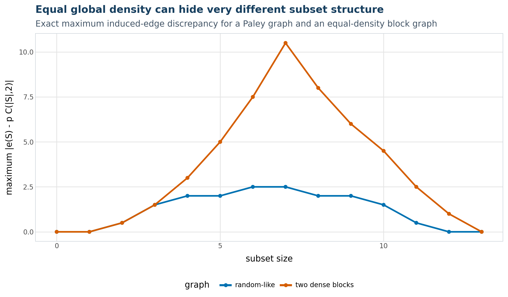

# Pseudorandom graphs, regularity, and limits {#sec-comb-pseudorandom}

A dense graph can look random without being generated randomly. Pseudorandom
graph theory asks which deterministic statistics force the uniform behavior
associated with an Erdős–Rényi graph. Regularity theory then decomposes every
large dense graph into a bounded collection of approximately uniform pairs,
and graph limits make convergence of subgraph statistics into an analytic
object.

## Preparation from this book

Chapter 11 supplies adjacency matrices, Chapter 16 extremal problems, Chapter
18 the probabilistic method, Chapter 22 random graphs, and Chapter 24 spectral
mixing. This chapter concerns **dense** graph sequences unless it explicitly
says otherwise. Sparse pseudorandomness needs different normalizations and
hypotheses.

## Density and discrepancy

<!-- inline-formula-code:start -->
For disjoint nonempty vertex sets $S,T$, define their edge density by

$$
d(S,T)=\frac{e(S,T)}{|S||T|}.
$$

If the whole graph has edge density $p$, a uniform graph should have roughly
$p|S||T|$ crossing edges for all large $S,T$. Small sets necessarily have
large relative fluctuations, so dense quasirandomness controls **absolute**
error on the $n^2$ scale rather than demanding small relative error for every
single pair.

An equivalent one-set formulation controls induced edges:

$$
\operatorname{disc}(S)
=\left|e(S)-p\binom{|S|}{2}\right|.
$$

For a quasirandom sequence with limiting density $p$, the maximum of this
quantity over all subsets is $o(n^2)$. The little-$o$ statement describes a
sequence of graphs; one graph cannot satisfy it by itself without a chosen
finite tolerance.

<figure id="fig-comb-quasirandom-discrepancy">


<figcaption>

Figure L.1: Two graphs with similar global density have sharply different subset-discrepancy profiles when one hides a two-block structure.

</figcaption>
</figure>

```python
from collections.abc import Sequence
from itertools import combinations
from math import comb

def validate_simple_adjacency(
    adjacency: Sequence[Sequence[int]],
) -> list[list[int]]:
    """Return a copied 0-1 symmetric adjacency matrix after validation."""
    matrix = [list(row) for row in adjacency]
    order = len(matrix)
    if any(len(row) != order for row in matrix):
        raise ValueError("adjacency must be square")
    if any(entry not in (0, 1) for row in matrix for entry in row):
        raise ValueError("simple adjacency entries must be zero or one")
    if any(matrix[vertex][vertex] for vertex in range(order)):
        raise ValueError("simple graphs have no loops")
    if any(matrix[left][right] != matrix[right][left] for left in range(order) for right in range(order)):
        raise ValueError("undirected adjacency must be symmetric")
    return matrix

def induced_edge_count(matrix: Sequence[Sequence[int]], subset: set[int]) -> int:
    """Count edges with both endpoints in a validated vertex subset."""
    order = len(matrix)
    if any(vertex < 0 or vertex >= order for vertex in subset):
        raise ValueError("subset contains an unknown vertex")
    return sum(matrix[left][right] for left, right in combinations(sorted(subset), 2))

def exact_maximum_subset_discrepancy(
    adjacency: Sequence[Sequence[int]],
) -> float:
    """Exhaustively compute max_S |e(S)-p*C(|S|,2)| for order at most 20."""
    matrix = validate_simple_adjacency(adjacency)
    order = len(matrix)
    if order > 20:
        raise ValueError("exhaustive discrepancy is limited to at most 20 vertices")
    total_edges = induced_edge_count(matrix, set(range(order)))
    possible_edges = comb(order, 2)
    density = total_edges / possible_edges if possible_edges else 0.0
    best = 0.0
    for mask in range(1 << order):
        subset = {vertex for vertex in range(order) if mask & (1 << vertex)}
        expected = density * comb(len(subset), 2)
        best = max(best, abs(induced_edge_count(matrix, subset) - expected))
    return best
```

**What the computation establishes.** The function translates $e(S)$ to
`induced_edge_count`, $p$ to `density`, and
the maximum discrepancy to `best`. The explicit order limit prevents an
innocent example from launching an unbounded exponential search. Exact search
describes one finite graph; it cannot verify a little-$o$ condition.
<!-- inline-formula-code:end -->

## Equivalent faces of quasirandomness

For dense graph sequences with edge density tending to $p\in(0,1)$, several
conditions are equivalent after the errors are normalized correctly:

- every large vertex subset has the expected edge count up to $o(n^2)$;
- the number of labeled copies, or homomorphisms, of every fixed graph $H$ is
  $p^{e(H)}n^{v(H)}+o(n^{v(H)})$;
- it is enough to check edges and four-cycles;
- the top adjacency eigenvalue is $pn+o(n)$ and all remaining absolute
  eigenvalues are $o(n)$.

These statements are asymptotic and their exact versions use different
conventions. An injective labeled copy, an unlabeled subgraph, an induced copy,
and a graph homomorphism have different multiplicities. The four-cycle
condition usually counts homomorphisms, including maps with coincident
opposite vertices; those degeneracies are lower order as $n$ grows but matter
in exact finite code.

Why four-cycles? Codegrees count common neighbors. A four-cycle homomorphism
sum is a second moment of codegrees. If it is as small as the mean permits,
Cauchy–Schwarz forces codegrees to be nearly uniform, which then controls
edge discrepancy. Triangles alone do not force quasirandomness: structured
graphs can match edge and triangle densities while differing on other patterns.

## Traces and triangle counts

For a finite simple graph with adjacency matrix $A$, a diagonal entry of
$A^3$ counts closed walks of length three. Every triangle supplies six such
walks—three starting vertices and two directions—so

$$
\#K_3(G)=\frac{\operatorname{tr}(A^3)}{6}.
$$

```python
from collections.abc import Sequence

def _validated_simple_adjacency(
    adjacency: Sequence[Sequence[int]],
) -> list[list[int]]:
    matrix = [list(row) for row in adjacency]
    order = len(matrix)
    if (
        any(len(row) != order for row in matrix)
        or any(entry not in (0, 1) for row in matrix for entry in row)
        or any(matrix[vertex][vertex] for vertex in range(order))
        or any(
            matrix[left][right] != matrix[right][left]
            for left in range(order)
            for right in range(order)
        )
    ):
        raise ValueError("require square symmetric 0-1 adjacency without loops")
    return matrix

def triangle_count(adjacency: Sequence[Sequence[int]]) -> int:
    """Count unordered triangles in a finite simple graph."""
    matrix = _validated_simple_adjacency(adjacency)
    order = len(matrix)
    count = sum(
        matrix[first][second]
        * matrix[second][third]
        * matrix[third][first]
        for first in range(order)
        for second in range(order)
        for third in range(order)
    )
    if count % 6 != 0:
        raise RuntimeError("closed three-walk count should be divisible by six")
    return count // 6

triangle = [[0, 1, 1], [1, 0, 1], [1, 1, 0]]
print(triangle_count(triangle))
```

The loops in the code are the entries in the matrix trace expansion. The
division by six relies on a simple loopless undirected graph; directed graphs,
weighted graphs, and multigraphs require different interpretations.

## Regular pairs

For disjoint vertex sets $X,Y$, the pair $(X,Y)$ is
**$\varepsilon$-regular** if every $X'\subseteq X$ and $Y'\subseteq Y$ with
$|X'|\ge\varepsilon|X|$ and $|Y'|\ge\varepsilon|Y|$ satisfies

$$
|d(X',Y')-d(X,Y)|\le\varepsilon.
$$

The lower-size thresholds are essential. A single exceptional vertex could
otherwise destroy regularity. Regularity also says nothing about pairs that
were declared exceptional in the partition.

Szemerédi's regularity lemma states that for every $\varepsilon>0$ and lower
bound $m$, there is an upper bound $M$ such that every sufficiently large graph
has an equitable partition into $k$ parts, with $m\le k\le M$, for which all
but at most $\varepsilon k^2$ ordered pairs of parts are regular. Proofs refine
a partition whenever an irregular pair supplies a witness and show that a
bounded energy index increases by a definite amount.

The known general bounds for $M$ grow enormously. The lemma is a qualitative
structure theorem, not automatically a practical compression algorithm. A
heuristic community detection output is not a regularity partition unless the
subset quantifiers have been certified.

```python
from collections.abc import Sequence

def _validated_simple_adjacency(
    adjacency: Sequence[Sequence[int]],
) -> list[list[int]]:
    matrix = [list(row) for row in adjacency]
    order = len(matrix)
    if (
        any(len(row) != order for row in matrix)
        or any(entry not in (0, 1) for row in matrix for entry in row)
        or any(matrix[vertex][vertex] for vertex in range(order))
        or any(
            matrix[left][right] != matrix[right][left]
            for left in range(order)
            for right in range(order)
        )
    ):
        raise ValueError("require square symmetric 0-1 adjacency without loops")
    return matrix

def pair_density(
    adjacency: Sequence[Sequence[int]], left: set[int], right: set[int]
) -> float:
    """Return d(left,right) for nonempty disjoint vertex sets."""
    matrix = _validated_simple_adjacency(adjacency)
    order = len(matrix)
    if not left or not right or left & right:
        raise ValueError("left and right must be nonempty and disjoint")
    if any(vertex < 0 or vertex >= order for vertex in left | right):
        raise ValueError("pair contains an unknown vertex")
    crossing_edges = sum(matrix[left_vertex][right_vertex] for left_vertex in left for right_vertex in right)
    return crossing_edges / (len(left) * len(right))

four_cycle = [
    [0, 1, 0, 1],
    [1, 0, 1, 0],
    [0, 1, 0, 1],
    [1, 0, 1, 0],
]
print(pair_density(four_cycle, {0, 2}, {1, 3}))
```

The formula for one density is directly executable. Testing regularity
literally requires all sufficiently large subpairs and is exponential; for a
large graph, sampling is only a probabilistic diagnostic unless paired with a
property-testing theorem.

## Counting and removal lemmas

A counting lemma says that a fixed pattern appears with approximately the
product of pair densities when its vertex classes are connected by suitable
regular pairs of nonnegligible density. This turns the reduced graph of a
regularity partition into information about the original graph.

The triangle removal lemma says that a graph with $o(n^3)$ triangles can be
made triangle-free by deleting $o(n^2)$ edges. In quantified form, for every
deletion tolerance there is a triangle-density tolerance. Its contrapositive
says a graph far from triangle-free must contain many triangles. Encoding
solutions of $x+y=2z$ as triangles yields a route to Roth's theorem.

These are deep universal implications. A program can find triangles or delete
edges in one graph, but no finite simulation establishes the quantifier order
or the dependence between tolerances. Accordingly, this section provides no
“proof by code.” The executable density functions are tools for exploring the
definitions and checking constructed examples.

## From triangle removal to progressions {#sec-comb-roth-transfer}

An arithmetic progression can be encoded by a triangle in a carefully
constructed graph. We prove that transfer, using triangle removal as an
assumed deep theorem. Preparation is the cyclic-group and ordered-pair convention in
[Chapter 26](26-additive-combinatorics.md#arithmetic-progressions-and-fourier-analysis),
the simple graphs of Chapter 11, and the triangle-count convention above.
We supply the one additional algebraic fact here: if $M$ is odd, then
$(M+1)/2$ is an inverse of $2$ modulo $M$, because twice it is $M+1$.
This holds for odd composite $M$ as well as prime $M$.

### Encoding and its inverse {#sec-comb-roth-encoding}

Fix an odd integer $M\ge3$ and a set $A\subseteq\mathbb Z/M\mathbb Z$.
Write $T_3(A)$ for the number of ordered pairs $(u,d)$ with
$u,u+d,u+2d\in A$, including $d=0$. All arithmetic in the construction is
modulo $M$. Take three distinct copies $X,Y,Z$ of the residue group.
The vertices $0_X,0_Y,0_Z$ are different vertices, despite their equal
residue labels. Place only the following undirected edges:

$$
\begin{aligned}
x_Xy_Y&\quad\Longleftrightarrow\quad y-x\in A,\\
y_Yz_Z&\quad\Longleftrightarrow\quad z-y\in A,\\
x_Xz_Z&\quad\Longleftrightarrow\quad (z-x)/2\in A.
\end{aligned}
$$

The graph is simple: its endpoints lie in different parts, and an edge is
either present or absent. There are $3M$ vertices and $M|A|$ edges between
each pair of parts. For the last count, $(x,a)\mapsto(x,x+2a)$ is injective
because multiplication by two is invertible. Thus $e(G)=3M|A|$.

Every triangle has exactly one vertex in each part, so we can record it
uniquely as $(x,y,z)\in X\times Y\times Z$. Its three edge conditions say
that the following ordered triple lies in $A$:

$$
u=y-x,\qquad u+d=(z-x)/2,\qquad u+2d=z-y.
$$

The last equality follows by substituting
$d=(z-x)/2-(y-x)$. Conversely, an ordered progression $(u,d)$ and any
$r\in\mathbb Z/M\mathbb Z$ give the triangle

$$
(r,\ r+u,\ r+2(u+d)).
$$

Its edge differences are $u,u+2d$ and $2(u+d)$, so all three edges exist.
Recovering $r=x$, $u=y-x$, and $d=(z-x)/2-(y-x)$ proves that these
constructions are inverse. Consequently,

$$
v(G)=3M,\qquad e(G)=3M|A|,\qquad
\#K_3(G)=M T_3(A).
$$

Here $\#K_3$ counts unordered graph triangles. No division by six belongs
in this bijection: the parts already choose the order $X,Y,Z$.
A homomorphism from the labeled triangle $K_3$ to a loopless graph must
be injective, and each graph triangle admits six labelings. Therefore
$\operatorname{hom}(K_3,G)=6MT_3(A)$. A constant arithmetic progression
still gives a triangle on three different tagged vertices.

### The exact edge-deletion certificate {#sec-comb-roth-deletion}

For each $(x,a)\in(\mathbb Z/M\mathbb Z)\times A$, the constant progression
gives the **trivial triangle** $(x,x+a,x+2a)$. These $M|A|$ triangles
partition all graph edges. Indeed, an $XY$ edge fixes $a=y-x$ and then
$z=x+2a$; a $YZ$ edge fixes $a=z-y$ and then $x=y-a$; an $XZ$ edge fixes
$a=(z-x)/2$ and then $y=x+a$. Each edge therefore belongs to exactly one
of these trivial triangles.

Let $\operatorname{del}_{K_3}(G)$ be the smallest number of edges whose
deletion makes $G$ triangle-free. Every trivial triangle must lose an edge,
and their edge sets are disjoint, giving a lower bound $M|A|$. Deleting
the whole $XY$ layer removes every triangle and uses exactly $M|A|$ edges.
We have proved, for every $A$, including the empty set,

$$
\operatorname{del}_{K_3}(G)=M|A|.
$$

Additional triangles can overlap with one another and with the trivial
ones. The partition claim concerns the specified trivial family; it does
not say every edge lies in a unique triangle of the full graph.

**Why oddness matters.** If one tries $M=8$ and $A=\{0,4\}$ using
$XZ$ edges of the form $(x,x+2a)$, the choices $a=0,4$ give the same
$XZ$ edge. That layer has eight edges rather than sixteen. The two
trivial triangles $(x,x,x)$ and $(x,x+4,x)$ share it, so the partition
and deletion argument fail. Division by two was an essential hypothesis.

### A worked composite-modulus example {#sec-comb-roth-worked}

Take $M=15$ and $A=\{0,1,3,4,6\}$. There are five constant progressions.
The only nontrivial ordered triples are $(0,3,6)$ and $(6,3,0)$, with
steps $3$ and $12$ respectively. To check completeness, note that
$a+c-2b$ lies between $-12$ and $12$, so congruence modulo fifteen is
ordinary equality here; checking the possible midpoint pairs leaves just
the endpoints $0,6$ and midpoint $3$.

Thus the graph has $45$ vertices, $225$ edges and
$15(5+2)=105$ unordered triangles. Its minimum deletion count is $75$,
and its labeled $K_3$-homomorphism count is $630$. The $75$ constant
triangles are supplemented by

$$
(x,x,x+6)\quad\text{and}\quad(x,x+6,x+6),
\qquad x\in\mathbb Z/15\mathbb Z.
$$

For example, $(0_X,0_Y,6_Z)$ encodes $(0,3,6)$; the residue repeated
across $X$ and $Y$ does not identify two graph vertices.

The number of full-graph triangles containing an edge is also instructive.
The $30$ $XY$ edges with difference $0$ or $6$, and the corresponding
$30$ $YZ$ edges, each lie in two triangles. The $15$ $XZ$ edges with
difference $6$ lie in three. The remaining $150$ edges lie in one.
Hence the edge triangle-multiplicity inventory is

$$
\{1:150,\ 2:60,\ 3:15\}.
$$

Its incidence sum is $150+2\cdot60+3\cdot15=315=3\cdot105$.
Counting all $105$ triangles as edge-disjoint would give a false deletion
lower bound; the $75$ specified trivial triangles give the exact one.

### A bounded exact computation {#sec-comb-roth-code}

The following standalone program constructs the three edge layers and
enumerates their triangles. It checks the encoding and inverse against
ordered progressions, then verifies that the trivial triangles partition
the edge set. The finite domain is an odd modulus from three through
thirty-one and a built-in finite set of integer residues. Negative and
out-of-range integers are normalized modulo the modulus.

```python
from collections import Counter
from itertools import product

def progression_graph_inventory(
    residues: set[int] | frozenset[int], modulus: int
) -> dict[str, int | dict[int, int]]:
    """Audit the small tripartite graph, with exact integer counts."""
    if isinstance(modulus, bool) or not isinstance(modulus, int):
        raise TypeError("modulus must be an integer, not a Boolean")
    if modulus < 3 or modulus > 31 or modulus % 2 == 0:
        raise ValueError("require an odd modulus from 3 through 31")
    if type(residues) not in (set, frozenset):
        raise TypeError("residues must be a finite set or frozenset")
    if any(isinstance(value, bool) or not isinstance(value, int)
           for value in residues):
        raise TypeError("every residue must be an integer, not a Boolean")
    values = {value % modulus for value in residues}
    inverse_two = (modulus + 1) // 2
    xy = {(x, (x + a) % modulus)
          for x in range(modulus) for a in values}
    yz = {(y, (y + a) % modulus)
          for y in range(modulus) for a in values}
    xz = {(x, (x + 2 * a) % modulus)
          for x in range(modulus) for a in values}
    triangles = {
        (x, y, z)
        for x, y, z in product(range(modulus), repeat=3)
        if (x, y) in xy and (y, z) in yz and (x, z) in xz
    }
    progressions = {
        (start, step) for start in values for step in range(modulus)
        if (start + step) % modulus in values
        and (start + 2 * step) % modulus in values
    }
    encoded = {
        (r, (r + start) % modulus,
         (r + 2 * (start + step)) % modulus)
        for r in range(modulus) for start, step in progressions
    }
    decoded = {
        (x, (y - x) % modulus,
         ((z - x) * inverse_two - (y - x)) % modulus)
        for x, y, z in triangles
    }
    expected = {(r, start, step)
                for r in range(modulus)
                for start, step in progressions}
    if triangles != encoded or decoded != expected:
        raise RuntimeError("the progression/triangle bijection failed")

    edges = ({("XY", *edge) for edge in xy}
             | {("YZ", *edge) for edge in yz}
             | {("XZ", *edge) for edge in xz})
    trivial_uses: Counter[tuple[str, int, int]] = Counter()
    for x in range(modulus):
        for a in values:
            y, z = (x + a) % modulus, (x + 2 * a) % modulus
            trivial_uses.update(
                [("XY", x, y), ("YZ", y, z), ("XZ", x, z)]
            )
    if set(trivial_uses) != edges or any(
        count != 1 for count in trivial_uses.values()
    ):
        raise RuntimeError("trivial triangles do not partition the edges")
    full_uses: Counter[tuple[str, int, int]] = Counter()
    for x, y, z in triangles:
        full_uses.update(
            [("XY", x, y), ("YZ", y, z), ("XZ", x, z)]
        )
    histogram = dict(sorted(Counter(full_uses.values()).items()))
    return {
        "vertices": 3 * modulus,
        "edges": len(edges),
        "progressions": len(progressions),
        "triangles": len(triangles),
        "homomorphisms": 6 * len(triangles),
        "deletion_witness_size": len(xy),
        "edge_triangle_multiplicities": histogram,
    }

worked = progression_graph_inventory({0, 1, 3, 4, 6}, 15)
print(worked["progressions"], worked["triangles"])
print(worked["deletion_witness_size"])
print(worked["edge_triangle_multiplicities"])
```

The output is $7,105$, then $75$, then the inventory
$\{1:150,2:60,3:15\}$. The deletion witness size counts the entire $XY$
layer. Its optimality follows from the proved edge partition, rather than
an optimization solver. The program checks one finite construction and its
multiplicities. Its size guard limits cubic enumeration; it does not prove
triangle removal, its tolerance dependence, or Roth's theorem.

### The transfer to integer progressions {#sec-comb-roth-proof}

First repair the ambient group. If
$A\subseteq\{0,\ldots,L-1\}$ and $M>2(L-1)$, then
$a+c-2b$ lies in $[-2(L-1),2(L-1)]$. The only multiple of $M$ in that
interval is zero. Thus $a+c=2b$ modulo $M$ holds exactly when it holds
over the integers. The standard odd choice $M=2L+1$ works and need not
be prime. A nonzero-step progression in this embedded set has three
different values: equality of its endpoints would give $2d=0$, and
oddness forces $d=0$.

**Theorem 18.1 (Assumed triangle-removal).** For every $\varepsilon>0$, there
exists $\eta>0$ such that every finite simple graph on $n$ vertices
with fewer than $\eta n^3$ unordered triangles can be made triangle-free
by deleting fewer than $\varepsilon n^2$ edges. The deep theorem is
not proved by the finite program. The graph construction and this
application follow the authored treatment
([Zhao 2023](bibliography.md#ref-zhao2023gtacbook), Sections 2.3–2.4); the exact deletion equality above
also makes the dependence on density explicit.

We prove the resulting qualitative Roth statement: for every fixed
$\delta\in(0,1]$, every sufficiently long integer interval has a
nontrivial progression in each subset of density at least $\delta$.
Translation preserves progressions, so it suffices to use intervals
starting at zero. Suppose instead that $A\subseteq\{0,\ldots,L-1\}$ is progression-free
and $|A|\ge\delta L$. Fix $\delta$ first, choose
$\varepsilon=\delta/54$, and obtain $\eta$ from triangle removal.
Only now take $L$ sufficiently large.

Use $M=2L+1$ and graph order $n=3M$. No wraparound and progression-freeness
give $T_3(A)=|A|$, so

$$
\frac{\#K_3(G)}{n^3}
=\frac{M|A|}{27M^3}
\le\frac{1}{27M}.
$$

For sufficiently large $L$ this is strictly less than $\eta$. Triangle
removal therefore permits fewer than $\varepsilon n^2$ deletions.
But $M\le3L$ for $L\ge1$, and our exact certificate gives

$$
\frac{\operatorname{del}_{K_3}(G)}{n^2}
=\frac{|A|}{9M}
\ge\frac{\delta L}{9M}
\ge\frac{\delta}{27}
=2\varepsilon,
$$

a contradiction. This proves the stated transfer. It gives no numerical
interval threshold without a quantitative bound on $\eta(\varepsilon)$.
The finite program checks the encoding; the assumed removal theorem
supplies the implication for arbitrarily large intervals.

### Changed task: diagnose and repair wraparound {#sec-comb-roth-task}

Let $B=\{0,1,3,4\}$, viewed first as an integer subset of
$\{0,\ldots,4\}$. Prove that it has no nontrivial integer progression.
A proposed transfer reduces it modulo five and then applies the graph
construction.

1. Find every nonzero-step ordered progression modulo five. Explain how
   the graph can contain nontrivial triangles although the integer set
   is progression-free.
2. Compute the graph's vertex, edge, unordered-triangle and labeled
   $K_3$-homomorphism counts, its minimum triangle-edge deletion count,
   and the number of triangles through each edge.
3. Repair the integer-to-cyclic step using the standard choice
   $M=2L+1$ with $L=5$. Prove the no-wrap condition, recompute those
   quantities, and explain why this changes the applicable
   progression-free argument.
4. Decide whether eleven is the only valid repair. Explain why choosing
   the density before the removal tolerance matters in the universal
   proof.

Give both deletion bounds, rather than inferring a deletion count from
the total number of triangles. Check finite totals with the program,
then compare with the [separate explanation](#sec-comb-roth-solution).

### Explanation of the changed task {#sec-comb-roth-solution}

The six unordered pairs of different endpoints in $B$ have midpoints
$1/2,3/2,2,2,5/2,7/2$, none of which lies in $B$.
There is therefore no nontrivial integer progression. Modulo five,
the nonzero-step ordered pairs $(u,d)$ are

$$
\begin{aligned}
&(0,3),(0,4),(1,2),(1,4),\\
&(3,1),(3,3),(4,1),(4,2).
\end{aligned}
$$

For example, $(u,d)=(0,3)$ gives $(0,3,1)$, whose equality is modular,
not an integer arithmetic progression. Adding four constants gives
$T_3(B)=12$. The graph has $15$ vertices, $60$ edges, $60$ unordered
triangles and $360$ labeled triangle homomorphisms. Each of the $60$
edges lies in three full-graph triangles. Its $20$ trivial triangles
are edge-disjoint, forcing at least twenty deletions; deleting all
twenty $XY$ edges attains the bound. The other forty triangles do not
supply forty additional independent deletion requirements.

With $L=5$, the standard choice is $M=11>2(L-1)=8$.
A modular equation now recovers an integer equation, so only the four
constant progressions remain. Thus $T_3(B)=4$, and the graph has
$33$ vertices, $132$ edges, $44$ unordered triangles, $264$ labeled
triangle homomorphisms and minimum deletion count $44$. Every edge
lies in exactly one triangle. The $44$ trivial triangles force the
lower bound, while the $XY$ layer attains it.

Eleven is sufficient, not uniquely necessary or minimal. The odd
modulus nine also exceeds eight and gives $27$ vertices, $108$ edges,
$36$ triangles, $216$ triangle homomorphisms and $36$ required
deletions. These finite examples expose the embedding error; they do
not supply an interval threshold in Roth's theorem. In the universal
argument the fixed density determines a positive deletion tolerance,
which determines $\eta$ independently of the eventual interval
length. Choosing these after seeing each individual graph would not
establish the required “every sufficiently long interval” statement.
Return to the [transfer proof](#sec-comb-roth-proof) to check that order.

## Graphons and homomorphism densities

A **graphon** is a symmetric measurable function
$W:[0,1]^2\to[0,1]$. Split the unit interval into equal vertex intervals and
place a zero or one rectangle for every nonedge or edge: every finite graph
then becomes a step graphon. For a fixed graph $H$, its homomorphism density is

$$
t(H,W)=\int_{[0,1]^{V(H)}}
\prod_{uv\in E(H)}W(x_u,x_v)\,\prod_{u\in V(H)}dx_u.
$$

For a finite graph's step graphon, this equals the number of graph
homomorphisms from $H$ divided by $n^{|V(H)|}$. Thus integrals generalize exact
finite pattern densities.

Constant $W=p$ represents a quasirandom limit and gives
$t(H,W)=p^{|E(H)|}$. A two-block graphon exposes community structure. Graphons
that differ only by a measure-preserving relabeling represent the same limit,
so pointwise comparison is the wrong metric. The cut distance incorporates
this quotient and makes dense graph sequences compact ([Lovasz 2012](bibliography.md#ref-lovasz2012large)).

```python
from collections.abc import Sequence
from itertools import product

def _validated_simple_adjacency(
    adjacency: Sequence[Sequence[int]],
) -> list[list[int]]:
    matrix = [list(row) for row in adjacency]
    order = len(matrix)
    if (
        any(len(row) != order for row in matrix)
        or any(entry not in (0, 1) for row in matrix for entry in row)
        or any(matrix[vertex][vertex] for vertex in range(order))
        or any(
            matrix[left][right] != matrix[right][left]
            for left in range(order)
            for right in range(order)
        )
    ):
        raise ValueError("require square symmetric 0-1 adjacency without loops")
    return matrix

def homomorphism_count(
    pattern: Sequence[Sequence[int]], target: Sequence[Sequence[int]]
) -> int:
    """Count all adjacency-preserving vertex maps for small simple graphs."""
    pattern_matrix = _validated_simple_adjacency(pattern)
    target_matrix = _validated_simple_adjacency(target)
    pattern_order, target_order = len(pattern_matrix), len(target_matrix)
    if pattern_order > 7 or target_order > 30:
        raise ValueError("direct homomorphism enumeration is intentionally size-limited")
    count = 0
    for image in product(range(target_order), repeat=pattern_order):
        if all(
            not pattern_matrix[left][right]
            or target_matrix[image[left]][image[right]]
            for left in range(pattern_order)
            for right in range(left + 1, pattern_order)
        ):
            count += 1
    return count

edge_pattern = [[0, 1], [1, 0]]
triangle_target = [[0, 1, 1], [1, 0, 1], [1, 1, 0]]
print(homomorphism_count(edge_pattern, triangle_target))
```

The bound makes exponential behavior explicit. The function counts maps, not
injective embeddings or induced copies. In the example, each undirected target
edge contributes two oriented homomorphisms.

## Sparse graphs and other limits

Dense graphons encode graphs with order-$n^2$ possible edges. For bounded-
degree graphs, ordinary homomorphism densities often vanish and cut-distance
theory loses local information. Local weak limits, graphings, sparse graphons,
and graphexes address different regimes. There is no single limit object that
preserves every statistic under every sparsity scale.

Likewise, the dense regularity lemma can partition a sparse graph into pairs
whose absolute densities are all nearly zero and thus say little. Sparse
regularity and counting lemmas require upper-uniformity, pseudorandom majorants,
or other conditions.

## Failure modes and scope boundaries

- Global density alone does not imply uniform edge distribution.
- Matching edge and triangle counts does not force quasirandomness; four-cycle
  or discrepancy control carries extra information.
- Copy, induced-copy, and homomorphism counts use different normalizations.
- Regularity ignores small subsets and allows a controlled set of irregular
  pairs.
- Regularity-lemma bounds are too large for many direct applications.
- Dense graphon results should not be applied unchanged to sparse networks.
- A randomized-looking adjacency image is not a proof of an asymptotic
  quasirandom condition.

## Summary

Discrepancy, subgraph counts, and spectra provide equivalent tests for dense
quasirandom sequences. Regularity decomposes arbitrary dense graphs into
uniform pairs, counting and removal lemmas transfer patterns through that
decomposition, and graphons capture limiting pattern densities up to relabeling.

## Exercises

<div class="exercise" id="combinatorics-28-pseudorandom-graphs-ex-1">
<p class="exercise-title"><strong>Exercise 1</strong></p>

Compute the maximum subset discrepancy of a complete bipartite graph.

</div>

<div class="exercise" id="combinatorics-28-pseudorandom-graphs-ex-2">
<p class="exercise-title"><strong>Exercise 2</strong></p>

Derive the trace formula for triangle counts.

</div>

<div class="exercise" id="combinatorics-28-pseudorandom-graphs-ex-3">
<p class="exercise-title"><strong>Exercise 3</strong></p>

Explain why four-cycle homomorphisms include degenerate maps.

</div>

<div class="exercise" id="combinatorics-28-pseudorandom-graphs-ex-4">
<p class="exercise-title"><strong>Exercise 4</strong></p>

Construct a pair that fails $\varepsilon$-regularity because of one large
exceptional subpair.

</div>

<div class="exercise" id="combinatorics-28-pseudorandom-graphs-ex-5">
<p class="exercise-title"><strong>Exercise 5</strong></p>

State the quantifiers in the regularity lemma in their correct order.

</div>

<div class="exercise" id="combinatorics-28-pseudorandom-graphs-ex-6">
<p class="exercise-title"><strong>Exercise 6</strong></p>

Show that a finite graph's step graphon has the advertised homomorphism
density.

</div>

<div class="exercise" id="combinatorics-28-pseudorandom-graphs-ex-7">
<p class="exercise-title"><strong>Exercise 7</strong></p>

Compare constant and two-block graphons with the same edge density.

</div>

<div class="exercise" id="combinatorics-28-pseudorandom-graphs-ex-8">
<p class="exercise-title"><strong>Exercise 8</strong></p>

Explain why dense graph limits discard bounded-degree local structure.

</div>

### Selected solutions

For Exercise 2, $(A^3)_{vv}$ counts ordered closed walks
$v\to u\to w\to v$. In a simple graph, the three vertices must be distinct
and form a triangle. Each triangle contributes once for three starting
vertices and two directions, so the trace is six times the triangle count.

For Exercise 5, choose $\varepsilon$ and $m$ first. Then an $M$ exists. Every
sufficiently large graph then admits some equitable partition with a number of
parts $k$ between $m$ and $M$, and at most $\varepsilon k^2$ ordered pairs are
irregular. Making $M$ depend on the input graph would weaken the theorem.
