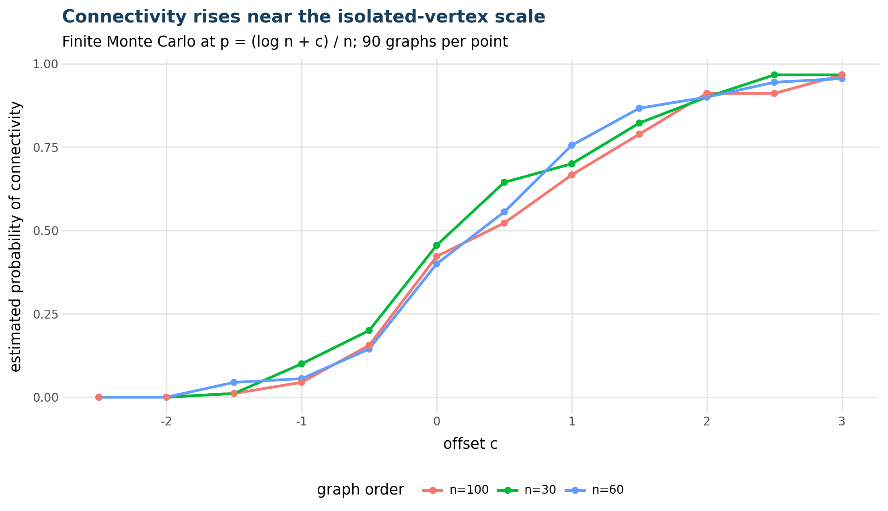

# Appendix D — Python laboratory {#sec-comb-python-lab}

These small laboratories combine exact generation, invariants, and randomized
checks. They deliberately use only the standard library.

## Enumerate set partitions

Restricted-growth strings encode a partition canonically: the first entry is
zero and each later entry is at most one more than the previous maximum.

```python
from collections.abc import Iterator

def restricted_growth_strings(size: int) -> Iterator[tuple[int, ...]]:
    if size < 0:
        raise ValueError("size must be nonnegative")
    if size == 0:
        yield ()
        return

    def extend(prefix: tuple[int, ...]) -> Iterator[tuple[int, ...]]:
        if len(prefix) == size:
            yield prefix
            return
        for value in range(max(prefix) + 2):
            yield from extend(prefix + (value,))

    yield from extend((0,))

partitions = list(restricted_growth_strings(5))
print(len(partitions), partitions[:8])
```

The result $52$ is the fifth Bell number. Canonical encoding prevents the same
blocks from reappearing merely because block names were permuted.

## Exact bipartite matching by augmentation

```python
def maximum_bipartite_matching(adjacency: list[list[int]], right_size: int) -> list[tuple[int, int]]:
    if right_size < 0 or any(v < 0 or v >= right_size for row in adjacency for v in row):
        raise ValueError("right vertex is out of range")
    partner = [-1] * right_size

    def augment(left: int, seen: set[int]) -> bool:
        for right in adjacency[left]:
            if right in seen:
                continue
            seen.add(right)
            if partner[right] == -1 or augment(partner[right], seen):
                partner[right] = left
                return True
        return False

    for left in range(len(adjacency)):
        augment(left, set())
    return [(left, right) for right, left in enumerate(partner) if left != -1]

print(maximum_bipartite_matching([[0, 1], [0, 2], [1]], 3))
```

The procedure is exact for the finite input. Its recursive search demonstrates
augmenting paths but is not the fastest implementation for large graphs.

## A reproducible random-graph experiment

```python
from random import Random

def isolated_vertices(order: int, edge_probability: float, rng: Random) -> int:
    if order < 0 or not 0.0 <= edge_probability <= 1.0:
        raise ValueError("invalid random-graph parameter")
    degrees = [0] * order
    for left in range(order):
        for right in range(left + 1, order):
            if rng.random() < edge_probability:
                degrees[left] += 1
                degrees[right] += 1
    return sum(degree == 0 for degree in degrees)

rng = Random(20260818)
for probability in (0.04, 0.08, 0.16):
    mean = sum(isolated_vertices(40, probability, rng) for _ in range(500)) / 500
    print(probability, round(mean, 3))
```

The declining averages illustrate a connectivity obstruction disappearing.
They neither locate the asymptotic threshold exactly nor prove concentration.

<figure id="fig-comb-random-lab">


<figcaption>

Figure 20.1: The random-graph laboratory shows a finite transition in connectivity as edge probability increases.

</figcaption>
</figure>

## Audit additive collisions

This lab computes the two equal definitions of additive energy: a four-tuple
count and the sum of squared representation counts. The symbols are replaced
by names before the loops begin.

```python
from collections import Counter

def checked_additive_energy(values: set[int]) -> int:
    if not values:
        raise ValueError("values must be nonempty")
    representation_counts = Counter(
        left + right for left in values for right in values
    )
    energy_from_counts = sum(
        count * count for count in representation_counts.values()
    )
    energy_from_quadruples = sum(
        first + second == third + fourth
        for first in values
        for second in values
        for third in values
        for fourth in values
    )
    if energy_from_counts != energy_from_quadruples:
        raise RuntimeError("the two energy formulas disagree")
    return energy_from_counts

for values in ({0, 1, 2, 3}, {0, 1, 4, 10}):
    print(sorted(values), checked_additive_energy(values))
```

The comparison catches code mistakes in either translation. It does not prove
the identity; grouping quadruples by their common sum does.

## Laboratory discipline

For exact enumeration, compare the generator with a formula and assert that
every output satisfies the definition. For randomized work, separate the
mathematical distribution from pseudo-random implementation, report Monte
Carlo uncertainty, and rerun at several sizes. Save seeds for reproducibility,
not as a substitute for investigating sensitivity.
