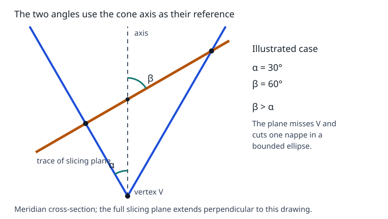

# A double cone and its planes {#section-1-a-double-cone-and-its-planes}

Why does slicing a cone with a plane produce curves that appear everywhere in astronomy, optics, and architecture? The answer lies in a single spatial construction: a right circular double cone and a plane that cuts it. This chapter defines that construction precisely, classifies the resulting sections, and connects the spatial picture to the focal properties that make conics indispensable.

## The double cone {#section-5-the-double-cone}

An ideal right circular double cone is the union of all lines through a fixed point $V$ (the vertex) that make a fixed acute angle $\alpha$ with a fixed line through $V$ (the axis). The two halves of the cone, one on each side of $V$ along the axis, are called nappes. Every line through $V$ lying on the cone is a generator.

A plane that does not pass through $V$ intersects the cone in a curve called a conic section. Let $\beta\in[0,\pi/2]$ be the acute angle between the plane and the cone axis. The classification depends on comparing $\beta$ with $\alpha$:

- If $\beta=\pi/2$, the plane is perpendicular to the axis and the section is a **circle**.
- If $\alpha<\beta<\pi/2$, the plane is tilted less steeply than the generators and the section is an **ellipse**.
- If $\beta=\alpha$, the plane is parallel to a generator and the section is a **parabola**.
- If $0\leq\beta<\alpha$, the plane is steeper than the generators and cuts both nappes, giving a **hyperbola**.

These four cases are exhaustive for a plane that misses the vertex. The condition $\beta=\pi/2$ is a special case of the ellipse interval, but it is worth naming separately because the resulting circle has extra symmetry.

The meridian diagram fixes the angle convention: both $\alpha$ and $\beta$ are measured relative to the cone axis. The shown plane has $\beta>\alpha$ and cuts a bounded ellipse.

*For $\alpha=30^{\circ}$ and $\beta=60^{\circ}$, the plane misses the vertex and intersects one nappe in an ellipse.*

## Degenerate sections {#section-24-degenerate-sections}

If the slicing plane passes through the vertex $V$, the intersection is a degenerate conic rather than one of the smooth nondegenerate sections. A single-line case is itself a smooth line, so degeneracy should not be confused with failure of smoothness in every case. The possible degenerate sections are:

- a single point, when the plane meets the cone only at $V$;
- one line, when the plane contains exactly one generator;
- two intersecting lines, when the plane contains two distinct generator lines.

Any theorem about foci, directrices, or standard equations must explicitly exclude these degenerate cases, because the focal constructions fail when the plane passes through $V$.

## Dandelin spheres connect slicing to foci {#section-34-dandelin-spheres-connect-slicing-to-foci}

The cone-section definition gives curves, but it is not obvious that those curves have the focal properties used in optics and orbital mechanics. Dandelin's construction bridges the gap.

Place a sphere tangent to the cone along a circle and tangent to the slicing plane at $F$. The tangency point $F$ is a focus. An ellipse has two such spheres in the same nappe, on opposite sides of the slicing plane; a parabola has one; a hyperbola uses spheres in opposite nappes.

The key fact is equality of tangent segments from an external point. If the generator through $P$ touches a sphere at $Q$, then $PF=PQ$. For an ellipse, the two generator tangency points $Q_1,Q_2$ lie on opposite sides of $P$ along the same generator, and the fixed separation of their tangency circles gives
$$PF_1+PF_2=PQ_1+PQ_2=Q_1Q_2=2a.$$
For one branch of a hyperbola, the relevant tangency points lie on the same side of $P$ along the full generator, so subtracting their fixed generator positions gives $|PF_1-PF_2|=2a$. The absolute value includes both branches; choosing a signed difference selects one.

The focus--directrix relation also follows exactly. Suppose a Dandelin sphere touches the cone along a circle contained in the horizontal plane $z=h$, and let the directrix $D$ be the intersection of that plane with the slicing plane. For a nondegenerate noncircular slice with $\beta<\pi/2$, tangent equality and the cone half-angle give
$$PF=PQ=\frac{|z(P)-h|}{\cos\alpha}.$$
The direction of steepest vertical change within the slicing plane has vertical component $\cos\beta$, hence
$$\operatorname{dist}(P,D)=\frac{|z(P)-h|}{\cos\beta},\qquad
\frac{PF}{\operatorname{dist}(P,D)}=\frac{\cos\beta}{\cos\alpha}.$$
Thus $\beta=\alpha$ yields the parabolic ratio one. The perpendicular circular slice is treated separately.

## Why the required spheres actually exist {#section-51-why-the-required-spheres-actually-exist}

The tangent-length argument needs spheres with both kinds of tangency. We now construct them, rather than assuming that a plausible meridian sketch guarantees their existence. Put the vertex at the origin and use a signed coordinate along the axis. A sphere centered at axial coordinate $c\ne0$ and having radius $|c|\sin\alpha$ is tangent to every generator line of the cone. In a meridian plane, the perpendicular distance from its center to a generator is exactly that radius. Rotation around the axis gives the full contact circle. Since the radius is smaller than the distance to the vertex, the sphere stays in its own nappe and does not pass through the vertex.

Take a unit normal to the slicing plane with axial component $\sin\beta$, choosing the axis direction and normal so that its signed offset from the vertex is $h>0$. The signed distance of the axial center from the plane is $c\sin\beta-h$. Plane tangency therefore asks for

$$|c\sin\beta-h|=|c|\sin\alpha.$$

Squaring and factoring gives the possible centers

$$c_+=\frac{h}{\sin\beta+\sin\alpha},\qquad
c_-=\frac{h}{\sin\beta-\sin\alpha},$$

omitting the second expression when its denominator is zero. Each finite expression satisfies the original absolute-distance equation as well as the squared one. Thus we have constructed actual spheres of positive radius, not just algebraic candidates left unchecked.

When the plane angle exceeds the cone half-angle, both centers are positive. Their signed distances place the spheres on opposite sides of the slicing plane, explaining the two spheres in the ellipse construction. When the angles agree, only the first finite sphere remains: the second center formula has no finite value. When the plane angle is smaller, the two centers have opposite signs and their spheres occupy opposite nappes. They are both on the same side of the slicing plane. These sign facts explain the sum-versus-difference argument, not merely the names of the resulting sections.

## Complete the tangent-length proof {#section-68-complete-the-tangent-length-proof}

For any point of the conic, the segment to a sphere's plane-contact point and the segment along its generator to the sphere's cone-contact point are both tangent segments. To prove their equality, join the point to the sphere center. Each tangency radius is perpendicular to its tangent segment, so the two right triangles have the same hypotenuse and the same radius. Subtracting the squared radius from the common squared hypotenuse gives equal squared tangent lengths. Nonnegative lengths are therefore equal.

For the ellipse the two cone-contact points lie on opposite sides of the slicing point along its generator. Each belongs to its own sphere's closed plane half-space, and the spheres occupy opposite half-spaces. Thus the sum of the tangent lengths is the distance between those contact points. The contact position on an oriented generator is $c\cos\alpha$, obtained by orthogonally projecting the axial center onto that generator. Their separation is consequently $(c_--c_+)\cos\alpha$, independent of the chosen generator. This proves the fixed focal sum for every slice point.

For the hyperbola the two contact points instead lie on the same side of the slicing point, since both spheres lie in the same plane half-space. The absolute difference of the tangent lengths is their fixed separation, $(c_+-c_-)\cos\alpha$. Opposite generator branches can reverse the signed difference, which is why the geometric locus uses its absolute value. These arguments rely on the plane missing the vertex; a plane containing an entire generator needs the degenerate treatment stated earlier.

Projecting the two axial centers onto the slicing plane gives focal separation equal to their axial separation times $\cos\beta$. In the ellipse case this is smaller than the generator-contact separation because $\beta>\alpha$; in the hyperbola case it is larger. Thus the required inequalities between focal separation and the fixed sum or difference follow from the same construction. For a perpendicular plane the projected centers coincide, giving the circular special case.

For the directrix construction, the contact circle's axial height is $c\cos^2\alpha$. Except for a perpendicular circular slice, its plane meets the slicing plane in a line. The height function restricted to the slicing plane has gradient magnitude $\cos\beta$, so perpendicular distance to that line is the height difference divided by this positive magnitude. Along a generator the corresponding distance is the same height difference divided by $\cos\alpha$. Tangent equality gives the stated eccentricity ratio. The circle case has parallel contact and slicing planes, so no finite directrix line is supplied by their intersection. It is handled separately, not by dividing by a zero cosine.

The focus cannot lie on that directrix. Such a point would also be a cone-contact point, making the slicing plane tangent to the cone along its generator and therefore contain the vertex. The same argument excludes a section point on the directrix: zero generator tangent length would force it to be that same double contact. Our nonvertex hypothesis rules both out, so the displayed distance ratio has nonzero denominator throughout the conic.

These are geometric implications from a cone section to its focal properties. The converse focus-directrix classification and its real degenerate cases are developed in [Conics in Coordinates](conics-in-coordinates.md). Keeping those algebraic classifications in the next chapter avoids treating a formula for an eccentricity as if it alone proved every converse.

## Three worked sphere constructions {#section-84-three-worked-sphere-constructions}

### Worked example 1 — An oblique ellipse {#section-86-worked-example-1-an-oblique-ellipse}

Let the cone half-angle be thirty degrees, the plane angle sixty degrees and the normal offset one. The two centers are $\sqrt3-1$ and $\sqrt3+1$, both in the positive nappe. Their radii are half their center coordinates. Their separation along any generator is $\sqrt3$, proving that the sum of distances to the two foci is that value.

Projection of the center separation onto the slicing plane has length one, so the foci are distinct. The semimajor axis is $\sqrt3/2$ and the focal half-separation is one half. Their ratio is $1/\sqrt3$, agreeing with the cosine formula for eccentricity. This checks the focal and angular descriptions against the same constructed spheres.

### Worked example 2 — A vertical hyperbola slice {#section-92-worked-example-2-a-vertical-hyperbola-slice}

Keep the cone half-angle thirty degrees and the normal offset one, but make the plane parallel to the axis. Its angle is zero. The sphere centers are two and minus two, with radius one each. Their generator-contact separation is $2\sqrt3$, so the absolute focal difference has that value. The focus separation in the vertical plane is four, giving semitransverse axis $\sqrt3$ and focal half-separation two. The eccentricity is $2/\sqrt3$, strictly greater than one. Both nappes contribute, while either signed focal-difference equation selects a branch.

### Worked example 3 — The finite parabolic sphere {#section-96-worked-example-3-the-finite-parabolic-sphere}

With both angles thirty degrees and offset one, the single finite center is one and its radius is one half. Its contact circle lies at axial height three quarters. The plane meets that horizontal contact plane in a directrix line, and the cosine ratio is exactly one. Thus each section point has equal distance to the focus and directrix. The missing second finite center is not a second focus hidden at a very large number: the formula has zero denominator. The one-sphere distance relation is the appropriate finite parabolic statement.

## Ellipses {#section-100-ellipses}

For distinct foci $F_{1}$ and $F_{2}$, an ellipse is the locus of points $P$ such that

$$PF_{1}+PF_{2}=2a,$$

where $2a>\lvert F_{1}F_{2}\rvert$. Place the foci at $(\pm c,0)$ and define $b^{2}=a^{2}-c^{2}>0$. The standard equation is

$$\frac{x^{2}}{a^{2}}+\frac{y^{2}}{b^{2}}=1.$$

The eccentricity is $e=c/a$, so $0<e<1$. The directrices are the vertical lines $x=\pm a/e$; each focus pairs with its nearer directrix, and for any point $P$ on the ellipse the ratio of its distance to the focus and its distance to the corresponding directrix equals $e$.

The major-axis vertices are $(\pm a,0)$, the minor-axis vertices are $(0,\pm b)$, and the area enclosed is $\pi ab$. The circle is the limiting case $c=0$, where both foci coincide at the center and $e=0$.

### Tangent and reflection {#section-114-tangent-and-reflection}

For the ellipse $\frac{x^{2}}{a^{2}}+\frac{y^{2}}{b^{2}}=1$, the tangent line at a point $(x_{0},y_{0})$ on the curve has equation

$$\frac{x x_{0}}{a^{2}}+\frac{y y_{0}}{b^{2}}=1.$$

The normal vector at $(x_{0},y_{0})$ is proportional to $(x_{0}/a^{2},y_{0}/b^{2})$. Differentiating the constant distance-sum $PF_{1}+PF_{2}=2a$ shows that this normal bisects the angle between the directions to the two foci. Under ideal specular reflection, a ray leaving one focus reflects off the ellipse toward the other focus. This is the principle behind whispering galleries and some medical reflectors.

## Parabolas {#section-122-parabolas}

A parabola is the locus of points equidistant from a fixed point (the focus) and a fixed line (the directrix). With focus $(p,0)$ and directrix $x=-p$ where $p>0$,

$$\sqrt{(x-p)^{2}+y^{2}}=\lvert x+p\rvert.$$

Every point on the locus lies to the right of the directrix, so $x+p>0$ and squaring gives

$$y^{2}=4px.$$

The vertex is the origin and the axis of symmetry is the x-axis. A convenient parametric form is $(pt^{2},2pt)$ for $t\in\mathbb{R}$. The tangent at this point has equation

$$ty=x+pt^{2}.$$

The tangent makes equal angles with the line toward the focus and the axis direction. Thus rays parallel to the axis reflect through the focus, and a point source at the focus produces parallel reflected rays. Real parabolic dishes approximate this ideal when their surface of revolution, finish, and alignment are sufficiently precise.

## Hyperbolas {#section-138-hyperbolas}

For foci at $(\pm c,0)$, a hyperbola is the locus of points $P$ satisfying

$$\lvert PF_{1}-PF_{2}\rvert=2a,$$

where $0<2a<2c$. Define $b^{2}=c^{2}-a^{2}>0$. The standard equation is

$$\frac{x^{2}}{a^{2}}-\frac{y^{2}}{b^{2}}=1.$$

The eccentricity is $e=c/a>1$, and the directrices are $x=\pm a/e$. The lines

$$y=\pm\frac{b}{a}x$$

are asymptotes: as $\lvert x\rvert\to\infty$, the curve approaches these lines but does not meet them in the nondegenerate form.

The absolute-value distance equation describes both branches. Dropping the absolute value and choosing one sign selects a branch; after squaring, a solver must restore that sign condition if the original problem specified a signed difference.

## Coordinates as a continuation {#section-156-coordinates-as-a-continuation}

The general quadratic equation, diagonalisation and worked reduction belong to [Conics in Coordinates](conics-in-coordinates.md). This chapter keeps the geometric slices and focal descriptions; the next chapter supplies the coordinate classification, including degenerate cases.

## Common errors {#section-160-common-errors}

- **Confusing angle conventions.** The classification compares the plane's tilt $\beta$ with the cone's half-angle $\alpha$, not with the generator lines themselves. A plane parallel to a generator gives a parabola, not a hyperbola.
- **Forgetting the vertex exclusion.** The focal formulas assume the plane does not pass through the cone vertex. Degenerate sections have no foci in the usual sense.
- **Sign errors in hyperbola asymptotes.** The slopes are $\pm b/a$, not $\pm a/b$. Remember that $a$ is the semitransverse axis, the one under the positive term.
- **Using slant height instead of perpendicular height** in volume formulas. The factor $1/3$ for cones and pyramids requires perpendicular height.
- **Solving the squared equation** $\frac{x^{2}}{a^{2}}-\frac{y^{2}}{b^{2}}=1$ and assuming both branches satisfy the same signed distance difference. Each branch corresponds to one sign choice.

## Practice exercises with solutions {#section-168-practice-exercises-with-solutions}

### Exercise 1 {#section-170-exercise-1}

For the ellipse $\frac{x^{2}}{25}+\frac{y^{2}}{9}=1$, find $a$, $b$, $c$, the eccentricity $e$, and the foci.

Hint 1

Identify the two positive squared semiaxes.

Hint 2

The focal distance squared is the major squared semiaxis minus the minor one.

Full solution

**Solution.** From the standard form, $a^{2}=25$ and $b^{2}=9$, so $a=5$ and $b=3$. Then $c^{2}=a^{2}-b^{2}=25-9=16$, giving $c=4$. The eccentricity is $e=c/a=4/5$. The foci are at $(\pm 4,0)$.

### Exercise 2 {#section-190-exercise-2}

Find the focus and directrix of the parabola $y^{2}=12x$.

Hint 1

Compare the coefficient with four times the focal parameter.

Hint 2

Keep the directrix on the opposite side of the vertex from the focus.

Full solution

**Solution.** The standard form is $y^{2}=4px$, so $4p=12$ and $p=3$. The focus is $(3,0)$ and the directrix is $x=-3$.

### Exercise 3 {#section-210-exercise-3}

For the hyperbola $\frac{x^{2}}{16}-\frac{y^{2}}{9}=1$, find the asymptotes and the eccentricity.

Hint 1

The positive denominator gives the transverse semiaxis.

Hint 2

Use the sum of the squared semiaxes for the squared focal distance.

Full solution

**Solution.** Here $a^{2}=16$ and $b^{2}=9$, so $a=4$ and $b=3$. The asymptotes are $y=\pm\frac{3}{4}x$. Also $c^{2}=a^{2}+b^{2}=16+9=25$, so $c=5$ and the eccentricity is $e=c/a=5/4$.

### Exercise 4 {#section-230-exercise-4}

Classify the conic $9x^{2}+4y^{2}-18x+16y-11=0$, find its center, and state its semiaxes.

Hint 1

Complete both squares before reading the center.

Hint 2

The larger final denominator selects the major-axis direction.

Full solution

**Solution.** Complete the square:

$$9(x^{2}-2x)+4(y^{2}+4y)=11,$$

$$9(x-1)^{2}-9+4(y+2)^{2}-16=11,$$

$$9(x-1)^{2}+4(y+2)^{2}=36,$$

$$\frac{(x-1)^{2}}{4}+\frac{(y+2)^{2}}{9}=1.$$

This is an ellipse centered at $(1,-2)$ with semiaxes $a=3$ (vertical) and $b=2$ (horizontal). The major axis is vertical because the larger denominator is under the $y$ term.

### Exercise 5 {#section-260-exercise-5}

A conical frustum has parallel end areas $4$ and $16$ and height $6$. Find its volume.

Hint 1

The two ends must be parallel and similar.

Hint 2

Use the geometric mean of the two end areas in the frustum formula.

Full solution

**Solution.** Using the frustum formula $V=\frac{h}{3}(B_{1}+\sqrt{B_{1}B_{2}}+B_{2})$ with $B_{1}=4$, $B_{2}=16$, and $h=6$:

$$V=\frac{6}{3}(4+\sqrt{64}+16)=2(4+8+16)=56.$$

The volume is $56$ cubic units, assuming the ends are parallel and similar.

### Exercise 6 {#section-284-exercise-6}

With camera picture plane $z=2$, find the perspective projection of the spatial point $(3,-1,6)$.

Hint 1

Divide both transverse coordinates by depth.

Hint 2

The picture-plane distance multiplies both resulting ratios.

Full solution

**Solution.** The projection formula is $(fX/Z,fY/Z)$ with $f=2$:

$$\left(\frac{2\cdot 3}{6},\frac{2\cdot(-1)}{6}\right)=\left(1,-\frac{1}{3}\right).$$

### Exercise 7 {#section-306-exercise-7}

What happens when a conic slicing plane passes through the cone vertex? List all possibilities and state which nondegenerate type arises in each orientation case.

Hint 1

Distinguish whether the plane contains zero, one or two generator lines.

Hint 2

Passing through the vertex prevents a nondegenerate cone section, regardless of the orientation label.

Full solution

**Solution.** When the plane passes through the vertex $V$:
- If the plane intersects the cone only at $V$, the section is a single point.
- If the plane contains exactly one generator, the section is one line.
- If the plane contains two distinct generator lines, the section is two intersecting lines.

These are the degenerate cases. Every nondegenerate conic requires the plane to miss the vertex.

### Exercise 8 {#section-331-exercise-8}

For a thirty-degree cone and perpendicular slicing plane at axial height three, find the two Dandelin sphere centers and radii. Explain why the slice is still a circle.

Hint 1

The plane angle is ninety degrees, so its sine is one.

Hint 2

Both sphere contacts with the plane lie at its center on the cone axis.

Full solution

The centers are $3/(1+1/2)=2$ and $3/(1-1/2)=6$, and their radii are one and three. Their plane tangency points coincide at the axial point of height three. The circular section radius is $3\tan30^\circ=\sqrt3$. Its distance sum to the coincident foci is twice that radius, matching the generator separation $(6-2)\cos30^\circ=2\sqrt3$. Two spheres need not give two distinct focal points in this perpendicular special case.

### Exercise 9 {#section-345-exercise-9}

For cone half-angle forty-five degrees and plane angle thirty degrees, determine the section type and eccentricity. Explain the signs of the two center formulas.

Hint 1

Compare the plane angle with the cone half-angle before evaluating a ratio.

Hint 2

The second denominator subtracts the larger sine from the smaller one.

Full solution

The plane angle is smaller, so the slice is a hyperbola. Its eccentricity is $\cos30^\circ/\cos45^\circ=\sqrt{3/2}>1$. For positive normal offset, the sum denominator is positive and the difference denominator is negative. Thus one sphere center is in each nappe. The focal relation uses an absolute difference, not a sum, and a signed choice would retain only one branch.

### Exercise 10 {#section-359-exercise-10}

Prove the equal tangent-segment fact used in the Dandelin argument by comparing the two right triangles from the common external point to the sphere center.

Hint 1

Each tangency radius is perpendicular to its tangent line.

Hint 2

Both right triangles have the same hypotenuse and equal radius lengths.

Full solution

If the external point is P, center C and two contacts F,Q, the Pythagorean identities give $PF^2=PC^2-r^2=PQ^2$. Both distances are nonnegative, so $PF=PQ$. One tangent line lies in the slicing plane and the other is the generator line, but the same right-triangle argument applies to both. It does not require assuming that the full cone section is already an ellipse or hyperbola, avoiding circular reasoning in the focal proof.

## Looking backward and forward {#section-373-looking-backward-and-forward}

This chapter introduced the cone-section classification and connected it to the focal definitions of ellipses, parabolas, and hyperbolas through Dandelin's sphere construction. The algebraic reduction of the general second-degree equation provides a computational route when spatial reasoning is inconvenient.

The next chapter, [Conics in Coordinates](conics-in-coordinates.md), proves the algebraic classification and its focal equivalences. [Cylinders and Surfaces of Revolution](cylinders-and-surfaces-of-revolution.md) then extends the slicing idea to new surfaces. The added Dandelin existence and worked-sphere development is new Euler writing; the earlier focal explanations and all seven original exercise solutions remain intact. Comparison references are Coxeter, Introduction to Geometry, and Hilbert and Cohn-Vossen, Geometry and the Imagination.
