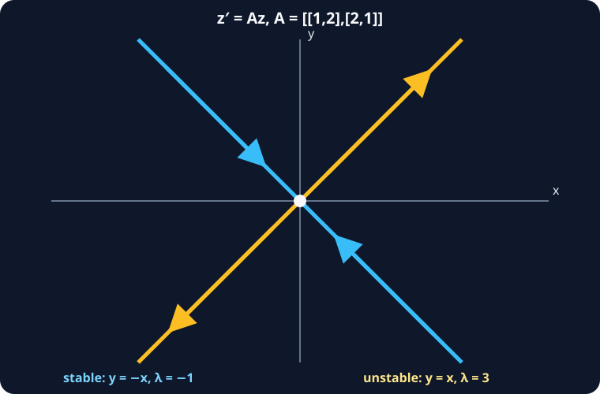

# Linear Systems and Phase Geometry

Linear systems are exactly solvable in a sense that supports more than formulas. They isolate modes, expose invariant subspaces, quantify forcing, and provide the local model for nonlinear flows. They also warn against two shortcuts: eigenvalues alone need not describe transient size, and a phase portrait is not a proof unless its geometry is derived.

## 1. The matrix exponential
For a constant n by n matrix A, define

$$e^{tA}=I+tA+\frac{t^2A^2}{2!}+\cdots$$

In any compatible matrix norm the series converges absolutely and uniformly on bounded time intervals because norm(A to k) is at most norm(A) to k. Termwise differentiation is therefore justified and gives

$$\frac{d}{dt}e^{tA}=Ae^{tA}=e^{tA}A.$$

The commutation in this formula holds because every term is a power of the same A. Commuting A and B satisfy
$$e^{t(A+B)}=e^{tA}e^{tB}$$
for every real t. Equality at one fixed time does not by itself force commutation, even for real matrices. In contrast, equality of the full flow operators throughout a real neighborhood of zero, equivalently equality for every initial state, forces AB=BA; [Exercise 13.5 in Matrix Functions](../matrix-computation-applications/matrix-functions.md) proves the distinction.

For z'=Az, z(0)=z0,

$$z(t)=e^{tA}z_0.$$

Verification is immediate from differentiation and exp(0A)=I. Uniqueness from the preceding chapter shows this is the solution rather than merely a solution.

The exponential has group properties

$$\begin{gathered}e^{(t+s)A}=e^{tA}e^{sA},\\(e^{tA})^{-1}=e^{-tA}.\end{gathered}$$

Thus a constant linear autonomous equation generates a flow for all real time. Backward evolution may be severely ill-conditioned even though the inverse exists algebraically.
## 2. Computing by structure

If A=SDS inverse with diagonal D, then

$$e^{tA}=Se^{tD}S^{-1},$$

and exp(tD) contains exp(t lambda_j) on its diagonal. Every initial vector decomposes into eigenmodes.

If A has a Jordan block J=lambda I+N with N nilpotent, then

$$e^{tJ}=e^{\lambda t}\left[I+tN+\frac{t^2N^2}{2!}+\cdots\right],$$

ending after finitely many terms. Polynomial factors multiply the exponential. When the real part of lambda is negative, they eventually decay, but can create large transients.

### Cayley–Hamilton in two dimensions

Every 2 by 2 matrix satisfies

$$A^2-(\operatorname{tr}A)A+(\det A)I=0.$$

Consequently every higher power reduces to a linear combination of I and A, and exp(tA) has the form alpha(t)I+beta(t)A. This gives exact formulas even without eigenvectors and explains why trace and determinant organize planar linear systems.

### Rotation

For

$$A=\begin{pmatrix}0&-\omega\\\omega&0\end{pmatrix},$$

A squared=-omega squared I. Separating even and odd powers yields

$$e^{tA}=\begin{pmatrix}\cos(\omega t)&-\sin(\omega t)\\\sin(\omega t)&\cos(\omega t)\end{pmatrix}.$$

The matrix is orthogonal, so Euclidean norm is conserved. Every nonzero orbit is a circle and the origin is stable but not attracting.

## 3. Forced systems and variation of constants

For

$$z'=Az+g(t),\qquad z(t_0)=z_0,$$

multiply by exp(-tA):

$$\frac{d}{dt}\bigl[e^{-tA}z(t)\bigr]=e^{-tA}g(t).$$

Integrating and multiplying back gives

$$z(t)=e^{(t-t_0)A}z_0
+\int_{t_0}^{t}e^{(t-s)A}g(s)\,ds.$$

The first term is natural response; the integral is forced response. The kernel exp((t-s)A) is the impulse propagator.

Choose a vector norm and its induced matrix norm, which are compatible. Let $M\ge1$, $\alpha>0$, and $G\ge0$. Assume $\lVert e^{sA}\rVert\le M e^{-\alpha s}$ for every $s\ge0$ and $\lVert g(s)\rVert\le G$ for every $s\ge t_0$. Then the following bound holds for every $t\ge t_0$:

$$\lVert z(t)\rVert\le M e^{-\alpha(t-t_0)}\lVert z_0\rVert+\frac{MG}{\alpha}.$$

A stable system driven by a persistent bounded input need not approach zero; it approaches a bounded response. If g tends to zero, further hypotheses give decay.

For periodic forcing, resonance occurs when the forcing aligns with an undamped natural frequency or a generalized eigenstructure. In a damped stable system, frequency response can still have a large peak without an unbounded solution.

## 4. Trace, determinant, and discriminant

For real A of size 2,

$$p(\lambda)=\lambda^2-T\lambda+D,$$

where T=trace A and D=det A. The discriminant Delta=T squared-4D controls real versus complex roots.

| conditions | eigenvalue pattern | generic portrait |
|---|---|---|
| D<0 | opposite real signs | saddle, unstable |
| D>0, Delta>0, T<0 | two negative real parts | stable node |
| D>0, Delta<0, T<0 | complex pair with negative real part | stable spiral |
| D>0, Delta<0, T=0 | purely imaginary pair | linear centre |
| D>0, Delta<0, T>0 | complex pair with positive real part | unstable spiral |
| D>0, Delta>0, T>0 | two positive real parts | unstable node |
| D=0 or Delta=0 | zero or repeated root | boundary; inspect eigenspaces |

The labels “node” and “star” depend on diagonalizability at repeated roots. A zero eigenvalue makes the equilibrium nonhyperbolic. Purely imaginary eigenvalues produce a linear centre in two dimensions, but a nonlinear perturbation can attract or repel.

### Worked portrait

Let

$$A=\begin{pmatrix}1&2\\2&1\end{pmatrix}.$$

The eigenvectors (1,1) and (1,-1) have eigenvalues 3 and -1. The origin is a saddle. The line spanned by (1,-1) is the stable subspace; the line spanned by (1,1) is unstable. A start exactly on the stable line approaches the origin, but any nonzero unstable component eventually dominates. Numerical roundoff can inject such a component, making backward or long-time plots of the stable line unreliable.

*Figure 4.1. For $A=\begin{pmatrix}1&2\\2&1\end{pmatrix}$, the line
$y=-x$ is the stable eigenspace ($\lambda=-1$), while $y=x$ is the unstable
eigenspace ($\lambda=3$). The invariant lines and arrow directions follow
exactly from the two eigenpairs.*

## 5. Phase portraits as quotient pictures

A phase portrait removes the explicit clock and shows orbit geometry. It should identify:

- equilibria and their local types;
- invariant axes, lines, curves, or regions;
- orientation along each orbit;
- nullclines and the direction of crossing;
- separatrices dividing qualitatively different futures;
- which claims are local, global, exact, or numerical.

For a linear system, an eigenvector line is invariant. In complex cases no real eigenline exists; orientation can be checked at one convenient point. For A=[[a,-b],[b,a]] with b positive, the vector at (1,0) is (a,b), so rotation is counterclockwise.

The slope equation

$$\frac{dy}{dx}=\frac{y'}{x'}$$

can describe orbit curves away from x'=0, but division loses vertical directions and equilibria. Time orientation must still be recovered from the original vector field.

## 6. Second-order equations as planar systems

The scalar equation

$$mq''+cq'+kq=F(t)$$

becomes

$$q'=v,\qquad v'=-\frac kmq-\frac cmv+\frac{F(t)}m.$$

For F=0, m and k positive, define

$$E=\tfrac12mv^2+\tfrac12kq^2.$$

Then

$$E'=mvv'+kqq'=-cv^2.$$

If c=0, energy ellipses are invariant. If c>0, energy decreases, but this alone does not yet prove every trajectory approaches the origin. The largest invariant subset where E'=0 is the origin: v=0 and invariance then forces q=0. LaSalle’s principle, on compact energy sublevel sets, completes the argument.

The characteristic roots of m lambda squared+c lambda+k classify overdamped, critically damped, and underdamped regimes. Critical damping is a repeated eigenvalue and can be defective. “Fastest return without oscillation” depends on which initial conditions and output metric are used; it is not a universal optimization theorem.

## 7. Fundamental matrices for time-dependent systems

For z'=A(t)z, a **fundamental matrix** Phi(t) has linearly independent solution columns. It satisfies

$$\Phi'=A(t)\Phi$$

and is invertible throughout an interval if it is invertible once. The state transition matrix from s to t is

$$\Phi(t)\Phi(s)^{-1}.$$

Usually this is not exp(integral A), because A(t1) and A(t2) may not commute. Time ordering matters.

Liouville’s formula states

$$\det\Phi(t)=\det\Phi(t_0)\exp\left(\int_{t_0}^t\operatorname{tr}A(s)\,ds\right).$$

Thus a fundamental matrix never becomes singular. Geometrically, trace controls infinitesimal volume expansion along a linear time-varying flow.

For the forced time-dependent equation, variation of constants becomes

$$z(t)=\Phi(t)\Phi(t_0)^{-1}z_0+\Phi(t)\int_{t_0}^t\Phi(s)^{-1}g(s)\,ds.$$

## 8. Eigenvalues are not the whole transient

Consider

$$A=\begin{pmatrix}-1&M\\0&-2\end{pmatrix}$$

with large positive M. Both eigenvalues are negative, so every solution decays asymptotically. Yet a start in the second coordinate drives a large temporary first-coordinate response. Direct calculation gives

$$y(t)=e^{-2t}y_0,\qquad x(t)=e^{-t}x_0+M(e^{-t}-e^{-2t})y_0.$$

The bracket reaches an order-one fraction, so transient x can be order M. A nonnormal matrix has nonorthogonal eigenvectors; modal cancellation at time zero can unravel before decay dominates.

Consequences:

- asymptotic stability does not imply monotone norm decay;
- small model perturbations can move eigenvalues more than a normal-matrix intuition suggests;
- actuator saturation can be triggered during a stable transient;
- numerical and measurement errors can be amplified before disappearing.

A matrix measure, singular values of exp(tA), pseudospectrum, or Lyapunov norm can quantify such behaviour. The full-edition chapter on robustness will develop those tools.

## 9. Linear flows and conserved quadratic forms

For symmetric P, define V(z)=z transpose Pz. Along z'=Az,

$$V'=z^T(A^TP+PA)z.$$

If P is positive definite and

$$A^TP+PA=-Q$$

for positive definite Q, then V decreases strictly away from zero and gives exponential stability bounds. Conversely, for a Hurwitz matrix A and positive definite Q, the integral

$$P=\int_0^\infty e^{tA^T}Qe^{tA}\,dt$$

converges, is positive definite, and solves the Lyapunov equation. This constructs a geometry in which even a nonnormal stable system contracts monotonically.

For rotation A skew-symmetric, choosing P=I gives A transpose P+PA=0, so squared norm is conserved. A conserved quadratic form need not be Euclidean; Hamiltonian linearizations often preserve an indefinite or symplectic structure instead.

## 10. Numerical matrix claims

Computing exp(tA) through diagonalization is dangerous when the eigenvector matrix is ill-conditioned. A nearly defective matrix can turn small rounding errors into large coefficient errors. Production algorithms use scaling, squaring, rational approximations, Schur forms, or Krylov actions rather than blindly forming S exp(tD) S inverse.

If only exp(tA)z is needed for a large sparse A, forming the dense exponential wastes memory and can lose structure. Krylov projection approximates the action in a smaller subspace and needs a residual or convergence estimate.

A phase plot generated by time stepping must also report:

- method and step;
- time direction and horizon;
- escape or stopping rule;
- how invariant axes and equilibria were protected or perturbed;
- refinement or exact comparison.

## Worked problems

### 1. Nilpotent flow

Let A=[[0,1],[0,0]]. Compute exp(tA) and describe its orbits.

**Solution.** A squared=0, so exp(tA)=I+tA=[[1,t],[0,1]]. Thus y(t)=y0 and x(t)=x0+t y0. Horizontal lines are invariant. If y0 is nonzero, x drifts linearly; if y0=0, every point is an equilibrium. Both eigenvalues are zero, showing why eigenvalues without Jordan structure are insufficient.

### 2. Forced stable scalar system

Solve x'=-a x+b with a positive and constant b.

**Solution.** Variation of constants gives

$$x(t)=e^{-a(t-t_0)}x_0+\frac ba[1-e^{-a(t-t_0)}].$$

The solution approaches b/a, not zero. The equilibrium shifts because the input persists.

### 3. Trace–determinant audit

A has trace -4 and determinant 13. Classify the eigenvalues.

**Solution.** Delta=16-52=-36, so the pair is complex with real part -2 and imaginary parts plus or minus 3. The origin is an asymptotically stable spiral for the linear system.

### 4. Energy and attraction

Why does E'=-c v squared with c positive not by itself say E decreases strictly at every nonzero state?

**Solution.** At states with v=0 and q nonzero, E'=0 instantaneously. Such a state does not remain in the zero-derivative set because v'=-(k/m)q is nonzero. LaSalle examines the largest invariant subset of v=0, which is only the origin when k is positive. That extra invariant-set step proves attraction.

### 5. Repair a false matrix formula

“For time-dependent A, the fundamental matrix is exp(integral A).”

**Solution.** This holds under a commutation condition such as A(t)A(s)=A(s)A(t) for all relevant s,t. Without it, differentiating the proposed exponential introduces noncommutative terms and does not simply yield A(t)Phi(t). Use a fundamental matrix, Peano–Baker series, or time-ordered exponential.

### 6. Jordan flow

Compute the flow for $A=\begin{pmatrix}-1&1\\0&-1\end{pmatrix}$.

**Solution.** Write $A=-I+N$, $N^2=0$, and commute the pieces. Then $e^{tA}=e^{-t}(I+tN)=e^{-t}\begin{pmatrix}1&t\\0&1\end{pmatrix}$. The polynomial factor records the defective Jordan block.

### 7. Rotation orientation

For $A=\begin{pmatrix}0&-3\\3&0\end{pmatrix}$, find angular direction and period.

**Solution.** At $(1,0)$ velocity is $(0,3)$, so rotation is counterclockwise. Angular speed is three and period is $2\pi/3$.

### 8. Repeated-root oscillator

For $q''+2q'+q=0$, give the general solution.

**Solution.** The characteristic polynomial is $(\lambda+1)^2$; hence $q=(c_1+c_2t)e^{-t}$. The polynomial factor is essential at critical damping.

### 9. Forced resonance boundary

Solve the qualitative issue in $q''+q=\sin t$: why is a bounded sinusoidal ansatz impossible?

**Solution.** The forcing frequency equals the natural frequency, so the usual coefficient system is singular. A particular solution contains a factor t, for example $-(t/2)\cos t$, producing linear amplitude growth in the undamped model.

### 10. Stable nonnormal peak

For the chapter’s triangular example with $x_0=0,y_0=1$, find when $e^{-t}-e^{-2t}$ peaks.

**Solution.** Differentiate to get $-e^{-t}+2e^{-2t}=0$, so $e^t=2$ and $t=\ln2$. The peak bracket is $1/2-1/4=1/4$, so x peaks at $M/4$.

### 11. Lyapunov scalar equation

For $A=-a$, $Q=q>0$, solve $A^TP+PA=-Q$.

**Solution.** $-2aP=-q$, hence $P=q/(2a)$ for a>0. Positivity corresponds to a Hurwitz scalar system.

### 12. Area evolution

If a planar time-varying system has trace $-2$, how does fundamental area scale?

**Solution.** Liouville gives determinant factor $e^{-2(t-t_0)}$. This is signed area scaling, not necessarily the norm of every vector.

### 13. Commuting time matrices

If $A(t)=a(t)A_0$, justify an exponential formula.

**Solution.** All A(t) are scalar multiples of A0 and commute, so $\Phi(t)=\exp\left(A_0 \int a\right)$ differentiates to $A(t)\Phi(t)$.

### 14. Invariant line test

How can one check whether line $\operatorname{span}(v)$ is invariant under z'=Az?

**Solution.** It is invariant exactly when $Av$ lies in $\operatorname{span}(v)$, meaning v is an eigenvector (or zero). A plotted straight-looking path is not the algebraic test.

### 15. Equilibrium under constant forcing

For $z'=Az+b$ with invertible A, find the equilibrium.

**Solution.** Solve $Az_*+b=0$, so $z_*=-A^{-1}b$. Translating $w=z-z_*$ gives $w'=Aw$; stability follows from A, while the equilibrium location depends on b.

### 16. Exact-versus-step diagnostic

Design a numerical audit for $z'=Az$.

**Solution.** Compute or reliably evaluate $e^{TA}z_0$, then run the time stepper at h,h/2,h/4. Report state error, observed order, invariant/quadratic drift when available, and work. For a nonnormal A include transient peak time and magnitude, not only the final state.

### 17. Ill-conditioned diagonalization

Why can accurate eigenvalues still yield a poor exponential through $S e^{tD}S^{-1}$?

**Solution.** Large $\lVert S\rVert\lVert S^{-1}\rVert$ amplifies rounding and eigenvector errors. A Schur or scaling-and-squaring method avoids explicitly relying on an ill-conditioned eigenbasis.

### 18. Stable eigenvalues repair

Repair: “All eigenvalues are negative, so Euclidean energy decreases monotonically.”

**Solution.** Negative real parts imply asymptotic exponential stability, but a nonnormal matrix can increase Euclidean norm transiently. A Lyapunov equation constructs another quadratic norm that decreases.

### 19. Phase portrait error diagnostic

A numerical stable manifold peels away from a saddle. Give two explanations and a test.

**Solution.** Roundoff or truncation injects an unstable component, and the initial eigenvector may itself be inaccurate. Reverse-time integration is also unstable in the opposite direction. Refine precision/step and compare against the exact exponential or use validated manifold methods.

### 20. Matrix-claim ledger

What must accompany “the origin is a stable spiral”?

**Solution.** Name the constant linear matrix, show complex conjugate eigenvalues with strictly negative real part, state rotation orientation separately, and distinguish asymptotic phase type from transient norm behavior and nonlinear validity.

## Dependency ledger

- Absolute convergence justified the matrix exponential and termwise differentiation.
- Uniqueness upgraded direct verification to the solution formula.
- Eigenvectors and Jordan chains exposed invariant modes.
- Cayley–Hamilton reduced planar matrix functions to I and A.
- Variation of constants separated natural and forced responses.
- Energy plus an invariant-set argument proved damped attraction.
- Liouville’s formula used trace to track volume.
- A Lyapunov equation supplied a contracting norm when Euclidean norm could grow transiently.
