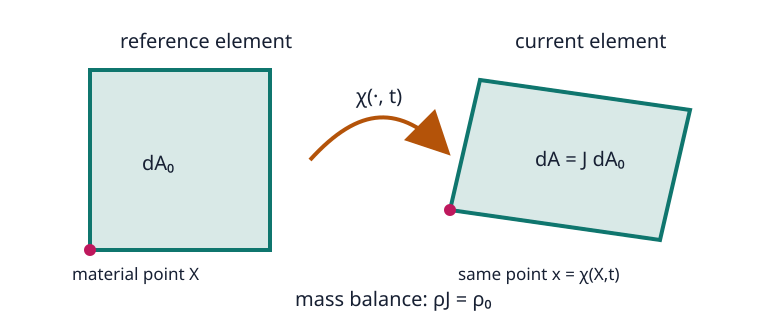

# Conservation of Mass

## Learning purpose

This chapter derives the continuity equation from the integral statement of mass conservation, explores its equivalent forms, and introduces jump conditions at discontinuities. You will learn to recognise when each form is most useful and how to handle interfaces.

## Integral statement

The mass of every material region $\Omega(t)$ is constant in time:

$$\frac{\mathrm{d}}{\mathrm{d}t} \int_{\Omega(t)} \rho \, \mathrm{d}v = 0,$$

where $\rho(x, t) > 0$ is the mass density per unit current volume.

## Local forms of mass balance

Applying the Reynolds transport theorem to $f = \rho$ gives

$$\int_{\Omega(t)} \left( \frac{D\rho}{Dt} + \rho \, \nabla \cdot v \right) \mathrm{d}v = 0.$$

Since $\Omega(t)$ is arbitrary, the integrand vanishes pointwise:

$$\frac{D\rho}{Dt} + \rho \, \nabla \cdot v = 0.$$

Expanding the material derivative yields the conservative form:

$$\partial_{t} \rho + \nabla \cdot (\rho v) = 0.$$

Both forms are equivalent; the first is natural in the material description, the second in the spatial description.

## Density evolution along a motion

Integrating the mass balance along a particle trajectory gives

$$\rho(\chi(X, t), t) \, J(X, t) = \rho_{0}(X),$$

where $\rho_{0}(X) = \rho(X, 0)$ is the reference density. This shows explicitly that density increases where material volume shrinks ($J < 1$) and decreases where it expands ($J > 1$).

The following diagram separates the reference description from the current one. The motion follows one material element, whose volume changes by the factor $J$ while its density changes reciprocally.

*Material-volume map. The two-dimensional area element represents the corresponding volume relation $dv=J\,dV$; the same material element satisfies $\rho J=\rho_{0}$.*

**Example 4.1: compression of a bar.** A bar undergoes the motion $x_{1} = \lambda(t) X_{1}$, $x_{2} = X_{2}$, $x_{3} = X_{3}$. Then $J = \lambda(t)$ and $\rho(t) = \rho_{0} / \lambda(t)$. If $\lambda(t) = 1 - \alpha t$ with $0 < \alpha t < 1$, the bar compresses and density increases as $1/(1 - \alpha t)$.

## Incompressibility

A material is incompressible if every motion from a volume-preserving reference satisfies $J = 1$. From $\rho J = \rho_{0}$, this implies $\rho$ is constant along particle paths. If the reference density is uniform, then $\rho$ is constant everywhere and the continuity equation reduces to

$$\nabla \cdot v = 0.$$

This divergence-free condition is the hallmark of incompressible flow. For a particular flow it is a kinematic condition; an incompressible material model imposes volume preservation on its admissible motions. Uniform constant density is an additional initial-data condition in that description.

**Common error.** Assuming $\nabla \cdot v = 0$ implies constant density. This is true only if the reference density is uniform. In stratified flow, $\rho$ may vary with position while still being constant along particle paths.

## Jump conditions

At a discontinuity moving with normal speed $s$, the integral mass balance yields a jump condition. In one dimension, if $[\cdot]$ denotes the jump right-minus-left across the discontinuity,

$$s \, [\rho] = [\rho v].$$

This is the Rankine--Hugoniot condition for mass. When $[\rho]\ne0$, it gives the ratio $s=[\rho v]/[\rho]$; this need not lie between the two fluid velocities and therefore is not an average. When $[\rho]=0$, the condition instead requires $[\rho v]=0$ and does not determine $s$ by division. A pointwise derivative formula cannot be imposed across the jump; the integral balance is the correct starting point.

**Example 4.2: stationary shock.** For a stationary discontinuity ($s = 0$), the jump condition gives $[\rho v] = 0$. The mass flux $\rho v$ is continuous across the shock.

## Mixtures and species balances

In a mixture, individual species may have densities $\rho_{k}$ and velocities $v_{k}$. The total mass balance is unchanged, but each species satisfies

$$\partial_{t} \rho_{k} + \nabla \cdot (\rho_{k} v_{k}) = r_{k},$$

where $r_{k}$ is the production rate of species $k$ by chemical reaction. Summing over all species gives total mass conservation provided $\sum_{k} r_{k} = 0$.

## Reference conservation is an exact equivalence

Assume the smooth one-to-one motion starts from the identity reference map and has positive Jacobian, and let the density be continuously differentiable on the swept region. Changing variables in every material subregion gives mass as the integral of $\rho(\chi(X,t),t)J(X,t)$ over that fixed reference subregion. If its value is constant for every such subregion, continuity and localization force this pulled-back density to equal the initial density pointwise. Conversely that pointwise relation immediately preserves every material-region mass.

Differentiating the product uses the material chain rule and the determinant-rate identity, producing J times the material continuity equation. Since J is positive, division gives the local equation. Thus the integral material law, the reference product relation and the smooth local equation are equivalent under the same motion assumptions. If the initial map is not identity, the reference density instead includes its initial Jacobian and initial pullback; silently setting that factor to one would change the amount of material assigned to a label.

The same localization can be formulated almost everywhere for integrable pulled-back densities: equality of their integrals on every compact subregion identifies their equivalence classes. Differentiating them pointwise would then require more regularity. The conservative distributional form below is the correct way to retain balance when only the integral information is available.

For a prescribed smooth velocity with a common flow, the density is determined uniquely by its initial value through the reference relation. Equivalently it solves a scalar linear ODE along each particle, with coefficient minus the velocity divergence. Its solution is the initial value times the exponential of minus the accumulated divergence. Positive initial density stays positive as long as this smooth flow and finite integral exist. Vacuum initially remains vacuum along that same trajectory; the undivided product law handles it without requiring division by density.

### Example 4.3: compression approaching loss of a smooth motion

For the bar compression already introduced, the density is the initial density divided by $1-\alpha t$. It stays finite and positive on every closed interval strictly before the collapse time. The product of density and the shrinking volume factor remains the original density, so every material mass is constant.

At the collapse time the Jacobian vanishes and the inverse motion no longer exists. The divergent density is therefore not a smooth continuation satisfying this chapter's hypotheses. Nor is the formula a proof that a physical material can undergo such compression without another constitutive effect becoming important. It is an exact mass-balance consequence of a prescribed kinematic map within its valid time interval.

## A divergence-free velocity transports nonuniform density

The implication from incompressible motion to zero divergence uses the initial normalisation J equal to one and its rate equation. Conversely zero divergence preserves the initial Jacobian along a smooth flow; it gives J equal to one only if that is its initial value. Together with mass balance, it makes density constant along each particle, not necessarily the same between different particles.

An incompressible material imposes this volume constraint on its admissible motions. A particular divergence-free velocity is a kinematic statement about one flow. The later constitutive chapters explain how pressure enforces that constraint without an equation determining pressure solely from density. A compressible constitutive material can also happen to execute a divergence-free motion; the observed kinematics alone do not classify its full response under other loadings.

### Example 4.4: an advected stratification

Take a uniform translational velocity U and initial density $\rho_0(X)=2+\sin X_1$, bounded away from zero. The motion is $x=X+Ut$, its Jacobian is one and the solution is $2+\sin(x_1-U_1t)$. Direct differentiation gives a partial time derivative cancelled exactly by advection, while the velocity divergence vanishes.

Unless the first component of U is zero, density changes at a fixed probe despite being constant on every particle. It is nonuniform at every time. Constant spatial density, constant particle density and temporal steadiness are therefore three different statements. Confusing them can discard a real advected stratification while still retaining a superficially correct divergence-free velocity.

## Relative mass flux clarifies an interface speed

The mass jump condition can be written as equality of the two relative normal mass fluxes $\rho(v_n-s)$. A material contact with positive density and no mass transfer has zero relative flux on both sides, hence each side's normal velocity equals the interface speed. A shock can carry a nonzero common relative mass flux. The interface is then not a material collection of the same particles.

### Example 4.5: the shock speed is not a velocity average

Use left density one and velocity three, and right density two and velocity two. The mass fluxes are three and four, so the right-minus-left jumps give interface speed one. This lies below both fluid velocities. The left relative mass flux is one times two and the right relative mass flux two times one, both equal to two.

Thus the jump ratio is not a convex average of the material velocities. The density jump weights a conservation relation rather than an averaging operation. This pair of states proves only mass compatibility; momentum, energy, an equation of state and entropy may rule them in or out as a shock for a particular material. Mass balance cannot establish that full physical admissibility alone.

If the densities are equal and positive, mass compatibility requires equal normal velocities, while the interface speed is not fixed by the mass equation. Other fields can still jump across a material contact, and the remaining balances determine additional restrictions. Dividing by the zero density jump would lose that meaningful case rather than solve it.

## Mixtures have a distinguished mass-average velocity

Let total density be the sum of species densities and define the barycentric velocity by total momentum of species mass, $\rho v=\sum_k\rho_kv_k$. Define diffusive mass flux $j_k=\rho_k(v_k-v)$. These definitions give $\sum_kj_k=0$ identically. Summing the species balances therefore yields the ordinary total continuity equation when the reaction mass productions sum to zero.

When total density is positive, introduce mass fractions $Y_k=\rho_k/\rho$, whose sum is one. Expand each species equation using total continuity. It becomes

$$\rho\frac{DY_k}{Dt}+\operatorname{div}j_k=r_k.$$

Thus a species fraction can change on a material particle through diffusion or reaction even while that particle's total mass is conserved. Treating every species as though it shared the total material density law would erase these physical transfers. Molar production rates must first be converted with species molar masses before their sum can be used as a mass-production condition.

For a binary mixture, choosing one diffusive flux determines the opposite flux of the other species. A simple Fick model for the first mass fraction is minus total density times positive diffusivity times its gradient, with the second flux its negative. That closure describes relative transport and needs boundary flux data. No-flux boundaries and zero reaction conserve the total amount of each species, although the fractions can become more uniform inside.

### Example 4.6: opposite diffusion with zero total flux

In a stationary binary mixture of constant total density, let $j_1=-\rho D\nabla Y_1$ and $j_2=-j_1$ with constant positive D. Then the first species fraction satisfies the heat equation, and the second fraction is one minus the first. Their relative fluxes can be nonzero everywhere a gradient exists, but their total diffusive mass flux cancels pointwise.

The mixture's total velocity and density can therefore stay fixed while both species redistribute. Under compatible no-flux boundaries the spatial integrals of each species mass stay fixed too. If a reaction is added, those separate amounts change according to its mass-production integral while their sum remains fixed only when the reaction's mass balance holds.

## The weak equation retains conservation without pointwise derivatives

For locally integrable density and mass flux, impose continuity by pairing against compact smooth spacetime tests. On the line or whole space, including the initial time, the identity has integrals of density times the test's time derivative and mass flux times its spatial gradient, plus the initial density term. Their sum is zero. This defines a distributional continuity equation without assigning ordinary derivatives across interfaces.

The products must still be locally integrable; giving a rough velocity and rough density independently does not automatically make their product meaningful. Boundary traces also require a solution class. For a bounded vessel, zero normal mass flux is additional boundary information, not a conclusion from tests supported away from its walls. Global total-mass conservation follows with that flux condition and the needed integrability; on an unbounded domain one must control the flux at infinity as well.

Weak mass conservation is necessary for a rough continuum solution but is not its complete definition. Momentum, energy and constitutive restrictions retain their own solution and trace requirements. A numerical method can satisfy exact cellwise mass cancellation while violating positivity, another balance or entropy. The purpose of the present theorem is precise accounting of mass, with those further requirements left explicit.

## Summary and connections

Mass conservation gives the continuity equation in material or conservative form. The integrated relation $\rho J = \rho_{0}$ connects density to volume change. Incompressibility reduces the continuity equation to $\nabla \cdot v = 0$. Jump conditions handle discontinuities.

This chapter used the Reynolds transport theorem from *Transport Theorem and Reynolds Transport*. In the next chapter, *Cauchy Stress and Momentum Balance*, we apply the same transport machinery to the vector field $\rho v$ to obtain the equation of motion.

## Exercises

### Exercise 1
For steady flow in a pipe with cross-sectional areas $A_{1}$ and $A_{2}$ at two stations, show that $\rho_{1} v_{1} A_{1} = \rho_{2} v_{2} A_{2}$ for one-dimensional flow.

Hint 1

Integrate the steady conservative equation over the pipe segment.

Hint 2

Use no penetration on the lateral wall and opposite normals at the two ends.

Full solution

**Solution.** Integrate $\nabla \cdot (\rho v) = 0$ over the pipe segment between the stations. By the divergence theorem, the flux through the lateral walls is zero (no penetration), so the net flux through the end faces vanishes: $-\rho_{1} v_{1} A_{1} + \rho_{2} v_{2} A_{2} = 0$.

### Exercise 2
A two-dimensional velocity field is $v = (x_{1} / (1 + t), -x_{2} / (1 + t))$. Find $\rho(x, t)$ given $\rho(x, 0) = \rho_{0}$ constant.

Hint 1

Compute the velocity divergence first.

Hint 2

Follow the two characteristic coordinates to carry the initial density.

Full solution

**Solution.** We have $\nabla \cdot v = 1/(1 + t) - 1/(1 + t) = 0$, so the flow is incompressible. The material derivative of density is $D\rho/Dt = \partial_{t} \rho + (x_{1}/(1+t)) \partial_{1} \rho - (x_{2}/(1+t)) \partial_{2} \rho = 0$. The ODEs for characteristics are $\dot{x}_{1} = x_{1}/(1+t)$, $\dot{x}_{2} = -x_{2}/(1+t)$, giving $x_{1} = X_{1}(1+t)$, $x_{2} = X_{2}/(1+t)$. Since $\rho$ is constant along characteristics and $\rho(X, 0) = \rho_{0}$, we have $\rho(x, t) = \rho_{0}$ everywhere.

### Exercise 3
A shock wave moves with speed $s$ into stationary fluid of density $\rho_{1}$. Behind the shock, the density is $\rho_{2} > \rho_{1}$ and the fluid moves with velocity $v_{2}$. Find $v_{2}$ in terms of $s$, $\rho_{1}$, and $\rho_{2}$.

Hint 1

Use the undivided mass jump relation.

Hint 2

The upstream flux vanishes because the upstream fluid is stationary.

Full solution

**Solution.** The jump condition is $s(\rho_{2} - \rho_{1}) = \rho_{2} v_{2} - \rho_{1} \cdot 0$. Solving,

$$v_{2} = s \left( 1 - \frac{\rho_{1}}{\rho_{2}} \right).$$

Since $\rho_{2} > \rho_{1}$, the fluid behind the shock moves in the same direction as the shock, but slower than $s$.

### Exercise 4

For the one-dimensional motion $x=e^{at}X$, find the density from nonuniform initial value $\rho_0(X)$.

Hint 1

Invert the motion to find the particle label at a current position.

Hint 2

The one-dimensional Jacobian is the exponential stretch itself.

Full solution

The label is $X=e^{-at}x$ and the density is $e^{-at}\rho_0(e^{-at}x)$. Both the density amplitude and its spatial pattern change. Dropping the Jacobian factor would transport the profile but fail to conserve the mass of each expanding material interval. The formula applies while the reference motion is the declared smooth one-to-one map.

### Exercise 5

Give an explicit divergence-free velocity and positive nonconstant density satisfying continuity.

Hint 1

Use a uniform translation.

Hint 2

Translate a positive nonconstant initial profile with it.

Full solution

Take velocity $(1,0,0)$ and density $2+\sin(x_1-t)$. The velocity divergence is zero, and the density's time derivative is minus its first spatial derivative, so continuity holds. Density remains positive and nonconstant. Thus zero velocity divergence does not imply spatially constant density without uniform initial data.

### Exercise 6

For left density one and velocity three and right density two and velocity two, compute the interface speed and both relative fluxes.

Hint 1

Compute the jump in physical mass flux before dividing by the density jump.

Hint 2

Compare each velocity with the resulting speed rather than averaging them.

Full solution

The speed is $(4-3)/(2-1)=1$. Relative fluxes are $1(3-1)=2$ and $2(2-1)=2$. The speed is below both velocities, disproving a velocity-average interpretation. Additional momentum, energy and entropy relations are still needed to call this a physically admissible shock for a particular constitutive model.

### Exercise 7

If the density is the same positive constant on each side of an interface, what does its mass jump equation determine?

Hint 1

The density jump vanishes.

Hint 2

Retain the undivided equation instead of forming a ratio.

Full solution

It requires equal normal mass flux, hence equal normal velocities. The mass equation does not determine the interface speed because its multiplier is the zero density jump. A separate material-contact condition or the other balances can impose further information. Division by the density jump would be undefined and would discard this case.

### Exercise 8

Prove that barycentric diffusive mass fluxes sum to zero.

Hint 1

Sum their definitions before using a field equation.

Hint 2

The defining total momentum of species mass cancels the total density times barycentric velocity.

Full solution

The sum is $\sum_k\rho_kv_k-v\sum_k\rho_k=\rho v-\rho v=0$. It is an identity of the chosen mass-average velocity. It does not mean each species diffusive flux vanishes, and a different average, such as a molar average, has a different corresponding sum rule.

### Exercise 9

Derive the mass-fraction equation from the species and total balances when total density is positive.

Hint 1

Write species density as total density times its mass fraction.

Hint 2

Use total continuity to cancel the terms proportional to the fraction.

Full solution

Insert $\rho_k=\rho Y_k$ and species flux $\rho Y_kv+j_k$. Expanding gives $Y_k[\partial_t\rho+\operatorname{div}(\rho v)]+\rho DY_k/Dt+\operatorname{div}j_k=r_k$. The bracket vanishes, leaving the stated equation. At vacuum the fraction may be undefined, so the undivided species-density balances are the safer primary variables.

### Exercise 10

For a binary no-flux mixture with zero reactions, show each species amount is conserved while its local fraction can change.

Hint 1

Integrate the species equation over the fixed vessel.

Hint 2

Internal diffusive redistribution has cancelling boundary contribution.

Full solution

The integrated time rate is minus the boundary species flux, which is zero under the stated no-flux condition. Thus each total species mass is constant. In the stationary constant-density Fick example, the local fraction still solves a heat equation and evolves wherever its Laplacian is nonzero. Global conservation does not require local temporal constancy.

