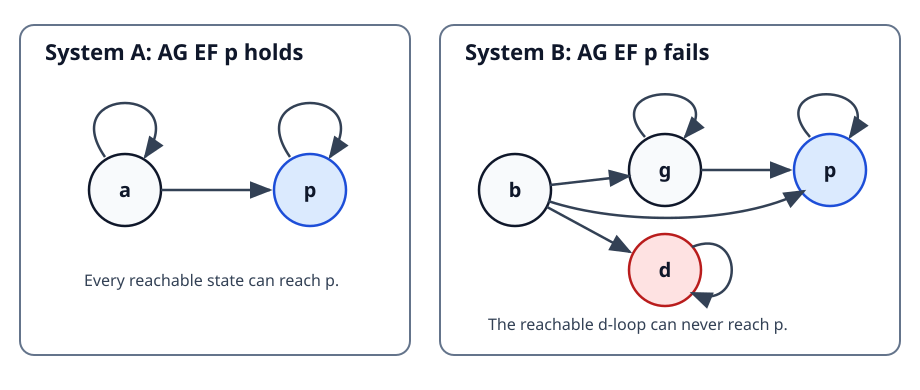

# Temporal Logics, Path Quantifiers, and Fixed-Point Characterizations

Reactive systems do not merely compute a final value; they generate paths. Temporal logic describes safety, progress, recurrence, and branching possibilities over those paths. Fixed-point characterizations turn formulas into algorithms, while fairness makes scheduler assumptions visible.

## 1. Kripke structures and paths

A finite Kripke structure $K=(S,R,L)$ has states, transition relation, and proposition labeling. Usually $R$ is total so every state begins an infinite path $s_0s_1...$ with $R(s_i,s_{i+1})$. Deadlocks can instead receive self-loops; that modeling choice changes temporal truth.

A state proposition is true by $L$. Path formulas inspect sequences. Initial-state satisfaction may require all initial states or a designated one.

## 2. Linear temporal logic

LTL operators include next $X \phi$, eventually $F \phi$, always $G \phi$, and until $\phi U \psi$. On path position $i$:

- $X \phi$ holds if $\phi$ holds at $i+1$;
- $F \phi$ holds if it holds at some $j\ge i$;
- $G \phi$ holds if it holds at every $j\ge i$;
- $\phi U \psi$ holds if some $j\ge i$ satisfies $\psi$ and every position from $i$ to $j-1$ satisfies $\phi$.

Weak until allows $\phi$ forever without $\psi$; strong until does not. Negation dualities include $\neg F \phi = G \neg \phi$.

LTL model checking commonly asks whether every path from initial states satisfies formula. Existential counterexamples are paths satisfying the negation.

## 3. CTL branching time

CTL pairs path quantifiers $A$ (all paths) or $E$ (some path) with temporal operators. $EF p$ means some path eventually reaches $p$; $AF p$ means every path eventually does; $EG p$ means some path remains in $p$; $AG p$ means all reachable states satisfy $p$.

$AF p$ and $AG EF p$ are not interchangeable. Branching-time formulas can distinguish structures with the same individual trace sets under different branching arrangements, and LTL can express some path properties not expressible in CTL. Neither simply contains the other under standard state-formula comparison.

## 4. Predecessor operators

For state set $X$, define

$\operatorname{Pre}_{\exists}(X)=
\{s:\exists t.\;R(s,t) \land t \in X\}$,

$\operatorname{Pre}_{\forall}(X)=\{s : \forall t.\ R(s,t) \Rightarrow t \in X\}$.

Under total transitions, CTL meanings satisfy:

$EF p = \mu X. (P \cup \operatorname{Pre}_{\exists}(X))$,

$EG p = \nu X. (P \cap \operatorname{Pre}_{\exists}(X))$,

where $\mu$ is least and $\nu$ greatest fixed point. Least iteration begins empty and accumulates finite witnesses; greatest iteration begins all states and removes states unable to continue.

$AF p = \mu X.(P \cup \operatorname{Pre}_{\forall}(X))$. Monotonicity of the functionals ensures fixed points on the finite powerset lattice.

## 5. Modal mu-calculus

The modal mu-calculus combines propositions, Boolean operations, modal predecessors, and least/greatest fixed-point binders. Variables must occur positively so induced functionals are monotone. It subsumes CTL and supports nested recurrence properties.

On finite structures, fixed-point iteration stabilizes after at most $|S|$ strict set changes per binder, though nesting and symbolic representation affect actual complexity.

## 6. Safety and liveness

Safety says “nothing bad ever happens” and is refutable by a finite bad prefix. Liveness says “something good eventually happens” and no finite prefix alone refutes it, because the path may progress later. Many specifications combine both.

Bounded response $G(request \to  F_{\le k} grant)$ is safety-like on a discrete system because a missed deadline has finite evidence. Unbounded response is liveness and needs infinite-path reasoning.

## 7. Fairness

Without fairness, a scheduler may ignore an enabled thread forever. Weak fairness requires a continuously enabled action eventually occur; strong fairness handles actions enabled infinitely often. Fairness restricts admissible paths and can make liveness true, but is an assumption to justify against the deployment scheduler.

Adding fairness to the property rather than the model can clarify scope: “on every fair path, requests recur to grants.” Safety usually should not depend on optimistic fairness.

## 8. Omega-automata boundary

LTL formulas translate to automata over infinite words, often nondeterministic Büchi automata accepting runs that visit designated states infinitely often. Model checking forms a product with the system and searches for a reachable accepting cycle. Translation can be exponential in formula size; the system product adds state-space cost.

## 9. Boundaries

- Path quantifiers and temporal operators must not be separated informally.
- Deadlock completion changes next-time and infinite-path semantics.
- Least fixed points capture finite reachability; greatest fixed points sustain infinite behavior.
- Fairness is a model assumption, not a free theorem.
- Finite prefixes refute safety but generally not liveness.

## Fixed-point meanings proved on finite serial structures

For this section the state set is finite and every state has a successor. Let P and Q be the satisfaction sets of state formulas. Define H(X)=Q∪(P∩Pre∃(X)). Both predecessors preserve inclusion, so H is monotone. Its increasing iteration from empty stabilizes after at most |S| strict additions of state sets, because each strict inclusion adds a previously absent state. The stable set is its least fixed point: induction places every iterate below every prefixed point.

**Theorem 7.1 (Existential until).** E[P U Q] is the least fixed point of H.

*Proof.* Induction on iteration index shows that membership in the kth iterate has a finite path to Q with all preceding states in P. A state first added through Q has a zero-edge witness. A state added through P∩Pre∃ has a P label and a successor with the induction witness; prepend its one edge.

Conversely, induct on the length of a finite until witness. A zero-edge witness begins in Q and enters the first iterate. A positive-length witness begins in P and its successor has a shorter witness, hence belongs to an iterate by induction. The current state then enters the next iterate. Since seriality extends each finite witness to an infinite path, these finite witnesses are exactly the stated CTL until semantics. Thus the union of iterates agrees with E[P U Q]. ∎

For EG P use K(X)=P∩Pre∃(X) and descending iteration from all states. At the stable set Z, every member is in P and has a successor in Z. Because the set is finite, choose one such successor for each member and repeatedly follow it. This constructs an infinite P-path, eventually with a cycle. Conversely every state on an infinite P-path belongs to every descending iterate, by induction using its next path state. Its initial state therefore belongs to Z. This proves the greatest-fixed-point characterisation in both directions.

For AF P iterate A(X)=P∪Pre∀(X) from empty. A state entering a finite stage has a finite bound on the number of edges needed to see P along every path: induct on its entry stage, decreasing the stage at each non-P successor. Conversely suppose a state is outside the stationary set Z. It is not in P, and it has at least one successor outside Z, since otherwise Pre∀(Z) would include it. Follow such successors forever. The resulting path never reaches P, contradicting AF P. This proves the least-fixed-point formula on the finite serial model. On infinite infinitely branching structures, a fixed finite iteration bound need not capture all universal eventualities; the finite-state hypothesis must not disappear from this proof.

## Worked example 1: possible is different from inevitable

Take states a,b,c with edges a→b, a→c, b→b and c→c. Only b satisfies p. Backward existential iteration starts at {b} and adds a, then stops at {a,b}. Thus EF p holds at a. Universal eventuality starts at {b}; a is not added because c is a successor outside the set, and c never enters. AF p therefore fails at a.

The infinite path a,c,c,… is a counterexample to inevitability, while a,b,b,… witnesses possibility. Both statements can hold exactly as the earlier exercise says. An interface that displays eventually without a path quantifier would leave the distinction undecided. The model and the sentence being formalised determine which claim the learner should choose.

## Worked example 2: strong and weak until

On a one-state self-loop labeled p and not q, p holds at every position and q never occurs. Strong p U q is false because its semantic witness must choose an actual finite q-position. Weak until is true because its alternative permits p forever.

Unfolding both into the same informal recursive equation loses this distinction. At the state-set level the equation X=Q∪(P∩Pre∃(X)) has both empty and singleton solutions here. The least solution selects finite eventual witnesses and is empty; the greatest solution permits indefinite continuation and contains the state. Fixed-point polarity is mathematical content, not merely a choice of an iteration starting point for the same property.

## Worked example 3: a fairness assumption changes the paths

Let w have a waiting self-loop and an edge to grant state g, and let g self-loop. The grant edge is enabled whenever the system is at w. Without fairness, w,w,w,… violates F grant. Under weak fairness for that particular continuously enabled grant action, this path is excluded, while every remaining path eventually moves to g and satisfies the eventuality.

The conclusion is conditional on that fairness rule. If the model instead repeatedly disables the grant action, weak fairness may no longer exclude the execution; strong fairness has another enabling condition. Giving a fairness condition solely to erase an inconvenient path supplies an assumption rather than a proof that an implementation's scheduler meets it. The concurrency chapter provides the corresponding operational distinctions.

## Safety, liveness and finite observations

A bad-prefix definition makes the familiar difference precise. A property of infinite traces is safety when every violating trace has a finite prefix that no extension can repair. For G ¬bad, the prefix ending at the first bad position suffices. For F grant, every finite grant-free prefix has an extension granting next, so no such prefix alone refutes it. The infinite all-waiting path still violates the property.

Bounded response changes this argument. If a request must be answered within k transitions, a prefix containing the request and the next k unanswered transitions proves failure. Units and the definition of simultaneous events must be fixed; a bound in model edges is not automatically a real-time deadline. Quantitative temporal extensions need their own clocks and semantics.

## Which expressiveness and complexity claims are cited

The incorporated logic chapter below gives an explicit pair of trace-equivalent structures separating AG EF p from universal LTL state semantics. Its reverse expressiveness separation, the full LTL-to-Büchi construction and PSPACE-hardness proof are cited standard results, not derived by the finite CTL fixed-point proofs above. The elementary CTL algorithm is polynomial because it processes finitely many subformulas and each finite lattice iteration examines a polynomial-size graph; specialised predecessor worklists improve the bound further.

The distinction between system size and formula size is part of the complexity statement. An exponential construction in the formula can be harmless for one fixed small formula but decisive in combined complexity. Merely observing an exponential automaton does not prove a polynomial-space upper bound; that uses on-the-fly representation and the corresponding space theorem. These qualifications preserve the original statements while locating their actual proof obligations.

## Earlier logic account: Temporal Logic

Temporal logic is a branch of modal logic specialized to reasoning about time. It is widely used in computer science for specifying and verifying the behavior of systems over time. This chapter introduces linear and branching time logics, their semantics over transition systems, and the model-checking problem.

## Linear temporal logic (LTL)

**Definition 7.2 (LTL syntax).** LTL formulas over a set of atomic propositions $AP$ are:
- Every $p \in AP$ is a formula.
- If $\varphi, \psi$ are formulas, so are $\neg \varphi$, $(\varphi \to \psi)$, $\mathsf{X} \varphi$, and $(\varphi \, \mathsf{U} \, \psi)$.

The operators are: $\mathsf{X}$ (next), $\mathsf{U}$ (until). Derived operators include $\mathsf{F} \varphi = \top \, \mathsf{U} \, \varphi$ (eventually) and $\mathsf{G} \varphi = \neg \mathsf{F} \neg \varphi$ (always).

**Definition 7.3 (transition system).** A *transition system* is a tuple $\mathcal{T} = (S, \to, L)$ where $S$ is a set of states, $\to \subseteq S \times S$ is a transition relation, and $L: S \to \mathcal{P}(AP)$ labels each state with the propositions true there.

Throughout this chapter the transition relation is **serial**: every state has a successor, so every finite path extends to an infinite one. A finite implementation may enforce this convention by adding a self-loop to each deadlock state.

**Definition 7.4 (path).** A *path* $\pi = s_0 s_1 s_2 \dots$ is an infinite sequence of states with $s_i \to s_{i+1}$ for all $i$. We write $\pi^i$ for the suffix starting at $s_i$.

**Definition 7.5 (LTL semantics).** For a path $\pi$:
- $\pi \models p$ iff $p \in L(s_0)$.
- $\pi \models \neg \varphi$ iff $\pi \not\models \varphi$.
- $\pi \models (\varphi \to \psi)$ iff $\pi \not\models \varphi$ or $\pi \models \psi$.
- $\pi \models \mathsf{X} \varphi$ iff $\pi^1 \models \varphi$.
- $\pi \models (\varphi \, \mathsf{U} \, \psi)$ iff there exists $j \geq 0$ such that $\pi^j \models \psi$ and for all $0 \leq k < j$, $\pi^k \models \varphi$.

**Definition 7.6 (satisfaction in a system).** $\mathcal{T}, s \models \varphi$ iff $\pi \models \varphi$ for every path $\pi$ starting at $s$.

## Computation tree logic (CTL)

**Definition 7.7 (CTL syntax).** CTL formulas are:
- Every $p \in AP$ is a formula.
- If $\varphi, \psi$ are formulas, so are $\neg \varphi$, $(\varphi \to \psi)$.
- If $\varphi, \psi$ are **state formulas**, so are $\mathsf{EX} \varphi$, $\mathsf{EG} \varphi$, and $\mathsf{E}[\varphi \, \mathsf{U} \, \psi]$.

Here $\mathsf{E}$ means “there exists a path” and $\mathsf{A}$ means “for all paths.” CTL requires every temporal operator to be immediately preceded by a path quantifier.

**Definition 7.8 (CTL semantics).** For a state $s$:
- $\mathcal{T}, s \models \mathsf{EX} \varphi$ iff there exists $s \to s'$ with $\mathcal{T}, s' \models \varphi$.
- $\mathcal{T}, s \models \mathsf{EG} \varphi$ iff there exists a path $s = s_0 s_1 \dots$ with $\mathcal{T}, s_i \models \varphi$ for all $i$.
- $\mathcal{T}, s \models \mathsf{E}[\varphi \, \mathsf{U} \, \psi]$ iff there exists a path $s = s_0 s_1 \dots$ and $j \geq 0$ with $\mathcal{T}, s_j \models \psi$ and $\mathcal{T}, s_k \models \varphi$ for all $k < j$.

## Expressive power: LTL vs. CTL

**Theorem 7.9.** Neither LTL nor CTL subsumes the other.

- CTL can express $\mathsf{AG} \mathsf{EF} p$ (on every path, it is always possible to reach $p$). This is not expressible in LTL.
- LTL can express $\mathsf{F} \mathsf{G} p$ (eventually $p$ holds forever). This is not expressible in CTL.

CTL* unifies both by allowing path quantifiers and linear temporal operators to mix freely.

These are expressibility theorems, not consequences of how the formulas look. Exercise 2 supplies trace-equivalent systems for the CTL-over-LTL separation. The converse separation for $\mathsf F\mathsf Gp$ requires the standard family/game argument and is cited to a model-checking text rather than reconstructed here.

## Model checking

**Definition 7.10 (model-checking problem).** Given a finite transition system $\mathcal{T}$, a state $s$, and a formula $\varphi$, determine whether $\mathcal{T}, s \models \varphi$.

**Theorem 7.11.** CTL model checking is in PTIME.

**Proof sketch.** Label every state with the subformulas of $\varphi$ it satisfies, working from atomic propositions upward. For $\mathsf{EX}\varphi$, label states with a successor satisfying $\varphi$. For $\mathsf{EG}\varphi$, restrict to the subgraph induced by $\varphi$-states, find its cyclic strongly connected components (including a singleton only when it has a self-loop), and take all $\varphi$-states that can reach one through $\varphi$-states. For $\mathsf{E}[\varphi\,\mathsf U\,\psi]$, compute the least predecessor fixpoint. Each step is polynomial in $|\mathcal T|$ and $|\varphi|$.

**Theorem 7.12.** LTL model checking is PSPACE-complete.

**Proof sketch.** A Büchi automaton for $\neg\varphi$ may have exponentially many states, but an accepting lasso in its product with $\mathcal T$ can be searched on the fly while storing only the current tableau state, a transition-system state, and polynomial-size counters. Savitch's theorem (or nondeterministic polynomial-space search) gives the PSPACE upper bound without materializing the exponential automaton. Hardness follows from a standard PSPACE reduction. Exponential construction time alone would not establish a polynomial-space bound.

## Common errors

**Error: omitting path quantifiers in CTL.** Writing $\mathsf{F} p$ without $\mathsf{E}$ or $\mathsf{A}$ is not a CTL formula. Every temporal operator must be paired with a path quantifier.

**Error: assuming LTL and CTL are equivalent.** They have incomparable expressive power. Choosing the right logic for a specification task requires understanding what each can express.

**Error: confusing fairness constraints with the logic itself.** Fairness (e.g., “every process gets infinitely many turns”) is often needed in practice but is not part of the basic LTL or CTL semantics. It is handled by restricting to fair paths.

## Exercises with complete solutions

### 1. Eventually dual {#temporal-logics-and-fixed-points-ex-1}

Prove $\neg F p$ equals $G \neg p$.

Hint 1

Expand F as an existential future position.

Hint 2

Negating that existential yields a universal absence.

Solution

“No future position has $p$” is exactly “every future position lacks $p$,” by quantifier negation.

### 2. Strong until {#temporal-logics-and-fixed-points-ex-2}

Does $p U q$ permit $p$ forever with no $q$?

Hint 1

Read the finite witness required by strong until.

Hint 2

The right-hand formula must occur at some actual index.

Solution

No. Strong until requires a finite future position satisfying $q$.

### 3. EF meaning {#temporal-logics-and-fixed-points-ex-3}

What witnesses $EF bad$?

Hint 1

Unpack existential eventuality.

Hint 2

Only the finite prefix to bad is needed as a witness.

Solution

A finite path from the current state to a state labeled $bad$; its prefix is a checkable reachability counterexample.

### 4. AF versus EF {#temporal-logics-and-fixed-points-ex-4}

Can both $EF p$ and $\neg AF p$ hold?

Hint 1

Choose one successful and one permanently unsuccessful branch.

Hint 2

The three-state worked example supplies both.

Solution

Yes. One branch may reach $p$ while another avoids it forever.

### 5. Least iteration {#temporal-logics-and-fixed-points-ex-5}

Why start $EF$ from empty set?

Hint 1

Ask what justifies adding a state.

Hint 2

A least iterate requires a finite predecessor chain to P.

Solution

The least fixed point adds only states justified by a finite chain to $P$, avoiding unsupported infinite behavior.

### 6. Greatest iteration {#temporal-logics-and-fixed-points-ex-6}

Why start $EG$ from all states?

Hint 1

Read the stable-set successor condition.

Hint 2

Repeatedly choosing an internal successor yields an infinite path.

Solution

Repeated removal retains the largest set in which a $p$ state has some successor still in the set, supporting an infinite $p$ path in a finite total structure.

### 7. Monotonicity {#temporal-logics-and-fixed-points-ex-7}

Prove $\operatorname{Pre}_{\exists}$ monotone.

Hint 1

Keep the same successor witness.

Hint 2

Membership in X implies membership in a larger Y.

Solution

If $X \subseteq Y$, any state with a successor in $X$ has that same successor in $Y$, so $\operatorname{Pre}_{\exists}(X) \subseteq \operatorname{Pre}_{\exists}(Y)$.

### 8. Safety witness {#temporal-logics-and-fixed-points-ex-8}

Why is $AG \neg bad$ refutable finitely?

Hint 1

Stop at the first bad position.

Hint 2

No later continuation erases that visited state.

Solution

A finite path reaching a $bad$ state already violates the universal invariant; later behavior cannot repair the prefix.

### 9. Liveness prefix {#temporal-logics-and-fixed-points-ex-9}

Why does a finite delay not refute $F grant$?

Hint 1

Extend the prefix by one granting step.

Hint 2

A delay of any fixed finite length may still end.

Solution

The path may grant at a later position. Only an infinite path with no grant refutes unbounded eventuality.

### 10. Weak fairness {#temporal-logics-and-fixed-points-ex-10}

What behavior does it exclude?

Hint 1

Focus on continuous enabling after some point.

Hint 2

Such an action cannot be postponed forever under weak fairness.

Solution

It excludes an action remaining continuously enabled from some point onward yet never being scheduled.

### 11. Büchi cycle {#temporal-logics-and-fixed-points-ex-11}

Why search for a reachable accepting cycle?

Hint 1

Use finiteness to find recurring vertices.

Hint 2

Acceptance must recur in a cyclic component, not only on its prefix.

Solution

Reaching and repeating the cycle yields an infinite run visiting an accepting state infinitely often; every accepting run in a finite product repeats such a component.

### 12. Deadlock self-loop {#temporal-logics-and-fixed-points-ex-12}

What can it change?

Hint 1

Compare finite maximal paths with infinite stuttering paths.

Hint 2

Next and eventuality observe the completion convention.

Solution

It turns a finite deadlock into an infinite stuttering path, affecting next-time and liveness formulas. The completion policy must be explicit.

## Earlier logic exercises

### Earlier logic exercise 1 {#temporal-logic-ex-1}

Using a clock proposition $e$ intended to mark exactly the even positions, express in LTL both the clock behavior and “$p$ holds at every even position.”

Hint 1

Use a separate proposition for the clock.

Hint 2

Require initial truth, alternating next truth and p at clock-marked states.

Solution

Use

$$e\ \land\ \mathsf G\bigl(\mathsf X e\leftrightarrow\neg e\bigr)\ \land\ \mathsf G(e\to p).$$

The first two conjuncts initialize and alternate the clock; the last requires $p$ at clock-marked positions while leaving odd positions unconstrained. A formula that forces $p$ itself to repeat every two steps would incorrectly forbid legitimate changes at odd positions.

### Earlier logic exercise 2 {#temporal-logic-ex-2}

Show that $\mathsf{AG} \mathsf{EF} p$ is not expressible in LTL.

Hint 1

Universal LTL observes trace sets.

Hint 2

Use the two systems in the solution to change reachable branching without changing traces.

Solution

Use two trace-equivalent pointed systems. System A has states $a,p$, labels only $p$ with proposition $p$, and edges $a\to a$, $a\to p$, $p\to p$. System B has states $b,g,d,p$, again labels only $p$, and edges $b\to g,d,p$, $g\to g,p$, $d\to d$, and $p\to p$. From either initial state the traces are exactly $\neg p^\omega$ and, for each $n\geq1$, $n$ copies of $\neg p$ followed by $p^\omega$. Hence every LTL state formula (under universal-path semantics) agrees at $a$ and $b$. But $\mathsf{AG}\mathsf{EF}p$ holds at $a$, whereas it fails at $b$ because the reachable dead branch $d$ can never reach $p$.

The diagram uses blue for the only state satisfying $p$ and red for the dead-loop state $d$; the labels and edges carry the same information without relying on color. Both initial states generate exactly the trace set stated in the solution, while the extra branch through $d$ changes the CTL reachability property.

### Earlier logic exercise 3 {#temporal-logic-ex-3}

Write a CTL formula expressing: “Whenever $p$ holds, $q$ holds at the next state on some path.”

Hint 1

The condition is checked at every reachable position.

Hint 2

The next-state requirement is existential, not universal.

Solution

$\mathsf{AG}(p \to \mathsf{EX} q)$.

### Earlier logic exercise 4 {#temporal-logic-ex-4}

Prove that $\mathsf{E}[\top \, \mathsf{U} \, \varphi]$ is equivalent to $\mathsf{EF} \varphi$ in CTL.

Hint 1

Expand strong until with a true left operand.

Hint 2

There is no restriction before the eventual right-hand witness.

Solution

$\mathsf{E}[\top \, \mathsf{U} \, \varphi]$ means there exists a path where eventually $\varphi$ holds, with no restriction before (since $\top$ always holds). This is exactly the definition of $\mathsf{EF} \varphi$.

### Earlier logic exercise 5 {#temporal-logic-ex-5}

Explain why LTL model checking is harder than CTL model checking.

Hint 1

State whether the formula is part of the varying input.

Hint 2

An implicit exponential tableau can still be searched in polynomial space.

Solution

In combined complexity, CTL's state-subformula fixpoints run in polynomial time, while LTL's path formulas require an implicit exponential tableau/Büchi search and give PSPACE-completeness. The comparison is about worst-case input where the formula varies; for a fixed LTL formula, model checking is polynomial in the transition-system size.

## Chapter summary

Temporal formulas quantify over specified paths. Finite serial structures admit full least-fixed-point until and universal-eventuality proofs and a greatest-fixed-point global proof. Fairness restricts paths as an assumption. The complete earlier logic account retains its trace-equivalent separation example and marks the deeper expressiveness and LTL-complexity inputs as cited.

## Sources

The earlier logic-foundations temporal-logic source, its five solutions and accessible branching diagram are incorporated without changing their serial-path hypotheses. Baier and Katoen, Principles of Model Checking, is the benchmark for the cited expressiveness and complexity results.
