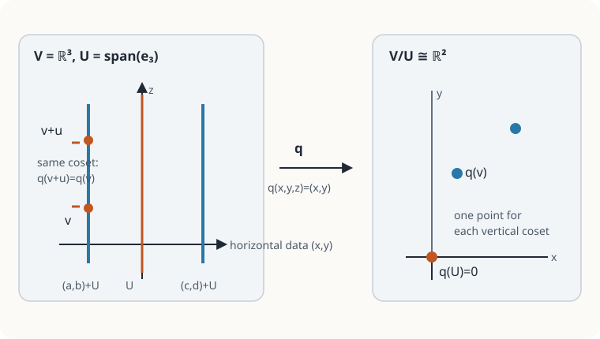

# Sums, Direct Sums, and Quotient Spaces {#section-1-sums-direct-sums-and-quotient-spaces}

Subspaces interact in two complementary ways. Their intersection records shared directions. Their sum records directions obtainable by combining them. Quotients perform a different operation: instead of adding directions, they deliberately make a chosen subspace invisible.

These constructions organize nearly every later structure theorem. Kernel–image factorization uses a quotient. Eigenspace decompositions are direct sums. Orthogonal projection chooses a particular complement. Primary decomposition separates an operator into invariant summands. The formulas are easy to memorize; the purpose of this chapter is to make the objects themselves unavoidable.

The local prerequisite is [Bases, Dimension, and Coordinate Isomorphisms](basis-dimension-coordinates.md). We assume all ambient spaces are finite-dimensional when stating dimension formulas, but the definitions of sum, direct sum, and quotient do not require finite dimension.

## 1. The sum is the smallest joint subspace {#section-9-1-the-sum-is-the-smallest-joint-subspace}

**Definition 4.1 (Sum of subspaces).** For subspaces $U,W$ of a vector space $V$, define

$U+W=\{u+w:u \in U, w \in W\}$.

This is a subspace. If $u_1+w_1$ and $u_2+w_2$ are in the sum, then

$a(u_1+w_1)+b(u_2+w_2)=(au_1+bu_2)+(aw_1+bw_2)$,

whose two terms lie in $U$ and $W$. The sum contains both subspaces and is contained in every subspace containing both, so

$U+W=\operatorname{span}(U \cup W)$.

The representation $v=u+w$ need not be unique. Shared directions can move from one term to the other: if $x \in U \cap W$, then

$u+w=(u+x)+(w-x)$.

In fact, all ambiguity arises this way.

### Worked computation: sum from equations {#section-29-worked-computation-sum-from-equations}

**Worked example 4.2 (Shared directions and ambiguous sums).**

In $\mathbb{R}^3$, let

$U=\{(x,y,z):z=0\}=\operatorname{span}(e_1,e_2)$

and

$W=\{(x,y,z):y=0\}=\operatorname{span}(e_1,e_3)$.

Then $U+W=\mathbb{R}^3$, since $(x,y,z)=(x,y,0)+(0,0,z)$. Their intersection is $\operatorname{span}(e_1)$. The vector $(1,2,3)$ has many decompositions:

$(1,2,3)=(1,2,0)+(0,0,3)$

and, for every $t$,

$(1,2,3)=((1+t),2,0)+(-t,0,3)$.

The parameter $t e_1$ moves along the intersection.

## 2. The dimension formula for two subspaces {#section-51-2-the-dimension-formula-for-two-subspaces}

**Theorem 4.3 (Dimension of a sum).** **Grassmann dimension formula.** For finite-dimensional subspaces $U,W$ of $V$,

$\operatorname{dim}(U+W)=\operatorname{dim} U+\operatorname{dim} W-\operatorname{dim}(U \cap W)$.

### Proof by extending a shared basis {#section-57-proof-by-extending-a-shared-basis}

Choose a basis $(a_1,\ldots,a_r)$ of $U \cap W$. Extend it to a basis of $U$:

$(a_1,\ldots,a_r,u_1,\ldots,u_p)$,

and separately to a basis of $W$:

$(a_1,\ldots,a_r,w_1,\ldots,w_q)$.

We claim the combined list

$(a_1,\ldots,a_r,u_1,\ldots,u_p,w_1,\ldots,w_q)$

is a basis of $U+W$.

It spans because every $u+w$ expands using the two extended bases. For independence, suppose

$\sum \alpha_i a_i+\sum \beta_j u_j+\sum \gamma_k w_k=0$.

Move the $w$ terms to the other side. The left side lies in $U$; the right side lies in $W$; therefore their common vector lies in $U \cap W$, which is spanned by the $a_i$. Consequently $\sum \beta_j u_j$ lies in the span of the $a_i$. Independence of the basis of $U$ forces all $\beta_j=0$. The original relation then lies inside the basis of $W$, forcing all $\alpha_i$ and $\gamma_k$ to be zero.

The combined basis has $r+p+q$ members, while $\operatorname{dim} U=r+p$, $\operatorname{dim} W=r+q$, and $\operatorname{dim}(U \cap W)=r$. Substitution proves the formula.

The subtracted term is not an inclusion–exclusion mnemonic pasted onto dimensions. It counts exactly the basis directions that would otherwise appear twice.

### Consequences {#section-83-consequences}

- $\operatorname{dim}(U+W)\le \operatorname{dim} U+\operatorname{dim} W$.
- Equality holds exactly when $U \cap W=\{0\}$.
- If $U+W=V$, then $\operatorname{dim}(U \cap W)=\operatorname{dim} U+\operatorname{dim} W-\operatorname{dim} V$.
- In an $n$-dimensional space, subspaces with dimensions adding to more than $n$ must intersect nontrivially.

## 3. Direct sums are unique decompositions {#section-90-3-direct-sums-are-unique-decompositions}

The sum $U+W$ is a **direct sum**, written $U \oplus W$, when each vector in it has a unique representation $u+w$ with $u \in U$ and $w \in W$.

**Direct-sum criterion.** The following are equivalent:

1. $U+W$ is direct;
2. $U \cap W=\{0\}$;
3. whenever $u+w=0$ with $u \in U,w \in W$, both terms are zero;
4. the concatenation of any basis of $U$ with any basis of $W$ is a basis of $U+W$.

To see uniqueness from trivial intersection, suppose $u_1+w_1=u_2+w_2$. Then

$u_1-u_2=w_2-w_1$

lies in both subspaces, so it is zero. Hence $u_1=u_2$ and $w_1=w_2$. Conversely, if a nonzero $x$ lies in the intersection, then $x=x+0=0+x$ gives two decompositions.

If $V=U \oplus W$, the subspace $W$ is called a **complement** of $U$ in $V$.

### Complements exist in finite dimension {#section-109-complements-exist-in-finite-dimension}

Choose a basis $(u_1,\ldots,u_r)$ of $U$ and extend it to a basis

$(u_1,\ldots,u_r,w_1,\ldots,w_s)$ of $V$.

Then $W=\operatorname{span}(w_1,\ldots,w_s)$ satisfies $V=U \oplus W$.

Existence is easy; canonicity is not. In $\mathbb{R}^2$, every line other than the $x$-axis is a complement of the $x$-axis. Nothing in the bare vector-space structure selects the vertical line. An inner product later selects the orthogonal complement, but that uses extra geometry.

### Worked decomposition {#section-119-worked-decomposition}

**Worked example 4.4 (A direct decomposition).**

Let

$U=\operatorname{span}((1,1,0),(0,0,1))$

and $W=\operatorname{span}((1,-1,0))$ in $\mathbb{R}^3$. The intersection is zero: if

$a(1,1,0)+b(0,0,1)=c(1,-1,0)$,

the third coordinate gives $b=0$, while the first two give $a=c$ and $a=-c$, hence $a=c=0$ over $R$. The dimensions add to three, so $\mathbb{R}^3=U \oplus W$.

For $(x,y,z)$, solve

$(x,y,z)=a(1,1,0)+b(0,0,1)+c(1,-1,0)$.

Then $a+c=x$, $a-c=y$, $b=z$, so

$a=(x+y)/2$, $c=(x-y)/2$, $b=z$.

The formula depends on $2$ being invertible. Over characteristic $2$, the listed directions no longer form a direct sum.

## 4. More than two summands {#section-143-4-more-than-two-summands}

For subspaces $U_1,\ldots,U_k$, their sum consists of all $u_1+\ldots+u_k$. It is written

$U_1 \oplus \ldots \oplus U_k$

when every such representation is unique, equivalently when

$u_1+\ldots+u_k=0$ implies every $u_j=0$.

Pairwise trivial intersections are necessary but, for three or more subspaces, not sufficient. In $\mathbb{R}^2$, let

$U_1=\operatorname{span}(e_1)$, $U_2=\operatorname{span}(e_2)$, $U_3=\operatorname{span}(e_1+e_2)$.

Every pair intersects only at zero, yet

$e_1+e_2-(e_1+e_2)=0$

is a nontrivial relation across the three subspaces.

A useful equivalent condition is

$U_j \cap \sum_{i\ne j}U_i=\{0\}$

for every $j$; it is enough to require each new summand meet the sum of earlier ones trivially in a fixed ordering.

When the sum is direct and all spaces are finite-dimensional,

$\operatorname{dim}\left(\oplus_j U_j\right)=\sum_j \operatorname{dim} U_j$.

Concatenating bases proves this immediately.

## 5. Quotients identify vectors deliberately {#section-175-5-quotients-identify-vectors-deliberately}

Fix a subspace $U$ of $V$. Declare two vectors equivalent when their difference lies in $U$:

$v ~ w$ exactly when $v-w \in U$.

This is an equivalence relation.

- Reflexive: $v-v=0 \in U$.
- Symmetric: if $v-w \in U$, then $w-v=-(v-w) \in U$.
- Transitive: if $v-w$ and $w-z$ lie in $U$, their sum $v-z$ lies in $U$.

The equivalence class of $v$ is the **coset**

$v+U=\{v+u:u \in U\}$.

The **quotient space** $V/U$ is the set of all cosets. Its elements are cosets, not selected representatives. In particular, the zero vector of $V/U$ is the entire subspace $U=0+U$.

Two cosets satisfy

$v+U=w+U$ exactly when $v-w \in U$.

The quotient treats movement along $U$ as invisible. It does not delete the points of $U$ from $V$; it collapses all of them into one quotient vector and collapses every parallel affine copy into another.

### Worked geometric picture with a numerical alternative {#section-199-worked-geometric-picture-with-a-numerical-alternative}

**Worked example 4.5 (Coordinates on vertical cosets).**

Let $V=\mathbb{R}^3$ and $U=\operatorname{span}(e_3)$. Two vectors represent the same quotient vector exactly when their first two coordinates agree. The coset of $(a,b,c)$ is the vertical line

$\{(a,b,c+t):t \in \mathbb{R}\}$.

Thus $\mathbb{R}^3/U$ can be coordinatized by $(a,b) \in \mathbb{R}^2$. The numerical alternative to the picture is the equality rule:

$(a,b,c)+U=(a',b',c')+U$ iff $a=a'$ and $b=b'$.

The third coordinate is precisely the discarded direction.

The diagram encodes the equality rule rather than choosing a special representative: each vertical line is one coset of $U=\operatorname{span}(e_3)$, and the quotient map $q(x,y,z)=(x,y)$ sends every point on that line to the same point of $\mathbb{R}^2$. Its kernel is exactly the central coset $U$.

## 6. Quotient operations must be well-defined {#section-217-6-quotient-operations-must-be-well-defined}

Define

$(v+U)+(w+U)=(v+w)+U$

and

$a(v+U)=av+U$.

The formulas use representatives $v,w$, so we must prove the result does not depend on the representatives chosen.

Suppose $v+U=v'+U$ and $w+U=w'+U$. Then $v-v' \in U$ and $w-w' \in U$, so

$(v+w)-(v'+w')=(v-v')+(w-w') \in U$.

Therefore $(v+w)+U=(v'+w')+U$. Similarly,

$av-av'=a(v-v') \in U$,

so $av+U=av'+U$. The operations are well-defined.

With these operations, vector-space axioms descend from $V$. For example,

$a((v+U)+(w+U))=a(v+w)+U=(av+aw)+U=a(v+U)+a(w+U)$.

The additive inverse of $v+U$ is $-v+U$, and the quotient zero is $U$.

“Well-defined” is not a stylistic compliment. It is a proof obligation whenever a rule on equivalence classes is written using representatives.

## 7. Dimension of a quotient {#section-247-7-dimension-of-a-quotient}

Let $V$ be finite-dimensional and $U$ a subspace. Choose a basis $(u_1,\ldots,u_r)$ of $U$ and extend it to a basis

$(u_1,\ldots,u_r,v_1,\ldots,v_s)$

of $V$.

We claim $(v_1+U,\ldots,v_s+U)$ is a basis of $V/U$.

It spans because every $x \in V$ has an expansion

$x=\sum a_i u_i+\sum b_jv_j$,

and the $U$ term becomes quotient zero, leaving

$x+U=\sum b_j(v_j+U)$.

For independence, if

$\sum b_j(v_j+U)=U$,

then $\sum b_jv_j \in U$, so it equals some combination of the $u_i$. Independence of the extended basis forces all $b_j=0$.

Therefore

$\operatorname{dim}(V/U)=s=\operatorname{dim} V-\operatorname{dim} U$.

This theorem also shows that choosing a complement $W=\operatorname{span}(v_1,\ldots,v_s)$ gives a coordinate model $V/U$ isomorphic to $W$. But the quotient exists without choosing $W$; different complements give different representative models of the same quotient.

### Worked quotient coordinates {#section-277-worked-quotient-coordinates}

Let $U=\operatorname{span}((1,1,1))$ in $\mathbb{R}^3$. Extend its generator with $e_1,e_2$; the list $((1,1,1),e_1,e_2)$ is a basis because a zero relation has third coordinate forcing the first coefficient to zero, then the others vanish. Thus

$(e_1+U,e_2+U)$

is a basis of $\mathbb{R}^3/U$.

For $x=(a,b,c)$, subtract $c(1,1,1)$:

$x+U=(a-c)e_1+(b-c)e_2+U$.

Hence $[x+U]=(a-c,b-c)$ in this quotient basis. Another complement would produce different coordinates but the same coset equality.

## 8. Internal and external direct sums {#section-291-8-internal-and-external-direct-sums}

An **internal direct sum** starts with subspaces inside one ambient $V$. An **external direct sum** starts with separate vector spaces and forms their product:

$U \oplus W=\{(u,w):u \in U,w \in W\}$

with componentwise operations. For finitely many spaces, external direct sum and Cartesian product have the same underlying set. The direct-sum language emphasizes decomposition into named components.

If $V=U \oplus W$ internally, then

$\Phi:U \oplus W \to V$, $\Phi(u,w)=u+w$,

is an isomorphism. Uniqueness of internal decomposition gives injectivity; existence gives surjectivity.

For infinitely many spaces, algebraic direct sum usually means tuples with finite support, while the full product permits arbitrary tuples. This repeats the finite-combination boundary from Chapter 2.

## 9. Common confusions and proof diagnostics {#section-307-9-common-confusions-and-proof-diagnostics}

### Confusion: quotient means set subtraction {#section-309-confusion-quotient-means-set-subtraction}

$V/U$ does not mean $V$ with $U$ removed. The slash denotes equivalence classes. Indeed, quotient zero is $U$, so the entire subspace is still represented.

### Confusion: a coset has a preferred point {#section-313-confusion-a-coset-has-a-preferred-point}

Every $v+u$ with $u \in U$ represents the same coset as $v$. A shortest or orthogonal representative exists only after adding suitable geometry.

### Confusion: dimensions alone prove directness {#section-317-confusion-dimensions-alone-prove-directness}

If $\operatorname{dim} U+\operatorname{dim} W=\operatorname{dim} V$, that does not by itself prove $V=U \oplus W$. One also needs either $U+W=V$ or $U \cap W=\{0\}$. In $\mathbb{R}^2$, taking $U=W$ equal to one line gives dimensions adding to two but sum only one-dimensional.

### Confusion: pairwise disjoint means a many-way direct sum {#section-321-confusion-pairwise-disjoint-means-a-many-way-direct-sum}

Pairwise zero intersections do not suffice for three or more subspaces, as the three lines in $\mathbb{R}^2$ show.

### Confusion: formulas on cosets are automatically meaningful {#section-325-confusion-formulas-on-cosets-are-automatically-meaningf}

Always change representatives and verify that the output class remains unchanged. A proposed rule such as “the length of $v+U$ is the length of $v$” usually fails because representatives can have different lengths.

## Part I investigation: decompositions, quotients, and noncanonical choices {#section-835-part-i-investigation-decompositions-quotients-and-nonca}

For a fixed two-dimensional subspace $U$ of $\mathbb{R}^4$, construct three distinct complements $W_1,W_2,W_3$. For each, write the unique decomposition formula for an arbitrary vector and the resulting isomorphism $W_j \to  \mathbb{R}^4/U$. Then identify which quantities agree across all three models and which depend on the complement.

**Solution framework.** After a coordinate change one may take $U=\operatorname{span}(e_1,e_2)$. Any graph

$W_A=\{(Ay,y):y \in \mathbb{R}^2\}$

of a linear rule $A:\mathbb{R}^2\to \mathbb{R}^2$ is a complement. Choose, for example, $A=0$, $A=I$, and $A=\begin{pmatrix}0 & 1 \\ -1 & 0\end{pmatrix}$. For $x=(p,q)$ with two-component blocks, the decomposition is

$x=(p-Aq,0)+(Aq,q)$.

The quotient class depends only on $q$; the representative $(Aq,q)$ and its coordinates inside the ambient standard basis depend on $A$. Each map $(Aq,q)\to x+U$ is an isomorphism. A complete report should prove directness, verify each formula, and distinguish the canonical equivalence class from the noncanonical representative choice.

## 11. A quotient map can respect relations without killing them {#section-848-11-a-quotient-map-can-respect-relations-without-killing}
Section 6 proves that quotient operations are well-defined. A new issue arises when a linear map is to pass between two quotients. Let $T:V\to V'$ be linear, with subspaces $U\subseteq V$ and $U'\subseteq V'$. The proposed rule is $\bar T(v+U)=T(v)+U'$. It defines a linear map $V/U\to V'/U'$ exactly when $T(U)\subseteq U'$.

For necessity, take $u\in U$. Its coset equals the source zero coset, so the output must be quotient zero: $T(u)+U'=U'$. Thus $T(u)\in U'$. For sufficiency, two source representatives differ by an element $u\in U$, and their images differ by $T(u)\in U'$. The output classes therefore agree. Linearity follows by applying $T$ to representatives and then using the already proved quotient operations. These steps separate the representative test from the linearity test: a formula cannot be a linear map on classes before it is a function on classes.

The condition is weaker than $T(U)=\{0\}$. Killing $U$ is required for a map from $V/U$ into the ordinary space $V'$. When the codomain is itself a quotient, moving a relation into its discarded subspace is sufficient. The types explain which condition is needed; writing the same formula without the quotient labels hides that distinction.

For example, take $T:F^3\to F^2$, $T(x,y,z)=(x+y,z)$, $U=\operatorname{span}(e_3)$ in the domain, and $U'=\operatorname{span}((0,1))$ in the codomain. Then $T(U)=U'$, so $T$ does not kill $U$, but it induces a map between the two quotients. Identifying domain classes by $(x,y)$ and codomain classes by their first coordinate gives the induced rule $(x,y)\mapsto x+y$. The coordinate identifications are chosen models; the induced class map is fixed by $T,U,U'$.

A failed representative test gives a complete counterexample. Let $S:F^3\to F^3$ exchange the first and third coordinates, and try to use $U=U'=\operatorname{span}(e_3)$. The representatives $0$ and $e_3$ define the same source class. Their images are $0$ and $e_1$, which define different target classes. Hence no map on these quotients is defined by the proposed formula, even though $S$ is a perfectly valid invertible linear map on the ambient space. Ambient linearity does not automatically preserve the chosen equivalence relations.

## 12. Induced maps compose because their representatives do {#section-859-12-induced-maps-compose-because-their-representatives-d}
Suppose $T:V\to V'$ respects $U,U'$ and $R:V'\to V''$ respects $U',U''$. Then $RT(U)\subseteq R(U')\subseteq U''$, so the composite also induces a quotient map. Evaluating at an arbitrary class verifies

\[
\overline{RT}(v+U)=RT(v)+U''
=\bar R(\bar T(v+U)).
\]

The identity map likewise induces the identity of $V/U$. This is the concrete content behind saying that quotients behave functorially: compatible arrows compose without an extra arbitrary choice. The vocabulary supplies no additional theorem beyond the displayed equality and the two representative tests.

Surjectivity and injectivity have different quotient criteria. If $T$ is surjective, its induced map is surjective because any target representative is $T(v)$ for some $v$. But injectivity of $T$ alone does not force injectivity of $\bar T$; a vector outside $U$ might be sent into $U'$. More precisely,

\[
\ker\bar T=\{v+U:T(v)\in U'\}.
\]

Thus the induced map is injective exactly when $T^{-1}(U')=U$, under the compatibility condition. Both inclusions matter. The inclusion $U\subseteq T^{-1}(U')$ is already known; the reverse says that no additional directions are lost after the target quotient.

For a small example, let $V=V'=F^2$, $T=I$, $U=\{0\}$, and $U'=\operatorname{span}(e_2)$. The ambient map is injective, but the induced map sends the nonzero class of $e_2$ to zero. Its kernel is the line $U'/\{0\}$. Conversely, a noninjective ambient map can induce an injective quotient map when its lost directions have already been collapsed in the source; the ordinary quotient-to-image construction in Chapter 5 formalizes that case.

Compatible inverse maps provide a particularly useful situation. If $T$ is an isomorphism and $T(U)=U'$, then $T^{-1}(U')=U$, so its induced map is an isomorphism. Its inverse is induced by $T^{-1}$. Equality, rather than only containment, is essential to this conclusion.

This offers a reliable method for changing coordinates in a quotient problem. Transport both the ambient vectors and the specified discarded subspace. Transforming the vectors while forgetting to transform $U$ changes the equivalence relation and may invalidate the intended comparison. Quotient isomorphism is a claim about a specified pair of spaces and subspaces, not merely a comparison of the dimensions printed beside two diagrams.

There is also an exact surjectivity criterion that does not require the ambient map to be onto:
\[
\bar T\text{ is onto}\quad\Longleftrightarrow\quad
T(V)+U'=V'.
\]
Indeed, a target class $v'+U'$ is attained exactly when $v'-T(v)\in U'$ for some $v$. This says precisely that every $v'$ is a sum of an image vector and a discarded target vector. Together with $T^{-1}(U')=U$, it gives both conditions for the induced map to be an isomorphism, after compatibility has been verified.

For example, let $T:F\to F^2$ send $a$ to $(a,0)$, with source discarded subspace zero and target discarded subspace $\operatorname{span}((0,1))$. The ambient map is not onto, but its image plus the target discarded line is all of $F^2$. The induced map is an isomorphism, with inverse $(a,b)+U'\mapsto a+\{0\}$. Thus quotienting can remove a target obstruction to surjectivity just as it can remove a source obstruction to injectivity.

The complete criteria are particularly useful when an ambient matrix is rectangular. The dimensions of its full domain and codomain need not match for the resulting quotient map to be an isomorphism. What must match is the surviving information, established by the explicit preimage and sum conditions. This is another reason that counting ambient rows and columns alone cannot settle a quotient question.

## 13. Collapsing a larger subspace can be done in two stages {#section-895-13-collapsing-a-larger-subspace-can-be-done-in-two-stag}
Assume $U\subseteq W\subseteq V$. A class $v+U$ can be sent to $v+W$ because changing $v$ by an element of $U$ also changes it by an element of $W$. This defines a surjective linear map $r:V/U\to V/W$. Its kernel consists of the classes represented by vectors in $W$, which form the subspace $W/U$ of $V/U$.

There is therefore a natural comparison between $(V/U)/(W/U)$ and $V/W$. Write its proposed formula as

\[
(v+U)+(W/U)\longmapsto v+W.
\]

To check it, suppose two double cosets agree. Their difference $(v-v')+U$ lies in $W/U$, meaning it equals $w+U$ for some $w\in W$. Thus $v-v'-w\in U\subseteq W$, giving $v-v'\in W$ and equality of the outputs. Conversely, if $v-v'\in W$, the difference of the first quotient classes lies in $W/U$, so the double cosets agree. This proves both representative independence and injectivity; every $v+W$ is attained, so the map is bijective. Quotient operations make it linear.

The construction uses no complement. It records that first forgetting $U$ and then forgetting the remaining part of $W$ loses exactly the same distinctions as forgetting $W$ at once. It also prevents a common type error: $W/U$ is a subspace of $V/U$, whereas $W$ itself is a subspace of $V$. The outer quotient cannot simply treat those two objects as interchangeable.

For an explicit model, let $V=F^3$, $U=\operatorname{span}(e_3)$ and $W=\operatorname{span}(e_2,e_3)$. The first quotient can be represented by $(x,y)$, while $W/U$ is represented by the vertical line of pairs $(0,y)$. Collapsing that line leaves the coordinate $x$, exactly the information retained by $F^3/W$. All of these identifications have been verified by coset equality; no preferred representative in the original space was assumed.

If the spaces are finite-dimensional, the dimension check agrees: subtracting $\dim(W/U)=\dim W-\dim U$ from $\dim(V/U)=\dim V-\dim U$ leaves $\dim V-\dim W$. The explicit map proves the isomorphism independently of this subtraction. A matching dimension is a useful check, but it does not define the map or establish representative independence. The map proof remains valid without finite-dimensional assumptions; the displayed finite subtraction is the part requiring them.

## 14. A sum quotient can be understood inside one summand {#section-912-14-a-sum-quotient-can-be-understood-inside-one-summand}
A different comparison starts with arbitrary subspaces $U,W\subseteq V$, without assuming either contains the other. The quotient $U/W$ is not defined unless $W\subseteq U$. The legitimate source is $U/(U\cap W)$. Define

\[
\eta:U/(U\cap W)\longrightarrow (U+W)/W,
\qquad \eta(u+(U\cap W))=u+W.
\]

If representatives differ by an element of $U\cap W$, they differ by an element of $W$, so their images agree. The formula is linear by quotient operations. It is onto because every representative of a class in $(U+W)/W$ has form $u+w$, and $(u+w)+W=u+W$. It is one-to-one because $u+W$ is zero exactly when $u\in W$, which for $u\in U$ means $u\in U\cap W$. Equivalently, equality of two images gives equality of their source classes by applying this difference criterion.

This isomorphism describes which directions of $U$ remain after allowing free movement through $W$. The overlap is precisely what must be collapsed in the source. The result should be read as an explicit class map, not as an instruction to choose a complement to the intersection. Such a complement would give another coordinate model, but is unnecessary for the comparison.

For example, let $U=\operatorname{span}(e_1,e_2)$ and $W=\operatorname{span}(e_2,e_3)$ in $F^3$. The intersection is $\operatorname{span}(e_2)$ and the sum is $F^3$. A source representative $(a,b,0)$ maps to its class modulo the plane $W$. Both sides retain exactly $a$. The source class ignores $b$ because it lies in the intersection; the target class ignores both the second and third ambient coordinates because they lie in $W$. Calling the classes “the same” without this map would hide their different underlying sets.

In finite dimension, taking dimensions in this isomorphism gives $\dim U-\dim(U\cap W)=\dim(U+W)-\dim W$, consistent with Grassmann's formula. Here Grassmann was proved earlier by basis extension, so this is a structural consistency check rather than a circular proof of quotient dimension.

The two quotient comparisons in these sections have different hypotheses. A nested quotient needs $U\subseteq W$ and yields a two-stage forgetting map. The sum comparison uses arbitrary $U,W$ but places the intersection in its source denominator. Writing the desired arrows and checking their domains is usually more dependable than memorizing several superficially similar slash formulas.

## 15. A representative convention can fail when the field changes {#section-930-15-a-representative-convention-can-fail-when-the-field-}
The quotient $F^3/\operatorname{span}((1,1,1))$ from Section 7 is defined over any field. Its coordinate comparison there, $(a,b,c)\mapsto(a-c,b-c)$, uses no division and remains valid in characteristic three. Now ask for a representative whose coordinates sum to zero. This is a new choice requiring its own proof.

Assume $3\ne0$ in $F$. Subtract $m(1,1,1)$ with $m=(a+b+c)/3$. The resulting vector lies in the plane $H=\{(x,y,z):x+y+z=0\}$ and represents the original class. Uniqueness follows because a vector $t(1,1,1)$ in $H$ has $3t=0$, so $t=0$. Thus $H$ is a complement and each class has exactly one such representative. This is sometimes a convenient mean-zero convention, but the quotient itself did not select it.

In characteristic three, the nonzero vector $(1,1,1)$ already belongs to $H$. Hence $H$ meets the discarded line nontrivially and is not a complement. For classes having coordinate sum zero, every representative obtained by adding that line still has sum zero, so uniqueness fails. Classes with nonzero coordinate sum have no representative in $H$, because adding $t(1,1,1)$ changes the sum by $3t=0$. Both existence and uniqueness can therefore fail for this convention even while the quotient remains well-defined.

The plane of vectors with third coordinate zero is a complement over every field in this example. Subtracting $c(1,1,1)$ gives its unique representative $(a-c,b-c,0)$. The two conventions agree on the quotient class but generally choose different ambient vectors. One was available without restriction; the other required the extra scalar hypothesis $3\ne0$.

This illustrates how to diagnose a failed formula. A denominator becoming zero need not invalidate the quotient, dimension theorem or all possible representative choices. It may invalidate only one attempted section of the quotient map. Separating the canonical class from a chosen lift prevents an unnecessarily broad conclusion.

Over $R$ with the standard Euclidean inner product, the mean-zero plane is the orthogonal complement of the discarded line. This identifies the extra geometric structure that prefers it. The coordinate-plane complement is equally legitimate algebraically and generally not orthogonal. Orthogonality is a later geometric selection rule, not a hidden feature of bare quotient notation.

## 16. Projections encode complements but do not choose one {#section-943-16-projections-encode-complements-but-do-not-choose-one}
A linear endomorphism $P:V\to V$ is a projection in the algebraic sense when $P^2=P$. Every vector has the decomposition $v=Pv+(v-Pv)$, where the first term is in $\operatorname{im}P$ and the second in $\ker P$. If $y$ belongs to both, write $y=Px$ and $Py=0$. Then $y=P^2x=Py=0$. Thus

\[
V=\operatorname{im}P\oplus\ker P.
\]

Conversely, a specified direct decomposition $V=U\oplus W$ defines $P(u+w)=u$. Uniqueness makes this a function, and adding or scaling decompositions proves linearity. Its square equals itself, its image is $U$, and its kernel is $W$. A projection onto a subspace is therefore not fully specified until its kernel, or equivalent complement data, is known.

In $F^2$ fix $U=\operatorname{span}(e_1)$. For each $a\in F$, the map $P_a(x,y)=(x-ay,0)$ is a projection onto $U$, with kernel $\operatorname{span}((a,1))$. Different $a$ give different kernels and different ambient representatives of the discarded component. Direct computation yields $P_aP_b=P_b$ and $P_bP_a=P_a$. Consequently distinct projections onto the same subspace need not commute. Their common image alone does not determine the maps.

There is a precise connection with the quotient map $q:V\to V/U$. Given a complement $W$, let $j:V/U\to V$ send each class to its unique representative in $W$. Then $qj=I_{V/U}$ and $P=I_V-jq$ is the projection onto $U$ along $W$. Its square equals itself because $qj=I$; also $q(Pv)=0$ and $P(u)=u$ for $u\in U$. These equations locate every arrow: $j$ is a section, not the inverse of $q$ on all of $V$.

If $j'$ is another linear section, $q(j'-j)=0$, so the difference maps every quotient class into $U$. Conversely, adding any linear map $h:V/U\to U$ to a section, using the inclusion $U\hookrightarrow V$, gives another section. Thus choices of representative differ by an arbitrary linear correction in the discarded directions. There is no distinguished zero correction until an initial section or further geometry has been chosen.

The investigation below applies these ideas to its already specified graph family and supplies the missing certificates. Its three choices illustrate one fixed quotient with several representative models; they are not three different quotients or three additional investigations.

Nonuniqueness alone does not rigorously rule out a distinguished choice; some additional property might single one out. A symmetry argument gives a sharper statement for the bare pair $V=F^2$, $U=\operatorname{span}(e_1)$. Every complement is a line $W_a=\operatorname{span}((a,1))$: a complementary line has a nonzero second coordinate in a generator, which can be scaled to one. For each $b\in F$, the invertible shear $g_b(x,y)=(x+by,y)$ fixes $U$ pointwise and induces the identity on $V/U$. Yet it sends $W_a$ to $W_{a+b}$.

Take $b=1$, which is nonzero over every field. The two graph lines differ, because equal normalized second coordinates would force $a=a+1$. Hence no complement in this pair is preserved by all automorphisms that preserve the given linear data. A universal choice of complement claimed to depend only on the bare pair and to respect all its isomorphisms would already fail on this two-dimensional example.

The quotient map itself has the required invariance: $qg_b=q$ because the shear changes only a vector in $U$. In contrast, a proposed section invariant under these symmetries would have to satisfy $g_bj=j$. Applying this to a nonzero quotient class forces a lift with nonzero second coordinate to remain unchanged under $g_1$, which is impossible. Thus a section carries information beyond the quotient and subspace.

An inner product can reduce the allowed symmetry group and then select the orthogonal complement. A recorded basis can likewise select a coordinate complement. These constructions do not contradict the shear argument because they use additional data that a general shear does not preserve. The zero subspace and whole-space cases also have immediate complements; the counterexample concerns a proper nonzero subspace. Stating this symmetry boundary gives a precise meaning to “noncanonical” instead of treating it as a synonym for “we have not chosen yet.”

## 17. LSP-04-GRAPH: complete certificates for the existing investigation {#section-969-17-lsp-04-graph-complete-certificates-for-the-existing-}
This completes the existing Part I investigation and its valid solution framework. It supplies no ninth project. For an actual fixed two-dimensional $U\subseteq R^4$, choose a basis of $U$ and extend it to a basis of $R^4$. The corresponding coordinate isomorphism transports $U$ to the first coordinate block $R^2\oplus0$. Prove the certificates in this model and transport their vectors and formulas back by that isomorphism; the actual chosen basis must be recorded.

For any real $2$ by $2$ matrix $A$, use $W_A=\{(Aq,q):q\in R^2\}$. It is a subspace because the displayed parametrization is linear. The two vectors $(Ae_1,e_1),(Ae_2,e_2)$ span it and are independent: their last block recovers the two coefficients. If $(Aq,q)$ lies in $U$, its last block is zero, so $q=0$ and the intersection is zero. Every $x=(p,q)$ decomposes as $(p-Aq,0)+(Aq,q)$; both terms have the stated membership. If another decomposition exists, its last block again forces the same $q$ and then the same $U$ component. This proves spanning, directness and uniqueness, rather than inferring them from matching dimensions.

The three original choices give the following exact certificate table:

| $A$ | ordered basis of $W_A$ | $U$ component of $(p_1,p_2,q_1,q_2)$ | $W_A$ component |
|---|---|---|---|
| $0$ | $(0,0,1,0),(0,0,0,1)$ | $(p_1,p_2,0,0)$ | $(0,0,q_1,q_2)$ |
| $I$ | $(1,0,1,0),(0,1,0,1)$ | $(p_1-q_1,p_2-q_2,0,0)$ | $(q_1,q_2,q_1,q_2)$ |
| $J=\left(\begin{smallmatrix}0&1\\-1&0\end{smallmatrix}\right)$ | $(0,-1,1,0),(1,0,0,1)$ | $(p_1-q_2,p_2+q_1,0,0)$ | $(q_2,-q_1,q_1,q_2)$ |

At $x=(2,-1,3,4)$ the respective pairs of components are $(2,-1,0,0)+(0,0,3,4)$, $(-1,-5,0,0)+(3,4,3,4)$ and $(-2,2,0,0)+(4,-3,3,4)$. All sum to the same $x$, and all quotient representatives have the same last block $(3,4)$.

The map $f_A:W_A\to R^4/U$, $f_A(w)=w+U$, has inverse $j_A(x+U)=(Aq,q)$, where $q$ is the last block of $x$. This inverse is representative-independent because changing $x$ by an element of $U$ does not change $q$. Both maps are linear. Their composites are identities: $j_A(f_A(Aq,q))=(Aq,q)$ and $f_A(j_A(x+U))=x+U$ because their representatives differ by $(p-Aq,0)\in U$. This completes the claimed quotient-isomorphism certificate.

The quotient dimension, coset equality and quotient class agree across all three choices. The ambient representative and projection onto $U$ vary. Coordinates inside $W_A$ are $(q_1,q_2)$ in the displayed compatible graph bases, so they agree for this explicitly coordinated choice; arbitrary independent changes of those bases would change the columns. Over $R$, the three complements are distinct and pairwise have zero intersection: equality of graph vectors requires $(A-B)q=0$, and $I,J,I-J$ each have zero kernel. For $I$ this is immediate; for $J$, its two coordinates are $(q_2,-q_1)$. For $I-J$, a kernel vector satisfies $q_1=q_2$ and $q_1=-q_2$, so $2q_1=0$ and both coordinates vanish over $R$. Thus this certificate needs no forward determinant theorem. The three two-dimensional subspaces nevertheless cannot form a three-way direct sum inside $R^4$, whose dimension is four.

For a changed hypothesis, repeat the same graph construction over $F_2$, interpreting $J=\left(\begin{smallmatrix}0&1\\1&0\end{smallmatrix}\right)$. All three graphs are still distinct complements of the fixed first-block subspace; their graph certificates used no division. However $I-J=\left(\begin{smallmatrix}1&1\\1&1\end{smallmatrix}\right)$ now has kernel $\operatorname{span}((1,1))$. Thus $W_I\cap W_J=\operatorname{span}((1,1,1,1))$, rather than zero. The changed mutual intersection does not invalidate any individual complement or quotient model. This is a field-sensitive comparison, not a change silently applied to the original real project.

A complete report checks five parts independently: its actual basis transport for $U$; graph basis and directness proofs; decomposition formulas and one exact test vector; mutually inverse quotient maps with type and representative checks; and a comparison of invariant information with choice-dependent representatives, including the changed-field intersection. These public checks are repair criteria, not a learner grade or evidence of an executed program.

## Summary

The sum $U+W$ is the smallest subspace containing both. Its dimension subtracts the shared intersection. A direct sum has unique component decompositions, equivalently trivial intersection for two summands. Every finite-dimensional subspace has complements, but not canonical ones. The quotient $V/U$ identifies vectors differing by an element of $U$; its operations require representative-independence proofs, and its dimension is $\operatorname{dim} V-\operatorname{dim} U$.

Retrieve:

1. How does an intersection create nonuniqueness in a sum decomposition?
2. Why are pairwise trivial intersections insufficient for three summands?
3. What is the zero vector of $V/U$?
4. Which exact calculation proves quotient addition is well-defined?
5. Why is a quotient canonical while a complementary subspace usually is not?

Subspace sums collect directions, direct sums make their allocation unique, and quotients identify vectors differing by an allowed subspace. Adapted bases explain the dimension formula and provide quotient coordinates. A complement chooses representatives, whereas the quotient itself does not choose them. Linear maps next connect these constructions through kernels, images, and factorization.

## Exercises {#section-341-exercises-with-full-solutions}

### 1. A sum as a span {#section-343-1-a-sum-as-a-span}

Prove $U+W=\operatorname{span}(U \cup W)$.

Hint 1

Show the sum is a subspace containing both inputs.

Hint 2

Use minimality of span for one inclusion and split combinations for the other.

Solution

**Solution.** The sum is a subspace containing both $U$ and $W$, so it contains their generated subspace. Conversely, each $u+w$ is a linear combination of two elements of $U \cup W$, so it lies in the span. Both containments give equality.

### 2. Compute a sum and intersection {#section-369-2-compute-a-sum-and-intersection}

In $\mathbb{R}^3$, let $U=\operatorname{span}(e_1,e_2)$ and $W=\operatorname{span}(e_2,e_3)$. Find bases of $U \cap W$ and $U+W$.

Hint 1

Impose both coordinate-plane descriptions for the intersection.

Hint 2

For the sum, combine their available standard directions.

Solution

**Solution.** A vector in both has form $(a,b,0)=(0,c,d)$, so $a=d=0$ and it is a multiple of $e_2$. Thus $(e_2)$ is an intersection basis. The combined generators contain all three standard vectors, so $(e_1,e_2,e_3)$ is a basis of the sum, which is $\mathbb{R}^3$.

### 3. Dimension lower bound for intersection {#section-395-3-dimension-lower-bound-for-intersection}

If $U,W$ are subspaces of an $n$-dimensional $V$, prove

$\operatorname{dim}(U \cap W)\ge \operatorname{dim} U+\operatorname{dim} W-n$.

Hint 1

Use the dimension formula for U+W.

Hint 2

Bound the dimension of that sum by the ambient dimension.

Solution

**Solution.** Grassmann gives

$\operatorname{dim}(U \cap W)=\operatorname{dim} U+\operatorname{dim} W-\operatorname{dim}(U+W)$.

Since $U+W$ is a subspace of $V$, its dimension is at most $n$. Substitution gives the inequality.

### 4. Forced intersection {#section-427-4-forced-intersection}

Prove any two planes through the origin in $\mathbb{R}^3$ intersect in at least a line.

Hint 1

Substitute plane dimensions into the intersection bound.

Hint 2

A subspace of positive dimension contains a nonzero line.

Solution

**Solution.** Each plane has dimension $2$, so the previous bound gives intersection dimension at least $2+2-3=1$. Thus the intersection contains a nonzero direction. It may be a plane only when the planes coincide.

### 5. Directness by coefficients {#section-453-5-directness-by-coefficients}

Show $\operatorname{span}((1,1,0)) + \operatorname{span}((1,0,1))$ is direct.

Hint 1

Set a sum of one vector from each line equal to zero.

Hint 2

Compare the second and third coordinates to force both coefficients to vanish.

Solution

**Solution.** If $a(1,1,0)=b(1,0,1)$, the second coordinate gives $a=0$, and the third gives $b=0$. Thus the intersection is zero, so the sum is direct.

### 6. Dimensions are not enough {#section-479-6-dimensions-are-not-enough}

Give subspaces $U,W$ of $\mathbb{R}^4$ with $\operatorname{dim} U=\operatorname{dim} W=2$ but $U+W$ not direct and not all of $\mathbb{R}^4$.

Hint 1

Choose two planes sharing a nonzero line.

Hint 2

Ensure their combined generators use only three ambient directions.

Solution

**Solution.** Take $U=W=\operatorname{span}(e_1,e_2)$. Their intersection is the whole two-dimensional plane, and their sum is that same plane. The dimensions add to four, but neither desired conclusion follows.

### 7. Complements by basis extension {#section-505-7-complements-by-basis-extension}

Find two distinct complements of $U=\operatorname{span}(e_1)$ in $\mathbb{R}^2$.

Hint 1

A complementary line must differ from the given line.

Hint 2

Test both the span condition and the zero intersection for each proposed line.

Solution

**Solution.** Both $\operatorname{span}(e_2)$ and $\operatorname{span}(e_1+e_2)$ intersect $U$ only at zero and, together with $U$, span $\mathbb{R}^2$. Hence each is a complement. They are distinct because $e_2$ is not a multiple of $e_1+e_2$.

### 8. Three summands {#section-531-8-three-summands}

Prove $U_1+U_2+U_3$ is direct if $U_1 \cap U_2=\{0\}$ and $(U_1+U_2) \cap U_3=\{0\}$.

Hint 1

Group the first two terms in a zero sum.

Hint 2

Use the second intersection condition first, then the first.

Solution

**Solution.** If $u_1+u_2+u_3=0$, then $u_1+u_2=-u_3$ lies in both $U_1+U_2$ and $U_3$, so it is zero and $u_3=0$. Then $u_1+u_2=0$; directness of the first two forces $u_1=u_2=0$.

### 9. Equality of cosets {#section-557-9-equality-of-cosets}

Prove $v+U=w+U$ exactly when $v-w \in U$.

Hint 1

Use membership of a representative in an equal coset.

Hint 2

For the converse, absorb the representative difference into U.

Solution

**Solution.** If the cosets are equal, then $v$, which lies in $v+U$, lies in $w+U$; hence $v=w+u$ for some $u \in U$, so $v-w \in U$. Conversely, if $v-w=u_0 \in U$, then every $v+u=w+(u_0+u)$ lies in $w+U$, so one coset contains the other. Reversing the difference gives the reverse containment.

### 10. Quotient zero {#section-583-10-quotient-zero}

Show $v+U$ is the zero vector of $V/U$ exactly when $v \in U$.

Hint 1

Identify the zero coset before interpreting the statement.

Hint 2

Apply the coset-equality criterion to v+U and 0+U.

Solution

**Solution.** Quotient zero is $U=0+U$. By the coset equality criterion, $v+U=U$ exactly when $v-0=v$ lies in $U$.

### 11. Negatives in a quotient {#section-609-11-negatives-in-a-quotient}

Verify that $-(v+U)=(-v)+U$ is well-defined and is the additive inverse.

Hint 1

Check different representatives differ by a member of U.

Hint 2

Their negatives also differ by a member of U, and the sum is the zero coset.

Solution

**Solution.** If $v+U=v'+U$, then $v-v' \in U$, so $(-v)-(-v')=-(v-v') \in U$; the output cosets agree. Also $(v+U)+((-v)+U)=0+U=U$, the quotient zero.

### 12. Quotient by the whole space and by zero {#section-635-12-quotient-by-the-whole-space-and-by-zero}

Describe $V/V$ and $V/\{0\}$.

Hint 1

Determine when any two representatives become equivalent.

Hint 2

For the zero subspace, each coset has just one representative.

Solution

**Solution.** Every two vectors differ by an element of $V$, so $V/V$ has one element, the zero coset; it is the zero vector space. In $V/\{0\}$, two cosets are equal only when their representatives are equal. The map $v+\{0\} \to v$ is a natural vector-space isomorphism with $V$.

### 13. A polynomial quotient {#section-661-13-a-polynomial-quotient}

Let $U=\operatorname{span}(1,x)$ inside $\mathbb{R}_3[x]$. Give a basis for $\mathbb{R}_3[x]/U$ and find the coordinates of $(2-x+4x^2-3x^3)+U$.

Hint 1

Discard terms already lying in U.

Hint 2

Prove the remaining monomial cosets are independent by testing when their combination belongs to U.

Solution

**Solution.** Extend $(1,x)$ by $(x^2,x^3)$. Therefore $(x^2+U,x^3+U)$ is a quotient basis. The terms $2-x$ vanish modulo $U$, leaving coordinates $(4,-3)$.

### 14. Quotient dimensions {#section-687-14-quotient-dimensions}

Let $V$ have dimension $10$ and $U$ dimension $6$. What are $\operatorname{dim}(V/U)$ and the dimension of any complement of $U$?

Hint 1

Extend a basis of U to a basis of V.

Hint 2

The number of added directions gives both quantities.

Solution

**Solution.** The quotient dimension theorem gives $10-6=4$. If $V=U \oplus W$, dimension additivity gives $10=6+\operatorname{dim} W$, so every complement also has dimension $4$.

### 15. Quotient versus complement {#section-713-15-quotient-versus-complement}

Given $V=U \oplus W$, define $T:W\to V/U$ by $T(w)=w+U$. Prove it is bijective using only decomposition uniqueness.

Hint 1

Write an arbitrary vector uniquely as u+w.

Hint 2

For injectivity, use that an element of W in the zero coset lies in U∩W.

Solution

**Solution.** Every $v$ has unique form $u+w$, so $v+U=w+U$; hence $T$ is surjective. If $T(w)=U$, then $w \in U$. Since also $w \in W$ and the intersection is zero, $w=0$; hence $T$ is injective. It is linear by quotient operations.

### 16. A rule that is not well-defined {#section-739-16-a-rule-that-is-not-well-defined}

Let $U=\operatorname{span}(e_2)$ in $\mathbb{R}^2$. Explain why $f((x,y)+U)=y$ does not define a function on the quotient.

Hint 1

Change only a coordinate along the quotient direction.

Hint 2

Compare the proposed output on two representatives of one coset.

Solution

**Solution.** The vectors $(x,y)$ and $(x,y+t)$ differ by $(0,t) \in U$, so they represent the same coset, but the proposed outputs are $y$ and $y+t$, generally different. The rule depends on the representative. By contrast, assigning $x$ would be well-defined.

### 17. External finite direct sums {#section-765-17-external-finite-direct-sums}

Prove $\operatorname{dim}(U \oplus W)=\operatorname{dim} U+\operatorname{dim} W$ for the external direct sum of finite-dimensional spaces.

Hint 1

Embed a basis of each space into its own coordinate component.

Hint 2

A zero combination separates into two independent zero combinations.

Solution

**Solution.** If $(u_1,\ldots,u_r)$ and $(w_1,\ldots,w_s)$ are bases, then

$( (u_1,0),\ldots,(u_r,0),(0,w_1),\ldots,(0,w_s) )$

spans every $(u,w)$ componentwise. A zero relation separates into zero relations in the two bases, so the list is independent. Its length is $r+s$.

### 18. Synthesis exercise: constrained configurations modulo gauge {#section-795-18-synthesis-exercise-constrained-configurations-modulo}

Let

$V=\{(x_1,x_2,x_3,x_4) \in \mathbb{R}^4:x_1+x_2+x_3+x_4=0\}$

and $U=\operatorname{span}((1,-1,1,-1))$.

Verify $U \subseteq V$, compute $\operatorname{dim}(V/U)$, and construct explicit quotient coordinates.

Hint 1

First solve the homogeneous constraint using three parameters.

Hint 2

Choose quotient-invariant linear measurements whose common kernel is the gauge line.

Solution

**Solution.** The generator’s coordinates sum to zero, so $U \subseteq V$. The single homogeneous constraint makes $\operatorname{dim} V=3$, while $\operatorname{dim} U=1$; hence $\operatorname{dim}(V/U)=2$. A basis of $V$ is

$u=(1,-1,1,-1)$, $v=(1,-1,0,0)$, $w=(0,1,-1,0)$.

Independence follows by comparing the fourth coordinate (forcing the coefficient of $u$ to zero), then the first and third coordinates. Therefore $(v+U,w+U)$ is a quotient basis. For $x \in V$, solve $x=a u+bv+cw$. From coordinates,

$a=-x_4$, $b=x_1+x_4$, $c=-x_3-x_4$.

The quotient coordinates are $(b,c)=(x_1+x_4,-x_3-x_4)$; changing $x$ by a multiple of $u$ leaves both unchanged.

### 19. LSP-04-E19. A larger source quotient can restore injectivity {#section-993-lsp-04-e19-a-larger-source-quotient-can-restore-injecti}

Let $T:F^3\to F^2$ be $T(x,y,z)=(x,z)$ and let $U'=\operatorname{span}((0,1))$ in the target. First use source subspace $U=\operatorname{span}(e_2)$: prove compatibility and find the kernel of the induced quotient map. Then replace the source subspace by $\widetilde U=\operatorname{span}(e_2,e_3)$ and prove the new induced map is an isomorphism.

Hint 1

Test T(U)⊆U′ and use T⁻¹(U′)/U for the induced kernel.

Hint 2

After enlarging U, determine exactly which information survives on each quotient.

### 20. LSP-04-E20. Two projections onto a plane {#section-1011-lsp-04-e20-two-projections-onto-a-plane}

On $F^3$ define $P(x,y,z)=(x-z,y,0)$ and $Q(x,y,z)=(x,y-z,0)$. Find their images and kernels, verify idempotence, and compute $PQ$ and $QP$. Decide whether the shared image determines their action.

Hint 1

Apply each map twice to check idempotence.

Hint 2

Compute compositions in their actual order and compare the two kernels.

## Solutions

### LSP-04-E19. A larger source quotient can restore injectivity — solution {#section-1030-lsp-04-e19-a-larger-source-quotient-can-restore-injecti}

Solution

Here $T(U)=0\subseteq U'$, so the first map is well-defined. A source class is in its kernel exactly when $(x,z)\in U'$, namely when $x=0$. Its kernel is therefore $\operatorname{span}(e_2,e_3)/\operatorname{span}(e_2)$, with basis $e_3+U$. For the larger source subspace, $T(\widetilde U)=U'$ and $T^{-1}(U')=\widetilde U$, so the induced map is injective. It is onto because every target class has representative $(a,0)=T(a,0,0)$. Explicitly, its inverse sends $(a,b)+U'$ to $(a,0,0)+\widetilde U$, independently of the target representative.

### LSP-04-E20. Two projections onto a plane — solution {#section-1040-lsp-04-e20-two-projections-onto-a-plane-solution}

Solution

Both images equal $\operatorname{span}(e_1,e_2)$: all outputs lie there and each map fixes that plane. Solving the zero-output equations gives $\ker P=\operatorname{span}((1,0,1))$ and $\ker Q=\operatorname{span}((0,1,1))$. Each map fixes its image, hence $P^2=P$ and $Q^2=Q$. Applying a second projection to the first's output gives $PQ=Q$ and $QP=P$. They differ, since $P(e_3)=(-1,0,0)$ and $Q(e_3)=(0,-1,0)$ over every field. Their common image therefore does not determine the projection or make the projections commute.

