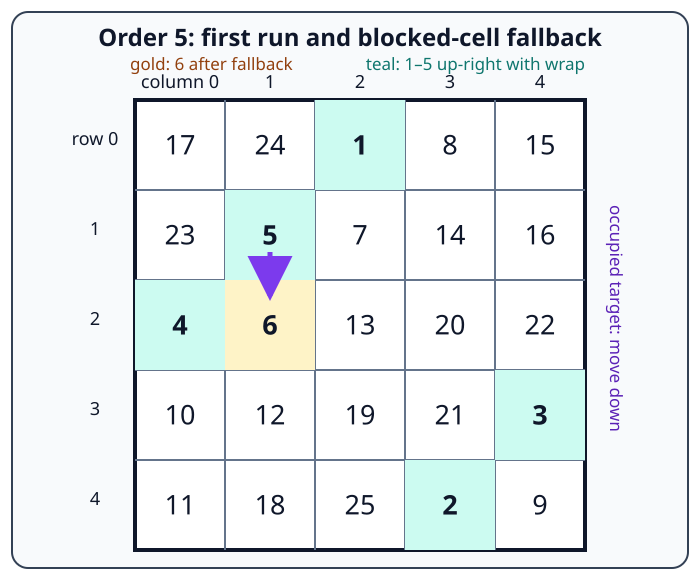

# Magic Squares

A **magic square** of order $n$ is an $n \times n$ array of numbers so that every row, every column, and both main diagonals have the same sum. It is **normal** when its entries are exactly $1,2,\dots,n^2$, each used once. That common sum is the **magic constant**. The study of magic squares spans ancient China, medieval Islam, and Renaissance Europe, yet the underlying mathematics is a blend of linear algebra, combinatorics, and symmetry.

## The magic constant

For a normal magic square of order $n$, the entries are $1,2,\dots,n^2$. Their total is

$$T = \frac{n^2(n^2+1)}{2}.$$

Since there are $n$ rows with equal sum $S$, we have $nS = T$, so

$$S = \frac{n(n^2+1)}{2}.$$

For $n=3$, $S = 15$; for $n=4$, $S = 34$; for $n=5$, $S = 65$.

## Worked example 1: the Lo Shu square

The oldest known magic square is the Chinese **Lo Shu**, of order $3$:

$$
\begin{pmatrix}
4 & 9 & 2 \\
3 & 5 & 7 \\
8 & 1 & 6
\end{pmatrix}
$$

Each row, column, and diagonal sums to $15$. The centre is $5$, the middle value; the even numbers occupy the corners. Up to rotation and reflection, this is the unique normal $3 \times 3$ magic square.

**Proof of uniqueness.** Summing the middle row, middle column and both
diagonals counts the centre $c$ four times and every other entry once. Thus
$60=45+3c$, giving $c=5$. Each pair of opposite cells consequently sums to 10.
Write the corners clockwise as $a,b,10-a,10-b$. The four edge-centres are
$15-a-b$, $5+a-b$, $a+b-5$, $5+b-a$.

If $a,b$ have different parity, all four edge-centres are even and exactly two
corners are even, exceeding the four available even entries. If both are odd,
all four corners and all four edge-centres are odd, again impossible. Therefore
both are even, and all four corners are $2,4,6,8$. Rotate to put 2 at the top
left; 8 is opposite. The only possible adjacent corners are 4 and 6,
because 8 is already opposite. Their two orders are reflections of one another,
and every edge entry is forced by its line sum. Hence there is exactly one
square up to rotations and reflections.

## Worked example 2: the Siamese method for odd orders

A classical construction for odd $n$ proceeds as follows. Place $1$ in the middle of the top row. For each subsequent number, move one step up and one step right, wrapping around the edges. If the target cell is occupied, move one step down instead.

For $n=5$, this yields:

$$
\begin{pmatrix}
17 & 24 & 1 & 8 & 15 \\
23 & 5 & 7 & 14 & 16 \\
4 & 6 & 13 & 20 & 22 \\
10 & 12 & 19 & 21 & 3 \\
11 & 18 & 25 & 2 & 9
\end{pmatrix}
$$

Every row, column, and diagonal sums to $65$.

*The first run places $1$ through $5$ one step up and right, with wrap-around.
The attempted position for $6$ is occupied by $1$, so the fallback moves one row
down from $5$. Rows and columns are numbered $0$ through $4$ in the figure.*

**Why it works.** Use zero-based rows and columns and put $m=(n-1)/2$. Write
$k-1=qn+s$ with $0\le q,s<n$. The algorithm places $k$ at

\[
  r\equiv 2q-s\pmod n,
  \qquad c\equiv m+s-q\pmod n.
\]

These formulas encode both the up-right moves and the downward move after each
block of $n$ entries. They also prove that no cell is repeated: from $(r,c)$ we
recover $q\equiv r+c-m\pmod n$ and then $s\equiv 2q-r\pmod n$.
For a fixed row, as $q$ runs through the residues, so does
$s\equiv2q-r$ because $n$ is odd; thus the row contains one value from each
quotient block and one from each residue class. Its sum is

\[
 n\sum_{q=0}^{n-1}q+\sum_{s=0}^{n-1}s+n
 =\frac{n(n^2+1)}2.
\]

The same argument applies to columns. Finally, entries in cells opposite about
the centre are $k$ and $n^2+1-k$, while the centre contains
$(n^2+1)/2$. Each main diagonal is therefore made of complementary pairs plus
the centre, so it has the same sum. This proves the construction for every odd
$n$.

## Even orders

Even-order magic squares split into two cases. Orders $n\equiv2\pmod4$ with
$n\ge6$ require a different construction from the two given here; the project
below supplies a starting example. When $n\equiv0\pmod4$, the **doubly even**
method writes $1$ to $n^2$ in row order and replaces $x$ by $n^2+1-x$ in the
diagonal positions of each $4\times4$ subgrid.

### Worked example 3: a doubly even square

For $n=4$, diagonal inversion gives a square which, after interchanging its
middle two columns, is:

$$
\begin{pmatrix}
16 & 3 & 2 & 13 \\
5 & 10 & 11 & 8 \\
9 & 6 & 7 & 12 \\
4 & 15 & 14 & 1
\end{pmatrix}
$$

This is the magic square in Albrecht Durer's engraving *Melencolia I* (1514), with the creation year $1514$ appearing in the bottom row.

For completeness, the doubly even rule works at every order divisible by four.
Use indices $r,j=0,\ldots,n-1$ and initial entry $nr+j+1$. In a fixed row,
the selected column indices have two complementary residues in each block of
four; there are $n/2$ selected indices and their sum is $n(n-1)/4$.
The change in the row sum is therefore
$\frac n2(n^2-2nr-1)-2\frac{n(n-1)}4$.
Adding this to the original row sum $n^2r+n(n+1)/2$ gives
$n(n^2+1)/2$. In a fixed column $j$, the selected row indices have the same
count and sum. Its change is
$\frac n2(n^2-2j-1)-2n\frac{n(n-1)}4
=\frac n2(n-2j-1)$.
Adding the original column sum $n^2(n-1)/2+n(j+1)$ gives the same constant.
Every cell on either main diagonal is selected. Each original diagonal already
has the required sum, so complementing the whole diagonal preserves it.
Within each complementary pair of entry values, both positions have the same
selected status, so the operation exchanges the pair or leaves it alone; all
numbers still appear once. The displayed middle-column interchange gives the
specific Dürer variant, whose diagonal sums are $16+10+7+1=34$ and
$13+11+6+4=34$. Arbitrary column permutations need not preserve diagonals.

## Franklin's semimagic squares

Benjamin Franklin constructed $8 \times 8$ squares with remarkable properties.
His square is not fully magic---the diagonals do not sum to the constant---but
every full row and full column sums to the magic constant $260$, while every
half-row and half-column sums to $130$. Moreover, every "bent diagonal" (a
V-shaped or W-shaped diagonal) also sums to $260$.

Franklin's square:

$$
\begin{pmatrix}
52 & 61 & 4 & 13 & 20 & 29 & 36 & 45 \\
14 & 3 & 62 & 51 & 46 & 35 & 30 & 19 \\
53 & 60 & 5 & 12 & 21 & 28 & 37 & 44 \\
11 & 6 & 59 & 54 & 43 & 38 & 27 & 22 \\
55 & 58 & 7 & 10 & 23 & 26 & 39 & 42 \\
9 & 8 & 57 & 56 & 41 & 40 & 25 & 24 \\
50 & 63 & 2 & 15 & 18 & 31 & 34 & 47 \\
16 & 1 & 64 & 49 & 48 & 33 & 32 & 17
\end{pmatrix}
$$

The bent-diagonal property is not accidental: Franklin designed the square by pairing complementary numbers and arranging them so that every symmetrically placed group of four cells sums to $130$.

## Counting magic squares

Counting normal magic squares is hard. The known values are:

- $n=1$: $1$
- $n=2$: $0$ (impossible)
- $n=3$: $1$ fundamental square up to rotation and reflection; $8$ labelled
  arrays
- $n=4$: $880$ fundamental squares; $7\,040$ labelled arrays
- $n=5$: $275\,305\,224$ fundamental squares; $2\,202\,441\,792$ labelled
  arrays

Here “labeled” means that rotating or reflecting an array usually produces a
new array, while “fundamental” identifies all eight dihedral images. With
distinct entries, a normal square of order greater than $1$ cannot be fixed by
a nonidentity rotation or reflection, so each fundamental class has exactly
eight labelled arrays. No general closed formula is known.

## Common errors

- **Assuming any magic constant works.** The constant is forced by the entry set.
- **Checking only rows and columns.** Diagonals are required for "magic"; without them the square is only **semimagic**.
- **Believing $n=2$ is possible.** The magic constant would be $5$, but no arrangement of $1,2,3,4$ in a $2 \times 2$ grid gives equal row, column, and diagonal sums.
- **Confusing magic squares with Latin squares.** A Latin square uses each symbol once per row and column, with no diagonal condition and no fixed entry set.

## Worked example: why the smallest orders behave differently

A one-by-one normal magic square is possible: its sole entry is one, and
every required line has that sum. It is tempting to assume that a construction
should therefore begin at one and continue at every larger order. Order two
already disproves that expectation.

Write the four entries in a two-by-two array as a and b in the first row,
and c and d in the second. If the first row and first column have the same
sum, cancelling their shared entry a forces b and c to be equal. A normal
square must use the four different numbers from one through four, so this
is impossible. The diagonal requirements are not even needed for the
contradiction: equal row and column sums already force a repeated entry.

If repeated entries are permitted, an array containing the same number in
all four positions satisfies every line-sum equation. That does not rescue
a normal order-two construction; it changes the rules about the entries.
Lo Shu then shows that normal order three is possible, using nine distinct
entries rather than repeating one value.

This short obstruction is a useful pattern for construction problems.
Before searching for an arrangement, use the required equalities to derive
necessary relationships among its positions. A contradiction between one
such relationship and the allowed piece inventory proves impossibility,
regardless of how many visual attempts might otherwise be made.

## Exercises

### Exercise 1 {#magic-squares-ex-1}

**Explorer.** Verify that the Lo Shu square has magic constant $15$ by computing all eight required sums.

Hint 1

There are three row sums, three column sums and two diagonal
   sums.

Hint 2

Verifying the rows alone is insufficient.

Solution

Rows: $4+9+2=15$, $3+5+7=15$, $8+1+6=15$. Columns: $4+3+8=15$, $9+5+1=15$, $2+7+6=15$. Diagonals: $4+5+6=15$, $2+5+8=15$.

### Exercise 2 {#magic-squares-ex-2}

**Foundation.** Prove that no normal $2 \times 2$ magic square exists.

Hint 1

Compare the first row and first column sums.

Hint 2

They
   share one entry, forcing their other entries to agree.

Solution

A normal $2 \times 2$ magic square would use $1,2,3,4$ with magic constant $S = 2(4+1)/2 = 5$. Let the square be $\begin{pmatrix} a & b \\ c & d \end{pmatrix}$. Then $a+b=5$, $c+d=5$, $a+c=5$, $b+d=5$, $a+d=5$, $b+c=5$. From $a+b=5$ and $a+c=5$ we get $b=c$, but $b$ and $c$ must be distinct entries from $\{1,2,3,4\}$. Contradiction.

### Exercise 3 {#magic-squares-ex-3}

**Secondary.** Apply the Siamese method to construct a $5 \times 5$ magic square and verify one row, one column, and one diagonal sum.

Hint 1

Wrap coordinates at each edge.

Hint 2

The sixth entry uses
   the blocked-cell fallback, rather than another ordinary diagonal move.

Solution

The construction is given in the chapter. Row 1: $17+24+1+8+15=65$. Column 3: $1+7+13+19+25=65$. Main diagonal: $17+5+13+21+9=65$.

### Exercise 4 {#magic-squares-ex-4}

**Secondary.** In any normal $3 \times 3$ magic square, prove that the centre entry must be $5$.

Hint 1

Add the four lines through the centre.

Hint 2

Compare the
   multiplicity of the centre with that of each other entry.

Solution

Let the centre be $c$. The middle row, middle column, and two diagonals each sum to $15$. Adding these four sums counts $c$ four times and every other cell once, giving $4 \cdot 15 = 60 = 3 \cdot 15 + 3c$, so $c=5$.

### Exercise 5 {#magic-squares-ex-5}

**Undergraduate.** Let $M$ be a normal magic square of order $n$. Prove that replacing each entry $x$ by $n^2+1-x$ produces another magic square. What is its magic constant?

Hint 1

Each line has $n$ entries.

Hint 2

Its transformed sum is
   $n(n^2+1)$ minus its original sum.

Solution

The new entry at position $(i,j)$ is $n^2+1-M_{i,j}$. Each original row sums to $S = n(n^2+1)/2$, so the new row sums to $n(n^2+1)-S = n(n^2+1)-n(n^2+1)/2 = S$. The same holds for columns and diagonals. The magic constant is unchanged.

## Complete solutions

[Exercise 1](#magic-squares-ex-1) · [Exercise 2](#magic-squares-ex-2) · [Exercise 3](#magic-squares-ex-3) · [Exercise 4](#magic-squares-ex-4) · [Exercise 5](#magic-squares-ex-5)

### Hints for exercises 1–5

[Exercise 1](#magic-squares-ex-1) · [Exercise 2](#magic-squares-ex-2) · [Exercise 3](#magic-squares-ex-3) · [Exercise 4](#magic-squares-ex-4) · [Exercise 5](#magic-squares-ex-5)

### Exercise 6: affine changes {#magic-squares-ex-6}

If a magic square of order $n$ has line sum $S$, replace every entry $x$ by
$ax+b$. What are the new line sums? When do distinct entries stay distinct?

Hint 1
 Distribute the sum over a whole line.

Hint 2
 Compare the images of two unequal numbers.

Solution
 Every required line sums to $aS+nb$, so the transformed array is
magic in the general sense. For $a\ne0$, equality $ax+b=ay+b$ implies $x=y$,
so distinctness survives. For $a=0$ all entries become $b$. Even when distinct,
the new array need not be normal, since its entry set need not be $1,\ldots,n^2$.

### Exercise 7: semimagic is weaker {#magic-squares-ex-7}

Give a normal $3\times3$ semimagic array that is not magic by interchanging
the first two rows of Lo Shu.

Hint 1
 Row permutations preserve all row and column sums.

Hint 2
 Compute the new top-left to bottom-right diagonal.

Solution
 The rows become $(3,5,7),(4,9,2),(8,1,6)$. Every row and column
still sums to 15. The indicated diagonal sums to $3+9+6=18$, so it is not
magic. An arbitrary row permutation is therefore not a symmetry of the full
magic-square condition, although rotating the entire square is.

### Exercise 8: eight distinct symmetries {#magic-squares-ex-8}

Why do the rotations and reflections of a normal square of order $n>1$
give eight distinct arrays?

Hint 1
 A nonidentity symmetry moves some cell.

Hint 2
 Could an invariant array give different moved cells distinct labels?

Solution
 Any nonidentity square symmetry moves at least one cell to a
different cell. If the labelled array were fixed, those two cells would have
equal entries, contradicting normality. Thus no nonidentity symmetry fixes
the array. If two of the eight images agreed, composing one with the inverse
of the other would give such a fixing symmetry. All eight are distinct.

### Exercise 9: opposite entries {#magic-squares-ex-9}

Prove that opposite cells in any normal $3\times3$ magic square sum to 10.

Hint 1
 The centre is 5 by exercise 4.

Hint 2
 Each opposite pair belongs to a line through the centre.

Solution
 The middle row, middle column and both main diagonals each
contain the centre and one opposite pair. Their line sum 15 minus the centre
5 leaves 10 for that pair. These four pairs partition the eight outer cells.

### Exercise 10: forced constants beyond normality {#magic-squares-ex-10}

Suppose a $4\times4$ array uses each odd integer from 1 to 31 once. If all
rows have equal sum, find that sum. Construct a magic example from the displayed
order-four square.

Hint 1
 The first sixteen odd numbers sum to $16^2$.

Hint 2
 Apply $x\mapsto2x-1$ to every entry.

Solution
 The total is 256, so each row must sum to 64. The stated affine
map sends $1,\ldots,16$ bijectively onto those odd numbers. Each old line sum
34 becomes $2\cdot34-4=64$, so all rows, columns and diagonals work. This
example is magic but not normal under the book's definition.

## Project: construct and classify

Construct a $6\times6$ magic square using a composite method, beginning with
the following concrete example if you have not met such a method:

$$\begin{pmatrix}
35&1&6&26&19&24\\
3&32&7&21&23&25\\
31&9&2&22&27&20\\
8&28&33&17&10&15\\
30&5&34&12&14&16\\
4&36&29&13&18&11
\end{pmatrix}.$$

Its four blocks begin with an order-three Lo Shu pattern, shifted by multiples
of 9; selected entries are exchanged between top and bottom blocks. Verify the
entry inventory and all fourteen required line sums, each of which is 111.
Then investigate which $3\times3$ subgrids are magic or semimagic and explain
the block patterns. This supplies an inspectable witness, rather than claiming
the odd-order algorithm also covers order six.

## Summary

The entry set forces the magic constant. Checking a magic square requires both
diagonals as well as rows and columns. Local line equations classify order
three, while coordinate formulas prove the odd-order construction. Symmetries
and affine transformations generate further examples, with normality and
semimagic conditions kept distinct.
