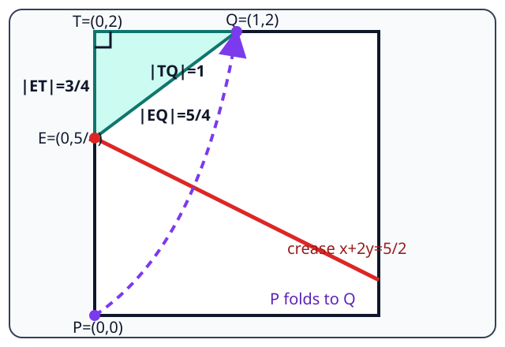

# Origami Mathematics

Paper folding is a physical computation. A single fold can bisect an angle, find a perpendicular, or locate a point that satisfies two constraints simultaneously. The mathematics of origami asks what constructions are possible, what axioms govern folds, and how flat-foldability constrains crease patterns.

## Worked example 1: Haga's theorem

A result in Haga's family of fold theorems, presented in Kazuo Haga's 2008
*Origamics*, produces a
$3:4:5$ triangle. Let the square have side $2$, fold the bottom-left corner
$P=(0,0)$ to the midpoint $Q=(1,2)$ of the opposite edge, and let the crease
meet the left edge at $E$. The crease is the perpendicular bisector of $PQ$:
$x+2y=5/2$, so $E=(0,5/4)$. In the right triangle with vertices
$E$, $Q$, and the top-left corner $T=(0,2)$, the legs have lengths
$|ET|=3/4$ and $|TQ|=1$, while
$|EQ|=\sqrt{1+(3/4)^2}=5/4$. Its side ratio is therefore exactly
$3:4:5$.

*Coordinates give a nonvisual check: $P=(0,0)$ folds to $Q=(1,2)$; the crease
$x+2y=5/2$ meets the left edge at $E=(0,5/4)$; and triangle $ETQ$ has side
lengths $3/4$, $1$, and $5/4$.*

## The Huzita-Hatori axioms

This chapter uses the following seven idealized single-fold operations. Historical names and enumerations differ across sources, so the list is fixed here as a working convention rather than assigned to one unsupported priority claim:

1. Fold a line connecting two given points.
2. Fold one point onto another (perpendicular bisector).
3. Fold one line onto another (angle bisector).
4. Fold a line perpendicular to a given line through a given point.
5. Fold a point onto a line through another point.
6. Fold two points onto two lines simultaneously.
7. Fold a line perpendicular to a given line that brings a point onto a line.

This chapter fixes the numbering above; other sources number or group the
operations differently. Operations 1--5 and 7 do not add cubic roots to the
classical straightedge-and-compass numbers. Operation 6, the simultaneous
two-point-to-two-line fold, is the essential new step: its admissible creases
are common tangents to two parabolas, and finding them can require solving a
cubic equation. Consequently, this ideal origami model can:

- **trisect any angle** (impossible with straightedge and compass);
- **construct $\sqrt[3]{2}$** (impossible with straightedge and compass);
- **construct the regular heptagon** (impossible with straightedge and compass).

## Flat-foldability

A crease pattern **folds flat** if it can be pressed into the plane without introducing new creases or cutting. Two local theorems govern flat-foldable vertices.

**Theorem 13.1 (Maekawa-Justin).** At a single interior vertex in a flat folding, the
number of mountain folds minus the number of valley folds is $\pm 2$.

**Theorem 13.2 (Kawasaki-Justin).** An unassigned single-vertex crease pattern with
consecutive sector angles $a_1,a_2,\dots,a_{2n}$ is locally flat-foldable if
and only if the alternating sums are equal:

$$a_1 + a_3 + \dots + a_{2n-1} = a_2 + a_4 + \dots + a_{2n} = 180^{\circ}.$$

Hull's 2020 *Origametry*, Chapter 5, gives proofs and historical notes for
both of these local flat-vertex theorems.

### Worked example 2: distinguish a book fold from a crossing

A single straight book fold has two sector angles of $180^\circ$ at a point
on its crease, and one crease line gives two opposite crease rays. An interior
vertex where two perpendicular crease lines cross instead has four sector
angles of $90^\circ$. Its alternating sums are $90+90=180$ in either class,
so it has a locally flat-foldable assignment. Maekawa requires three mountain
rays and one valley ray, or the reverse. Assigning two mountains and two valleys
fails that necessary condition, even though the unassigned angles satisfy
Kawasaki. Angles and mountain-valley assignments answer separate questions.

### Worked example 3: compute the crease before folding

Suppose a fold sends $P=(0,0)$ to $Q=(u,v)$, with $P\ne Q$. A point $(x,y)$
on the crease is equidistant from the two points, so
$x^2+y^2=(x-u)^2+(y-v)^2$. Cancelling gives
$ux+vy=(u^2+v^2)/2$. This is the perpendicular bisector equation, derived
without measuring the fold's angle. For $Q=(2,0)$ it becomes $x=1$; for
$Q=(1,2)$ it becomes $x+2y=5/2$, recovering Haga's crease. The formula
specifies an infinite ideal line; only its intersection with the actual sheet
becomes a physical crease. If that line misses the sheet, the ideal operation
does not supply a fold within the available paper.

## Constructing a regular pentagon

The regular pentagon is constructible with straightedge and compass. An exact
folding route can use $\phi=(1+\sqrt5)/2$ and the identity
$2\cos36^\circ=\phi$. To derive that identity, write $x=2\cos36^\circ$.
Since $\cos108^\circ=-\cos72^\circ$, the double- and triple-angle identities
give $x^3-3x=-(x^2-2)$, or $(x+2)(x^2-x-1)=0$. The positive root is
$\phi$, since $0<36^\circ<90^\circ$.

One useful connection between classical constructions and fold operation 5 is
the following. Suppose first that $Q\ne O$. To intersect a line $\ell$ with
the circle of centre $O$ and radius $|OQ|$, fold $Q$ onto $\ell$ using a
crease through $O$. Reflection fixes $O$, so the image $R$ satisfies
$|OR|=|OQ|$. Conversely, an intersection $R\ne Q$ gives the perpendicular
bisector of $QR$ through $O$, since $O$ is equidistant from $Q$ and $R$.
If the intersection is $R=Q$, then $Q$ already lies on $\ell$; the crease
$OQ$ fixes it and supplies this image without a degenerate bisector.
Thus operation 5 realizes every circle-line intersection in this case.
If $Q=O$, the radius is zero: there is no intersection when $O\notin\ell$,
and when $O\in\ell$ every crease through $O$ fixes the sole intersection.
No unique crease is asserted for this zero-radius case.

Construct $\sqrt5$ as the hypotenuse of a right triangle with legs 1 and 2,
using perpendiculars and this circle-line operation; bisect lengths to obtain
$\phi$ and then $\phi/2$. With $O=(0,0)$ and $Q=(1,0)$, fold $Q$ onto
the line $x=\phi/2$ through a crease passing through $O$. Choose its upper
image $R$. The unit vector $OR$ makes angle $36^\circ$ with the horizontal.
Reflecting the horizontal ray about $OR$ gives a $72^\circ$ ray. Copy that
central angle successively around a common circle to locate five equally
spaced vertices. Joining them gives equal chords and angles, hence a regular
pentagon. These steps require a sufficiently large sheet or auxiliary marks;
they describe ideal exact constructions rather than a claim that a rough
strip fold determines an exact polygon.

## Common errors

- **Attaching algebraic power to an unfrozen axiom number.** In the convention
  listed here, operation 6 is the simultaneous fold that can solve cubics;
  always state the operation as well as its number.
- **Ignoring the mountain-valley assignment.** A crease pattern without a valid MV assignment does not fold flat.
- **Confusing local and global flat-foldability.** The Maekawa and Kawasaki theorems are local; a pattern can satisfy them at every vertex and still not fold flat globally due to self-intersection.
- **Using approximate folds as exact proofs.** A fold that looks correct must be justified by an exact geometric construction.

## Worked example: paper area and visible footprint are different

Take a unit square sheet and fold its lower-left corner onto its centre.
The corner has coordinates zero-zero and the centre has coordinates one
half, one half. The crease is their perpendicular bisector. Its equation
is x plus y equals one half, so it meets the lower and left edges halfway
along each. The corner triangle has perpendicular side lengths one half
and one half, hence area one eighth.

Reflection moves that triangle inside the rest of the square, onto the
triangle whose vertices are the centre and those two edge midpoints. The
paper has not been cut away: its total material area is still one. Its
footprint on the table, however, is the original square without the corner
triangle, with area seven eighths. The overlapping region now has two layers,
which explains where the remaining material area is counted.

Measuring only the visible outline therefore answers a different question
from measuring all paper layers. This matters in folding puzzles that claim
an area has disappeared. Before calculating, decide whether overlapping
layers are counted once as occupied space or repeatedly as material. The
crease equation certifies the ideal reflection; it does not by itself state
which convention the puzzle intends. Real paper thickness introduces further
physical restrictions, but the distinction between footprint and material
already appears in this exact zero-thickness model.

## Exercises

### Exercise 1 {#origami-mathematics-ex-1}

**Explorer.** Fold a square sheet so that one corner meets the midpoint of
   the opposite side. Identify the triangle corresponding to $ETQ$ in the
   coordinate model, and verify by measurement that its side ratios are
   approximately $3:4:5$.

Hint 1

Locate the crease's intersection with the left edge, not the
   top-edge midpoint alone.

Hint 2

Scale all three model lengths by the
   same factor when using a sheet of another size.

Solution

Scale the coordinate derivation in the chapter from side $2$ to side
   $10$ cm. The triangle $ETQ$ has exact side lengths $15/4$, $5$, and
   $25/4$ cm, hence ratio $3:4:5$. Physical measurements should be reported
   with their resolution and may differ slightly from these ideal values.

### Exercise 2 {#origami-mathematics-ex-2}

**Foundation.** A flat-foldable interior vertex has six creases. Determine
   all possible pairs $(M,V)$ using the Maekawa-Justin theorem.

Hint 1

In addition to the difference condition, use $M+V=6$.

Hint 2

Solve the two signs of the difference separately.

Solution

Solve $M+V=6$ together with $M-V=\pm2$. The two possibilities are
   $(M,V)=(4,2)$ and $(2,4)$.

### Exercise 3 {#origami-mathematics-ex-3}

**Secondary.** Verify the Kawasaki-Justin theorem for a vertex with angles $45^{\circ},90^{\circ},45^{\circ},90^{\circ},45^{\circ},45^{\circ}$. Does it fold flat?

Hint 1

Add sectors 1,3,5.

Hint 2

A total angle of $360^\circ$
   alone is not the alternating-sum condition.

Solution

The angles sum to $360^{\circ}$. The alternating sums are $45^{\circ}+45^{\circ}+45^{\circ}=135^{\circ}$ and $90^{\circ}+90^{\circ}+45^{\circ}=225^{\circ}$. These are not equal, so the vertex does not fold flat by Kawasaki-Justin.

### Exercise 4 {#origami-mathematics-ex-4}

**Secondary.** Prove that a $60^\circ$ angle cannot be trisected by
   straightedge and compass, and explain which additional constraint in
   operation 6 allows ideal origami to reach the required cubic root.

Hint 1

Put $x=2\cos20^\circ$ into the triple-angle identity.

Hint 2

Test the possible rational roots $1,-1$ of its monic cubic.

Solution

If $20^\circ$ were constructible, then $x=2\cos20^\circ$ would be
   constructible. The triple-angle identity and $\cos60^\circ=1/2$ give
   $x^3-3x-1=0$. The rational-root test shows this cubic is irreducible over
   $\mathbb Q$, so $x$ has degree $3$; a straightedge-and-compass construction
   from rational data can have only power-of-two degree. Thus this particular
   trisection is impossible classically. Operation 6 imposes two point-to-line
   image conditions at once; equivalently, the crease is a common tangent to
   two parabolas. Solving that condition can produce the required real root of
   a cubic. This explains the enlarged tool model without claiming that every
   individual angle is classically nontrisectable.

### Exercise 5 {#origami-mathematics-ex-5}

**Undergraduate.** Prove the Maekawa-Justin theorem for a single interior
   vertex whose flat folding has a non-self-intersecting cross-section: if $M$
   creases are mountains and $V$ are valleys, then $M-V=\pm 2$.

Interpret the cross-section using slightly separated layers approaching the
flat configuration, retaining its sector edges and crease corners without
crossings. Count active crease rays; an uncreased marked point is not a vertex.

Hint 1

Follow a small regularized transverse cross-section once
   around.

Hint 2

Its total signed turning is one full turn; record the
   opposite half-turn contributions at mountains and valleys.

Solution

Let $n=M+V$ count the active crease rays. Each crease reverses the orientation
of the adjacent sector's planar image. Returning around the vertex to the
first sector must restore its orientation, so $n$ is positive and even.

To justify a clipping section, follow a small circle about the vertex on the
unfolded paper. After folding, its polar angle has a continuous real-valued
lift $\theta$: on each sector it changes by that sector's angle, with sign
reversed at every crease. Its total variation is $360^\circ$. Its net change
is an integer multiple of $360^\circ$ because the circle closes; both signs
occur, so its magnitude is strictly smaller than $360^\circ$, hence it is
zero. If $n=2$, the two sector angles are therefore both $180^\circ$: this
is a straight book fold, whose two rays are both mountains or both valleys.
Thus $(M,V)=(2,0)$ or $(0,2)$, as required.

For $n\ge4$, the range of $\theta$ is strictly less than $180^\circ$.
Indeed, going from its minimum to its maximum and back uses twice its range;
the additional positive-length reversals make the total variation strictly
larger than that. Thus all folded sectors lie in an open half-plane about
the vertex. Place the folded vertex at the origin and choose a vector $a$
pointing into that half-plane so that $a\mathbin{\cdot}u>0$ for every folded
ray direction $u$. For small $\delta>0$, the plane
$a\mathbin{\cdot}x=\delta$ perpendicular to the folded paper cuts every
incident crease ray. Each sector supplies a segment joining its two crease
intersections. The sectors occur cyclically around an interior vertex, so
these segments join end to end and the last joins the first: the section is
one closed loop, with one edge per sector and one corner per crease.

The exact flat cut has coincident segments and is degenerate. Apply the
exercise's non-self-intersection hypothesis to its slightly layer-separated
planar polygonal sections instead. Each is simple and closed, so its total
signed exterior turn is $+360^\circ$ or $-360^\circ$, with sign fixed by
the chosen orientation. Viewed consistently from one side of the clipped
vertex, mountain corners approach convex hairpins with interior angle
$0^\circ$, while valley corners approach reflex hairpins with interior
angle $360^\circ$; viewing the other side interchanges these roles. Since
exterior turn equals $180^\circ$ minus interior angle, the limiting turns
are respectively $+180^\circ$ and $-180^\circ$, up to that global reversal.
Taking the limit of the polygon's turning sum gives

\[
  180^\circ(M-V)=\pm360^\circ,
\]

so $M-V=\pm2$. This uses the exact turning sum of simple polygons before
taking the flat limit. The polygon method is the Siwanowicz proof recorded
in [Hull's survey, Section 2](https://arxiv.org/html/1307.1065).

## Complete solutions

[Exercise 1](#origami-mathematics-ex-1) · [Exercise 2](#origami-mathematics-ex-2) · [Exercise 3](#origami-mathematics-ex-3) · [Exercise 4](#origami-mathematics-ex-4) · [Exercise 5](#origami-mathematics-ex-5)

### Hints for exercises 1–5

[Exercise 1](#origami-mathematics-ex-1) · [Exercise 2](#origami-mathematics-ex-2) · [Exercise 3](#origami-mathematics-ex-3) · [Exercise 4](#origami-mathematics-ex-4) · [Exercise 5](#origami-mathematics-ex-5)

### Exercise 6: another perpendicular bisector {#origami-mathematics-ex-6}

Find the crease sending $(0,0)$ to $(2,2)$ and its intersections with the
coordinate axes.

Hint 1
 Equate squared distances to the two points.

Hint 2
 Substitute zero for one coordinate at a time.

Solution
 The equation is $2x+2y=(4+4)/2=4$, hence $x+y=2$.
Its intercepts are $(2,0)$ and $(0,2)$. The line passes through the midpoint
$(1,1)$ and has slope $-1$, perpendicular to the joining segment's slope 1.

### Exercise 7: legal angles, wrong assignment {#origami-mathematics-ex-7}

Four sector angles are $60^\circ,120^\circ,120^\circ,60^\circ$. Check
unassigned local flat-foldability. Can an assignment with two mountains and two
valleys be flat-folded at this interior vertex?

Hint 1
 Compare opposite-sector sums.

Hint 2
 Check the assigned crease counts separately.

Solution
 Alternating sums are $60+120=180$ and $120+60=180$, so
Kawasaki ensures some local assignment exists. The proposed assignment has
$M-V=0$, contradicting Maekawa's $\pm2$. It therefore fails. Passing the
angle criterion does not validate every assignment.

### Exercise 8: eight crease rays {#origami-mathematics-ex-8}

For a flat-foldable interior vertex with eight crease rays, list the possible
mountain and valley counts. Does this count condition suffice by itself?

Hint 1
 Solve $M+V=8$ and $M-V=\pm2$.

Hint 2
 The sector angles have not yet been specified.

Solution
 The possible counts are $(5,3)$ and $(3,5)$. These are only
necessary. For example, eight positive sectors whose alternating sums are
not 180 degrees fail Kawasaki regardless of these counts; even satisfying
both necessary numerical conditions does not check all assigned layer ordering.

### Exercise 9: why a cubic is new {#origami-mathematics-ex-9}

Prove that $x^3-2$ is irreducible over the rationals and explain why a tool
that constructs $\sqrt[3]2$ has greater algebraic reach than a rational-data
straightedge-and-compass construction.

Hint 1
 A reducible cubic over a field has a root in that field.

Hint 2
 The rational-root candidates are $\pm1,\pm2$.

Solution
 None of the four candidates is a root, so the cubic is
irreducible and its real root has degree 3. Classical construction steps give
a tower of quadratic extensions; any element's degree divides a power of 2.
Degree 3 is impossible there. Operation 6 can impose genuinely cubic equations,
which explains the new possibility without implying arbitrary algebraic roots
are constructible by the seven single-fold operations.

### Exercise 10: exactness and measurement {#origami-mathematics-ex-10}

A measured triangle has sides $3.01,3.99,5.00$ cm. Does this prove that an
ideal fold produced a $3:4:5$ triangle? Explain what extra argument is needed.

Hint 1
 A finite-resolution measurement is compatible with many exact lengths.

Hint 2
 Compare the coordinate derivation in Haga's example.

Solution
 It gives approximate agreement, not an exact ratio proof.
Specify the ideal points and fold operation, derive the perpendicular-bisector
equation, and calculate the three lengths exactly. Physical measurements then
describe how closely the paper realizes that model, with their uncertainty
reported separately. Neither kind of evidence should be described as the other.

## Project: fold a regular heptagon

Research and execute the origami construction of a regular heptagon. Document each fold as an application of one of the Huzita-Hatori axioms. Prove that the resulting polygon has seven equal sides and seven equal angles, or identify the exact error if the construction is approximate.

## Summary

An ideal fold is a reflection with an exact crease equation. The fixed list of
operations distinguishes quadratic constructions from simultaneous folds that
can solve cubics. Single-vertex angle conditions and assigned mountain-valley
conditions must be kept separate, and local foldability does not establish a
whole sheet's global folding. Coordinate proofs explain the ideal geometry;
measurements describe a physical approximation.
