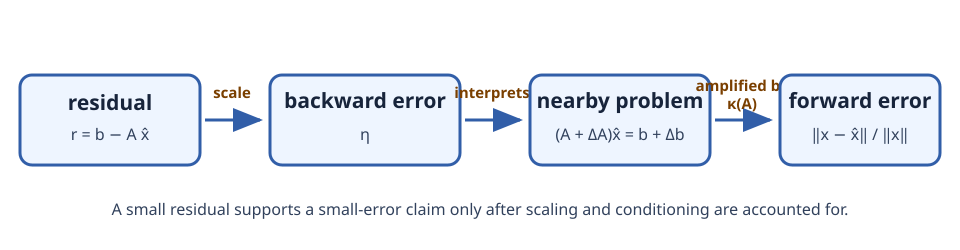

# Conditioning and Stability

A beautiful algorithm applied to an ill-posed problem can still return nonsense. Conversely, a crude algorithm on a well-conditioned problem may give an excellent approximation. This chapter separates the sensitivity of the problem itself from the quality of the algorithm, and introduces the backward-error framework that lets us reason about computed results with rigor.

## Conditioning: sensitivity of the problem

Consider the linear system $Ax = b$ with $A$ nonsingular. Suppose the data are perturbed to $A + \delta A$ and $b + \delta b$, producing a perturbed solution $x + \delta x$. Subtracting the original equation from the perturbed one gives

$$
(A + \delta A)(x + \delta x) = b + \delta b
\quad \Longrightarrow \quad
A \, \delta x \approx \delta b - \delta A \, x,
$$

where we have dropped the second-order term $\delta A \, \delta x$. Multiplying by $A^{-1}$ and taking norms yields

$$
\lVert \delta x \rVert \lesssim \lVert A^{-1} \rVert \, \lVert \delta b \rVert + \lVert A^{-1} \rVert \, \lVert \delta A \rVert \, \lVert x \rVert.
$$

Dividing by $\lVert x \rVert$ and using $\lVert b \rVert \le \lVert A \rVert \, \lVert x \rVert$, we obtain the classical first-order bound

$$
\frac{\lVert \delta x \rVert}{\lVert x \rVert}
\lesssim \kappa(A) \left(
\frac{\lVert \delta A \rVert}{\lVert A \rVert}
+ \frac{\lVert \delta b \rVert}{\lVert b \rVert}
\right),
$$

where the **condition number** is

$$
\kappa(A) = \lVert A \rVert \, \lVert A^{-1} \rVert.
$$

In the 2-norm, $\kappa_{2}(A) = \sigma_{\max}(A) / \sigma_{\min}(A)$, the ratio of largest to smallest singular value. Here $\lesssim$ denotes a first-order estimate after dropping quadratic terms. For nonzero $b$ and $x$, set $\epsilon_A=\lVert\delta A\rVert/\lVert A\rVert$ and $\epsilon_b=\lVert\delta b\rVert/\lVert b\rVert$. The finite perturbation bound is $\lVert\delta x\rVert/\lVert x\rVert\le\kappa(A)(\epsilon_A+\epsilon_b)/(1-\kappa(A)\epsilon_A)$ when $\kappa(A)\epsilon_A<1$; it follows by retaining $\delta A\,\delta x$ and rearranging the norm inequality. A large condition number permits large amplification of small data errors.

Conditioning is a property of the **problem**, not of any particular algorithm. It does not depend on rounding error, on the compiler, or on the programmer. It depends only on the mathematical map from data to solution.

## Backward stability: quality of the algorithm

An algorithm is **backward stable** if the computed result $\widehat{x}$ is the exact solution of a nearby problem. Formally, for solving $Ax = b$, backward stability means there exist perturbations $\Delta A$ and $\Delta b$ such that

$$
(A + \Delta A) \widehat{x} = b + \Delta b,
$$

with $\lVert \Delta A \rVert / \lVert A \rVert$ and $\lVert \Delta b \rVert / \lVert b \rVert$ on the order of machine epsilon $\varepsilon_{\text{mach}}$.

The power of this definition is that it separates algorithm analysis from problem analysis. If the algorithm is backward stable and its matrix backward error times the condition number is small, the first-order forward-error estimate is:

$$
\frac{\lVert x - \widehat{x} \rVert}{\lVert x \rVert}
\lesssim \kappa(A) \cdot O(\varepsilon_{\text{mach}}).
$$

This is not a theorem about a particular code. Householder QR and successful Cholesky admit standard backward-error bounds under the arithmetic model; LU with partial pivoting additionally depends on element growth. The cited references supply those algorithm-specific results.

The arrows encode the logic, not equalities: the residual is scaled to obtain a backward-error measure; that measure describes the nearby problem solved; and the condition number controls how strongly a small backward perturbation can be amplified into forward error. A small residual alone cannot bypass the conditioning step.

## Residual versus error

A small residual $\lVert b - A \widehat{x} \rVert$ is necessary but not sufficient for a small forward error. Consider

$$
A = \begin{pmatrix} 1 & 0 \\ 0 & 10^{-8} \end{pmatrix},
\quad
b = \begin{pmatrix} 1 \\ 10^{-8} \end{pmatrix},
\quad
\widehat{x} = \begin{pmatrix} 1 \\ 0 \end{pmatrix}.
$$

The exact solution is $x = (1, 1)^{T}$. The residual is

$$
b - A \widehat{x} = \begin{pmatrix} 0 \\ 10^{-8} \end{pmatrix},
$$

which is tiny in absolute terms. Yet the solution error is

$$
x - \widehat{x} = \begin{pmatrix} 0 \\ 1 \end{pmatrix},
$$

so the relative error is $1 / \sqrt{2} \approx 0.71$, enormous. The condition number $\kappa_{2}(A) = 10^{8}$ explains why: the small singular value hides errors in the second component.

A more informative quantity is the **scaled backward error**

$$
\eta = \frac{\lVert b - A \widehat{x} \rVert}{\lVert A \rVert \, \lVert \widehat{x} \rVert + \lVert b \rVert}.
$$

If a reliably evaluated $\eta$ is on the order of $\varepsilon_{\text{mach}}$, this computed solution solves a nearby problem in the stated normwise sense. That certifies a small backward error for this instance; it does not prove that the algorithm is backward stable across inputs. Interpret its forward error using conditioning and data accuracy, and compare the measured backward error with an algorithm-specific error budget.

## Example: exact formulas and their numerical risks

**Example 3.1 (Worked calculation).**

Consider solving $Ax = b$ by Cramer's rule for $n = 2$:

$$
x_{1} = \frac{\det\begin{pmatrix} b_{1} & a_{12} \\ b_{2} & a_{22} \end{pmatrix}}{\det A},
\quad
x_{2} = \frac{\det\begin{pmatrix} a_{11} & b_{1} \\ a_{21} & b_{2} \end{pmatrix}}{\det A}.
$$

For $A = \begin{pmatrix} 1 & 2 \\ 3 & 4 \end{pmatrix}$ and $b = \begin{pmatrix} 5 \\ 6 \end{pmatrix}$, the exact solution is $x = (-4, 4.5)^{T}$. Cramer's rule gives the exact answer in exact arithmetic, but in floating point the explicit determinant computation is prone to overflow, underflow, and catastrophic cancellation. Gaussian elimination with partial pivoting has a backward-error bound proportional to its growth factor and is usually stable in practice, though exponential worst cases exist; it is the preferred general route here.

## Common errors and misconceptions

**Error: blaming the algorithm for ill conditioning.** A large condition number, even $\kappa(A)\approx10^{16}$, signals sensitivity; it does not identify the cause of a large computed error or rule out an unstable algorithm. For a concrete comparison, set $\delta=10^{-16}$, $A=\operatorname{diag}(1,\delta)$ and $b=(1,\delta)^T$, so the exact solution is $x=(1,1)^T$. The outputs $\widehat{x}_s=(1,0)^T$ and $\widehat{x}_\ell=(0,1)^T$ both have relative forward error $1/\sqrt2$, but $\eta_s=\delta/(1+\sqrt{1+\delta^2})\approx\delta/2$ while $\eta_\ell=1/(1+\sqrt{1+\delta^2})\approx1/2$. The first output exactly solves the nearby right-hand-side problem with $\Delta A=0$ and $\Delta b=(0,-\delta)^T$; the second has a large backward error that conditioning alone cannot excuse. The exact output $x$ has zero forward and backward error despite the same condition number. Assess backward error against a justified algorithmic error budget before assigning causes; a single accurate result does not establish stability across inputs.

**Error: using the determinant as a singularity test.** The magnitude $|\det(A)| = \prod_{i} \sigma_{i}$ mixes all singular values and scales with dimension and units. A matrix can have a tiny determinant yet be well conditioned, or a large determinant yet be badly ill conditioned; an exactly singular square matrix necessarily has determinant zero. Use the condition number or a rank-revealing factorization instead.

**Error: assuming symmetry fixes everything.** Symmetry reduces storage and operation counts, but an indefinite symmetric matrix can still be ill conditioned. Cholesky factorization requires positive definiteness, not merely symmetry.

## Norms, data, and the map being conditioned

**Definition 3.2 (Normwise relative condition number).** Let a map $f$ be defined near nonzero data $d$ and suppose $f(d)\ne0$. Its local relative condition number in declared input and output norms is
$$
\operatorname{cond}(f,d)=
\lim_{\epsilon\downarrow0}\sup_{0<\|\delta d\|\le\epsilon\|d\|}
\frac{\|f(d+\delta d)-f(d)\|/\|f(d)\|}
{\|\delta d\|/\|d\|},
$$
when the limit is interpreted as an extended nonnegative value. If $f$ is differentiable, this equals
$\|Df(d)\|\|d\|/\|f(d)\|$.

To see the derivative formula, write
$f(d+\delta d)-f(d)=Df(d)\delta d+o(\|\delta d\|)$. The operator norm bounds the ratio above, up to a term tending to zero. Conversely, unit vectors approaching a maximizing direction for $Df(d)$ give the lower bound; in finite dimensions the unit sphere is compact, so a maximizing direction exists. The definition depends on the map and perturbation model, not merely on a matrix printed somewhere in the computation.

For $f(b)=A^{-1}b$ with fixed nonsingular $A$, the local relative condition number is
$\|A^{-1}\|\|b\|/\|A^{-1}b\|$, which can be smaller than $\kappa(A)$. The matrix condition number is a uniform upper bound over right-hand sides and becomes sharp in suitable singular-vector directions for the 2-norm. Sensitivity to changes in $A$ is another map. If some inputs are exact constants or constrained to maintain a structure, unconstrained normwise perturbations may overstate the relevant sensitivity.

## The finite perturbation theorem

**Theorem 3.3 (Perturbed linear system).** Let $A$ be nonsingular, let $b\ne0$, and use a vector norm with its induced matrix norm. Suppose
$\|A^{-1}\|\|\Delta A\|<1$. Then $A+\Delta A$ is nonsingular and its solution $\widetilde x$ satisfies
$$
\frac{\|\widetilde x-x\|}{\|x\|}
\le
\frac{\kappa(A)(\epsilon_A+\epsilon_b)}
{1-\kappa(A)\epsilon_A},
\quad
\epsilon_A=\frac{\|\Delta A\|}{\|A\|},
\quad
\epsilon_b=\frac{\|\Delta b\|}{\|b\|},
$$
where $Ax=b$ and $(A+\Delta A)\widetilde x=b+\Delta b$.

*Proof.* Put $B=A^{-1}\Delta A$. Since $\|B\|<1$, the finite identity
$(I+B)\sum_{j=0}^k(-B)^j=I-(-B)^{k+1}$ converges to $I$ as $k\to\infty$. Thus the norm-convergent geometric series is $(I+B)^{-1}$, with norm at most $1/(1-\|B\|)$. This proves invertibility. Subtraction gives
$$
(I+B)(\widetilde x-x)
=A^{-1}(\Delta b-\Delta A x).
$$
Take norms and use the inverse bound. Finally,
$\|b\|\le\|A\|\|x\|$, so
$\|A^{-1}\|\|\Delta b\|/\|x\|\le\kappa(A)\epsilon_b$.
Replacing $\|B\|$ by $\kappa(A)\epsilon_A$ gives the result. $\square$

The denominator records a genuine restriction. Dropping it when $\kappa(A)\epsilon_A$ is near one can turn a useful theorem into a false reassurance. If $\Delta A=0$, no smallness restriction is needed and the right-hand-side-only estimate is exact as a bound. If $b=0$, the relative error normalized by $\|x\|$ is undefined because $x=0$; an absolute-error statement should be used instead.

## What the scaled backward error certifies

**Definition 3.4 (Joint normwise backward error).** For $A\ne0$, $b\ne0$, and an approximate solution $\widehat x$, define the backward error as the infimum of $\epsilon\ge0$ for which perturbations satisfy
$$
(A+E)\widehat x=b+f,\qquad
\|E\|_2\le\epsilon\|A\|_2,\qquad
\|f\|_2\le\epsilon\|b\|_2.
$$
The same relative budget is allowed independently for the matrix and right-hand side.

**Theorem 3.5 (Residual formula in the 2-norm).** Under this definition,
$$
\eta=\frac{\|r\|_2}{\|A\|_2\|\widehat x\|_2+\|b\|_2},
\qquad r=b-A\widehat x.
$$

*Proof.* Every admissible pair satisfies $r=E\widehat x-f$, so
$\|r\|_2\le\epsilon(\|A\|_2\|\widehat x\|_2+\|b\|_2)$. This proves the lower bound. If $\widehat x=0$, take $E=0$, $f=-b$; the formula gives 1 and the bound is attained. Otherwise write
$D=\|A\|_2\|\widehat x\|_2+\|b\|_2$ and
$\alpha=\|A\|_2\|\widehat x\|_2/D$. Set
$$
E=\frac{\alpha r\widehat x^*}{\|\widehat x\|_2^2},
\qquad f=-(1-\alpha)r.
$$
Then $E\widehat x-f=r$. A rank-one matrix $uv^*$ has2-norm $\|u\|_2\|v\|_2$: Cauchy–Schwarz proves the upper bound and a vector parallel to $v$ attains it. Hence $\|E\|_2/\|A\|_2=\|f\|_2/\|b\|_2=\|r\|_2/D$. The lower bound is attained. $\square$

This exact formula permits unstructured perturbations. The constructed $E$ will not generally be diagonal, symmetric, sparse, or positive definite. A structured backward error can be larger because fewer perturbations are allowed. Likewise a componentwise error model uses the original entry magnitudes rather than a single global norm. Neither measure replaces the other; report which question is being answered.

Residual evaluation has its own rounding error. If a computed residual $\widehat r$ has a proved evaluation bound $\|\widehat r-r\|\le\delta_r$, then use
$\|r\|\le\|\widehat r\|+\delta_r$ for a certified upper bound. A tiny displayed residual obtained by cancellation in the working precision is insufficient evidence without considering this evaluation error. Higher-precision residuals are often useful even when the solution remains stored at the original precision.

**Example 3.6 (An attained backward perturbation).** Let $A=I_2$, $b=(1,1)^T$, and $\widehat x=(1,0)^T$. Then $r=(0,1)^T$, $D=1+\sqrt2$, and
$\eta=1/(1+\sqrt2)=\sqrt2-1$. The construction gives
$$
E=\begin{pmatrix}0&0\\\eta&0\end{pmatrix},
\qquad f=(0,-\sqrt2\,\eta)^T.
$$
Indeed $(I+E)\widehat x=(1,\eta)^T=b+f$, since $1-\sqrt2\eta=\eta$. The two relative perturbation budgets both equal $\eta$. The matrix is perfectly conditioned, but this particular output has large backward error; conditioning cannot justify it.

## Distance to singularity and hidden directions

**Theorem 3.7 (Nearest singular matrix).** For nonsingular $A\in\mathbb C^{n\times n}$,
$$
\min\{\|E\|_2:A+E\text{ is singular}\}=\sigma_{\min}(A).
$$
Thus the relative distance to singularity is $1/\kappa_2(A)$.

*Proof.* If $(A+E)v=0$ for a unit vector $v$, then
$\|E\|_2\ge\|Ev\|_2=\|Av\|_2\ge\sigma_{\min}(A)$.
For the opposite inequality, take unit singular vectors $u,v$ with
$Av=\sigma_{\min}u$, and set $E=-\sigma_{\min}uv^*$. Then $(A+E)v=0$ and the rank-one norm formula gives $\|E\|_2=\sigma_{\min}$. Divide by $\|A\|_2=\sigma_{\max}$ to obtain the relative statement. $\square$

This is an unstructured distance. A physically allowed family might exclude the singular perturbation just constructed. It also explains why determinant magnitude is a poor replacement: determinant is a product, while distance to singularity is controlled by a minimum.

**Example 3.8 (A residual in a sensitive direction).** Take $A=\operatorname{diag}(1,10^{-6})$, $b=(1,10^{-6})^T$, and $\widehat x=(1,1-10^{-3})^T$. Then
$r=(0,10^{-9})^T$, while $x-\widehat x=(0,10^{-3})^T$. The residual lies entirely in the direction amplified by $A^{-1}$ by a factor $10^6$. The relative forward error is $10^{-3}/\sqrt2$, and the usual residual bound
$$
\frac{\|x-\widehat x\|_2}{\|x\|_2}
\le\kappa_2(A)\frac{\|r\|_2}{\|b\|_2}
$$
is about $10^{-3}$. To prove this bound, write $x-\widehat x=A^{-1}r$, apply the norm inequality, and use $\|b\|\le\|A\|\|x\|$. The direction of the residual can make the actual amplification close to the worst-case scale.

A complete numerical conclusion therefore names the mathematical input uncertainty, the observed backward error, the norm or componentwise model, and a conditioning estimate in the same model. It also distinguishes an a posteriori certificate for one answer from a theorem about an algorithm over a class of inputs. Both are valuable; neither should be advertised as the other.

## A right-hand side can change the realised sensitivity

Take A=diag(1,η), with 0<η<1, and vary only the right-hand side in the Euclidean norm. At b=e_1 the solution is e_1. A perturbation of size δ in the second coordinate changes the solution by δ/η there, so the relative local condition number is η^(−1), attaining the matrix condition number.

At b=e_2, however, the solution has norm η^(−1). The derivative is still the same operator A^(−1), but the output normalization is larger. The relative condition number for this fixed right-hand side is one. The absolute sensitivity remains η^(−1); its relative interpretation changed with the base solution.

This pair of calculations holds the matrix and perturbation norm fixed. It therefore isolates the role of which data are perturbed and where the condition number is evaluated. A uniform matrix bound can be useful without describing every right-hand side sharply. If the permitted perturbations are further restricted to the first coordinate, the maximal derivative must be taken on that restricted subspace instead.

The permitted perturbations can change the conclusion even for a diagonal system. Take diagonal entries δ and one, with δ positive and small, and right side (δ,1). The solution is (1,1). Under componentwise relative right-side perturbations, each right-side error is at most ε times its own entry. Dividing by the corresponding diagonal entry then bounds each solution error by ε, so the relative infinity-norm solution error is at most ε, independently of δ. A normwise relative budget instead permits an error of size ε in the first right-side component, producing solution error ε divided by δ. The same system therefore has very different sensitivity under the two declared input models. A large normwise condition number does not contradict a sharp componentwise guarantee.

## Practice exercises with solutions

### Exercise 2.1

Let $A = \operatorname{diag}(1, 10^{-6}, 10^{3})$. Compute $\kappa_{2}(A)$ and discuss the first-order accuracy estimate for a backward-stable algorithm in single precision ($\varepsilon_{\text{mach}} \approx 10^{-7}$).

Hint 1

**Hint.** For a diagonal matrix, singular values are absolute diagonal entries.

Hint 2

**Hint.** Check whether the product of condition number and perturbation budget is small.

Solution

**Solution.** The singular values are $\sigma_{1} = 10^{3}$, $\sigma_{2} = 1$, $\sigma_{3} = 10^{-6}$. Thus $\kappa_{2}(A) = 10^{3} / 10^{-6} = 10^{9}$. The formal first-order scale is

$$
\kappa_2(A)\varepsilon_{\text{mach}}=10^{9}\cdot10^{-7}=10^{2},
$$

so the small-perturbation regime is not certified in single precision and no digit guarantee follows. In double precision ($\varepsilon_{\text{mach}} \approx 10^{-16}$), the scale is $10^{-7}$, suggesting about $7$ decimal digits only for backward errors of order $\varepsilon_{\text{mach}}$ with modest constants and sufficiently accurate data. Actual guarantees require the measured errors and the finite bound above.

### Exercise 2.2

Prove that $\kappa_{2}(A^{T}A) = \kappa_{2}(A)^{2}$ for any nonsingular $A$.

Hint 1

**Hint.** Use a singular value decomposition.

Hint 2

**Hint.** The Gram matrix squares each singular value.

Solution

**Solution.** The singular values of $A^{T}A$ are $\sigma_{i}(A)^{2}$. Hence

$$
\kappa_{2}(A^{T}A)
= \frac{\sigma_{\max}(A)^{2}}{\sigma_{\min}(A)^{2}}
= \left(\frac{\sigma_{\max}(A)}{\sigma_{\min}(A)}\right)^{2}
= \kappa_{2}(A)^{2}.
$$

This is why the normal equations square the condition number.

### Exercise 2.3

A computed solve yields residual $r = b - A \widehat{x}$ with $\lVert r \rVert_{2} = 10^{-10}$, $\lVert A \rVert_{2} = 10^{3}$, $\lVert \widehat{x} \rVert_{2} = 1$, and $\lVert b \rVert_{2} = 10^{3}$. Compute the scaled backward error $\eta$ and interpret it.

Hint 1

**Hint.** Use the denominator in the scaled residual.

Hint 2

**Hint.** Compare with unit roundoff only after considering dimension-dependent constants.

Solution

**Solution.**
$$
\eta = \frac{10^{-10}}{10^{3} \cdot 1 + 10^{3}} = \frac{10^{-10}}{2 \times 10^{3}} = 5 \times 10^{-14}.
$$

With the convention $\varepsilon_{\text{mach}}=2^{-53}\approx 1.11\times10^{-16}$ for binary64 unit roundoff, $\eta$ is about $450\,\varepsilon_{\text{mach}}$. This is a small scaled backward error, but the number alone neither proves nor disproves backward stability: a stability bound also depends on the algorithm, dimension, and rounding analysis. It does not diagnose $\kappa(A)$; conditioning enters when backward error is converted to a forward-error bound.

### Exercise 2.4

Give an example of a $2 \times 2$ matrix with $\det(A) = 1$ but $\kappa_{2}(A) > 10^{6}$.

Hint 1

**Hint.** Choose reciprocal diagonal scales.

Hint 2

**Hint.** The determinant is their product, but the condition number is their ratio.

Solution

**Solution.** Take $A = \operatorname{diag}(10^{6}, 10^{-6})$. Then $\det(A) = 1$, but $\kappa_{2}(A) = 10^{12}$. This shows that determinant magnitude is unrelated to conditioning.

### Exercise 3.5 — A finite bound

Suppose $\kappa_2(A)=100$, $\epsilon_A=10^{-4}$, and $\epsilon_b=2\times10^{-4}$. Compute the finite perturbation bound.

Hint 1

**Hint.** Check the denominator is positive.

Hint 2

**Hint.** Use the sum of the two relative input errors.

Solution

**Solution.** The product $\kappa\epsilon_A=0.01<1$, so the bound applies and gives $100(3\times10^{-4})/(1-0.01)=0.03/0.99\approx0.030303$. The first-order value0.03 is slightly smaller and is not the rigorous finite bound.

### Exercise 3.6 — An exact distance

Find the 2-norm distance from $A=\operatorname{diag}(4,0.02)$ to the set of singular matrices and give a perturbation attaining it.

Hint 1

**Hint.** Use the smallest singular value.

Hint 2

**Hint.** Cancel the second diagonal entry.

Solution

**Solution.** The distance is0.02. The perturbation $E=\operatorname{diag}(0,-0.02)$ has norm0.02 and makes $A+E$ singular. Its relative norm is $0.02/4=0.005=1/\kappa_2(A)$.

### Exercise 3.7 — Zero residual, uncertain data

A computed vector solves the stored system exactly, but the stored right-hand side has unknown relative error at most $10^{-3}$. Does zero residual establish accuracy for the intended data?

Hint 1

**Hint.** Separate stored and intended systems.

Hint 2

**Hint.** Apply conditioning to the input uncertainty.

Solution

**Solution.** No. Zero residual certifies only an exact solve of the stored system. With $A$ fixed, the intended-solution difference can be amplified by $\kappa(A)$ times the right-hand-side uncertainty in a worst-case normwise estimate. Input uncertainty remains even with no arithmetic error.

### Exercise 3.8 — A condition number for one right-hand side

Let $A=\operatorname{diag}(1,10^{-4})$. Compute the local right-hand-side condition number for $b=e_1$ and for $b=e_2$.

Hint 1

**Hint.** Use $\|A^{-1}\|_2\|b\|_2/\|A^{-1}b\|_2$.

Hint 2

**Hint.** The derivative permits perturbations in any direction.

Solution

**Solution.** For $b=e_1$, the value is $10^4$. For $b=e_2$, the solution has norm $10^4$, so the value is1. The same matrix has different relative sensitivity at these two right-hand sides; $\kappa_2(A)=10^4$ bounds both.

### Exercise 3.9 — Residual evaluation uncertainty

If $\|\widehat r\|_2=10^{-14}$ and a proved residual-evaluation error is $3\times10^{-13}$, what rigorous upper bound can replace the residual norm in a backward-error estimate?

Hint 1

**Hint.** Use the triangle inequality.

Hint 2

**Hint.** Do not subtract the evaluation uncertainty.

Solution

**Solution.** The rigorous bound is $\|r\|_2\le10^{-14}+3\times10^{-13}=3.1\times10^{-13}$. The small computed norm alone cannot certify a $10^{-14}$ true residual.

### Exercise 3.10 — Backward and forward error separate

For $A=\operatorname{diag}(1,\epsilon)$ and $b=(1,\epsilon)^T$, compare $\widehat x=(1,0)^T$ with the exact solution when $0<\epsilon\ll1$.

Hint 1

**Hint.** Compute the residual and solution error explicitly.

Hint 2

**Hint.** Use the joint backward-error denominator.

Solution

**Solution.** The exact solution is $(1,1)^T$. The error norm is1 and relative error $1/\sqrt2$. The residual norm is $\epsilon$, while $\eta=\epsilon/(1+\sqrt{1+\epsilon^2})\approx\epsilon/2$. Thus an arbitrarily small backward error can coexist with an order-one relative forward error for increasingly ill-conditioned problems.

## Connections

This chapter introduced conditioning as a property of the problem and backward stability as a property of the algorithm. The next chapter, *Advanced Factorizations and Block Algorithms*, organizes elimination into blocks and proves the associated Schur-complement and iteration results.

## Sources

- Lloyd N. Trefethen and David Bau III, [Numerical Linear Algebra](https://doi.org/10.1137/1.9780898719574), SIAM, 1997.
- Gene H. Golub and Charles F. Van Loan, [Matrix Computations](https://doi.org/10.56021/9781421407944), fourth edition, Johns Hopkins University Press, 2013.
- Nicholas J. Higham, [Accuracy and Stability of Numerical Algorithms](https://doi.org/10.1137/1.9780898718027), second edition, SIAM, 2002.

The exposition, proofs, and worked calculations in this chapter are original to Euler; these references provide further reading and the stated specialist results.

## Summary

Conditioning belongs to a specified mathematical map and perturbation model. Backward error measures a nearby problem solved by a particular output; the finite perturbation theorem converts that evidence into a forward bound only within its hypotheses. Residual direction, data uncertainty, and evaluation error all matter. Block factorizations next exploit structure without changing these requirements.
