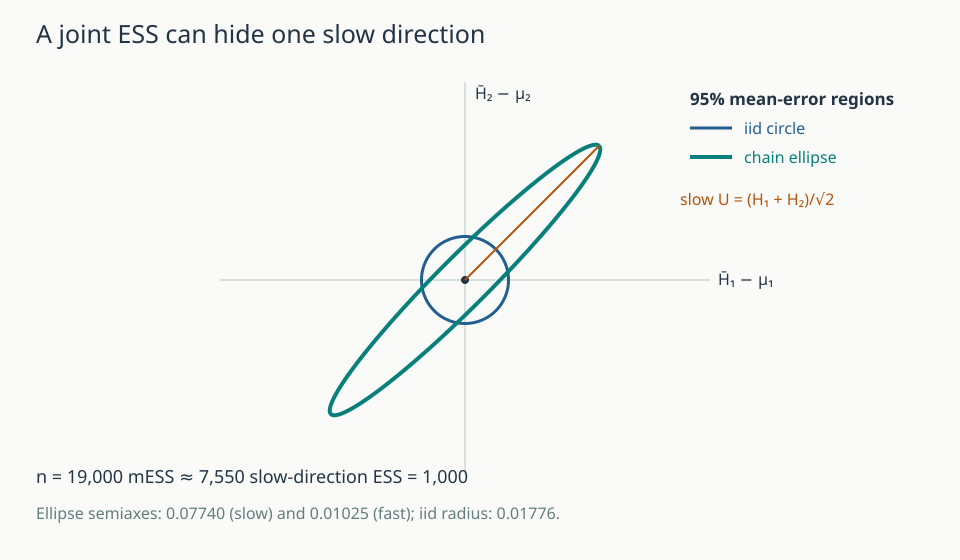

# 13. Monte Carlo error and effective sample size

A posterior calculation is unfinished until its numerical accuracy is understood. Two researchers can use the same simulation and face very different accuracy problems: one estimates an average treatment effect, while the other estimates the probability that the effect exceeds a threshold. The relevant uncertainty depends on the function being averaged, as well as on the chain.

**Learning goals.** Derive the variance of a dependent average; distinguish a law of large numbers from a central limit theorem; interpret effective sample size for a specified estimand; calculate scalar and vector batch means errors; and choose a meaningful simulation precision target.

**Prerequisites.** Expectation and covariance from [Chapter 2](02-probability.md), independent Monte Carlo from [Chapter 5](05-monte-carlo.md), and Harris ergodicity and geometric convergence from [Chapter 8](08-convergence.md). [Chapter 12](12-kernel-design.md) explains why changing the transition kernel can change the variance studied here.

## 13.1 Which uncertainty are we measuring?

Fix a measurable function $h$ and write

$$
\mu=E_\pi h(X),\qquad Y_t=h(X_t),\qquad \bar Y_n=\frac1n\sum_{t=1}^nY_t.
$$

For a posterior mean, $h$ might select one parameter. For a probability, it might be $h(x)=\mathbf 1\{x>c\}$. For an expected loss, it is the loss associated with a particular decision. Naming $h$ is the first step in output analysis.

The marginal standard deviation $\sqrt{\operatorname{Var}_\pi(h)}$ describes uncertainty under the target distribution. The **Monte Carlo standard error**, or MCSE, describes how much $\bar Y_n$ would fluctuate if we repeated the simulation. In a Bayesian application, increasing computation reduces the second quantity without reducing posterior uncertainty about the world.

There are also errors that MCSE does not measure. A nonstationary start can produce finite-run initialization bias. A discretized sampler may have an invariant distribution different from the intended target. An approximate likelihood can define yet another target. Finally, even an exactly computed posterior is conditional on modeling assumptions. Keep these parts of the error budget separate: a narrow simulation error bar around an approximate answer does not remove its approximation bias.

A useful units check is that both posterior standard deviation and MCSE have the units of $h$. Their similar units do not make them interchangeable. For a probability both are dimensionless, but only MCSE should shrink as the run grows.

Imagine a posterior standard deviation of two kilograms and an MCSE of 0.02 kilograms for its mean. The first number describes the posterior's spread; the second describes uncertainty in the numerical location of its center. A Monte Carlo interval for that center is therefore different from a posterior interval for an unknown weight. Adding more iterations should stabilize the endpoints of the posterior interval, rather than collapse the posterior interval itself. This distinction is particularly useful when deciding whether a visible difference between two analyses reflects a modeling change or merely simulation noise.

## 13.2 The exact variance of a stationary average

Assume for this section that the chain starts in stationarity and $E_\pi h^2<\infty$. Define the stationary autocovariances

$$
\gamma_k=\operatorname{Cov}_\pi(Y_0,Y_k),\qquad k\geq0.
$$

Expanding the variance of a sum gives one term for every pair of observations. There are $n$ diagonal terms, each equal to $\gamma_0$. For lag $k>0$, there are $n-k$ pairs in each direction. Therefore

$$
\operatorname{Var}(\bar Y_n)
=\frac{1}{n^2}\left[n\gamma_0+2\sum_{k=1}^{n-1}(n-k)\gamma_k\right],
$$

or, equivalently,

$$
n\operatorname{Var}(\bar Y_n)
=\gamma_0+2\sum_{k=1}^{n-1}\left(1-\frac{k}{n}\right)\gamma_k.
$$

This identity is exact. It already explains why the independent formula $\gamma_0/n$ can be wrong: it deletes every off-diagonal term. Positive covariances increase uncertainty; negative covariances can decrease it.

If $\sum_{k\geq1}|\gamma_k|<\infty$, dominated convergence yields the long-run variance

$$
\sigma_h^2=\lim_{n\to\infty}n\operatorname{Var}(\bar Y_n)
=\gamma_0+2\sum_{k=1}^{\infty}\gamma_k.
$$

Absolute summability controls the tail of the series while each fixed weight $1-k/n$ approaches one. This is a statement about second moments. A central limit theorem is a separate statement about distributions; convergence in distribution alone does not imply convergence of variances.

There is a frequency interpretation. Extend $\gamma_{-k}=\gamma_k$ and use the convention

$$
f(\omega)=\frac{1}{2\pi}\sum_{k=-\infty}^{\infty}\gamma_k e^{-ik\omega}.
$$

At zero frequency every exponential equals one, so $\sigma_h^2=2\pi f(0)$. Averaging is especially sensitive to slow fluctuations, which concentrate near frequency zero. Rapid local movement can coexist with a large long-run variance when the process drifts slowly between different levels.

For a nonstationary start, covariances generally depend on both observation times. The finite-$n$ identity above cannot simply be asserted using stationary $\gamma_k$. Asymptotic results can nevertheless hold from nonstationary starts under suitable convergence assumptions.

## 13.3 A law of large numbers is not an error bar

Harris ergodicity and $E_\pi|h|<\infty$ give consistency of the average. They do not, by themselves, provide a rate or justify a Gaussian error bar. A deliberately sufficient CLT statement is the following: for a Harris ergodic, geometrically ergodic chain, if $E_\pi|h|^{2+\delta}<\infty$ for some $\delta>0$, then, from any initial distribution,

$$
\sqrt n(\bar Y_n-\mu)\ \xrightarrow{d}\ N(0,\sigma_h^2).
$$

For a reversible geometrically ergodic chain, the finite second moment condition suffices. These are sufficient conditions, not necessary ones; see [Jones, *On the Markov chain central limit theorem*, Corollaries 2 and 4](https://arxiv.org/pdf/math/0409112).

To standardize the limit, require $0<\sigma_h^2<\infty$. With a consistent estimator $\widehat\sigma_h^2$, Slutsky's theorem then gives

$$
\frac{\bar Y_n-\mu}{\sqrt{\widehat\sigma_h^2/n}}
\ \xrightarrow{d}\ N(0,1).
$$

Thus an approximate fixed-run 95% interval is $\bar Y_n\pm1.96\sqrt{\widehat\sigma_h^2/n}$. Its justification has two components: a CLT for the average and consistency of the variance estimate. Establishing the first does not automatically establish the second.

Even independence cannot rescue a nonexistent moment. Independent Cauchy draws have no target mean, and their average remains Cauchy. A subtler example has density $p(y)=\alpha y^{-\alpha-1}$ on $y\geq1$, with $1<\alpha<2$. Direct integration gives $E[Y]=\alpha/(\alpha-1)$ but $E[Y^2]=\infty$. The ordinary law of large numbers applies, while the usual finite-variance square-root-$n$ CLT does not. Dependence adds another obstacle: even a finite marginal variance does not guarantee a CLT for an arbitrary ergodic chain.

## 13.4 Effective sample size belongs to an estimand

Retain the absolute-summability assumption on stationary autocovariances from Section 13.2, and suppose $0<\gamma_0<\infty$ and $0<\sigma_h^2<\infty$. Define

$$
\rho_k=\frac{\gamma_k}{\gamma_0},\qquad
\tau_h=\frac{\sigma_h^2}{\gamma_0}
=1+2\sum_{k=1}^{\infty}\rho_k,\qquad
\operatorname{ESS}_h=\frac{n}{\tau_h}.
$$

Here $\tau_h$ is the integrated autocorrelation time. The interpretation follows by matching variances. An average of $m$ independent target draws has variance $\gamma_0/m$. Setting this equal to $\sigma_h^2/n$ gives $m=n/\tau_h$. Consequently,

$$
\operatorname{MCSE}(\bar Y_n)\approx
\sqrt{\frac{\sigma_h^2}{n}}
=\sqrt{\frac{\gamma_0}{\operatorname{ESS}_h}}.
$$

ESS is a variance comparison, not the size of an identifiable independent subset. It can exceed $n$ when negative dependence improves an average. Automatically clipping ESS at $n$ erases that information. A constant function has $\gamma_0=0$, so the ratio definition is undefined even though its average is known exactly. Zero long-run variance also needs separate analysis rather than an infinite-ESS slogan.

Efficiency comparisons should include cost. A kernel giving twice the ESS per transition but requiring five times the work has worse ESS per second. Report expensive likelihood or gradient evaluations when wall-clock measurements would depend strongly on hardware.

Thinning should likewise be assessed against total work. Keeping every tenth observation does not refund the other nine transitions. It may help storage or downstream processing, but it changes the covariance sequence and can discard useful cancellation. With negative dependence, keeping only even observations can turn an alternating sequence into a positively correlated one.

## 13.5 Estimating long-run variance from a finite record

A sample autocovariance with divisor $n$ is

$$
\widehat\gamma_k=\frac1n\sum_{t=1}^{n-k}
(Y_t-\bar Y_n)(Y_{t+k}-\bar Y_n).
$$

Simply summing all lags cannot work. Because the centered observations sum to zero,

$$
\widehat\gamma_0+2\sum_{k=1}^{n-1}\widehat\gamma_k
=\frac1n\left[\sum_{t=1}^n(Y_t-\bar Y_n)\right]^2=0.
$$

The algebra exposes a practical problem: long-lag estimates are noisy and constrained by centering. One response is a lag window,

$$
\widehat\sigma^2_{\mathrm{SV}}=
\widehat\gamma_0+2\sum_{k=1}^{m}w(k/m)\widehat\gamma_k.
$$

For example, the Bartlett window uses $w(u)=1-u$ on $0\leq u\leq1$. Small $m$ misses distant dependence; large $m$ admits more noisy terms. A fixed cutoff generally leaves nonvanishing truncation bias. Growing bandwidth, appropriate windows, moment conditions, and dependence conditions all matter. The detailed consistency theory is developed in [Flegal and Jones, *Batch means and spectral variance estimators in Markov chain Monte Carlo*](https://arxiv.org/pdf/0811.1729).

Another approach exploits reversibility. Define paired covariances $\Gamma_k=\gamma_{2k}+\gamma_{2k+1}$. Their nonnegative, decreasing, convex structure motivates initial positive, monotone, and convex sequence estimators, with variance reconstructed as $-\gamma_0+2\sum_{k\geq0}\Gamma_k$. These restrictions concern paired covariances, not individual autocorrelations. Their theoretical basis requires reversibility; applying the same truncation to arbitrary nonreversible or adapting output does not inherit that justification. [Geyer's author-maintained initial-sequence documentation](https://www.stat.umn.edu/geyer/mcmc/library/mcmc/html/initseq.html) describes these constraints and their source theorem.

An estimated ACF is useful evidence about observed dependence. A chain trapped in one region can have a short local ACF while missing an enormous source of uncertainty: how often it should visit other regions.

## 13.6 Batch means: compress the record carefully

Batch means replaces individual observations by averages of consecutive blocks. Choose a batch length $b$, let $a=\lfloor n/b\rfloor$, and retain $N=ab$ observations. Discard the incomplete final batch for this calculation. Define

$$
Z_j=\frac1b\sum_{t=(j-1)b+1}^{jb}Y_t,
\qquad \bar Y_N=\frac1a\sum_{j=1}^{a}Z_j.
$$

The estimator is

$$
\widehat\sigma^2_{\mathrm{BM}}=
\frac{b}{a-1}\sum_{j=1}^{a}(Z_j-\bar Y_N)^2,
\qquad
\widehat{\operatorname{MCSE}}=\sqrt{\frac{\widehat\sigma^2_{\mathrm{BM}}}{N}}.
$$

Why multiply by $b$? For a long stationary block, the variance of its average is approximately $\sigma_h^2/b$. The sample variance of sufficiently long batch averages estimates this smaller quantity. Multiplication by $b$ recovers the variance scale associated with the original observations.

Long batches reduce dependence between batch averages, but leave fewer batches with which to estimate variability. Tiny batches give many replicates of the wrong variance scale. Fixing $b$ indefinitely generally retains bias; fixing $a$ indefinitely leaves only finitely many batch averages and persistent variance-estimation noise. Both must grow, although that fact alone is not a universal consistency theorem.

One conservative sufficient regime assumes Harris geometric ergodicity and a **one-step minorization**: there are a probability measure $\nu$ and a measurable $s:\mathsf X\to[0,1]$ such that

$$
P(x,A)\geq s(x)\nu(A)\quad\text{for every }x,A,
\qquad E_\pi s>0.
$$

This is the refresh-component condition from [Chapter 8](08-convergence.md). Here it supports the proof; computing batches does not require identifying refresh times. Also assume $E_\pi|h|^{4+\delta}<\infty$ for some $\delta>0$, $0<\sigma_h^2<\infty$, and $b_n=\lfloor n^\theta\rfloor$, $a_n=\lfloor n/b_n\rfloor$, with

$$
\frac{2}{2+\delta}<\theta<1.
$$

Then the batch means variance estimate is strongly consistent. This follows from Proposition 3 and Remark 6 of [Jones, Haran, Caffo, and Neath, *Fixed-Width Output Analysis for Markov Chain Monte Carlo*](https://www.stat.rice.edu/~dcox/Stat552/Mcmc/JonesEtalJASA2006.pdf), including the minorization used by their Lemma 2(b). The strict inequality matters: square-root batches fit this particular sufficient result when a moment strictly above order six exists.

This moment threshold is conservative. [Bednorz and Łatuszyński, Proposition 4](https://warwick.ac.uk/fac/sci/statistics/staff/academic-research/latuszynski/remarks2.pdf), retain geometric ergodicity and that minorization but replace the moment requirement by $E_\pi|h|^{2+\delta+\eta}<\infty$ for some $\delta,\eta>0$, with the same exponent restriction. Thus a moment strictly above four can suffice for square-root batches under those conditions: choose $\delta>2$ and a small positive $\eta$. Neither statement says that a finite second moment alone justifies a chosen batch estimator.

In a finite analysis, compare several reasonable batch lengths. A large change in MCSE is a reason to investigate or extend the run. Agreement is reassuring about sensitivity, but cannot verify the asymptotic assumptions. Keep the denominator consistent: an MCSE calculated from $a$ complete batches belongs with their $N$ observations and their mean.

The blocks must be consecutive. Randomly shuffling observations before forming batches destroys the temporal structure whose effect we are trying to measure. For a persistent chain, shuffled batches mix high and low stretches together and can make the output look much closer to independent sampling. Likewise, concatenating different chains without accounting for their boundaries creates artificial adjacent pairs. Analyze individual chains or use an estimator explicitly designed to combine them. Saving the original order and chain identifiers is part of preserving the information needed for output analysis.

## 13.7 Worked example: one Gaussian chain, two answers

Consider the exactly invariant Gaussian autoregression

$$
X_{t+1}=\phi X_t+\sqrt{1-\phi^2}\,\varepsilon_t,
\qquad \varepsilon_t\overset{\mathrm{iid}}{\sim}N(0,1),\quad |\phi|<1.
$$

Start $X_0\sim N(0,1)$ independently of the innovations. The next state is Gaussian with mean zero and variance $\phi^2+(1-\phi^2)=1$, proving invariance. Iteration gives $X_k=\phi^kX_0+U_k$, where $U_k$ is independent of $X_0$. Hence $\operatorname{Cov}(X_0,X_k)=\phi^k$.

For $h(x)=x$, summing the geometric series yields

$$
\tau_x=1+2\frac{\phi}{1-\phi}
=\frac{1+\phi}{1-\phi}.
$$

At $\phi=0.9$, $\tau_x=19$. For $n=19{,}000$, the asymptotic ESS is $1{,}000$ and MCSE is $\sqrt{19/19{,}000}=0.03162$. Treating the observations as independent gives $1/\sqrt{19{,}000}=0.00725$, more than four times too small. The exact finite-run variance comes from the weighted covariance sum in Section 13.2; the unweighted infinite sum is its approximation.

At $\phi=-0.5$, however, $\tau_x=1/3$ and ESS is $3n$. Successive positive and negative deviations cancel. This does not mean that every feature of this chain enjoys a threefold improvement.

For $h(x)=x^2$, let $r=\phi^k$ and write $X_k=rX_0+\sqrt{1-r^2}Z$ with independent standard-normal $Z$. Using $E[X_0^4]=3$ and the vanishing odd cross-term,

$$
E[X_0^2X_k^2]=3r^2+(1-r^2)=1+2r^2.
$$

Thus $\gamma_k=2\phi^{2k}$, $\gamma_0=2$, and

$$
\tau_{x^2}=\frac{1+\phi^2}{1-\phi^2}.
$$

At $\phi=-0.5$, this is $5/3$, so ESS is only $3n/5$. Squaring removes the signs that created cancellation. At $\phi=0.9$, $\tau_{x^2}=1.81/0.19\approx9.526$, but its marginal variance is two, giving $\sigma_{x^2}^2\approx19.053$. Its MCSE is therefore close to that of the mean despite the different ESS. Always carry both the function and its marginal variance through an accuracy calculation.

## 13.8 Worked example: an inspectable batch calculation

Suppose six consecutive batches, each of length ten, have means

$$
0.8,\quad1.0,\quad1.2,\quad0.9,\quad1.1,\quad1.0.
$$

Their mean is one, and their squared deviations sum to

$$
0.04+0+0.04+0.01+0.01+0=0.10.
$$

Consequently,

$$
\widehat\sigma^2_{\mathrm{BM}}=\frac{10}{5}(0.10)=0.20,
\qquad
\widehat{\operatorname{MCSE}}=\sqrt{0.20/60}=0.05774.
$$

A normal interval would have half-width approximately $1.96(0.05774)=0.1132$. Six batches make the arithmetic transparent; they do not establish accurate coverage. A Student quantile can account for few approximately independent Gaussian batch means, but cannot repair batches that remain strongly dependent or a chain missing a mode.

For a threshold probability, apply the same calculation to $Y_t=\mathbf1\{X_t>c\}$. Do not reuse the MCSE of $X_t$. If every observed indicator is zero, the batch estimate is also zero. This says the record contains no observed variation, not that the true probability has been calculated exactly.

Ratios require cross-covariances. Suppose $(\bar A_n,\bar B_n)$ has a joint CLT with long-run covariance matrix $\Sigma$, and $\mu_B\neq0$. For $r=\mu_A/\mu_B$, the delta-method gradient is

$$
g=\left(\frac1{\mu_B},-\frac{\mu_A}{\mu_B^2}\right)^T,
\qquad \sigma_r^2=g^T\Sigma g.
$$

Estimate $\Sigma$ using vector batch means. Ignoring its off-diagonal entry throws away the simulation dependence between numerator and denominator. A small denominator can amplify error dramatically.

Quantiles need their own regularity. When an empirical-process CLT and local inversion are valid and the target density at quantile $q_p$ is positive, the indicator's long-run variance is divided by the squared density at $q_p$. Without those hypotheses, a mean-based MCSE formula cannot simply be relabelled as quantile MCSE.

### 13.8.1 Keep the covariance when estimating several answers

Fix a vector $H=(h_1,\ldots,h_p)^T$ of quantities, with $p$ fixed as the simulation grows. Write $\mu=E_\pi H$, $\Lambda=\operatorname{Cov}_\pi(H(X_0))$, and

$$
C_k=\operatorname{Cov}_\pi(H(X_0),H(X_k)),\qquad
\Sigma=\Lambda+\sum_{k=1}^{\infty}(C_k+C_k^T).
$$

Assume stationarity and entrywise absolute summability for this covariance identity. Expanding the covariance of the vector average, just as in Section 13.2, gives $n\operatorname{Cov}(\bar H_n)\to\Sigma$. Unlike scalar covariances, $C_k$ need not be symmetric, so replacing $C_k+C_k^T$ by $2C_k$ is generally wrong. Separately require a joint CLT, $\sqrt n(\bar H_n-\mu)\xrightarrow{d}N_p(0,\Sigma)$, with positive definite $\Sigma$. Under the sufficient scalar conditions in Section 13.3 applied to every linear combination of $H$, the joint CLT follows by the Cramér–Wold characterization of multivariate convergence.

Use the same consecutive batches for every component. With vector batch means $Z_j$, the matrix version is

$$
\widehat\Sigma_{\mathrm{BM}}
=\frac{b}{a-1}\sum_{j=1}^a(Z_j-\bar H_N)(Z_j-\bar H_N)^T,
\qquad N=ab.
$$

The diagonal entries estimate long-run variances; the off-diagonal entries estimate long-run cross-covariances. This is the multivariate batch estimator studied by [Vats, Flegal, and Jones, Section 4](https://arxiv.org/pdf/1512.07713). For an accessible sufficient consistency argument, impose Section 13.6's conservative regime with $E_\pi\|H\|^{4+\delta}<\infty$ and positive definite $\Sigma$. Apply the scalar result to each $h_i$ and each $h_i+h_j$. The identity

$$
2\Sigma_{ij}=\sigma_{h_i+h_j}^2-\sigma_{h_i}^2-\sigma_{h_j}^2
$$

holds for the estimates as well as their limits, proving entrywise strong consistency. There are only finitely many entries. This argument transfers the scalar assumptions explicitly; a joint CLT alone would not suffice.

The estimate has rank at most $a-1$, because its centered batch vectors sum to zero. Hence $a>p$ is necessary for invertibility, and is not sufficient if the batches lie in a lower-dimensional subspace. Check positive definiteness before using an inverse or determinant. Exact linear redundancies among estimands should be removed from a joint region.

### 13.8.2 A joint ESS can hide a slow direction

For positive definite $\Lambda$ and $\Sigma$, [Vats, Flegal, and Jones, Section 3](https://arxiv.org/pdf/1512.07713), define

$$
\operatorname{mESS}=n\left(\frac{\det\Lambda}{\det\Sigma}\right)^{1/p}.
$$

We can derive its interpretation directly. Independent averages based on $m$ draws have covariance $\Lambda/m$. Equating its determinant to $\det(\Sigma/n)$ gives $m=\operatorname{mESS}$. This matches the volume scale of joint error, rather than every directional variance. If $H$ is replaced by $MH+c$ for invertible $M$, both determinants acquire the factor $(\det M)^2$; the ratio is unchanged.

For a specific nonzero direction $v$, the scalar answer is instead

$$
\operatorname{ESS}_{v^TH}
=n\frac{v^T\Lambda v}{v^T\Sigma v}.
$$

After rescaling target covariance to the identity, set $D=\Lambda^{-1/2}\Sigma\Lambda^{-1/2}$, where $\Lambda^{-1/2}$ is its symmetric inverse square root. The largest eigenvalue of $D$ is the largest variance inflation across directions. Thus the smallest directional ESS is $n/\lambda_{\max}(D)$, while mESS uses the geometric mean of all eigenvalues. A small eigenvalue can offset a large one in that mean.

Here is a fully specified example. Let $U_t$ and $V_t$ be independent stationary standard-normal AR(1) processes, with coefficients $0.9$ and $-0.5$. Observe

$$
H_t=\frac1{\sqrt2}
\begin{pmatrix}U_t+V_t\\U_t-V_t\end{pmatrix}.
$$

Each $H_t$ has mean zero and covariance $\Lambda=I_2$. Section 13.7 gives long-run variances $19$ and $1/3$ for $U$ and $V$. Rotating that diagonal covariance gives

$$
\Sigma=\frac12
\begin{pmatrix}19+1/3&19-1/3\\19-1/3&19+1/3\end{pmatrix}
=\begin{pmatrix}29/3&28/3\\28/3&29/3\end{pmatrix},
\qquad \det\Sigma=19/3.
$$

The Gaussian examples fit our sufficient conditions: all polynomial moments exist, and $E[U_{t+1}^2+V_{t+1}^2\mid U_t=u,V_t=v]=0.81u^2+0.25v^2+0.94$ gives quadratic drift toward a compact set. Their positive continuous transition densities give a common positive lower bound on compact rectangles, hence a one-step minorization. Chapter 8's drift argument then gives geometric ergodicity.

At $n=19{,}000$, each displayed coordinate has ESS $3n/29\approx1{,}966$. Joint mESS is $n\sqrt{3/19}\approx7{,}550$. Yet the direction $(H_{t,1}+H_{t,2})/\sqrt2=U_t$ has ESS $1{,}000$, and $(H_{t,1}-H_{t,2})/\sqrt2=V_t$ has ESS $57{,}000$. These statements agree: they compare different aspects of the same covariance matrix. In particular, zero contemporaneous covariance does not imply independent errors in the estimated coordinate means.

A joint CLT and consistent positive definite $\widehat\Sigma$ give the approximate fixed-run confidence region

$$
\mathcal C_n=\left\{m\in\mathbb R^p:
n(\bar H_n-m)^T\widehat\Sigma^{-1}(\bar H_n-m)
\leq q\right\},\qquad q=\chi^2_{p,1-\alpha}.
$$

Indeed the standardized quadratic form converges to the sum of squares of $p$ independent standard normals. The region concerns the vector of expectations, not a new posterior draw. In this example, using the known $\Sigma$ and $q=\chi^2_{2,0.95}=-2\log(0.05)\approx5.9915$, its semiaxes are $\sqrt{19q/n}\approx0.07740$ and $\sqrt{q/(3n)}\approx0.01025$. These use the long-run approximation; even here, exact finite-$n$ covariance comes from the weighted sums. Reporting just the ellipse's area would conceal its long axis.

*For 19,000 draws, the joint mESS hides a slow direction: the correlated mean-error ellipse has semiaxes 0.07740 and 0.01025, while the iid reference circle has radius 0.01776. These are long-run approximations to mean uncertainty.*

### 13.8.3 A conditional probability has a random denominator {#sec-1383-a-conditional-probability-has-a-random-denominator}

Suppose each draw records eligibility $B_t\in\{0,1\}$ and an outcome $Z_t\in\{0,1\}$. The question is the conditional probability $r=\Pr_\pi(Z=1\mid B=1)$, rather than either marginal probability. With $A_t=B_tZ_t$ and $M_N=\sum_{t=0}^{N-1}B_t$, its usual estimate is

$$
\widehat r_N=\frac{\bar A_N}{\bar B_N}
=\frac{\sum_{t=0}^{N-1}B_tZ_t}{M_N},\qquad M_N>0.
$$

The original iteration clock matters: discarding ineligible cases does not guarantee independence of the remaining outcomes. The exact rearrangement

$$
\widehat r_N-r
=\frac{\overline{H}_N}{\bar B_N},\qquad H_t=A_t-rB_t,
$$

identifies the relevant centered series. If the pair $(A,B)$ has the required joint CLT, $\bar B_N\to\mu_B>0$, and the long-run variance of $H$ is $\sigma_H^2$, then the ratio's CLT variance is $\sigma_r^2=\sigma_H^2/\mu_B^2$. This is the same covariance calculation as the gradient formula above. [Roy, Tan, and Flegal, Section 3.2](https://arxiv.org/pdf/1509.06310) derive ratio CLTs and vector batch-means error estimates for the more general setting of Markov-chain importance sampling. The following finite-state construction lets us check every covariance directly.

**Predict before calculating.** If eligibility changes very slowly but outcomes are independent over time, must the conditional-probability estimate inherit eligibility's very low ESS? Conversely, if eligibility is iid, are the eligible outcomes necessarily precise?

Construct two *independent processes*, each a stationary symmetric binary Markov chain. Their lag-one correlations are $\beta$ for $B$ and $\zeta$ for $Z$, with $-1<\beta,\zeta<1$. Their transition matrices are

$$
P_c=\frac12\begin{pmatrix}1+c&1-c\\1-c&1+c\end{pmatrix},
\qquad c\in\{\beta,\zeta\}.
$$

Start $B_0,Z_0$ independently as Bernoulli$(1/2)$, and update each coordinate using independent randomness. Their product chain has four states, strictly positive transition probabilities, and uniform invariant distribution. Its bounded observables satisfy the usual finite-state CLTs. Thus $\mu_A=1/4$, $\mu_B=1/2$, and $r=1/2$ for every choice of the two correlations.

Since $E[B_0B_k]=(1+\beta^k)/4$ and $E[(Z_0-1/2)(Z_k-1/2)]=\zeta^k/4$, independence of the entire processes gives

$$
\operatorname{Cov}(H_0,H_k)
=\frac{\zeta^k+(\beta\zeta)^k}{16}.
$$

This includes $k=0$, where both powers are one. Define $S(c)=(1+c)/(1-c)=1+2\sum_{k\ge1}c^k$. Summing the covariances and dividing by $\mu_B^2$ yields

$$
\boxed{\sigma_r^2=\frac{S(\zeta)+S(\beta\zeta)}4.}
$$

We can also see the cancellation in the joint covariance for $(A,B)$:

$$
\Sigma_{AA}=\frac{S(\beta)+S(\zeta)+S(\beta\zeta)}{16},\quad
\Sigma_{BB}=\frac{S(\beta)}4,\quad
\Sigma_{AB}=\frac{S(\beta)}8.
$$

The gradient is $(2,-1)^T$, so $4\Sigma_{AA}+\Sigma_{BB}-4\Sigma_{AB}$ cancels the whole $S(\beta)$ term. Ignoring that covariance can be extremely pessimistic here; covariance mistakes can also be optimistic in other problems.

| Eligibility correlation $\beta$ | Outcome correlation $\zeta$ | Asymptotic ESS for the eligibility mean | Ratio CLT variance $\sigma_r^2$ | If numerator–denominator covariance is discarded |
|---|---|---|---|---|
| $0.98$ | $0$ | $N/99$ | $1/2$ | $50$ |
| $0$ | $0.9$ | $N$ | $5$ | $11/2$ |

The iid *four-state draw* reference has ratio CLT variance $1/2$. The first row therefore has the same asymptotic variance as iid joint draws, even though eligibility's mean is hard to estimate. The second needs ten times as many joint draws for the same asymptotic ratio precision, despite iid eligibility. These comparisons use $\operatorname{MCSE}\approx\sqrt{\sigma_r^2/N}$; they are not comparisons with $N$ direct iid Bernoulli observations from the conditional distribution, which would have variance $1/(4N)$.

**Check the finite budget separately.** In the first row, $M_N=0$ exactly when eligibility starts at zero and never switches. Hence

$$
\Pr(M_N=0)=\frac12\left(\frac{1+\beta}{2}\right)^{N-1}.
$$

At $\beta=0.98$ and $N=100$, about $18.49\%$ of stationary runs have no eligible observations at all. Their ratio is undefined. Returning zero would invent a probability estimate; silently omitting them would hide a failure of the chosen budget. A stationary start removes initialization bias, not this possibility.

For $\zeta=0$, condition on any eligibility path with $M_N>0$. The numerator is Binomial$(M_N,1/2)$, so the ratio has conditional mean $1/2$ and variance $1/(4M_N)$. Averaging over eligibility paths gives the exact variance *conditional on a defined run*, $E[1/(4M_N)\mid M_N>0]$. The companion program computes the count distribution by an exact rational recursion over $(\text{last eligibility state},\text{count})$. At the displayed budget it is approximately $0.010101$, compared with the CLT planning approximation $0.005$. Neither variance summarizes the undefined runs, whose probability must be reported alongside it. There is no conflict with the CLT, which fixes $\beta<1$ before sending $N$ to infinity.

**Revise the prediction and transfer it.** Use the covariance table to explain which sources of variation cancel and which remain. Then change $\zeta$ to $-1/2$ in Exercise 8. A claim that all correlation must inflate the conditional-probability MCSE should now have a checkable counterexample.

Run [the chapter program](examples/ch13.py) for both the exact count calculation and a seeded vector-batch calculation on the original clock. Its ratio, gradient, and covariance all use the same complete batches. It never averages per-batch ratios: a batch with no eligible cases can still contribute valid zero numerator and denominator averages to vector batch means. For a real report, include eligibility frequency, the ratio's MCSE method and batch-size sensitivity, undefined runs, and exploration checks for the events actually needed. A benign ratio residual does not certify adequate exploration for other questions.

## 13.9 Stop when the answer is precise enough

Choose a tolerance with scientific meaning before inspecting the final output. An absolute half-width of 0.002 may be useful for a decision probability; three significant digits may be irrelevant if modeling uncertainty dominates. Relative error divided by an estimated mean becomes unstable when the mean is near zero. A fixed reference scale can be more interpretable.

For a prespecified estimand, a possible stopping rule is

$$
T(\epsilon)=\inf\left\{n\geq n_{\min}:
 z_{1-\alpha/2}\frac{\widehat\sigma_n}{\sqrt n}+p(n)\leq\epsilon\right\},
$$

where $p(n)>0$ and $p(n)=o(n^{-1/2})$, for example $c/n$. The positive penalty and minimum run length discourage stopping on an accidentally tiny early variance estimate. They cannot eliminate every finite-run failure.

Sequential asymptotic coverage requires a functional CLT, strong variance consistency, and a positive finite limiting variance; an ordinary fixed-$n$ CLT alone is insufficient. Under the appropriate conditions, coverage approaches $1-\alpha$ as $\epsilon$ decreases to zero. This is not an anytime-valid confidence sequence. The sequential justification and penalty conditions are given by [Jones and colleagues](https://www.stat.rice.edu/~dcox/Stat552/Mcmc/JonesEtalJASA2006.pdf).

As a planning calculation, if an estimated long-run variance is 19 and the desired normal half-width is 0.01, then $n\approx1.96^2(19)/0.01^2=729{,}904$. This is a budget estimate conditional on the variance assessment, not a promise of accuracy after exactly that many iterations.

Set a maximum computation budget and report when the precision target remains unmet. With several estimands, require all specified accuracy criteria; simultaneous interval coverage is a separate issue. A universal ESS threshold cannot express every scientific tolerance because MCSE also depends on marginal variance and units.

### 13.9.1 Translate joint precision into an ESS target

The ellipsoid above also explains how a chosen joint tolerance can determine an ESS threshold. Let $V_p=\pi^{p/2}/\Gamma(1+p/2)$ be the volume of the unit ball in $p$ dimensions. Transforming that ball by $\widehat\Sigma^{1/2}\sqrt{q/n}$ multiplies its volume by $(q/n)^{p/2}\sqrt{\det\widehat\Sigma}$. Therefore

$$
\frac{\operatorname{Vol}(\mathcal C_n)^{1/p}}
     {\det(\widehat\Lambda)^{1/(2p)}}
=V_p^{1/p}\sqrt{\frac{q}{\widehat{\operatorname{mESS}}}}.
$$

All estimates here use the same observations; $\widehat\Lambda$ is their ordinary sample covariance. Requiring this ratio to be at most $\epsilon$ gives the planning threshold $\widehat{\operatorname{mESS}}\geq V_p^{2/p}q/\epsilon^2$. This is the asymptotic relative-volume connection developed by [Vats, Flegal, and Jones, Sections 2–3](https://arxiv.org/pdf/1512.07713). In dimension two at 95% confidence and $\epsilon=0.05$, the threshold is $\pi(5.9915)/0.05^2\approx7{,}530$. The example's mESS just exceeds this value despite its slow direction. The tolerance controls a normalized volume, not a 5% error in every component. For $p=1$ the volume is interval *length*, so its tolerance is twice a half-width tolerance.

Using this inequality repeatedly to stop needs a sequential theorem. A sufficient setting for the paper's Theorem 1 is a Harris geometrically ergodic chain, $E_\pi\|H\|^{2+\delta}<\infty$ for some $\delta>0$, positive definite $\Lambda,\Sigma$, and strong consistency of both covariance estimates. Use a minimum run, check only when both estimates are positive definite, and add the paper's $1/n$ penalty to $\operatorname{Vol}(\mathcal C_n)^{1/p}$ before comparing it to $\epsilon\det(\widehat\Lambda)^{1/(2p)}$. Its theorem allows weaker polynomial convergence as well. Coverage is asymptotic as $\epsilon\downarrow0$; the displayed planning threshold omits that penalty and is not a finite-run guarantee. If a particular direction matters scientifically, retain its own precision requirement.

## 13.10 Laboratory and reproducible calculation {#sec-1310-laboratory-and-reproducible-calculation}

Choose the correlation anywhere between $-0.99$ and $0.99$, then select either the mean $E[X]=0$ or the second moment $E[X^2]=1$. Both choices reuse the same seeded stationary AR(1) draws; only the observable changes. The displayed **exact finite-run ESS and theoretical standard error** use Section 13.2's weighted covariance sum. For $X$, the lag correlation is $\phi^k$ and marginal variance is one. For $X^2$, Section 13.7 gives correlation $\phi^{2k}$ and marginal variance two. The standard errors are consequently $1/\sqrt{\operatorname{ESS}_X}$ and $\sqrt{2/\operatorname{ESS}_{X^2}}$. Compare the exact results with their long-run approximations at high persistence and small sample count. These are analytic references for the selected observable, rather than estimated rank-normalized diagnostics; empirical ACF curves still vary across seeds.

**Predict, run, explain.** Set $n=1{,}000$ and $\phi=-0.8$. Before running, predict whether each observable's ESS is above or below the draw count. Hold the seed fixed and switch between the two estimands, then compare with $\phi=+0.8$. Explain which theoretical ACF changes and why an alternating trace can be useful for one answer while inefficient for another.

Worked check

For the mean, the long-run ESS at $-0.8$ is $9n=9{,}000$; its exact finite-run value is about $8{,}960$. For the second moment, $\phi^2=0.64$ gives long-run ESS $n(0.36/1.64)\approx219.5$ and exact ESS about $219.99$. Their exact theoretical standard errors are approximately $0.01056$ and $0.09535$. At $+0.8$, the mean's exact ESS falls to about $111.61$, whereas the second moment's theoretical ESS is unchanged because squaring removes the sign. Individual observed errors need not follow this ordering in every seeded run. Negative dependence can reduce mean variance without improving every function; the [Stan reference manual's ESS discussion](https://mc-stan.org/docs/reference-manual/analysis.html#effective-sample-size) likewise permits antithetic ESS above the draw count.

Run `python examples/ch13.py` from the repository root. The seeded, standard-library program generates stationary chains for $\phi=0.9$ and $\phi=-0.5$, evaluates both $x$ and $x^2$, and prints batch MCSE at several lengths alongside analytic MCSE. Each row uses only its complete batches. It also reproduces the rotated bivariate example, estimates its full covariance with vector batches, and compares estimated mESS with the known asymptotic answer. Deterministic checks verify the worked arithmetic, transformation invariance, and the scalar/vector projection identity. A repeated-run experiment compares the actual spread of estimated means with the exact stationary finite-run standard deviation and average reported batch MCSE.

The experiment's empirical spread is itself estimated. With 120 approximately Gaussian replication means, a rough relative standard error for their sample standard deviation is $1/\sqrt{2(119)}\approx6.5\%$. Small discrepancies are expected. The experiment can reveal large implementation mistakes, but cannot validate an estimator for every target.

Notice also that a single batch estimate can be noticeably below its analytic counterpart at every displayed batch size. Those estimates share the same record and are not independent confirmations. The repeated simulations supply a different comparison: between-run variation, for which the example has a known answer. In an actual posterior calculation that answer is unavailable, so this kind of controlled benchmark is valuable before applying an implementation to an unfamiliar target.

The bivariate run has only 38 batches. Its estimated mESS is about 11,349, compared with the analytic 7,550. This illustrates uncertainty in an estimated determinant; passing a threshold with that estimate is not evidence of exact finite-run precision. The program reports a fixed-run comparison and does not execute a sequential stopping experiment.

A useful report names the estimand, number of retained observations, initialization and warmup, variance estimator and settings, MCSE, requested tolerance, and computational cost. It also records unresolved exploration concerns. [Chapter 14](14-diagnostics.md) adds complementary ways to detect failures across chains; passing those checks is not a proof of convergence.

## 13.11 Exercises with worked solutions

1. **Count dependent pairs.** Derive the exact stationary variance identity for $n$ observations. Where does stationarity enter?

Solution

Expand $\operatorname{Var}(\sum_tY_t)=\sum_s\sum_t\operatorname{Cov}(Y_s,Y_t)$. Stationarity makes each diagonal covariance $\gamma_0$ and each lag-$k$ covariance $\gamma_k$. There are $n$ diagonal terms and $2(n-k)$ terms at positive lag $k$. Divide by $n^2$ to obtain the identity in Section 13.2. Without stationarity, the same double-sum expansion holds but its entries need not depend only on lag.

2. **Design a correlation.** For the AR(1) mean, find $\phi$ giving $\tau=9$. What is the asymptotic MCSE at $n=9{,}000$?

Solution

Solve $1+\phi=9(1-\phi)$, giving $10\phi=8$ and $\phi=0.8$. ESS is $9{,}000/9=1{,}000$. The target variance is one, so MCSE is $1/\sqrt{1{,}000}\approx0.03162$.

3. **Antithetics and thinning.** At $\phi=-0.5$, compare ESS for $x$ and $x^2$. What happens to the mean ESS if every second state is retained from a run of even length $n$?

Solution

The unthinned ESS values are $3n$ and $3n/5$. Squaring changes lag correlation from $\phi^k$ to $\phi^{2k}$, removing alternating signs. The thinned mean sequence has correlation parameter $\phi^2=1/4$ and $n/2$ observations. Its integrated autocorrelation time is $(1+1/4)/(1-1/4)=5/3$, giving ESS $3n/10$. At the same transition cost, thinning has lost a factor of ten in asymptotic mean ESS.

4. **Change units.** Double every observation in the six-batch example. Recalculate the mean, long-run variance estimate, and MCSE.

Solution

Every batch mean doubles, giving overall mean two. Squared deviations multiply by four, so their sum is 0.40 and $\widehat\sigma^2_{\mathrm{BM}}=10(0.40)/5=0.80$. MCSE becomes $\sqrt{0.80/60}=0.11547$, twice the original. The sample size is still 60; changing units changes both the signal and its standard error.

5. **Read a strict hypothesis.** A chain satisfies the Harris geometric ergodicity and one-step minorization conditions, $0<\sigma_h^2<\infty$, and $h$ has a finite sixth moment. Does the conservative 2006 result establish consistency with $b_n=\lfloor\sqrt n\rfloor$? What changes under the 2007 refinement?

Solution

The sixth moment permits $4+\delta=6$, hence $\delta=2$. The 2006 regime then requires $\theta>2/(2+2)=1/2$, strictly. It therefore does not establish the requested conclusion. A moment strictly above six would permit $\delta>2$ and $\theta=1/2$. The 2007 refinement does apply: take $\delta=3$ and $\eta=1$, so $2+\delta+\eta=6$ and $2/(2+\delta)=2/5<1/2$. Failure of an older sufficient condition is not failure of consistency.

6. **Critique a stopping rule.** An analyst stops when every coordinate has estimated ESS above 1,000 and reports that every posterior calculation is accurate. Identify three gaps and propose a better report.

Solution

Coordinate means do not cover threshold probabilities, nonlinear losses, or correlations. ESS alone omits marginal variance and therefore the actual MCSE. A chain missing a mode can overestimate its information. In addition, marginal checks do not establish simultaneous coverage, and variance-estimator conditions remain relevant. A better report specifies the required functions and tolerances, gives their MCSE estimates and estimator settings, reports multiple-chain exploration checks, and states any unmet precision or exploration concerns.

7. **A covariance that changes the answer.** For the rotated bivariate example, calculate the long-run variance of $H_{t,1}+H_{t,2}$. What would happen if you kept only the diagonal of $\Sigma$? Is mESS a lower bound on every directional ESS?

Solution

The sum equals $\sqrt2 U_t$, so its long-run variance is $2(19)=38$. Matrix multiplication gives the same result: $29/3+29/3+2(28/3)=38$. Dropping the off-diagonal terms gives $58/3\approx19.333$, underestimating this variance by almost half. Its target variance is two, so the actual ESS is $2n/38=n/19=1{,}000$ at $n=19{,}000$. This is below mESS $\approx7{,}550$, disproving the proposed lower-bound interpretation. Multiplying an estimand by $\sqrt2$ changes its MCSE, but not its ESS.

8. **Change the conditional outcome's dependence.** In Section 13.8.3 set $\beta=0$ and $\zeta=-1/2$. Find the ratio's asymptotic variance and MCSE at $N=12{,}000$. Compare with iid joint draws, and explain why using only $M_N\approx N/2$ as an independent sample count gives the wrong error estimate. What remains possible at finite $N$?

Solution

Here $S(-1/2)=1/3$ and $S(\beta\zeta)=S(0)=1$, so $\sigma_r^2=(1/3+1)/4=1/3$. The asymptotic MCSE is $\sqrt{(1/3)/12000}=1/\sqrt{36000}\approx0.005270$. Iid joint draws give $\sqrt{(1/2)/12000}\approx0.006455$. Counting roughly $6{,}000$ eligible observations and treating them as independent would also give $\sqrt{(1/4)/6000}\approx0.006455$, losing the benefit of negative outcome dependence. Random selection does not erase the original time correlations. Eligibility's iid law gives $\Pr(M_N=0)=2^{-N}$, positive for every finite budget, although tiny here. Neither a CLT approximation nor this analytic benchmark proves coverage for a different chain.

## 13.12 Key takeaways

A simulation error bar describes repeated computation of a named quantity. Its scale is governed by long-run variance, which combines marginal variability with dependence. ESS translates that variance into an independent-sampling comparison and can exceed the number of transitions.

For several quantities, preserve the full long-run covariance. Multivariate ESS compares joint volume; a scientific requirement for a particular direction still needs its own MCSE.

For a conditional probability, use the centered numerator–denominator residual and keep the original iteration clock. A denominator's ESS and a selected-case count answer different questions from the ratio's uncertainty; a zero denominator must be reported as undefined.

Reliable output analysis requires more than a consistent average. It needs suitable limit theory, a defensible variance estimate, and a precision criterion relevant to the task. Exact invariance, small MCSE, and successful exploration answer different questions; a credible calculation attends to all three.
