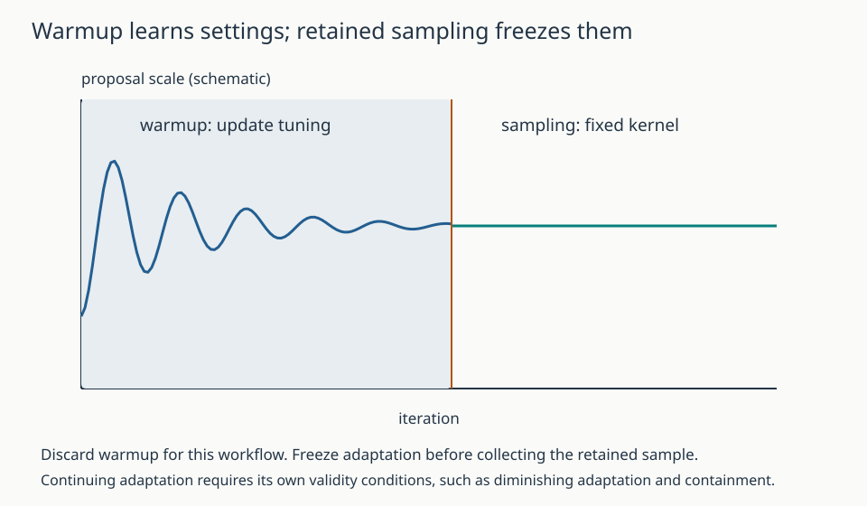

# 15. Adaptive MCMC and warmup

## Learning goals and prerequisites

A proposal that fits the target can save hours of computation. Unfortunately, the target covariance and useful jump size are often unknown until we have sampled. Adaptive MCMC uses the trajectory to learn these settings. This introduces feedback: past positions determine future transitions, and those transitions determine which positions become available for learning.

By the end of this chapter, you should be able to explain why individually valid kernels can become invalid when selected adaptively, implement a finite warmup followed by a frozen sampler, and distinguish diminishing adaptation from containment. You should also be able to interpret acceptance tuning and empirical covariance learning without treating either as a convergence certificate.

The prerequisites are [Metropolis–Hastings](09-metropolis-hastings.md), [kernel comparison](12-kernel-design.md), and [Monte Carlo error](13-mc-error.md), with the convergence distinctions of [Chapter 8](08-convergence.md). Covariance matrices and conditional probability provide the mathematical language. The main experiment uses only standard-library Python.

## 15.1 Learning the algorithm while running it

Let $\pi$ be a fixed target distribution and let $\{P_\gamma:\gamma\in\mathcal G\}$ be a family of transition kernels. The setting $\gamma$ might contain a proposal scale, a covariance matrix, or mixture weights. Suppose each fixed kernel preserves the same target:

$$
\pi P_\gamma=\pi.
$$

An adaptive algorithm maintains both a position $X_n$ and settings $\Gamma_n$. If $\mathcal F_n$ contains all information available before the next transition, its defining update is

$$
\Pr(X_{n+1}\in B\mid\mathcal F_n)=P_{\Gamma_n}(X_n,B).
$$

The settings for the following transition may depend on the new position, the acceptance decision, and stored summaries. Positions alone generally cease to form a homogeneous Markov chain. Including the current scale is not necessarily enough to recover a Markov description: an empirical covariance update also needs its running mean, centered sum of products, and observation count.

For random-walk Metropolis, consider proposals $Y=X+sLZ$, where $Z\sim N(0,I)$ and $LL^\mathsf T=C$. With $s,C$ held fixed, the proposal is symmetric and the usual density-ratio acceptance probability is correct. Adapting these quantities after the transition creates a sequence of such kernels. The unresolved question is whether that whole sequence yields correct inference.

A useful implementation discipline is to separate three operations: transition under current settings, summarize the resulting state, and choose settings for the next transition. Changing the covariance halfway through an acceptance calculation would define a different algorithm whose proposal probabilities require a fresh derivation.

## 15.2 Worked example: correct pieces, incorrect feedback

Consider the uniform target on $\{0,1\}$. For every $0<a<1$, the matrix

$$
P_a=\begin{pmatrix}1-a&a\\a&1-a\end{pmatrix}
$$

is irreducible, aperiodic, and preserves $(1/2,1/2)$. Its rows and columns sum to one, so invariance follows directly.

Now choose $a=0.9$ whenever the current state is zero and $a=0.1$ whenever it is one. At zero, the next state is one with probability $0.9$. At one, the next state remains one with probability $0.9$. The complete transition matrix is therefore

$$
Q=\begin{pmatrix}0.1&0.9\\0.1&0.9\end{pmatrix}.
$$

Multiplying the desired initial distribution by $Q$ gives

$$
(1/2,1/2)Q=(0.1,0.9).
$$

Thus even starting exactly at the target does not protect the algorithm. If a stationary distribution puts mass $p$ at one, its stationarity equation is $p=0.9(1-p)+0.9p$, hence $p=0.9$. The script accompanying this chapter obtains a fraction of ones of $0.8993$ in 20,000 seeded iterations.

The problem is visible in the row selection. Invariance of $P_{0.9}$ uses both rows of that matrix together; the adaptive rule keeps only its first row. It then combines that row with the second row of a different matrix. There is no reason for the resulting columns to sum to one.

This example happens to remain a homogeneous Markov chain because the setting depends only on the current state. More elaborate historical dependence is unnecessary for failure. It also clarifies the difference from a deliberately state-dependent Metropolis proposal: that can be valid when its full forward and reverse proposal densities appear in the acceptance ratio. Simply borrowing the acceptance rule for a fixed symmetric proposal does not establish that validity.

## 15.3 Finite warmup creates a useful boundary

A practical construction is to adapt for a predetermined finite number $T$ of transitions, then freeze the resulting settings $\Gamma_T$. Warmup positions train the proposal; production positions estimate expectations. Future transitions use fresh randomness and the fixed kernel $P_{\Gamma_T}$.



Here is a precise marginal-convergence argument. Assume the family is measurable, the relevant total variation distances are measurable, and for every state and setting that warmup can produce,

$$
\lim_{m\to\infty}\|P_\gamma^m(x,\cdot)-\pi\|_{\rm TV}=0.
$$

Conditional on the warmup history, $(X_T,\Gamma_T)$ is fixed and the production law after $m$ steps is $P_{\Gamma_T}^m(X_T,\cdot)$. Convexity of total variation gives

$$
\|\mathcal L(X_{T+m})-\pi\|_{\rm TV}
\leq
\mathbb E\!\left[\|P_{\Gamma_T}^m(X_T,\cdot)-\pi\|_{\rm TV}\right].
$$

The integrand tends to zero almost surely and lies between zero and one. Bounded convergence proves the claim. This is the finite-adaptation principle discussed by [Roberts and Rosenthal](https://www2.stat.duke.edu/~scs/Courses/Stat376/Papers/AdaptiveMC/RobRosCouplingErgod2007.pdf).

Notice what the argument allows. Warmup may be inefficient, and its selected covariance may be inaccurate. As long as the frozen kernel has the stipulated convergence property, the eventual marginal limit is still correct. But a poor covariance can make “eventual” far beyond the available budget. Freezing removes one theoretical complication; it cannot manufacture exploration.

Also, $X_T$ is not generally a stationary draw. Discarding warmup does not remove all initialization error, and an additional settling interval has no universal sufficient length. Laws of large numbers and central limit theorems require their own hypotheses. Conditional CLTs may even have variances that depend on the learned settings. A practical error estimate must be based on production behavior, using the qualifications in Chapter 13.

## 15.4 Continuing adaptation needs two kinds of control

Some algorithms adapt indefinitely. To state one sufficient result, define total variation by $\|\mu-\nu\|_{\rm TV}=\sup_B|\mu(B)-\nu(B)|$. Assume a measurable common-target kernel family on a standard Borel state space, with every frozen kernel converging to $\pi$ from every state. Assume also that the suprema and mixing-time variables below are measurable and that the conditional update is the one in Section 15.1.

**Diminishing adaptation** requires

$$
D_n=\sup_x\|P_{\Gamma_{n+1}}(x,\cdot)-P_{\Gamma_n}(x,\cdot)\|_{\rm TV}
\longrightarrow0
\quad\text{in probability}.
$$

For $\epsilon>0$, define the frozen mixing time

$$
M_\epsilon(x,\gamma)=\inf\{m\geq1:
\|P_\gamma^m(x,\cdot)-\pi\|_{\rm TV}\leq\epsilon\}.
$$

**Containment** requires that, for every $\epsilon,\delta>0$, there is finite $K$ such that

$$
\sup_{n\geq0}\Pr\{M_\epsilon(X_n,\Gamma_n)>K\}<\delta.
$$

For a fixed initial condition, these two conditions imply $\|\mathcal L(X_n)-\pi\|_{\rm TV}\to0$. This is the diminishing-adaptation and containment result of [Roberts and Rosenthal](https://www2.stat.duke.edu/~scs/Courses/Stat376/Papers/AdaptiveMC/RobRosCouplingErgod2007.pdf). It is a sufficient marginal-convergence theorem, not a general adaptive CLT.

There are two different comparisons here. Diminishing adaptation compares adjacent algorithms. Containment compares each current algorithm with the target it must explore. Their distinction is essential: two nearly identical kernels may both move almost nowhere.

For intuition, imagine freezing the kernel for a finite window of future steps. Containment supplies a window length that is usually long enough to mix. Diminishing adaptation makes the actual evolving sampler increasingly close to that frozen experiment over such a fixed window. The theorem uses both controls to join these comparisons; they are sufficient conditions, not a claim that every convergent adaptive algorithm must satisfy them. This is an intuition for the coupling argument rather than a substitute for its technical proof.

A small change in a parameter does not automatically bound $D_n$. Such a deduction needs continuity of the map from parameters to kernels in an appropriate uniform metric. Similarly, clipping a scale to an interval does not by itself establish containment on an unbounded state space. The chain's position and other learned settings still matter.

## 15.5 Worked example: adaptation can diminish into immobility

The following deterministic schedule isolates the second condition. Let $\Pi$ be the two-state matrix with every row equal to $(1/2,1/2)$, and use

$$
P_n=(1-a_n)I+a_n\Pi,
\qquad a_n=\frac{1}{(n+2)^2},\qquad n\geq0.
$$

A step either stays put or refreshes from the target. Every frozen $P_n$ is irreducible, aperiodic, and target invariant. Successive kernels are uniformly close because

$$
\sup_x\|P_{n+1}(x,\cdot)-P_n(x,\cdot)\|_{\rm TV}
=\frac{|a_{n+1}-a_n|}{2}\longrightarrow0.
$$

Starting from zero, any refresh erases the initial distributional error. If no refresh occurs, that error survives. Independence of the refresh decisions therefore yields

$$
\|\mathcal L(X_n)-\pi\|_{\rm TV}
=\frac12\prod_{k=0}^{n-1}(1-a_k).
$$

This product can be evaluated exactly:

$$
\begin{aligned}
\prod_{k=0}^{n-1}\left(1-\frac1{(k+2)^2}\right)
&=\prod_{k=0}^{n-1}\frac{(k+1)(k+3)}{(k+2)^2}\\
&=\frac1{n+1}\frac{n+2}{2}
=\frac{n+2}{2(n+1)}.
\end{aligned}
$$

Consequently the distance tends to $1/4$, rather than zero. At $n=1000$ it is approximately $0.250250$. Increasing the run length cannot remove this residual error.

Containment fails explicitly. From either starting state, the frozen kernel with refresh probability $a_n$ has distance $\tfrac12(1-a_n)^m$ after $m$ steps. For $0<\epsilon<1/2$, its mixing time grows approximately as $\log(1/(2\epsilon))/a_n$, which diverges quadratically with $n$.

If instead the initial distribution were $\pi$, every scheduled transition would preserve it. The example therefore distinguishes invariance from convergence starting elsewhere. It also shows why “the settings have stabilized” is ambiguous: a nearly motionless algorithm can look extremely stable.

### 15.5.1 A slower schedule fixes marginals but can still spoil averages

Change just the refresh probability to $a_n=1/(n+2)$. From initial state zero, the same argument gives

$$
\|\mathcal L(X_n)-\pi\|_{\rm TV}
=\frac12\prod_{k=0}^{n-1}\frac{k+1}{k+2}
=\frac1{2(n+1)}\longrightarrow0.
$$

Diminishing adaptation still holds. Containment still fails, since the frozen mixing time grows proportionally to $n$. Thus containment is not necessary for marginal convergence in this particular schedule. The distinction between convergence of draws and a law of large numbers is central to [Roberts and Rosenthal, Section 9](https://www2.stat.duke.edu/~scs/Courses/Stat376/Papers/AdaptiveMC/RobRosCouplingErgod2007.pdf); the following exact calculation makes it visible without invoking an adaptive limit theorem.

Now initialize $X_0\sim\pi$, and define $\bar X_N=N^{-1}\sum_{i=0}^{N-1}X_i$. Every marginal is exactly uniform. For $0\leq i<j$, a refresh between times $i$ and $j$ makes $X_j$ independent of $X_i$. Otherwise they are equal. Since $\operatorname{Var}(X_i)=1/4$,

$$
\operatorname{Cov}(X_i,X_j)
=\frac14\prod_{k=i}^{j-1}(1-a_k)
=\frac14\frac{i+1}{j+1}.
$$

Summing these covariances gives

$$
\begin{aligned}
\operatorname{Var}(\bar X_N)
&=\frac1{4N^2}\left[N+2\sum_{j=1}^{N-1}
\sum_{i=0}^{j-1}\frac{i+1}{j+1}\right]\\
&=\frac1{4N^2}\left[N+\sum_{j=1}^{N-1}j\right]
=\frac{N+1}{8N}\longrightarrow\frac18.
\end{aligned}
$$

The estimate is unbiased, but its uncertainty does not vanish. Because $0\leq\bar X_N\leq1$, convergence in probability to $1/2$ would force its mean squared error to vanish: for any $\delta>0$, that error is at most $\delta^2+\tfrac14\Pr(|\bar X_N-1/2|>\delta)$. The variance limit therefore rules out even a weak law of large numbers. This is a failure of consistent estimation despite exact target marginals.

The mechanism is growing residence times. With $N=2m$, the probability of no refresh during the final $m$ transitions is $(m+1)/(2m+1)$, tending to one half. Increasing the budget leaves a substantial chance that half the run contributes repeated observations. The script computes both scheduled marginal error from zero and the variance of averages initialized from $\pi$; these are explicitly different initializations. For the harmonic schedule at $N=1000$, the two quantities are $0.0004995$ and $0.125125$.

There is a simple repair **for this refresh family**. Impose $a_n\geq a_{\min}>0$ in a deterministic schedule. Then the marginal error is at most $\tfrac12(1-a_{\min})^n$, and the covariance calculation gives

$$
\operatorname{Var}(\bar X_N)
\leq\frac1{4N}\left[1+2\sum_{k=1}^{\infty}(1-a_{\min})^k\right]
=\frac{2-a_{\min}}{4a_{\min}N}.
$$

The stationary-start mean now converges in mean square. The script compares the two decaying schedules with $a_n=\max(0.05,1/(n+2))$. This lower bound controls actual refresh probability; a lower bound on a proposal scale in a general Metropolis sampler supplies no such uniform guarantee. The positive example explains what a successful safeguard must accomplish, without treating a tuning constraint as a general proof.

## 15.6 Learning a proposal scale

Write $\ell_n=\log s_n$ so any finite update gives a positive scale. A simple feedback rule is

$$
\ell_{n+1}=\ell_n+\eta_n(A_n-a_\star),
$$

where $A_n$ records acceptance of the transition from $X_n$ and $a_\star$ is the desired acceptance rate. Frequent acceptance raises the scale, making future proposals more ambitious. Frequent rejection lowers it.

For example, with $s_n=1$, $\eta_n=0.1$, and $a_\star=0.3$, an accepted proposal gives $s_{n+1}=\exp(0.07)\approx1.073$. A rejection instead gives $s_{n+1}=\exp(-0.03)\approx0.970$. Replacing the indicator by the computed acceptance probability can reduce the extra noise from the accept/reject draw.

Under a stationary frozen kernel, define $h(\ell)=\mathbb E_\pi[A\mid\ell]-a_\star$. The update seeks a zero of this mean response. This is a stochastic-approximation viewpoint, developed for adaptive MCMC in [Andrieu and Thoms](https://people.eecs.berkeley.edu/~jordan/sail/readings/andrieu-thoms.pdf). The familiar gain conditions are

$$
\sum_n\eta_n=\infty,
\qquad
\sum_n\eta_n^2<\infty.
$$

For $\eta_n=c(n+n_0)^{-\kappa}$, positive $c,n_0$ and $1/2<\kappa\leq1$ satisfy them. The first condition retains enough cumulative movement to correct an initial mistake; the second controls accumulated noise in classical settings. Here the observations are dependent and often nonstationary. Root stability, regularity, boundedness, and control of Markovian noise remain necessary for a theorem about the learning rule.

Our finite-warmup script clips $s$ to $[0.02,20]$ and chooses $a_\star=0.3$ for illustration. That value is not a universal optimum. In particular, meeting an acceptance target cannot identify how much the chain travels along every important direction. The optimal-scaling assumptions discussed in Chapter 12 should accompany any recommended number.

## 15.7 Learning shape from occupation statistics

A scalar cannot rotate an elongated proposal. To learn shape, maintain the mean $m_n$ and centered sum of products $S_n$ of observed states. With $m_0=0$, $S_0=0$, and $n$ counting observations, update

$$
\begin{aligned}
\delta_n&=x_n-m_{n-1},\\
m_n&=m_{n-1}+\delta_n/n,\\
S_n&=S_{n-1}+\delta_n(x_n-m_n)^\mathsf T.
\end{aligned}
$$

For $n>1$, $\widehat\Sigma_n=S_n/(n-1)$ is exactly the usual sample covariance of those observations. The identity follows by expanding each centered observation around the new mean; the mean-shift terms combine into the displayed rank-one correction. It avoids subtracting two large, nearly equal raw second moments.

Include the state after every transition, including repetitions caused by rejection. These repetitions record residence time. An accepted-moves-only sequence changes the weighting: states with low departure probability are underrepresented in that jump chain. Its covariance generally estimates a different distribution's shape.

A proposal covariance can then be

$$
C_n=s_n^2(\widehat\Sigma_n+\varepsilon I),\qquad\varepsilon>0.
$$

The ridge makes the matrix positive definite even when observations lie on a line. It also changes the learned geometry, especially along directions whose variance is comparable to $\varepsilon$. Choose it in meaningful coordinate units; standardizing coordinates may be necessary before a common ridge makes sense.

Learning proposal covariance from the trajectory is the central idea of the [adaptive Metropolis algorithm of Haario, Saksman, and Tamminen](https://researchportal.helsinki.fi/en/publications/an-adaptive-metropolis-algorithm/). A ridge is a numerical safeguard, not an ergodicity proof. Unbounded targets require separate assumptions, as emphasized by [Saksman and Vihola's unbounded-domain analysis](https://arxiv.org/abs/0806.2933). We do not invoke their detailed theorem for arbitrary targets here.

Serial dependence also matters statistically. The formula for $\widehat\Sigma_n$ is algebraically correct, but its observations are not independent; the denominator $n-1$ does not make it an unbiased target-covariance estimator for a transient dependent trajectory. Its accuracy depends on exploration.

## 15.8 A complete correlated-normal experiment

Consider $X\sim N(0,\Sigma)$ with

$$
\Sigma=\begin{pmatrix}1&0.95\\0.95&1\end{pmatrix}.
$$

The eigenvectors point along $(1,1)$ and $(1,-1)$, with eigenvalues $1.95$ and $0.05$. The ratio of principal standard deviations is $\sqrt{39}\approx6.245$. An isotropic proposal must compromise between crossing the narrow direction and advancing along the broad one.

For two estimands, define $f_+(x)=x_1+x_2$ and $f_-(x)=x_1-x_2$. Both expectations are zero. Directly expanding their variances gives

$$
\operatorname{Var}_\pi(f_+)=2+2(0.95)=3.9,
\qquad
\operatorname{Var}_\pi(f_-)=2-2(0.95)=0.1.
$$

These known answers let us assess two geometrically different tasks. Since the proposal is symmetric for fixed settings, its acceptance probability is $\min(1,\exp(\log\pi(y)-\log\pi(x)))$, using

$$
\log\pi(x)=\text{constant}
-\frac{x_1^2-1.9x_1x_2+x_2^2}{2(1-0.95^2)}.
$$

Run [the companion example](examples/ch15.py) with `python examples/ch15.py`. It compares fixed isotropic scale $s=1$, scale-only warmup, and scale-plus-covariance warmup. Each run spends 5,000 transitions on warmup and 25,000 on production. All begin at zero. Each method uses seeds 151–154; reusing seed labels across methods makes comparisons paired, while the four streams within a method are distinct.

The covariance method collects observations after the first 500 transitions, begins covariance updates once 200 observations are available, and updates every 50 transitions through warmup transition 4,000. It uses ridge $0.01I$. Scale learning continues until transition 5,000 with gain $0.8(i+10)^{-0.6}$ for zero-based iteration $i$. The final thousand transitions let scale respond to the now fixed shape.

```text
initialize position, scale, identity shape, and empty summaries
for each warmup transition:
    propose using current scale and shape
    accept or reject using that fixed proposal's MH rule
    store resulting position, including repeats
    update scale for the next transition
    during the covariance window, update position summaries
    at scheduled boundaries, update shape for the next transition
freeze scale and shape
for each production transition:
    run the frozen MH kernel
    store resulting position
```

For seed 151, covariance warmup learns shape entries approximately $(1.033,0.980,1.032)$ and scale $1.969$. These are the three distinct entries of the regularized shape matrix; the actual proposal covariance multiplies them by $s^2$. Production acceptance is $0.292$, compared with $0.235$ for the fixed baseline and $0.302$ after scale-only warmup.

Across four runs, the root mean squared errors are:

| Method | RMSE for $\mathbb E[f_+]$ | RMSE for $\mathbb E[f_-]$ |
|---|---:|---:|
| Fixed isotropic | 0.0644 | 0.0037 |
| Scale warmup | 0.0779 | 0.0033 |
| Covariance warmup | 0.0415 | 0.0052 |

Covariance learning helps the broad direction in this experiment, while its narrow-direction error is slightly worse. Four replicates give a noisy comparison, not a universal ranking. Scale tuning gets close to its acceptance objective without improving the broad-direction estimate.

The script also prints marginal means and nonoverlapping batch-means MCSEs. It uses 200 consecutive batches of 125 draws, so both the reported mean and MCSE use all 25,000 production draws. This is a teaching estimator, not a complete production diagnostic; its fixed finite-run batch choice does not claim asymptotic consistency as the run length changes. Using the known target variance, it reports estimated ESS per thousand **total** proposals as

$$
\frac{1000\operatorname{Var}_\pi(f)}{(T+N)\widehat{\operatorname{MCSE}}^2}.
$$

This charges warmup to the budget. It counts target evaluations approximately, not elapsed time or covariance arithmetic. The fixed baseline discards the same initial 5,000 steps for a transparent comparison; a separate study could optimize that allocation. Uncertainty in batch MCSE and initialization error still limit interpretation.

## 15.9 Windows, geometry, and the interactive lab

Fast settings such as scale can react to individual acceptance decisions. Covariance needs observations spanning the target. Combining them without a schedule can create interference: a shape change alters acceptance, and the scale controller then responds to that change.

A useful schedule therefore has initial scale learning, a longer covariance-learning period, and final scale readjustment. Expanding covariance windows devote more observations to later, better informed estimates; resetting summaries can reduce contamination from early transient positions. Resetting also throws away information, so extremely short windows can produce noisy geometry. Stan documents a fast/slow/fast warmup organization for HMC in its [official sampling manual](https://mc-stan.org/docs/reference-manual/mcmc.html). Our Metropolis example illustrates the scheduling idea with a simpler single covariance window. HMC step-size learning is developed further in [Chapter 21](21-nuts.md).

A global covariance matrix can rotate and stretch an ellipse. It cannot straighten a curved valley, eliminate a funnel, or learn a mode never visited. These failures motivate [reparameterization](16-geometry.md) and [tempering](25-tempering.md). More adaptation can sharpen a misleading within-mode estimate if exploration remains local.

In the following Metropolis lab, compare tiny, moderate, and excessive proposal scales. Before each run, predict acceptance and visible travel distance. Then compare how quickly the trajectory moves through the displayed target. Look especially for high acceptance accompanied by tiny movements.

<div class="mcmc-lab" data-lab="metropolis"></div>

The lab targets a one-dimensional standard normal, starts at zero, and removes no warmup. Its controls change proposal standard deviation, sample count, and seed; it displays a trajectory, histogram, acceptance, and lag-one correlation. It demonstrates the tuning objective for fixed proposals. It does not implement this chapter's covariance warmup or verify containment. Use the executable experiment to examine actual learned settings.

## 15.10 Reporting adaptation honestly

A reproducible report states warmup and production lengths, initial settings, gain schedule, clipping bounds, covariance windows, regularization, final settings, and random seeds. Each independent chain should have its own warmup summaries. Sharing learned information creates dependence between runs; it must be described before interpreting them as independent replications.

Report acceptance alongside estimand-specific precision and exploration evidence. A flat scale trace says the rule changes slowly. A plausible covariance says the observed positions have a plausible shape. Neither statement shows that unvisited regions carry negligible probability. Diagnostics from [Chapter 14](14-diagnostics.md) can expose problems but do not prove convergence.

Finally, separate the errors involved. Frozen Metropolis has the specified target exactly as its invariant distribution in exact arithmetic. Finite production still has initialization error and Monte Carlo error. Learning an imperfect covariance mainly affects efficiency once it is frozen; it does not by itself change that invariant distribution. Numerical implementation errors and an incorrectly specified statistical model remain separate concerns. This construction introduces no intentional discretization approximation to the target.

## 15.11 Exercises with worked solutions

<div class="exercise" id="mcmc-15-adaptation-ex-1">

### Exercise 1: audit the selected rows

Verify uniform invariance for $P_{0.1}$ and $P_{0.9}$, then derive the stationary distribution when the setting is selected as in Section 15.2. Does starting uniformly help?

<details>
<summary>Solution</summary>

For either matrix, multiplying $(1/2,1/2)$ produces $(1/2,1/2)$ because both column sums are one. The selected rows form $Q$ with both rows $(0.1,0.9)$. Therefore every starting distribution becomes $(0.1,0.9)$ after one transition, including the uniform distribution. The unique stationary mass at one is $0.9$.

</details>

</div>

<div class="exercise" id="mcmc-15-adaptation-ex-2">

### Exercise 2: a persistent initial error

For the refresh schedule $a_n=(n+2)^{-2}$, derive the exact total variation distance at time $n$ from initial state zero. What happens from a uniform initial state?

<details>
<summary>Solution</summary>

Without any refresh, the initial error survives; after a refresh, the marginal is uniform. The no-refresh probability telescopes to $(n+2)/(2(n+1))$. Multiplying by the initial distance $1/2$ gives $(n+2)/(4(n+1))$, tending to $1/4$. From a uniform initial state, every step preserves uniformity and the distance is always zero. Thus preservation and convergence from an arbitrary start are different properties.

</details>

</div>

<div class="exercise" id="mcmc-15-adaptation-ex-3">

### Exercise 3: check the gains

Which of $n^{-0.4}$, $n^{-0.7}$, $n^{-1}$, and $n^{-1.2}$ satisfy both usual gain-sum conditions? What conclusion about adaptive ergodicity follows?

<details>
<summary>Solution</summary>

A power series $\sum n^{-p}$ converges exactly when $p>1$. Therefore $\sum\eta_n$ diverges for exponents at most one, and $\sum\eta_n^2$ converges for exponents greater than one half. The valid choices are $0.7$ and $1$. This establishes only the two sum conditions; it establishes neither containment nor a stochastic-approximation convergence theorem.

</details>

</div>

<div class="exercise" id="mcmc-15-adaptation-ex-4">

### Exercise 4: compute online covariance

Use the recursion on $(0,0),(1,1),(2,0)$ and report the final mean and sample covariance.

<details>
<summary>Solution</summary>

After the first point, $m_1=(0,0)$ and $S_1=0$. After the second, $m_2=(1/2,1/2)$ and all entries of $S_2$ equal $1/2$. For the third point, $\delta_3=(3/2,-1/2)$ and $m_3=(1,1/3)$. The correction has entries $3/2,-1/2,-1/2,1/6$, giving $S_3=\operatorname{diag}(2,2/3)$. Dividing by two gives $\widehat\Sigma_3=\operatorname{diag}(1,1/3)$.

</details>

</div>

<div class="exercise" id="mcmc-15-adaptation-ex-5">

### Exercise 5: why keep rejected repeats?

Suppose a stationary chain has departure probability $r(x)$ at state $x$. Explain how keeping only actual departures changes occupation weights, and why this matters for covariance learning.

<details>
<summary>Solution</summary>

Over a long stationary run, the frequency of departures from a region is weighted by $\pi(dx)r(x)$. Subject to the usual existence and irreducibility conditions for the jump chain, its invariant distribution is proportional to this measure, not generally $\pi(dx)$. Low-departure states are underweighted when repetitions are removed. Covariance learning for $\pi$ should use the full sequence of occupied states, or an appropriately residence-time-weighted equivalent.

</details>

</div>

<div class="exercise" id="mcmc-15-adaptation-ex-6">

### Exercise 6: warmup inside one mixture component

Design a four-chain check for the symmetric mixture $\tfrac12N(-a,1)+\tfrac12N(a,1)$ with $a\gg1$, when all initial warmups lie near $-a$. Use the indicator $1\{x<0\}$ to track occupancy of the left region. Explain what you would report and change if acceptance looks good but no chain crosses zero.

<details>
<summary>Solution</summary>

Record the sign indicator as well as coordinates and learned covariances. Symmetry and the absence of a point mass at zero give $\Pr_\pi(X<0)=1/2$ exactly. If every indicator remains “left,” estimated occupancy is one. The learned covariance describes only the visited region, and a plausible acceptance rate cannot repair missing global exploration. Repeat with dispersed starts in both components to reveal disagreement, then investigate a method capable of intercomponent movement, such as suitable tempering. Dispersed starts alone do not guarantee correct mixing. Compare occupancy precision and transitions under a budget that includes warmup and all auxiliary chains.

</details>

</div>

## Key takeaways and sources

Adaptation changes the complete sampling process. Finite warmup followed by a genuinely frozen ergodic kernel gives a simple route back to fixed-kernel convergence theory, while continuing adaptation requires additional control. Diminishing adaptation prevents persistent disruption; containment prevents the chosen kernels from becoming arbitrarily ineffective along the run. Neither an acceptance target nor covariance regularization establishes both conditions.

The primary references linked above are Roberts and Rosenthal's *Coupling and Ergodicity of Adaptive MCMC* (2007), Andrieu and Thoms's *A Tutorial on Adaptive MCMC* (2008), Haario, Saksman, and Tamminen's *An Adaptive Metropolis Algorithm* (2001), and Saksman and Vihola's *On the Ergodicity of the Adaptive Metropolis Algorithm on Unbounded Domains* (2010). The Helsinki record supports the historical attribution; the original Haario paper was not inspected for theorem hypotheses. The official Stan manual supplies the software warmup comparison. The exact two-state calculations and executable Gaussian comparison provide self-contained ways to examine the chapter's central claims.
