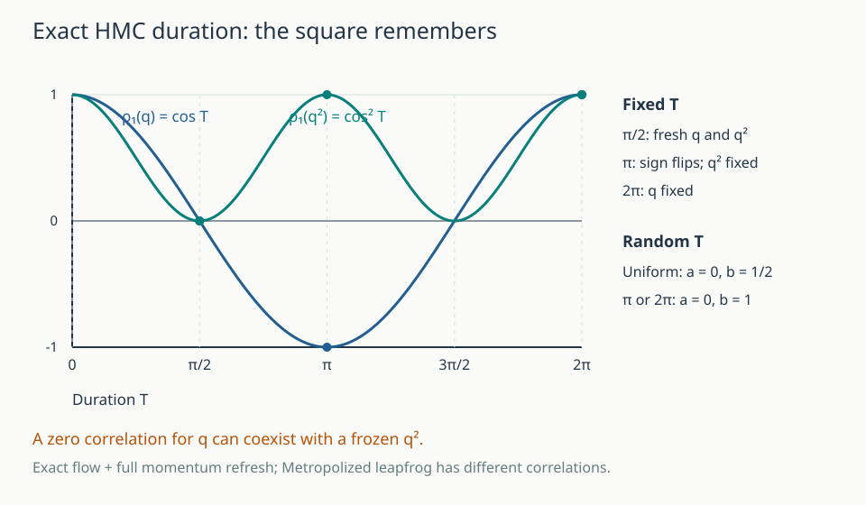

# 20. Hamiltonian Monte Carlo

**Learning goals.** By the end of this chapter you should be able to construct the Hamiltonian auxiliary target, derive leapfrog, prove why its momentum-flipped proposal admits a Metropolis correction, implement fixed-length HMC, and diagnose a trajectory that has high acceptance yet little movement.

**Prerequisites.** Gaussian densities and transformations ([Chapter 02](02-probability.md)); stable log arithmetic ([Chapter 04](04-numerics.md)); invariance and Metropolis–Hastings ([Chapters 07–09](09-metropolis-hastings.md)); whitening ([Chapter 16](16-geometry.md)). [Chapter 19](19-langevin.md) supplies a useful comparison with single gradient-guided moves.

## 20.1 Why add a momentum?

Our objective is an expectation, such as $E_\pi[f(q)]$, under a target density $\pi$. Optimization would seek only a mode. A random-walk proposal can sample, but on a long narrow Gaussian contour it repeatedly proposes across the narrow direction and either rejects or uses a tiny step. A gradient can point toward high density, yet following it alone would collapse toward a mode. Hamiltonian Monte Carlo (HMC) instead attaches a *fictitious momentum* to each position. It uses the gradient to bend a moving trajectory around the target's contours and then applies an accept/reject correction. The momentum is a computational variable, not an unknown physical quantity in the statistical model. This is another use of an expanded target, as in [Chapter 11](11-slice.md). [Neal's original tutorial](https://glizen.com/radfordneal/ham-mcmc.abstract.html) develops this combination of distant proposals and volume-preserving dynamics.

Time $t$ along one trajectory is not the Markov chain iteration number. One iteration draws a momentum, follows a trajectory for an integration time $\tau$, and records one final position (or the old position on rejection). The intermediate integration points are numerical construction points. Recording all of them as if they were separate posterior draws would change the sampling scheme and its dependence structure.

There is a useful geometric distinction between a force and a proposal. The force $-\nabla U$ points uphill in probability, toward smaller $U$, but HMC does not keep following that direction. Momentum carries the position past the high-density region; the force then turns it back. On an elliptical Gaussian contour, this produces an orbit whose successive points can be far apart in position while remaining at similar joint energy. A random walk must find such distant, compatible points by chance. The trajectory builds them using local gradient information. This advantage is conditional on gradients being reasonably cheap and on the numerical path following the target's geometry accurately enough to avoid frequent rejection.

## 20.2 The expanded density and mass convention

Let $q\in\mathbb R^d$ have a proper density $\pi(q)=Z^{-1}\exp[-U(q)]$. Assume here that $U$ is differentiable wherever proposals travel. Fix a constant symmetric positive-definite matrix $M$. **Throughout this chapter, $M$ is the covariance of momentum**:

$$
p\mid q\sim N(0,M),\qquad K(p)=\tfrac12p^\mathsf{T}M^{-1}p,\qquad H(q,p)=U(q)+K(p).
$$

Thus the joint target is $\rho(q,p)=\pi(q)\varphi_M(p)\propto\exp[-H(q,p)]$. Gaussian normalization, including $|M|^{-1/2}$, is constant in $(q,p)$ and cancels from energy differences. Marginalization is immediate:

$$
\int_{\mathbb R^d}\rho(q,p)\,dp
=\pi(q)\int_{\mathbb R^d}\varphi_M(p)\,dp
=\pi(q).
$$

Drawing $p$ afresh from $N(0,M)$ is a conditional update of this joint law: it preserves $q$ and supplies exactly the correct conditional momentum. It also changes the energy $H$, allowing the chain to move among energy levels. A single exactly energy-conserving orbit, with no refreshments, could not generally explore the full joint distribution. Some software calls $M^{-1}$ the *metric*; always check which matrix is a covariance before using a mass setting. The [Stan reference manual](https://mc-stan.org/docs/reference-manual/mcmc.html) uses the momentum construction and discusses mass matrices.

For a fixed $q$, the resampled kinetic energy $K(p)$ varies from one iteration to the next. That random energy is the resource a trajectory can exchange with potential energy $U(q)$: it may climb away from a mode while slowing down, then descend while speeding up. The Gaussian momentum law is convenient because $K$ is quadratic and velocity is linear in $p$; it is not a claim that the target positions are Gaussian. Choosing a different fixed positive-definite $M$ changes the computational motion, while the $q$ marginal remains $\pi$ when the corresponding kinetic energy and momentum draw are changed together. Mixing a momentum draw from one mass with velocity from another breaks the intended Hamiltonian construction.

## 20.3 What exact Hamiltonian flow gives us

Hamilton's equations for this separable energy are

$$
\dot q=\nabla_pH=M^{-1}p,\qquad
\dot p=-\nabla_qH=-\nabla U(q).
$$

Momentum sets velocity; the negative gradient bends it. Along a differentiable solution, the chain rule gives

$$
\frac{dH}{dt}=(\nabla U)^\mathsf{T}M^{-1}p
+(M^{-1}p)^\mathsf{T}(-\nabla U)=0.
$$

The flow's vector field also has zero divergence: $\nabla_q\cdot(M^{-1}p)+\nabla_p\cdot(-\nabla U)=0$. The first term has no $q$ dependence and the second no $p$ dependence. If $U$ is sufficiently smooth and the solution exists throughout the chosen time interval, Liouville's theorem says this flow preserves phase-space volume. Conserving both $H$ and volume makes $\rho\propto e^{-H}$ invariant under exact flow. For example, $U\in C^2$ gives a locally regular vector field; global claims additionally need a nonexplosion condition, such as compact energy sublevel sets for the energies used.

These properties establish invariance, not convergence of positions from every start. A fixed travel time can repeatedly return close to its starting location. Momentum refresh reduces this risk but does not make every fixed-length choice effective. Moreover, except for simple targets, exact flow is unavailable; numerical integration must preserve enough structure to support a valid correction. [Betancourt's conceptual treatment](https://arxiv.org/abs/1701.02434) provides a broader account of why trajectories can explore efficiently and where that intuition fails.

## 20.4 Leapfrog from reversible shears

For step size $\epsilon>0$, leapfrog applies a half *kick*, a full *drift*, and another half kick:

$$
\begin{aligned}
p_{1/2}&=p_0-\frac{\epsilon}{2}\nabla U(q_0),\\
q_1&=q_0+\epsilon M^{-1}p_{1/2},\\
p_1&=p_{1/2}-\frac{\epsilon}{2}\nabla U(q_1).
\end{aligned}
$$

Why use these three particular maps? A kick maps $(q,p)$ to $(q,p-c\nabla U(q))$; its Jacobian is block triangular with identity blocks on the diagonal. A drift maps $(q,p)$ to $(q+cM^{-1}p,p)$ and has the same determinant. Each determinant is one, even though the force bends the overall trajectory. Therefore a leapfrog step $\Phi_\epsilon$ and any fixed number $L$ of steps preserve volume exactly in exact arithmetic.

Each kick or drift is inverted by changing $c$ to $-c$. Because the outer kicks have the same half size, reversing the order gives $\Phi_\epsilon^{-1}=\Phi_{-\epsilon}$. This symmetry is as important as volume preservation: an accurate method without a tractable reverse mapping would need a different acceptance construction. Under sufficient smoothness and bounded derivatives in the visited region, leapfrog has local state error $O(\epsilon^3)$ and global state error $O(\epsilon^2)$ over a *fixed* integration time. Those orders say little about arbitrarily long runs or an ill-behaved target. Leapfrog does not conserve $H$ exactly; its finite-step energy error is corrected by Metropolis acceptance. [Neal's chapter](https://glizen.com/radfordneal/ftp/ham-mcmc.pdf) details the integrator and correction.

## 20.5 Why the momentum flip makes a valid proposal

Define the reversal $R(q,p)=(q,-p)$. Since kinetic energy is even, $H(Rz)=H(z)$. Directly reversing the kick–drift–kick sequence shows $R\Phi_\epsilon R=\Phi_\epsilon^{-1}$. With $L$ **fixed independently of the current state**, define $T=R\Phi_\epsilon^L$. Then

$$
T^2=R\Phi_\epsilon^L R\Phi_\epsilon^L
=\Phi_\epsilon^{-L}\Phi_\epsilon^L=I.
$$

So $T$ is an involution: applying the same proposal at its destination returns to its origin. Its absolute Jacobian determinant is one. This lets us write a direct probability-flow argument instead of inserting ordinary continuous proposal densities for a deterministic map. A small volume element $dz$ around $z$ and its image $T(dz)$ have equal volume. The accepted flow from $z$ to $Tz$ is

$$
\rho(z)\alpha(z)\,dz
=\min\{\rho(z),\rho(Tz)\}\,dz,
\quad
\alpha(z)=\min\{1,\exp[H(z)-H(Tz)]\}.
$$

Because $T^2=I$, the reverse accepted flow has the same minimum. Rejected mass remains at its starting state. This proves detailed balance for the corrected proposal on the *extended* space, assuming an exactly computed smooth map and energy. A fresh-momentum update followed by this proposal therefore leaves the joint law invariant by composition; its $q$ marginal is $\pi$. The composition need not itself be reversible for this conclusion.

The volume element in that argument matters. If a deterministic proposal stretched one region and compressed another, the two paired elements would have different volumes, and the ratio would need a Jacobian factor. Leapfrog's shear construction is what removes it. The involution matters separately: it identifies the return move with the *same* deterministic proposal rule. Merely running a volume-preserving numerical integrator forward does not establish this pairing. The final momentum flip is a compact way to build the return path. These are two independent mathematical requirements, not consequences of a small energy error.

If momentum is fully refreshed at each iteration and then discarded, an implementation can omit storing the final flip: it changes neither $q$ nor $K(p)$, hence neither the next position nor acceptance. The proof still uses the flip. With persistent momentum or a state-dependent trajectory length, that simplification and the involution argument need separate analysis. See [Chapter 21](21-nuts.md) for valid dynamic path constructions. Invariance from this proof alone does not imply a useful finite run or convergence from every initial value; those require separate conditions, as the [convergence analysis of Durmus, Moulines, and Saksman](https://arxiv.org/abs/1705.00166) illustrates.

## 20.6 A complete fixed-length transition

Choose $M$, $\epsilon$, and positive integer $L$ before collecting the draws you plan to analyze. Adaptation during warmup can be useful, but the fixed-kernel argument above then applies to the post-warmup phase ([Chapter 15](15-adaptation.md)). The transition is:

```text
Given current q, fixed mass M, step epsilon, and integer L:
    draw p ~ N(0,M)
    save q_old = q and H_old = U(q) + p' M^{-1} p / 2
    repeat L times:
        p <- p - epsilon grad U(q) / 2
        q <- q + epsilon M^{-1} p
        p <- p - epsilon grad U(q) / 2
    p <- -p
    H_new = U(q) + p' M^{-1} p / 2
    if log Uniform(0,1) < min(0, H_old - H_new): return q
    otherwise: return q_old
```

The position saved before integration is essential: a rejection restores the *original* position, not the previous leapfrog point. Consecutive half kicks at an interior position can share a gradient, so an $L$-step path requires $L+1$ distinct gradient evaluations when the initial gradient is computed anew; the example code uses this accounting. A persistent cache can sometimes save the initial evaluation. Potential evaluations and linear algebra also cost time, so gradient count is a useful but incomplete comparison.

An analytic gradient should be compared with centered finite differences at several ordinary points and coordinate scales. Large mismatches signal code or transformation errors; finite differences are only a check, not an exact oracle. The example runs these checks before sampling, validates the dimensions and positive diagonal mass, and requires a finite starting energy. It rejects a proposal if integration overflows or produces nonfinite energy. That is defensive software behavior, not a general proof that finite-precision execution samples exactly from $\pi$. If nonfinite events occur in practice, investigate target gradients, scale, and integration steps; simply counting them as rejections does not repair the underlying computation.

For example, when checking coordinate $j$, compare the supplied derivative with $[U(q+h e_j)-U(q-h e_j)]/(2h)$ for several moderate $h$. Agreement should improve as $h$ decreases until floating-point cancellation begins; one arbitrarily tiny $h$ is a poor check. Also verify that the potential and gradient use the same transformed coordinates and include any Jacobian term required by a model transformation. A sampler can show plausible acceptance even with a consistently wrong potential and gradient: it may be sampling the wrong target very efficiently. The finite-difference check addresses only local calculus, so a known Gaussian target with computable moments is a complementary end-to-end check.

## 20.7 Worked example: oscillator, acceptance, and resonance {#sec-207-worked-example-oscillator-acceptance-and-resonance}

Take $U(q)=q^2/2$ and $M=1$. Hamilton's equations become $\dot q=p$, $\dot p=-q$, so the exact solution from $(q_0,p_0)$ is

$$
q(t)=q_0\cos t+p_0\sin t,\qquad
p(t)=p_0\cos t-q_0\sin t.
$$

After refreshing $p_0\sim N(0,1)$, an exact flow of time $\pi/2$ gives $q'=p_0$: the next position is independent of the current one and already has the right marginal. At time $2\pi$, however, $q'=q_0$ with acceptance one. High acceptance can coexist with *zero* movement. Numerical leapfrog has its own resonance times, so a fixed path should be judged by movement and cost as well as acceptance.

For one leapfrog step with $\epsilon=0.5$ from $(q,p)=(1,0)$, the first half kick gives $p_{1/2}=-0.25$. Drift gives $q'=1+0.5(-0.25)=0.875$. The final half kick gives $p'=-0.25-0.25(0.875)=-0.46875$. The initial energy is $H_0=0.5$ and the proposed energy is

$$
H_1=\tfrac12(0.875)^2+\tfrac12(0.46875)^2
=0.49267578125.
$$

Thus $\min(1,e^{H_0-H_1})=1$ for this proposal. Other proposals can *increase* energy: the correction is needed in both directions. After the final momentum flip, the proposal is $(0.875,0.46875)$; applying the same flipped leapfrog map again returns $(1,0)$ in exact arithmetic.

The leapfrog step is linear for this oscillator:

$$
\begin{pmatrix}q'\\p'\end{pmatrix}
=\begin{pmatrix}
1-\epsilon^2/2 & \epsilon\\
-\epsilon(1-\epsilon^2/4) & 1-\epsilon^2/2
\end{pmatrix}
\begin{pmatrix}q\\p\end{pmatrix}.
$$

Its determinant is one and trace is $2-\epsilon^2$. For $0<\epsilon<2$, eigenvalues lie on the unit circle and the linear recurrence is stable. At $\epsilon=2$ the repeated eigenvalue $-1$ has a nontrivial Jordan block, permitting linear growth; beyond $2$ one eigenvalue has magnitude greater than one. This is a precise stability statement for this oscillator, not a universal HMC step-size bound.

### 20.7.1 Numerical resonance has a different clock

Call this matrix $A_\epsilon$ and define $\theta=\arccos(1-\epsilon^2/2)$ and $s=\sqrt{1-\epsilon^2/4}$ in the stable range. Since $\sin\theta=\epsilon s$, its powers are

$$
A_\epsilon^L=
\begin{pmatrix}
\cos(L\theta)&\sin(L\theta)/s\\
-s\sin(L\theta)&\cos(L\theta)
\end{pmatrix}.
$$

This follows by writing $A_\epsilon=D B_\theta D^{-1}$, where $D=\operatorname{diag}(1,s)$ and $B_\theta$ is the exact oscillator rotation. Consequently the numerical phase is $L\theta$, whereas the intended physical time is $L\epsilon$. Their difference accumulates along the path. For instance, $\epsilon=1$ gives $\theta=\pi/3$: three steps give $A_1^3=-I$ and six give $A_1^6=I$. Both endpoints conserve the true energy exactly and accept with probability one, despite integration times $3$ and $6$ differing from $\pi$ and $2\pi$. With three steps the position changes sign but its square is frozen; with six it does not move at all. Full momentum refresh cannot fix these particular lengths. The example verifies both matrix identities with exact rational arithmetic. This makes the periodicity warning in [Neal, Section 3.2](https://arxiv.org/pdf/1206.1901) concrete for the actual leapfrog map.

## 20.8 Worked example: anisotropic Gaussian and mass

Consider $\pi=N(0,\Sigma)$ with $\Sigma=\operatorname{diag}(1,0.01)$. Its potential, up to a constant, is $U(q)=q_1^2/2+50q_2^2$, and $\nabla U(q)=\Sigma^{-1}q$. Differentiating velocity gives

$$
\ddot q=M^{-1}\dot p=-M^{-1}\Sigma^{-1}q.
$$

With $M=I$, the coordinates have angular frequencies $1$ and $10$. The narrow coordinate oscillates ten times faster, and its leapfrog stability condition requires $\epsilon<2/10=0.2$. A small step dictated by $q_2$ can make progress in $q_1$ expensive.

Under **our covariance convention**, choose $M=\Sigma^{-1}=\operatorname{diag}(1,100)$. Then $M^{-1}\Sigma^{-1}=I$ and both coordinates have unit frequency. Refreshed momentum has standard deviations $(1,10)$, while velocity $M^{-1}p$ has standard deviations $(1,0.1)$, matching the target position scales. Choosing $M=\Sigma$ instead would make the frequencies $(1,100)$: it worsens the mismatch. This is the same geometry correction obtained by whitening coordinates in [Chapter 16](16-geometry.md), expressed through momentum.

The executable [two-dimensional demonstration](examples/ch20.py) uses four seeded chains for each setting and a budget of 96,000 gradient evaluations per setting. It spends $L+1$ gradients per transition, including the initial gradient, with a 10% initial discard. The executed output is:

```text
Identity mass: mass=(1.0, 1.0), epsilon=0.1, L=14, transitions=6400, gradients=96000
  acceptance=0.9214; nonfinite=0
  E[q_j^2] estimates=(1.0069, 0.01041); exact=(1, 0.01)
  mean squared standardized jump=(1.564, 2.846)
  batch MCSE for E[q1], E[q1^2]=(0.01664, 0.01739)
  gradients * MCSE^2=(26.57, 29.02); 80 batches of 72
Matched mass: mass=(1.0, 100.0), epsilon=0.5, L=3, transitions=24000, gradients=96000
  acceptance=0.9676; nonfinite=0
  E[q_j^2] estimates=(1.0093, 0.01025); exact=(1, 0.01)
  mean squared standardized jump=(1.888, 1.893)
  batch MCSE for E[q1], E[q1^2]=(0.00741, 0.00919)
  gradients * MCSE^2=(5.28, 8.11); 80 batches of 270
```

Standardizing each squared jump by its target variance makes the two coordinates comparable. The matched mass permits a larger step and more transitions at equal gradient count; it has balanced movement across coordinates. The identity setting here also moves, and its larger second-coordinate jump per transition does not by itself imply lower Monte Carlo error per gradient. The small moment discrepancies are finite-run error and dependence, not evidence of discretization bias in ideal corrected HMC.

To compare precision for two estimands, the script partitions each retained chain into 20 equal batches without crossing chain boundaries. For each of $q_1$ and $q_1^2$, let $s_b^2$ be the sample variance of the 80 batch means. It reports the approximate MCSE $\sqrt{s_b^2/80}$. This treats long batches as approximately independent and assumes the retained chain is sufficiently close to stationarity; neither assumption follows from using batches. Multiplying MCSE squared by the total gradient budget gives an estimated cost for precision, with smaller values preferable **for the same estimand**. Both comparisons favor the matched setting in this run. Longer runs, other seeds, and different batch lengths could change these noisy estimates; four chains initialized at zero are not a dispersed-start convergence study. See [Chapter 13](13-mc-error.md) for the conditions behind batch means. The target, mass, gradient, and path parameters remain teaching choices.

## 20.9 Choosing $\epsilon$ and $L$

Integration time is $\tau=L\epsilon$. If $\tau$ is too short, trajectories barely move before spending another momentum refresh and acceptance decision. If it is too long, a curved path can return near its start or spend gradients tracing around the same contour. If $\epsilon$ is too large, integration error drives rejection or numerical instability. Shrinking $\epsilon$ without changing $L$ also shrinks $\tau$, so separate these effects when experimenting. A short path and a small step can have near-perfect acceptance while producing highly dependent positions.

One simple way to reduce the risk of a single fixed resonance is to draw $L$ independently of the current $(q,p)$ from a small set of positive integers. Each fixed-$L$ corrected kernel preserves the target, so their state-independent mixture does too. The set must include useful lengths: mixing only $L=3$ and $L=6$ at $\epsilon=1$ in the oscillator still freezes $q^2$. Choosing $L$ using the *starting state or unfinished path* needs a new symmetry and selection argument; applying the fixed-$L$ proof to such a rule is invalid. [Chapter 21](21-nuts.md) handles dynamic HMC constructions. For fair tuning, examine movement and estimated precision per gradient for more than one estimand, including a narrow-direction or tail quantity. Acceptance is a numerical health signal, not the objective.

### 20.9.1 What random integration times do to two estimands {#sec-2091-what-random-integration-times-do-to-two-estimands}

[Bou-Rabee and Sanz-Serna, Sections 4.1–4.2](https://arxiv.org/pdf/1511.09382), analyze Gaussian HMC with random durations and compute correlations of the coordinate mean. We can extend the elementary oscillator calculation here to both $q$ and $q^2$, using two deliberately simple duration laws. This concerns exact flow with full momentum refresh; leapfrog plus rejection generally changes these correlation formulas.

Draw an independent duration $T_n$ and momentum $p_n\sim N(0,1)$ each iteration. Then

$$
q_{n+1}=\cos(T_n)q_n+\sin(T_n)p_n.
$$

For any fixed duration, the two independent normal terms have variances summing to one when $q_n\sim N(0,1)$, so this preserves the standard normal. Averaging such kernels also preserves it. More generally, if $P_t$ preserves $\pi$ and $\nu$ is a fixed probability distribution on durations, then

$$
\pi P=\int \pi P_t\,\nu(dt)=\int\pi\,\nu(dt)=\pi.
$$

For the oscillator put $a=E[\cos T]$ and $b=E[\cos^2 T]$. Independence and the first two momentum moments give

$$
E[q_{n+1}\mid q_n]=a q_n,\qquad
E[q_{n+1}^2-1\mid q_n]=b(q_n^2-1).
$$

Repeated conditioning therefore gives stationary lag-$k$ correlations $a^k$ for $q$ and $b^k$ for $q^2$; the marginal variances are $1$ and $2$, respectively. Whenever $|a|<1$ and $b<1$, summing these geometric series yields integrated autocorrelation factors

$$
\mathcal T_q=\frac{1+a}{1-a},\qquad
\mathcal T_{q^2}=\frac{1+b}{1-b}.
$$

These describe the large-sample variance of each stationary average relative to independent draws. They are different because $b$ need not equal $a^2$.

For $T$ uniform on $(0,2\pi)$, elementary trigonometric integrals give $a=0$ and $b=1/2$. Thus $q$ is uncorrelated across iterations but dependent, as revealed by the positive correlations of $q^2$. The two factors are $1$ and $3$. At fixed $T=\pi/2$, both factors are $1$ and positions really are independent. Randomization offers robustness to an unfortunate duration; it need not beat a favorable fixed one. Here it also doubles expected integration time from $\pi/2$ to $\pi$, relevant when integration cost is proportional to duration.

For a more serious trap, choose $T=\pi$ or $2\pi$ with equal probability. Then $a=0$ but $b=1$: signs are randomized while $q_n^2=q_0^2$ forever. Even at stationarity, zero coordinate correlations conceal a nonergodic chain; the square has no finite autocorrelation factor. Starting from $q_0=2$, the example's 20,000 exact-flow transitions yield a mean of $-0.0182$ and a second moment of exactly $4$, against target values $0$ and $1$. The same seeded demonstration gives second moments $0.9893$ for uniform durations and $0.9752$ for quarter periods. Those latter discrepancies are finite-run variation. Every case accepts with probability one. This supplies a specific reason to inspect nonlinear estimands as well as coordinate means.



*With exact oscillator flow and independent refreshed momentum, fixed-duration lag-one correlations are $\cos T$ for $q$ and $\cos^2 T$ for $q^2$. Uniform duration gives $(a,b)=(0,1/2)$; an equal mixture of durations $\pi$ and $2\pi$ gives $(0,1)$ and freezes the square. These formulas do not describe corrected leapfrog.*

### 20.9.2 Cost, scaling, and the browser lab

Compare costs at a common computing budget, not just at the same number of saved positions. A path of 50 gradients can produce a larger jump than a path of five, yet still provide less precision per second if the shorter path decorrelates an estimand nearly as well. Different functions $f$ can rank the same two parameter settings differently: a sampler may move the mean of one coordinate well while rarely reaching a tail event. Replicated chains and the error tools of [Chapters 13–14](13-mc-error.md) help put uncertainty around such comparisons. They cannot certify that an unvisited mode does not exist.

For a high-dimensional product of independent, identically distributed components, fixed integration time, and suitable smoothness and moment bounds, [Beskos and coauthors](https://arxiv.org/pdf/1001.4460) derive leapfrog step-size scaling $d^{-1/4}$. Their limiting efficiency criteria, including expected squared jumping distance per computational cost, give an optimum near $0.651$ acceptance. This is not a universal target acceptance, especially for strongly curved, constrained, or multimodal posteriors, and does not optimize the MCSE of every estimand.

**Lab.** Change step size and compare identity mass with the precision mass. The lab targets covariance $\operatorname{diag}(1,0.04)$ and fixes $L=10$, so its matched momentum covariance is $\operatorname{diag}(1,25)$. Changing step size changes both integration accuracy and travel time $10\epsilon$. Inspect acceptance, proposal energy error, position scatter, and the first-coordinate trace. To vary $L$ independently, edit the Python example; the browser lab has no trajectory-length control and does not display intermediate integration points. This low-dimensional experiment does not establish convergence or replace multi-chain diagnostics.


**Try the resonance trap.** With precision mass, choose step size $0.62$ and inspect both marginal variances despite the high acceptance. Section 20.7.1 gives numerical angle $\theta=2\arcsin(\epsilon/2)$ for each matched oscillator. At the exact value $\epsilon=2\sin(\pi/10)\approx0.618034$, ten leapfrog steps satisfy $10\theta=2\pi$ and return to the starting position for every refreshed momentum. Acceptance is one, yet no position exploration occurs. The interface's $0.01$ increments put $0.62$ near this trap. Compare with $0.15$ using several seeds; an apparently healthy acceptance percentage does not establish useful exploration.

<div class="mcmc-lab" data-lab="hmc"></div>

## 20.10 Scope, failure modes, and next steps

A constant mass can align a Gaussian ellipsoid but cannot remove curvature that changes across position. A multimodal target can trap trajectories within one mode because crossing a low-density barrier demands a suitable energy refresh. Nondifferentiable potentials and hard boundaries require additional constructions; directly applying these smooth equations can be wrong. [Chapters 22](22-hmc-diagnostics.md), [23](23-riemannian.md), and [25](25-tempering.md) develop diagnostics, geometry-aware methods, and multimodal strategies.

Keep four claims distinct. In exact arithmetic, fixed-parameter, correctly corrected HMC has the intended target as an invariant marginal. Leapfrog alone has discretization error; the Metropolis step addresses its stationary-distribution effect, at the price of rejections. A finite chain still has initialization and Monte Carlo error even with a correct invariant distribution. Finally, a wrong target, gradient, constraint transform, or unstable floating-point implementation is a modeling or software error that the acceptance formula cannot automatically cure. Diagnostics can reveal problems, but passing them is not a convergence proof.

**Key takeaways.** Draw momentum with covariance $M$; move position with $M^{-1}p$. Leapfrog is volume-preserving and reversible after momentum reversal, which makes its energy-corrected deterministic proposal valid. Check movement and estimand-specific precision per cost as well as acceptance. Keep the parameters fixed for the analyzed chain after warmup, and investigate nonfinite transitions rather than treating them as routine rejections.

## Exercises

<div class="exercise" id="mcmc-20-hmc-ex-1">

### 1. Marginalization

Write the normalized joint density for $q$ and Gaussian momentum $p$, then integrate out $p$. Why must $M$ be positive definite?

<details>
<summary>Solution</summary>

$\rho(q,p)=\pi(q)(2\pi)^{-d/2}|M|^{-1/2}\exp[-p^\mathsf{T}M^{-1}p/2]$. For positive-definite $M$, the second factor is a normalized Gaussian density, so its integral is one and the marginal is $\pi(q)$. Positive definiteness supplies a valid covariance, inverse, and positive determinant; a singular matrix would require a different measure on a lower-dimensional support.

</details>

</div>

<div class="exercise" id="mcmc-20-hmc-ex-2">

### 2. Volume of leapfrog

Calculate the Jacobian block structure for a kick and a drift, and show that any fixed number of leapfrog steps preserves volume.

<details>
<summary>Solution</summary>

For a kick of length $c$, the Jacobian is $\begin{pmatrix}I&0\\-c\nabla^2U(q)&I\end{pmatrix}$; for a drift it is $\begin{pmatrix}I&cM^{-1}\\0&I\end{pmatrix}$. Both are triangular in blocks and have determinant one. Determinants multiply under composition, so the kick–drift–kick step and its $L$-fold composition have determinant one wherever the derivatives exist.

</details>

</div>

<div class="exercise" id="mcmc-20-hmc-ex-3">

### 3. Reversing a proposal

Prove $T=R\Phi_\epsilon^L$ is an involution. Explain why choosing $L$ deterministically from the starting position generally breaks this proof.

<details>
<summary>Solution</summary>

$R^2=I$ and $R\Phi_\epsilon R=\Phi_\epsilon^{-1}$ imply $T^2=R\Phi_\epsilon^LR\Phi_\epsilon^L=\Phi_\epsilon^{-L}\Phi_\epsilon^L=I$. If $L=L(q)$, the second application may use $L(q')\ne L(q)$; its path then need not retrace the first. A state-dependent rule needs a separate reversible construction or a correct treatment of selection probabilities.

</details>

</div>

<div class="exercise" id="mcmc-20-hmc-ex-4">

### 4. The opposite energy error

For the standard oscillator, start at $(q,p)=(0,1)$ and take one leapfrog step with $\epsilon=0.5$. Compute the new energy and acceptance probability.

<details>
<summary>Solution</summary>

The first kick leaves $p_{1/2}=1$, drift gives $q'=0.5$, and the last kick gives $p'=1-0.25(0.5)=0.875$. Thus $H'=0.5(0.5)^2+0.5(0.875)^2=0.5078125$, versus $H_0=0.5$. Acceptance is $\exp(-0.0078125)\approx0.99222$. The energy error has the opposite sign from the first worked trajectory.

</details>

</div>

<div class="exercise" id="mcmc-20-hmc-ex-5">

### 5. Which mass matches covariance?

For $\Sigma=\operatorname{diag}(1,0.01)$, derive the coordinate frequencies for $M=I$, $M=\Sigma^{-1}$, and $M=\Sigma$ under this chapter's convention.

<details>
<summary>Solution</summary>

The squared frequencies are the diagonal entries of $M^{-1}\Sigma^{-1}$. They are $(1,100)$ for $I$, $(1,1)$ for $\Sigma^{-1}$, and $(1,10000)$ for $\Sigma$. Hence the frequencies are respectively $(1,10)$, $(1,1)$, and $(1,100)$. The momentum covariance that matches this Gaussian's frequencies is its **precision** matrix.

</details>

</div>

<div class="exercise" id="mcmc-20-hmc-ex-6">

### 6. Design a resonance check

Propose a reproducible experiment on the oscillator that could refute the claim “higher acceptance always means better sampling.” Specify what to report besides acceptance.

<details>
<summary>Solution</summary>

Exact flow of duration $2\pi$ returns every $q$ to itself and accepts with probability one, whereas duration $\pi/2$ gives a fresh standard-normal $q$ after momentum refresh. For numerical leapfrog, choose several $L\epsilon$ values near a return time and record accepted squared jumps, autocorrelation or Monte Carlo standard error for both $q$ and $q^2$, and gradients per retained estimate. Repeat with seeds and initial values. A step beyond the oscillator's linear stability range $\epsilon>2$ will often cause large energy errors; its behavior illustrates numerical failure, not an improved long trajectory.

</details>

</div>

<div class="exercise" id="mcmc-20-hmc-ex-7">

### 7. Random times with apparently good correlations

For exact standard-normal oscillator HMC, choose $T$ uniformly from $\{\pi/2,\pi,3\pi/2\}$ independently each iteration. Compute $a$, $b$, and the autocorrelation factors for $q$ and $q^2$. Compare this with randomizing only between $\pi$ and $2\pi$.

<details>
<summary>Solution</summary>

The cosine values are $0,-1,0$, so $a=-1/3$ and $b=1/3$. Hence $\mathcal T_q=(1-1/3)/(1+1/3)=1/2$, while $\mathcal T_{q^2}=(1+1/3)/(1-1/3)=2$. Negative correlation helps estimate the mean, but estimating the second moment is less efficient per transition than independent draws. With probability $2/3$, a quarter- or three-quarter-period move supplies a fresh normal position, which also explains why this mixture can escape its starting magnitude. For the half/full-period mixture, $a=0$ and $b=1$: the mean's correlations vanish at stationarity but the magnitude never changes. A finite variance factor for one function is not a convergence guarantee for the chain.

</details>

</div>

## Sources

- [Neal, *MCMC using Hamiltonian dynamics* (2011)](https://glizen.com/radfordneal/ftp/ham-mcmc.pdf): mechanics, leapfrog, momentum reversal, and Metropolis correction.
- [Betancourt, *A Conceptual Introduction to Hamiltonian Monte Carlo* (2017/2018)](https://arxiv.org/abs/1701.02434): trajectory interpretation and practical limitations.
- [Stan Development Team, *Reference Manual: MCMC Sampling*](https://mc-stan.org/docs/reference-manual/mcmc.html): implementation terminology and mass conventions (consulted 2026-09-26).
- [Beskos et al., *Optimal tuning of the Hybrid Monte-Carlo Algorithm* (2010)](https://arxiv.org/abs/1001.4460): product-target high-dimensional scaling and its acceptance optimum.
- [Durmus, Moulines, and Saksman, *On the convergence of Hamiltonian Monte Carlo* (2017)](https://arxiv.org/abs/1705.00166): separate convergence questions beyond invariance.
- [Bou-Rabee and Sanz-Serna, *Randomized Hamiltonian Monte Carlo* (2017; preprint revised 2016)](https://arxiv.org/pdf/1511.09382): independent random durations and Gaussian correlation analysis.
