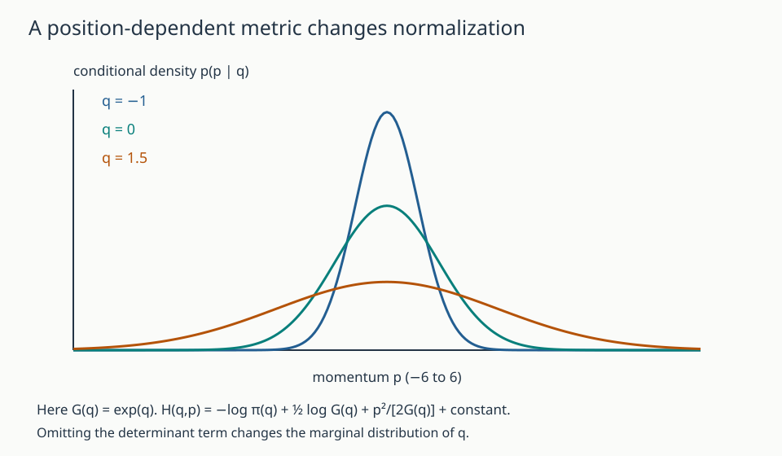

# 23. Riemannian and constrained sampling

Local geometry can change dramatically across a posterior. A step that is harmless in one region may cross a narrow ridge in another. Some models impose a more fundamental restriction: the unknown is a unit vector, an orthogonal frame, or a configuration satisfying conservation equations. We need to distinguish improving motion through a distribution from specifying where that distribution lives.

This chapter develops both ideas through a common discipline: write the probability measure before designing the dynamics. You will derive the determinant correction for a changing mass matrix, understand why its integrator becomes implicit, and construct a sampler that stays on a sphere. You will also learn which numerical checks matter and what they cannot establish.

Prerequisites are densities and Jacobians in [Chapter 2](02-probability.md), MH in [Chapter 9](09-metropolis-hastings.md), transformations in [Chapter 16](16-geometry.md), and Hamiltonian dynamics in [Chapter 20](20-hmc.md). The discussion of diffusion corrections builds on [Chapter 19](19-langevin.md).

## 23.1 Three different geometric problems

Consider a banana-shaped density in the plane. Its support remains two dimensional; a curved contour does not make it a distribution on a curve. A position dependent metric changes the sampler's local units while retaining the original probability distribution.

A directional parameter $x$ satisfying $\|x\|=1$ has a different status. On the sphere in $\mathbb R^3$, only two directions of infinitesimal movement are allowed. Its density must be specified relative to surface area or to coordinates covering the surface. There is no ordinary three dimensional Lebesgue density concentrated exactly on that sphere.

Finally, a positive scalar has full dimensional support with a boundary. A logarithmic transformation often handles this constraint directly. Sampling $z=\log x$ requires the transformed density $\pi_z(z)=\pi_x(e^z)e^z$. Clipping negative proposals to zero neither implements that transformation nor generally preserves the target.

| Problem | Reference measure | Possible approach | Main accounting issue |
|---|---|---|---|
| Changing local scale | Lebesgue measure $dx$ | Position dependent metric | Normalize the auxiliary momentum |
| Unit vector | Surface area $d\sigma$ | Tangent kicks and geodesics | Specify the surface density |
| Positive parameter | Lebesgue measure on $(0,\infty)$ | Logarithmic transformation | Include the Jacobian |

These categories guide implementation choices. They do not rank algorithms: a useful transformation can be simpler and cheaper than a changing metric, while an embedded representation can avoid awkward coordinate singularities on a sphere.



## 23.2 A metric changes local units

A metric in coordinates is a symmetric positive definite matrix $G(x)$. It assigns squared length $v^T G(x)v$ to a small displacement or tangent vector $v$. The matrix can vary smoothly with position. Positive definiteness is essential: negative squared lengths would not define a Gaussian momentum distribution or a kinetic energy bounded below.

We use the mass convention of Chapter 20:

$$
p\mid x\sim N(0,G(x)),\qquad v=G(x)^{-1}p.
$$

Thus momentum covariance is $G$, whereas velocity covariance is $G^{-1}$. Larger metric eigenvalues produce smaller typical velocities in their corresponding directions. Confusing these two covariance matrices reverses the intended preconditioning.

Momentum is formally a covector, meaning that its coordinate transformation preserves the pairing $p^T dx$. Velocity transforms like a displacement. In fixed Euclidean coordinates both appear as columns of numbers, but their transformation rules explain why a metric converts one into the other.

Possible choices include Fisher information plus a positive prior contribution, or regularized curvature information. A raw Hessian of the negative log density need not be positive definite, especially away from a mode. One alternative transforms each Hessian eigenvalue $\lambda$ into $\lambda\coth(\alpha\lambda)$, with limiting value $1/\alpha$ at zero and $\alpha>0$. This is the SoftAbs construction introduced by [Betancourt](https://arxiv.org/abs/1212.4693). It supplies positive eigenvalues, but does not by itself guarantee bounded derivatives, easy numerical solves, or efficient exploration.

A fixed formula $G(x)$ is compatible with a time homogeneous transition kernel. Updating the formula from the entire chain history introduces adaptation and brings back the conditions discussed in [Chapter 15](15-adaptation.md).

## 23.3 Deriving the determinant correction

Let $\pi(x)>0$ be a target density relative to $dx$ on an open subset of $\mathbb R^d$. Assume $G(x)$ is positive definite. Augment the target with its normalized conditional Gaussian:

$$
\widetilde\pi(x,p)=\pi(x)(2\pi)^{-d/2}
\det(G(x))^{-1/2}
\exp\left[-\frac12p^TG(x)^{-1}p\right].
$$

Taking the negative logarithm gives, up to a constant,

$$
H(x,p)=-\log\pi(x)+\frac12\log\det G(x)
+\frac12p^TG(x)^{-1}p.
$$

The determinant has a positive sign in the Hamiltonian. It compensates for the changing volume of typical momenta. To check the sign, set $p=G^{1/2}u$ at fixed $x$. The momentum Jacobian is $\sqrt{\det G}$, so

$$
\int \exp\left[-\frac12p^TG^{-1}p\right]dp
=(2\pi)^{d/2}\sqrt{\det G}.
$$

Multiplication by the normalizing factor cancels that volume exactly. The marginal distribution of $x$ remains $\pi(x)dx$.

If instead we omit $\tfrac12\log\det G$, the marginal becomes proportional to $\pi(x)\sqrt{\det G(x)}$, provided that expression is integrable. The algorithm would spend extra time where momentum space has greater volume. Small energy errors would not reveal this modeling mistake: they would only show accurate integration of the wrong Hamiltonian.

This augmentation is the starting point of [Girolami and Calderhead's Riemannian HMC construction](https://arxiv.org/abs/0907.1100). Deriving the normalizer is more reliable than remembering a determinant sign, particularly when another source uses a density relative to Riemannian volume rather than $dx$.

## 23.4 Worked example: a scalar determinant audit

Take a standard normal target and $g(x)=1+x^2$. Ignoring an additive constant,

$$
H(x,p)=\frac{x^2}{2}+\frac12\log(1+x^2)
+\frac{p^2}{2(1+x^2)}.
$$

Differentiating at fixed momentum yields

$$
\dot x=\frac{p}{1+x^2},\qquad
\dot p=-x-\frac{x}{1+x^2}
+\frac{xp^2}{(1+x^2)^2}.
$$

At $x=1,p=2$, the velocity is $1$ and the force is $-1-1/2+1=-1/2$. The final force contribution is positive because differentiating the inverse metric introduces a minus sign, which Hamilton's equation reverses.

Now integrate out momentum. With the determinant correction, the integrand includes $(1+x^2)^{-1/2}$, cancelling the Gaussian integral $\sqrt{2\pi(1+x^2)}$. Without the correction, the position density is proportional to

$$
e^{-x^2/2}\sqrt{1+x^2}.
$$

At $x=2$, its unnormalized density relative to the value at zero is $e^{-2}\sqrt5\approx0.3026$. The intended ratio is $e^{-2}\approx0.1353$. A local metric intended to change movement has instead more than doubled this relative tail weight. Both densities are normalizable and symmetric, so checking only a mean near zero would miss the error. A variance or tail probability would be more revealing.

## 23.5 Nonseparable dynamics and implicit integration

Write $G_i=\partial G/\partial x_i$ and $v=G^{-1}p$. The matrix identities

$$
\partial_i\log\det G=\operatorname{tr}(G^{-1}G_i),
\qquad \partial_iG^{-1}=-G^{-1}G_iG^{-1}
$$

give Hamilton's equations:

$$
\dot x=v,\qquad
\dot p_i=\partial_i\log\pi
-\frac12\operatorname{tr}(G^{-1}G_i)
+\frac12v^TG_i v.
$$

The scalar example is a direct check of these signs. If the potential and metric are twice continuously differentiable and the metric stays positive definite locally, the Hamiltonian vector field is locally Lipschitz, giving local existence and uniqueness. This does not prove trajectories exist for every time: escaping to infinity or approaching a singular metric requires further control.

Ordinary leapfrog relies on a separable Hamiltonian $U(x)+K(p)$. Here $\partial_xH$ depends on momentum and $\partial_pH$ depends on position. A generalized leapfrog step of size $h$ can be written

$$
p_{1/2}=p_0-\frac h2 H_x(x_0,p_{1/2}),
$$

$$
x_1=x_0+\frac h2\left[H_p(x_0,p_{1/2})+H_p(x_1,p_{1/2})\right],
$$

$$
p_1=p_{1/2}-\frac h2 H_x(x_1,p_{1/2}).
$$

The first two equations are implicit. If $H$ is twice continuously differentiable, the implicit function theorem gives a unique local branch through $h=0$ at each fixed initial state. On compatible forward and reverse neighborhoods, the ideal generalized leapfrog map is symplectic; since this Hamiltonian is even in momentum, it is also reversible under momentum reversal. The permitted step bound can depend on the state. Those statements concern solved equations, not any numerical procedure that resembles them.

A fixed point iteration can fail to contract. Newton's method can find different roots from different initial guesses. Even a converged residual does not establish that the reverse step chooses the corresponding branch. These are kernel construction questions because they determine which states can propose one another.

## 23.6 Numerical solves belong to the Markov kernel

Let $R(x,p)=(x,-p)$ and let $\Phi$ denote a deterministic trajectory map. The familiar HMC acceptance probability applies when $T=R\circ\Phi$ is an involution and preserves phase volume. The identity $T^2=I$ supplies the reverse proposal; volume preservation removes a Jacobian factor. Then

$$
\alpha(z)=\min\{1,\exp[H(z)-H(Tz)]\},\qquad z=(x,p).
$$

For an invertible proposal that changes volume, an appropriate MH construction must account for the Jacobian and its reverse. An arbitrary many-to-one projection has no such immediate repair. Energy alone cannot tell how much probability has been collapsed onto the proposed point.

This explains why truncating an implicit solver after a fixed number of iterations is not automatically exact HMC. It also explains why “reject whenever the solver struggles” needs a precise rule. Rejection preserves reversibility when the permitted set of forward moves is paired with its reverse; a one-sided success criterion may not do that. [Lelièvre, Rousset and Stoltz](https://arxiv.org/abs/1807.02356) develop constrained methods with explicit reverse projection checks. Their construction addresses a specific projection mechanism; it is not permission to attach an energy test to any projection routine.

A practical implementation should record the implicit-equation or constraint residual, the error after a forward-and-reverse trajectory, the Hamiltonian error, and the work spent in solves. These answer different questions. A tiny energy error can coexist with poor reversibility; an excellent reverse check can coexist with slow mixing.

In exact arithmetic, a valid MH correction removes integrator discretization bias in the invariant distribution. Finite trajectories still produce Monte Carlo error. Floating point arithmetic and finite solver tolerances introduce additional implementation discrepancies. Passing numerical checks supports confidence in those discrepancies being small for the tested cases, but proves neither invariance nor convergence in untested regions.

### 23.6.1 A solve that fails before roundoff matters

Return to $g(x)=1+x^2$ and the standard normal target. At $x_0=1$, writing $w=p_{1/2}$ makes the first implicit equation

$$
w=p_0-\frac h2\left(\frac32-\frac{w^2}{4}\right),
\qquad \frac h8w^2-w+p_0-\frac{3h}{4}=0.
$$

For $h>0$, its discriminant is $D=1-(h/2)(p_0-3h/4)$. When $p_0>2/h+3h/4$, there is no real solution. At $h=0.2,p_0=11$, $D=-0.085$. The refresh distribution at $x_0=1$ is $N(0,2)$, so every fixed positive step leaves a positive, possibly very small, probability of such a failure. By continuity it also occurs in a neighborhood of these states. Local solvability is therefore insufficient to define a proposal everywhere; a complete kernel needs a specified treatment of its domain and the reverse moves.

Even where a nearby root exists, terminating a solve early changes the proposal. Define $\Phi_{h,m}$ by taking exactly $m$ fixed point updates for the first equation, initialized at $w=p_0$, and then exactly $m$ updates for the position equation, initialized at $x_1=x_0$, before applying the final kick. At $(x_0,p_0)=(1,2)$ and $h=0.2$, one update of each equation gives

$$
\Phi_{0.2,1}(1,2)\approx(1.195000,1.858361).
$$

Reverse the momentum and repeat the same computation. The result is approximately $(1.033793,-2.017905)$, whereas reversibility requires $(1,-2)$. The error is much larger than roundoff. The accompanying code compares

$$
\left\|\Phi_{h,m}\bigl(R\Phi_{h,m}(z)\bigr)-Rz\right\|_\infty.
$$

| Updates per implicit equation | Reverse residual at this state |
|---|---|
| 1 | $3.38\times10^{-2}$ |
| 4 | $5.06\times10^{-6}$ |
| 12 | about $10^{-13}$ |

These are measurements for one state, not universal tolerance guarantees. For small $h>0$ with $D>0$, the momentum root on the near-identity branch is $w=2(p_0-3h/4)/(1+\sqrt D)$; this gives a separate check on the fixed point calculation. [Brofos and Lederman, Section 2 and Algorithms 1–2](https://proceedings.mlr.press/v139/brofos21a/brofos21a.pdf) study the corresponding loss of reversibility and volume preservation in approximate implicit integration. The scalar calculation above makes the issue visible without constructing an entire RMHMC sampler.

## 23.7 Position dependent Langevin and probability flux

The same accounting principle appears in diffusions. Let $A(x)=G(x)^{-1}$ and consider an Itô diffusion

$$
dX_t=b(X_t)dt+S(X_t)dW_t,\qquad SS^T=A.
$$

For a smooth density $\rho$, its probability flux has components

$$
J_i=b_i\rho-\frac12\sum_j\partial_j(A_{ij}\rho).
$$

To obtain zero flux at a Lebesgue target $\pi$, solve $J_i=0$ and expand the derivative:

$$
b_i=\frac12\sum_j A_{ij}\partial_j\log\pi
+\frac12\sum_j\partial_j A_{ij}.
$$

The divergence term accounts for spatial variation in the noise. This formal stationary calculation requires an actual nonexplosive diffusion and suitable boundary or decay conditions before it becomes an invariance statement. Ergodicity requires more again. The measure distinction and corrected drift are treated explicitly by [Xifara and colleagues](https://discovery.ucl.ac.uk/10064288/7/Byrne_PMALAv5.3.pdf).

For implementation, an Euler proposal is Gaussian with mean $x+h b(x)$ and covariance $hA(x)$. An MH step must use its actual forward and reverse densities, including both covariance determinants and quadratic forms. Even a different drift can define a valid MH proposal when these densities are used correctly. What fails without the divergence correction is the claim that the corresponding unadjusted diffusion automatically has the stated Lebesgue target.

## 23.8 Surface density, coordinate density, and conditioning

Suppose a smooth injective chart $F$ maps an open subset of $\mathbb R^m$ into a surface in $\mathbb R^n$, with $DF$ of full column rank. The Gram matrix $DF^TDF$ measures how small coordinate boxes become surface patches. Their area element is

$$
d\sigma(F(z))=\sqrt{\det(DF(z)^TDF(z))}\,dz.
$$

Consequently a density $f$ per unit surface area becomes the coordinate density $f(F(z))\sqrt{\det(DF^TDF)}$. This is the geometric version of a Jacobian, not an optional prior adjustment. Multiple charts require consistent overlap handling; an arbitrary parametrization need not cover a surface once.

For intrinsic metric coordinates, $d\operatorname{vol}_G=\sqrt{\det G}\,dz$. Hence $\pi_L=\pi_{\mathrm{vol}}\sqrt{\det G}$. Substituting this identity into the augmented Hamiltonian cancels the explicit determinant term:

$$
H(z,p)=-\log\pi_{\mathrm{vol}}(z)+\frac12p^TG(z)^{-1}p.
$$

There is no contradiction with Section 23.3: the density symbol now refers to another measure. [Byrne and Girolami](https://arxiv.org/html/1301.6064) use this distinction to connect coordinate and embedded manifold algorithms.

There is also a difference between prescribing a surface distribution and conditioning an ambient distribution. Let $c:\mathbb R^n\to\mathbb R^k$ be smooth with full row rank near the level set, and define

$$
J_c(x)=\sqrt{\det(Dc(x)Dc(x)^T)}.
$$

The coarea decomposition rewrites an ambient integral as an integral over values $y$ and surfaces $c^{-1}(y)$, with integrand divided by $J_c$; see [Negro, Theorem 4.4](https://arxiv.org/html/2110.01441). Applying that decomposition also to integrals with a test function gives the conditional density arising from the random variable $c(X)$: it is proportional to $\pi_{\rm amb}(x)/J_c(x)$ relative to surface area on a regular level. This holds for almost every level with a finite positive normalizer. At a particular null level such as zero, continuity of the conditional family or a specified limiting construction is needed to select a version. A declaration of “condition on the constraint” alone does not settle that issue.

### 23.8.1 A quantitative coarea and Fixman audit

Near the unit circle in $\mathbb R^2$, take $c(x)=e^{x_1}(\|x\|^2-1)$. On the circle, $J_c(x)=2e^{x_1}$. Choose a smooth radial ambient density supported in a sufficiently thin bounded annulus around the circle and positive on the circle. Compact support, regularity of nearby levels, and positivity at the circle justify the continuous narrow-band limit. The annular support also excludes remote points where $c$ can approach zero.

Write $x=(r\cos\theta,r\sin\theta)$. Near $r=1$,

$$
c(x)=2e^{\cos\theta}(r-1)+O((r-1)^2).
$$

Thus $|c(x)|<\delta$ gives a radial width $\delta e^{-\cos\theta}+o(\delta)$. Multiplying by the polar area factor $r\,dr\,d\theta$ and the ambient density, which is constant on the circle, yields the limiting angle density

$$
q(\theta)=\frac{e^{-\cos\theta}}{Z_c},\qquad
Z_c=\int_0^{2\pi}e^{-\cos\theta}\,d\theta\approx7.954927.
$$

The density at $(1,0)$ relative to $(-1,0)$ is $e^{-2}$, and numerical quadrature gives $E[x_1]\approx-0.446390$. Uniform arc length instead gives $E[x_1]=0$. Conditioning the same ambient law on $|\|X\|^2-1|<\delta$ gives that uniform limit. The two shrinking bands have different widths around the same zero set; their limits need not agree.

This also determines the potential required by a sampler designed for surface area. Set $V=-\log\pi_{\rm amb}$ wherever the ambient density is positive. To sample the coarea conditional with density proportional to $e^{-V}/J_c$ per unit area, use

$$
V_{\rm cond}=V+\log J_c
=V+\frac12\log\det(Dc\,Dc^T).
$$

For identity ambient mass and inverse temperature one, this added potential is the **Fixman correction**; see [Lelièvre, Rousset and Stoltz, Remark 3.3 and equation (3.13)](https://arxiv.org/pdf/1006.4914). Here it reduces on the circle to $x_1+\log2$, up to the constant ambient potential. The positive sign follows by exponentiating $-V_{\rm cond}$. It converts a surface sampler to the chosen conditional law. A model specified directly per unit surface area needs its stated surface potential; adding this term would change that model.

The example computes the circle integrals with a periodic midpoint rule and checks them independently against convergent power series. It also multiplies the conditional weight by $J_c$ and recovers the zero mean of uniform arc length. This checks the direction of the measure conversion; it does not simulate or certify a general constrained algorithm.

## 23.9 Worked example: sampling a directional distribution

Consider the unit sphere $S^2$ with density per unit area

$$
f(x)=Z(\kappa)^{-1}e^{\kappa x_3},\qquad \kappa=2.
$$

Set $z=x_3$. A horizontal band of width $dz$ has area $2\pi\,dz$, so

$$
Z(\kappa)=2\pi\int_{-1}^1e^{\kappa z}dz
=\frac{4\pi\sinh\kappa}{\kappa}.
$$

Differentiating its logarithm gives an analytic check:

$$
E[x_3]=\coth\kappa-\frac1\kappa
\approx0.537315\quad (\kappa=2).
$$

At position $x$, the tangent space consists of vectors satisfying $x^Tv=0$. Draw an ambient standard Gaussian $\xi$ and project it:

$$
v=(I-xx^T)\xi.
$$

In any orthonormal tangent basis, the two components of $v$ are independent standard normals. This defines the conditional Gaussian relative to tangent-plane area. Together with surface area, that measure corresponds to the intrinsic Hamiltonian phase volume for the induced Euclidean metric. The energy is $H(x,v)=-\kappa x_3+\|v\|^2/2$.

The potential half-step changes velocity by

$$
v\leftarrow v+\frac h2\kappa(e_3-x_3x).
$$

The added vector is tangent because $x^T(e_3-x_3x)=0$. For the kinetic step, let $r=\|v\|$. The sphere's geodesic flow is

$$
x' =x\cos(rh)+\frac vr\sin(rh),\qquad
v'=-rx\sin(rh)+v\cos(rh).
$$

At $r=0$, use $x'=x,v'=0$. Orthogonality of $x$ and $v$ makes $\|x'\|^2=\cos^2(rh)+\sin^2(rh)=1$. The same expansion gives $x'^Tv'=0$ and $\|v'\|=r$. The kinetic flow stays exactly on the sphere in real arithmetic.

Finish with another half-kick at $x'$. Each piece is an exact Hamiltonian subflow; their symmetric composition supplies the reversible, volume-preserving proposal required for an energy acceptance test. The composition does not exactly conserve the total energy, because the two Hamiltonian pieces generally do not commute. This separation explains how exact constraint motion and integration error can coexist.

For a numerical step, start at $x=(1,0,0)$ and $v=(0,1,0)$ with $h=0.2$. The first kick gives $(0,1,0.2)$, so $r=\sqrt{1.04}$. The geodesic reaches approximately $(0.97927,0.19862,0.03972)$. Apply the final projected kick there before evaluating the energy difference. Omitting that final kick destroys the symmetric composition.

Run the complete standard-library implementation:

```text
python examples/ch23.py
```

The script first runs the deterministic geometry and measure audits above. Its sphere sampler refreshes tangent momentum, chooses 4, 6, or 8 steps independently with equal probability, and uses $h=0.18$. This state independent mixture preserves invariance when each component kernel does. Length randomization reduces dependence on a single possible orbital resonance; it is not a universal mixing guarantee.

With seed 23023, 1,000 discarded iterations and 12,000 retained states, the example prints a mean of 0.537475, rough batch-means MCSE 0.004086, and acceptance 0.9940. Maximum squared-norm and tangency residuals are about $10^{-12}$; the reverse residual checked during the first 100 trajectories is about $3\times10^{-15}$. Rejections remain in the sample. The code performs no corrective position projection, so these residuals also expose accumulated roundoff. This finite run checks a known moment and numerical structure; it does not certify convergence or implement general manifold sampling.

## 23.10 General constraints and hard walls

For equality constraints $c(x)=0$, full row rank of $Dc$ makes the local tangent space $\{v:Dc(x)v=0\}$. Lagrange multipliers can impose position constraints and compatible momentum constraints during integration. SHAKE and RATTLE are established approaches to these tasks, but a general nonlinear constraint can have multiple projection solutions. A usable MCMC implementation must specify its solution branch and reverse consistency; a small constraint residual alone is insufficient.

When implementing the algorithm in the cited constrained-HMC paper, consult its [published correction](https://researchportal.ip-paris.fr/fr/publications/correction-to-hybrid-monte-carlo-methods-for-sampling-probability/): the numerical algorithm requires two distinct momentum projection operators. The sphere splitting here uses explicit tangent kicks and geodesics, so it needs no nonlinear projection solver.

Disconnected constraint components pose a separate problem. Dynamics remaining on the surface may never move between components, even when integration and MH are flawless. A component-changing proposal or another global mechanism is needed when the target gives mass to several components.

For an inequality boundary, a suitable coordinate transformation may be easiest. Boundary rejection is also possible within a valid proposal construction. A third option is specular reflection. With constant positive definite mass $M$ and wall normal $n$, reflect momentum as

$$
p'=p-2n\frac{n^TM^{-1}p}{n^TM^{-1}n}.
$$

Let $a=n^TM^{-1}p$ and $b=n^TM^{-1}n$. Then $n^TM^{-1}p'=a-2a=-a$: normal velocity reverses. Expanding the kinetic energy difference gives $-2a^2/b+2a^2/b=0$. For a nonidentity mass, simply reflecting Euclidean momentum about the wall would generally be wrong.

This formula is only a collision rule. An algorithm also needs correct collision times, handling of repeated collisions, and a policy for corners where a unique normal may not exist. Stepping beyond the wall and clipping the endpoint does not supply these missing pieces.

## 23.11 Exploring geometry and choosing a method

Use the lab's **Scale of v** control to increase the spread of the hierarchical log variance. Compare the independent draws in centered $(v,x)$ coordinates with the same draws in noncentered $(v,z)$ coordinates, where $x=e^{v/2}z$. The changing width in the centered plot illustrates why one fixed matrix cannot equalize every conditional scale; the noncentered plot shows how a nonlinear transformation removes that dependence in this prior-only example. These are direct Gaussian simulations, so they do not measure sampler trajectories or mixing.

<div class="mcmc-lab" data-lab="geometry"></div>

This lab illustrates geometry and reparameterization. It does not implement implicit RMHMC, RATTLE, or the sphere sampler; the executable example above supplies the constrained calculation.

In practice, begin by identifying the support dimension and reference measure. Try useful charts, whitening, or noncentering before adding metric derivatives and nonlinear solves. Dense factorizations commonly cost order $d^3$, and derivatives or repeated solver iterations can dominate further. Compare methods by uncertainty for the scientific estimand at equal computational budgets, as in [Chapter 47](47-benchmark-lab.md), rather than by acceptance alone.

Local geometry also cannot remove a remote probability barrier merely by being accurate nearby. [Chapter 25](25-tempering.md) addresses global exploration, while [Chapter 24](24-function-space.md) considers another geometric challenge: changing the dimension of a discretized function without destroying sampling efficiency.

## 23.12 Exercises with worked solutions

<div class="exercise" id="mcmc-23-riemannian-ex-1">

### Exercise 1: the missing normalizer

For a Lebesgue target $\pi$ and positive definite $G(x)$, integrate momentum out of $\exp[-H]$ when $H=-\log\pi+p^TG^{-1}p/2$. What extra condition is needed for a probability distribution to result?

<details>
<summary>Solution</summary>

The Gaussian integral equals $(2\pi)^{d/2}\sqrt{\det G(x)}$. The position marginal is therefore proportional to $\pi(x)\sqrt{\det G(x)}$. Its integral over position must be finite and positive. A proper original target does not ensure this after multiplication by an arbitrarily growing determinant factor.

</details>

</div>

<div class="exercise" id="mcmc-23-riemannian-ex-2">

### Exercise 2: differentiate the scalar energy

Derive both Hamilton equations for $g(x)=1+x^2$ and a standard normal target. Evaluate them at $x=1,p=2$.

<details>
<summary>Solution</summary>

The momentum derivative gives $\dot x=p/(1+x^2)$. The position derivative of the three energy terms is $x+x/(1+x^2)-xp^2/(1+x^2)^2$. Negating it gives $\dot p$. Substitution produces $\dot x=1$ and $\dot p=-1/2$. Differentiating at fixed velocity instead of fixed momentum would not give Hamilton's canonical equation.

</details>

</div>

<div class="exercise" id="mcmc-23-riemannian-ex-3">

### Exercise 3: find a diffusion correction

For $A(x)=1+x^2$ and standard normal $\pi$, calculate the zero-flux Itô drift. Verify the flux identity directly.

<details>
<summary>Solution</summary>

Since $(\log\pi)'=-x$ and $A'=2x$,

$$
b(x)=-\tfrac12x(1+x^2)+x.
$$

Also $(A\pi)'=2x\pi+(1+x^2)(-x\pi)=2b\pi$. Hence $b\pi-\tfrac12(A\pi)'=0$. This is a stationary density calculation; existence and boundary behavior of the diffusion remain separate mathematical requirements.

</details>

</div>

<div class="exercise" id="mcmc-23-riemannian-ex-4">

### Exercise 4: verify the spherical geodesic

Assuming $\|x\|=1$, $x^Tv=0$, and $r=\|v\|>0$, prove that the stated geodesic preserves tangency and speed.

<details>
<summary>Solution</summary>

Write $c=\cos(rt)$ and $s=\sin(rt)$. Then

$$
(xc+vs/r)^T(-rxs+vc)=-rcs+rcs=0.
$$

The squared new speed is $r^2s^2+r^2c^2=r^2$, because the cross term vanishes. Similarly the squared new position norm is $c^2+s^2=1$. The zero-speed case follows by continuity, with a fixed position and zero velocity.

</details>

</div>

<div class="exercise" id="mcmc-23-riemannian-ex-5">

### Exercise 5: what is uniform on a sphere?

Does drawing latitude uniformly on $[-\pi/2,\pi/2]$ and longitude uniformly on $[0,2\pi)$ produce uniform surface area? Give a correct alternative.

<details>
<summary>Solution</summary>

No. With latitude $\phi$ and longitude $\theta$, the area element is $\cos\phi\,d\phi\,d\theta$. Uniform coordinate draws assign too much probability per unit area near the poles. Instead draw $z$ uniformly on $[-1,1]$ and $\theta$ uniformly on $[0,2\pi)$, independently, and set $x=(\sqrt{1-z^2}\cos\theta,\sqrt{1-z^2}\sin\theta,z)$. Here $z=\sin\phi$ gives $dz=\cos\phi\,d\phi$.

</details>

</div>

<div class="exercise" id="mcmc-23-riemannian-ex-6">

### Exercise 6: audit a projection sampler

A programmer takes an unconstrained step, projects to the nearest surface point, and accepts with $\min(1,e^{-\Delta H})$. Constraint residuals are tiny. Is that sufficient? Describe the missing work.

<details>
<summary>Solution</summary>

Nearest-point projection may collapse many points onto one and may select different branches in reverse. Tiny residuals establish proximity to the surface, not invertibility or phase-volume preservation. The programmer must first specify the target surface measure, then supply a valid forward/reverse proposal construction and any required Jacobian or proposal-density terms. An established constrained integrator with its prescribed reverse projection check is one route. Merely tightening the projection tolerance cannot establish those structural properties.

</details>

</div>

<div class="exercise" id="mcmc-23-riemannian-ex-7">

### Exercise 7: changing the constraint equation

Let $c:\mathbb R^n\to\mathbb R^k$ have full row rank on $c^{-1}(0)$, and let $a(x)>0$ be smooth. Set $\widetilde c(x)=a(x)c(x)$. How does the coarea conditional surface weight change? Contrast this with $\widehat c=b\circ c$, where $b$ is a smooth local diffeomorphism of the constraint values and $b(0)=0$.

<details>
<summary>Solution</summary>

On the zero set, the derivative of $a$ multiplies $c=0$, so $D\widetilde c=a\,Dc$ and $J_{\widetilde c}=a^kJ_c$. The conditional surface weight becomes proportional to $\pi_{\rm amb}/(a^kJ_c)$, with finite positive normalizers and a continuous or specified limiting conditional family assumed. Thus a spatially varying rescaling can change the selected law. For $\widehat c=b\circ c$, instead $D\widehat c=Db(0)Dc$ on the zero set, giving $J_{\widehat c}=|\det Db(0)|J_c$. This constant cancels on normalization. A change of coordinates in the constraint values differs from changing band widths separately at different surface points.

</details>

</div>

<div class="exercise" id="mcmc-23-riemannian-ex-8">

### Exercise 8: which implicit root is local?

For the quadratic momentum equation in Section 23.6.1, identify the root tending to $p_0$ as $h\downarrow0$. What fails when its discriminant reaches zero? Does selecting this root alone establish reversibility of the complete step?

<details>
<summary>Solution</summary>

The roots for $h>0$ are $4(1\pm\sqrt D)/h$. The minus root tends to $p_0$; rationalizing it gives $2(p_0-3h/4)/(1+\sqrt D)$, avoiding cancellation for small $h$. At $D=0$ the roots coincide and the derivative of the equation with respect to $w$, $hw/4-1$, vanishes, so the implicit function theorem no longer supplies a smooth local branch. For $D<0$ no real root exists. Choosing the momentum branch does not resolve the position equation or establish compatible reverse branch selection; all parts of the proposal remain to be checked.

</details>

</div>

## Key takeaways

A changing metric requires normalized momentum augmentation; for a Lebesgue target, that produces a positive half log determinant in the Hamiltonian. Surface targets require their own reference measure. Implicit solvers and projection rules affect the actual proposal and must satisfy the assumptions behind its MH correction. Exact geodesic pieces make spheres unusually convenient, but even this case requires an acceptance step for the split total dynamics and separate assessment of finite-run error.

## Primary references

- [Girolami and Calderhead, Riemannian manifold HMC](https://arxiv.org/abs/0907.1100): position dependent Gaussian augmentation and generalized integration.
- [Xifara, Sherlock, Livingstone, Byrne and Girolami, position dependent Langevin diffusions](https://discovery.ucl.ac.uk/10064288/7/Byrne_PMALAv5.3.pdf): divergence correction and reference measures.
- [Byrne and Girolami, Geodesic Monte Carlo on Embedded Manifolds](https://arxiv.org/html/1301.6064): surface measures, tangent updates, and explicit geodesics.
- [Betancourt, A General Metric for Riemannian Manifold Hamiltonian Monte Carlo](https://arxiv.org/abs/1212.4693): the SoftAbs metric construction.
- [Lelièvre, Rousset and Stoltz, Hybrid Monte Carlo methods for sampling probability measures on submanifolds](https://arxiv.org/abs/1807.02356): constrained proposals and reverse projection checks.
- [Negro, Sample distribution theory using Coarea Formula](https://arxiv.org/html/2110.01441): level-set integration and the inverse Jacobian factor.
- [Brofos and Lederman, Evaluating the Implicit Midpoint Integrator for Riemannian Hamiltonian Monte Carlo](https://proceedings.mlr.press/v139/brofos21a.html): numerical reversibility and volume errors in implicit solvers.
- [Lelièvre, Rousset and Stoltz, Langevin dynamics with constraints and computation of free energy differences](https://arxiv.org/abs/1006.4914): rigid versus conditional surface laws and the Fixman potential.
