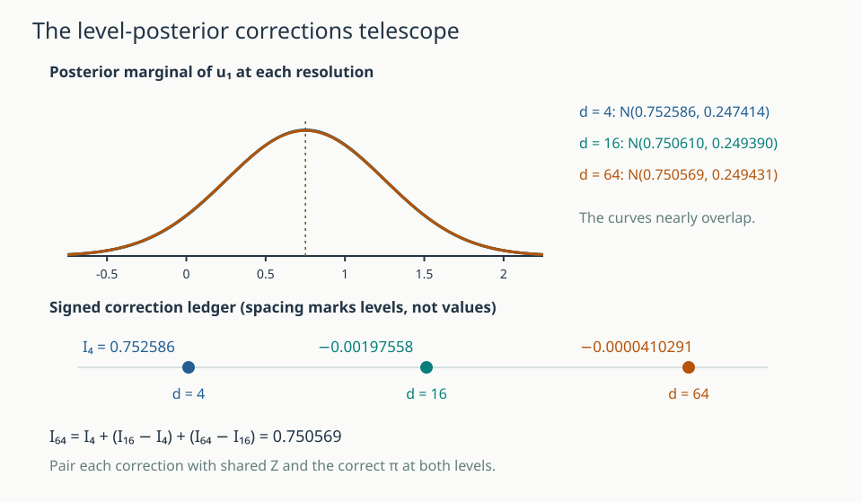

# 24. Function-space and inverse problems

## Learning goals and prerequisites

An unknown temperature profile, permeability field, or forcing history is naturally a function. A computer represents it by finitely many numbers, but those numbers are coordinates of one scientific object. Increasing their number should improve resolution without unnecessarily destroying the sampler's efficiency. This chapter develops a proposal designed around that requirement: preconditioned Crank–Nicolson, or **pCN**.

You will construct a posterior relative to a Gaussian law on functions, derive pCN's acceptance rule, and compare truncation error with Monte Carlo error. You will also learn why discretization robustness is a qualified statement about a family of problems, and how coupled estimates at several resolutions can reduce sampling cost. Review [Bayesian targets](03-bayesian-targets.md), [Metropolis–Hastings](09-metropolis-hastings.md), [Monte Carlo error](13-mc-error.md), and [whitening](16-geometry.md). Inner products and Gaussian conditioning are sufficient for the main derivations; no previous functional analysis course is assumed.

## 24.1 Start with the unknown function

Suppose a field $u$ produces measurements through a forward map $G$:

$$
y=G(u)+\epsilon,\qquad y\in\mathbb R^k.
$$

The noise $\epsilon$ describes measurement uncertainty. The forward map describes how a field becomes observable: an averaging sensor, an integral transform, or a differential equation followed by observation. Neither component should be silently changed when the computational mesh changes.

For a concrete representation, choose an orthonormal basis $e_1,e_2,\ldots$ of $H=L^2(0,1)$, such as a complete sine basis. Write a zero-mean field as $u=\sum_j u_j e_j$. A calculation with $d$ coefficients uses $u_d=\sum_{j=1}^d u_j e_j$. Here, increasing $d$ resolves additional spatial modes. It does not add another patient, another independent regression problem, or another observation.

Before choosing a sampler, specify an estimand. Examples include the first coefficient $u_1$, a spatial average $\langle u,h\rangle$, or a predicted measurement $G(u)$. A visually rough field may already give accurate integral predictions; conversely, a smooth-looking reconstruction may miss scientifically important local variation. Resolution requirements depend on the requested quantity.

The function-space Bayesian viewpoint makes this ordering explicit: define a law on the underlying field, then approximate its computation. Stuart's [Bayesian inverse-problems survey](https://doi.org/10.1017/S0962492910000061) develops this perspective. Our construction below establishes existence under simple assumptions; it does not claim a general theorem about stability under changes in data.

## 24.2 A Gaussian reference measure

Let $H$ be a separable real Hilbert space with norm $\|\cdot\|_H$. Take a mean $m\in H$ and a positive, self-adjoint covariance operator $C$ with eigenvectors $e_j$ and eigenvalues $\lambda_j\geq0$. Assume $C$ is trace class:

$$
\sum_{j=1}^{\infty}\lambda_j<\infty.
$$

Independent standard normal variables $z_j$ define the Gaussian series

$$
u=m+\sum_{j=1}^{\infty}\sqrt{\lambda_j}\,z_j e_j,
\qquad \mu_0=\mathcal N(m,C).
$$

The series converges in mean-square $H$ norm because its tails satisfy

$$
\mathbb E\left\|\sum_{j=p+1}^{q}\sqrt{\lambda_j}z_j e_j\right\|_H^2
=\sum_{j=p+1}^{q}\lambda_j\longrightarrow0.
$$

Thus the partial sums are Cauchy as square-integrable $H$-valued random variables. For a nonzero mean, define the truncation by retaining the entire known mean: $u_d=m+\sum_{j=1}^d\sqrt{\lambda_j}z_je_j$. Only the random part is truncated. The covariance specifies variation in each direction; it is much more than a convenient proposal scale. In our examples $m=0$ and $\lambda_j=j^{-2}$. Higher modes have smaller variance, and the expected squared norm is finite.

Two cautions prevent misleading finite-dimensional analogies. First, there is no infinite-dimensional Lebesgue density to write as a product of normalizing constants. We work with the probability measure $\mu_0$ itself. Second, when infinitely many eigenvalues are positive, enumerate those modes: although $u$ lies in $H$, their whitened coordinates $(z_j)$ are almost surely not square summable. Indeed, the strong law gives $d^{-1}\sum_{j=1}^d z_j^2\to1$. Zero-variance modes cannot be whitened and are fixed at their mean. Finite whitening remains perfectly useful; with infinitely many active modes its limiting coordinate space is a product space, not ordinary $\ell^2$.

Also distinguish a function's norm from its point values. Elements of $L^2$ are equivalence classes under equality almost everywhere, so point evaluation is not a bounded linear functional there. The measurements in this chapter are bounded linear functionals. A model with point sensors needs a suitable continuous version or a function space and covariance with sufficient sample regularity. Merely writing $u(x_i)$ does not establish that requirement.

## 24.3 Bayes' rule relative to the prior

Assume independent observation noise $\epsilon\sim\mathcal N(0,\Gamma)$, where the $k\times k$ matrix $\Gamma$ is positive definite. For a measurable forward map that is finite $\mu_0$-almost surely, define

$$
\Phi(u;y)=\frac12\bigl(y-G(u)\bigr)^T\Gamma^{-1}\bigl(y-G(u)\bigr).
$$

The posterior measure $\pi$ is specified by

$$
\frac{d\pi}{d\mu_0}(u)=Z^{-1}\exp[-\Phi(u;y)],
\qquad
Z=\int_H \exp[-\Phi(u;y)]\,\mu_0(du).
$$

The derivative means that posterior probabilities are prior integrals weighted by likelihood. More generally, if $\Phi$ is measurable, nonnegative, and finite almost surely under $\mu_0$, then the integrand is strictly positive almost surely and at most one. Hence $0<Z\leq1$, so this expression defines a probability measure. It also assigns zero posterior probability to any event having zero prior probability.

The omitted Gaussian noise normalizer is constant only while $\Gamma$ is fixed. If a noise scale is sampled, its log determinant belongs in the joint target. Similarly, changing prior hyperparameters changes the reference distribution. Neither operation is justified by declaring all normalizing terms irrelevant.

A finite computation replaces $u$ by $u_d$ and perhaps $G$ by a numerical approximation $G_h$. The resulting posterior is a different probability measure. Correct Metropolis–Hastings can preserve that approximate posterior exactly in mathematical arithmetic, while still approximating the intended continuum inference problem. We will keep these two meanings of accuracy separate.

## 24.4 Why a familiar random walk slows down

Consider the easiest target: the prior alone. In $d$ whitened coordinates it is $\mathcal N(0,I_d)$. A symmetric random-walk proposal is

$$
z'=z+s\eta,\qquad \eta\sim\mathcal N(0,I_d).
$$

Its log Metropolis ratio is

$$
R=-\frac12(\|z+s\eta\|^2-\|z\|^2)
=-s\,z^T\eta-\frac{s^2}{2}\|\eta\|^2.
$$

At stationarity $z$ and $\eta$ are independent standard normal vectors, so $\mathbb E R=-s^2d/2$. This calculation exposes a penalty that accumulates across coordinates, even when all added coordinates are uninformed by data. More strongly, at fixed $s>0$, $R/d\to-s^2/2$ in probability. Therefore acceptance tends to zero as $d$ grows.

Taking $s$ proportional to $d^{-1/2}$ keeps the two terms on an order-one scale. But the proposed displacement of any fixed coordinate now shrinks with resolution. An algorithm that continues to accept a reasonable fraction of proposals may still move the scientific observable increasingly slowly.

In field coordinates the corresponding proposal is $v=u+s\xi$, where $\xi\sim\mathcal N(0,C_d)$. This already respects prior covariance scales; the problem is not simply failure to standardize variables. Additive motion increases total whitened energy. The next proposal compensates for that increase with a contraction of the current state. Cotter and colleagues' [MCMC Methods for Functions](https://arxiv.org/abs/1202.0709) introduces the Gaussian-preserving design principle underlying this comparison.

## 24.5 Deriving pCN from an exchangeable Gaussian pair

Choose $0<\beta\leq1$ and write $\rho=\sqrt{1-\beta^2}$. The pCN proposal is

$$
v=m+\rho(u-m)+\beta\xi,
\qquad \xi\sim\mathcal N(0,C),
$$

with fresh noise independent of $u$. At $\beta=1$ this is an independent prior draw; small $\beta$ gives gentle motion.

To find the Metropolis correction, suppose temporarily that $u\sim\mu_0$. Both $u$ and $v$ then have mean $m$ and covariance $C$, since $\rho^2+\beta^2=1$. Their cross covariance is $\rho C$. Consequently the jointly Gaussian pair $(u,v)$ has the same distribution as $(v,u)$. If $Q$ is the proposal kernel, the pair measure

$$
\nu(du,dv)=\mu_0(du)Q(u,dv)
$$

is symmetric. This is **reversibility with respect to the prior**, a stronger property than merely having the prior as an invariant distribution.

For the posterior, set $w(u)=\exp[-\Phi(u)]$. Accept with

$$
\alpha(u,v)=\min\{1,w(v)/w(u)\}
=\min\{1,\exp[\Phi(u)-\Phi(v)]\}.
$$

The accepted probability flux is

$$
\pi(du)Q(u,dv)\alpha(u,v)
=Z^{-1}\min\{w(u),w(v)\}\nu(du,dv).
$$

Both factors on the right are unchanged when $u$ and $v$ are exchanged. Rejection adds mass only on the diagonal $u=v$, which is also symmetric. This proves detailed balance and therefore posterior invariance under the stated assumptions. It does not establish how many iterations will be sufficient from a chosen initialization.

The prior has already been accounted for through the proposal's reversibility. Multiplying by an additional Gaussian prior-density ratio would generally produce the wrong target. Nor is this proposal symmetric with respect to finite-dimensional Lebesgue measure: its conditional mean depends on the current state through $\rho u$.

```text
Compute phi = Phi(current)
For each iteration:
    Draw xi from the centered Gaussian prior
    proposed = m + sqrt(1 - beta^2) * (current - m) + beta * xi
    proposed_phi = Phi(proposed)
    Draw U uniformly on (0, 1)
    If log(U) < min(0, phi - proposed_phi):
        current = proposed
        phi = proposed_phi
    Record current, including after a rejection
```

Retaining the current potential avoids an unnecessary forward solve. Retaining rejected states is necessary for posterior averages.

## 24.6 What robustness promises

With a constant likelihood, every pCN proposal is accepted. In any nondegenerate centered coordinate, the stationary chain obeys

$$
u_{j,t+1}=\rho u_{j,t}+\beta\sqrt{\lambda_j}\,\eta_{j,t}.
$$

Its lag-$k$ correlation is $\rho^k$. For the coordinate mean, the integrated autocorrelation time is

$$
\tau=1+2\sum_{k=1}^{\infty}\rho^k
=\frac{1+\rho}{1-\rho}.
$$

There is no truncation dimension in this expression. At $\beta=0.6$, $\rho=0.8$ and $\tau=9$: roughly nine correlated draws provide the mean-estimation information of one independent draw, asymptotically. At $\beta=1$, the prior-only chain is independent.

A posterior adds likelihood rejections, so this exact AR(1) formula no longer generally applies. Strongly informative observations can force a small $\beta$; separated posterior modes can remain difficult to traverse. Adding more data as dimension increases is also a different experiment from resolving the same field with fixed data.

Furthermore, acceptance, autocorrelation, and cost are distinct measurements. Stable acceptance does not guarantee stable autocorrelation for every observable, and a constant iteration count does not imply constant time when each forward solve becomes more expensive. Hairer, Stuart, and Vollmer establish dimension-uniform spectral-gap results for pCN under specific conditions on the potential; [their paper](https://arxiv.org/abs/1112.1392) is a theoretical refinement, not an unconditional guarantee for any Gaussian-prior model.

Use the following lab to set $\rho=0.8$, then increase it toward one. Compare the empirical autocorrelation curve with the theoretical $\rho^k$ curve. The lab displays the exact finite-run mean ESS,

$$
\operatorname{ESS}_n=\frac{n}{1+2\sum_{k=1}^{n-1}(1-k/n)\rho^k},
$$

alongside its long-run approximation $n(1-\rho)/(1+\rho)$. Their difference can matter when the run is short relative to the correlation time. The lab simulates a stationary scalar AR(1) process and illustrates the constant-likelihood pCN calculation; both ESS values are computed from the model, not estimated from the trace. It does not implement an inverse-problem solver or posterior pCN, and its diagnostic displays cannot certify convergence.

<div class="mcmc-lab" data-lab="diagnostics"></div>

### 24.6.1 Worked scale hierarchy: unchanged target, slower Gibbs {#sec-2461-worked-scale-hierarchy-unchanged-target-slower-gibbs}

Robustness of a field update does not automatically extend to an unknown prior scale. Here is an exact benchmark with no observations. Let $\theta$ multiply the **variance**, and define

$$
\begin{aligned}
\theta&\sim\operatorname{IG}(a,b),\\
u_j\mid\theta&\sim N(0,\theta j^{-2})
\quad\text{independently},\qquad j\geq1.
\end{aligned}
$$

Our normalized inverse-gamma convention is

$$
p(\theta)=\frac{b^a}{\Gamma(a)}
\theta^{-a-1}\exp(-b/\theta),\qquad \theta>0,
$$

where $a,b>0$ and $\Gamma(a)$ is the scalar gamma function. The observation-noise covariance denoted by $\Gamma$ earlier in the chapter is a different object. For every finite $\theta>0$, the conditional field covariance is trace class because $\sum_j\theta j^{-2}<\infty$. Thus the field exists in $H$ without requiring a second moment for $\theta$. A marginal coefficient variance is finite when $a>1$. For the scale correlations and variances below, assume $a>2$; then

$$
m=E[\theta]=\frac{b}{a-1},\qquad
V=\operatorname{Var}(\theta)
=\frac{b^2}{(a-1)^2(a-2)}.
$$

A computation retains $d$ field coefficients. Its marginal scale distribution is still $\operatorname{IG}(a,b)$, independent of $d$: integrating each normalized Gaussian conditional gives one. **Predict first:** if every Gibbs conditional can be sampled exactly, will successive scale draws be independent? Does increasing the number of unobserved coefficients supply more observed information?

Define one complete centered Gibbs sweep precisely: draw all $u_{1:d}$ independently from their conditional law at $\theta_t$, then draw

$$
\theta_{t+1}\mid u_{1:d}
\sim\operatorname{IG}\!\left(
a+\frac d2,\ b+\frac12\sum_{j=1}^d j^2u_j^2
\right).
$$

Conditional on $\theta_t=\theta$, the sum is distributed as $\theta Q$ with $Q\sim\chi_d^2$. The inverse-gamma mean therefore gives

$$
\begin{aligned}
E[\theta_{t+1}\mid\theta_t=\theta]
&=\frac{b+d\theta/2}{a+d/2-1}\\
&=m+r_d(\theta-m),\qquad
r_d=\frac{d}{d+2a-2}.
\end{aligned}
$$

This is a statement about the scale observable, not an AR(1) Gaussian transition law. The preceding Gaussian lab therefore does not simulate this inverse-gamma chain. Under stationary initialization, iterating this conditional expectation yields
$E[\theta_{t+\ell}-m\mid\theta_t]=r_d^\ell(\theta_t-m)$. Multiplication by $\theta_t-m$ and expectation give

$$
\begin{aligned}
\operatorname{Cov}(\theta_t,\theta_{t+\ell})
&=V r_d^\ell,\\
\tau_\theta=1+2\sum_{\ell\geq1}r_d^\ell
&=1+\frac{d}{a-1}.
\end{aligned}
$$

Here $r_d$ is the Gibbs scale correlation, distinct from the pCN proposal coefficient $\rho$. Exact field refreshes and exact scale conditionals can still leave a slow joint sampler.

For $a=3,b=2$, the scale mean and variance are both one at every resolution:

| Unobserved modes $d$ | Scale mean | Scale variance | $r_d$ | $\tau_\theta$ |
|---:|---:|---:|---:|---:|
| 4 | 1 | 1 | $1/2$ | 3 |
| 16 | 1 | 1 | $4/5$ | 9 |
| 64 | 1 | 1 | $16/17$ | 33 |

For $N$ consecutive stationary scale draws, the exact finite-window law and its long-window limit are

$$
\begin{aligned}
\operatorname{Var}(\bar\theta_N)
&=\frac{V}{N^2}
\left[N+2\sum_{\ell=1}^{N-1}(N-\ell)r_d^\ell\right],\\
N\operatorname{Var}(\bar\theta_N)&\longrightarrow V\tau_\theta.
\end{aligned}
$$

These follow from the covariance sum, without asserting a central limit theorem. A fresh initialization changes the finite-run calculation. The formulas also rely on a complete independent field refresh each sweep; substituting general pCN substeps does not retain this exact scale transition.

The limiting mechanism is visible without a mixing theorem. Conditional on $\theta$, the variables $j^2u_j^2/\theta$ are independent squared standard normals. The strong law gives

$$
\frac1d\sum_{j=1}^d j^2u_j^2
\longrightarrow\theta\qquad\text{almost surely}.
$$

An entire latent field identifies the scale that generated it. Conditional Gaussian field laws at different scales therefore concentrate on disjoint sets, even though the marginal scale distribution remains unchanged as resolution grows. The increasingly concentrated scale conditional is not additional information from observations.

For this no-observation benchmark, set $v=u/\sqrt\theta$. Then $v\sim N(0,C_0)$ with eigenvalues $j^{-2}$, independently of $\theta\sim\operatorname{IG}(a,b)$. An exact scale refresh in these noncentered coordinates is iid, with $\tau_\theta=1$. A likelihood usually couples the scale and transformed field again; this benchmark is not a universal preference for noncentering.

[Agapiou, Bardsley, Papaspiliopoulos, and Stuart (2014), Sections 1–2](https://doi.org/10.1137/130944229) explain the scale-identification mechanism and compare centered and noncentered hierarchical inverse-problem algorithms. Their precision parameter is $\delta=1/\theta$. The finite covariance formulas above are our direct calculation for this benchmark; they are not an assertion of their general theory for arbitrary potentials.

The default Python example appends the exact table after its existing experiments, without simulating a scale chain. Its pure Fraction helpers also evaluate stationary finite-window variances. They accept exact integer or rational parameters with $2<a\leq32$, $0<b\leq32$, denominators at most 64, mode counts 0–256 and window lengths 1–256; these are computational bounds for the supplied reference, not restrictions on the derivation.

The following worked pCN examples return to the original fixed covariance $C_0$; they do not retain the random scale introduced here.

## 24.7 Worked example: one observed coefficient

Let $u_j=z_j/j$ independently under the prior and observe

$$
y=u_1+\epsilon,\qquad \epsilon\sim\mathcal N(0,1/4),\qquad y=1.
$$

The likelihood depends on only one coordinate. The first coefficient has prior precision one and likelihood precision four. Completing the square gives

$$
-\frac12u_1^2-2(1-u_1)^2
=-\frac52(u_1-0.8)^2+\text{constant}.
$$

Thus $u_1\mid y\sim\mathcal N(0.8,0.2)$. Every $u_j$, $j\geq2$, retains its independent $\mathcal N(0,j^{-2})$ distribution, also independent of $u_1$ under the posterior. The data have narrowed one direction without changing infinitely many others.

Check a pCN acceptance calculation at $\beta=0.6$. A move whose first coefficient changes from zero to $0.6$ changes the potential from $2$ to $2(0.4)^2=0.32$. Its log acceptance ratio is $1.68$, so it is accepted with probability one. The reverse move is accepted with probability $\exp(-1.68)\approx0.1864$. These probabilities need not be equal: symmetry belongs to the weighted probability flux, not to acceptance alone.

Adding unobserved coordinates cannot change this likelihood calculation. It also cannot change the marginal pCN proposal for $u_1$. Indeed, the entire transition kernel for the first coefficient is identical at every truncation containing it. This provides a particularly transparent refinement benchmark.

There is a subtlety for unobserved coefficients: their posterior distributions remain prior distributions, but their sampled paths still experience joint rejections caused by $u_1$. They are therefore not automatically AR(1) chains with correlation $\rho$. Posterior factorization does not imply independent transition dynamics when one accept/reject decision controls all coordinates.

## 24.8 Worked example: a smooth measurement and a resolution limit

Now observe the bounded linear functional

$$
G(u)=\sum_{j=1}^{\infty}\frac{u_j}{j},\qquad y=G(u)+\epsilon=1,
\qquad \operatorname{Var}(\epsilon)=1/4.
$$

The measurement weights $(1/j)$ are square summable, so Cauchy–Schwarz makes $G$ bounded on the coefficient Hilbert space. With $u_j=z_j/j$, its prior variance is

$$
S_\infty=\sum_{j=1}^{\infty}j^{-4}=\frac{\pi^4}{90}.
$$

Truncating after $d$ terms replaces this by $S_d=\sum_{j=1}^d j^{-4}$. Since $\operatorname{Cov}(u_1,y)=1$, scalar Gaussian conditioning gives

$$
\mathbb E_d[u_1\mid y]=\frac{1}{S_d+1/4},\qquad
\operatorname{Var}_d(u_1\mid y)=1-\frac{1}{S_d+1/4}.
$$

The mean decreases to $0.750568612\ldots$. The direction is interpretable: adding modes gives the measurement more alternative explanations, reducing the amount attributed to $u_1$.

Let $D_d=S_d+1/4$. The exact truncation error in this mean is

$$
\mathbb E_d[u_1\mid y]-\mathbb E_\infty[u_1\mid y]
=\frac{S_\infty-S_d}{D_dD_\infty}>0.
$$

An integral comparison bounds the numerator by $1/(3d^3)$. This is an error estimate obtained from the model, independent of any chain diagnostic. A second estimand provides a useful check:

$$
\mathbb E_d[G(u_d)\mid y]=\frac{S_d}{D_d},\qquad
\operatorname{Var}_d(G(u_d)\mid y)=\frac{S_d/4}{D_d}.
$$

Run `python examples/ch24.py`. It compares pCN with $\beta=0.6$ against a prior-preconditioned random walk with whitened step $2/\sqrt d$, using 30,000 proposals per row. Both algorithms target the same finite posterior at each resolution. This is a controlled example with an analytic oracle, so each chain starts with an exact conditional Gaussian draw. There is no initialization bias in this experiment; ordinary inverse problems usually lack that convenience.

The seeded run produced the following first-coordinate results. MCSE uses 60 consecutive batches of length 500 and is an approximate teaching estimate.

| Modes | Kernel | Acceptance | Sample mean | Estimated MCSE | Exact mean |
|---|---|---:|---:|---:|---:|
| 4 | pCN | 0.638 | 0.76024 | 0.00745 | 0.75259 |
| 4 | Random walk | 0.250 | 0.75981 | 0.01102 | 0.75259 |
| 16 | pCN | 0.636 | 0.75657 | 0.00873 | 0.75061 |
| 16 | Random walk | 0.283 | 0.76816 | 0.01448 | 0.75061 |
| 64 | pCN | 0.639 | 0.76064 | 0.00788 | 0.75057 |
| 64 | Random walk | 0.309 | 0.77414 | 0.02784 | 0.75057 |

The pCN rows show approximately stable sampling precision here. Random-walk acceptance rises slightly while precision deteriorates, illustrating why acceptance alone is inadequate. The exact discretization biases are about $2.02\times10^{-3}$, $4.17\times10^{-5}$, and $7.00\times10^{-7}$. All are smaller than these runs' MCSEs. Consequently a plot of sample means alone would not resolve the improvement from the finer truncations.

The script also prints variances, measurement means, and elapsed time. Its proposal-generation cost grows with $d$ even though this forward map is inexpensive. Repeating seeds and checking longer batch lengths would be necessary before turning these illustrative precision comparisons into a careful benchmark.

## 24.9 Directions informed by the likelihood

Why can a function have many coefficients but comparatively few difficult directions? In a finite discretization with differentiable $G$, let $J$ be its Jacobian at a specified field. A perturbation $\delta u=C^{1/2}v$ corresponds to a whitened perturbation $v$. Its local quadratic data sensitivity is governed by

$$
H=C^{1/2}J^T\Gamma^{-1}JC^{1/2}.
$$

This positive semidefinite matrix is the prior-preconditioned Gauss–Newton matrix. An eigenvalue much larger than one signals substantial local likelihood curvature relative to the unit prior precision in whitened coordinates. An eigenvalue near zero indicates little local information from those observations.

For a linear model, the whitened posterior precision is exactly $I+H$. In Example B, the whitened measurement vector is $a=(1,1/4,\ldots,1/d^2)^T$, so $H=4aa^T$. There is only one nonzero eigenvalue, $4S_d$. The likelihood changes one linear combination even though it involves every coefficient.

For nonlinear models, this matrix is local and omits residual-weighted second derivative terms from the exact likelihood Hessian. Its eigenvectors may change across the posterior. A possible design is to use specialized moves on a fixed informative subspace and prior-preserving moves on its complement. [Cui, Law, and Marzouk](https://arxiv.org/abs/1411.3688) develop likelihood-informed algorithms along these lines. Arbitrarily recomputing a state-dependent subspace and applying an unchanged acceptance rule is not justified; the proposal law and any adaptation must be accounted for.

## 24.10 Report the whole error budget

For an estimate $\widehat I_{d,h,n}$ of a continuum expectation $I$, distinguish three contributions conceptually:

$$
\widehat I_{d,h,n}-I
=\bigl(\widehat I_{d,h,n}-I_{d,h}\bigr)
+\bigl(I_{d,h}-I_d\bigr)
+\bigl(I_d-I\bigr).
$$

The first term is sampling error, potentially including initialization effects. The second is forward-solver approximation error. The third is field-truncation error. MCSE addresses stationary fluctuations in the first term under appropriate assumptions; it does not estimate the other terms. None of these terms measures whether the physical forward model or observation-noise assumptions are scientifically adequate.

In practice, record the estimands, resolution, solver tolerance, proposal tuning, likelihood-evaluation budget, MCSE, and runtime. Use multiple-chain diagnostics for computation and separate resolution studies for numerical approximation. An MH correction based on $G_h$ preserves the posterior defined by $G_h$, not automatically the posterior defined by an exact differential-equation solution.

### 24.10.1 Multilevel estimates: learn the coarse answer and its corrections

The error budget suggests a further question: must every draw use the finest resolution? Choose levels $d_0<\cdots<d_L$, with posterior $\pi_\ell$ and observable $f_\ell$ at level $\ell$. Write $I_\ell=\mathbb E_{\pi_\ell}[f_\ell]$. The elementary identity

$$
I_L=I_0+\sum_{\ell=1}^L(I_\ell-I_{\ell-1})
$$

opens another computational route. Estimate the coarse answer many times and estimate each correction using coupled fine and coarse samples. The posterior distributions themselves change with resolution; [Dodwell, Ketelsen, Scheichl, and Teckentrup, Section 3](https://www.pure.ed.ac.uk/ws/portalfiles/portal/154776511/mlmcmc_new_preprint.pdf) formulate multilevel MCMC using precisely this distinction.

For each correction construct a pair $(U_\ell,V_{\ell-1})$ whose marginal laws are $\pi_\ell$ and $\pi_{\ell-1}$. Then

$$
\Delta_\ell=f_\ell(U_\ell)-f_{\ell-1}(V_{\ell-1}),
\qquad \mathbb E[\Delta_\ell]=I_\ell-I_{\ell-1}.
$$

Dependence within the pair does not change this expectation. It can reduce the variance through the covariance term in

$$
\operatorname{Var}(\Delta_\ell)
=\operatorname{Var}(f_\ell(U_\ell))
+\operatorname{Var}(f_{\ell-1}(V_{\ell-1}))
-2\operatorname{Cov}(f_\ell(U_\ell),f_{\ell-1}(V_{\ell-1})).
$$

Simply truncating a fine posterior draw does not generally supply the coarse posterior marginal. The two resolutions have different likelihoods. Shared randomness is useful only alongside a construction that gives both correct marginals.

Set $\Delta_0=f_0(U_0)$ and use independent simulation streams for the different correction levels. Within each stream, draws may be correlated over time. Suppose every stream is stationary with finite second moments. For $\widehat I_{\rm ML}=\sum_{\ell=0}^L\overline\Delta_\ell$, expectation is exactly $I_L$, and independence between streams gives

$$
\mathbb E[(\widehat I_{\rm ML}-I)^2]
=(I_L-I)^2+\sum_{\ell=0}^L\operatorname{Var}(\overline\Delta_\ell).
$$

The first term is the remaining continuum bias. For a stationary correction process with $n_\ell$ draws and autocovariance $\gamma_\ell(k)$, its finite-run contribution is exactly

$$
\operatorname{Var}(\overline\Delta_\ell)
=\frac{1}{n_\ell}\left[\gamma_\ell(0)
+2\sum_{k=1}^{n_\ell-1}\left(1-\frac{k}{n_\ell}\right)\gamma_\ell(k)\right].
$$

If these autocovariances are absolutely summable, define the long-run variance $A_\ell=\gamma_\ell(0)+2\sum_{k\geq1}\gamma_\ell(k)$. Then $n_\ell\operatorname{Var}(\overline\Delta_\ell)\to A_\ell$. Small instantaneous correction variance alone is insufficient when corrections decorrelate slowly. Nonstationary initialization introduces additional sampling bias; reusing randomness across correction streams introduces cross-covariance terms in the total variance.

Let $c_\ell$ be the cost per retained correction draw, including both resolutions and any intermediate work. For positive $A_\ell,c_\ell$, a long-run planning approximation minimizes $\sum n_\ell c_\ell$ subject to $\sum A_\ell/n_\ell\leq\varepsilon_{\rm MC}^2$. Differentiating the Lagrangian gives $n_\ell\propto\sqrt{A_\ell/c_\ell}$; imposing the constraint yields

$$
n_\ell\approx\varepsilon_{\rm MC}^{-2}
\sqrt{\frac{A_\ell}{c_\ell}}\sum_{r=0}^L\sqrt{A_rc_r},
\qquad
\text{cost}\approx\varepsilon_{\rm MC}^{-2}
\left(\sum_{\ell=0}^L\sqrt{A_\ell c_\ell}\right)^2.
$$

For independent draws $A_\ell=\operatorname{Var}(\Delta_\ell)$, recovering the allocation in [Giles's multilevel Monte Carlo analysis, Section 1.3](https://people.maths.ox.ac.uk/gilesm/files/acta15.pdf). With Markov chains this is an asymptotic budget calculation using their long-run variances. Integer rounding, startup cost, uncertainty in estimated $A_\ell$, and a sufficiently long run at every level must also be accounted for. A multilevel speedup requires favorable variance and cost behavior; the telescope alone promises none.

### 24.10.2 An exact Gaussian coupling to check the idea

Example B lets us isolate the coupling calculation without constructing a new MCMC kernel. The first-coordinate marginal at dimension $d$ is $\mathcal N(m_d,v_d)$, where $m_d=1/D_d$ and $v_d=1-m_d$. For neighboring dimensions $c<f$, draw one $Z\sim\mathcal N(0,1)$ and set

$$
X_f=m_f+\sqrt{v_f}Z,\qquad
X_c=m_c+\sqrt{v_c}Z.
$$

Both marginals are exactly correct. Subtracting gives a Gaussian correction with

$$
\mathbb E[X_f-X_c]=m_f-m_c,\qquad
\operatorname{Var}(X_f-X_c)
=(\sqrt{v_f}-\sqrt{v_c})^2
=\frac{(m_c-m_f)^2}{(\sqrt{v_f}+\sqrt{v_c})^2}.
$$

For the resolutions used in our refinement experiment:

| Correction | Exact mean | Shared-normal variance | Independent-draw variance |
|---|---:|---:|---:|
| 4 to 16 modes | $-1.97558\times10^{-3}$ | $3.92806\times10^{-6}$ | $0.496804$ |
| 16 to 64 modes | $-4.10291\times10^{-5}$ | $1.68737\times10^{-9}$ | $0.498820$ |



*The first-coordinate posterior marginals at 4, 16, and 64 modes nearly overlap, but their mean corrections telescope: $0.7525859253-0.0019755847-0.0000410291=0.7505693115$. Each correction must preserve both posterior marginals. The lower ledger spaces levels evenly; it is not a numerical axis.*

The shared normal makes fluctuations cancel while preserving the small change in expectation. Independent fine and coarse draws have variance $v_f+v_c$, which barely changes. Also notice that copying the first coordinate from a fine draw into its truncation would make the correction identically zero, although the required correction mean is nonzero.

The supplied script simulates independent correction streams, checks this table, and reports a telescoping estimate with its exact standard error. These are direct draws from known scalar Gaussian marginals. They demonstrate coupling and variance accounting; their constant sampling cost does not represent a PDE solver benchmark. The analytic mean is already available here, so simulation serves as a check of the estimator.

For an actual nonlinear inverse problem, a coupled MCMC algorithm must establish the correct posterior marginal at each resolution. See the hierarchical construction in [Dodwell and colleagues](https://www.pure.ed.ac.uk/ws/portalfiles/portal/154776511/mlmcmc_new_preprint.pdf), together with its [2019 erratum](https://epubs.siam.org/doi/10.1137/19M1278089): the erratum corrects claims about symmetric proposals in Lemmas 4.6 and 4.7, while leaving the pCN statements and their proofs unchanged. No general coupled-kernel validity or complexity theorem follows from the Gaussian check above.

### 24.10.3 Practical method choices

When prior simulation is cheap but gradients are unavailable, pCN and the [elliptical slice sampler](11-slice.md) are natural candidates. Gradient and Hamiltonian constructions may help when suitable derivatives or adjoints are available, but their function-space validity requires its own derivation. Prior hyperparameters require additional care because Gaussian measures can change drastically with covariance; finite-coordinate noncentering often provides a useful starting point. Continue to [spatial models](40-spatial.md) and [scientific inverse problems](42-scientific-inference.md) for application-specific choices.

## 24.11 Exercises with worked solutions

<div class="exercise" id="mcmc-24-function-space-ex-1">

### Exercise 1: Gaussian truncation

Under the assumptions of Section 24.2, retaining the full mean $m$ in $u_d$, compute $\mathbb E\|u-u_d\|_H^2$. For $\lambda_j=j^{-2}$, give a simple upper bound. What changes if the mean is projected onto the first $d$ modes too?

<details>
<summary>Solution</summary>

Orthogonality gives the squared norm as $\sum_{j>d}\lambda_j z_j^2$. Taking expectations yields $\sum_{j>d}\lambda_j$. For $j^{-2}$, comparison with $\int_d^\infty x^{-2}\,dx$ gives an upper bound $1/d$. If $P_d$ also projects the mean, the error is instead $\|(I-P_d)m\|_H^2+\sum_{j>d}\lambda_j$; the cross term has zero expectation. Both terms tend to zero, since $m\in H$. This alone does not give a posterior expectation error bound for an arbitrary nonlinear observable.

</details>

</div>

<div class="exercise" id="mcmc-24-function-space-ex-2">

### Exercise 2: Detailed balance without densities

Let $Q$ be reversible with respect to $\mu_0$ and let $\pi(du)=Z^{-1}w(u)\mu_0(du)$ with $w>0$ almost surely and $0<Z<\infty$. Derive the acceptance rule and prove balance.

<details>
<summary>Solution</summary>

Use $\alpha(u,v)=\min(1,w(v)/w(u))$. The accepted pair measure becomes $Z^{-1}\min(w(u),w(v))\mu_0(du)Q(u,dv)$. The minimum is symmetric, and reversibility makes the remaining pair measure symmetric. Rejection is supported on the diagonal, completing detailed balance. No Lebesgue density for either measure is needed.

</details>

</div>

<div class="exercise" id="mcmc-24-function-space-ex-3">

### Exercise 3: The extra prior ratio

A finite-dimensional implementation uses pCN but accepts with the likelihood ratio multiplied by $\exp[-(\|z'\|^2-\|z\|^2)/2]$. What target does this preserve when the likelihood is constant?

<details>
<summary>Solution</summary>

The proposal is already reversible with respect to the standard Gaussian measure. The extra factor supplies another weight $w(z)=\exp(-\|z\|^2/2)$ relative to that measure. The resulting Lebesgue density is proportional to $\exp(-\|z\|^2)$, which is $\mathcal N(0,I_d/2)$. Correct prior-only pCN instead accepts every proposal and preserves $\mathcal N(0,I_d)$.

</details>

</div>

<div class="exercise" id="mcmc-24-function-space-ex-4">

### Exercise 4: Conditioning and the direction of bias

Derive the posterior mean and variance of $u_1$ in Example B, and explain why truncation overestimates its mean for $y=1$.

<details>
<summary>Solution</summary>

The jointly Gaussian pair $(u_1,y)$ has zero mean, variances $1$ and $D_d=S_d+1/4$, and covariance $1$. Gaussian conditioning therefore gives mean $y/D_d$ and variance $1-1/D_d$. Since $S_d<S_\infty$, the finite denominator is smaller and its positive reciprocal is larger. For negative observed $y$ the sign of the mean error reverses; it is not a universal positive bias.

</details>

</div>

<div class="exercise" id="mcmc-24-function-space-ex-5">

### Exercise 5: Two estimands and a fair experiment

Run the supplied example with a second seed. Compare the errors for $u_1$ and $G(u_d)$ to their MCSEs. Explain why exact posterior initialization is possible here and what must replace it in a nonlinear problem.

<details>
<summary>Solution</summary>

In whitened coordinates draw $z\sim\mathcal N(0,I_d)$ and independent $\epsilon\sim\mathcal N(0,1/4)$. Put $Y=a^Tz+\epsilon$ and $z^*=z+a(1-Y)/D_d$. This affine Gaussian vector has mean $a/D_d$ and covariance $I_d-aa^T/D_d$, exactly the conditional law. Compare each sample mean with its own analytic expectation and MCSE; differing errors are expected and a fixed MCSE multiple is not a deterministic guarantee. A nonlinear problem generally requires initialization checks, warmup, multiple chains, and diagnostics. These investigate finite-run reliability without proving convergence.

For one reproducible check, call `run_chain(64, "pcn", 34640)` and `run_chain(64, "rw", 34641)` after importing it from `examples.ch24`. The errors divided by their estimated MCSEs are approximately $-0.17$ and $-0.77$ for $u_1$, and $-0.58$ and $2.03$ for $G(u_d)$, respectively. One observable being farther from its oracle is compatible with sampling variability and uncertain MCSE estimates; these values do not define a convergence test.

</details>

</div>

<div class="exercise" id="mcmc-24-function-space-ex-6">

### Exercise 6: Interpret a robustness claim

A report says, “Acceptance remained near 0.6 when resolution quadrupled, so runtime and all estimation errors are dimension independent.” Identify three missing pieces of evidence.

**Changed task: one exact observation, five unobserved modes.** Use the scale hierarchy of Section 24.6.1 with prior $\theta\sim\operatorname{IG}(3,2)$. Change the experiment by observing the second coefficient exactly: $u_2=1$. This is a separate conditional benchmark, not a zero-noise substitution into Section 24.3. Keep the five unobserved coefficients with indices $1,3,4,5,6$ as Gibbs auxiliaries.

First incorporate the observed coefficient's density to obtain the marginal posterior law of $\theta$. Then derive the centered complete-sweep conditional expectation, stationary lag correlation and long-window variance multiplier. Compute the exact variance of the mean of two consecutive stationary scale draws, and compare it with two iid posterior draws. Does the long-window multiplier give the exact two-draw inflation? Finally, identify which coefficients can be noncentered independently of the scale after conditioning on the observation.

<details>
<summary>Optional hint for the changed scale task</summary>

The observed coefficient has conditional variance $\theta/4$. Its density at the observed value contributes a factor proportional to $\theta^{-1/2}\exp[-2/\theta]$. Absorb this factor into the scale posterior before introducing independent standard normals for the remaining modes. In the finite-window covariance sum, two draws have only one nonzero lag.

</details>

<details>
<summary>Solution</summary>

First, acceptance does not measure autocorrelation: report MCSE or ESS for the actual estimands. Second, each iteration may cost more: report forward-solver work and elapsed time. Third, statistical precision does not measure discretization bias: compare resolutions or use an analytic error bound. Also verify that the comparison holds the scientific model, data, prior family, and estimand fixed. More informative data can change the inference difficulty even if the proposal is valid on function space.

**Condition on the observed coefficient before choosing new coordinates.** Multiplying its density by the prior gives

$$
\begin{aligned}
p(\theta\mid u_2=1)
&\propto\theta^{-4}\exp(-2/\theta)
\,\theta^{-1/2}\exp(-2/\theta),\\
\theta\mid u_2=1&\sim\operatorname{IG}(7/2,4).
\end{aligned}
$$

The five remaining conditional Gaussian densities integrate to one, so they add no information to this marginal posterior. It has

$$
m=\frac85,\qquad
V=\frac{128}{75}.
$$

Let $S=\sum_{j\in\{1,3,4,5,6\}}j^2u_j^2$. A complete centered sweep draws those five coefficients given the current scale, so $S\mid\theta$ is distributed as $\theta\chi_5^2$. The following scale draw has

$$
\begin{aligned}
\theta'\mid u_2=1,u_{\rm remaining}
&\sim\operatorname{IG}(6,4+S/2),\\
E[\theta'\mid\theta,u_2=1]
&=\frac{4+5\theta/2}{5}
=\frac45+\frac12\theta.
\end{aligned}
$$

Thus the centered posterior scale has lag-$\ell$ correlation $(1/2)^\ell$ and $\tau_\theta=3$. Its stationary two-draw mean variance is

$$
\begin{aligned}
\operatorname{Var}\!\left(\frac{\theta_1+\theta_2}{2}\right)
&=\frac{V}{2}(1+1/2)=\frac{32}{25},\\
\operatorname{Var}(\text{two-draw iid mean})
&=\frac{V}{2}=\frac{64}{75}.
\end{aligned}
$$

The exact two-draw variance inflation is $3/2$, whereas $\tau_\theta=3$ is the long-window multiplier. In particular, $N\operatorname{Var}(\bar\theta_N)\to128/25$; it does not equal that limit at every finite $N$.

For the unobserved indices only, write $u_j=\sqrt\theta\,z_j/j$. Their $z_j$ are independent standard normals, independent of the updated marginal $\operatorname{IG}(7/2,4)$ scale law. Exact scale refreshes in this representation are iid posterior draws. But the observed coordinate obeys $z_2=2/\sqrt\theta$, which depends on $\theta$: assigning all six transformed coefficients independent standard-normal posteriors would discard the observation. The iid conclusion is specific to this separated exact-observation benchmark, not a claim for general noisy inverse problems.

</details>

</div>

<div class="exercise" id="mcmc-24-function-space-ex-7">

### Exercise 7: Check a multilevel correction

In Example B, use levels 4 and 16 and estimand $u_1$. Explain why a fine draw paired with its own truncation fails to give the required correction. Derive the variance of the shared-normal correction in Section 24.10.2. Finally, if independent correction streams have positive long-run variances $A_0,A_1$ and costs $c_0,c_1$, derive the optimal ratio $n_1/n_0$ under the long-run variance approximation.

<details>
<summary>Solution</summary>

Truncation retains exactly the same first coordinate, so the proposed difference is zero. But $m_{16}-m_4\approx-0.00197558$. The projected fine draw has first-coordinate mean $m_{16}$, not the required coarse mean $m_4$.

With a shared standard normal, subtracting the two affine draws gives $(m_{16}-m_4)+(\sqrt{v_{16}}-\sqrt{v_4})Z$. Its variance is $(\sqrt{v_{16}}-\sqrt{v_4})^2\approx3.92806\times10^{-6}$. Independent normals instead give $v_{16}+v_4\approx0.496804$.

Differentiate $n_0c_0+n_1c_1+\lambda(A_0/n_0+A_1/n_1-\varepsilon_{\rm MC}^2)$. The stationarity equations are $c_\ell=\lambda A_\ell/n_\ell^2$. Their ratio yields $n_1/n_0=\sqrt{A_1c_0/(A_0c_1)}$. The calculation treats sample counts as continuous and omits startup costs. It needs the correction processes' long-run variances; replacing them by their marginal variances without checking temporal correlation can give a misleading budget.

</details>

</div>

## Key takeaways and primary reading

A Gaussian reference measure supplies both the prior and a proposal geometry. pCN preserves that measure reversibly, giving a likelihood-only acceptance rule with a direct function-space meaning. The prior-only AR(1) calculation explains a precise form of resolution robustness. Multilevel estimation can distribute work across resolutions when correctly coupled posterior corrections have small long-run variance. Posterior mixing, computational cost, and discretization bias still require separate assessment.

The primary references are [Stuart (2010), *Inverse problems: A Bayesian perspective*](https://doi.org/10.1017/S0962492910000061); [Cotter, Roberts, Stuart, and White (2013), *MCMC Methods for Functions*](https://arxiv.org/abs/1202.0709); [Hairer, Stuart, and Vollmer (2014), *Spectral gaps for a Metropolis–Hastings algorithm in infinite dimensions*](https://arxiv.org/abs/1112.1392); and [Cui, Law, and Marzouk (2016), *Dimension-independent likelihood-informed MCMC*](https://arxiv.org/abs/1411.3688). They provide broader applications and theory beyond the explicitly derived Gaussian examples here.
