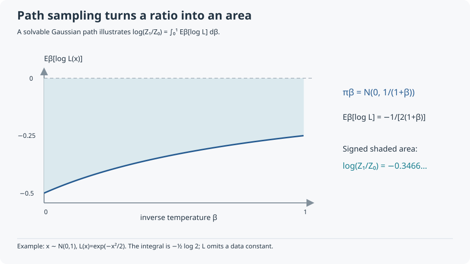

# 26. Normalizing constants and model comparison

**Learning goals.** By the end of this chapter you should be able to derive a bridge ratio and a power-path identity; estimate evidence with bridge sampling, thermodynamic integration, or stepping stones; explain the path weights in annealed importance sampling; diagnose why reciprocal-likelihood averaging is dangerous; and explain how a prior changes a Bayes factor. The prerequisites are [Bayesian targets](03-bayesian-targets.md), [log arithmetic](04-numerics.md), [importance sampling](05-monte-carlo.md), [Monte Carlo error](13-mc-error.md), [diagnostics](14-diagnostics.md), and [tempering](25-tempering.md).

## 26.1 The quantity that sampling leaves unknown

Let $u(\theta)$ be a nonnegative function measured against a specified reference measure $d\theta$, with $0<Z=\int u(\theta)d\theta<\infty$. A sampler targeting $\pi(\theta)=u(\theta)/Z$ often needs only ratios of $u$. Multiplying $u$ by any positive number leaves those ratios and the distribution $\pi$ unchanged. It does change $Z$ by the same factor. This is why a chain of excellent posterior draws contains no automatic estimate of the integral that normalized them.

For a Bayesian model $M$, set $u_M(\theta)=p(y\mid\theta,M)p(\theta\mid M)$, with a *normalized* prior and the complete observed-data likelihood. Then $Z_M=p(y\mid M)$ is the marginal likelihood, or evidence. For two models,

$$
\frac{p(M_1\mid y)}{p(M_0\mid y)}
=\frac{p(M_1)}{p(M_0)}\frac{Z_1}{Z_0}.
$$

The evidence is a density in $y$ when $y$ is continuous, so it can exceed one. A Bayes factor requires both models' densities to refer to the same observed-data measure. If one model uses the density of an ordered sequence and another uses the probability of a count, their raw evidences are not directly comparable. This distinction is independent of numerical accuracy. [Meng and Wong's original bridge-sampling paper](https://people.eecs.berkeley.edu/~jordan/sail/readings/archive/meng-wong.pdf) frames evidence and free-energy differences as ratios of normalizers.

In statistical physics $u(x)=\exp[-\beta_{\rm phys}E(x)]$ yields a partition function. A free-energy *difference* can be read from a ratio of partition functions, up to the chosen physical temperature convention. The computational path parameter $t$ used below is an interpolation device; it need not be physical inverse temperature.

## 26.2 Constants, priors, and the question being answered

Suppose $y\mid\theta\sim N(\theta,1)$. The likelihood is $L(\theta)=(2\pi)^{-1/2}\exp[-(y-\theta)^2/2]$. Dropping $(2\pi)^{-1/2}$ is harmless for a within-model Metropolis acceptance ratio, but multiplies the reported evidence by $\sqrt{2\pi}$. More generally, dropping a multiplicative factor $c>0$ subtracts $\log c$ from log evidence; adding a factor of seven adds $\log 7$. In a Bayes factor the factor cancels only if it is genuinely the same factor in both likelihoods under the same data convention. The safe practice is to build the evidence calculation from a log joint density that retains every normalization constant.

An improper prior has no specified total mass. If $p(\theta)$ is known only up to an arbitrary multiplier, so is $Z_M$; an ordinary Bayes factor is therefore undefined without an additional convention or special construction. A proper but broad prior is different: its density has a known scale, and averaging the likelihood over the extra prior mass can lower evidence. That is a feature of the model's prior-predictive claim, not a failure of the integrator. Posterior predictive checks and held-out predictive scores ask different questions and need not rank models as evidence does. See [Chapter 17](17-workflow.md) for model checking and sensitivity.

## 26.3 One-sided importance sampling

If $g$ is a normalized density and $g(\theta)>0$ wherever $u(\theta)>0$ (up to null sets), then

$$
Z=\int \frac{u(\theta)}{g(\theta)}g(\theta)d\theta
=E_g[w(\theta)],\qquad w=\frac{u}{g}.
$$

The expectation exists because $\int u=Z<\infty$. For independent draws $G_i\sim g$, $\widehat Z=n^{-1}\sum_iw(G_i)$ is unbiased. Its usual finite variance formula additionally requires $E_g[w^2]<\infty$. If $g$ misses positive target mass, the expectation computes only the covered integral; no sample-based weight diagnostic can identify the missing region. Even with formal support coverage, an extremely small $g$ in an important tail can make variance infinite. Concentrating $g$ around a posterior mode is not enough: the integral is assessed by the distribution of $u/g$ under $g$.

With dependent draws from a Markov chain targeting $g$, the identity still holds, but an iid standard error is inappropriate. A Markov chain central limit theorem for the *weight function*, with finite long-run variance, is needed for the familiar standard-error calculation; parameter ESS alone says little about weights. These are the conditions behind the warnings in [Chapters 05](05-monte-carlo.md) and [13](13-mc-error.md). One-sided importance sampling is a useful limit case of a more symmetric construction.

## 26.4 Bridge sampling: use both distributions

Let $u_0,u_1$ have finite positive integrals $Z_0,Z_1$, and $\pi_i=u_i/Z_i$ relative to a common measure. Choose a nonnegative bridge function $h$ for which

$$
0<I=\int u_0(\theta)u_1(\theta)h(\theta)d\theta<\infty.
$$

Direct substitution gives $E_{\pi_0}[u_1h]=I/Z_0$ and $E_{\pi_1}[u_0h]=I/Z_1$. Thus the exact ratio is

$$
r=\frac{Z_1}{Z_0}
=\frac{E_{\pi_0}[u_1h]}{E_{\pi_1}[u_0h]}.
$$

The two expectations are computed from *different* samples. The shared integral cancels; it must be positive and finite. Some overlap of $u_0$ and $u_1$ suffices. Disjoint supports make $I=0$ for every ordinary bridge and leave this ratio undefined. In contrast, one-sided importance sampling needs its proposal to cover the whole positive target support. The identity and its overlap analysis originate in [Meng and Wong (1996)](https://people.eecs.berkeley.edu/~jordan/sail/readings/archive/meng-wong.pdf).

Given $X_i\sim\pi_0$ and $Y_j\sim\pi_1$, replace each expectation by its own sample mean. Their ratio is generally biased at finite $n$, even if each mean is unbiased. Under appropriate laws of large numbers and a nonzero limiting denominator, it is consistent. A tiny denominator in a particular run is a warning about overlap or sampling, not evidence that the ratio is astronomically large.

## 26.5 A practical bridge and its fixed point

For an evidence calculation, let $u_0=g$ be a normalized approximation to the posterior, so $Z_0=1$, and let $u_1=Lp$, so $Z_1=Z$. Write $n_0,n_1$ for the numbers of estimation draws and $s_i=n_i/(n_0+n_1)$. A useful bridge is

$$
h_r(\theta)=\frac{1}{s_1u_1(\theta)+s_0r u_0(\theta)}.
$$

The fraction indexing matters: $s_1$ multiplies $u_1$, and $s_0r$ multiplies $u_0$. Up to a common factor this is $1/(s_1\pi_1+s_0\pi_0)$. For independent draws, the corresponding bridge minimizes an asymptotic relative mean-square criterion under the conditions studied by [Meng and Wong](https://people.eecs.berkeley.edu/~jordan/sail/readings/archive/meng-wong.pdf); it is not a universal optimality claim for arbitrary correlated chains. The [bridge-sampling tutorial](https://arxiv.org/html/1703.05984) develops the practical iterative scheme.

The unknown $r$ appears in $h_r$, so start with $r^{(0)}>0$ and iterate

$$
r^{(k+1)}=
\frac{n_0^{-1}\sum_{i=1}^{n_0}
u_1(X_i)/[s_1u_1(X_i)+s_0r^{(k)}u_0(X_i)]}
{n_1^{-1}\sum_{j=1}^{n_1}
u_0(Y_j)/[s_1u_1(Y_j)+s_0r^{(k)}u_0(Y_j)]}.
$$

Fit $g$ using one part of the posterior output and evaluate the bridge on a held-out part. This avoids direct reuse of fitting draws, but splitting a correlated chain does not make the two parts independent. Independently simulated fitting and estimation runs provide a cleaner separation; estimation-chain dependence still needs its own uncertainty analysis. A fit in unconstrained coordinates must include the transformation Jacobian when evaluating both densities in a shared coordinate system. Compute $\log u_i$ and use log-sum-exp for the averages; direct likelihood products can underflow. Fixed-point convergence verifies only that the finite-sample equation has been solved to a chosen tolerance. It does not verify posterior mode coverage, a good $g$, or convergence of an MCMC chain.

The denominator in $h_r$ gives the bridge its practical shape. Where $u_1$ is large relative to $r u_0$, the numerator contribution $u_1h_r$ levels off rather than exploding as an ordinary importance weight could. Where $u_0$ dominates, the denominator-side contribution $u_0h_r$ similarly levels off. Both sets of draws inform the common overlap region. This stabilization does not manufacture overlap: if almost all $g$ draws and posterior draws occupy separate regions, nearly every useful contribution comes from rare draws. The ratio can then be extremely sensitive to a handful of points, no matter how neatly the fixed-point calculation terminates.

For the Gaussian example below, choosing $g$ as the *prior* gives a transparent bridge without fitting. It is not always efficient: if the posterior is much narrower than the prior, the endpoint overlap is poor. A fitted approximation, multiple proposal components, or an intermediate path may help. In a multimodal model, a single Gaussian fitted to one mode can make the estimate confidently wrong even when the iteration is numerically stable.

## 26.6 Thermodynamic integration along a path

Suppose $u_t$ is positive on a common support for $0\le t\le1$, with $Z_t=\int u_t$ finite and positive. If differentiation can be passed under the integral, and $\partial_t\log u_t$ is integrable under $\pi_t=u_t/Z_t$, then

$$
\frac{d}{dt}\log Z_t
=\frac{1}{Z_t}\int \partial_tu_t(\theta)d\theta
=E_{\pi_t}[\partial_t\log u_t(\theta)].
$$

If $\log Z_t$ is absolutely continuous on $[0,1]$—for example, if its displayed derivative extends continuously to both endpoints—integrating this derivative gives $\log Z_1-\log Z_0$. The identity is exact; evaluating the integral on a finite temperature grid is a numerical approximation. This is path sampling, or thermodynamic integration, as developed in [Gelman and Meng (1998)](https://stat.duke.edu/~scs/Courses/Stat376/Papers/NormConstants/GelmanMengStatSci1998.pdf).

The common Bayesian power path is $u_\beta(\theta)=p(\theta)L(\theta)^\beta$, $0\le\beta\le1$. If $p$ is normalized, $Z_0=1$, and where $L>0$, $\partial_\beta\log u_\beta=\log L$. Subject to the differentiation assumptions, including a well-defined integrable endpoint limit,

$$
\log Z_1=\int_0^1 E_{\pi_\beta}[\log L(\theta)]d\beta.
$$

At the prior endpoint, $\log L$ can be very variable or even fail to be integrable. A zero likelihood on a positive-prior set also changes support at $\beta=0$ under the usual $L^0=1$ convention. In such cases the displayed endpoint derivative cannot be used blindly; establish an appropriate one-sided identity or choose another path. If second moments and differentiation justify one further derivative, then

$$
\frac{d}{d\beta}E_{\pi_\beta}[\log L]
=\operatorname{Var}_{\pi_\beta}(\log L)\ge0.
$$

This gives a geometric reading of the integration curve: rapid change in expected log likelihood means high curvature in $\log Z_\beta$ and calls for a finer temperature grid. A trapezoidal rule has deterministic grid error even if every expectation were known exactly; MCMC adds sampling error to the grid values. More draws at fixed temperatures reduce only the latter. [Friel, Hurn and Wyse](https://arxiv.org/abs/1209.3198) study improvements to power-posterior evidence estimation, including the role of numerical integration. [Chapter 25](25-tempering.md) treats movement between modes along temperature paths.

The illustration uses a deliberately simple path: $x\sim N(0,1)$ and $L(x)=\exp(-x^2/2)$. Its normalizer is $Z_\beta=(1+\beta)^{-1/2}$ and its power target is $N(0,(1+\beta)^{-1})$. Thus $E_\beta[\log L]=-1/[2(1+\beta)]$, and the signed area under that curve is $-\tfrac12\log 2$. The omitted Gaussian data constant is intentional *for this illustrative integral*; it must be restored if the result is reported as evidence for a Gaussian observation.

### 26.6.1 When the prior endpoint loses mass

The support warning has a concrete correction. Let $A=\{\theta:L(\theta)>0\}$ and $a=P_p(A)>0$. With $L^0=1$, $Z_0=1$, but $Z_{0+}=a$: for $0<\beta\le1$, $L^\beta\le1+L$, so dominated convergence applies when the evidence is finite. If the derivative identity can be integrated on the positive-temperature path with an integrable limit at zero, then

$$
\log Z_1=\log a+\int_{0+}^1 E_{\pi_\beta}[\log L]d\beta.
$$

For example, take a uniform prior on $[0,1]$ and $L(\theta)=\mathbf1\{\theta\le1/4\}$. Every positive-temperature target is uniform on $[0,1/4]$, with expected log likelihood zero. Integrating that zero function gives zero, although the true log evidence is $-\log4$. The missing term is exactly $\log a$. A first stepping stone sampled from the full prior estimates $a$ and retains this contribution. In a finite run all its weights can be zero; a logarithm then gives $-\infty$. This example also changes the ordinary harmonic identity below to $E_{\rm post}[1/L]=a/Z$, explaining its strict-positivity assumption.

## 26.7 Stepping stones instead of quadrature

Choose $0=\beta_0<\beta_1<\cdots<\beta_K=1$ and write $\Delta_k=\beta_k-\beta_{k-1}$. Because $u_{\beta_k}=u_{\beta_{k-1}}L^{\Delta_k}$,

$$
\frac{Z_{\beta_k}}{Z_{\beta_{k-1}}}
=E_{\pi_{\beta_{k-1}}}[L^{\Delta_k}],\qquad
\log Z_1=\sum_{k=1}^K\log E_{\pi_{\beta_{k-1}}}[L^{\Delta_k}].
$$

The exact ratios telescope for *any* ladder. In computation, replace each expectation by a sample average and sum their logarithms, using log-sum-exp on $\Delta_k\log L$. There is no deterministic integration-grid bias, but a large step can have poor importance-weight overlap. A finer ladder can reduce that problem while requiring more sampling. The method was introduced for Bayesian phylogenetic evidence by [Xie and colleagues (2011)](https://mdanderson.elsevierpure.com/en/publications/improving-marginal-likelihood-estimation-for-bayesian-phylogeneti/).

Individual iid sample means of positive weights are unbiased for their ratios when their means are finite. Taking logs creates finite-sample bias: Jensen's inequality gives $E[\log\widehat R_k]\le\log R_k$ when the expectation exists. Independent unbiased factors have an unbiased product. Dependent factors need a separate argument; unbiasedness of each factor alone is insufficient, and interacting temperature chains can introduce dependence. Do not infer that an exact telescoping identity makes its log estimator unbiased. For MCMC draws, uncertainty must also reflect dependence within and potentially across temperature chains.

### 26.7.1 Annealed importance sampling: weighting a whole trajectory

[Neal's annealed importance sampling paper, Section 2](https://arxiv.org/pdf/physics/9803008), constructs an importance sampler on paths using intermediate invariant transitions. In our increasing-temperature notation, fix a ladder and kernels $K_k$ invariant for $\pi_k=\pi_{\beta_k}$. Assume finite positive normalizers, a common positive support, and an exact initial draw $X_0\sim\pi_0$. One trajectory follows

$$
W_0=1,\qquad
W_k=W_{k-1}\frac{u_{\beta_k}(X_{k-1})}{u_{\beta_{k-1}}(X_{k-1})},
\qquad X_k\sim K_k(X_{k-1},\cdot).
$$

Evaluate each weight **before** applying the new-temperature transition. For a power path its log increment is $\Delta_k\log L(X_{k-1})$. Intermediate states need not have marginal distribution $\pi_k$. Here is a direct verification in the chapter's notation. For bounded $f$, induction gives

$$
E[W_k f(X_k)]=\frac1{Z_0}\int u_{\beta_k}(x)f(x)dx.
$$

The base case is the initial normalized law. Write $K_kf(x)=\int K_k(x,dy)f(y)$. Conditional expectation and the previous induction step give

$$
E[W_k f(X_k)]
=\frac1{Z_0}\int u_{\beta_{k-1}}(x)
\frac{u_{\beta_k}(x)}{u_{\beta_{k-1}}(x)}K_kf(x)dx
=\frac1{Z_0}\int u_{\beta_k}(y)f(y)dy,
$$

where invariance supplies the last equality. For nonnegative functions the argument uses Tonelli's theorem; bounded signed $f$ follows by subtraction, since the normalizers are finite. Taking $f=1$ proves $E[W_K]=Z_1/Z_0$. Independent trajectories therefore give an unbiased arithmetic mean of weights. Compute its logarithm with log-sum-exp; averaging log weights estimates a different quantity. When its expectation exists, the log of the arithmetic mean generally has downward bias. A finite-variance standard error additionally needs $E[W_K^2]<\infty$.

For an explicit check, use the Gaussian model of Section 26.8. Its power target has variance $v_\beta=(\tau^{-2}+\beta)^{-1}$. The transition

$$
X_k=\rho X_{k-1}+\sqrt{(1-\rho^2)v_{\beta_k}}\,\varepsilon_k,
\qquad \varepsilon_k\sim N(0,1),\quad 0\le\rho\le1,
$$

with fresh independent noise preserves $N(0,v_{\beta_k})$: starting with that variance makes the output variance $\rho^2v_{\beta_k}+(1-\rho^2)v_{\beta_k}=v_{\beta_k}$. Along the actual path, however, its unweighted variance obeys $V_k=\rho^2V_{k-1}+(1-\rho^2)v_{\beta_k}$, starting from $V_0=\tau^2$. For $\tau=2$, sixteen uniform steps and $\rho=0.9$, the variance recursion gives $V_{16}\approx1.1614$, compared with posterior variance $0.8$. The companion script checks weighted evidence against $1/\sqrt{10\pi}$. At $\rho=1$ every transition is the identity: the weight telescopes to $L(X_0)$, recovering prior importance sampling. Invariance suffices for the weight identity, while movement can matter greatly for its variance. These independent trajectories use no resampling; [Chapter 28](28-particle-mcmc.md) develops interacting particle populations and their normalizer estimators.

## 26.8 Worked example A: one Gaussian observation

Observe $y=0$ under $y\mid\theta\sim N(\theta,1)$ and $\theta\sim N(0,\tau^2)$. The prior predictive distribution is $y\sim N(0,1+\tau^2)$, hence

$$
Z(\tau)=\frac{1}{\sqrt{2\pi(1+\tau^2)}},\qquad
\theta\mid y=0\sim N\left(0,v\right),\quad v=\frac{\tau^2}{1+\tau^2}.
$$

The companion script also evaluates TI on this Gaussian path using analytic expectations $E_\beta[\log L]=-\tfrac12\log(2\pi)-v_\beta/2$. For $\tau=2$, on uniform grids with 4, 16, and 64 intervals the log-evidence errors are approximately $-0.036948$, $-0.002484$, and $-0.000156$. No simulation enters those values, so this comparison isolates quadrature error.

For $\tau=2$, $Z=1/\sqrt{10\pi}\approx0.178412$ and $\log Z\approx-1.72366$; the posterior variance is $0.8$. Relative to the point model $M_0:\theta=0$, the model $M_1$ with $\tau=2$ has Bayes factor $Z_1/Z_0=1/\sqrt5\approx0.4472$. With equal prior model probabilities, its posterior probability is $0.4472/(1+0.4472)\approx0.3090$. For $\tau=1,2,10$, the evidence values are approximately $0.2821,0.1784,0.03970$. The decline as $\tau$ grows reflects the wider prior's weaker concentration near observed $y=0$.

This model also exposes an especially tempting failure. Since $L(\theta)>0$ throughout the prior support,

$$
E_{\pi(\theta\mid y)}[L(\theta)^{-1}]
=\frac{1}{Z}\int p(\theta)d\theta=\frac1Z.
$$

Thus the reciprocal of a posterior average of $1/L$ is the ordinary harmonic-mean evidence estimator. Its *identity* is correct. The variance of the reciprocal-likelihood quantity being averaged may be infinite. Here $L^{-1}=\sqrt{2\pi}\exp(\theta^2/2)$ and $L^{-2}=2\pi\exp(\theta^2)$. For $\theta\sim N(0,v)$, the second-moment integral is proportional to

$$
\int_{-\infty}^{\infty}
\exp\left[-\left(\frac{1}{2v}-1\right)\theta^2\right]d\theta.
$$

It is finite only when $v<1/2$, equivalent to $\tau^2<1$. At $\tau^2=1$ the integrand is constant; above it grows in the tails. The sample mean still has a finite first moment and can obey a law of large numbers under appropriate sampling conditions, but an ordinary finite-variance CLT and its delta-method error bar fail. In this particular model the *reciprocal of the sample mean* is bounded above by the maximum likelihood, so saying that this final estimator itself has infinite variance would be false. Most runs can look stable until a rare tail draw makes a large change. Parameter moments of the Gaussian posterior remain finite, and a reassuring ESS for $\theta$ cannot repair the infinite variance of $1/L$. Generalized reciprocal estimators that use a carefully chosen normalized auxiliary density have different tail conditions; this calculation condemns the *ordinary* choice $1/L$, not every related estimator.

## 26.9 Worked example B: a sequence of Bernoulli observations

Consider a particular ordered sequence of ten Bernoulli outcomes with eight successes and two failures, and give $\theta$ the uniform $\operatorname{Beta}(1,1)$ prior. Because the data are the sequence, the likelihood is $L(\theta)=\theta^8(1-\theta)^2$ without a binomial coefficient. Direct integration gives

$$
Z_1=\int_0^1\theta^8(1-\theta)^2d\theta
=B(9,3)=\frac{8!\,2!}{11!}=\frac1{495},
\qquad \log Z_1=-\log495\approx-6.20456.
$$

The power posterior is $\operatorname{Beta}(1+8\beta,1+2\beta)$ and $Z_\beta=B(1+8\beta,1+2\beta)$. Every exact stepping-stone ratio is therefore

$$
R_k=\frac{B(1+8\beta_k,1+2\beta_k)}
{B(1+8\beta_{k-1},1+2\beta_{k-1})}.
$$

Multiplication cancels every intermediate beta function and leaves $B(9,3)/B(1,1)=1/495$. The companion [executable example](examples/ch26.py) samples each lower-temperature beta distribution, estimates the ratios, and compares the result with this exact value. It also checks a numerical trapezoid rule against the same answer. That check isolates arithmetic and method behavior on a tractable model; it does not establish reliability on a multimodal target.

The path integrand can be checked at both ends without simulation. At $\beta=0$, a uniform $\theta$ has $E[\log\theta]=E[\log(1-\theta)]=-1$, so $E_0[\log L]=-10$. At $\beta=1$, the posterior is $\operatorname{Beta}(9,3)$ and beta-distribution log moments give

$$
E_1[\log L]
=-8\left(\frac19+\frac1{10}+\frac1{11}\right)
-2\sum_{j=3}^{11}\frac1j\approx-5.45592.
$$

The integrand rises substantially near the prior side. A coarse uniform trapezoid grid approximates a curved function by chords, whereas stepping stones approximate each expectation of $L^{\Delta}$ directly. Neither method escapes the need to sample the low-temperature distributions faithfully. In this conjugate example, direct beta draws make that easy; in a general model, temperature-chain mixing is a separate concern from either formula.

If instead the recorded datum is only the count $S=8$, its likelihood is $\binom{10}{8}\theta^8(1-\theta)^2$ and its evidence is $45/495=1/11$. That multiplier changes standalone evidence. If every compared model describes the *same* count and receives the same data-only multiplier, it cancels from their Bayes factor. Mixing sequence and count conventions across models would create a spurious factor of 45.

## 26.10 Error budget and method choice

Numerical agreement on one seed should be read against separate failure sources. First establish the model: proper priors, the data measure, constants in $L$, and Jacobians. Then establish exploration: a chain can miss a posterior mode, and temperatures can fail to transport it, even while within-mode diagnostics look good. Next examine estimator overlap and moments: weight concentration, unstable denominators, and long-range chain dependence affect Monte Carlo error. Bridge fitting adds another source if a fitted $g$ is too narrow or omits modes. TI adds grid quadrature error; stepping stones add finite-step weight variance and finite-sample log bias. Log arithmetic limits floating-point loss but cannot cure missing mass.

For a bridge estimate, rerun the complete fit-and-estimate procedure on independent seeds and examine both bridge summands, not only the final fixed point. For a path estimate, report the ladder and draws at each temperature; increase draws and refine the ladder as *separate* experiments. Replicated estimates measure run-to-run variation conditional on the design but cannot reveal a mode that all runs miss. A tractable benchmark, a different method, and targeted exploration checks give more varied evidence than repeating one estimator alone. Passing posterior diagnostics is useful evidence about sampled quantities, never proof that an evidence estimate has converged.

One useful reporting table has a row for every temperature or bridge side, with its sample count, chain diagnostics for the estimator's actual function, and a measure of weight concentration where weights are used. Show the log-evidence estimate from each independent run before averaging runs. If an estimate changes materially under extra temperatures while its within-temperature Monte Carlo error appears small, investigate grid error or overlap. If it changes under longer chains at a fixed ladder, investigate sampling and mixing. An apparent plateau under both changes is encouraging but still conditional on the paths and modes explored.

| Situation | Starting method | Main check |
| --- | --- | --- |
| A normalized approximation overlaps the posterior | Bridge sampling | Both bridge averages and fit stability |
| A smooth powered path can be sampled | Thermodynamic integration | Grid refinement and temperature-wise error |
| Powered targets overlap in manageable steps | Stepping stones | Weight concentration at every step |
| Sequential weighted paths are already available | AIS or SMC | Weight degeneracy and repeated runs |

Annealed importance sampling in Section 26.7.1 uses weighted paths; [Chapter 28](28-particle-mcmc.md) develops sequential Monte Carlo normalizers. [Chapter 30](30-reversible-jump.md) addresses posterior model probabilities through moves between model spaces. These methods can be compared on a common model, but each has its own error conditions. When reporting a Bayes factor, state the log evidences, prior model probabilities, parameter priors, data convention, estimation method, uncertainty procedure, and sensitivity to substantive prior scales.

### Interactive lab: where importance weights concentrate

Change the **proposal standard deviation** in the importance-sampling lab away from one. Watch how a few weights dominate and how a short run may still look stable. Every available Gaussian proposal has full support on the real line, so the control changes tail coverage in finite samples and weight concentration, rather than introducing a literal support gap. The lab implements one-sided importance sampling, not bridge sampling or Bayesian evidence estimation.

## 26.11 Exercises

1. **A hidden factor.** Replace $u(\theta)$ by $7u(\theta)$. What happens to its normalized law and log normalizer? When does this factor cancel from $Z_1/Z_0$?

Solution

The new normalizer is $7Z$ and the normalized law is $7u/(7Z)=u/Z$. Its log normalizer increases by $\log7$. A Bayes factor is unchanged if *both* model likelihoods gain the same data-only factor seven under a common data convention. If only one model gains it, the Bayes factor is multiplied by seven.

2. **Prove the bridge identity.** Give the two expectations explicitly and identify a condition under which the formula is unusable.

Solution

With $I=\int u_0u_1h$, $E_{\pi_0}[u_1h]=I/Z_0$ and $E_{\pi_1}[u_0h]=I/Z_1$. Their ratio is $Z_1/Z_0$ if $0<I<\infty$. If the positive supports are disjoint, $I=0$ for any ordinary finite bridge and the result is $0/0$.

3. **A moment boundary.** In the Gaussian example derive $v$ by completing the square, then find exactly when $\operatorname{Var}_{\pi}(1/L)$ exists. Would a high ESS for $\theta$ settle the issue?

Solution

The quadratic coefficient in prior times likelihood is $1+1/\tau^2$, so $v=(1+1/\tau^2)^{-1}=\tau^2/(1+\tau^2)$. The second moment of $1/L$ requires $\int\exp[-(1/(2v)-1)\theta^2]d\theta<\infty$, which holds precisely when $v<1/2$, or $\tau^2<1$. Equality diverges. ESS for $\theta$ concerns a different function and cannot establish a finite variance for $1/L$.

4. **Exact stepping stones.** Use the Bernoulli example with ladder $0,0.1,0.35,0.7,1$. Write its four exact ratios and show their product.

Solution

Let $A(b)=B(1+8b,1+2b)$. The ratios are $A(0.1)/A(0)$, $A(0.35)/A(0.1)$, $A(0.7)/A(0.35)$, and $A(1)/A(0.7)$. Their product telescopes to $A(1)/A(0)=B(9,3)/B(1,1)=1/495$. The exact result is ladder-independent; simulated ratio precision is not.

5. **Two refinements.** On the Beta–Bernoulli example, compare TI on coarse and fine grids, each with short and long independent runs. What pattern suggests quadrature error rather than Monte Carlo noise?

Solution

If longer runs on the same coarse grid concentrate around a value still separated from the fine-grid value and from $-\log495$, the persistent gap suggests quadrature error. If increasing draws chiefly shrinks run-to-run spread with no persistent grid gap, Monte Carlo noise was dominant at that resolution. An exact-ratio stepping-stone calculation checks algebra separately; its sampled version has its own weight and log bias.

6. **Prior width and model odds.** For $y=0$, compare $M_0:\theta=0$ with $M_1:\theta\sim N(0,\tau^2)$ using equal prior model probabilities. Derive the posterior probability of $M_1$ and its limit as $\tau\to\infty$.

Solution

$Z_0=1/\sqrt{2\pi}$ and $Z_1=1/\sqrt{2\pi(1+\tau^2)}$, so $BF_{10}=1/\sqrt{1+\tau^2}$. Equal prior odds give $p(M_1\mid y)=BF_{10}/(1+BF_{10})=1/(1+\sqrt{1+\tau^2})$. It tends to zero as $\tau$ grows. The increasingly diffuse *proper* prior puts less predictive density at zero; the limit is not a sampling failure.

7. **An annealing path that never moves.** Set every AIS kernel to the identity. Explain why the evidence estimate remains unbiased and calculate the relative variance of one weight for the Gaussian model with $\tau=2$.

Solution

Identity kernels preserve every distribution. All states equal the prior draw $X_0$, and $W_K=\prod_k L(X_0)^{\Delta_k}=L(X_0)$. Thus $E[W_K]=Z$ regardless of the number of temperatures. Gaussian integration gives $E[W_K^2]=(2\pi)^{-1}(1+2\tau^2)^{-1/2}$ and $Z^2=(2\pi)^{-1}(1+\tau^2)^{-1}$. Therefore $\operatorname{Var}(W_K)/Z^2=(1+\tau^2)/\sqrt{1+2\tau^2}-1=2/3$ at $\tau=2$. For $N$ independent paths the relative variance is $2/(3N)$. Adding temperatures without any movement leaves this variance unchanged. Unweighted endpoints still have prior variance four, rather than posterior variance $0.8$.

## Key takeaways

Normalization is an integration problem with information that a ratio-based sampler may discard. Bridge sampling compares two overlapping distributions; thermodynamic integration integrates an expected log-density derivative; stepping stones multiply exact adjacent ratios and estimate each one. AIS averages weights accumulated along invariant-kernel paths; its intermediate states need not be equilibrated. These exact identities have different finite-run errors. Ordinary harmonic-mean evidence can average reciprocal likelihoods with infinite variance even under a well-behaved Gaussian posterior. A reported Bayes factor is meaningful only with complete likelihood constants, a common data convention, specified proper priors, and an uncertainty analysis tied to the estimator.
