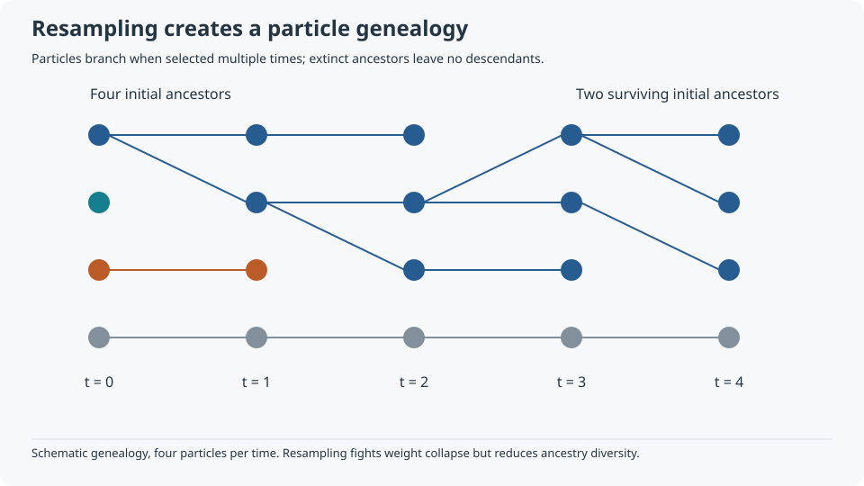

# 28. Sequential Monte Carlo and particle MCMC

## Learning goals and prerequisites

A particle filter follows a changing distribution with a population of weighted simulations. Its finite population is an approximation. Nevertheless, a carefully constructed Markov chain using that population can have the exact posterior as its invariant marginal. Understanding this distinction is the central goal of this chapter.

You will derive particle weights, calculate a likelihood estimate, establish its unbiasedness, and use it in particle marginal Metropolis–Hastings (PMMH). You will also construct an annealed SMC sampler for a static posterior, see why particle Gibbs retains a trajectory, and learn how ancestor sampling helps that trajectory change. Read [importance sampling](05-monte-carlo.md), [Gibbs augmentation](10-gibbs.md), and especially [pseudo-marginal MCMC](27-pseudo-marginal.md) first. The distinctions between invariance, convergence, and finite-run accuracy from [Chapter 8](08-convergence.md) remain essential. We use $M$ for particles and $N$ for MCMC iterations.

## 28.1 A sequence of posterior distributions

Let $\theta$ be a static parameter, $X_t$ an unobserved state, and $y_{1:T}$ fixed observations. Assume the latent process is Markov conditional on $\theta$, and observations are conditionally independent given the states, with each observation depending only on its corresponding state. The joint density is then

$$
p(\theta,x_{1:T},y_{1:T})=p(\theta)\mu_\theta(x_1)
\prod_{t=2}^T f_\theta(x_t\mid x_{t-1})
\prod_{t=1}^T g_\theta(y_t\mid x_t).
$$

Integrals below become sums for discrete states. For now, hold $\theta$ fixed. Filtering concerns $p_\theta(x_t\mid y_{1:t})$: what can we infer about today's state using observations through today? Smoothing concerns $p_\theta(x_{1:T}\mid y_{1:T})$: what can the complete observations tell us about the entire past? Future observations can revise earlier state estimates.

Writing $\eta_{t-1}$ for the filtering density, prediction and correction give

$$
\eta_t^-(x)=\int f_\theta(x\mid z)\eta_{t-1}(z)\,dz,
\qquad
\eta_t(x)=\frac{g_\theta(y_t\mid x)\eta_t^-(x)}{c_t},
$$

where $c_t=\int g_\theta(y_t\mid x)\eta_t^-(x)\,dx$. At time one use $\mu_\theta$ for the prediction. Each $c_t$ is a predictive observation density, so the evidence is $Z_T(\theta)=\prod_t c_t$.

The two operations have different jobs. Prediction spreads existing uncertainty through the transition model. Correction favors states compatible with the new observation. Particle filtering replaces the integrals by weighted simulations. More general sequential Monte Carlo (SMC) methods can instead follow artificial sequences of distributions, such as increasingly informative static posteriors; the sequential index need not represent physical time. The [Doucet–Johansen tutorial](https://warwick.ac.uk/fac/sci/statistics/staff/academic-research/johansen/publications/DJ11.pdf) develops this broader viewpoint.

## 28.2 Worked example: an exactly soluble hidden Markov model

Take states and observations in $\{0,1\}$, initial probabilities $(0.5,0.5)$, and transition matrix

$$
F=\begin{pmatrix}0.9&0.1\\0.2&0.8\end{pmatrix}.
$$

Rows index the previous state. The observation probabilities satisfy $P(Y=1\mid X=0)=0.2$ and $P(Y=1\mid X=1)=0.8$. Observe $(y_1,y_2)=(1,0)$.

The first unnormalized masses are $(0.1,0.4)$. Thus $c_1=0.5$ and the first filter is $(0.2,0.8)$. Predicting the next state gives

$$
(0.2,0.8)F=(0.34,0.66).
$$

The second observation is zero, whose emission probabilities are $(0.8,0.2)$. Correction produces masses $(0.272,0.132)$, giving

$$
c_2=0.404,\qquad Z_2=0.5(0.404)=0.202,
\qquad P(X_2=1\mid y_{1:2})=\frac{0.132}{0.404}\approx0.32673.
$$

We can also see smoothing directly. The joint observation-and-path masses for paths $00,01,10,11$ are respectively $0.072,0.002,0.064,0.064$. They sum to $0.202$. Therefore $P(X_1=1\mid y_{1:2})=0.128/0.202\approx0.63366$, smaller than the earlier filtering value $0.8$. The observation zero has revised our opinion of the first state.

Now consider one possible four-particle run. Suppose its first states are $(0,1,1,1)$. Their weights are $(0.2,0.8,0.8,0.8)$, their mean weight is $0.65$, and normalized weights are $(1,4,4,4)/13$. Suppose resampling chooses parents $(2,2,3,4)$ and propagation gives states $(1,1,0,1)$. This event has positive probability under the model. The new weights are $(0.2,0.2,0.8,0.2)$, with mean $0.35$. The likelihood estimate is $0.65(0.35)=0.2275$.

The estimate differs from $0.202$, and the estimated final state-one probability is $0.6/1.4\approx0.42857$. Neither discrepancy is an implementation error. A single population is random; the unbiasedness claim concerns the likelihood estimate averaged across independently generated populations.

The accompanying executable averages 20,000 independent four-particle likelihood estimates. Its seeded result is $0.202480$, with an estimated independent-simulation standard error of $0.000536$. The discrepancy from $0.202$ is smaller than one standard error. This checks the implementation against a known answer; the proof in Section 28.6 establishes unbiasedness beyond this one simulation.

## 28.3 Extending paths and correcting proposals

Define the unnormalized path density

$$
\gamma_t(x_{1:t})=\mu_\theta(x_1)g_\theta(y_1\mid x_1)
\prod_{s=2}^t f_\theta(x_s\mid x_{s-1})g_\theta(y_s\mid x_s).
$$

Suppose an existing path is extended using $r_t(x_t\mid x_{t-1},y_t)$. Dividing the new target density by the extended proposal density cancels all earlier factors. The incremental importance weight is

$$
a_t(x_{t-1},x_t)=
\frac{f_\theta(x_t\mid x_{t-1})g_\theta(y_t\mid x_t)}
{r_t(x_t\mid x_{t-1},y_t)}.
$$

At initialization the corresponding weight is $\mu_\theta(x_1)g_\theta(y_1\mid x_1)/r_1(x_1\mid y_1)$. Proposals must cover the relevant target support: positive target mass cannot sit where the proposal has zero mass. Assume finite, positive evidence throughout.

Without resampling, the new unnormalized weight is the old weight multiplied by $a_t$. This accumulated product can become extremely uneven. A proposal that appears reasonable for each individual state can still be poor for a long path, because small mismatches multiply over time.

The bootstrap choice uses $r_1=\mu_\theta$ and $r_t=f_\theta$. Its incremental weight simplifies to $g_\theta(y_t\mid x_t)$. This is convenient when transition simulation is easy. It can be inefficient when observations are much more informative than the transition proposal anticipates: most proposed states then receive negligible weight.

Guided proposals incorporate the current observation before generating the new state. Their extra cost can be worthwhile, but the denominator $r_t$ must remain in the correction. Replacing a transition proposal by a guided proposal while retaining bootstrap weights changes the target.

## 28.4 Resampling solves one problem and creates another

For normalized weights $W_t^1,\ldots,W_t^M$, define particle weight ESS as

$$
\operatorname{ESS}_{\mathrm{weight}}=\frac{1}{\sum_{i=1}^M(W_t^i)^2}.
$$

It ranges from one for complete concentration to $M$ for equal weights. This measures concentration within one population. It does not estimate the number of independent draws represented by an MCMC chain.

Multinomial resampling draws $M$ parent indices independently from the categorical distribution with probabilities $W_t$. If $n_i$ is the number of children of parent $i$, then

$$
E[n_i\mid W_t]=\sum_{j=1}^M P(A^j=i\mid W_t)=MW_t^i.
$$

Thus resampling preserves weighted averages in conditional expectation while reallocating future simulation effort. It also adds sampling noise and duplicates paths. After resampling, equal weights do not imply independent particles.

Weight collapse and genealogical collapse are distinct. Weight collapse means that only a few current particles contribute appreciably. Genealogical collapse means that many current paths share the same earlier ancestors. Later propagation can produce diverse current states without restoring lost historical paths. This is why an apparently healthy filter may be a poor smoother.

### 28.4.1 Perfect evidence, maximal weight ESS, and growing estimation error {#sec-2841-perfect-evidence-maximal-weight-ess-and-growing-estimation-error}

**Predict before running.** Start with $M$ independent fair binary particles. Every observation has likelihood one, and the transition initially copies the selected parent's state unchanged. Resample uniformly with replacement at every round. Will another round reduce the error in the population's state-one proportion? Will weight ESS reveal the change? Write a prediction before using the laboratory.

Here generation zero is the initial iid population. The integer $g$ counts **completed resampling rounds**, so $g=0$ means that no parent selection has occurred. Let $X_g^i\in\{0,1\}$, $Q_g=M^{-1}\sum_iX_g^i$, and $v=1/4$. The target remains $\operatorname{Bernoulli}(1/2)$. Every incremental mean weight equals one, hence $\widehat Z=1$ exactly; all normalized weights are $1/M$, hence weight ESS is $M$ at every generation. These facts hold for each run, including a population containing only zeros.

Nevertheless, for two distinct particle slots $i\ne j$ and identity mutation,

$$
\operatorname{Cov}(X_g^i,X_g^j)
=v\left[1-\left(1-\frac1M\right)^g\right],
\qquad
\operatorname{Var}(Q_g)
=v\left[1-\left(1-\frac1M\right)^{g+1}\right].
$$

The covariance statement requires $M\ge2$; the variance formula also holds for $M=1$. These are **unconditional** moments over independently drawn initial clouds and all subsequent resampling. Initially $\operatorname{Var}(Q_0)=v/M$. At $M=100$, $g=99$, its standard deviation is approximately $0.398110$, compared with $0.05$ initially. Another perfectly neutral observation has supplied no information; unnecessary copying has added noise. For fixed $M$, the variance tends to $v$, the variance of a single fair binary draw. Maximal weight ESS has not certified independent particles.

**Derive the error, rather than reading it from one path.** Trace two distinct terminal slots backward. At each resampling step their parents coincide with probability $1/M$ if they have not already met. Thus their probability of meeting within $g$ rounds is $1-(1-1/M)^g$. Identity mutation gives the two descendants the same initial binary value if their paths meet. Distinct initial roots carry independent values. Both marginal means are $1/2$, so their covariance is $v$ times that meeting probability. Summing the $M$ marginal variances and $M(M-1)$ covariances, then dividing by $M^2$, yields the variance formula. The offset $g+1$ includes the randomness already present in generation zero.

This coalescence probability is not a realized count of surviving roots. Give each initial particle a distinct root label, copy that label at every parent selection, and count the distinct labels actually present. That count is a random historical measurement. Equal outcome values need not share a root, and different outcome values after mutation can share a root. Report the count separately from weight ESS and from the exact variance over repeated systems. The general genealogy bookkeeping in [Lee and Whiteley, Section 2 and Algorithm 1](https://arxiv.org/pdf/1509.00394), tracks these initial-ancestor labels; their variance-estimation theory extends well beyond this soluble example. The finite formulas here follow from the displayed derivation. [Doucet and Johansen, Section 3.4](https://warwick.ac.uk/fac/sci/statistics/staff/academic-research/johansen/publications/DJ11.pdf), discusses the noise introduced by resampling.

**Conditioning changes the question.** If we hold one realized initial cloud fixed, with $Q_0=p_0$, then identity copying gives

$$
E[Q_g\mid X_0^{1:M}]=p_0,\qquad
\operatorname{Var}(Q_g\mid X_0^{1:M})
=p_0(1-p_0)\left[1-\left(1-\frac1M\right)^g\right].
$$

At $g=0$ this conditional variance is zero: nothing remains random once the initial cloud is fixed. If that cloud contains only zeros, it remains zero forever, with zero conditional variance and an error of $-1/2$ relative to the target mean. Zero conditional variance therefore does not mean a correct target estimate. Conditional mean squared error relative to the target mean is $V_g+(\mu_g-1/2)^2$; it includes this squared bias. The laboratory always draws an iid initial cloud, and displays both the unconditional reference and the conditional reference for the particular cloud drawn.

### Repair current outcomes without inventing historical paths

After each uniform parent selection, independently refresh the child to a new $\operatorname{Bernoulli}(1/2)$ draw with probability $\varepsilon$; otherwise copy the parent's value. This is a target-invariant mutation. The order is **resample, then refresh**, independently for each child. Keep copying the actual historical root label even when refreshing the outcome. A fresh value can reduce current-state dependence; it does not reconstruct a discarded ancestral path.

Put $a=1-\varepsilon$. Given the current population proportion $Q_g$, a child is one with probability $aQ_g+\varepsilon/2$. Children are conditionally independent, so the exact count transition is

$$
K_{g+1}\mid K_g=k
\ \sim\ \operatorname{Binomial}\left(M,\,a\frac{k}{M}+\frac{\varepsilon}{2}\right),
\qquad K_g=MQ_g.
$$

For either conditioning convention, write $\mu_g=E[Q_g]$ and $V_g=\operatorname{Var}(Q_g)$ under that convention. Total expectation and total variance give

$$
\mu_{g+1}=a\mu_g+\frac{\varepsilon}{2},\qquad
V_{g+1}=\frac{\mu_{g+1}(1-\mu_{g+1})}{M}
+a^2\left(1-\frac1M\right)V_g.
$$

For example, with $R=aQ_g+\varepsilon/2$, total variance is $E[R(1-R)]/M+\operatorname{Var}(R)$. Since $E[R(1-R)]=E[R]\,(1-E[R])-\operatorname{Var}(R)$ and $\operatorname{Var}(R)=a^2V_g$, the recurrence follows. For a fixed initial cloud use $\mu_0=p_0$, $V_0=0$. For iid fair initialization use $\mu_0=1/2$, $V_0=v/M$, so the mean stays $1/2$ and

$$
V_g=V_\infty+b^g(V_0-V_\infty),\qquad
b=a^2\left(1-\frac1M\right),\qquad
V_\infty=\frac{v}{M-a^2(M-1)}.
$$

The recurrence also defines $g=0$ directly, avoiding any ambiguous $0^0$ notation at $\varepsilon=1$. With complete refresh and iid initialization, $V_g=v/M$ at every generation. Conditional on a fixed initial cloud, $V_0=0$ and $V_g=v/M$ for $g\ge1$: each refreshed generation really consists of iid fair draws. With no refresh, the earlier copying formula returns. Evidence remains one and weight ESS remains $M$ under every refresh setting. For intermediate refresh, this is a calculation for this particular kernel, rather than a claim that any mutation repairs any model.

**Compare, explain, then change.** In the laboratory, compare $\varepsilon=0$ and $1$ at the same particle count and number of rounds; use several seeds. Inspect actual parent edges and root labels, not just the final zeros and ones. Move the generation focus to inspect consecutive portions of the stored path: the plot shows at most six generations at a time. The available controls use $2\le M\le40$, $0\le g\le80$, and refresh probabilities $0,0.1,0.5,1$. Before each run predict which quantities can change: evidence, weight ESS, root count, final proportion, and exact variance. Explain why complete refresh can produce both outcome values even when only one initial root survives. Then derive Exercise 4's changed target without using the fair-target numbers.

<div class="mcmc-lab" data-lab="ancestry"><p>The genealogy experiment requires JavaScript. The generation convention, exact formulas, derivations, and changed exercise remain available in the text and print edition.</p></div>

The laboratory's exact moment curves describe repeated systems, while its genealogy is one seeded realization. Neither the final realized error nor the realized root count is itself a variance estimate. [The chapter program](examples/ch28.py) supplies a rational count-law oracle and a separate moment recurrence, plus a seeded genealogy that retains actual parent slots and root labels. Small count laws can be enumerated exactly; the moment recurrence handles larger comparisons without enumerating every history.

Stratified and residual resampling can reduce resampling noise in useful settings. Systematic resampling is computationally attractive, but its behavior can depend on particle ordering; no universal ranking of every resampling method is needed here. We use multinomial resampling throughout the conditional algorithms below, where the conditioning mechanism is explicit.



The importance laboratory isolates one part of this process. Move the proposal standard deviation away from one and observe weight concentration and its ESS. Repeat with other seeds: a very narrow proposal can miss important tails even when the displayed ESS looks satisfactory. It illustrates a single importance-weighting step; it does not simulate sequential ancestry, conditional SMC, or particle Gibbs.

<div class="mcmc-lab" data-lab="importance"></div>

## 28.5 A bootstrap filter with consistent bookkeeping

Our convention resamples before every transition and does not resample after the final observation. Under this convention, all weights after propagation are fresh emission weights:

```text
Draw X[1,i] from mu for i = 1,...,M
Set w[1,i] = g(y[1] | X[1,i])
Set logZ = log(mean(w[1,:])); normalize to W[1,:]
For t = 2,...,T:
    For i = 1,...,M:
        Draw A[t,i] from Categorical(W[t-1,:])
        Draw X[t,i] from f(. | X[t-1,A[t,i]])
        Set w[t,i] = g(y[t] | X[t,i])
    Add log(mean(w[t,:])) to logZ
    Normalize w[t,:] to W[t,:]
Optionally draw K from Categorical(W[T,:])
Trace K backward through A to recover one ancestral path
```

The likelihood estimate is

$$
\widehat Z_T=\prod_{t=1}^T\left[\frac1M\sum_{i=1}^M w_t^i\right].
$$

Do not multiply each fresh emission weight by its parent's normalized weight: parent selection already incorporated that weight. Doing both would count the observation information twice.

In larger problems, work with log weights and log-sum-exp. With $\ell_i=\log w_i$ and $b=\max_i\ell_i$, compute $\log\sum_iw_i=b+\log\sum_i\exp(\ell_i-b)$. If every weight is genuinely zero, the filter estimates zero likelihood and cannot normalize its population. A PMMH proposal with this result is rejected; initialize the chain at a positive estimate. Underflow that merely *looks* like zero is a numerical failure requiring stable arithmetic.

This straightforward algorithm uses $O(MT)$ simulations and $O(MT)$ storage when all states and ancestor indices are retained. Computing only the likelihood needs $O(M)$ working storage. Recovering paths requires ancestry or another justified reconstruction scheme.

## 28.6 Why the likelihood estimate is unbiased

The incremental averages are dependent, so multiplying their separate expectations is not a valid proof. A stronger identity carries the dependence correctly.

Let $X_{1:t}^i$ denote the full ancestral path of particle $i$, and write $\gamma_t(h)=\int h(x_{1:t})\gamma_t(x_{1:t})\,dx_{1:t}$. For finite $T$, correct proposal support, unbiased resampling offspring counts, and $\gamma_t(|h|)<\infty$, the bootstrap construction satisfies

$$
E\left[\widehat Z_t\sum_i W_t^i h(X_{1:t}^i)\right]=\gamma_t(h).
$$

If a population has all-zero weights, interpret its unnormalized contribution as zero thereafter. One can stop that run with likelihood estimate zero, or use arbitrary normalized weights to complete its bookkeeping while keeping $\widehat Z=0$. The identity concerns this zero-extended construction; it does not require dividing by zero. The conditional-path construction below operates on positive extended-target support.

At time one the random quantity inside the expectation is simply $M^{-1}\sum_i g(y_1\mid X_1^i)h(X_1^i)$. Integrating $X_1^i\sim\mu$ proves the base case.

For the induction step, condition on the entire population through time $t-1$. Since $\widehat Z_t=\widehat Z_{t-1}M^{-1}\sum_iw_t^i$, multiplication by the normalized weighted average cancels the new normalizer:

$$
\widehat Z_t\sum_iW_t^ih(X_{1:t}^i)
=\widehat Z_{t-1}\frac1M\sum_iw_t^ih(X_{1:t}^i).
$$

Define a function on earlier paths by

$$
(Q_th)(x_{1:t-1})=\int f(x_t\mid x_{t-1})g(y_t\mid x_t)
h(x_{1:t})\,dx_t.
$$

Conditional expectation over resampling and propagation turns the last display into $\widehat Z_{t-1}\sum_jW_{t-1}^j(Q_th)(X_{1:t-1}^j)$. The induction hypothesis gives $\gamma_{t-1}(Q_th)=\gamma_t(h)$. Taking $h=1$ establishes $E[\widehat Z_T]=Z_T$.

This argument does not make the normalized particle average unbiased: dividing by the random $\widehat Z_t$ cannot be moved outside expectation. Nor is $\log\widehat Z_T$ unbiased for $\log Z_T$. When the logarithm is integrable, Jensen's inequality gives $E[\log\widehat Z_T]\leq\log Z_T$. These distinctions underpin the extended constructions in [Andrieu, Doucet, and Holenstein (2010)](https://www.stats.ox.ac.uk/~doucet/andrieu_doucet_holenstein_PMCMC.pdf).

The binary example makes the distinction numerical. Exact count enumeration for $M=4$ gives $E[\widehat Z_2]=101/500=0.202$, while the expected normalized estimate of $P(X_2=1\mid y)$ is approximately $0.400728$. The actual filtering probability is approximately $0.326733$. Unbiased evidence and biased normalized filtering coexist in the same algorithm.

## 28.7 Annealed SMC for a static posterior

Now change the meaning of the sequence. Suppose $x$ is one static unknown, $p_0(x)$ is a normalized prior, and $L(x)$ is the likelihood of all the fixed observations. Choose a finite schedule in advance,

$$
0=\beta_0<\beta_1<\cdots<\beta_J=1,
\qquad \gamma_k(x)=p_0(x)L(x)^{\beta_k},
\qquad \pi_k(x)=\gamma_k(x)/Z_k.
$$

Here $Z_0=1$, $\pi_J$ is the posterior, and $Z_J$ is its evidence. Every particle represents the same static unknown throughout. Increasing $k$ increases the fraction of the full likelihood used; it does not append a latent state or reveal another observation.

This is a special case of the SMC samplers of [Del Moral, Doucet, and Jasra (2006)](https://www.stats.ox.ac.uk/~doucet/delmoral_doucet_jasra_sequentialmontecarlosamplersJRSSB.pdf), especially their MCMC-kernel construction in Section 3.3.2.3. We derive the needed estimator directly below, without introducing general backward kernels.

### Weight, resample, then mutate

Start with independent $X_0^i\sim p_0$. Suppose the population after the previous stage has equal weights. Changing its target from $\pi_{k-1}$ to $\pi_k$ contributes the potential

$$
G_k(x)=\frac{\gamma_k(x)}{\gamma_{k-1}(x)}
=L(x)^{\beta_k-\beta_{k-1}}.
$$

Compute this at the *old* positions. Resampling allocates descendants according to these weights. A subsequent mutation kernel $K_k$ preserves $\pi_k$; for example, an MH proposal $q_k(x'\mid x)$ accepts with probability

$$
\min\left\{1,
\frac{p_0(x')L(x')^{\beta_k}q_k(x\mid x')}
{p_0(x)L(x)^{\beta_k}q_k(x'\mid x)}\right\}.
$$

The move can be a fixed finite number of MH or Gibbs steps. Invariance suffices for the calculation; the kernel need not produce an independent draw from $\pi_k$.

```text
Draw X[0,i] independently from p0; set logZ = 0
For k = 1,...,J:
    Set logg[i] = (beta[k] - beta[k-1]) * log L(X[k-1,i])
    Add logsumexp(logg) - log(M) to logZ
    Normalize exp(logg) to V[i]
    Draw M parents A[i] independently from Categorical(V)
    Draw X[k,i] from K[k](X[k-1,A[i]], .) for each child
Return logZ and the equally weighted final population
```

The evidence estimate is

$$
\widehat Z_J=\prod_{k=1}^J\widehat c_k,
\qquad \widehat c_k=\frac1M\sum_iG_k(X_{k-1}^i).
$$

Resampling duplicates particles; mutation can move those copies to different values. Even after mutation, the finite population is generally dependent and approximate. Identity kernels would still give a valid evidence estimator under the conditions below, but cannot recreate a region missing from the initial population. Skipping resampling requires carrying the existing normalized weights into the next weighting and normalizer calculation; the displayed arithmetic means assume the stated resampling schedule.

### Why this product is unbiased

Assume $M\geq1$, a fixed finite ladder, $0<L(x)<\infty$ on the prior support, and $0<Z_k<\infty$ for every stage. Start from exact prior draws, use resampling with conditional expected offspring counts $MV_i$, and choose the $\pi_k$-invariant kernels and their numbers of steps in advance. These conditions describe the algorithm above, without adaptation to its live population.

Let $\eta_k^M(h)=M^{-1}\sum_i h(X_k^i)$ denote its empirical average *after* mutation. For bounded $h$, we claim

$$
E[\widehat Z_k\eta_k^M(h)]=\gamma_k(h),
\qquad \gamma_k(h)=\int\gamma_k(x)h(x)\,dx.
$$

At $k=0$ this follows from prior sampling. Write $K_kh(x)=\int K_k(x,dx')h(x')$. Conditional on the population through $k-1$, unbiased resampling and mutation give

$$
E[\widehat Z_k\eta_k^M(h)\mid\mathcal F_{k-1}]
=\widehat Z_{k-1}\eta_{k-1}^M(G_kK_kh).
$$

The cancellation is the same useful maneuver as in the filter proof: $\widehat c_k V_i=G_k(X_{k-1}^i)/M$. Induction then gives

$$
\gamma_{k-1}(G_kK_kh)=\gamma_k(K_kh)=\gamma_k(h),
$$

where the last equality uses $\pi_kK_k=\pi_k$. Formally, establish the induction for nonnegative functions first, using monotone convergence when needed, and then subtract positive and negative parts for integrable signed functions. Thus $h=1$ proves $E[\widehat Z_J]=Z_J$ for finite $M$. It does not make $\eta_J^M(h)$ unbiased, make $\log\widehat Z_J$ unbiased, or ensure a small variance.

Fixing the schedule matters to this proof: the induction uses a predetermined function $G_kK_kh$. Choosing temperatures or proposal scales from the current population requires a separate argument; conditioning on a realized adaptive schedule does not restore the original particle law. A schedule and kernels chosen in an independent pilot run and frozen before the production run satisfy the argument conditionally on that pilot. The common-support assumptions here also keep every weight positive; zero-likelihood extensions need explicit handling as in Section 28.6.

### Worked static example with exact enumeration

Let $x\in\{0,1\}$ have prior probabilities $(1/2,1/2)$, and let one fixed observation have likelihood values $L(0)=1/16$ and $L(1)=9/16$. With schedule $(0,1/2,1)$,

$$
Z_{1/2}=\tfrac12(\tfrac14+\tfrac34)=\tfrac12,
\quad \pi_{1/2}(1)=\tfrac34,
\quad Z_1=\tfrac12(\tfrac1{16}+\tfrac9{16})=\tfrac5{16},
\quad \pi_1(1)=\tfrac9{10}.
$$

Subscripts in this display denote temperature. At both stages, $G_k(0)=1/4$ and $G_k(1)=3/4$. At temperature $\beta$, use a lazy MH move: with probability $1/2$ propose to flip the bit, otherwise stay. A proposed $0\to1$ move is always accepted; a proposed $1\to0$ move is accepted with probability $9^{-\beta}$. At temperature $1/2$ the transition matrix is

$$
K_{1/2}=\begin{pmatrix}1/2&1/2\\1/6&5/6\end{pmatrix},
\qquad (1/4,3/4)K_{1/2}=(1/4,3/4).
$$

One four-particle run might start at $(0,0,1,1)$, giving $\widehat c_1=1/2$ and normalized weights $(1,1,3,3)/8$. If parents $(1,3,4,4)$ are selected, the copied states are $(0,1,1,1)$. A possible mutation flips the first bit and retains the others, giving $(1,1,1,1)$. Then $\widehat c_2=3/4$ and $\widehat Z_2=3/8$, larger than the true $5/16$. The final mutation changes the population, but cannot change this already recorded estimate. Equal weights after resampling do not make this one run exact.

The executable enumerates every particle-count transition for $M=4$ using rational arithmetic. It obtains $E[\widehat Z_2]=5/16$ and $E[\widehat Z_2\eta_2^M(x)]=9/32$, the exact unnormalized posterior mass at one. Its 10,000 repetitions of the actual resampling-and-MH simulation give mean evidence $0.312906$, with estimated independent-run standard error $0.001089$, compared with the exact $0.3125$. Enumeration checks this finite example exactly; the preceding induction explains the general construction.

The annealed importance sampling (AIS) construction in [Chapter 26](26-normalizers.md) follows separate trajectories with accumulated importance weights. Here resampling makes trajectories interact and the evidence estimate is a product of population averages. If resampling is removed, weights must accumulate along each trajectory; averaging those final weights recovers AIS. Multiplying *unweighted* stage averages after removing resampling generally does not. Particle filtering, in contrast, extends a latent path as observations arrive. All three constructions use sequences, but their particle states and weight bookkeeping serve different purposes.

## 28.8 PMMH retains the likelihood estimate

Assume the Bayesian posterior is proper, with $0<p(y_{1:T})<\infty$. Let $u$ contain all variables of a particle run, with simulation law $m_\theta(u)$. The extended target

$$
\widetilde\pi(\theta,u)
=\frac{p(\theta)m_\theta(u)\widehat Z_T(\theta,u)}{p(y_{1:T})}
$$

has marginal $p(\theta\mid y_{1:T})$, by the unbiasedness just proved. Propose $\theta'\sim q(\cdot\mid\theta)$ and generate a fresh particle run $u'\sim m_{\theta'}$. Applying ordinary Metropolis–Hastings on this space cancels the simulation-law factors and gives

$$
\alpha=\min\left\{1,
\frac{p(\theta')\widehat Z_T(\theta',u')q(\theta\mid\theta')}
{p(\theta)\widehat Z_T(\theta,u)q(\theta'\mid\theta)}\right\}.
$$

A rejection retains the current parameter **and the current likelihood estimate**. Redrawing the denominator changes the transition and generally loses this invariant target. An unusually large estimate can remain current for many iterations, causing a sticky chain. This is an efficiency problem consistent with exact invariance.

For parameter-only output, storing the parameter and likelihood estimate is sufficient for this independent-refresh construction; the full particle population need not occupy memory after its estimate has been computed. Recovering joint parameter-and-path output requires the corresponding path extension described next. Finite $M$ affects efficiency, while finite $N$ still causes initialization and Monte Carlo error. Exact invariance does not turn a short chain into exact posterior draws.

### 28.8.1 Retrying a proposed filter until it is positive changes the target {#sec-2881-retrying-a-proposed-filter-until-it-is-positive-changes-the-target}

**Predict first.** A filter sometimes returns zero. Suppose we retain the current estimate on rejection, but rerun every *proposed* filter until it returns a positive estimate. Does this merely save zero-likelihood rejections? The simulation law has changed, so the extended-target calculation must be repeated.

Use a one-observation model that admits exact arithmetic. Give $\theta\in\{0,1\}$ a uniform prior. Conditional on $\theta$, draw a latent state $X\sim\operatorname{Bernoulli}(p_\theta)$, with $p_0=1/4$ and $p_1=3/4$, and observe $Y=X=1$. The likelihood is $L(\theta)=p_\theta$, the evidence is $1/2$, and

$$
\Pr(\theta=1\mid Y=1)=\frac{3/4}{1/4+3/4}=\frac34.
$$

A bootstrap filter with $M$ independent initial particles gives $K\sim\operatorname{Binomial}(M,p_\theta)$ and $\widehat L=K/M$. This is a bounded nonnegative unbiased likelihood estimate, with

$$
q_\theta(k)=\binom Mk p_\theta^k(1-p_\theta)^{M-k},\qquad
s_\theta=\Pr(K>0)=1-(1-p_\theta)^M.
$$

Propose a parameter independently from the uniform prior. Ordinary PMMH draws one count from $q_{\theta'}$ and rejects a proposed zero; its current positive count survives rejection. Its positive extended states are $(\theta,k)$, $1\le k\le M$, with invariant mass proportional to $(k/M)q_\theta(k)/2$. Summing over $k$ recovers the required parameter mass proportional to $p_\theta/2$. Zeros have no extended-target mass, but their proposal probability is part of the transition.

Now retry at the same proposed parameter until the count is positive. The law of the retained proposed count is

$$
q_\theta^+(k)=\frac{q_\theta(k)}{s_\theta},\qquad 1\le k\le M.
$$

If we still accept with $\min(1,k'/k)$, the familiar MH cancellation now establishes invariance for a *different* extended target:

$$
\widetilde\pi_+(\theta,k)\ \propto\ \frac12\frac{k}{M}q_\theta^+(k),
\qquad
\widetilde\pi_+(\theta)\ \propto\ \frac12\frac{p_\theta}{s_\theta}.
$$

This follows from the same generator-weighted target argument used by [Andrieu and Roberts, Section 2](https://arxiv.org/pdf/0903.5480). Conditioning on survival raises the generator's mean from $p_\theta$ to $p_\theta/s_\theta$. Since the multiplier $1/s_\theta$ depends on the parameter, it changes posterior odds.

| Particles $M$ | Correct posterior mass at $\theta=1$ | Target after positive-only proposal retries |
|---|---|---|
| $1$ | $3/4$ | $1/2$ |
| $2$ | $3/4$ | $7/12$ |
| $4$ | $3/4$ | $35/52$ |

For $M=1$, a successful estimate is always one. Ordinary PMMH has transition matrix

$$
P=\begin{pmatrix}5/8&3/8\\1/8&7/8\end{pmatrix},
$$

whose invariant probabilities are $(1/4,3/4)$. With positive-only retries, every proposal eventually supplies estimate one, so every uniform parameter proposal is accepted. The new matrix has both rows $(1/2,1/2)$. The wrong answer persists as the number of MCMC iterations grows. Increasing $M$ reduces this particular distortion because $s_\theta\to1$, but does not make an incorrect finite-$M$ algorithm exact.

For $M>1$, parameter values alone need not form a Markov chain: the retained count also determines acceptance. [The chapter program](examples/ch28.py) constructs the complete $2M$-state rational transition matrix for both policies, checking row sums and every detailed-balance equation. The tests separately solve the stationary equations and enumerate binary particle proposals. This avoids judging correctness from a favorable finite-run posterior mean.

**Separate initialization from transitions.** Retrying solely to find a valid positive initial estimate is compatible with ordinary PMMH. After initialization, draw each proposal once, reject a zero result, and retain both the parameter and its estimate after rejection. The subsequent kernel is then the original one. Its initial state need not be stationary; convergence and finite-run accuracy still need assessment. Retrying every proposed filter changes the kernel throughout the run. Redrawing the current estimate is another, separate change already excluded in Section 28.8.

### Zero estimates and log summaries

At any fixed $\theta$, $\widehat L\le1$ and $E[\widehat L]=p_\theta$, yet $\Pr(\widehat L=0)=(1-p_\theta)^M>0$. With the extended-real convention $\log0=-\infty$,

$$
E[\log\widehat L]=-\infty
$$

for every finite $M$. Averaging $R$ independent complete filter estimates before taking the logarithm leaves zero probability $(1-p_\theta)^{MR}>0$, so its expected logarithm is also $-\infty$ at every finite $R$. The raw average remains bounded and unbiased and is consistent as the budget increases. A logarithm's integrability and an unbiased raw-scale estimate are different requirements.

Discarding zero runs instead estimates the positive-conditioned mean $p_\theta/s_\theta$; reporting only the surviving log values likewise changes the reported distribution. Replacing a genuine zero by a small numerical floor defines another estimator. Stable log arithmetic addresses underflow, whereas these zeros come from an actual population missing the observed state. Record the zero-estimate frequency and assess raw-scale error without inventing a finite log variance. Neither finite log moments nor strictly positive estimates are required by the basic nonnegative pseudo-marginal target identity.

There are valid ways to construct a different estimator that avoids zeros, but its normalization must account for the stopping rule. In a single Bernoulli experiment, let $T$ be the number of trials needed for $r\ge2$ successes. Then $(r-1)/(T-1)$, rather than a success-conditioned count fraction, is unbiased for $p$. Indeed,

$$
E\left[\frac{r-1}{T-1}\right]
=p^r\sum_{t=r}^{\infty}\binom{t-2}{r-2}(1-p)^{t-r}=p.
$$

This has random computational cost $E[T]=r/p$. The [alive particle filter of Jasra and colleagues](https://arxiv.org/pdf/1304.0151), Algorithm 1 and Proposition 3.1, develops the corresponding properly normalized sequential construction for indicator potentials. That algorithm is a different design with its own proof; repeating ordinary filters until one survives does not implement it. Exercise 9 changes the likelihoods so that the altered posterior must be derived afresh.

## 28.9 Conditional SMC and particle Gibbs

An ordinary particle-filter trajectory is generally not an exact smoothing draw. Particle Gibbs instead constructs an invariant path transition by keeping one trajectory inside a conditional particle filter.

Here is the relevant extended target at fixed $\theta$. Let $U$ denote all particle states and ancestor indices, with ordinary bootstrap-filter density $\psi_\theta(U)$. Add a terminal label $K$ and set

$$
\Phi_\theta(U,K)=\frac{\psi_\theta(U)\widehat Z_T(U)W_T^K}{Z_T}.
$$

The identity from Section 28.6, applied to arbitrary integrable path functions, proves that the ancestral trajectory selected by $K$ has the exact smoothing marginal under $\Phi_\theta$.

To see why conditioning a trajectory is possible, let $b_T=K$ and $b_{t-1}=A_t^{b_t}$ denote its lineage. Algebra rewrites the same density as

$$
\Phi_\theta(U,K)=\frac{p_\theta(X_{1:T}^{b}\mid y_{1:T})}{M^T}
\frac{\psi_\theta(U)}{
\mu_\theta(X_1^{b_1})\prod_{t=2}^T
 W_{t-1}^{b_{t-1}} f_\theta(X_t^{b_t}\mid X_{t-1}^{b_{t-1}})}.
$$

The denominator removes precisely the ordinary simulation factors along the selected lineage. Conditional on that path and lineage, the remaining factors describe a conditional SMC sweep. Particle-label symmetry lets us place the retained lineage in slot $M$ at every time.

```text
Put retained state x*[1] in slot M; draw M-1 free particles from mu
Calculate all M emission weights at time 1 and normalize them
For each subsequent time t:
    Resample and propagate the M-1 free particles normally
    Set X[t,M] = x*[t] and A[t,M] = M
    Recalculate and normalize all M emission weights
Draw a terminal index from the final normalized weights
Trace its ancestors to obtain the next retained trajectory
```

Free particles may choose the retained particle as a parent. Conversely, the retained trajectory's ancestor indices must stay fixed in this basic construction. Independently resampling its ancestors while forcing its state values is a different algorithm and needs a different derivation. The display gives the augmented-Gibbs rationale; full label bookkeeping and convergence conditions are developed in the [original particle MCMC paper](https://www.stats.ox.ac.uk/~doucet/andrieu_doucet_holenstein_PMCMC.pdf).

Alternating this smoothing-invariant update with an exact or invariant update for $p(\theta\mid x_{1:T},y)$ yields particle Gibbs for the joint posterior. With $M=1$, the conditional filter returns its retained path unchanged. The identity kernel preserves every distribution but cannot explore the smoothing posterior.

## 28.10 Ancestor sampling brings future information backward

Long retained paths can be difficult to replace because free trajectories coalesce onto them. Particle Gibbs with ancestor sampling (PGAS) introduces a valid additional update of the retained particle's parent. For a Markov state-space model, at time $t$ its ancestor probabilities satisfy

$$
P(A_t^M=i\mid\text{relevant variables})
\ \propto\ W_{t-1}^i f_\theta(x_t^*\mid X_{t-1}^i).
$$

The filtering weight rates the proposed prefix; the transition factor rates its ability to connect to the retained next state. Earlier states can therefore change while the reference states at later times remain available. The reconstructed lineage need no longer match the original retained trajectory.

For example, suppose two possible parents have weights $(0.7,0.3)$ and states $(0,1)$. In the asymmetric HMM of Section 28.2, connecting to retained state one gives unnormalized weights $(0.07,0.24)$ and ancestor probabilities $(7/31,24/31)$. The lower filtering-weight parent becomes more likely because its state better predicts the retained continuation.

For non-Markov targets, the connection generally depends on the retained suffix through a larger density ratio. The simple $Wf$ expression cannot be exported unchanged. Even in a Markov model, nearly deterministic transitions can concentrate these ancestor weights on one parent. Ancestor sampling improves opportunities to move; it does not guarantee efficient mixing. The exact construction and invariant-target result are given by [Lindsten, Jordan, and Schön (2014)](https://jmlr.org/papers/volume15/lindsten14a/lindsten14a.pdf).

For a reproducible finite audit, the executable enumerates both the basic particle-Gibbs and PGAS transition matrices for the two-observation HMM with $M=2$. Every row sums to one, and multiplying the exact four-path smoothing distribution by either matrix reproduces that distribution exactly in rational arithmetic. This verifies the displayed conditioning and ancestor rules on this model; it is not a general convergence theorem.

## 28.11 Worked example: parameter inference against quadrature

Replace the transition matrix by

$$
F_\theta=\begin{pmatrix}\theta&1-\theta\\1-\theta&\theta\end{pmatrix},
\qquad \theta\sim\operatorname{Beta}(2,2).
$$

Keep the emissions from Section 28.2. Here $\theta$ is the probability of retaining the previous state. The executable [examples/ch28.py](examples/ch28.py) simulates 18 observations using $\theta=0.85$ and a fixed seed. Since the forward algorithm computes $Z_T(\theta)$ exactly, numerical quadrature provides an independent reference for

$$
E[\theta\mid y]=
\frac{\int_0^1\theta Z_T(\theta)\theta(1-\theta)\,d\theta}
{\int_0^1Z_T(\theta)\theta(1-\theta)\,d\theta}.
$$

The prior's constant cancels. Midpoint grids of 5,000 and 10,000 cells check numerical stability of this reference; agreement is a numerical check, not an analytic error bound.

For PMMH use $z=\log[\theta/(1-\theta)]$ and a symmetric Gaussian random walk in $z$. Since $d\theta/dz=\theta(1-\theta)$, the transformed prior density is proportional to $\theta^2(1-\theta)^2$. Consequently the log acceptance ratio is

$$
\log\widehat Z'-\log\widehat Z
+2\log\theta'+2\log(1-\theta')
-2\log\theta-2\log(1-\theta).
$$

Omitting this Jacobian would target the wrong parameter distribution. The script compares $M=8$ and $M=64$, with 12,000 proposals and 2,000 discarded iterations each. It prints posterior means, batch-means MCSE estimates, acceptance, longest rejection runs, repeated-filter log-likelihood variability, and particle-step counts.

The seeded observation sequence is `101111101110011111`. Quadrature gives posterior mean $0.653219$, with a grid-refinement difference of about $1.9\times10^{-8}$. The executed chains give:

| Particles | Posterior mean | Batch MCSE | Acceptance | Longest rejection run |
|---|---:|---:|---:|---:|
| 8 | 0.661107 | 0.007585 | 0.450 | 43 |
| 64 | 0.649030 | 0.006371 | 0.658 | 16 |

The estimated log-likelihood standard deviations at the reference posterior mean are $1.008$ and $0.317$, respectively. Increasing particles reduces noise and repeated-state runs in this experiment, but uses eight times as many particle steps. The reported MCSEs do not improve by a comparable factor. Their batch length is fixed at 200, so they are illustrative uncertainty estimates, especially if dependence persists beyond that scale. Neither chain's one observed mean establishes a general efficiency ranking.

The binary implementation integrates out parent identities: conditional on the weighted state-one mass $p$, a child is Bernoulli with probability $(1-p)(1-\theta)+p\theta$. Independent draws from this distribution have exactly the resample-and-propagate state-cloud law. This saves bookkeeping while preserving the likelihood-estimator distribution. It cannot supply ancestral trajectories for particle Gibbs.

Run `python examples/ch28.py`. Compare mean discrepancies with estimated MCSE, then change particle count or proposal scale. More particles cost more per proposal and often reduce estimator noise; the best tradeoff concerns uncertainty in the posterior estimand per computational cost. This bounded teaching experiment does not establish convergence or provide production diagnostics.

## 28.12 Tuning, extensions, and the error ledger

Three measurements answer different questions: particle weight ESS describes current weight concentration; distinct ancestral counts describe historical path diversity; chain ESS describes serial dependence for an MCMC estimand. Good performance on one does not imply good performance on the others.

Repeated independent filters at representative parameters reveal how likelihood noise changes across the posterior. Where the estimate is positive almost surely and its logarithm has finite variance, the spread of log estimates is a useful tuning measurement even though log estimates are biased. With genuine zero estimates, record their frequency and raw-scale variability instead of discarding them to manufacture a finite log standard deviation. Section 28.8.1 supplies an exact example; the executable's original HMM has strictly positive emissions and does not exhibit those zeros. Longer observation sequences, more informative observations, and higher-dimensional states can make bootstrap filtering expensive. Compare estimand MCSE against runtime or particle evaluations instead of enforcing a universal noise threshold.

For a continuous model such as $X_t=\phi X_{t-1}+\sigma\varepsilon_t$, with Gaussian $\varepsilon_t$, bootstrap propagation simply draws this transition and evaluates an observation density at the resulting state. The preceding algebra is unchanged. If the complete model is linear Gaussian, analytic filtering supplies an especially useful check. Nonlinear emissions motivate guided proposals or partial analytic integration, each requiring its own valid weight formula.

Static parameters copied into every particle often lose diversity under repeated resampling because copying cannot regenerate lost parameter values. PMMH and particle Gibbs address parameter inference through MCMC updates. Other approaches are surveyed by [Kantas and colleagues (2015)](https://arxiv.org/abs/1412.8695); [Chapter 39](39-state-space.md) develops time-series applications.

Keep an explicit error ledger. Model assumptions determine the posterior being studied. Numerical approximation of a transition or observation model may introduce model-discretization bias. A finite ordinary particle filter approximates filtering and smoothing distributions. Properly constructed particle MCMC removes that finite-population approximation from the invariant posterior marginal, while initialization, serial dependence, floating-point errors, and finite MCMC duration remain. An unbiased likelihood estimate for a discretized model still concerns that discretized model.

## 28.13 Exercises with worked solutions

<div class="exercise" id="mcmc-28-particle-mcmc-ex-1">

1. **Forward calculation.** Reproduce the likelihood $0.202$ and the smoothed probability of the first state being one for the two-observation HMM.

<details>
<summary>Solution</summary>

The first masses $(0.1,0.4)$ normalize to $(0.2,0.8)$. Prediction gives $(0.34,0.66)$ and correction gives $(0.272,0.132)$, so the evidence is $0.5(0.404)=0.202$. The masses of paths $10$ and $11$ are both $0.064$. Their sum divided by the evidence gives $P(X_1=1\mid y)=0.128/0.202\approx0.63366$.

</details>

</div>

<div class="exercise" id="mcmc-28-particle-mcmc-ex-2">

2. **Proposal correction.** Derive the incremental weight when a path is extended through a proposal $r_t$. Explain where the earlier weight goes with and without resampling.

<details>
<summary>Solution</summary>

The target extends by $f(x_t\mid x_{t-1})g(y_t\mid x_t)$ while the proposal extends by $r_t(x_t\mid x_{t-1},y_t)$. Their ratio is $a_t=fg/r_t$. Without resampling multiply the earlier unnormalized weight by $a_t$. After multinomial parent selection using earlier normalized weights, those earlier weights are already represented by selection probabilities; assign the child only $a_t$. These formulas require proposal coverage of the target support.

</details>

</div>

<div class="exercise" id="mcmc-28-particle-mcmc-ex-3">

3. **Dependence in the likelihood product.** Explain why independent unbiased increments would be enough to prove unbiasedness of a product, but why that proof does not apply here. Supply the correct conditional-expectation step.

<details>
<summary>Solution</summary>

For independent random variables the expectation of their product factors. Particle-filter increments share the evolving population and are dependent. Instead cancel the current normalizer to obtain $\widehat Z_{t-1}M^{-1}\sum_iw_t^ih(X_{1:t}^i)$. Conditional expectation gives $\widehat Z_{t-1}\sum_jW_{t-1}^jQ_th(X_{1:t-1}^j)$. Induction yields $\gamma_t(h)$, and $h=1$ yields the likelihood identity without any independence claim about increments.

</details>

</div>

<div class="exercise" id="mcmc-28-particle-mcmc-ex-4">

4. **Change the neutral-resampling target.** Replace the fair target in Section 28.4.1 by $\operatorname{Bernoulli}(1/4)$ and use $M=4$, $g=2$. With identity mutation, find the unconditional mean and variance of $Q_2$ under iid initialization, and its conditional mean and variance given an initial cloud containing exactly one one. Next refresh independently to $\operatorname{Bernoulli}(1/4)$ with probability $1/2$ after every resampling round: find the unconditional variance after two rounds and its limiting value. Would keeping the refresh target at $1/2$ preserve the changed target? Finally construct a run with weight ESS four but only one initial root. Can refreshing recover its discarded histories?

<details>
<summary>Solution</summary>

Replace $v$ by $p(1-p)=3/16$. Under iid initialization the mean stays $p=1/4$, and identity copying gives

$$
\operatorname{Var}(Q_2)=\frac3{16}\left[1-\left(\frac34\right)^3\right]
=\frac{111}{1024}.
$$

Given one one initially, the conditional mean also stays $p_0=1/4$, but the conditional variance is $(3/16)[1-(3/4)^2]=21/256$. This smaller number excludes the randomness of the initial cloud; it is not a correction to the unconditional answer.

Refreshing to the changed target preserves its mean. The unconditional recurrence is $V_{g+1}=3/64+(3/16)V_g$, starting from $V_0=3/64$. Hence $V_1=57/1024$, $V_2=939/16384$, and $V_\infty=(3/64)/(1-3/16)=3/52$. Refreshing to $1/2$ instead would change the mean by $\mu_{g+1}=\mu_g/2+1/4$, pulling it toward the wrong value $1/2$. A mutation must preserve the target actually being studied.

For the historical counterexample, let all four first-round children select initial slot one, an event with probability $(1/4)^4>0$. Every current root label is then one. Constant observation likelihoods still give all normalized weights $1/4$, so weight ESS is four. Later refreshes can produce both zeros and ones but still copy those same root labels; they cannot restore the discarded histories. A realized root count, a weight concentration measurement, and the exact variance of a specified estimand answer different questions.

</details>

</div>

<div class="exercise" id="mcmc-28-particle-mcmc-ex-5">

5. **Audit a PMMH update.** A programmer retains $\theta$ after rejection but reruns its filter before computing the next acceptance ratio. Identify the error and describe a useful numerical check.

<details>
<summary>Solution</summary>

The current extended-state distribution is tilted by $\widehat Z$. A fresh unconditional filter draw comes from $m_\theta$, which is generally not the conditional distribution under that tilted target. Thus the programmer has inserted an unjustified state update. Retain the existing estimate on rejection. Comparing both implementations against the exact-HMM quadrature reference can expose a discrepancy, but an apparently close short-run mean cannot validate the incorrect transition generally.

</details>

</div>

<div class="exercise" id="mcmc-28-particle-mcmc-ex-6">

6. **Ancestor choice and invariance.** For parents with states $(0,1)$ and weights $(0.7,0.3)$, compute ancestor probabilities when the retained next state is zero. What happens to basic particle Gibbs with one particle?

<details>
<summary>Solution</summary>

Using the asymmetric matrix, the connection factors are $(0.9,0.2)$. Unnormalized ancestor weights are $(0.63,0.06)$ and normalized probabilities are $(21/23,2/23)$. With $M=1$, the sole particle and its ancestry are retained, so the path never changes. The smoothing distribution is invariant under this identity transition, but the chain cannot converge to it from a different fixed path. Invariance alone is insufficient.

</details>

</div>

<div class="exercise" id="mcmc-28-particle-mcmc-ex-7">

7. **Mutation and the static target.** For the static example in Section 28.7, write the final-temperature lazy-flip kernel and verify its invariant distribution. Does one such move guarantee an exact posterior draw from any starting state?

<details>
<summary>Solution</summary>

The kernel is

$$
K_1=\begin{pmatrix}1/2&1/2\\1/18&17/18\end{pmatrix}.
$$

Multiplying $(1/10,9/10)$ by this matrix gives $(1/10,9/10)$; equivalently the two opposite probability flows are both $1/20$. From starting state zero, however, the output probability of one is $1/2$, whereas the posterior probability is $9/10$. Invariance preserves a correct input distribution. It does not instantly correct every input distribution. The static SMC identity uses invariance inside an unnormalized expectation over the full population procedure.

</details>

</div>

<div class="exercise" id="mcmc-28-particle-mcmc-ex-8">

8. **Removing resampling incorrectly.** Use identity mutation kernels in the static example, so every particle remains at its initial prior draw. A programmer removes resampling but still multiplies the two unweighted stage averages. Find the expectation of this estimator for $M$ particles and compare it with AIS.

<details>
<summary>Solution</summary>

At both stages $G(X_i)$ is $1/4$ or $3/4$ with equal probabilities. Thus $E[G]=1/2$ and $\operatorname{Var}(G)=1/16$. The incorrect estimator is $(M^{-1}\sum_iG(X_i))^2$, whose expectation is

$$
\frac14+\frac{1}{16M}.
$$

For $M=4$ this is $17/64$, rather than the true $5/16=20/64$. AIS accumulates $G(X_i)^2=L(X_i)$ along each unchanged trajectory and then averages across trajectories. Its expectation is $(1/16+9/16)/2=5/16$. The difference between a product of averages and an average of products matters when the population has not been resampled. For $M=1$ they coincide, which is why checking only a single particle would miss this error.

</details>

</div>

<div class="exercise" id="mcmc-28-particle-mcmc-ex-9">

9. **Change the retry experiment.** Replace the likelihoods in Section 28.8.1 by $p_0=1/5$ and $p_1=4/5$, retain a uniform prior, and use $M=2$. Find the correct posterior probability of $\theta=1$, both survival probabilities, and the posterior targeted by positive-only proposal retries. Does allowing retries only during initialization have the same effect? What is the expected log estimate at either parameter?

<details>
<summary>Solution</summary>

The correct posterior mass is $4/5$. The survival probabilities are $s_0=1-(4/5)^2=9/25$ and $s_1=1-(1/5)^2=24/25$. Positive-conditioned generator means are $(1/5)/(9/25)=5/9$ and $(4/5)/(24/25)=5/6$. Their normalized parameter mass at one is $(5/6)/(5/9+5/6)=3/5$, a different posterior. Retrying only initialization leaves ordinary subsequent proposals unchanged; it changes the starting law rather than their invariant target. Retain the positive current estimate on every rejection. At either parameter a finite two-particle run has positive probability of a zero estimate, so its extended-real expected logarithm is $-\infty$, despite the finite unbiased raw mean. Discarding those zero runs changes the generator and cannot justify a log-error summary for the original experiment.

</details>

</div>

## Key takeaways and reading

A particle population approximates a sequence of distributions, while its likelihood estimate can be nonnegative and unbiased. Static annealed SMC weights by likelihood powers, resamples, and moves particles with invariant MCMC kernels; its evidence product needs the corresponding bookkeeping and assumptions. PMMH uses an unbiased estimate on an extended state space and retains it on rejection. Particle Gibbs instead conditions a population on its current path, then selects a new path through the correct extended target. Ancestor sampling reconnects prefixes using transition compatibility. These constructions preserve their stated targets under their assumptions; practical accuracy still requires adequate exploration and uncertainty assessment.

Rejecting a zero PMMH proposal and retrying it until positive are different transition rules. The latter conditions the estimator generator and can change the posterior. Unbiased raw-scale estimates can coexist with an expected logarithm of $-\infty$; assess actual zeros before using log-noise summaries.

The linked primary readings serve different purposes: [Doucet and Johansen](https://warwick.ac.uk/fac/sci/statistics/staff/academic-research/johansen/publications/DJ11.pdf) for filtering and smoothing, [Del Moral, Doucet, and Jasra](https://www.stats.ox.ac.uk/~doucet/delmoral_doucet_jasra_sequentialmontecarlosamplersJRSSB.pdf) for static SMC samplers, [Andrieu, Doucet, and Holenstein](https://www.stats.ox.ac.uk/~doucet/andrieu_doucet_holenstein_PMCMC.pdf) for particle MCMC, [Lindsten, Jordan, and Schön](https://jmlr.org/papers/volume15/lindsten14a/lindsten14a.pdf) for ancestor sampling, and [Kantas and colleagues](https://arxiv.org/abs/1412.8695) for parameter-estimation methods.
