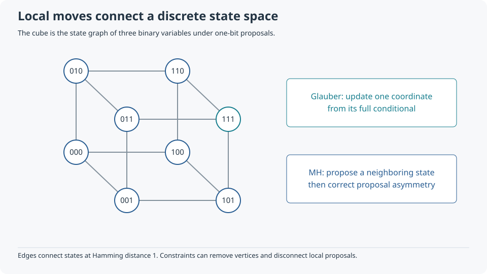

# 29. Discrete spaces and combinatorial targets

**Learning goals.** By the end of this chapter you should be able to construct the graph of legal moves for a discrete target, prove whether a proposed kernel can reach its support, calculate Hastings corrections for state-dependent proposals, and recognize when an auxiliary-variable update permits a collective move. You should also be able to verify a small discrete sampler exactly before using simulation to study a larger one.

**Prerequisites.** Counting measure and conditional probability from [Chapter 2](02-probability.md), finite chains from [Chapter 7](07-finite-chains.md), Metropolis–Hastings from [Chapter 9](09-metropolis-hastings.md), Gibbs sampling from [Chapter 10](10-gibbs.md), and the ideas of Monte Carlo error and diagnostics from Chapters 13–14.

## 29.1 Targets, representations, and neighborhoods

Let $S$ be a finite set of admissible states and let $w(x)>0$ for every $x\in S$. We want expectations under

$$
\pi(x)=\frac{w(x)}{Z},\qquad Z=\sum_{z\in S}w(z).
$$

The set may be finite yet far too large to enumerate. A simple undirected graph on $n$ labeled vertices has $2^{n(n-1)/2}$ possible edge sets; at $n=30$ that is $2^{435}$. In a graph model, a state might be an adjacency matrix, while in an assignment problem it is a permutation. An algorithm must manipulate the chosen representation, so the representation suggests a neighborhood: toggle one edge, exchange two labels, or flip one bit. The same abstract target can have very different sampling difficulty under different representations.

For a fixed target, Metropolis–Hastings (MH) uses ratios $w(y)/w(x)$ and need not calculate $Z$. That cancellation does not mean normalizers never matter. If the model contains a parameter $\theta$ and the likelihood itself is $w_\theta(x)/Z(\theta)$, a move in $\theta$ generally contains $Z(\theta)/Z(\theta')$. We return to such *doubly intractable* targets in [Chapter 45](45-machine-learning.md). Here the weights of each state can be evaluated up to one shared constant.

Before computing any acceptance probability, specify **the support** $S$ and **the move graph**. The latter has an edge between $x$ and $y$ when the proposal can move in both directions with positive probability. It is a graph *of states*, even if an individual state happens to be a graph. Confusing these two graphs is an easy source of wrong connectivity arguments.

The figure shows unconstrained three-bit states. Restricting this cube to a fixed number of ones removes every single-bit edge, motivating the exchange moves below.

## 29.2 Connectivity, rejection, and waiting

Suppose $q(x,y)>0$ exactly when $q(y,x)>0$ on distinct admissible states. The MH acceptance probability is

$$
\alpha(x,y)=\min\left\{1,\frac{w(y)q(y,x)}{w(x)q(x,y)}\right\}.
$$

Because all $w(x)$ are positive, every proposal-graph edge also has positive MH transition probability. If that graph is connected, the resulting finite chain is irreducible. Adding explicit laziness, $P_{\mathrm{lazy}}=(I+P)/2$, makes every state have a self-loop and hence makes an irreducible chain aperiodic. These conditions imply convergence to $\pi$ from any starting state; they give no useful guarantee about how many steps convergence takes. The distinction between a stationary distribution and a usable mixing time is central to [Levin, Peres, and Wilmer's finite-chain treatment](https://pages.uoregon.edu/dlevin/MARKOV/markovmixing.pdf).

An invalid proposal can simply be rejected. For example, choose a coordinate uniformly in a bit vector and flip it; if the result violates a constraint, stay put. The attempted move still counts as a transition. If instead the program redraws until it finds a valid move, it has changed the proposal. On an irregular move graph, uniform selection among *valid* neighbors gives $q(x,y)=1/d(x)$, where $d(x)$ is the degree. Even for a uniform target, the necessary acceptance is $\min\{1,d(x)/d(y)\}$. Without it, a random walk on that graph favors states with more neighbors.

Periodicity offers a second caution. A chain on two states that always flips has the uniform stationary distribution, but its distribution alternates forever when started at one state. Its occupation averages still converge to the uniform law. More generally, finite irreducible chains satisfy the time-average law of large numbers even when periodic; aperiodicity is needed for convergence of the distribution at each fixed time. See [Oveis Gharan's university notes, Sections 2.3–2.5](https://courses.cs.washington.edu/courses/cse599i/24au/mc-2.pdf) for the distinct roles of reversibility, connectivity, and laziness. Rejection may introduce self-loops, but relying on accidental rejection to make a sampler aperiodic can fail for a uniform target. Explicit laziness provides a simple guarantee.

## 29.3 Coordinate Gibbs as Glauber dynamics

In random-scan, heat-bath **Glauber dynamics**, choose a coordinate $i$ uniformly and replace it with a draw from $\pi(x_i\mid x_{-i})$. The literature also uses “Glauber” for related continuous-time or flip-rate dynamics, so the update convention matters. The conditional draw may return the current value. It is still a completed update, not a failed computation.

For Ising spins $s_i\in\{-1,+1\}$ on an undirected interaction graph, define a dimensionless target

$$
\pi(s)\propto\exp\left(\sum_{\{i,j\}\in E}K_{ij}s_is_j+\sum_i h_i s_i\right).
$$

The coefficients $K_{ij}$ already include any inverse-temperature factor. Holding all other spins fixed, the terms involving $s_i$ equal $s_i H_i$, where $H_i=h_i+\sum_{j:\{i,j\}\in E}K_{ij}s_j$. The two local weights are $e^{H_i}$ and $e^{-H_i}$; therefore

$$
\Pr(s_i=+1\mid s_{-i})=\frac{e^{H_i}}{e^{H_i}+e^{-H_i}}
=\frac{1}{1+e^{-2H_i}}.
$$

For any fixed $i$, a conditional replacement preserves $\pi$: if the old full state has law $\pi$, then $s_{-i}$ has its correct marginal and the newly sampled $s_i$ has its correct conditional. Averaging these invariant coordinate kernels over the random choice of $i$ preserves $\pi$ too. This is the Gibbs argument of [Chapter 10](10-gibbs.md); see also the original finite-state presentation in [Levin, Peres, and Wilmer, Chapter 3](https://pages.uoregon.edu/dlevin/MARKOV/markovmixing.pdf).

The conditioning is not cosmetic. If adjacent coordinates are both redrawn independently from conditionals evaluated at the *old* state, the pair generally does not have its joint conditional law. That synchronous rule is a different Markov kernel and need not preserve the desired Ising target. A proper block Gibbs update samples the joint conditional, or a sequential sweep recomputes each conditional after preceding changes. A “sweep” commonly means $n$ coordinate proposals; report its actual computational cost when comparing it with a block or cluster update.

## 29.4 Local Metropolis moves and score changes

A flip proposal for the Ising target sets $s'_i=-s_i$. Choosing $i$ uniformly gives a symmetric proposal, so the acceptance probability is $\min\{1,e^{\Delta_i}\}$ with

$$
\Delta_i=\log w(s')-\log w(s)=-2s_i\left(h_i+\sum_{j:\{i,j\}\in E}K_{ij}s_j\right).
$$

Only the incident edges and local field need to be read. This is cheaper than recomputing the energy over the whole graph. Heat-bath Gibbs instead chooses between the two values using their normalized local weights. Its probability of *changing* $s_i$ is not an MH acceptance probability: Gibbs can choose the present value without proposing a flip. When comparing updates, compare autocorrelation and cost for the quantities of interest, not raw “acceptance” labels.

For a sparse graph, one can cache each local field $H_i$. After a flip at $i$, only neighboring fields change, by $-2K_{ij}s_i$ using the **old** $s_i$. The cache saves repeated neighbor sums but adds a bookkeeping risk; periodically recompute the score from the state during development. Use log weights for stable acceptance tests: draw $U$ uniform on $(0,1)$ and accept when $\log U<\min(0,\Delta_i)$. The exact invariant law assumes correctly evaluated ratios. Numerical error and cache bugs are separate from the finite-run error of an otherwise correct chain.

## 29.5 Worked example: fixed-cardinality bit vectors

Consider four bits with exactly two ones:

$$
S=\{x\in\{0,1\}^4:\sum_i x_i=2\},\qquad
\log w(x)=\sum_{i=1}^4 a_i x_i,
\quad a=(0,\log 2,\log 3,\log 4).
$$

Writing a state by the positions of its ones, its six weights are

| State | $\{1,2\}$ | $\{1,3\}$ | $\{1,4\}$ | $\{2,3\}$ | $\{2,4\}$ | $\{3,4\}$ |
|---|---:|---:|---:|---:|---:|---:|
| $w$ | 2 | 3 | 4 | 6 | 8 | 12 |

Thus $Z=35$ and the exact probability that coordinate 4 is included is $(4+8+12)/35=24/35\approx0.685714$. A single-bit flip leaves $S$ every time. If every such proposal is rejected, the chain remains forever at its initial state despite satisfying detailed balance trivially. Invariance without irreducibility is not enough.

Instead, select one occupied position and one unoccupied position uniformly, then exchange them. Each state has $2\cdot2=4$ neighbors, and each exchange has proposal probability $1/4$ in both directions. For $x=\{1,2\}$ and $y=\{2,4\}$, the weight ratio is $8/2=4$: $x\to y$ accepts surely, whereas $y\to x$ accepts with probability $1/4$. Detailed balance across this edge is visible directly:

$$
\pi(x)P(x,y)=\frac{2}{35}\frac14
=\frac{8}{35}\frac14\frac14=\pi(y)P(y,x).
$$

Any two size-two subsets are connected by exchanges: whenever the current subset contains a position absent from the desired subset, exchange it for a missing desired position. Each step reduces the mismatch. Add probability $1/2$ of doing nothing before proposing an exchange to ensure aperiodicity. The edge probabilities above are then both halved, leaving their balance unchanged. The seeded [standard-library example](examples/ch29.py) constructs all six transition rows, checks stationarity and detailed balance to floating-point tolerance, checks connectivity, and compares a finite trajectory with $24/35$. These checks cover this enumerated instance; a close simulated frequency alone would be weaker evidence. The script also checks the later path, constrained-assignment, and two-spin cluster matrices with exact rational arithmetic.

## 29.6 Informed proposals still need correction

Uniformly choosing a neighbor ignores the target weights until acceptance. A **locally balanced proposal** gives more proposal mass to promising neighbors while retaining an exact correction. Let $k(x,y)=k(y,x)\geq0$ be symmetric base weights on a connected, finite move graph. For positive $t$, choose a positive function $g$ satisfying the balancing identity $g(t)=t g(1/t)$, and define

$$
C_g(x)=\sum_{z\neq x}k(x,z)g\!\left(\frac{w(z)}{w(x)}\right),\qquad
q_g(x,y)=\frac{k(x,y)g(w(y)/w(x))}{C_g(x)}.
$$

Assume each $C_g(x)$ is finite and nonzero. In the Hastings ratio, symmetry cancels $k$. Writing $t=w(y)/w(x)$ and using $g(t)=t g(1/t)$ gives

$$
\frac{w(y)q_g(y,x)}{w(x)q_g(x,y)}
=\frac{w(y)}{w(x)}\frac{g(1/t)}{g(t)}\frac{C_g(x)}{C_g(y)}
=\frac{C_g(x)}{C_g(y)}.
$$

So accept with $\min\{1,C_g(x)/C_g(y)\}$. The function $g$ defines **proposal weights**, not acceptance probabilities. Examples include $g(t)=\sqrt t$ and $g(t)=t/(1+t)$. This construction and its asymptotic analysis come from [Zanella, “Informed proposals for local MCMC in discrete spaces”](https://www.carloalberto.org/wp-content/uploads/2017/12/no.539.pdf). Its favorable comparisons have specified regimes; neither function is automatically best for every finite problem. Scoring all neighbors to compute $C_g$ can also cost more than a simple proposal, especially when degree is large.

## 29.7 Worked example: the three-state path

Take states $A-B-C$, with $w(A)=1$, $w(B)=4$, and $w(C)=1$. Let $k=1$ on the two undirected edges and choose $g(t)=\sqrt t$. The normalizers are $C_g(A)=2$, $C_g(B)=1/2+1/2=1$, and $C_g(C)=2$. Thus $q(A,B)=q(C,B)=1$, while $q(B,A)=q(B,C)=1/2$. The target is $(1/6,4/6,1/6)$.

The correction gives acceptance one for $A\to B$ and $C\to B$, and $1/2$ for $B\to A$ and $B\to C$. With rows and columns ordered $A,B,C$, the full MH transition matrix is

$$
P=\begin{pmatrix}
0&1&0\\
1/4&1/2&1/4\\
0&1&0
\end{pmatrix}.
$$

For instance, $\pi(A)P(A,B)=1/6$ and $\pi(B)P(B,A)=(4/6)(1/4)=1/6$. If we used $q$ without the MH correction, the matrix would have the middle row $(1/2,0,1/2)$. Its stationary masses would be $(1/4,1/2,1/4)$, which are not the target, and its moves would alternate between the middle and an endpoint. The corrected chain's rejection self-loop at $B$ removes that period. This tiny calculation shows exactly why an attractive neighbor weighting is not, by itself, a valid sampler.

## 29.8 Permutations, graphs, and constrained tables

For an assignment permutation $\sigma$ of $\{1,\ldots,n\}$ with $n\geq2$, consider

$$
\pi(\sigma)\propto\exp\left(-\lambda\sum_{i=1}^n c_{i,\sigma(i)}\right),\qquad\lambda\geq0.
$$

Swapping the assigned values at two uniformly chosen distinct positions preserves the bijection and has a symmetric reverse. If positions $i$ and $j$ hold $a$ and $b$, only two cost terms change: $\Delta C=c_{i,b}+c_{j,a}-c_{i,a}-c_{j,b}$, so MH accepts with $\min\{1,e^{-\lambda\Delta C}\}$. Transpositions connect all permutations, since misplaced values can be moved to their desired positions one at a time. But at $\lambda=0$, always transposing changes permutation parity every step, creating period two. A lazy step fixes that. Uniform choice among only currently *allowed* swaps under extra constraints may be asymmetric because the number of allowed swaps can differ between states.

For unrestricted simple graphs, toggling any one of the $\binom n2$ possible edges connects the graph space, and score changes often involve only local motifs. A fixed-degree graph cannot use single-edge toggles. An edge-switch move can delete two existing edges and add two others while retaining degrees, provided it avoids loops and duplicate edges. Whether such switches connect the exact restricted graph class must be established for that class; detailed balance alone cannot prove it.

For a nonnegative integer table with fixed row and column totals, a $2\times2$ checkerboard move adds $1$ to two diagonal cells and subtracts $1$ from the other two, or the reverse. It preserves all margins, but it is legal only if no entry becomes negative. A **fiber** is the set $\{x\in\mathbb Z_{\geq0}^d:Ax=b\}$ for a fixed integer constraint matrix $A$ and totals $b$. A **Markov basis** is a finite collection of integer moves in the kernel of $A$ whose signed, legal applications connect every nonempty fiber for that same $A$. The algebraic approach is due to [Diaconis and Sturmfels](https://statistics.stanford.edu/technical-reports/algebraic-algorithms-sampling-conditional-distributions). Structural zeros or further constraints alter the fiber and can invalidate a move set that worked for unrestricted tables. Define the support first, then test or prove connectivity for the resulting fiber; do not infer it from the shape of a move.

### 29.8.1 Forbidden assignments can require longer cycles

A structural zero is a cell forbidden by the model, rather than a cell whose observed count happens to be zero. [Hara, Takemura, and Yoshida, Sections 2.1 and 4](https://www.keisu.t.u-tokyo.ac.jp/data/2007/METR07-49.pdf), formalize fiber connectivity and discuss how structural zeros change the constraints. The following small assignment example makes the obstruction explicit.

Suppose three people must each receive one of three jobs, but person $i$ cannot receive job $i$. Of the six permutations, only two are allowed:

$$
x=(2,3,1),\qquad y=(3,1,2).
$$

Every transposition in either state creates a forbidden fixed point. A sampler that proposes transpositions and rejects invalid assignments therefore has transition matrix $I_2$. It preserves any target on these two states and reaches only its initial state. In table form, each permutation is a $3\times3$ table with every row and column total equal to one and diagonal structural zeros. A transposition is precisely a $2\times2$ checkerboard move; none is legal here.

Rotate all three assigned values instead. Propose the left rotation or right rotation with probability $1/2$ each. From $x$, the left rotation gives $y$, while the right rotation gives the forbidden identity permutation; from $y$, these roles reverse. Rejecting the forbidden rotation leaves a symmetric off-diagonal proposal probability $1/2$.

For a nonuniform target, assign weight three to the person-2/job-1 pairing and weight one to every other allowed pairing, and multiply pairing weights. Then $w(x)=1$, $w(y)=3$, and $\pi=(1/4,3/4)$. Add an outer lazy step with probability $1/2$, then apply the rotation proposal and MH correction. The complete matrix is

$$
P=\begin{pmatrix}3/4&1/4\\1/12&11/12\end{pmatrix}.
$$

The $x\to y$ transition has probability $(1/2)(1/2)\cdot1=1/4$, while $y\to x$ has probability $(1/2)(1/2)(1/3)=1/12$. Both stationary flows equal $1/16$. Row sums, connectivity, and positive self-loops can all be checked directly. The example script enumerates all six permutations before filtering, tries every transposition and both rotations, and verifies the resulting matrix using rational arithmetic. It finds two components for transpositions and one for rotations.

There is a useful general connectivity argument for assignments with arbitrary forbidden pairings, provided the admissible set is nonempty. Draw the current and desired assignments as perfect matchings between people and jobs. After removing shared edges, their union splits into disjoint even cycles whose edges alternate between the two matchings. Replacing the current edges of one whole cycle by the desired edges preserves every person's and job's degree one, and uses only allowed pairings. It also increases the number of desired pairings. Repeating reaches the desired assignment. Thus allowing **all alternating-cycle exchanges** connects this assignment support. Restricting cycle length requires a new argument; three-cycles alone do not suffice in general.

A symmetric proposal can choose a length $\ell\in\{2,\ldots,n\}$ from fixed positive probabilities, choose an ordered list of $\ell$ distinct positions uniformly, and rotate their values. The reverse list ordering generates the inverse rotation with the same probability. Reject forbidden assignments and apply the usual weight ratio. This establishes a valid construction, not an efficiency guarantee: many proposed cycles may be illegal. Uniform selection among only currently legal cycles would again require checking the forward and reverse proposal probabilities.

## 29.9 Cluster updates from an augmented target

Local flips can be slow when many spins move together between important regions. For a ferromagnetic, zero-field Ising target ($K_e\geq0$, every $h_i=0$), an auxiliary set of open bonds yields a valid collective update. For edge $e=\{i,j\}$ let $p_e=1-e^{-2K_e}$. Conditional on spins $s$, open a bond with probability $p_e$ if $s_i=s_j$; if they differ, leave it closed. Then find connected components of open bonds and assign each component a fresh, independent, uniform sign $-1$ or $+1$. This is the Swendsen–Wang style update associated with [Swendsen and Wang](https://journals.aps.org/prl/abstract/10.1103/PhysRevLett.58.86) and the [Edwards–Sokal representation](https://journals.aps.org/prd/abstract/10.1103/PhysRevD.38.2009).

Why is the update exact? For a bond variable $b_e\in\{0,1\}$, introduce the factor

$$
F_e(s_i,s_j,b_e)
=(1-p_e)\mathbf 1[b_e=0]
+p_e\mathbf 1[b_e=1]\mathbf 1[s_i=s_j].
$$

Sum over $b_e$. Equal spins give $1$; unequal spins give $1-p_e=e^{-2K_e}$. These values are proportional to $e^{K_e s_i s_j}$, because $e^{K_e}$ and $e^{-K_e}$ have ratio $e^{2K_e}$. Multiplying factors over edges and normalizing therefore recovers the zero-field Ising target. Conditional on spins, the bond rule above follows from $F_e$. Conditional on bonds, all spins within each open component must agree, and every component sign is equiprobable. The procedure is alternating Gibbs sampling on a joint distribution, as in [Chapter 10](10-gibbs.md), so it preserves the spin marginal.

The assumptions matter. Negative couplings make $p_e<0$, which is not a probability. A nonzero field makes the two signs of a component have unequal conditional weights, so uniform recoloring is wrong. Cluster moves can cross some barriers in one update, but clusters may also require costly graph traversal and do not guarantee fast mixing for every model. [Chapter 41](41-physics.md) develops the physical interpretation and critical behavior.

## 29.10 Verification and empirical comparison

On a small support, enumerate the states and assemble the complete transition matrix $P$. Check nonnegative entries, row sums of one, and $\pi P=\pi$. For a kernel claimed to be reversible, also check $\pi(x)P(x,y)=\pi(y)P(y,x)$ for every pair. Enumerate connected components of the *positive transition* graph separately; the identity matrix passes all the first checks but cannot sample across states. Check self-loops or periods if convergence at fixed time matters. These tests can expose an incorrect Hastings ratio before simulation noise obscures it.

Then run multiple independent chains from dispersed starting states and inspect functions relevant to the question: a particular inclusion indicator, energy, assignment cost or distance, a graph motif count, or a mode indicator. Estimate uncertainty for each function using the methods of [Chapter 13](13-mc-error.md); use [Chapter 14](14-diagnostics.md) to look for poor exploration. High acceptance can coexist with movement only inside one region. Agreement of a simulation estimate with an exactly enumerated answer is reassuring for that test case, but neither that agreement nor a passing diagnostic proves convergence on a larger state space.

The *unit of work* should be reported. One attempted bit exchange, one full neighborhood score used by an informed proposal, and one cluster construction have different costs. Compare estimates at equal computational budgets and include rejected states in time averages. Dropping rejected iterations samples an embedded jump chain with a generally different stationary distribution. If fixed-parameter weights are expensive, incremental scores may dominate the algorithmic choice; if the support is nearly disconnected, a faster score will not solve the topological problem. For separated modes, [tempering methods in Chapter 25](25-tempering.md) may help; a move that changes the dimension of the state belongs to [Chapter 30](30-reversible-jump.md).

### Interactive lab

In the Ising lab, change the temperature and observe the mean-spin (magnetization) trace and final lattice. Try to identify long stretches in which the magnetization retains one sign. The widget uses random-site heat-bath updates and reports magnetization; it does not display energy. The lab illustrates local dynamics and spatial dependence; the cluster construction above is a separate algorithm, so the visual experiment is not a benchmark of its speed.

## Exercises

**1. Ising conditional.** Starting from the target in Section 29.3, derive the conditional odds for $s_i=+1$ versus $s_i=-1$, and then derive the conditional probability.

Solution

All factors independent of $s_i$ cancel. With $H_i=h_i+\sum_jK_{ij}s_j$, the remaining weights are $e^{H_i}$ and $e^{-H_i}$. Their odds are $e^{2H_i}$. Dividing the first weight by their sum yields $1/(1+e^{-2H_i})$.

**2. Connectivity under fixed cardinality.** Prove that exchanges of one occupied and one unoccupied position connect all $k$-subsets of $\{1,\ldots,n\}$ for $0<k<n$.

Solution

Let $A$ be current and $B$ desired. If $A\ne B$, equal cardinality implies both $A\setminus B$ and $B\setminus A$ are nonempty. Exchange any $i$ in the first set for any $j$ in the second. The new set has one fewer element outside $B$. Repeating reaches $B$ after $|A\setminus B|$ exchanges.

**3. Irregular graph.** A target is uniform on vertices of a connected undirected graph. From $x$, propose a uniformly chosen neighbor. Find the MH acceptance probability and the stationary distribution if every proposal is accepted.

Solution

Since $q(x,y)=1/d(x)$ and $q(y,x)=1/d(y)$, MH accepts with $\min\{1,d(x)/d(y)\}$. Without rejection, detailed balance holds for the degree-proportional law $\nu(x)=d(x)/\sum_z d(z)$, because $\nu(x)q(x,y)$ is the same constant on each oriented edge. It is uniform only when degrees are equal.

**4. Locally balanced correction.** Re-derive the MH correction for $q_g$ and identify exactly where the two assumptions on $k$ and $g$ are used.

Solution

The ratio is $[w(y)/w(x)][k(y,x)/k(x,y)][g(w(x)/w(y))/g(w(y)/w(x))][C_g(x)/C_g(y)]$. Symmetry makes the $k$ ratio one. For $t=w(y)/w(x)$, balancing gives $g(1/t)/g(t)=1/t$, which cancels the weight ratio. The result is $C_g(x)/C_g(y)$, so acceptance is its minimum with one.

**5. Permutation parity.** For a uniform target on permutations of $n\geq2$ objects, suppose a sampler always makes one transposition. Explain its periodicity and give a simple repair that preserves the target.

Solution

Each transposition reverses parity, so return to any permutation is possible only at even times. Transpositions connect all permutations, and a pair of identical transpositions gives a two-step return, so the period is two. At each iteration, stay put with probability $1/2$ and otherwise transpose. The mixture with the identity preserves the uniform target and adds a positive self-loop at every state.

**6. Two-spin cluster calculation.** For two spins joined by a ferromagnetic edge, sum over the bond to recover the Ising interaction. What changes if a field $h$ acts on the first spin?

Solution

With $p=1-e^{-2K}$, summing $F$ over $b$ gives $1$ for equal spins and $e^{-2K}$ for unequal spins. Multiplication by the common factor $e^K$ yields $e^{Ks_1s_2}$ in both cases. If an open bond forces $s_1=s_2=u$, a field on the first spin gives conditional component weights $e^{hu}$ for $u=\pm1$. Uniform recoloring is then wrong unless $h=0$; the plus sign must be chosen with probability $e^h/(e^h+e^{-h})$ for this component.

**7. A longer move can still miss half the support.** For four people and four jobs with every self-assignment forbidden, show that using only three-cycle rotations is insufficient for irreducibility. Does adding laziness repair the problem?

Solution

A three-cycle is the product of two transpositions and hence preserves permutation parity. The admissible permutation $(2,1,4,3)$ consists of two disjoint transpositions and is even. The admissible permutation $(2,3,4,1)$ is a four-cycle and is odd. No sequence of three-cycles can connect them, even if all intermediate permutations were allowed. Laziness preserves parity too, so it cannot repair this disconnection. The alternating-cycle construction in Section 29.8.1 includes other lengths and avoids this particular obstruction.

## Key takeaways

The support and its move graph come before an acceptance formula. Reversibility can certify the desired invariant law, but connectivity and aperiodicity determine whether fixed-time convergence is possible. Local score updates make ordinary discrete MH cheap; state-dependent proposals need their normalizing-constant correction. Constraints often require exchanges or other carefully justified moves. A cluster method can be exact when derived as Gibbs sampling on a valid augmented target. Exact enumeration checks small implementations; simulation and diagnostics assess finite-run performance for chosen estimands without proving that a larger chain has converged.
