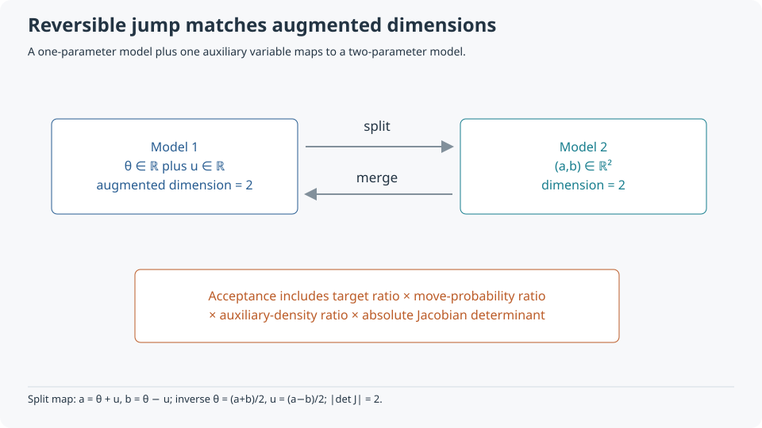

# 30. Reversible jump and variable dimensions

A regression model with five coefficients and one with six coefficients do not inhabit the same Euclidean space. Nevertheless, both can be states of one Markov chain. The challenge is to compare probability flowing between those spaces without confusing density with probability. Reversible jump solves this by adjoining random coordinates, applying an invertible transformation, and accounting for its change in volume.

**Learning goals.** Specify a target over models of different dimensions; derive a reversible-jump acceptance rule; audit birth, death, split, and merge proposals; and estimate model probabilities with appropriate Monte Carlo uncertainty.

**Prerequisites.** Review reference measures and Jacobians in [Chapter 2](02-probability.md), proper Bayesian targets in [Chapter 3](03-bayesian-targets.md), Metropolis–Hastings in [Chapter 9](09-metropolis-hastings.md), and kernel composition in [Chapter 12](12-kernel-design.md). [Chapter 26](26-normalizers.md) supplies the evidence interpretation of model probabilities.

## 30.1 A state contains a model tag

Suppose a measurement may contain no signal, or a signal with an unknown mean. Model $M_0$ fixes the mean at zero; model $M_1$ estimates a real parameter $\theta$. In the first model there is no free parameter to store. In the second there is one. A state is therefore the tagged object $(k,\theta_k)$, with state space

$$
\mathcal X=\bigsqcup_{k\in\mathcal K}\bigl(\{k\}\times\Theta_k\bigr),
\qquad \Theta_k\subseteq\mathbb R^{d_k}.
$$

The disjoint union symbol means that model tags remain distinct. Two models can have the same number of parameters and still represent different likelihoods. Conversely, a parameter value numerically equal to zero inside $M_1$ does not become the separate state $M_0$.

Use counting measure over $k$ and Lebesgue measure within each continuous parameter block. For $d_k=0$, use unit mass on the single empty parameter vector. This convention makes integration over the zero-dimensional model well defined. It also explains why a density evaluated at zero in $M_1$ cannot be compared directly with the posterior probability of $M_0$: they are different kinds of quantities.

This construction covers regression subsets, unknown change-point counts, and unknown numbers of mixture components. Green introduced reversible jump as a general framework for such problems in his [1995 Biometrika article](https://doi.org/10.1093/biomet/82.4.711). We will derive the mechanism through small examples where every factor can be checked independently.

## 30.2 The joint target comes first

For observations $y$, define

$$
\widetilde\pi(k,\theta_k)=p(k)p(\theta_k\mid k)L(y\mid k,\theta_k).
$$

Assume all functions are measurable and nonnegative, and that

$$
0<C=\sum_k\int_{\Theta_k}\widetilde\pi(k,\theta_k)\,d\theta_k<\infty.
$$

The posterior density on the disjoint union is $\pi=\widetilde\pi/C$. Writing the evidence in model $k$ as

$$
Z_k=\int p(\theta_k\mid k)L(y\mid k,\theta_k)\,d\theta_k,
$$

we obtain $P(K=k\mid y)=p(k)Z_k/C$. The sampler's occupancy should reproduce these *integrated* block masses.

Only a multiplicative constant common to every state cancels harmlessly. Within one normal-prior model, dropping the prior's normalization constant leaves the conditional parameter distribution unchanged. Across models, that constant affects the relative block masses. Dropping it can therefore leave excellent parameter traces alongside wrong model probabilities.

Improper priors present the same issue more fundamentally: an arbitrary scaling constant may make posterior model odds undefined, even when each conditional posterior is proper. Proper priors and an explicit model prior are the straightforward starting point here. Their scientific sensitivity is a modeling issue, distinct from Monte Carlo error. A posterior probability of 0.9 means 0.9 conditional on the candidate models, priors, and likelihood assumptions; it does not certify that a candidate is the scientific truth.

## 30.3 Match dimensions using auxiliary variables

Consider a proposed move from model $k$ to model $l$. Draw a continuous auxiliary vector $u$ of dimension $r_{kl}$ from density $g_{kl}(u\mid\theta_k)$. Construct a transformation

$$
T_{kl}(\theta_k,u)=(\theta_l',u'),
$$

where $u'$ has dimension $r_{lk}$. The necessary dimension equation is

$$
d_k+r_{kl}=d_l+r_{lk}.
$$

For the usual change-of-variables derivation, assume the map is a bijection between the supported augmented domains, differentiable with differentiable inverse almost everywhere, and has nonzero absolute Jacobian determinant almost everywhere. Piecewise maps require explicit branch bookkeeping. Merely satisfying the dimension equation does not establish invertibility.

For a birth of one unconstrained coefficient, $u$ can be the new coefficient itself. The output consists of the old coefficients and $u$; the reverse move extracts the deleted coefficient as its auxiliary output. No fresh continuous random variable is needed for that death proposal. Its zero-dimensional auxiliary density is one.

Auxiliaries belong to the proposal mechanism. They need not have any scientific interpretation. A forward proposal may discard $u'$ after its acceptance decision, but must calculate its reverse density first. Otherwise information required to evaluate the reverse probability is lost.



A constrained parameter requires additional care. A split producing a negative variance lies outside the destination support and must be rejected or excluded by construction. If the proposal is truncated to avoid such outcomes, its truncation normalization is part of $g_{kl}$.

## 30.4 Derive the acceptance rule from probability flow

Let $s_{kl}(\theta_k)$ denote the probability of selecting a particular forward move, including any discrete choices assigned to it. Its paired reverse move has selection probability $s_{lk}(\theta_l')$. If several transformations connect the same model pair, index them separately and pair each with its own inverse.

Write $z=(\theta_k,u)$ and $w=T_{kl}(z)$. Before acceptance, forward probability flow has density

$$
f(z)=\widetilde\pi(k,\theta_k)s_{kl}(\theta_k)g_{kl}(u\mid\theta_k).
$$

Reverse flow has density

$$
b(w)=\widetilde\pi(l,\theta_l')s_{lk}(\theta_l')g_{lk}(u'\mid\theta_l').
$$

These densities refer to different coordinates. The volume elements satisfy $dw=J(z)\,dz$, where

$$
J(z)=\left|\det DT_{kl}(z)\right|.
$$

Thus reverse flow expressed in forward coordinates is $b(T_{kl}(z))J(z)\,dz$. To balance accepted flow, choose

$$
R(z)=\frac{b(T_{kl}(z))J(z)}{f(z)},
\qquad \alpha_{kl}(z)=\min\{1,R(z)\}.
$$

Equivalently,

$$
R=\frac{\widetilde\pi(l,\theta_l')s_{lk}(\theta_l')g_{lk}(u'\mid\theta_l')}
{\widetilde\pi(k,\theta_k)s_{kl}(\theta_k)g_{kl}(u\mid\theta_k)}J.
$$

On a paired move the inverse Jacobian is $1/J$, so the reverse *ratio* is $1/R$. The reverse acceptance probability is $\min(1,1/R)$. It is never obtained by reciprocating the already truncated forward acceptance. For example, $R=4$ gives forward acceptance one and reverse acceptance one-quarter.

The equality establishing balance is simply

$$
f(z)\min(1,R(z))
=\min\{f(z),b(T_{kl}(z))J(z)\}.
$$

The reverse accepted flow gives the same minimum. Integrating over measurable sets and adding the rejection self-transitions establishes detailed balance, hence invariance. A proposed destination with zero reverse probability has acceptance zero. Ratios need only be evaluated where the forward sampling density is positive.

This argument establishes the invariant distribution under the stated assumptions. Useful ergodic averages additionally require the recurrence and irreducibility conditions discussed in [Chapter 8](08-convergence.md). A collection of individually valid moves may leave whole model families disconnected. Within-model conditional kernels can be composed with the jump kernel because each preserves the joint target; the composition need not itself be reversible.

For a broader account of move construction and multi-model methods, see [Fan, Sisson, and Davies](https://arxiv.org/html/1001.2055v2). The acceptance reciprocity above follows directly from the flow calculation, avoiding any ambiguity between a ratio and its truncated probability.

## 30.5 Birth and death need discrete bookkeeping

Suppose there are $p$ possible covariates and the current subset is $S$, with $m=|S|$. Give coefficients a deterministic ordering by covariate index. With probability $b_m$, propose a birth: choose one of the $p-m$ missing covariates uniformly and draw its coefficient $u$ from density $q_j(u\mid\beta_S)$. The inverse death chooses that coefficient among the $m+1$ active ones.

For destination $S'=S\cup\{j\}$, the birth acceptance ratio is

$$
R_{\rm birth}=
\frac{\widetilde\pi(S',\beta_{S'})}{\widetilde\pi(S,\beta_S)}
\frac{d_{m+1}/(m+1)}{b_m/(p-m)}
\frac{1}{q_j(u\mid\beta_S)}.
$$

The insertion map has absolute determinant one: it is an identity transformation followed by a coordinate permutation. The model prior $p(S)$ is already inside the target. A prior uniform over model sizes is different from a prior uniform over subsets, because there are $\binom{p}{m}$ subsets of size $m$.

Here is a complete move table for the simple proposal.

| Ingredient | Birth | Paired death |
|---|---|---|
| Move-type probability | $b_m$ | $d_{m+1}$ |
| Coordinate selection | $1/(p-m)$ | $1/(m+1)$ |
| Continuous draw | $q_j(u\mid\beta_S)$ | Density one in dimension zero |
| Map | Insert $u$ at index $j$ | Remove coefficient $j$, recover $u$ |
| Absolute Jacobian | $1$ | $1$ |

A common policy takes $b_m=d_m=1/2$ in the interior, $b_0=1$, and $d_p=1$. Those boundary changes belong in the ratio. Alternatively, one can keep half-probability birth/death choices everywhere and treat impossible moves as self-transitions; that is a different valid kernel with different selection probabilities. Implement the policy actually used.

For $p=3$, the selection ratio for a specified birth from size zero to one is $(1/2)/(1/3)=3/2$. From size one to two it is $(1/4)/(1/4)=1$. From size two to three it is $(1/3)/(1/2)=2/3$. A universal factor of one misses both boundaries.

## 30.6 Worked example: a spike and a normal slab

Take one observation $y=2$ with sampling model $Y\mid\theta\sim N(\theta,1)$. Give $M_0:\theta=0$ and $M_1:\theta\sim N(0,4)$ prior probability one-half each. Write $\phi(x;\mu,v)$ for a normal density with variance $v$.

Under $M_0$, the evidence is $Z_0=\phi(y;0,1)$. Under $M_1$, the observation is a sum of independent $N(0,4)$ and $N(0,1)$ variables, so $Z_1=\phi(y;0,5)$. Consequently,

$$
B_{10}=\frac{Z_1}{Z_0}
=\frac{1}{\sqrt5}\exp\left(\frac{y^2}{2}-\frac{y^2}{10}\right)
=5^{-1/2}\exp(2y^2/5).
$$

At $y=2$, $B_{10}\approx2.2151$ and

$$
P(M_1\mid y)=\frac{B_{10}}{1+B_{10}}\approx0.688964.
$$

Completing the square in the slab posterior gives precision $1+1/4=5/4$, variance $4/5=0.8$, and mean $(4/5)y=1.6$. Thus

$$
p(\theta\mid y,M_1)=\phi(\theta;1.6,0.8).
$$

A birth draws $u\sim q$ and sets $\theta'=u$. A death deletes $\theta$, recovering $u'=\theta$. With equal jump-selection probabilities and unit Jacobian,

$$
R_{01}(u)=\frac{\phi(u;0,4)\phi(y;u,1)}{\phi(y;0,1)q(u)}.
$$

Use Bayes' identity $\phi(u;0,4)\phi(y;u,1)=Z_1p(u\mid y,M_1)$ to obtain

$$
R_{01}(u)=B_{10}\frac{p(u\mid y,M_1)}{q(u)}.
$$

If $q$ is the exact conditional posterior, the ratio is the constant $B_{10}$. Every birth is accepted here; deaths are accepted with probability $1/B_{10}\approx0.4515$. The resulting preference for spending time in the slab is exactly the posterior evidence preference.

Contrast $q=N(0,25)$. At $u=5$, the proposed signal is poorly supported and the birth ratio is about $0.015$. At $u=1.6$, it is about $13.0$, and the proposal is accepted. Many diffuse draws land where the posterior density is negligible, wasting attempts. Both proposals give the same invariant distribution when their actual densities appear in the ratio, but different finite-run uncertainty.

The executable example mixes three kernels with fixed probabilities: identity with probability 0.1, an exact conditional refresh with probability 0.4, and a model jump with probability 0.5. The refresh does nothing in $M_0$. Explicit laziness makes aperiodicity transparent. Equal jump probabilities cancel in both directions. With 100,000 retained iterations and seed 3030, the posterior proposal estimates 0.690190 with batch-means MCSE 0.001998; the diffuse proposal estimates 0.695160 with MCSE 0.003999. These are particular finite-run outcomes, not performance guarantees.

### 30.6.1 Which null model does an ordinate ratio compare? {#sec-3061-which-null-model-does-an-ordinate-ratio-compare}

The spike/slab calculation has no nuisance parameter. A Savage–Dickey ordinate ratio in a larger nested model can compare a different null nuisance prior from the one stipulated. Work with a separate Gaussian model comparison where every integral can be checked, and distinguish the compared model from the precision of an estimated density.

**Specify the models and density versions.**

There is one scalar recorded observation $Y=y$. Write $\phi(x;\mu,v)$ for the ordinary Gaussian density with mean $\mu$ and **variance** $v$. Both candidate models use the same sampling density

$$
L_y(\theta,\eta)=\phi(y;\theta+\eta,1).
$$

The model tag is separate from the parameter values. Under $H_0$, $\theta=0$ is fixed and $\eta$ is the only free parameter. Under $H_1$, both coordinates are free. The alternative gives the event $\theta=0$ probability zero; a density evaluated there is neither that event's mass nor a posterior model probability.

Let $g(\theta,\eta)$ be the stipulated alternative prior density, $p(\theta)=\int g(\theta,\eta)d\eta$, and $q_0(\eta)$ the separately stipulated null prior. Use the ordinary everywhere-continuous Gaussian versions in the fixtures. In particular define

$$
q_1(\eta\mid0)=\frac{g(0,\eta)}{p(0)},\qquad
p(\theta\mid y,H_1)=\frac{\int L_y(\theta,\eta)g(\theta,\eta)d\eta}{m_1(y)}
$$

pointwise by these formulas. This fixes the versions at the tested ordinate. All priors here are proper, all Gaussian densities are strictly positive, and the evidence integrals are finite and positive. The formulas are not statements about arbitrary modifications of densities or conditionals on a null set.

The three evidence quantities to keep distinct are

$$
\begin{aligned}
m_0(y)&=\int L_y(0,\eta)q_0(\eta)d\eta,\\
m_1(y)&=\iint L_y(\theta,\eta)g(\theta,\eta)d\eta d\theta,\\
m_c(y)&=\int L_y(0,\eta)q_1(\eta\mid0)d\eta.
\end{aligned}
$$

The target Bayes factor is $BF_{01}=m_0/m_1$, with the null in the numerator. If the model prior odds are $\gamma_0:\gamma_1$, the posterior odds are $(\gamma_0/\gamma_1)BF_{01}$, and the posterior null probability follows by dividing those odds by one plus the odds.

**Predict before using an ordinate.**

Stipulate

$$
H_1:\quad \theta,\eta\stackrel{\rm independent}{\sim}N(0,1),
\qquad
H_0:\quad \theta=0,\quad\eta\sim N(0,4).
$$

Use equal model prior probabilities when comparing the direction of posterior model preference.

Before calculating, predict whether the raw ratio
$$
R(y)=\frac{p(0\mid y,H_1)}{p(0\mid H_1)}
$$
must compare these two models. Derive the two actual predictive densities, $R(y)$, and the null prior which $R$ actually uses. At $y=0$, can the two Bayes factors prefer opposite models? Derive the correct multiplicative repair, specifying the distribution over which its expectation is taken. Then investigate nonzero $y$: does the disagreement disappear in the tails?

<details class="optional-hint">
<summary>Optional hint for the ordinate investigation</summary>

First integrate the Gaussian priors to obtain the variances of $Y$. Divide the pointwise Bayes formula at $\theta=0$ by its prior ordinate. The relevant nuisance prior is conditional on $\theta=0$, and the repair averages under a nuisance posterior conditional on both $\theta=0$ and $y$, not its marginal posterior given $y$ alone.

</details>

**Which null is compared, and which posterior supplies the correction?**

The fixed pointwise density versions give

$$
R(y)=\frac{\int L_y(0,\eta)q_1(\eta\mid0)d\eta}{m_1(y)}
=\frac{m_c(y)}{m_1(y)}.
$$

Thus matching the stipulated null nuisance prior to this specified conditional prior, $q_0=q_1(\cdot\mid0)$ almost everywhere, is sufficient for $R=BF_{01}$ at every datum in this setting. It is not asserted to be necessary for accidental equality at one particular datum.

Define the continuous conditional posterior

$$
h_y(\eta)=p(\eta\mid\theta=0,y,H_1)
=\frac{L_y(0,\eta)q_1(\eta\mid0)}{m_c(y)}.
$$

Because $q_0\ll q_1(\cdot\mid0)$ here, direct integration yields

$$
\begin{aligned}
C(y)&=E_{h_y}\!\left[\frac{q_0(\eta)}{q_1(\eta\mid0)}\right]
=\frac{m_0(y)}{m_c(y)},\\
BF_{01}(y)&=R(y)C(y).
\end{aligned}
$$

All quantities are finite in these Gaussian fixtures. This argument establishes a particular expectation identity; it does not provide a variance or accuracy guarantee for a Monte Carlo implementation of that expectation.

**Work through the Gaussian laws.**

Independent Gaussian addition gives

$$
m_1(y)=\phi(y;0,3),\qquad
m_0(y)=\phi(y;0,5),\qquad
m_c(y)=\phi(y;0,2).
$$

The matched null behind $m_c$ has $\eta\sim N(0,1)$, whereas the stipulated null has $\eta\sim N(0,4)$. Consequently

$$
BF_{01}(y)=\sqrt{\frac35}\exp(y^2/15),\qquad
R(y)=\sqrt{\frac32}\exp(-y^2/12).
$$

The same ordinate follows by completing the alternative posterior square:

$$
\theta\mid y,H_1\sim N(y/3,2/3),\qquad
h_y(\eta)=\phi(\eta;y/2,1/2).
$$

In particular the conditional law with density $h_y$ differs from the marginal law $\eta\mid y,H_1\sim N(y/3,2/3)$. The prior ratio and its conditional-posterior expectation are

$$
\frac{q_0(\eta)}{q_1(\eta\mid0)}=\frac12e^{3\eta^2/8},\qquad
C(y)=\sqrt{\frac25}e^{3y^2/20}.
$$

For a direct integral check, multiply by the $N(y/2,1/2)$ density. Its exponent becomes

$$
-(\eta-y/2)^2+3\eta^2/8
=-\frac58(\eta-4y/5)^2+\frac{3y^2}{20}.
$$

The prefactor $1/(2\sqrt\pi)$, integrated Gaussian factor $\sqrt{8\pi/5}$, and the displayed constant exponent give exactly $C(y)$. Multiplying $R C$ produces the stipulated Bayes factor, with exponent $-1/12+3/20=1/15$.

At $y=0$, the actual factor is $\sqrt{3/5}<1$, while the raw ordinate ratio is $\sqrt{3/2}>1$. With equal prior model odds, they favor opposite models. This is a change of the compared null model, not Monte Carlo uncertainty.

For general $y$, define

$$
a^2=6\log(3/2),\qquad
b^2=\frac{15}{2}\log(5/3).
$$

Here $a<b$: $b^2-a^2=(3/2)\log(50000/19683)>0$. For $|y|<a$, $R>1$ but $BF_{01}<1$; for $a<|y|<b$, both are below one; for $|y|>b$, $R<1$ but $BF_{01}>1$. At each boundary the relevant factor equals one. As $|y|\to\infty$, $R\to0$ but $BF_{01}\to\infty$. The stipulated null has the wider predictive distribution and gains tail support.

Despite the incompatible nuisance priors, $R=BF_{01}$ at the two data values satisfying

$$
y^2=\frac{10}{3}\log(5/2),
$$

because then $C(y)=1$. Compatibility is a sufficient structural condition, not an iff test inferred from equality at one observation.

The conditional-posterior correction measure is specified by [Mulder, Wagenmakers and Marsman (2020), Introduction and equation (1)](https://arxiv.org/html/2004.09899v2). [Marin and Robert (2010), Sections 1–2](https://arxiv.org/pdf/0910.1452v6), explain why density versions at a tested null point matter. The Gaussian fixtures, thresholds and changed task here are separate derivations. Use their displayed integrals as the analytic reference; no numerical density-estimation accuracy follows from the identity.

## 30.7 Worked example: split, merge, and a determinant of two

Now construct a normalized target directly. Model 1 has probability 0.4 and one coordinate $x\sim N(0,1)$. Model 2 has probability 0.6 and independent coordinates $a,b\sim N(0,1)$. This deliberately simple example isolates the volume calculation.

For a split, draw $u\sim N(0,1)$ and set

$$
a=x+u,\qquad b=x-u.
$$

The inverse merge recovers

$$
x=(a+b)/2,\qquad u=(a-b)/2.
$$

Both augmented sides have dimension two. The derivative matrix and its absolute determinant are

$$
DT=\begin{pmatrix}1&1\\1&-1\end{pmatrix},
\qquad J=|-2|=2.
$$

Assume equal probabilities of attempting split and merge in their respective models. A merge requires no continuous random draw. The split ratio is

$$
R=\frac{0.6\phi(a;0,1)\phi(b;0,1)}
{0.4\phi(x;0,1)\phi(u;0,1)}\,2.
$$

All four normal densities together have cancelling normalization factors. Moreover, $a^2+b^2=2x^2+2u^2$, so

$$
R=3\exp\left[-\frac{a^2+b^2-x^2-u^2}{2}\right]
=3\exp[-(x^2+u^2)/2].
$$

At $x=1,u=0.5$, the proposal is $(a,b)=(1.5,0.5)$ and $R=3e^{-0.625}\approx1.606$. The forward acceptance is one; the reverse acceptance is approximately 0.623. Computing both map directions gives an immediate audit of the inverse determinant and recovered auxiliary density.

Suppose the implementation omits the factor two in the split ratio and uses its reciprocal for the merge. Its transitions then correspond to the correct calculation for model-2 weight 0.3 instead of 0.6, with model-1 weight still 0.4. The resulting model-2 probability is

$$
\frac{0.3}{0.4+0.3}=\frac37\approx0.428571.
$$

The code includes this explicitly labeled incorrect variant. Its occupancy is approximately 0.42345 in the seeded run, whereas the correct version gives 0.59758 against the intended 0.6. Acceptance rates do not diagnose this mistake: the incorrect chain still makes many successful switches.

An orthonormal alternative $a=(x+u)/\sqrt2$, $b=(x-u)/\sqrt2$ has determinant magnitude one and preserves $x^2+u^2$. Its ratio is simply $0.6/0.4=1.5$. Changing the map changes both the proposed coordinates and the Jacobian; one cannot borrow the determinant of this alternative while retaining the original coordinates.

### 30.7.1 A common audit: apply the augmented move twice

An **involution** is a transformation $F$ satisfying $F(F(z))=z$. For an augmented density $\rho(z)$, a differentiable involution with nonzero Jacobian gives the acceptance ratio

$$
R_F(z)=\frac{\rho(F(z))}{\rho(z)}|\det DF(z)|.
$$

The flow argument of Section 30.4 applies unchanged. Refresh auxiliaries from their specified conditional distribution, attempt $F$, retain the current state on rejection, then discard the auxiliary coordinates. Invariance alone does not ensure exploration. This formulation connects familiar algorithms, as developed by [Neklyudov, Welling, Egorov, and Vetrov (2020), Sections 2–3](https://proceedings.mlr.press/v119/neklyudov20a/neklyudov20a.pdf).

| Method | Augmented density and involution |
|---|---|
| Metropolis–Hastings | $\rho(x,v)=\pi(x)q(v\mid x)$; exchange $F(x,v)=(v,x)$. The determinant magnitude is one, recovering the usual proposal-density ratio. |
| HMC with a fixed trajectory length | $\rho(q,p)\propto e^{-H(q,p)}$; leapfrog map $L$ followed by momentum flip $S(q,p)=(q,-p)$. Since $SLS=L^{-1}$, $F=SL$ is an involution with determinant magnitude one. |
| Reversible jump | Include the model and paired move tags in $z$; apply the forward map on one branch and its inverse on the other. Include move-selection masses and auxiliary densities in $\rho$. |

**Worked audit of the split.** On two tagged copies of $\mathbb R^2$, define

$$
F(1,x,u)=(2,x+u,x-u),\qquad
F(2,a,b)=\left(1,\frac{a+b}{2},\frac{a-b}{2}\right).
$$

The augmented densities are $\rho(1,x,u)=0.4\phi(x;0,1)\phi(u;0,1)$ and $\rho(2,a,b)=0.6\phi(a;0,1)\phi(b;0,1)$. We consider the jump kernel by itself, so a jump is attempted with probability one in either model. Mixing this kernel with refreshes as in the script does not alter its balance calculation.

Starting at $(1,1,0.5)$ gives $(2,1.5,0.5)$ and then exactly the original augmented state. The determinants have magnitudes 2 and $1/2$, whose product is one. The ratios are $3e^{-5/8}$ and $e^{5/8}/3$. An involution can therefore have a nonunit Jacobian: its determinants at paired points must be reciprocal. The model tag determines which branch to apply; applying the forward split matrix twice would not return the starting point.

For a numerical HMC comparison, take $H(q,p)=(q^2+p^2)/2$, one leapfrog step of size $1/2$, and $(q,p)=(1,1/2)$. A half momentum step gives $p=1/4$, the position step gives $q=9/8$, and the final half step gives $p=-1/32$. After flipping momentum, $F(q,p)=(9/8,1/32)$. Applying $F$ again returns $(1,1/2)$. Here $\Delta H=17/2048$, so acceptance is $e^{-17/2048}\approx0.9917336$. The ratio includes this energy error even though the Jacobian magnitude is one. [Chapter 20](20-hmc.md) develops the integrator; this comparison supplies an additional audit of the same acceptance construction.

The script checks these round trips and determinants from the linear maps' action on basis vectors. For a general nonlinear map, pointwise numerical checks remain useful error detectors, not a proof of global invertibility.

## 30.8 From transparent maps to scientific models

A change-point birth may choose a segment, propose a location inside it, and split one segment parameter into two. Count the choices before writing a ratio. If there are $m$ existing locations and $m+1$ segments, choosing a segment uniformly contributes $1/(m+1)$. Choosing a new continuous location uniformly within a segment of length $\ell$ contributes $1/\ell$. A reverse deletion may choose among $m+1$ change points. Those factors generally do not cancel.

The likelihood, location prior, segment-parameter prior, and count prior each contribute separately. Introducing a location plus one extra segment parameter increases dimension by two, so a split typically needs two forward auxiliaries when the reverse requires none. A particular map must still be specified before calculating its determinant. Green's [author-maintained change-point software page](https://people.maths.bris.ac.uk/~mapjg/Cpt/) documents a historical Poisson-process example and reports separate move counts; it is useful reproducibility context, rather than a modern installation prescription.

Mixture splitting raises additional choices: which component to split, how to divide its weight, how to move its means, and whether allocations are explicit. Ordered components and labeled components use different representations. Sorting an unrestricted labeled proposal is many-to-one unless the permutation is tracked or the construction otherwise accounts for multiplicity. A factorial correction is justified only by a specific target and representation; inserting one by habit can count the same multiplicity twice. See [Chapter 38](38-mixtures.md) for label symmetry and invariant estimands.

Transformation inverses and Jacobians become substantial implementation work in these settings. [Roberts, Gallagher, and Taimre](https://proceedings.mlr.press/v89/roberts19a.html) study automated reversible-jump construction in probabilistic programming. Automation can assist the bookkeeping, but the modeller must still specify a coherent target and assess exploration.

## 30.9 Better proposals and other representations

The spike/slab example suggests a practical design principle: propose plausible parameters under the destination model. Conditional fitting, approximate moment matching, and maps that preserve well-supported features can reduce rejection. A pilot run can inform a proposal that is subsequently frozen for sampling. Continuing to adapt requires the additional conditions from [Chapter 15](15-adaptation.md); inserting an MH ratio alone does not settle adaptive-chain validity. [Chapter 36](36-learned-proposals.md) develops related ideas for learned proposals.

Variable scientific dimension does not force variable computational dimension. For finitely many models, introduce every model's parameters at once and give inactive parameters normalized auxiliary densities $\rho_j$. The product-space target

$$
\overline\pi(k,\theta_1,\ldots,\theta_K)
=\pi(k,\theta_k)\prod_{j\ne k}\rho_j(\theta_j)
$$

has the desired marginal because each inactive density integrates to one. These densities are often called pseudo-priors. They affect how easily an index update finds plausible inactive parameters but do not change the marginal model probabilities when correctly normalized. This is the central product-space idea associated with [Carlin and Chib (1995)](https://doi.org/10.1111/j.2517-6161.1995.tb02042.x). The displayed marginalization follows immediately by integrating the independent inactive factors.

The index update must still use the augmented target. Where all $\rho_j(\theta_j)$ are positive, its conditional weights simplify to

$$
P(K=k\mid\theta_1,\ldots,\theta_K,y)
\ \propto\ \frac{\widetilde\pi(k,\theta_k)}{\rho_k(\theta_k)}.
$$

The common product $\prod_j\rho_j(\theta_j)$ cancels. Using only $\widetilde\pi(k,\theta_k)$ would generally give the wrong conditional. Update active coordinates from their posterior conditional and inactive coordinates from their pseudo-priors. Normalization protects the desired marginal; proposals whose support connects the model blocks are also needed for exploration. See [Carlin and Chib, Section 2.1, equations (1)–(2)](https://people.eecs.berkeley.edu/~jordan/sail/readings/archive/carlin-chib.pdf).

If the evidences $Z_k$ can be computed analytically, sampling model indices from weights $p(k)Z_k$ may be simpler still. The spike/slab example admits this option. Its purpose here is to test a transdimensional implementation against an exact answer. In larger problems, the relative cost of marginalization, augmentation, and explicit jumps determines which representation is useful.

## 30.10 Estimate model probabilities, including uncertainty

For retained iterations $t=1,\ldots,n$, estimate

$$
\widehat p_k=\frac1n\sum_{t=1}^n I\{K_t=k\}.
$$

Keep repeated states after rejection and every scheduled self-transition. Retaining only accepted model switches estimates a jump-chain quantity and generally changes occupancy weights.

Let $H_t=I\{K_t=k\}$. Under stationarity and suitable conditions for a Markov-chain central limit theorem,

$$
\sqrt n(\widehat p_k-p_k)\Rightarrow N(0,\sigma_k^2),
\qquad
\sigma_k^2=\operatorname{Var}(H_0)+2\sum_{h\ge1}\operatorname{Cov}(H_0,H_h),
$$

where the covariance representation requires suitable summability. Estimate this long-run variance using methods from [Chapter 13](13-mc-error.md). The iid binomial formula omits temporal dependence. For $a$ batches of size $b$, sample variance $s_B^2$ of batch means gives estimated MCSE $\sqrt{s_B^2/a}$ when batches are sufficiently long and numerous. The code's fixed batch size is a teaching choice, not a universal prescription.

Posterior odds divided by prior odds estimate a Bayes factor:

$$
\widehat B_{kl}=\frac{\widehat p_k}{\widehat p_l}\frac{p(l)}{p(k)}.
$$

When model $l$ is rarely visited, that ratio can be unstable even if the common model has an apparently smooth trace. With no visits to $l$, a numerical infinity does not establish infinite evidence.

Inspect model traces, dwell times, directed transition counts, and cumulative occupancy across independent chains started in different models. Examine conditional parameter mixing too, but do not substitute it for model exploration. A sampler can refresh parameters perfectly within each model and almost never change models. Diagnostics provide evidence about finite runs; they do not prove convergence.

### 30.10.1 An exact uncertainty benchmark for the posterior proposal

For the exact posterior birth proposal in Section 30.6, the model indicator is itself a two-state Markov chain: its switch probabilities do not depend on $\theta$. Let $B=B_{10}>1$. The probability of an attempted jump is $1/2$, so its transition matrix, in model order $(0,1)$, is

$$
P=\begin{pmatrix}1/2&1/2\\1/(2B)&1-1/(2B)\end{pmatrix}.
$$

The stationary slab mass $p=B/(1+B)$ satisfies $(1-p)P_{01}=pP_{10}$. The other eigenvalue is $\lambda=1-1/2-1/(2B)\approx0.274273$. Since $E[H_{t+1}-p\mid H_t]=\lambda(H_t-p)$, iteration and stationarity give

$$
\operatorname{Cov}(H_0,H_h)=p(1-p)\lambda^h.
$$

Consequently the exact variance of an average of $n$ **stationary** indicators is

$$
\operatorname{Var}(\widehat p)
=\frac{p(1-p)}n\left[1+2\sum_{h=1}^{n-1}\left(1-\frac hn\right)\lambda^h\right].
$$

For $n=100{,}000$, its square root is approximately $0.00193975$, close to the seeded batch estimate $0.001998$. The limiting variance multiplier is $(1+\lambda)/(1-\lambda)\approx1.755857$, so the iid binomial standard error would be too small. This supplies a check on the uncertainty calculation independent of simulation. It is not a confidence guarantee for the reported run, which starts in the spike and removes a finite warmup. For the diffuse proposal, switch probabilities depend on $\theta$, so this two-state matrix does not describe the model indicator's dynamics.

## 30.11 Run and audit the examples

Run the standard-library script from the repository root:

```text
python examples/ch30.py
```

The script checks split/merge and HMC involutions, determinants computed from the linear maps, independently assembled forward/reverse log-ratio antisymmetry, and the constant birth ratio under the exact posterior proposal. It then prints occupancies, batch-means MCSEs, switching counts, and the exact stationary standard error for the posterior-proposal indicator. These checks target identifiable implementation risks. Agreement with a toy reference distribution does not prove that a later mixture implementation is correct.

The jump logic has the following form:

```text
Select a move type and all discrete choices.
Draw forward auxiliary coordinates.
Compute destination parameters and reverse auxiliary coordinates.
Compute log target difference, reverse-minus-forward log selection
probabilities, reverse-minus-forward log auxiliary densities,
and log absolute Jacobian.
Accept when log(U) < min(0, log ratio).
Record the resulting state, including a rejection repeat.
```

Change the diffuse proposal variance from 25 to 4 and then 100. Repeat several seeds. Compare occupancy error and estimated MCSE per attempted jump, rather than interpreting a high acceptance rate alone. Next inspect the deliberately wrong Jacobian variant: it should settle near the analytically predicted wrong mass, illustrating systematic error rather than merely slower mixing.

The following fixed-dimensional Metropolis lab provides a short refresher on proposal scale and rejection repeats. Change its proposal scale and watch residence times. It does **not** implement reversible jump, model probabilities, or dimension matching; the Python script supplies those experiments.

<div class="mcmc-lab" data-lab="metropolis"></div>

The correct algorithms here preserve their specified targets without a discretization approximation. Their reported occupancy errors are finite-run Monte Carlo errors, alongside possible initialization effects. The deliberately omitted Jacobian changes the invariant target. Scientific prior and likelihood choices form a separate source of uncertainty.

## 30.12 Exercises with worked solutions

<div class="exercise" id="mcmc-30-reversible-jump-ex-1">

### Exercise 1: a missing constant {#exercise-1-a-missing-constant}

Multiply the slab prior density in Section 30.6 by seven while leaving the spike block unchanged. Compute the resulting model probability and explain why conditional parameter diagnostics might miss the error.

<details>
<summary>Solution</summary>

The slab evidence contribution becomes $7Z_1$, so the odds become $7B_{10}$. The slab probability is $7B_{10}/(1+7B_{10})\approx0.9394$. Conditional on the slab, the factor seven cancels upon normalization, leaving $N(1.6,0.8)$ unchanged. Conditional traces alone therefore cannot detect the wrong relative block weight.

</details>

**Changed task: matching nuisance marginals with different model odds.** Keep $Y\mid\theta,\eta\sim N(\theta+\eta,1)$, observe $y=0$, and now stipulate

$$
H_1:\quad
\begin{pmatrix}\theta\\\eta\end{pmatrix}
\sim N_2\!\left(\begin{pmatrix}0\\0\end{pmatrix},
\begin{pmatrix}1&1/2\\1/2&1\end{pmatrix}\right),
\qquad
H_0:\quad\theta=0,\quad\eta\sim N(0,1).
$$

The covariance matrix is positive definite, with eigenvalues $1/2,3/2$. Give the model tags prior odds $H_0:H_1=1:2$. The nuisance marginals now match. Decide whether that makes the raw ordinate ratio valid. Derive the conditional nuisance prior at $\theta=0$, both actual evidences, the raw ordinate ratio, its correction expectation, and the true posterior null probability. Compare with the probability obtained by treating the raw ordinate ratio as $BF_{01}$.

<details class="optional-hint">
<summary>Optional hint for the changed nuisance-prior task</summary>

The conditional variance of $\eta\mid\theta=0,H_1$ is $1-(1/2)^2$, not its marginal variance. First compute $\operatorname{Var}(\theta+\eta+\epsilon\mid H_1)$, where $\epsilon\sim N(0,1)$ is independent. Derive $\operatorname{Var}(\theta\mid Y,H_1)$ from its covariance with $Y$. Distinguish the Bayes factor from posterior model odds.

</details>

<details>
<summary>Solution for the changed nuisance-prior task</summary>

The matched conditional nuisance prior is $N(0,3/4)$, with density

$$
q_1(\eta\mid0)=\phi(\eta;0,3/4),
$$

which differs from $q_0(\eta)=\phi(\eta;0,1)$ despite matching nuisance marginals. The actual predictive variances are four under $H_1$ and two under $H_0$; the matched null predictive variance is $7/4$. Therefore, at zero,

$$
BF_{01}=\sqrt2,\qquad
R=\sqrt{\frac4{7/4}}=\frac4{\sqrt7}.
$$

An independent posterior-ordinate check uses

$$
\operatorname{Cov}(\theta,Y)=3/2,\qquad
\operatorname{Var}(\theta\mid Y,H_1)
=1-\frac{(3/2)^2}{4}=\frac7{16}.
$$

At $y=0$, the alternative posterior mean is zero, giving the same ratio $1/\sqrt{7/16}=4/\sqrt7$.

The conditional nuisance posterior and prior-density ratio are

$$
h_0(\eta)=\phi(\eta;0,3/7),\qquad
\frac{q_0(\eta)}{q_1(\eta\mid0)}
=\sqrt{\frac34}\,e^{\eta^2/6}.
$$

Multiplying the latter by the $h_0$ density gives
$\sqrt{7/(8\pi)}e^{-\eta^2}$. Its integral is

$$
C=\sqrt{\frac78}=\frac{\sqrt{14}}4,
\qquad
RC=\sqrt2.
$$

Finally the true posterior odds are $\sqrt2/2$, so

$$
P(H_0\mid y=0)=\frac{\sqrt2}{2+\sqrt2}=\sqrt2-1.
$$

The naive ordinate calculation instead gives odds $2/\sqrt7$ and probability $2/(\sqrt7+2)$. Equal nuisance marginals do not establish the conditional-prior match used by the uncorrected identity, and model prior odds do not cancel when they are unequal.

</details>

</div>

<div class="exercise" id="mcmc-30-reversible-jump-ex-2">

### Exercise 2: count and construct

A three-dimensional model jumps to a five-dimensional model. The reverse move draws one auxiliary scalar. How many forward auxiliary coordinates are necessary? Does this count guarantee a valid map?

<details>
<summary>Solution</summary>

Dimension matching requires $3+r=5+1$, hence $r=3$. It does not guarantee invertibility or support compatibility. For unconstrained coordinates, one possible map sends $(x_1,x_2,x_3,u_1,u_2,u_3)$ to destination $(x_1,x_2,x_3,u_1,u_2)$ and reverse auxiliary $u_3$. This coordinate rearrangement has determinant magnitude one. Constrained domains could invalidate this construction.

</details>

</div>

<div class="exercise" id="mcmc-30-reversible-jump-ex-3">

### Exercise 3: ratios versus probabilities

A paired proposal has forward ratio $R=4$. Find both acceptance probabilities and the two accepted flows when the forward proposal-flow density is $f=3$ and the reverse flow expressed in forward coordinates is 12.

<details>
<summary>Solution</summary>

Forward acceptance is one and reverse acceptance is $1/4$. Accepted forward flow is $3\times1=3$; accepted reverse flow is $12\times(1/4)=3$. Reciprocating the forward acceptance would incorrectly produce reverse acceptance one and flow 12.

</details>

</div>

<div class="exercise" id="mcmc-30-reversible-jump-ex-4">

### Exercise 4: enumerate a boundary policy

With three covariates, choose birth/death equally in interior models, force birth at size zero, and force death at size three. Choose coordinates uniformly. Find reverse/forward selection ratios for births from sizes zero, one, and two, then for the paired deaths.

<details>
<summary>Solution</summary>

For $0\to1$, forward probability for a specified coordinate is $1/3$ and reverse probability is $1/2$, giving $3/2$. For $1\to2$, both probabilities are $1/4$, giving one. For $2\to3$, forward probability is $1/2$ and reverse probability is $1/3$, giving $2/3$. Paired death factors are respectively $2/3$, one, and $3/2$. These multiply the target-density and auxiliary-density terms; they are not complete acceptance ratios.

</details>

</div>

<div class="exercise" id="mcmc-30-reversible-jump-ex-5">

### Exercise 5: find the wrong invariant target

Recompute the split determinant in Section 30.7. If an implementation omits it in the split ratio and reciprocates that ratio for merging, what model probabilities does it target? What changes for the orthonormal split?

<details>
<summary>Solution</summary>

The determinant of the matrix with rows $(1,1)$ and $(1,-1)$ is $-2$, so its magnitude is two. Omitting that magnitude halves the effective model-2 weight: relative weights are 0.4 and 0.3. Thus probabilities become $4/7$ and $3/7$. For the orthonormal split, the determinant magnitude is one and squared norm is preserved, so the correct split ratio is 1.5 everywhere. This is a different proposal, with different destination coordinates.

</details>

</div>

<div class="exercise" id="mcmc-30-reversible-jump-ex-6">

### Exercise 6: twenty thousand draws, six switches

A chain reports 20,000 retained draws, excellent within-model parameter ESS, and six model switches. Describe a defensible report and two concrete next steps.

<details>
<summary>Solution</summary>

Report the small switching count, model occupancy, dwell times, initialization, and the limited evidence for reliable model probabilities. A batch estimate based on very few effectively independent dwell periods may itself be unstable, so avoid presenting a narrow interval as established precision. Start independent chains in different models and compare occupancy trajectories. Improve destination proposals using conditional approximations, or marginalize parameters if possible. Longer runs help only when they deliver additional exploration; the raw draw count and conditional parameter ESS do not resolve the concern.

</details>

</div>

<div class="exercise" id="mcmc-30-reversible-jump-ex-7">

### Exercise 7: does an involution preserve volume?

Suppose $F(F(z))=z$ and $F$ is differentiable at both points. What must its two absolute Jacobian determinants satisfy? Use Section 30.7.1 to refute the claim that each must equal one.

<details>
<summary>Solution</summary>

Differentiating gives $DF(F(z))DF(z)=I$. Taking absolute determinants yields $J(F(z))J(z)=1$. The tagged split has $J(z)=2$ on its split branch and $J(F(z))=1/2$ on its merge branch. It is an involution but does not preserve ordinary volume. The Metropolis acceptance accounts for the volume change as well as the density change.

</details>

</div>

## Key takeaways and further reading

Reversible jump balances probability flow after both sides are expressed in the same augmented coordinates. Model prior masses, normalized parameter priors, move-selection probabilities, auxiliary densities, and the absolute Jacobian all belong in that balance. Exact invariance and efficient exploration are separate requirements. Model indicators deserve their own uncertainty estimates and diagnostics.

The primary references used here are [Green (1995)](https://doi.org/10.1093/biomet/82.4.711) for the original method; [Fan, Sisson, and Davies](https://arxiv.org/html/1001.2055v2) for a broad methodological account; [Carlin and Chib (1995)](https://doi.org/10.1111/j.2517-6161.1995.tb02042.x) for product-space model sampling; [Roberts, Gallagher, and Taimre (2019)](https://proceedings.mlr.press/v89/roberts19a.html) for automated construction; [Neklyudov and colleagues (2020)](https://proceedings.mlr.press/v119/neklyudov20a/neklyudov20a.pdf) for involutive MCMC; and [Green's change-point documentation](https://people.maths.bris.ac.uk/~mapjg/Cpt/) for an original application and its software record.
