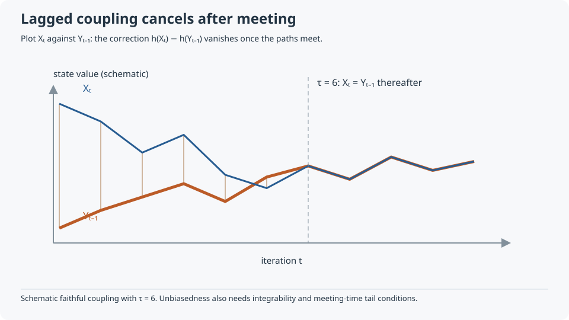

# 31. Coupling and unbiased estimation

## Learning goals and prerequisites

Coupling gives us a way to remove initialization bias from estimates of stationary expectations. The output is a random numerical estimate, possibly negative even when the quantity being estimated is positive. Its construction combines ordinary Markov transitions with a correction that becomes exactly zero after two carefully related chains meet.

By the end of this chapter, you should be able to construct a coupled transition without changing either marginal sampler, derive a lagged correction, distinguish termination from finite variance, and combine independent completed computations with an appropriate Monte Carlo standard error. We will work through a binary chain completely and a continuous Metropolis transition numerically.

Prerequisites are expectation and joint distributions from [Chapter 2](02-probability.md), Monte Carlo averages from [Chapter 5](05-monte-carlo.md), convergence from [Chapters 7](07-finite-chains.md) and [8](08-convergence.md), and [Metropolis–Hastings](09-metropolis-hastings.md). Familiarity with [Monte Carlo error](13-mc-error.md) helps when comparing computational efficiency.

## 31.1 Many short chains retain initialization bias

Suppose a kernel $P$ has invariant distribution $\pi$, and we want

$$
\pi(h)=\int h(x)\,\pi(dx).
$$

Starting from distribution $\mu$, an ordinary finite chain has marginal law $\mu P^t$ at time $t$. Its expectation need not equal $\pi(h)$. Running one million independent copies of the same short chain can make the average extremely precise around the wrong expectation.

Consider a chain on $\{0,1\}$ with transition matrix

$$
P=\begin{pmatrix}0.8&0.2\\0.3&0.7\end{pmatrix},
\qquad X_0=0,\qquad h(x)=x.
$$

Writing $p_t=\Pr(X_t=1)$ gives $p_{t+1}=0.2+0.5p_t$. Therefore the stationary mean is $0.4$, while

$$
p_t=0.4(1-0.5^t).
$$

An average over times $0$ through $4$ has expectation

$$
\frac{1}{5}(0+0.2+0.3+0.35+0.375)=0.245.
$$

Independent replication reduces uncertainty around $0.245$; it does not move that center to $0.4$. Longer chains reduce this particular bias, but the question here is different: can a finite, randomly sized computation have expectation exactly $0.4$?

Randomized debiasing provides such constructions. The historical connection to equilibrium expectations is developed by [Glynn and Rhee (2014)](https://arxiv.org/abs/1409.4302). Our route will use two chains whose differences eventually vanish. Random duration is essential to the design, and its cost must be studied along with variance.

## 31.2 Coupling changes dependence while preserving marginals

A *coupling* of probability laws $p$ and $q$ is a joint distribution for $(A,B)$ such that $A\sim p$ and $B\sim q$. Independent draws give one coupling. Sharing random numbers gives others. A coupling is valid because of its marginals, not because its sample paths look similar.

For Markov chains, a coupled kernel $\bar P$ must satisfy, for every measurable set $C$,

$$
\bar P((x,y),C\times\mathcal X)=P(x,C),\qquad
\bar P((x,y),\mathcal X\times C)=P(y,C).
$$

These equalities must hold at every pair of current states. Once they hold, all the dependence introduced between the coordinates is available for computational purposes without changing either coordinate's transition law.

For example, draw one $U\sim\operatorname{Uniform}(0,1)$ and set $A=\mathbf 1\{U<0.2\}$ and $B=\mathbf 1\{U<0.7\}$. The marginals are the desired Bernoulli laws. They agree on $U<0.2$ and $U\geq0.7$, so their meeting probability is $0.5$. Independent draws would agree with probability $0.2(0.7)+0.8(0.3)=0.38$.

This has a direct connection to total variation. With the convention

$$
\|p-q\|_{\mathrm{TV}}=\sup_C|p(C)-q(C)|,
$$

any coupling satisfies

$$
|p(C)-q(C)|
=|E[\mathbf 1_C(A)-\mathbf 1_C(B)]|
\leq\Pr(A\ne B).
$$

The indicators cancel whenever the coordinates agree. Taking a supremum gives the coupling inequality. When densities exist relative to a common measure, the largest possible agreement probability is

$$
\int\min\{p(z),q(z)\}\,dz=1-\|p-q\|_{\mathrm{TV}}.
$$

A coupling attaining this value is called *maximal*. Maximality concerns a single pair of distributions. Optimizing one transition's meeting probability need not optimize the eventual cost of an entire estimator.

## 31.3 Constructing a genuine meeting

For a binary Gibbs update, share the uniform used to sample each chain's conditional Bernoulli variable. If the two conditional success probabilities are close, the updated coordinates agree with high probability. For a whole vector, coordinating scan choices and all updates matters: equality of one coordinate is not equality of the state.

Continuous states require more care. Independent continuous proposals have zero probability of being exactly equal. Nevertheless, a joint distribution can put positive probability on the diagonal while retaining continuous marginals. A maximal density coupling constructs precisely that shared part:

```text
Draw A from density p and U uniformly on (0,1).
If U p(A) <= q(A), return (A,A).
Otherwise:
    repeatedly draw B from q and V uniformly on (0,1)
    until V q(B) > p(B);
    return (A,B).
```

The probability density assigned to the shared branch is $\min(p,q)$. On failure, the first coordinate has residual density proportional to $(p-q)_+$, while rejection sampling makes the second coordinate proportional to $(q-p)_+$. Both residuals have the same total mass. Adding the shared and residual contributions reconstructs each requested marginal. If $p=q$, the initial branch always succeeds and the residual loop is never entered.

The residual loop also has a cost worth checking. Let $d=\|p-q\|_{\mathrm{TV}}>0$ and count each proposed draw as one unit. The loop is entered with probability $d$, and each attempt succeeds with probability $d$. Conditional on entering, its attempt count $G$ is geometric with $E[G]=1/d$ and $E[G^2]=(2-d)/d^2$. If $C$ is the total draw count, then

$$
E[C]=1+dE[G]=2,\qquad
\operatorname{Var}(C)=\frac{2(1-d)}{d}.
$$

When $d$ is small, the loop is rarely needed but can be very long when entered. If $d=0$, its cost is exactly one draw instead. This is a concrete example of why mean cost does not describe variability in runtime. The general algorithm and its cost analysis appear in [Jacob, O'Leary, and Atchadé, Section 4.1](https://academic.oup.com/jrsssb/article/82/3/543/7056129). Equal-variance normal distributions admit the construction in Section 31.8a with no residual rejection loop.

For Metropolis–Hastings, first couple the proposal distributions, then use a fresh shared acceptance uniform. Each coordinate still proposes from its own proposal kernel and accepts with its own correct probability. A common proposal becomes an actual meeting only if both chains accept it. A maximal proposal coupling generally does not maximize meeting for the entire Metropolis transition; this distinction is the subject of [O'Leary, Wang, and Jacob's work on maximal MH couplings](https://arxiv.org/abs/2010.08573).

After equality, share every random choice so the chains remain equal. This property is called *faithfulness*. A test such as “distance below $10^{-6}$” cannot replace exact equality in the theory: forcing nearby unequal states to merge may change a marginal kernel. In continuous implementations, assign the same sampled object on the shared branch so equality is an intentional construction.

## 31.4 Put one chain a step ahead

The estimator uses a lag of one. Draw $(X_0,Y_0)$ with both marginals equal to $\mu$; they may be dependent, even identical. Advance $X$ once using $P$. For $t\geq2$, draw

$$
(X_t,Y_{t-1})\sim
\bar P((X_{t-1},Y_{t-2}),\cdot).
$$

The first coupled comparison is $(X_1,Y_0)$. The second is $(X_2,Y_1)$. Both coordinate processes still have $X_s\sim Y_s\sim\mu P^s$ at their own index $s$, although the paired coordinates occupy different times.

```text
Paired comparison:    1        2        3        4
Ahead chain:         X1       X2       X3       X4
Behind chain:        Y0       Y1       Y2       Y3
Difference:          h(X1)    h(X2)    h(X3)    h(X4)
                     -h(Y0)   -h(Y1)   -h(Y2)   -h(Y3)
```

Define

$$
\tau=\inf\{t\geq1:X_t=Y_{t-1}\}.
$$

Faithfulness now means $X_t=Y_{t-1}$ for every $t\geq\tau$. It is this lagged equality that makes subsequent corrections vanish. Starting with $X_0=Y_0$ does not set $\tau=0$: $X$ must first take its extra step.



Why use a lag at all? Differences between chains at the same index have expectation zero. They may reduce variance, but they cannot supply the change in expectation from time $t-1$ to time $t$. The one-step offset supplies exactly that change.

## 31.5 Derive the correction and justify the limit

For a fixed nonnegative integer $k$, define

$$
H_k=h(X_k)+\sum_{t=k+1}^{\tau-1}
\{h(X_t)-h(Y_{t-1})\}.
$$

An empty sum is zero. To understand the construction, first sum to a deterministic $n\geq k$. Since $Y_{t-1}$ and $X_{t-1}$ have identical marginal laws,

$$
E\left[h(X_k)+\sum_{t=k+1}^{n}
\{h(X_t)-h(Y_{t-1})\}\right]
=E[h(X_n)].
$$

Each intermediate expectation cancels. This is an algebraic identity at finite $n$, requiring only integrability. Passing to an infinite sum needs an additional argument.

Here is a sufficient theorem that covers our binary example. Assume $|h|\leq M$, $E[h(X_n)]\to\pi(h)$, the coupling is faithful, and $E[\tau]<\infty$. Write $\Delta_t=h(X_t)-h(Y_{t-1})$. Since $\Delta_t=0$ for $t\geq\tau$,

$$
\sum_{t=k+1}^{\infty}|\Delta_t|
\leq 2M(\tau-k-1)_+.
$$

The right side is integrable. Thus we may exchange expectation and the absolutely integrable series, then use the finite telescope and its limit. We obtain $E[H_k]=\pi(h)$. The finite expected meeting time also implies that the computation terminates almost surely.

This proof identifies the work done by each assumption. Correct marginals justify cancellation; convergence identifies the limiting expectation; faithful meeting gives a finite computable sum; integrability justifies the exchange. Observing some short meetings establishes none of the unverified assumptions. The lagged estimator and its broader conditions are developed in [Jacob, O'Leary, and Atchadé (2020)](https://academic.oup.com/jrsssb/article/82/3/543/7056129).

The result concerns the expectation of $H_k$. It makes no claim that $X_\tau$ is distributed as $\pi$. Individual correction terms may have either sign, and $H_k$ may lie outside the range of $h$. Clipping it into a desired range changes its expectation.

## 31.6 Worked example: solve the binary estimator completely

Return to the binary chain. A transition can be generated as

$$
f(x,U)=\mathbf 1\{U<0.2+0.5x\}.
$$

Use the same uniform for both coordinates of the coupled update. If the lag-aligned states are $(1,0)$, they become $(1,1)$ when $U<0.2$, remain $(1,0)$ when $0.2\leq U<0.7$, and become $(0,0)$ when $U\geq0.7$. Equality occurs with probability $0.5$ per such update. The ordering never reverses.

Initialize both chains at zero. With probability $0.8$, $X_1=Y_0=0$, so $\tau=1$ and $H_0=0$. With probability $0.2$, the first pair is $(1,0)$. Every unequal comparison contributes $+1$, and each following update has probability $0.5$ of ending the unequal period.

Conditional on the latter event, the number $G$ of unequal comparisons is geometric on $\{1,2,\ldots\}$ with success probability $1/2$. Thus $H_0=G$ on that event, with

$$
E[G]=2,\qquad \operatorname{Var}(G)=2,\qquad E[G^2]=6.
$$

Consequently,

$$
E[H_0]=0.2(2)=0.4,
\qquad E[H_0^2]=0.2(6)=1.2,
\qquad \operatorname{Var}(H_0)=1.04.
$$

We have removed the full bias of $h(X_0)=0$. The price is a variable output that can be $2$, $3$, or larger despite estimating a probability. In particular, interpreting the output as a Bernoulli draw would be incorrect.

For integers $t\geq1$,

$$
\Pr(\tau>t)=0.2(0.5)^{t-1},\qquad
E[\tau]=1+\sum_{t=1}^{\infty}\Pr(\tau>t)=1.4.
$$

This analytically derived tail verifies every meeting-time moment needed below. It also supplies a useful debugging relation: in this example $H_0=\tau-1$ on every path. An implementation producing a negative raw correction or violating this identity has probably mixed up the indices.

## 31.7 Average several corrections from one trajectory

One can reuse a coupled path to calculate $H_k,H_{k+1},\ldots,H_m$. For deterministic $0\leq k\leq m$, their average is unbiased by linearity. Let $n=m-k+1$. The ordinary terms contribute $n^{-1}\sum_{j=k}^m h(X_j)$. A correction $\Delta_t$ appears in $H_j$ precisely when $j<t$, so it appears $\min(n,t-k)$ times when $t\geq k+1$. Therefore

$$
H_{k:m}=\frac{1}{m-k+1}\sum_{j=k}^{m}h(X_j)
+\sum_{t=k+1}^{\tau-1}
\min\left(1,\frac{t-k}{m-k+1}\right)
\{h(X_t)-h(Y_{t-1})\}.
$$

Early corrections receive smaller weights because fewer component estimators use them. Later corrections receive weight one. Although the component estimators are dependent, that dependence does not affect their unbiasedness; it does affect the variance of their average.

The algorithm must simulate $X$ through time $m$, even if meeting occurs earlier. After meeting, simulating only $X$ is sufficient for this calculation because all future corrections are known to be zero. Conversely, if meeting is late, continue beyond $m$ until the correction is complete.

Choosing $k$ beyond most meeting times often makes the correction zero on most runs. Those uncommon nonzero corrections remain essential. Choosing $m$ larger adds ordinary averaging and dilutes early corrections, but increases work. Neither choice is automatically more efficient. The script compares three settings using variance times expected transition work.

Use fixed choices or choose them from an independent pilot. Selecting $k$ and $m$ after seeing the very trajectory being corrected changes the estimator and needs another proof. A data-dependent rule cannot inherit unbiasedness merely because each fixed choice has it.

## 31.8 Worked example: a continuous Metropolis meeting

Let $\pi$ be the standard normal density and use random-walk proposals $q_x=N(x,1)$. Symmetry gives

$$
\log\alpha(x,z)=\min\{0,(x^2-z^2)/2\}.
$$

Suppose a lag-aligned pair currently equals $(x,y)=(2,1)$. Maximally couple $q_2$ and $q_1$. Their densities cross at $1.5$, and their overlap is

$$
\int\min(q_2,q_1)=2\Phi(-0.5)\approx0.6171.
$$

This is the proposal-meeting probability. To see the acceptance step, imagine the shared branch produces $z=1.5$. The first chain accepts with probability one, whereas the second accepts with probability $\exp(-0.625)\approx0.5353$. A fresh common acceptance uniform of $0.4$ makes both states $1.5$. A value of $0.8$ gives states $(1.5,1)$: the proposals met, but the chains did not. These calculations describe what happens for a shared proposal near that numerical value, rather than assigning positive probability to one exact real number.

Once the states coincide, identical normal proposals and acceptance uniforms preserve equality. By contrast, before meeting a synchronous proposal $x+Z,y+Z$ preserves the proposal separation exactly, so sharing the increment alone does not create a common proposal.

### 31.8a Derive a reflection coupling for normal proposals

Here is an explicit way to generate the maximally coupled proposals. Let $p=N(a,s^2)$ and $q=N(b,s^2)$, with $s>0$. Draw independent $Z\sim N(0,1)$ and $U\sim\operatorname{Uniform}(0,1)$; put $A=a+sZ$ and $d=(a-b)/s$. The log density ratio is

$$
\log\frac{q(A)}{p(A)}
=\frac{(A-a)^2-(A-b)^2}{2s^2}
=-dZ-\frac{d^2}{2}.
$$

Set

$$
B=
\begin{cases}
A,&\log U\leq\min(0,-dZ-d^2/2),\\
b-sZ,&\text{otherwise}.
\end{cases}
$$

When $a=b$, directly set $B=A$. Otherwise, the second branch reflects $A$ about the midpoint $(a+b)/2$. This normal special case of reflection maximal coupling uses one normal variate and one uniform, without a residual rejection loop. See [Atchadé and Jacob (2024), Section 4.1, Algorithm 4](https://arxiv.org/html/2406.06851v1).

Why is $B$ still normal? The shared branch contributes the density $\min(p(z),q(z))$ to $B$. The failed branch has unnormalized density $(p(z)-q(z))_+$ for $A$. Its map $T(z)=a+b-z$ is its own inverse and has absolute Jacobian one. Normal symmetry gives $p(T(z))=q(z)$ and $q(T(z))=p(z)$, so the reflected contribution to $B$ is $(q(z)-p(z))_+$. Adding the two contributions gives exactly $q(z)$. Reflecting a normal innovation only on selected events is valid here because this density calculation accounts for the selection.

For the earlier pair, $a=2,b=1,s=1$, hence $d=1$. If $Z=0.5$, then $A=2.5$, and the shared-branch threshold is $e^{-1}\approx0.3679$. A coupling uniform of $0.2$ sets $B=2.5$; a value of $0.8$ instead sets $B=0.5$. A new shared uniform then performs the two MH acceptance decisions. Reusing the coupling uniform for those decisions would invalidate the usual marginal-MH argument, because it is already involved in selecting $B$.

The general proposal overlap is $2\Phi(-|a-b|/(2s))$: split its integral at the midpoint, where the normal densities cross. For our pair it is $0.617075$. Actual state agreement has a smaller probability,

$$
\int_{\mathbb R}\min\{q_2(z),q_1(z)\}
\min\{\alpha(2,z),\alpha(1,z)\}\,dz
\approx0.341334.
$$

The first factor is the density of a shared proposal; the second is the probability both accept it using a common fresh uniform. With unequal current states and these continuous proposals, other ways of meeting have probability zero. This transition-meeting formula is analyzed by [O'Leary, Wang, and Jacob, Section 2.2](https://arxiv.org/pdf/2010.08573). The script evaluates the integral numerically and checks both meeting rates, both proposal marginals, and both MH marginal means. These are checks of one transition, not a proof about long-run meeting tails.

### 31.8b From transitions to a continuous estimator

To form an estimator, initialize $X_0=Y_0=3$, advance $X$ once, and apply the coupled transition above until meeting, continuing $X$ through the requested averaging endpoint. Apply the same stored path to $h_1(x)=x$ and $h_2(x)=x^2$. The target expectations are zero and one. Each replicate produces a pair of estimates, and uncertainty for each is calculated across independent replicates.

This construction verifies the transition marginals and faithfulness. For these unbounded functions, a complete theorem also requires moment and meeting-tail conditions. Neither the numerical acceptance calculation nor a plausible histogram proves them. The next section states a sufficient set of conditions; a production continuous example should establish them for its chosen initialization and kernel.

## 31.9 Termination, variance, and computational cost are separate

Almost-sure meeting means each ideal run eventually returns. Finite $E[\tau]$ gives finite mean transition count for fixed averaging endpoints. A second moment controls a different issue. For bounded $h$,

$$
|H_k|\leq M\{1+2(\tau-k-1)_+\}.
$$

Thus $E[\tau^2]<\infty$ is a simple sufficient condition for finite variance. Finite $E[\tau]$ alone does not imply that second moment. These are sufficient conditions, not necessary characterizations: cancellation may improve particular estimators.

For unbounded $h$, one established sufficient framework assumes convergence of $E[h(X_t)]$ to $\pi(h)$, a uniform bound $\sup_t E|h(X_t)|^{2+\eta}<\infty$ for some $\eta>0$, geometric meeting tails $\Pr(\tau>t)\leq C\delta^t$ with $0<\delta<1$, and faithfulness. These conditions yield unbiasedness, finite variance, and finite expected transition count for fixed $k,m$. See the assumptions and Proposition 1 in [Jacob, O'Leary, and Atchadé](https://academic.oup.com/jrsssb/article/82/3/543/7056129). Actual runtime also depends on the cost of each coupled transition, which may itself be variable.

The role of the extra moment can be seen directly. If the uniform moment bound is $D$, Hölder's inequality and the triangle inequality for the $L^2$ norm give

$$
\|\Delta_t\|_2
\leq 2D^{1/(2+\eta)}
\Pr(\tau>t)^{\eta/[2(2+\eta)]}.
$$

Here $\Delta_t$ is zero outside $\{\tau>t\}$, and both coordinates have the required marginal moment bound. A geometric tail makes the sum of these norms finite. The correction series therefore converges in $L^2$, supplying finite variance and also allowing expectations to pass to the limit. Almost-sure meeting by itself supplies no such summable bound.

Given $R$ independent complete estimates, use

$$
\bar H_R=\frac1R\sum_{r=1}^R H^{(r)},\qquad
\widehat{\operatorname{MCSE}}=\sqrt{\frac{s_H^2}{R}}.
$$

Here $s_H^2=(R-1)^{-1}\sum_r(H^{(r)}-\bar H_R)^2$ and $R\geq2$. A finite variance supports the usual iid central limit theorem across replicates; a nonzero variance gives the corresponding studentized limit. Thus $\bar H_R\pm1.96\,\widehat{\operatorname{MCSE}}$ is an asymptotic 95% interval as $R$ grows, not an exact finite-replicate guarantee. This is different from estimating autocorrelation within one long chain. A small empirical standard error can still be misleading when rare large corrections have not appeared, so meeting-time theory and cost records remain valuable.

For a large total-work budget, variance times expected work is a useful efficiency measure. Parallel elapsed time additionally depends on the slowest jobs. Retaining only jobs finished before a deadline can change the distribution of retained outputs because runtime and estimate can be correlated. Complete a prespecified number of independent jobs, preserving unfinished jobs for later completion if necessary. Never replace their corrections with zero.

### 31.9.1 Target variance is not the variance of unbiased estimates {#sec-3191-target-variance-is-not-the-variance-of-unbiased-estimates}

**Predict before calculating.** The binary estimator $H_0$ has expectation $0.4$ and variance $1.04$. Is $1.04$ the variance of a stationary binary state? Could we estimate the target variance by substituting $H_0$ into $h-h^2$? These questions concern different random variables.

Write $\mu=\pi(h)$ and $\nu=\pi(h^2)$. The target variance is $\operatorname{Var}_\pi(h)=\nu-\mu^2$. The variance of a completed unbiased correction, $\operatorname{Var}(H)$, instead describes its Monte Carlo noise across independently completed computations. In Section 31.6 the target is Bernoulli with mean $2/5$, so its variance is $6/25=0.24$, while the correction variance is $26/25=1.04$. More correction noise does not mean more target uncertainty.

Suppose one completed computation supplies a pair $(A,B)$ with

$$
E[A]=\mu=\pi(h),\qquad E[B]=\nu=\pi(h^2).
$$

Crucially, $B$ must estimate the **target second moment**. Squaring an unbiased mean estimate usually does not do this: $E[A^2]=\mu^2+\operatorname{Var}(A)$, rather than $\pi(h^2)$. We can apply the lagged correction separately to the two functions $h$ and $h^2$, using the same coupled trajectory if desired. This permits dependence between $A$ and $B$ within a completed computation. Section 31.8b describes that pairing for $h(x)=x$ and $h^2(x)=x^2$; the necessary unbiasedness and moment conditions must hold for both outputs.

Now generate an **independent completed copy** $(A',B')$ with the same law as $(A,B)$, and put

$$
W=\frac{B+B'}2-AA'.
$$

Independence across the two completed computations gives $E[AA']=E[A]E[A']=\mu^2$. Hence $E[W]=\nu-\mu^2$, the target variance. Independence of $A$ and $B$ within a computation is unnecessary. Taking $A'=A$ would instead give $E[B-A^2]=\operatorname{Var}_\pi(h)-\operatorname{Var}(A)$; the missing independence is exactly the unwanted subtraction.

Finite second moments of $A$ and $B$ are sufficient for finite variance of $W$. Indeed,

$$
W^2\le B^2+(B')^2+2A^2(A')^2,\qquad
E[W^2]\le2E[B^2]+2\{E[A^2]\}^2<\infty.
$$

Use $(x-y)^2\le2x^2+2y^2$ with $x=(B+B')/2$, followed by $(B+B')^2\le2B^2+2(B')^2$; then use independence to factor the product of squared outputs. **No fourth moment of $A$ is required.** Unbiasedness and square integrability of the separately corrected $h^2$ output $B$ must still be established: square-integrable $A$, or merely finite $\pi(h^2)$, establishes neither. Applying Section 31.9's unbounded-function framework to $h^2$ can require stronger target-function moment conditions. A useful exact identity, allowing arbitrary within-copy dependence, is

$$
\operatorname{Var}(W)
=\frac12\operatorname{Var}(B-2\mu A)
+\{\operatorname{Var}(A)\}^2.
$$

It follows by expanding $E[W^2]=(E[B^2]+\nu^2)/2-2\mu E[AB]+\{E[A^2]\}^2$ and subtracting $(\nu-\mu^2)^2$. All products used here are integrable under the stated square-integrability assumptions. [Wang and Wang (2023), Sections 1–2](https://www.jmlr.org/papers/volume24/22-1468/22-1468.pdf), discusses the broader problem of unbiased estimation of nonlinear functions of expectations. Our variance construction is the elementary independent-copy repair for this particular polynomial; it does not claim a generic correction for every nonlinear transformation.

### Work the binary case and preserve complete pairs

For $h(x)=x$ on $\{0,1\}$, $h^2=h$. Applying the correction to $h^2$ therefore gives **$B=A=H_0$**, because the two target functions coincide; this is not the assertion $B=A^2$. Section 31.6 gives

$$
E[A]=\frac25,\qquad E[A^2]=\frac65,\qquad
E[A-A^2]=-\frac45.
$$

An unbiased estimate of the target variance cannot have mean $-4/5$ when the correct answer is $6/25$. For two independent copies, however,

$$
W=\frac{H_0+H_0'}2-H_0H_0',\qquad
E[W]=\frac6{25},\qquad
E[W^2]=\frac{29}{25},\qquad
\operatorname{Var}(W)=\frac{689}{625}.
$$

For example, $H_0=1$, $H_0'=2$ gives $W=-1/2$, an event with positive probability. A negative estimate is compatible with a nonnegative expectation. Clipping it at zero changes its expectation. Here $W$ is positive exactly when one correction is zero and the other is positive. Since $\Pr(H_0=0)=4/5$, its clipped mean is $(4/5)E[H_0]=8/25$, above the required $6/25$. The exact calculation exposes the clipping bias without relying on a favorable histogram.

Prespecify an even number $2R$ of independent completed computations, arrange them into **disjoint pairs**, and average the resulting $R$ values of $W$. They are iid, so for $R\ge2$ use the sample variance of these pair outputs divided by $R$ to estimate the variance of their mean. Its square root is the across-pair MCSE. This measures computational uncertainty about the estimated target variance; it is not the target variance itself. The finite-moment argument above supports the iid central limit theorem, with the same asymptotic-interval qualifications as earlier in this section.

Combining every overlapping pair of completed outputs is another possible estimator, but those pair values share inputs. Treating them as iid underestimates or otherwise misstates uncertainty; it requires a covariance calculation or U-statistic analysis. Keep the simple disjoint pairing for this experiment. Fix the completion count before inspecting outputs, complete every required correction, and preserve unfinished jobs for later completion. Keeping only pairs ready by a deadline reintroduces the runtime selection problem.

The executable adds a separately seeded, buffered report for 25,000 disjoint pairs from 50,000 complete raw binary corrections. It reports the pair mean and MCSE, target variance, correction variance, and the deliberately clipped and same-copy alternatives. Exercise 2 changes the chain so that the distribution and variance calculations must be derived again.

## 31.10 Run the experiment and inspect the lab

Run the standard-library script with:

```text
python examples/ch31.py
```

It uses fixed seeds and 50,000 complete replicates per setting. For $k=m=0$, one run gives mean $0.400640$, MCSE $0.004600$, mean meeting time $1.400640$, and sample variance $1.058109$. Compare these with the exact values $0.4$, $1.4$, and $1.04$. Agreement at Monte Carlo resolution is evidence that the implementation matches the derivation; the derivation establishes unbiasedness.

For $k=0,m=4$, the uncorrected mean is approximately $0.244444$, while the corrected mean is $0.400360$. For $k=2,m=12$, they are approximately $0.380911$ and $0.397949$. The final setting has smaller empirical variance times work than either earlier setting. That comparison depends on this chain and on counting a coupled transition as two marginal transitions; it is not a universal tuning prescription.

The Gaussian part generates 50,000 independent proposal pairs from the same starting pair $(2,1)$ and applies one coupled MH transition to each. Compare the proposal means and variances with $(2,1)$ and $(1,1)$ respectively, the proposal agreement with $0.617075$, and the accepted-state agreement with $0.341334$. The MH state means have numerical integration references that include rejections. This experiment checks the reflection construction; it does not run the continuous unbiased estimator described in Section 31.8b. The final, separately seeded part runs the disjoint-pair target-variance experiment from Section 31.9.1.

The script has a safety cap that raises an error and aborts the experiment if meeting takes too long. It buffers its summaries until every setting has completed, so a failure cannot leave a partial experiment report. It does not print a truncated estimator or discard the offending run. The mathematical estimator has no deterministic truncation. Report any cap failure and revise the computation before using its output. Repeatedly restarting capped experiments until one succeeds would condition on completion and need not preserve unbiasedness. The capped script illustrates the ideal estimator; observing no failures does not prove that its cap is mathematically harmless.

In the following lab, vary **Seed offset** and observe when the two traces first coincide and then remain together. The widget couples a three-state chain with a shared uniform, starting at states zero and two. Its comparison uses the same time index for both chains. It illustrates faithful meeting and variability across seeds; it does not calculate the lagged unbiased estimator above, supply a mixing certificate, or generate a perfect stationary draw.

<div class="mcmc-lab" data-lab="coupling"></div>

## 31.11 Lagged couplings can also bound convergence

There is a related use of lagged meetings as evidence about convergence. Initialize both marginals from $\mu$. For integer lag $L\geq1$, advance $X$ by $L$ steps, then couple $(X_{s+L},Y_s)$ with a faithful coupling of $P$, defining

$$
\tau_L=\inf\{u\geq L:X_u=Y_{u-L}\}.
$$

Suppose the marginals converge in total variation to $\pi$, meeting is faithful, and the sum below is integrable. Apply the coupling inequality to successive pairs of marginal laws separated by $L$ steps, then the triangle inequality along that sequence:

$$
\|\mu P^t-\pi\|_{\mathrm{TV}}
\leq\sum_{j=1}^{\infty}\Pr(\tau_L>t+jL)
=E\left[\max\left(0,\left\lceil
\frac{\tau_L-L-t}{L}\right\rceil\right)\right].
$$

The last expression counts how many comparison indices $t+L,t+2L,\ldots$ occur strictly before meeting. Strictness matters: a pair at the meeting index already agrees. This total-variation version follows the lagged-coupling approach of [Biswas, Jacob, and Vanetti (2019)](https://proceedings.neurips.cc/paper_files/paper/2019/file/aec851e565646f6835e915293381e20a-Paper.pdf).

We check for equality at $u=L$, consistent with the lag-one convention used earlier. Their paper begins checking at $u>L$. Either convention supports the counting argument when equality persists from the declared meeting onward.

The bound is an expectation over repeated coupled runs. Its sample average has sampling error and is not automatically an upper confidence bound. Increasing $L$ changes both cost and the bound's behavior. In multimodal problems, poor exploration and poor coupling can each produce long meeting times; fast observed meetings alone do not establish that every important region has been represented.

## Exercises with worked solutions

<div class="exercise" id="mcmc-31-coupling-ex-1">

### Exercise 1: overlap of two Bernoulli laws

Find the maximal agreement probability for Bernoulli probabilities $0.2$ and $0.7$. Explain why the common-uniform construction attains it.

<details>
<summary>Solution</summary>

The overlap is $\min(0.2,0.7)+\min(0.8,0.3)=0.5$. Total variation is $0.5$, so no coupling can agree more often. A shared uniform yields equal ones below $0.2$ and equal zeros above $0.7$, attaining agreement probability $0.2+0.3=0.5$.

</details>

</div>

<div class="exercise" id="mcmc-31-coupling-ex-2">

### Exercise 2: derive transient bias, then change the variance problem

For the original binary chain, derive its stationary success probability and $E[X_t]$ from a zero start. What is the bias of the mean over times zero through four? Next change the transition probabilities to $P(0,1)=a=1/10$ and $P(1,0)=b=3/10$, retaining $X_0=Y_0=0$, lag one, common uniforms, and $h(x)=x$. Derive the law of the raw correction $H_0$, its first two moments, its correction variance, and the target variance. What does the same-copy expression $H_0-H_0^2$ estimate on average? For independent completed copies, compute $E[W^2]$ and $\operatorname{Var}(W)$ for $W=(H_0+H_0')/2-H_0H_0'$. Explain why $B=H_0$ is valid here, and why clipping negative $W$ is not a repair.

<details>
<summary>Solution</summary>

Conditioning on the current state gives $p_{t+1}=0.2(1-p_t)+0.7p_t=0.2+0.5p_t$. The fixed point is $p=0.4$. Subtracting it gives $p_t-0.4=0.5^t(p_0-0.4)$, hence $p_t=0.4(1-0.5^t)$. The five-time average has expectation $0.245$, so its bias is $-0.155$. Replication leaves this bias unchanged.

For the changed chain, the first pair already meets with probability $1-a=9/10$, giving $H_0=0$. Otherwise it starts at $(1,0)$. Each unequal comparison adds one, and the next coupled update meets with probability $a+b=2/5$. Thus conditional on the nonzero branch, $H_0$ is geometric on $\{1,2,\ldots\}$ with success probability $2/5$. Its conditional mean is $5/2$ and conditional second moment is $(2-2/5)/(2/5)^2=10$. Hence

$$
\mu=E[H_0]=\frac14,\qquad E[H_0^2]=1,\qquad
\operatorname{Var}(H_0)=\frac{15}{16}.
$$

The target is Bernoulli with success probability $a/(a+b)=1/4$, so its variance is $3/16$. The same-copy expression has mean $1/4-1=-3/4$, which subtracts correction noise from the quantity wanted. Since $h^2=h$ on the state space, the unbiased target-second-moment correction is $B=A=H_0$, whereas $A^2=H_0^2$ has expectation one and is not that estimator.

For independent copies the expansion in Section 31.9.1 gives

$$
E[W^2]=\frac{1+(1/4)^2}{2}-2\left(\frac14\right)(1)+1^2
=\frac{33}{32},\qquad
\operatorname{Var}(W)=\frac{33}{32}-\left(\frac3{16}\right)^2
=\frac{255}{256}.
$$

The mean remains the desired $3/16$. For example, independent outputs one and two again give $W=-1/2$ with positive probability. Clipping produces mean $(9/10)(1/4)=9/40$, above $3/16$, because it removes negative contributions needed for unbiasedness. Across-pair MCSE must use independent disjoint pairs of complete computations, including the rare long corrections.

</details>

</div>

<div class="exercise" id="mcmc-31-coupling-ex-3">

### Exercise 3: justify exchanging expectation and summation

Assume bounded $h$, convergence of expectations, a faithful coupling, and $E[\tau]<\infty$. Prove $E[H_k]=\pi(h)$, identifying the integrable bound.

<details>
<summary>Solution</summary>

If $|h|\leq M$, each absolute correction is at most $2M$, and all corrections at or after $\tau$ vanish. Thus $\sum_{t=k+1}^{\infty}|\Delta_t|\leq2M(\tau-k-1)_+$ has finite expectation. Fubini's theorem permits exchanging expectation and summation. The partial expected sums telescope to $E[h(X_n)]$, whose assumed limit is $\pi(h)$. Faithfulness identifies the infinite random sum with the implemented finite one.

</details>

</div>

<div class="exercise" id="mcmc-31-coupling-ex-4">

### Exercise 4: check averaging weights

For $k=1,m=3$, list the correction weights at times $2,3,4,5$. Explain what happens if $\tau=2$.

<details>
<summary>Solution</summary>

The width is three. The weights are $1/3,2/3,1,1$, respectively, provided their indices precede meeting. If $\tau=2$, every possible correction is zero because the sum ends at one. The estimator is then $(h(X_1)+h(X_2)+h(X_3))/3$. Simulation must continue through $X_3$ despite the early meeting.

</details>

</div>

<div class="exercise" id="mcmc-31-coupling-ex-5">

### Exercise 5: contraction without meeting

Couple two AR(1) chains using $X_{t+1}=\rho X_t+Z_t$ and $Y_{t+1}=\rho Y_t+Z_t$, where $0<\rho<1$ and the same Gaussian innovation is used. For unequal starting states, does the coupling meet?

<details>
<summary>Solution</summary>

Subtracting the recursions gives $X_t-Y_t=\rho^t(X_0-Y_0)$. This is nonzero at every finite time in exact arithmetic, although it tends to zero. A lag-aligned pair with unequal states obeys the same difference recursion. Thus contraction alone does not supply the finite exact meeting needed to terminate our correction. Rounding the difference to zero changes the mathematical construction.

</details>

</div>

<div class="exercise" id="mcmc-31-coupling-ex-6">

### Exercise 6: audit runtime-based selection

An implementation drops the longest five percent of coupled runs and averages the rest. Explain the problem using the raw binary estimator, and propose a corrected workflow.

<details>
<summary>Solution</summary>

For this example $H_0=\tau-1$, so the longest runs have the largest outputs. In fact, $\Pr(\tau>3)=0.05$. Retaining $\tau\leq3$ keeps precisely $H_0=0,1,2$, with probabilities $0.8,0.1,0.05$ before conditioning. Their conditional mean is

$$
E[H_0\mid\tau\leq3]
=\frac{0(0.8)+1(0.1)+2(0.05)}{0.95}
=\frac4{19}\approx0.210526.
$$

Thus deleting about five percent of a large batch can nearly halve the answer. More generally, runtime-based selection changes the output distribution whenever completion time and estimator are dependent. Prespecify a number of independent replicates and retain all completed results, allowing pending jobs to finish or checkpointing them for completion. Report total work and elapsed time separately. A hard safety cap should fail visibly rather than silently manufacture an estimator.

</details>

</div>

<div class="exercise" id="mcmc-31-coupling-ex-7">

### Exercise 7: reflect a Gaussian residual

Use the coupling of $N(2,1)$ and $N(1,1)$ in Section 31.8a. With $Z=0.5$ and coupling uniform $U=0.8$, find both proposals. Apply a fresh MH acceptance uniform $V=0.4$ for the standard normal target. Do the chains meet? Explain why reflecting about the midpoint has absolute Jacobian one.

<details>
<summary>Solution</summary>

The first proposal is $A=2.5$, and the sharing threshold is $\exp(-1)\approx0.3679$. Since $0.8$ exceeds it, the reflected proposal is $B=1-0.5=0.5$. The first chain's acceptance probability is $\exp((4-6.25)/2)=\exp(-1.125)\approx0.324652$, so it rejects. The second moves toward the normal center and accepts with probability one. The next states are $(2,0.5)$, which do not meet. The map is $T(z)=3-z$, whose derivative is $-1$, so its absolute Jacobian is one. Reflection preserves interval lengths; together with the residual-density calculation, that gives the required second marginal.

</details>

</div>

## Key takeaways and further reading

A successful coupling preserves both marginal kernels and creates exact, persistent lagged equality. Telescoping then turns a transient expectation into an unbiased estimate of a stationary expectation, provided the relevant integrability conditions hold. Finite mean work, finite variance, and practical efficiency require separate attention.

The binary calculation shows the tradeoff explicitly: an estimate of a probability can exceed one because it includes a correction for initialization. A meeting state is not thereby a stationary draw. [Chapter 32](32-perfect-simulation.md) develops perfect simulation, which has that different output guarantee. Coupling also leaves modeling choices and any approximation already present in the marginal kernel untouched: correcting initialization for an approximate invariant law does not remove its discretization or modeling error.

The primary papers linked above serve distinct purposes: Glynn and Rhee explain randomized equilibrium estimation; Jacob, O'Leary, and Atchadé develop practical coupled MCMC estimators; O'Leary, Wang, and Jacob analyze maximal Metropolis couplings; and Biswas, Jacob, and Vanetti develop convergence bounds from larger lags. Atchadé and Jacob's later review gives a broader account of coupling design and applications.
