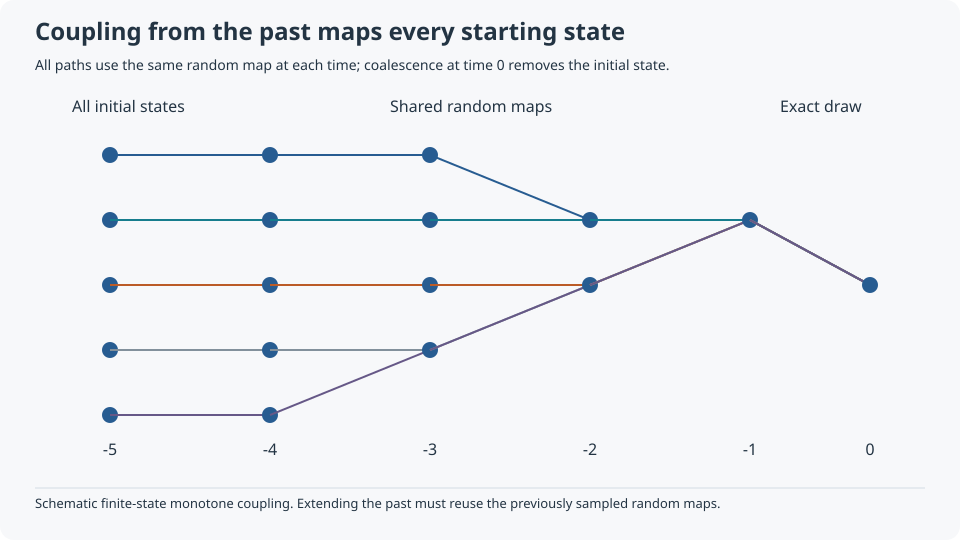

# 32. Perfect simulation

A long Markov chain can look stationary without providing a certificate that its initialization has been forgotten. Perfect simulation asks for something stronger: a computation whose output has exactly the target distribution. Its running time may be random, but its mathematical guarantee contains no unspecified burn-in. Coupling from the past, or CFTP, achieves this by making every possible initialization agree at a fixed observation time.

The central difficulty is constructing a coupling that can certify agreement over the whole state space. An excellent ordinary Markov chain can have a useless coupling for this purpose. Conversely, a coupling with a rigorous exactness guarantee can be computationally expensive. This chapter develops a finite-state construction where both statements can be checked directly.

## 32.1 Learning goals and prerequisites

After this chapter, you should be able to represent a transition kernel using random maps, implement the reuse of past randomness correctly, prove the finite-state CFTP guarantee, and identify when two bounding trajectories certify all-state coalescence. You should also be able to explain why stopping coupled chains when they first meet can give a biased draw.

We use stationarity from [Chapter 7](07-finite-chains.md), Gibbs updates from [Chapter 10](10-gibbs.md), and shared randomness from [Chapter 31](31-coupling.md). The discrete targets in [Chapter 29](29-discrete.md) supply motivating applications. Numerical exactness has the qualifications discussed in [Chapter 4](04-numerics.md).

Keep three statements separate:

| Guarantee | Mathematical object | What it does not establish |
|---|---|---|
| $\pi P=\pi$ | A transition kernel | A finite trajectory started elsewhere is stationary |
| $X\sim\pi$ | A returned random state | Its empirical averages have no Monte Carlo error |
| $\mathbb E[H]=\pi(h)$ | An estimator of an expectation | $H$ is a draw from the state space |

The coupled correction estimators of [Jacob, O'Leary, and Atchadé](https://arxiv.org/abs/1708.03625) concern the third row. For an indicator function, such a corrected estimator can even fall outside $[0,1]$. Perfect simulation concerns the second row. Independent complete runs with independent random histories produce independent draws, but estimating a probability from finitely many draws still involves sampling variation.

## 32.2 A kernel is not a coupling

Let $S$ be a finite state space and let $P(x,y)$ be a transition matrix. A random-map representation consists of a random input $U$ and a deterministic function $\Phi$ satisfying

$$
\Pr\{\Phi(x,U)=y\}=P(x,y)
$$

for each $x,y$. Drawing one input and applying it to every possible state defines a random function $F:S\to S$. Each individual trajectory follows $P$, while the joint behavior of different trajectories depends on the representation.

Take iid inputs indexed by negative integers. The map $F_t$ advances a state from time $t$ to $t+1$. For a positive integer $T$, define

$$
G_T=F_{-1}\circ F_{-2}\circ\cdots\circ F_{-T}.
$$

The rightmost map acts first. Thus $G_T(x)$ is the endpoint at time zero of a trajectory initialized at $x$ at time $-T$. Inputs are independent across times. At a given time, every trajectory uses exactly the same input.

Consider $S=\{0,1\}$ and choose identity or bit-flip with equal probability:

$$
F(x)=x\quad\text{or}\quad F(x)=1-x.
$$

The resulting kernel has both rows equal to $(1/2,1/2)$, so a single transition gives the stationary law from any initial state. Yet each random map is a bijection. Every composition remains a bijection, and two distinct starting states never meet under this coupling.

The same kernel admits a completely different representation: draw a fair bit $B$ and set $F(x)=B$ for every $x$. Now all trajectories meet in one step. The marginal transition matrix alone therefore cannot establish termination of a particular CFTP implementation. The random-map construction is part of the algorithm, not an incidental programming choice.

## 32.3 Looking backward while executing forward

The exhaustive CFTP procedure computes the image

$$
G_T(S)=\{G_T(x):x\in S\}.
$$

If this image contains one state, the endpoint at zero does not depend on initialization at time $-T$. Otherwise, extend the history farther into the past. A convenient schedule tries horizons $1,2,4,8,\ldots$.

There is one indispensable bookkeeping rule: retain every previously generated map. Extending from $T=2$ to $T=4$ adds $F_{-4}$ and $F_{-3}$ while reusing the original $F_{-2}$ and $F_{-1}$. We examine increasingly long pieces of one random history with the same endpoint. We do not repeatedly generate unrelated histories until one happens to coalesce.

```text
maps = empty time-indexed dictionary
T = 1
repeat:
    for each missing time t in {-T, ..., -1}:
        maps[t] = a fresh independent random input
    images = the full state space S
    for t = -T, ..., -1:
        images = {Phi(x, maps[t]) : x in images}
    if images contains one state:
        return that state
    T = 2*T
```

Every replay proceeds in chronological order. The backward part is the search for a sufficiently early starting time. Once a composition is constant, adding earlier maps cannot change its final value: a constant function applied after any other function remains the same constant.



This reuse of a fixed suffix, together with all-state coalescence, is the defining mechanism of [Propp and Wilson's CFTP construction](https://www.stat.berkeley.edu/~aldous/206-RWG/RWGpapers/propp_wilson.pdf). Storing map inputs rather than entire transition tables is often sufficient. For Gibbs sampling an input might be a site index and a uniform variate; both must be retained, since together they determine the map.

## 32.4 Why the returned state has the target law

Here is a finite-state theorem with the termination assumption exposed.

**Theorem 32.1.** Suppose $S$ is finite, $\pi$ is stationary for $P$, and $(F_t)_{t<0}$ are iid random maps representing $P$. Assume that with probability one some finite $T$ makes $G_T$ constant on all of $S$. Then the value returned by CFTP has distribution $\pi$.

**Proof.** Put the entire infinite sequence of past maps on one probability space. Define

$$
T_\star=\inf\{T\geq1:G_T\text{ is constant on }S\}.
$$

On $\{T_\star<\infty\}$, every constant composition obtained at a horizon at least $T_\star$ has the same value; call it $Z$. Assign any state to $Z$ on the nontermination event, which has probability zero by assumption.

Fix a deterministic $T$. Introduce an auxiliary $X^{(T)}$ with law $\pi$, independent of the entire map sequence. This variable is only a proof device. By stationarity and independence of successive maps,

$$
Y_T=G_T(X^{(T)})\sim\pi.
$$

When $G_T$ is constant, $Y_T=Z$. Consequently, for any event $A\subseteq S$,

$$
\left|\Pr(Z\in A)-\pi(A)\right|
\leq \Pr(Z\neq Y_T)
\leq \Pr(T_\star>T).
$$

Taking the supremum over $A$ gives the same upper bound on total variation distance. Almost-sure termination implies $\Pr(T_\star>T)\to0$. Therefore the distance is zero and $Z\sim\pi$. $\square$

The same comparison, starting from any fixed $x$, gives $\|P^T(x,\cdot)-\pi\|_{\mathrm{TV}}\leq\Pr(T_\star>T)$. Thus these assumptions also imply convergence from every state and uniqueness of the stationary law. They do not require irreducibility as a separate hypothesis: transient states are allowed. The identity/flip example shows why convergence of the kernel does not imply coalescence for every random-map representation. This distinction is explicit in the hypotheses of [Propp and Wilson's Theorem 2](https://www.stat.berkeley.edu/~aldous/206-RWG/RWGpapers/propp_wilson.pdf).

The comparison variable does not assume we can already sample from $\pi$: mathematical couplings can introduce objects that are unavailable to an algorithm. Nor did the proof substitute the random stopping horizon into a fixed-time stationarity statement. Such a substitution would be unjustified because the stopping horizon depends on the maps.

The proof also explains why doubling is harmless. The first successful tested horizon need not equal $T_\star$; any successful horizon produces the same $Z$. Exactness follows from the entire consistent history, rather than the particular schedule used to discover it. The proof does not provide a useful bound on computation until we establish termination quantitatively.

## 32.5 Monotone bounds replace exhaustive enumeration

Tracking every state costs too much when $S$ contains all $2^n$ spin configurations. Suppose instead that $S$ has a partial order, a least element $\bot$, and a greatest element $\top$. Assume every possible map preserves order:

$$
x\leq y\quad\Longrightarrow\quad F_t(x)\leq F_t(y).
$$

Composition preserves this property. Because $\bot\leq x\leq\top$ for every $x$,

$$
G_T(\bot)\leq G_T(x)\leq G_T(\top).
$$

Thus equality of the two extreme endpoints proves that $G_T$ is constant. This is a deterministic certificate for each realized history. It needs neither a convergence diagnostic nor a probability calculation about untracked states.

A partial order need not compare all pairs. For componentwise ordered spins, $(-1,+1)$ and $(+1,-1)$ are incomparable, but both lie between the all-minus and all-plus configurations. What matters is that the two bounding configurations enclose every state.

Two arbitrary starting states do not provide this certificate. They might meet even though a third state has a different endpoint. Likewise, an update that is usually order preserving is insufficient: the envelope argument requires preservation for every input used, apart from explicitly handled probability-zero cases in an ideal continuous randomization.

When bounds meet before time zero, continue their common path to zero. Returning the state at the meeting time changes the observation time and can change the law. Monotonicity reduces the number of trajectories to replay; it does not by itself ensure that replay will finish quickly.

## 32.6 A termination condition and the price of doubling

A useful sufficient condition is the existence of a block length $m\geq1$ and a number $\epsilon>0$ such that a composition of $m$ iid maps is constant with probability at least $\epsilon$.

Split the most recent $km$ maps into $k$ disjoint blocks. The block-constant events are independent. If any block is constant, every longer composition containing it is constant too: earlier inputs are forgotten by that block, and later maps take its single output to a single endpoint. Hence

$$
\Pr(T_\star>km)\leq(1-\epsilon)^k.
$$

This proves almost-sure termination. Summing the tail in groups of $m$ also gives

$$
\mathbb E[T_\star]
=\sum_{t=0}^{\infty}\Pr(T_\star>t)
\leq m\sum_{k=0}^{\infty}(1-\epsilon)^k
=\frac{m}{\epsilon}.
$$

The bound can be loose. Its value is that it supplies an actual termination argument for the chosen maps. Irreducibility and aperiodicity of $P$ alone do not replace it, as the identity/flip example demonstrates.

Let $H$ be the first successful power-of-two horizon. For $T_\star>1$, $H<2T_\star$, while $H=1$ when $T_\star=1$. Replaying one trajectory at every attempted horizon costs

$$
1+2+\cdots+H=2H-1<4T_\star.
$$

Two monotone trajectories therefore require fewer than $8T_\star$ state-map evaluations under this simple implementation. A state-map evaluation means applying one stored map to one state; the cost of that evaluation depends on the representation. Updating a spin with a fixed number of neighbors differs from evaluating a dense interaction field over thousands of sites.

Storage is proportional to $H$ random inputs, excluding state storage. Replaying from the extremes avoids retaining every intermediate configuration. Strong interactions can make coalescence slow even when two trajectories fit easily in memory. Exactness removes initialization bias; it is not a promise of favorable computational scaling.

## 32.7 Worked example: reset and drift

Let $S=\{0,1,2\}$. Independently at each time, choose with equal probability either the reset map $R(x)=0$ or the drift map $D(x)=\min(x+1,2)$. In state order $0,1,2$, the transition matrix is

$$
P=\begin{pmatrix}
1/2&1/2&0\\
1/2&0&1/2\\
1/2&0&1/2
\end{pmatrix}.
$$

Write the stationary probabilities as $(a,b,c)$. The first balance equation gives $a=(a+b+c)/2=1/2$. The second gives $b=a/2=1/4$, leaving $c=1/4$. Thus

$$
\pi=(1/2,1/4,1/4),\qquad \mathbb E_\pi[X]=3/4.
$$

We can derive the CFTP output without matrix algebra. A final reset gives $Z=0$, with probability $1/2$. A final drift preceded by a reset gives $Z=1$, with probability $1/4$. Two final drifts give $Z=2$, with probability $1/4$, regardless of earlier maps. Every composition of two maps is constant, so $T_\star\leq2$ for every history.

For example, if the maps at times $-3,-2,-1$ are $R,D,D$, then the images of the whole state space are successively

$$
\{0,1,2\}\longmapsto\{0\}\longmapsto\{1\}\longmapsto\{2\}.
$$

The order matters: a final reset would instead make the endpoint zero. Under doubling, a final reset succeeds at horizon one. A final drift fails at horizon one and succeeds at horizon two; the previously generated final drift is reused in that second attempt.

Now compare a tempting forward algorithm. Start one trajectory from each state at time zero, apply shared fresh maps, and return the common state at the first coalescence time. If the first map is $R$, return zero, with probability $1/2$. If the first is $D$, the image is $\{1,2\}$; a subsequent $R$ returns zero and a subsequent $D$ returns two, each with unconditional probability $1/4$. The resulting law is

$$
\Pr(Z_{\mathrm{forward}}=0,1,2)=(3/4,0,1/4).
$$

State one is never returned, despite having stationary mass $1/4$. The bias is caused by the rule that selects the observation time. CFTP instead observes at zero and moves the initialization backward.

This example also exposes runtime censoring. Conditional on CFTP finishing at horizon one, its output is always zero. Keeping only the fastest completed runs would therefore destroy the target law, even though every completed run obeyed the CFTP procedure.

### 32.7.1 An exact distribution for horizon and work

We can quantify this dependence without simulation. [Fill's analysis of runtime selection, Section 6](https://www.ams.jhu.edu/~fill/papers/algo1.pdf), studies the output law conditional on finishing before a cutoff. The following calculation extends our reset example and gives both that conditional law and an exact replay cost.

Take $S=\{0,\ldots,L\}$, where $L\geq1$ is an integer. Choose $R(x)=0$ with probability $p\in(0,1)$ and $D(x)=\min(x+1,L)$ with probability $q=1-p$. Let $K$ be the position of the most recent reset when reading backward from time $-1$: $K=1$ means the final map is a reset. Then $\Pr(K=k)=pq^{k-1}$.

A reset anywhere in the history makes the composition constant. Without a reset, $t<L$ drifts have image $\{t,\ldots,L\}$, while $L$ drifts are constant. Therefore

$$
T_\star=\min(K,L),\qquad Z=\min(K-1,L).
$$

In particular, the joint dependence is strong: when $T_\star<L$, necessarily $Z=T_\star-1$. The marginals are

$$
\Pr(T_\star=t)=
\begin{cases}
pq^{t-1},&1\leq t<L,\\
q^{L-1},&t=L,
\end{cases}
\qquad
\pi(z)=
\begin{cases}
pq^z,&0\leq z<L,\\
q^L,&z=L.
\end{cases}
$$

For integer $t\geq0$, write $s(t)=\Pr(T_\star>t)$. It equals $q^t$ for $t<L$ and zero for $t\geq L$. Summing this finite tail gives

$$
\mathbb E[T_\star]=\frac{1-q^L}{p}.
$$

Doubling transforms this into a different distribution: $\Pr(H=1)=1-s(1)$ and, for $j\geq1$,

$$
\Pr(H=2^j)=s(2^{j-1})-s(2^j).
$$

For the two-trajectory implementation, total replay work is exactly $W=2(1+2+\cdots+H)=4H-2$. With $L=5$ and $p=1/4$, the complete horizon distribution is

| Tested horizon $H$ | Probability | Map evaluations $W$ |
|---|---:|---:|
| $1$ | $1/4$ | $2$ |
| $2$ | $3/16$ | $6$ |
| $4$ | $63/256$ | $14$ |
| $8$ | $81/256$ | $30$ |

Consequently $\mathbb E[T_\star]=781/256\approx3.050781$ and $\mathbb E[W]=233/16=14.5625$. A horizon is a length of stored history; work includes earlier unsuccessful replays. The script verifies these fractions by enumerating all 256 histories of length eight with their exact rational probabilities.

Now impose a tested power-of-two cutoff $C<L$. Completion means $K\leq C$, equivalently $Z<C$. Retained outputs have law

$$
\Pr(Z=z\mid H\leq C)=\frac{pq^z}{1-q^C},\qquad 0\leq z<C,
$$

and zero mass elsewhere. The excluded target mass is $\pi(\{C,\ldots,L\})=q^C$. Renormalization adds the same mass to the retained states, so the total variation distance from $\pi$ is exactly $q^C$. In the table's example, cutoff $C=2$ retains only $0$ and $1$, with probabilities $4/7$ and $3/7$, and distance $9/16$ from the target. Restarting after each failure would sample this conditional law. Completing every requested run avoids this selection rule; observing zero failures in a finite experiment cannot establish that failures are impossible.

## 32.8 Worked example: two ferromagnetic spins

On a finite graph, take spins $s_i\in\{-1,+1\}$ with distribution

$$
\pi(s)\propto\exp\left(\beta\sum_{\{i,j\}\in E}J_{ij}s_is_j+\sum_i h_i s_i\right),
$$

where every undirected edge is counted once, $\beta\geq0$ and all interactions $\beta J_{ij}$ are finite and nonnegative. Fields $h_i$ are finite and are already on the dimensionless scale in this parameterization. Holding all other spins fixed, changing $s_i$ from minus to plus changes the log weight by

$$
2h_i+2\beta\sum_{j:\{i,j\}\in E}J_{ij}s_j.
$$

The conditional probability of plus is consequently

$$
p_i(s)=\operatorname{logistic}\left(2h_i+2\beta\sum_jJ_{ij}s_j\right),
\qquad \operatorname{logistic}(z)=\frac{1}{1+e^{-z}}.
$$

Choose a site uniformly and draw $U\sim\operatorname{Uniform}(0,1)$. Set the chosen spin to plus if $U<p_i(s)$, and to minus otherwise. Random-scan Gibbs preserves $\pi$. Use the same chosen site and uniform for both bounding chains.

Increasing neighboring spins cannot decrease $p_i$, since the coefficients are nonnegative and logistic is increasing. If the lower configuration receives plus, then $U$ lies below its threshold and hence below the upper threshold too. If the upper receives minus, the lower does too. Unchanged coordinates retain their order. This proves preservation of componentwise order.

For two spins with one edge, set $\beta J=0.4$ and $h_1=h_2=0$. The normalizer is $2e^{0.4}+2e^{-0.4}$, giving

| Configuration | Probability |
|---|---:|
| $(-1,-1)$ | $0.344987$ |
| $(-1,+1)$ | $0.155013$ |
| $(+1,-1)$ | $0.155013$ |
| $(+1,+1)$ | $0.344987$ |

In particular,

$$
\Pr(s_1=s_2)=\frac{e^{0.4}}{e^{0.4}+e^{-0.4}}
=\operatorname{logistic}(0.8)\approx0.689974.
$$

The two possible conditional thresholds are approximately $0.310026$ and $0.689974$. Start the bounds at $(-1,-1)$ and $(+1,+1)$. If the first update chooses site one with $U=0.2$, both bounds set that site to plus, becoming $(+1,-1)$ and $(+1,+1)$. If the next update chooses site two with $U=0.6$, both now see a plus neighbor and set site two to plus. They coalesce at $(+1,+1)$.

Termination also has a direct proof. Put $a=\operatorname{logistic}(-0.8)\approx0.310026$. In any two-map block, the event “choose site one, then site two, with both uniforms below $a$” forces every starting state to $(+1,+1)$. Its probability is $(1/2)^2a^2>0$, so the block criterion applies. On a graph with $n$ sites, each conditional plus probability has a strictly positive minimum $a_i$ over the finite configuration space. Prescribing sites $1,\ldots,n$ in order and requiring the uniform for site $i$ to lie below $a_i$ forces all spins to plus, with probability $n^{-n}\prod_i a_i>0$. This extends the argument to every finite ferromagnetic graph with finite interactions and fields; the bound can become extremely pessimistic.

A negative interaction breaks this particular ordering argument: increasing a neighbor lowers the conditional plus probability. Perfect sampling might still be possible with another construction, but all-minus and all-plus trajectories no longer supply the certificate just proved. [Chapter 41](41-physics.md) examines the larger lattice setting and its computational difficulties.

## 32.9 A bounded executable demonstration

Run `python examples/ch32.py`. The script first checks the exact reset-chain laws by enumerating weighted histories, then implements time-indexed map storage and monotone endpoint checks for both numerical examples. Each call starts with an empty history. It prints target and empirical frequencies, the number of completed replicates, mean replay work, the largest horizon, and cap failures. Replay work counts both bounding trajectories, including redundant updates after they have met.

For the two-spin model, 20,000 independent ideal draws would give an approximate standard error for the alignment frequency of

$$
\sqrt{\frac{0.689974(1-0.689974)}{20000}}\approx0.00327.
$$

An empirical discrepancy on that scale is ordinary Monte Carlo variation. Agreement is a useful check against an implementation error; the proof and the verified map construction supply the distributional guarantee.

The demonstration has a finite horizon cap so that execution is bounded. It tests powers of two up to the cap; a custom cap between powers of two leaves the largest tested horizon below the cap. If no tested horizon succeeds, the script reports the last tested horizon, stops without a frequency summary for that experiment, and exits with a failure status. It never substitutes a current endpoint for an exact draw. The ideal mathematical algorithm continues until coalescence; the capped script illustrates that algorithm. For reset/drift, the deterministic bound $T_\star\leq L$ makes a tested horizon at least $L$ sufficient for every history. The two-spin example has no such deterministic bound, so a failure-free capped batch alone cannot establish an unconditional perfect-sampling guarantee.

Change **Seed offset** in the lab below and observe how meeting time varies across shared random histories. The common-uniform coupling and starting states zero and two stay fixed; the control changes the random seed. Identify which displayed quantities concern this pair of trajectories. The lab illustrates coupling; it does not implement the preserved past history and all-state certificate required by CFTP.

<div class="mcmc-lab" data-lab="coupling"></div>

## 32.10 Extensions and the limits of exactness

An unbounded state space may have no greatest element. A continuous space may have no usable pair of extremes, and trajectories under naive shared additive noise can approach each other without ever becoming equal. A proof then needs a different device for representing or bounding all possible histories.

Dominated CFTP uses an appropriately constructed dominating process to control the states that must be considered. [Kendall and Møller](https://vbn.aau.dk/en/publications/perfect-simulation-using-dominating-processes-on-ordered-spaces-w/) develop this direction for ordered spaces, including locally stable point processes. This pointer indicates the scope of the method; the stationary domination and backward simulation requirements require additional theory beyond our finite-state proof.

Runtime selection has also motivated separate perfect-sampling constructions. [Fill's interruptible algorithm](https://www.ams.jhu.edu/~fill/papers/algo1.pdf) addresses this issue under its own assumptions. One cannot obtain its guarantees simply by adding a timeout to ordinary CFTP.

Finally, distributional exactness is relative to a specified mathematical target and ideal transition probabilities. It does not validate the scientific model. Pseudorandom generators and floating-point logistic thresholds introduce numerical qualifications. These finite-state examples have no time-discretization approximation, but a perfect sampler for an approximated target would still sample that approximation. An exact auxiliary draw can be crucial in methods such as those discussed in [Chapter 45](45-machine-learning.md); replacing it by a long MCMC run changes the guarantee.

## 32.11 Exercises with worked solutions

<div class="exercise" id="mcmc-32-perfect-simulation-ex-1">

### Exercise 1: composition order

The maps at times $-3,-2,-1$ in the reset-and-drift example are $R,D,D$. Compute $G_3(0)$, $G_3(1)$, and $G_3(2)$. What happens if you reverse their order?

<details>
<summary>Solution</summary>

The correct composition is $D\circ D\circ R$. Each starting state first becomes zero, then one, then two, so all three outputs equal two. Reversing the order gives $R\circ D\circ D$, whose output is zero. Both compositions coalesce, but they represent different histories. A coalescence check cannot detect a mistaken convention for time ordering.

</details>

</div>

<div class="exercise" id="mcmc-32-perfect-simulation-ex-2">

### Exercise 2: stationary moments

Solve the reset-chain balance equations and compute its stationary variance.

<details>
<summary>Solution</summary>

The equations give $a=1/2$, $b=a/2=1/4$, and $c=1-a-b=1/4$. Thus $\mathbb E[X]=1/4+2/4=3/4$ and $\mathbb E[X^2]=1/4+4/4=5/4$. The variance is $5/4-(3/4)^2=11/16$. Perfect draws retain this variability; exactness concerns their law, not equality to a population mean.

</details>

</div>

<div class="exercise" id="mcmc-32-perfect-simulation-ex-3">

### Exercise 3: forward stopping bias

Enumerate the possible histories up to first forward coalescence for the reset chain. Compare the returned mean with the stationary mean.

<details>
<summary>Solution</summary>

The relevant histories are $R$, $DR$, and $DD$, with probabilities $1/2$, $1/4$, and $1/4$. Their common endpoints are zero, zero, and two. The forward-stopped mean is therefore $1/2$, whereas the stationary mean is $3/4$. Every path has genuinely coalesced; the error comes from selecting the observation time using its random history.

</details>

</div>

<div class="exercise" id="mcmc-32-perfect-simulation-ex-4">

### Exercise 4: repair a noncoalescing coupling

Why does a fair choice between identity and bit-flip never coalesce on $\{0,1\}$? Give a coalescing representation of the same kernel.

<details>
<summary>Solution</summary>

Both possible maps are permutations, and a composition of permutations is a permutation. Its image has two elements forever. The kernel nevertheless sends each initial state to a fair bit. Drawing one fair bit $B$ and using the constant map $F(x)=B$ preserves exactly those transition probabilities while giving $T_\star=1$. This changes the joint coupling without changing either marginal transition law.

</details>

</div>

<div class="exercise" id="mcmc-32-perfect-simulation-ex-5">

### Exercise 5: ferromagnetic and negative interactions

Derive the single-spin conditional odds. Then show explicitly that a negative two-spin interaction can reverse the order after one shared update.

<details>
<summary>Solution</summary>

Terms not involving $s_i$ cancel in the weight ratio. The conditional odds of plus against minus are $\exp(2h_i+2\beta\sum_jJ_{ij}s_j)$, yielding the logistic conditional. With $\beta J=-0.4$ and zero field, use lower state $(-1,-1)$ and upper state $(+1,+1)$. Update site one with $U=0.5$. The lower threshold is $\operatorname{logistic}(0.8)>0.5$, while the upper threshold is $\operatorname{logistic}(-0.8)<0.5$. The results are $(+1,-1)$ and $(-1,+1)$, which violate the previous coordinatewise order. The ordinary Gibbs kernel remains valid; the proposed monotone certificate fails.

</details>

</div>

<div class="exercise" id="mcmc-32-perfect-simulation-ex-6">

### Exercise 6: work and censoring

Suppose an $m$-map block is constant with probability at least $\epsilon>0$. Bound the expected coalescence horizon and two-trajectory doubling work. Explain why retaining only runs completed before a deadline needs a separate justification.

<details>
<summary>Solution</summary>

Independent disjoint blocks give $\Pr(T_\star>km)\leq(1-\epsilon)^k$. Summing grouped tails gives $\mathbb E[T_\star]\leq m/\epsilon$. Doubling and replay cost fewer than $8T_\star$ state-map evaluations for the two trajectories, hence expected work at most $8m/\epsilon$. This counts evaluations, not their machine cost. Runtime depends on the same maps as the output, so conditioning on fast completion can alter the law. In the reset example, conditioning on horizon one forces the output to zero. A reported failure is honest, but repeated attempts that discard failures can still amount to biased conditioning.

</details>

</div>

<div class="exercise" id="mcmc-32-perfect-simulation-ex-7">

### Exercise 7: a cap changes the law

For the generalized reset chain with $L=5$ and $p=1/4$, verify the target probability of state five and the conditional law when only runs finishing by horizon two are retained. Compute the conditional mean and compare it with the target mean.

<details>
<summary>Solution</summary>

Five final drifts give $\pi(5)=q^5=(3/4)^5=243/1024$. Horizon-two completion is the event that a reset occurs in the final two maps, with probability $1-q^2=7/16$. Its output masses before conditioning are $\Pr(Z=0)=1/4$ and $\Pr(Z=1)=3/16$, so the conditional probabilities are $4/7$ and $3/7$. The conditional mean is $3/7$. Using $\mathbb E[Z]=\sum_{k=1}^5\Pr(Z\geq k)=\sum_{k=1}^5q^k$, the target mean is $q(1-q^5)/p=2343/1024\approx2.288086$. The missing upper states explain the large downward error. The total variation distance is their total target mass $q^2=9/16$.

</details>

</div>

## 32.12 Key takeaways and primary reading

CFTP produces an exact target draw when a consistent history of random maps coalesces from every possible starting state and the search terminates almost surely. Monotone extremes can make that certificate affordable. Retaining the past maps, observing at a fixed endpoint, and proving termination are essential mathematical parts of the procedure.

The executable examples separate four questions: whether the kernel preserves the target, whether its coupling coalesces, whether the implementation follows that coupling, and how much sampling error remains in a finite empirical average. None can be answered merely by seeing two plotted lines meet.

The primary readings are [Propp and Wilson (1996), *Exact Sampling with Coupled Markov Chains and Applications to Statistical Mechanics*](https://www.stat.berkeley.edu/~aldous/206-RWG/RWGpapers/propp_wilson.pdf); [Fill (1998), *An Interruptible Algorithm for Perfect Sampling via Markov Chains*](https://www.ams.jhu.edu/~fill/papers/algo1.pdf); [Kendall and Møller (2000), *Perfect simulation using dominating processes on ordered spaces*](https://vbn.aau.dk/en/publications/perfect-simulation-using-dominating-processes-on-ordered-spaces-w/); and [Jacob, O'Leary, and Atchadé, *Unbiased Markov chain Monte Carlo with couplings*](https://arxiv.org/abs/1708.03625). The first develops the central construction, the next two give distinct extensions, and the last clarifies the neighboring goal of unbiased expectation estimation.
