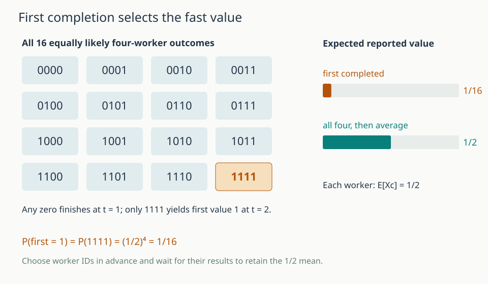

# 35. Parallel hardware and distributed MCMC

**Learning goals.** By the end of this chapter you should be able to identify which probability law each worker targets, prove when independent chains preserve a joint target, assign reproducible random streams to logical chains, recognize invalid simultaneous Gibbs updates, derive Gaussian consensus and its limits, and benchmark time to a defensible inferential result.

**Prerequisites.** We use likelihood factorization from [Chapter 03](03-bayesian-targets.md), random-number and floating-point ideas from [Chapter 04](04-numerics.md), MCMC uncertainty and diagnostics from Chapters [13](13-mc-error.md)–[15](15-adaptation.md), and sampler engineering from [Chapter 18](18-sampler-engineering.md). [Chapter 34](34-scalable.md) discusses stochastic-gradient approximations; this chapter focuses on parallel work and on reconstructing a posterior from data shards.

## 35.1 What is being parallelized?

An MCMC computation has several axes: independent **chains**, the **iterations** within a chain, components of a **single transition**, and **data contributions** to a likelihood. Splitting any one of them among workers has a different mathematical consequence. Consecutive iterations of one ordinary Markov chain depend on the previous state, so putting them in an array does not make them independent jobs. By contrast, several chains can advance concurrently because each keeps its own state and random stream.

| Work assigned to workers | Law represented by each worker | Communication | Final object |
| --- | --- | --- | --- |
| Independent full-target chains | The same posterior $\pi$ | Usually diagnostics and results at the end | Pooled or chainwise estimates of $\pi$ |
| Pieces of one transition | A shared current state | Usually every transition | One Markov kernel, if the pieces are assembled correctly |
| Likelihood contributions | Shard likelihood $L_s$, all included in each full evaluation | Reduction at every needed evaluation | The full-data target, up to arithmetic effects |
| Separate shard posteriors | Different $\pi_s$ | Often only final draws or summaries | A reconstruction that may be approximate |

Interacting replicas are another design: tempering exchanges states between chains with different targets under a joint invariant law; see [Chapter 25](25-tempering.md). Such replicas are not independent full-target chains. The [figure](figures/35.svg) sketches independent-chain timelines, with repeated warmup and retained sampling on each worker. The key design question is always, “What law does one worker leave invariant, and what law is claimed for the reported estimator?”

Hardware choice follows the bottleneck. If independent chains fit in memory and each mixes adequately, chain parallelism is straightforward. If a gradient is dominated by a large sum over observations, distributing that *complete* sum may help, although communication can dominate. If state updates are conditionally independent in blocks, within-transition parallelism is possible. When the model barely fits on one machine, data sharding may be unavoidable; its final statistical approximation then needs explicit validation. None of these choices repairs a difficult posterior geometry by itself.

## 35.2 Independent chains and a product invariant law

Let $P_c(x_c,dy_c)$ be a transition kernel for chain $c$, each invariant for the same probability measure $\pi$. Suppose transitions use independent randomness conditional on the current vector $\mathbf x=(x_1,\ldots,x_C)$. The joint update has product kernel

$$
K(\mathbf x,d\mathbf y)=\prod_{c=1}^{C}P_c(x_c,dy_c).
$$

For any measurable rectangle $A_1\times\cdots\times A_C$, with $\Pi=\pi^{\otimes C}$,

$$
\int K(\mathbf x,A_1\times\cdots\times A_C)\,\Pi(d\mathbf x)
=\prod_{c=1}^{C}\int P_c(x_c,A_c)\,\pi(dx_c)
=\prod_{c=1}^{C}\pi(A_c).
$$

Rectangles generate the product sigma field, so $\Pi K=\Pi$. This is an **exact-invariance statement about the mathematical kernel**, not a claim that finite chains have reached stationarity. Different workers may use different invariant kernels, such as different valid Metropolis proposals, while still sharing $\pi$.

The conditional independence assumption matters. If two chains use the same proposal noise or uniforms, each marginal can remain invariant while their joint law is not $\pi^{\otimes C}$. A particularly stark example draws a fresh $Z\sim\pi$ and sets both next states to $Z$: each marginal is perfect, yet the two outputs are identical. Counting them as two independent draws would halve a reported variance incorrectly. Keep chain labels in storage and diagnostics even when combining estimates.

Parallel chains mainly multiply the amount of stationary sampling possible in a given wall time. They do not shorten the transient of an individual chain. If all chains start in the same narrow region and the target has a separated mode, all may miss it; agreement among chains does not prove exploration. See [Chapter 14](14-diagnostics.md) for diagnostics and their limits. Coupled chains can even be useful for a different purpose, unbiased estimation, as in [Chapter 31](31-coupling.md), but their covariance must enter uncertainty calculations.

## 35.3 Random streams belong to logical chains

The random input to a transition should be identified independently of the worker that happens to execute it. A useful conceptual address is

```text
(experiment, chain, phase, iteration, draw)
```

where *phase* distinguishes warmup from retained sampling. If chain 7 moves from device 0 to device 2, its stream must move with it. Giving each process the same inherited state after a process fork can produce identical “independent” chains. Reusing one vector of normal variates across all chain rows induces dependence, even if each row has a different current state.

One implementation assigns a stateful generator to each chain and checkpoints both the chain state and generator state. Recording only the initial seed is insufficient if execution resumes after a variable number of draws: rejection loops and dynamic HMC paths consume variable amounts of randomness. A counter-based design instead derives a value from a key and a unique logical address. It can make scheduling changes easier to tolerate, provided the address scheme never reuses a key/counter pair. In either design, changing the sequence of operations inside a transition can change the path, even when the eventual statistical result remains sound.

The standard-library [example](examples/ch35.py) uses separate, recorded `random.Random` objects as a simple teaching device. Distinct integer seeds alone are not a proof of independent pseudorandom streams. For practical parallel programs, use documented splitting or counter methods such as NumPy's `SeedSequence.spawn` or a suitable counter generator, and record the generator and derivation scheme. The [NumPy parallel RNG documentation](https://numpy.org/doc/stable/reference/random/parallel.html) describes these options and their probabilistic collision assurances. A reproducibility record also needs software version, precision, target code, chain-to-stream mapping, and execution mode. Bitwise replay and statistical reproducibility are different claims.

## 35.4 Vectorization, memory, and unequal work

With $C$ chains of dimension $d$, a vectorized state can have shape `(C, d)`; retained draws can have shape `(N, C, d)`. This layout makes the chain axis explicit. Each chain still needs its own acceptance decision and its own state update. A single Boolean acceptance flag broadcast across rows accidentally couples the chains. Likewise, a reduction intended to sum coordinates within each chain must preserve the chain axis.

The full draw array consumes memory proportional to $NCd$. For large $N$, save selected coordinates, thin only for a concrete storage reason, write chunks, or accumulate online summaries while retaining enough draws for diagnostics of relevant quantities. Broadcasting can avoid copies, but an apparently compact expression can materialize a large temporary array. Inspect actual memory use before interpreting a speed result. A simple wall-time model is

$$
T_C \approx T_{\mathrm{setup}}+T_{\mathrm{transfer}}
 +T_{\mathrm{compute}}(C)+T_{\mathrm{sync}}+T_{\mathrm{output}}.
$$

On an accelerator, many similar arithmetic operations can amortize setup and transfer. A small model with cheap transitions may be slower after those costs. Static-length HMC trajectories batch naturally; dynamic HMC can leave lanes idle while the longest trajectory finishes. Masking a finished lane must preserve its last valid state. The implementation must also define whether random draws for masked lanes are consumed, so replay and stream accounting remain consistent. Merely placing chains on a GPU does not imply an inferential speedup.

### Completion order is a selection rule

Dynamic scheduling can move a logical chain to an available worker without changing its transition kernel, provided the chain's state and random stream move together. **Which completed results are retained** is a separate choice. If computation time depends on the simulated value, taking the first result can select a different law even when every worker produces a correct draw. This matters for variable-cost likelihoods, rejection loops, and dynamic trajectories; whether it occurs in a particular implementation depends on how cost and retained values are related.

For an exact, finite example, let four workers independently draw $X_c\sim\operatorname{Bernoulli}(1/2)$. A task takes one time unit when $X_c=0$ and two when $X_c=1$. Suppose the coordinator keeps only the first completed draw, breaking ties arbitrarily. A one can arrive first only if **all four** workers drew one, so

$$
P(X_{\mathrm{first}}=1)=P(X_1=X_2=X_3=X_4=1)=2^{-4}=\frac{1}{16},
$$

although each worker's output has mean $1/2$. Waiting for all four and averaging their prespecified outputs has expectation $1/2$. Logical streams make the four outputs reproducible under rescheduling; they cannot correct the first-completion selection. The [example](examples/ch35.py) checks both expectations with simulated batches. It uses artificial task costs, not measured hardware timings or an MCMC chain. In a real sampler, retain a prespecified set of chain IDs and iteration indices, then wait for those results; record unfinished tasks separately. A wall-time stopping rule or first-$K$ completion rule needs its own analysis when progress or runtime depends on state.



*Only outcome 1111 yields a first completed value of one when zero takes one time unit and one takes two. First completion has mean $1/16$; averaging all four prespecified outputs has mean $1/2$.*

Real-time interruption of an ongoing MCMC computation is related but has a different selection law: the state observed at an arbitrary time can be **length biased toward longer computation times**. [Murray, Singh, and Lee](https://www.cambridge.org/core/journals/data-centric-engineering/article/anytime-monte-carlo/3E8ED0F13E0A1E3AF37D09E1515ABFA2) derive that law and study a multiple-chain correction under their assumptions. The short-task bias in the first-completion example and the long-hold bias at a fixed observation time concern different ways of selecting an output; neither follows from the chain's invariant distribution alone.

### Worked computation clock: which state is reported? {#worked-computation-clock-which-state-is-reported}

**Define the observation before calculating its law.** Use artificial integer computation times, not measured hardware timings. The completed states form a Markov chain $X_0,X_1,\ldots$ with kernel $P$. Set $A_0=0$ and $A_{n+1}=A_n+H_n$, where $H_n$ is the positive integer duration of the job producing $X_{n+1}$. Throughout the half-open interval $[A_n,A_{n+1})$, report the **old state $X_n$**. At the boundary $A_{n+1}$, install the completed state $X_{n+1}$ before observing or starting the next job. A self-transition still completes a job and begins another hold, even if the displayed value does not change.

Take

$$
P=\begin{pmatrix}4/5&1/5\\1/5&4/5\end{pmatrix},
\qquad h_0=1,\quad h_1=3,\quad H_n=h_{X_n}.
$$

**Predict first.** Will longer computations while reporting one make a clock observer more or less likely to see one? Does starting $X_0\sim\pi$ at a fresh job boundary already initialize the computation clock in stationarity?

Its completion-index invariant law is $\pi=(1/2,1/2)$. To track the computation clock, augment the displayed state by the whole ticks $r$ remaining in its current job. For $r>1$, decrement $r$ while preserving the old state. For $r=1$, the next tick installs $Y\sim P(X_n,\cdot)$ and starts its hold at $h_Y$. In the explicit phase order

$$
(0,1),\ (1,1),\ (1,2),\ (1,3),
\qquad
Q=\begin{pmatrix}
4/5&0&0&1/5\\
1/5&0&0&4/5\\
0&1&0&0\\
0&0&1&0
\end{pmatrix}.
$$

Every column sums to one, so the four-phase invariant law is uniform. Three phases report one. Thus the stationary computation-clock law is

$$
\alpha=(1/4,3/4),\qquad
P_{\rm clock}(\text{reported state}=1)=3/4,
$$

although the completed chain has invariant mass $1/2$ at one. A visit to one occupies three times as many clock positions as a visit to zero. The embedded chain's invariant law alone does not determine what an interruption observes.

**Stationarity, occupation, and a fresh deadline are different statements.** Starting the phase chain in its uniform invariant law gives the displayed law $\alpha$ at every integer tick. Here $Q$ is irreducible, and its self-loop at $(0,1)$ makes it aperiodic. Consequently its law converges to that invariant from any phase, and its long-run occupation proportions converge to the same masses. These finite-chain facts justify this example without a general real-time convergence theorem.

Starting a new job with $X_0\sim\pi$ instead gives initial phase law $(1/2,0,0,1/2)$. After one tick it is $(2/5,0,1/2,1/10)$, so

$$
P(\text{reported state at tick }1=1)=3/5,
$$

not $3/4$. The zero jobs have completed and installed their results; the initial one jobs still have two ticks left. Even initialization of the embedded state from $\pi$ is not initialization of the computation clock from its invariant phase law.

**Finite phase balance identifies the relevant conditional cost.** More generally, let $P$ be a finite irreducible kernel with invariant law $\pi$. At a job boundary in state $i$, queue the next *chain state* $j\sim P_{ij}$, use a fixed positive integer duration $d_{ij}$, and keep reporting $i$ until completion. Include phases $(i,j,r)$ with $P_{ij}>0$ and $1\le r\le d_{ij}$. Define

$$
m_i=\sum_jP_{ij}d_{ij},\qquad
C=\sum_i\pi_i m_i,\qquad
\eta(i,j,r)=\frac{\pi_iP_{ij}}{C}.
$$

The sum of $\eta$ over all phases is one. A countdown phase receives the same mass from the phase with one more tick remaining. The full-duration phase $(i,j,d_{ij})$ receives boundary flux

$$
\sum_\ell\eta(\ell,i,1)P_{ij}
=\frac{\sum_\ell\pi_\ell P_{\ell i}}{C}P_{ij}
=\frac{\pi_iP_{ij}}{C}.
$$

This proves invariance, including when $d_{ij}=1$. Projecting onto the old reported state gives

$$
\alpha_i=\sum_{j,r}\eta(i,j,r)=\frac{\pi_i m_i}{C}.
$$

Finite positive costs and irreducibility give an irreducible finite phase chain, hence these long-run occupation proportions. They do **not** alone give pointwise convergence from a fresh phase: integer durations can make the phase chain periodic. Check aperiodicity separately before claiming a fixed-deadline limit. The main example above has the needed one-tick self-loop.

For an old-state cost $d_{ij}=h_i$, the conditional mean is $m_i=h_i$. For a next-state cost $d_{ij}=c_j$, it is instead $m_i=\sum_jP_{ij}c_j$. Weighting by a cost attached to the wrong state answers a different question. The next state here is an already defined transition outcome, not an MH proposal awaiting an additional acceptance test.

This finite derivation illustrates the expected-hold weighting in [Murray, Singh, and Lee, Section 2, Proposition 1 and Corollary 2](https://www.cambridge.org/core/journals/data-centric-engineering/article/anytime-monte-carlo/3E8ED0F13E0A1E3AF37D09E1515ABFA2). Their framework allows joint transition and hold-time kernels; Section 2.1 discusses independence from the state being held. Their multiple-chain correction has its own construction and assumptions. The artificial clock here establishes a probability law, not a claim about an actual scheduler or measured runtime.

The chapter's Python reference builds exact phase matrices with `Fraction` entries. It accepts two-state stochastic kernels with positive off-diagonals, integer holds from 1 through 16, and exact propagation through 0 through 256 ticks. These are bounds on the executable reference, not on the finite phase-balance argument. Its new default report shows only the worked old-state model, including the fresh-deadline value $3/5$; the changed next-state-cost task below can be investigated through the pure helpers without printing its answers by default.

## 35.5 Parallel updates *inside* one chain

Parallelizing coordinates is more delicate than parallelizing chains. Let $(X,Y)$ have a centered bivariate normal target with unit variances and correlation $\rho$, where $|\rho|<1$. Its Gibbs conditionals are $X\mid Y=y\sim N(\rho y,1-\rho^2)$ and $Y\mid X=x\sim N(\rho x,1-\rho^2)$. A sequential Gibbs sweep first draws $X'$ given old $Y$, then draws $Y'$ given the new $X'$. The composition preserves the target.

Suppose instead that two workers use stale values simultaneously:

$$
X'=\rho Y+\sqrt{1-\rho^2}\,\epsilon_x,\qquad
Y'=\rho X+\sqrt{1-\rho^2}\,\epsilon_y,
$$

with independent standard normal innovations. Starting *at* the intended target, both new marginal variances are one, but

$$
\operatorname{Cov}(X',Y')
=\rho^2\operatorname{Cov}(Y,X)=\rho^3.
$$

For $\rho=0.8$, the intended covariance is $0.8$ and the one-step covariance is $0.512$. Thus the target is not invariant, although each displayed conditional draw is individually correct and both marginal histograms look right. Repeating the stale update has stationary covariance zero for $|\rho|<1$: if $c$ is stationary, $c=\rho^2c$. The [executable example](examples/ch35.py) checks the one-step prediction empirically. [Chapter 10](10-gibbs.md) develops Gibbs invariance more fully.

There is a valid simultaneous case. Partition variables into a block $A$ and its complement $B$. If the full conditional factorizes as $\pi(x_A\mid x_B)=\prod_{j\in A}\pi(x_j\mid x_B)$, then all $j\in A$ can be drawn independently from the old $B$ and installed together. Updating the next block conditional on the new $A$ is a valid block Gibbs composition. The checkerboard split of a nearest-neighbor lattice is an example; [Chapter 41](41-physics.md) connects it to Ising systems. The condition is a property of the target's conditional dependence graph, not of available processor count.

## 35.6 Arithmetic on parallel hardware

Real-number proofs do not certify a particular floating-point program. Addition is not associative in finite precision: `(1e16 + -1e16) + 1` can evaluate to $1$, while `1e16 + (-1e16 + 1)` can evaluate to $0$ in ordinary double precision. Parallel reductions change summation order as thread grouping and scheduling change. For a log likelihood $\sum_i\ell_i(\theta)$, even a small difference may flip an accept/reject decision when its log uniform threshold is close to the computed log ratio. All subsequent states can then differ.

This is not a reason to demand identical trajectories across machines. It is a reason to check that the *distributional result* is stable enough for the named estimands. Use stable log-domain arithmetic, inspect cancellation, and compare single and double precision where relevant. Fused multiply-add, compiler transformations, and deterministic versus nondeterministic reductions can also matter; the [NVIDIA floating-point guide](https://docs.nvidia.com/cuda/floating-point/index.html) explains the arithmetic principles. Its hardware examples are context-specific, so test the environment actually used.

For a known target, compare moments and tail probabilities with analytic values. For a gradient implementation, compare selected derivatives with a careful finite-difference check at representative points. For an unknown posterior, compare independent implementations or precision settings, with uncertainty intervals wide enough to reflect Monte Carlo error. Diagnostics passing does not establish target correctness: a fast, well-mixed chain for a numerically altered density can still answer the wrong question. Numerical error is separate from finite-run Monte Carlo error and from a deliberate approximation such as a nonvanishing stochastic-gradient step size.

## 35.7 Distributing likelihoods and distributing posteriors

Suppose data split into conditionally independent shards $D_1,\ldots,D_S$ given $\theta$, and the prior is $p(\theta)$. Then

$$
\pi(\theta\mid D)\propto p(\theta)\prod_{s=1}^{S}L_s(\theta),
\qquad
\log L(\theta)=\sum_{s=1}^{S}\log L_s(\theta).
$$

One exact-target strategy evaluates every $\log L_s(\theta)$ in parallel at every proposal or gradient evaluation and reduces the complete sum. Subject to correct synchronization and numerical implementation, the mathematical likelihood is the full-data likelihood. Its cost includes a barrier and communication at each evaluation. A slow shard can delay all workers.

Another strategy runs one sampler per shard. Define

$$
\pi_s(\theta)\propto p(\theta)^{1/S}L_s(\theta).
$$

If each $\pi_s$ is proper, multiplying their densities gives the full posterior up to normalization. The fractional prior ensures the product contains one copy of $p$, not $S$ copies. The fractional prior itself need not integrate to one, but each distribution used for sampling must. If the prior is replicated whole on every shard, the product instead contains $p(\theta)^S$. These constructions and the Gaussian combination below appear in [Scott and colleagues' consensus Monte Carlo paper](https://rob-mcculloch.org/some_papers_and_talks/papers/working/consensus-mc.pdf).

This factorization presumes conditional independence given the *same* global parameter. Correlated observations or global latent variables may require more communication or a different decomposition. Pooling raw shard draws into one bag samples a mixture of the $\pi_s$ distributions, not their density product. Shard sampling is therefore only the beginning of a distributed-posterior method: reconstruction is a separate statistical step.

Consider the prior duplication error in a simple conjugate setting. With a $N(0,1)$ prior and two independent Gaussian data shards, a worker that uses the whole prior produces a subposterior with one unit of prior precision. Multiplying the two subposterior densities contributes *two* units of prior precision; the full posterior has only one. The fractional-prior construction contributes one half-unit from each shard. This difference is present even if every shard chain is infinitely long and perfectly sampled. When a shard has too little data to make its fractional-prior posterior proper, the proposed decomposition is not usable as stated. A different allocation of the prior or a different distributed method is then required, with its target verified from first principles.

## 35.8 Worked example: Gaussian consensus can be exact

Take two proper shard posterior densities $\pi_1=N(1,4)$ and $\pi_2=N(3,1)$ whose product represents the desired target. Their precisions are $1/4$ and $1$. Completing the square in the product of densities gives target precision $5/4$, variance $V=4/5=0.8$, and mean

$$
V\left(\frac{1}{4}\cdot 1+1\cdot 3\right)=0.8(3.25)=2.6.
$$

Now draw $\theta_1\sim N(1,4)$ and $\theta_2\sim N(3,1)$ independently and set $\theta^*=0.2\theta_1+0.8\theta_2$. Its mean is $0.2(1)+0.8(3)=2.6$, and its variance is $0.2^2(4)+0.8^2(1)=0.8$. A linear combination of independent normals is normal, so $\theta^*\sim N(2.6,0.8)$ exactly. Ordinary averaging instead yields mean $2$ and variance $(4+1)/4=1.25$. The weights reflect precision, not worker speed or shard sample size.

In $d$ dimensions, assume independent stationary shard draws $\theta_s\sim N(\mu_s,\Sigma_s)$ with **known positive-definite** covariance matrices and a correct density factorization. Write $Q_s=\Sigma_s^{-1}$ and $V=(\sum_s Q_s)^{-1}$. The precision combination

$$
\theta^*=V\sum_s Q_s\theta_s
$$

has mean $V\sum_s Q_s\mu_s$ and covariance

$$
V\left(\sum_s Q_s\Sigma_s Q_s\right)V
=V\left(\sum_s Q_s\right)V=V.
$$

It is therefore an exact draw from the Gaussian density product. In practice, covariance matrices are estimated from finite, autocorrelated shard chains; weights then fluctuate and the finite-draw theorem no longer applies literally. Time dependence within each shard chain also affects the Monte Carlo standard error of averages of $\theta^*$ even if its one-time marginal law is right. Mode misalignment and nonnormal tails add another kind of error. The [sample program](examples/ch35.py) compares analytic and empirical moments for this deliberately ideal case; it is an algebra check, not a production consensus sampler.

## 35.9 Worked example: a reconstruction error that survives infinite sampling

Let both shard densities be exponential with rate one: $\pi_1(x)=\pi_2(x)=e^{-x}$ for $x\ge0$. Their normalized density product is $\pi(x)=2e^{-2x}$, an exponential with rate two. Its mean is $1/2$, variance $1/4$, and upper-tail probability $P_\pi(X>1)=e^{-2}\approx0.1353$.

The two shard variances match, so an inverse-variance Gaussian-consensus rule would average independent shard draws: $A=(X_1+X_2)/2$. But $X_1+X_2$ is gamma with shape two and rate one, so $A$ has density $4a e^{-2a}$ for $a\ge0$. Its mean is $1$, variance $1/2$, and

$$
P(A>1)=\int_1^\infty 4a e^{-2a}\,da=3e^{-2}\approx0.4060.
$$

Even infinitely many perfect shard draws would leave this discrepancy. A tiny MCSE for the mean of $A$ would quantify the wrong distribution very precisely. The example does not imply that every distributed reconstruction is inconsistent. Density-product estimators, including nonparametric proposals studied by [Neiswanger, Wang, and Xing](https://www.cs.cmu.edu/~epxing/papers/2014/Neiswanger_Wang_Xing_UAI14a.pdf), address a different reconstruction problem and can have asymptotic guarantees under their assumptions. Such a guarantee does not make a fixed-bandwidth, finite-budget implementation exact.

On a manageable subset, compare a distributed reconstruction against a trusted full-data run for several named functions $f$: means, quantiles, and tails can disagree in different ways. Change the shard partition and inspect sensitivity. If no full-data reference is feasible, state the limitation and conduct model-specific checks. No generic convergence diagnostic detects all reconstruction bias.

## 35.10 Benchmark an inferential result

For the *same workload*, define wall-time speedup with $C$ workers as $S_C=T_1/T_C$ and parallel efficiency as $E_C=S_C/C$. A toy serial-fraction model says $S_C\le 1/[a+(1-a)/C]$ when fraction $a$ remains serial, but actual setup, communication, and idle time usually worsen it. Specify whether compilation, warmup, device transfer, checkpointing, synchronization, and diagnostics are inside the timed interval. Asynchronous device calls must be complete before stopping the clock; the [JAX benchmarking guide](https://docs.jax.dev/en/latest/benchmarking.html) gives concrete examples of completion barriers, compilation, and transfer effects. Record hardware, precision, software version, number of chains, warmup and retained lengths, and variability across repeated timings.

For stationary independent chains of equal retained length $N$, suppose a Markov chain CLT holds for $f$ with asymptotic variance $\sigma_f^2$. The pooled mean has approximate variance $\sigma_f^2/(CN)$, provided chain cross-covariances vanish. If chains are dependent, those covariance terms must be included. A useful comparison is estimated uncertainty for a *named estimand* per elapsed second, after confirming that methods target the same law. An ESS per second computed from a biased distributed reconstruction measures precision about that reconstruction; it cannot establish accuracy for the intended posterior.

When the reconstruction has bias $b_f$ relative to the true posterior expectation, its mean squared error is $b_f^2+\operatorname{Var}(\hat\mu_f)$. More computation may shrink the variance while leaving $b_f$ unchanged, as in the exponential example. Since $b_f$ is usually unknown, report reference comparisons or sensitivity evidence rather than an invented MSE estimate. [Chapter 47](47-benchmark-lab.md) develops a controlled comparative protocol. The defensible performance question is how long a method takes to reach useful uncertainty and acceptable target fidelity for the inferential quantities actually needed.

The workload held fixed depends on the claim. Strong scaling asks how quickly a fixed data set and fixed inferential task run as workers are added. Weak scaling grows the data or chain count with the number of workers; it answers a capacity question. A comparison that silently gives the parallel method more retained draws can be useful, but its raw time ratio is not a speedup for equal work. Report both elapsed time and the achieved accuracy or uncertainty instead. For multiple estimands, avoid compressing them into one opaque throughput score: tail events, means, and between-mode probabilities can have very different effective sample sizes and biases.

## 35.11 Lab: correlation and replicated estimates

In the diagnostics lab, vary **AR(1) correlation**, **Samples / iterations**, and **Seed**. It generates one stationary Gaussian AR(1) trace per run and compares empirical with theoretical autocorrelation. Hold correlation and length fixed, record the displayed means for several seeds, and compare their variation with the displayed exact finite-length standard error for this AR(1) process. Then use the variance formula above to predict the effect of averaging $C$ genuinely independent runs. The interface has no chain-offset or chain-count control. It does not execute on a GPU, measure distributed timing, or implement Gaussian consensus. Agreement in its displays is evidence to examine, never proof of convergence.

<div class="mcmc-lab" data-lab="diagnostics"></div>

## Exercises

<div class="exercise" id="mcmc-35-parallel-ex-1">

**1. Product chains.** Let $P_1,P_2$ both leave $\pi$ invariant. Prove that simultaneous updates using independent conditional randomness leave $\pi\otimes\pi$ invariant. Explain which step fails if the two outputs are forced equal.

<details>
<summary>Solution</summary>

For measurable $A,B$, integrate $P_1(x,A)P_2(y,B)$ against $\pi(dx)\pi(dy)$. The product separates into $\pi(A)\pi(B)$. A monotone-class argument extends rectangle equality to the product sigma field. Forced-equal outputs do not give the product kernel: the joint transition probability for $A\times B$ is $\pi(A\cap B)$ in the fresh-draw example, generally different from $\pi(A)\pi(B)$.

</details>

</div>

<div class="exercise" id="mcmc-35-parallel-ex-2">

**2. Variance from chains.** Suppose $C$ stationary independent chains each have $N$ retained draws and a CLT with asymptotic variance $\sigma_f^2$. Derive the pooled-mean variance approximation. What changes if chain averages have nonzero covariance?

<details>
<summary>Solution</summary>

Write the pooled estimate as $C^{-1}\sum_c\bar f_c$. Independence and $\operatorname{Var}(\bar f_c)\approx\sigma_f^2/N$ give $\operatorname{Var}(\hat\mu)\approx\sigma_f^2/(CN)$. In general add $2C^{-2}\sum_{c<d}\operatorname{Cov}(\bar f_c,\bar f_d)$; shared randomness can make this material.

</details>

</div>

<div class="exercise" id="mcmc-35-parallel-ex-3">

**3. Stale Gibbs.** For the bivariate normal construction in Section 35.5 with $\rho=0.8$, compute the covariance after one stale simultaneous update begun at the target. Why could separate histograms of $X'$ and $Y'$ miss the error?

<details>
<summary>Solution</summary>

Independence of innovations gives $\operatorname{Cov}(X',Y')=\rho^2\operatorname{Cov}(Y,X)=\rho^3=0.512$. Each new marginal variance is $\rho^2+(1-\rho^2)=1$, so separate marginal normal histograms can match the target even though the joint correlation is wrong.

</details>

</div>

<div class="exercise" id="mcmc-35-parallel-ex-4">

**4. Precision weights.** Change the first Gaussian shard in Section 35.8 to $N(1,9)$, leaving the second at $N(3,1)$. Find the exact product law and consensus weights.

<details>
<summary>Solution</summary>

The precisions are $1/9$ and $1$, totaling $10/9$. Thus $V=9/10=0.9$. The normalized weights are $0.1$ and $0.9$, giving mean $0.1(1)+0.9(3)=2.8$. The density product and the precision-weighted normal draw are $N(2.8,0.9)$ under the example's independence assumptions. Equal weights would not have that law.

</details>

</div>

<div class="exercise" id="mcmc-35-parallel-ex-5">

**5. A persistent tail error.** Integrate the target and averaged-draw densities of Section 35.9 above $1$. If each law could be sampled without Monte Carlo error, what discrepancy would remain?

<details>
<summary>Solution</summary>

For the product target, $\int_1^\infty 2e^{-2x}dx=e^{-2}$. For the averaged draw, integration by parts gives $\int_1^\infty4x e^{-2x}dx=3e^{-2}$. The remaining tail-probability error is $2e^{-2}\approx0.2707$; increasing shard draws cannot remove this reconstruction bias.

</details>

</div>

<div class="exercise" id="mcmc-35-parallel-ex-6">

**6. Timing audit.** A report claims a hundredfold device speedup. It stops the timer after launching asynchronous work, excludes compilation and transfer, uses lower precision, and reports only iterations per second. Design a comparison that can support an inference claim. Can the original report establish any numerical speedup?

<details>
<summary>Solution</summary>

Synchronize completion before ending each timing; disclose both end-to-end and steady-state intervals, including compilation, transfer, warmup, and output as appropriate. Repeat timings, specify hardware and precision, and compare MCSE or another uncertainty measure for named estimands after checking target fidelity at the used precision. Record chains and retained lengths. The original numbers do not determine a valid speedup because their timed intervals and numerical tasks differ; a repaired test could still find a benefit.

</details>

</div>

<div class="exercise" id="mcmc-35-parallel-ex-7">

**7. First completion.** In the four-worker example in Section 35.4, find the law of the first completed draw for general worker count $C\ge1$. How should the coordinator collect a fixed batch if it wants an unbiased average of the workers' Bernoulli outputs?

**Changed task: next-state work, old-state reporting.** Now consider one chain with

$$
P=\begin{pmatrix}4/5&1/5\\2/5&3/5\end{pmatrix},
\qquad c_0=1,\quad c_1=4.
$$

At each job boundary, queue $Y\sim P(X,\cdot)$ and spend $c_Y$ ticks computing it while continuing to report the old $X$. Install $Y$ at completion before any observation at that boundary. Find the embedded invariant law, the expected hold conditional on the reported state, the mean duration per completed job, and the stationary clock probabilities that the reported old state and the queued next state equal one. Would weighting $\pi_i$ by $c_i$ give the reported-state law? Then replace both rows of $P$ by $(2/3,1/3)$, keeping the costs and reporting convention. Find both stationary clock probabilities and the displayed-state probability at tick one when a fresh job starts at tick zero with $X_0\sim(2/3,1/3)$.

<details>
<summary>Optional hint for the changed clock task</summary>

Condition the duration on the state that is actually reported, averaging over the queued result. Use phases $(i,j,r)$ to keep old and next states distinct. For the fresh deadline, separate jobs that complete exactly at tick one from jobs still computing; a completed result has already been installed at the boundary.

</details>

<details>
<summary>Solution</summary>

The first result is one exactly when every worker drew one, an event with probability $2^{-C}$. It is therefore Bernoulli with success probability $2^{-C}$, rather than $1/2$ except when $C=1$. Choose the $C$ logical draws before dispatch, wait for all their results, and average them. Each has expectation $1/2$, so linearity gives expected batch average $1/2$ regardless of completion order. This says nothing about a stopped MCMC run whose individual outputs have not yet reached their target law.

For the changed chain, balance gives $\pi_0/5=2\pi_1/5$, hence $\pi=(2/3,1/3)$. The durations conditional on the old state are

$$
\begin{aligned}
m_0&=(4/5)1+(1/5)4=8/5,\\
m_1&=(2/5)1+(3/5)4=14/5,\\
C&=(2/3)(8/5)+(1/3)(14/5)=2.
\end{aligned}
$$

The invariant phase masses are $\eta(i,j,r)=\pi_iP_{ij}/2$:

| Old state $i$ | Queued state $j$ | Number of phases | Mass of each phase |
|---:|---:|---:|---:|
| 0 | 0 | 1 | $4/15$ |
| 0 | 1 | 4 | $1/15$ |
| 1 | 0 | 1 | $1/15$ |
| 1 | 1 | 4 | $1/10$ |

Summing phases with old state one gives $1/15+4(1/10)=7/15$. Summing phases with queued state one gives $4(1/15)+4(1/10)=2/3$. Naive weighting by $c_i$ gives $(\pi_1c_1)/(\pi_0c_0+\pi_1c_1)=2/3$; in this construction that is the queued-state clock probability, not the reported-state probability. The ten-phase chain is irreducible and has a self-loop at $(0,0,1)$, so its stationary law is also its limiting law from a fresh phase at integer ticks.

With iid rows $(2/3,1/3)$, both conditional mean holds are $2$, so the stationary old-state probability remains $1/3$. The stationary queued-state probability is still $(1/3)4/2=2/3$. This iid phase chain also has the one-tick self-loop. However, at a fresh job boundary $X_0$ and its first queued $Y$ are independent. At tick one, every $Y=0$ job has completed and installed zero; every $Y=1$ job is still reporting $X_0$. Therefore

$$
P(\text{reported state at tick }1=1)
=P(X_0=1,Y=1)=\frac19.
$$

Constant conditional mean holds make the stationary old-state law correct here; they do not make a fresh job-boundary initialization stationary. The reporting convention and observation time are essential to each answer.

</details>

</div>

## Key takeaways

- Independent full-target chains have a product invariant law when each kernel preserves the target and their transition randomness is independent. Finite-run convergence remains a separate question.
- Retaining the first completed outputs can select by state-dependent runtime; define the retained logical draws before dispatch when claiming an unweighted target average.
- Within-chain parallel updates require a valid joint or block kernel. Individually correct full conditionals do not justify stale simultaneous updates.
- Parallel likelihood summation retains the full mathematical target when all terms are included. Shard posterior combination introduces a separate reconstruction problem.
- Gaussian consensus is exact under its normality, independence, covariance, and factorization assumptions; nonnormal combination can retain bias at infinite sample size.
- Benchmark completed inference for specified estimands, including communication and numerical choices. Faster draws from the wrong law are not faster answers.
