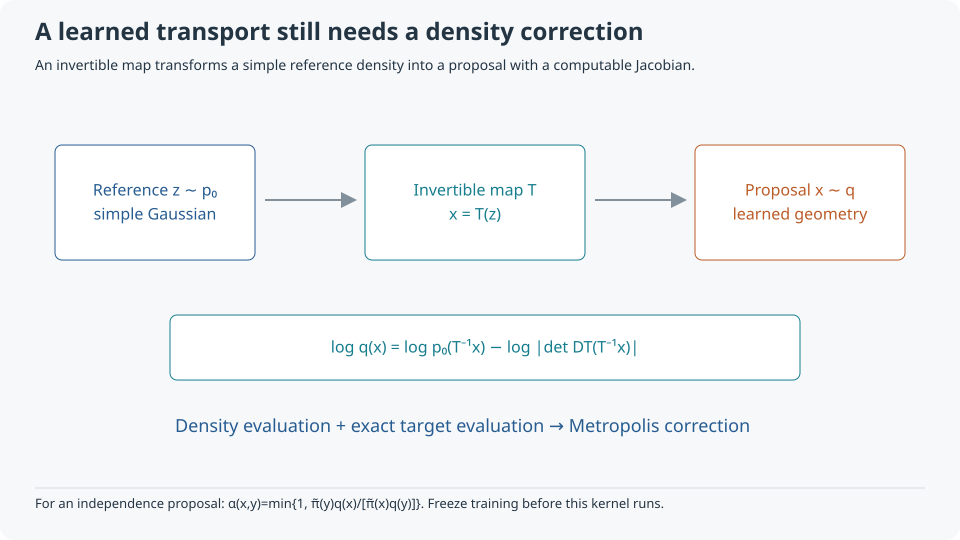

# 36. Learned proposals and hybrid inference

**Learning goals.** By the end of this chapter you should be able to compute the density of an invertible learned proposal, derive its independence Metropolis–Hastings (MH) correction, distinguish a transported target from a proposal distribution, and explain when adaptation or poor coverage defeats an apparently attractive fit. You should also be able to compare a learned sampler with a conventional one using estimand-specific error and total computational cost.

**Prerequisites.** Change of variables in [Chapter 2](02-probability.md), importance weights in [Chapter 5](05-monte-carlo.md), MH in [Chapter 9](09-metropolis-hastings.md), invariant kernel mixtures in [Chapter 12](12-kernel-design.md), Monte Carlo error and diagnostics in [Chapters 13](13-mc-error.md) and [14](14-diagnostics.md), adaptation in [Chapter 15](15-adaptation.md), and reparameterization in [Chapter 16](16-geometry.md). [Chapter 20](20-hmc.md) helps with the transported HMC discussion.

## 36.1 What can learning change?

Suppose a model supplies an unnormalized density $\tilde\pi(x)$ on $\mathbb R^d$, with $0<Z=\int\tilde\pi(x)\,dx<\infty$ and target $\pi=\tilde\pi/Z$. We fit an easy-to-sample density $q_\phi$ using training data, target evaluations, or both. There are three different ways to use it:

1. **Direct approximation:** draw $X\sim q_\phi$ and report $q_\phi$ expectations. This is fast after fitting, but discrepancies between $q_\phi$ and $\pi$ become approximation bias.
2. **Importance sampling:** draw from $q_\phi$ and weight by $\tilde\pi(X)/q_\phi(X)$. This requires density and target evaluations; highly uneven weights can make an estimate unstable. Self-normalization has finite-sample bias even with a correct density ratio.
3. **MH proposal:** propose from $q_\phi$, then accept or reject using both target and proposal densities. With fixed $q_\phi$ and the conditions below, the target is invariant even when the fit is poor. The price is dependence, rejection, and target evaluation at each proposal.

These uses answer different computational questions. Calling flow draws “exact” means exact draws from the distribution represented by the flow under ideal arithmetic, not necessarily from the posterior. For corrected MCMC, distinguish error from the fitted proposal (mostly efficiency), initialization and finite-run error (estimation), floating-point error (implementation), and error in the scientific model or target evaluator (the target itself). A learned proposal cannot correct a wrong likelihood supplied to the acceptance test. The normalizing-flow view of flexible transformed approximations was developed by [Rezende and Mohamed (2015)](https://proceedings.mlr.press/v37/rezende15.html).

## 36.2 From whitening to nonlinear transport

Affine whitening maps a standard Gaussian reference $z$ to $x=m+Lz$. When a posterior is curved, a nonlinear map may straighten more of its geometry. Fix the direction now: let $T_\phi:\mathbb R^d\to\mathbb R^d$ map a reference draw $z\sim r$ **forward** to $x=T_\phi(z)$. Assume for the formulas in this chapter that $T_\phi$ is a continuously differentiable bijection with nonsingular Jacobian and computable inverse. Analogous almost-everywhere conditions can suffice, but singular regions and support boundaries need separate treatment.

The pushforward density $q_\phi$ is obtained by conserving probability mass:

$$
q_\phi(T_\phi(z))\,|\det DT_\phi(z)|=r(z),\qquad
\log q_\phi(x)=\log r(T_\phi^{-1}(x))-\log|\det DT_\phi(T_\phi^{-1}(x))|.
$$

One can draw a **global independence proposal** by sampling a fresh $z\sim r$ and setting $y=T_\phi(z)$. A different construction proposes a small move $z'\sim k(z,\cdot)$ in latent space, then maps it forward. Its proposal density and MH ratio depend on $k$ and the transformed target; it is not an independence sampler. Both can benefit from an imperfect map. Transport-map MCMC uses this geometry explicitly; see [Parno and Marzouk (2018)](https://arxiv.org/abs/1412.5492).



## 36.3 A flow density you can evaluate

A normalizing flow composes invertible maps $T=T_K\circ\cdots\circ T_1$. Put $z_0=z$, $z_k=T_k(z_{k-1})$, and $x=z_K$. The chain rule makes the log density computationally convenient:

$$
\log q(x)=\log r(z_0)-\sum_{k=1}^K\log|\det DT_k(z_{k-1})|.
$$

The inverse operations recover $z_0$ from $x$; each layer contributes its log determinant. “Expressive” alone is not enough for ordinary independence MH: we must evaluate $q$ at both current and proposed points. An implicit generator that only produces samples does not provide this ratio without an additional valid density method.

For a concrete two-dimensional coupling layer, let

$$
x_1=z_1,\qquad x_2=e^{s(z_1)}z_2+t(z_1).
$$

No inverse of the functions $s$ or $t$ is needed: $z_1=x_1$ and $z_2=(x_2-t(x_1))e^{-s(x_1)}$. The Jacobian is triangular,

$$
DT(z)=\begin{pmatrix}1&0\\ e^{s(z_1)}s'(z_1)z_2+t'(z_1)&e^{s(z_1)}\end{pmatrix},
\qquad \log|\det DT(z)|=s(z_1).
$$

The first coordinate remains unchanged by one layer. Swapping or rotating the partition between layers lets later transformations alter both coordinates. This tractable inverse and determinant are the operational virtues of affine coupling layers, as in [Dinh, Sohl-Dickstein, and Bengio (2017)](https://arxiv.org/abs/1605.08803). A flow can still be a poor density model for a specific target; architecture does not guarantee coverage.

## 36.4 Training objectives and undiscovered regions

Two common objectives face opposite directions. For a proper target and a proposal positive where needed,

$$
D_{\mathrm{KL}}(q_\phi\|\pi)
=\mathbb E_{q_\phi}[\log q_\phi(X)-\log\tilde\pi(X)]+\log Z,
$$

so its parameter-dependent terms can be estimated from proposal draws and target evaluations. This is often called *reverse KL*. The other direction is

$$
D_{\mathrm{KL}}(\pi\|q_\phi)
=\mathbb E_\pi[\log\pi(X)-\log q_\phi(X)].
$$

Its parameter-dependent term is $-\mathbb E_\pi\log q_\phi(X)$, requiring target-distributed information or a justified approximation to it. It may use MCMC training samples. Positive serial correlation can reduce the information available for a fitting statistic relative to the same number of independent draws; the effect depends on that statistic and its autocorrelations. A training chain trapped in one mode provides no examples of another. The direction of KL affects how discrepancies are penalized, but “reverse KL misses modes” is not a universal theorem about all fitted flows or optimizers. Finite optimization and limited training data matter as much as the formal objective.

A useful training audit asks: Which target evaluations were used? Did exploratory chains cross modes? Did held-out target-distributed data cover tails? Is the fit assessed on estimands that matter? A good held-out likelihood for a selected training distribution is not posterior calibration. If a model has symmetries, a map trained in only one symmetric sector may reproduce the local shape perfectly while missing the others. Training on accepted *jumps* alone further changes their frequencies because rejected states also occupy time in an MCMC path.

## 36.5 Frozen independence MH is exact-invariant

Fix the learned parameters $\phi$ before this transition. Assume $q_\phi(x)>0$ wherever $\pi(x)>0$ (up to target-null sets). From current $x$, draw $y\sim q_\phi$ and accept with

$$
\alpha(x,y)=\min\!\left\{1,
\frac{\tilde\pi(y)q_\phi(x)}{\tilde\pi(x)q_\phi(y)}\right\}.
$$

The unknown $Z$ cancels. For $x,y$ in the relevant support,

$$
\pi(x)q_\phi(y)\alpha(x,y)
=\min\{\pi(x)q_\phi(y),\pi(y)q_\phi(x)\}
=\pi(y)q_\phi(x)\alpha(y,x).
$$

This detailed balance identity proves invariance. To assert convergence from arbitrary admissible starts, one also needs suitable irreducibility and aperiodicity conditions; proposal support is a basic part of that. Detailed balance alone says nothing about how quickly a finite chain discovers all important regions.

In log arithmetic, with a single frozen parameter value for the whole step:

```text
log_r = log_target(y) + log_q_phi(x) - log_target(x) - log_q_phi(y)
if log(U) < min(0, log_r):
    x = y
else:
    x = x        # record the repeated current state
```

Here $U$ is uniform on $(0,1)$. A cached $\log q_\phi(x)$ is valid only until $\phi$ changes. On rejection, the retained sample is the old $x$, not a missing row. Normalization of $q_\phi$ matters: if only an unnormalized proposal shape is known, one cannot sample it as stated without another construction, although its constant would cancel in the ratio.

## 36.6 Worked example: a banana-shaped target

Let $Z_1,Z_2$ be independent standard normals and define the scientific target through

$$
X_1=Z_1,\qquad X_2=Z_2+b(Z_1^2-1),\qquad b=0.8.
$$

This is a nonlinear coupling map with $s=0$ and $t(z_1)=b(z_1^2-1)$. Its determinant is one, and its inverse is $z_1=x_1$, $z_2=x_2-b(x_1^2-1)$. Thus, apart from the same Gaussian normalizing constant for every coefficient,

$$
\log\pi_b(x)=-\tfrac12\{x_1^2+[x_2-b(x_1^2-1)]^2\}+\text{constant}.
$$

Choose a proposal with coefficient $c$ instead of $b$, so $q_c$ has the same formula with $c$. Direct proposal draws use $(Z_1,Z_2+c(Z_1^2-1))$. If $c=b$, $q_c=\pi_b$ and every independence proposal is accepted: the resulting draws are independent target draws, assuming independent reference draws. For $c=0$, the proposal is an ordinary bivariate standard normal. It still has full support, so the correction is valid, but its shape misses the curved ridge.

The target moments provide a check. Since $\mathbb E[Z_1^2-1]=0$, $\mathbb E[X_2]=0$. The Gaussian fourth moment gives $\operatorname{Var}(Z_1^2-1)=2$, hence

$$
\operatorname{Var}_\pi(X_2)=1+2b^2=2.28,
\quad \mathbb E_\pi[X_1^2]=1,
\quad \operatorname{Cov}_\pi(X_1,X_2)=0.
$$

Zero covariance does not mean independence: the conditional mean of $X_2$ given $X_1=x_1$ is $b(x_1^2-1)$. Raw $q_c$ draws have $\operatorname{Var}(X_2)=1+2c^2$; they are biased for this target variance unless $c^2=b^2$ (and matching one moment would still not prove distributional equality).

The correction can also be checked at two points. Let $x=(0,0)$ and $y=(2,2.4)$, with $c=0$. The target log-density difference is $-1.68$ because the inverse target coordinates are $(0,0.8)$ and $(2,0)$. The proposal log-density difference is $-4.88$. Therefore the forward log MH ratio is $-1.68-(-4.88)=3.2$, giving acceptance one. Reversing the pair gives acceptance $e^{-3.2}\approx0.0408$. The ratio is directional because the independence proposal is not symmetric around the current point.

Run [the standard-library example](examples/ch36.py) with `python examples/ch36.py`. It fixes $c\in\{0,0.4,0.8\}$ for separate chains, prints acceptance and retained moment estimates, and contrasts them with raw proposal variances. Its fixed burn-in and one seed make it a transparent teaching calculation, not a convergence assessment or an effective-sample-size estimate. A high acceptance rate at $c=b$ has a mathematical explanation here; in an unknown target, high acceptance alone could coexist with poor exploration.

## 36.7 Worked example: a proposal that nearly misses a mode

Compress two well-separated regions to states $A$ and $B$. Let $\pi(A)=\pi(B)=1/2$ and $q(A)=0.99$, $q(B)=0.01$. Raw learned draws report only 1% in $B$, a severe approximation error for mode occupancy. Independence MH instead uses importance ratios $w=\pi/q$:

$$
w(A)=\frac{0.5}{0.99},\qquad w(B)=\frac{0.5}{0.01}=50.
$$

From $A$, a proposal to $B$ occurs with probability $0.01$ and is accepted with probability one. From $B$, a proposal to $A$ occurs with probability $0.99$ and is accepted with probability $w(A)/w(B)=1/99$. Both off-diagonal transition probabilities are therefore $0.01$:

$$
P=\begin{pmatrix}0.99&0.01\\0.01&0.99\end{pmatrix}.
$$

The invariant distribution is exactly $(1/2,1/2)$, yet the expected residence length in either state is $1/0.01=100$ iterations. For the centered mode indicator, the nontrivial eigenvalue is $0.98$. Its lag-$k$ correlation is $0.98^k$, giving integrated autocorrelation time $1+2\sum_{k\ge1}0.98^k=(1+0.98)/(1-0.98)=99$. Thus $n$ stationary iterations carry asymptotic variance like only about $n/99$ independent draws for this estimand. Starting in $A$, a short chain may never enter $B$ even though the kernel is valid. No generic acceptance-rate-to-ESS conversion captures this; a different estimand can have different dependence.

## 36.8 Defensive tails and local–global hybrids

The previous example exposes an importance-weight view of independence MH:

$$
\alpha(x,y)=\min\{1,w(y)/w(x)\},\qquad w=\pi/q.
$$

If $q$ is tiny where $\pi$ is substantial, a high-weight state is sticky: many proposed lower-weight states are rejected. A precise sufficient condition is $w(x)\le M<\infty$ throughout the target support (with the usual almost-everywhere interpretation and admissible starting states). Then

$$
q(y)\alpha(x,y)=\frac{\pi(y)}{\max\{w(x),w(y)\}}\ge\frac{\pi(y)}{M}.
$$

Consequently the transition kernel satisfies $P(x,A)\ge\pi(A)/M$ for measurable $A$. This uniform minorization gives $\sup_A|P^n(x,A)-\pi(A)|\le(1-1/M)^n$ after $n$ steps from such starts. Writing the supremum explicitly fixes the total-variation convention; a convention using the full absolute-density integral has an extra factor of two. This is a *sufficient* guarantee, not a property inferred from a small training loss or the largest weight seen in a finite sample. For an independence sampler, domination conditions and adaptive flow proposals are studied by [Brofos et al. (2022), Proposition 2.6](https://proceedings.mlr.press/v151/brofos22a/brofos22a.pdf).

A defensive density can be formed as $q_{\mathrm{mix}}=(1-\delta)q_\phi+\delta r_0$, with $0<\delta<1$ and a broad fallback $r_0$. Sampling is easy by drawing the mixture indicator. **The MH ratio must evaluate the full mixture density** at both $x$ and $y$, even if the sampled component is known. If $\pi(x)\le C r_0(x)$ everywhere on the relevant support for some finite $C$, then $q_{\mathrm{mix}}\ge\delta r_0\ge(\delta/C)\pi$, so $M\le C/\delta$. A Student proposal is not automatically heavy enough to dominate every possible target; the inequality needs proof for the particular case.

A distinct design mixes *already corrected transition kernels*: with a fixed probability, apply a local MH update and otherwise a global learned-proposal MH update. If each kernel preserves $\pi$, the fixed-probability mixture preserves $\pi$; a deterministic composition does too, although it need not be reversible. Local moves can explore a discovered region while global moves can cross barriers represented in $q_\phi$. Neither guarantees discovering an unrepresented mode within a finite budget. Flow-augmented local and global MCMC has been studied for physical targets by [Gabrié, Rotskoff, and Vanden-Eijnden (2022)](https://arxiv.org/abs/2105.12603).

### 36.8.1 Small KL can coexist with unbounded weights

Return to the banana family and write $d=b-c$. Under the target, set $a=Z_1^2-1$ and $X_2=Z_2+ba$. Substitution into the two log densities gives

$$
\log\frac{\pi_b(X)}{q_c(X)}=d\,aZ_2+\tfrac12d^2a^2.
$$

Independence and centering give $\mathbb E[aZ_2]=0$, while $\mathbb E[a^2]=2$. Therefore $D_{\mathrm{KL}}(\pi_b\|q_c)=d^2$. Repeating the calculation under $q_c$ gives $D_{\mathrm{KL}}(q_c\|\pi_b)=d^2$ as well. This equality is special to this family, not a symmetry of KL in general.

Yet on the target ridge $x=(t,b(t^2-1))$,

$$
\log\frac{\pi_b(x)}{q_c(x)}=\tfrac12d^2(t^2-1)^2\longrightarrow\infty
\quad\text{as }|t|\to\infty,\quad d\ne0.
$$

Continuity makes arbitrarily large ratios persist on neighborhoods of positive target probability, so this is also an unbounded *essential* supremum. Even $c=0.79$ gives KL $0.0001$ in both directions without a finite $M$. For $c=0.4$, the ratio at $t=4$ is $e^{18}$, approximately $6.6\times10^7$.

For a continuous independence proposal, the probability of leaving a current state is $a(x)=\int q(y)\alpha(x,y)\,dy\le1/w(x)$, because $q(y)\alpha(x,y)\le\pi(y)/w(x)$. The expected number of proposals until departure is $1/a(x)\ge w(x)$. Thus the last ridge point would be extraordinarily sticky if reached. Its rarity matters: this calculation does not predict that every short run gets stuck. It shows exactly why excellent average fit and reassuring ordinary runs do not certify tail behavior. These calculations apply the density-ratio criterion above; they do not assume a neural optimizer achieves the chosen coefficient.

### 36.8.2 A defensive bound that can actually be checked

Consider a separate one-dimensional teaching target $\pi=N(0,1)$ and a narrow proposal $q=N(0,1/4)$, matching the lab's standard deviation $0.5$. Their ratio is $w(x)=\tfrac12e^{3x^2/2}$ and is unbounded. Choose the standard Cauchy fallback $r_0(x)=1/[\pi(1+x^2)]$, where the $\pi$ in this denominator is the circle constant. Then

$$
\frac{\pi(x)}{r_0(x)}=\sqrt{\frac{\pi}{2}}(1+x^2)e^{-x^2/2}.
$$

The derivative of its logarithm is $2x/(1+x^2)-x$. Checking its stationary points $0,\pm1$ and its limit zero at infinity gives the global maximum $C=\sqrt{2\pi/e}\approx1.52035$ at $x=\pm1$. With $\delta=0.1$, the full proposal $q_{\mathrm{mix}}=0.9q+0.1r_0$ therefore has $M\le15.2035$. Applying the proved minorization bound yields

$$
\sup_A|P^{100}(x,A)-\pi(A)|\le(1-0.1/C)^{100}\approx0.00111.
$$

This is a conservative marginal-distribution bound from every real starting point, not a confidence interval for a chain average. The fallback increases tail coverage at the cost of some extreme proposals and rejections; the bound alone does not rank computational efficiency. Crucially, it follows from an analytic global maximum, not a sampled maximum weight. This is an explicit application of the independence-sampler domination result in [Brofos et al. (2022), Section 2.2](https://proceedings.mlr.press/v151/brofos22a/brofos22a.pdf). The example program checks these constants and the banana ridge ratios. No Cauchy fallback is implied by the existing importance lab, which retains its Gaussian proposal.

## 36.9 Sampling in latent coordinates

Instead of using $T$ only to propose $x$, we can run a sampler on $z$ and map retained states forward. The correct latent target is the *pullback* of the scientific target:

$$
\pi_z(z)\propto\tilde\pi(T_\phi(z))\,|\det DT_\phi(z)|.
$$

Notice the determinant is multiplied here, whereas it is divided out when evaluating the proposal density $q_\phi(T(z))$. The two formulas serve different purposes. If $T$ were an exact transport, $\pi_z=r$. When $T$ is approximate, simply drawing $z\sim r$ samples $q_\phi$ and does not sample $\pi$. A valid MH or HMC transition must target $\pi_z$; its resulting $T(z)$ samples have $\pi$ as invariant distribution under the corresponding conditions.

For latent HMC, the potential is $U(z)=-\log\tilde\pi(T(z))-\log|\det DT(z)|$ up to a constant. Its gradient includes derivatives of the log determinant and derivatives through $T$, requiring enough additional smoothness for these derivatives to exist. A target evaluation at $T(z)$ is still required. This can precondition difficult geometry but adds forward-map, determinant, and gradient costs. If the state is stored in latent coordinates, an inverse evaluation is needed to initialize from a specified $x$, not at every leapfrog step. Map-induced proposals and transported kernels are developed in [Parno and Marzouk (2018)](https://arxiv.org/abs/1412.5492); using a lower-fidelity model to learn a preconditioner while correcting against a higher-fidelity target is another setting studied by [Peherstorfer and Marzouk (2019)](https://arxiv.org/abs/1808.09379).

## 36.10 Training, freezing, and assessment

A transparent workflow is: run exploratory chains; fit the proposal from their states and target evaluations; **freeze** $\phi$; start fresh, dispersed assessment chains; then retain draws after separately justified warmup. After freezing, each step uses a homogeneous, $\pi$-invariant kernel. Freezing does not put an arbitrary initial state in stationarity, and earlier exploratory draws should not silently be treated as draws from the final fixed kernel. Multiple chains, mode indicators, tail probabilities, trace plots, and Monte Carlo standard errors should accompany acceptance summaries; [Chapter 14](14-diagnostics.md) explains why diagnostics cannot prove convergence.

One may instead update $\phi$ throughout sampling, but per-step MH balance for a fixed $\phi$ does not establish correctness for the history-dependent sequence. A shrinking optimizer learning rate alone proves neither diminishing adaptation nor containment. The standard theoretical route requires the kernels to change diminishingly in an appropriate transition-kernel metric and requires their convergence times not to escape control along the adaptive history; the precise hypotheses and alternatives are discussed in [Chapter 15](15-adaptation.md). Continuous neural training needs its own argument or an explicitly approximate interpretation. If parameters change, recompute both proposal log densities with the parameter value selected for that step; a cached value from an old flow corrupts even the local MH ratio.

An experiment should state where data for fitting came from and whether fitting reused assessment chains. It should separate a fixed-kernel invariance claim from finite-run evidence. A proposal trained on correlated, locally trapped states can make a later chain *look* stable because it repeatedly revisits that same region. This is particularly dangerous for multimodal posteriors and rare-event estimands.

## 36.11 Error, cost, and a practical comparison

Compare methods at the same scientific target and estimands. For raw $q_\phi$ expectations, report an approximation discrepancy where a reference is available; for importance sampling, report weight concentration and uncertainty; for MH, report estimates with autocorrelation-aware Monte Carlo standard errors and exploration checks. Include means, nonlinear functions, mode occupancy, and tail probabilities. The two-state example shows why a coordinate mean and a plausible acceptance percentage cannot certify exploration.

Record total training wall time, target calls, gradient calls, flow forward and inverse evaluations, memory, and production wall time. Count rejected iterations as work. An amortized proposal may pay off when reused for the *same* target or for a family whose generalization has been explicitly checked; there is no universal speedup from adding a flow. Equal numbers of retained draws are rarely equal computational budgets. For the banana example, the exact map gives independent draws, but real targets do not reveal their perfect map in advance. A fair benchmark reports error per target call and per second at several budgets, with independently seeded chains and an explicit training-cost allocation, as developed further in [Chapter 47](47-benchmark-lab.md).

The **importance** lab lets you vary **Proposal standard deviation** for a centered Gaussian proposal targeting $N(0,1)$. Compare a narrow proposal with standard deviation $0.5$, a matching proposal with standard deviation $1$, and a broad proposal with standard deviation $2$. Repeat with different seeds and inspect the estimate of $\mathbb E[X^2]=1$, largest normalized weight, and weight ESS. A narrow proposal can miss important tails even when its observed weights appear reassuring. The lab illustrates the weight problem behind sticky independence MH states; it does not shift proposal means, train a flow, or run learned-proposal MH.

<div class="mcmc-lab" data-lab="importance"></div>

Future work explores symmetry-aware transports, mixtures with reliable tails, maps for multimodal geometry, and proposal fitting across related datasets. These change efficiency and training requirements; they do not remove the obligation to specify a target. In [Chapter 46](46-likelihood-free.md), a neural likelihood or posterior approximation may itself change the target being sampled. That is a different error from learning only a proposal while correcting against the original $\tilde\pi$.

## Key takeaways

- A flow provides an evaluable proposal only when its inverse and Jacobian density can be computed at the states used in MH.
- A fixed learned independence proposal with the correct full density yields an invariant MH kernel; proposal quality controls finite-run efficiency and may strongly affect mode discovery.
- Proposal pushforward densities divide by the forward Jacobian. A target pulled back into latent coordinates multiplies by it.
- Defensive mixtures help only as much as their verified support and tail domination allow. Corrected local and global kernels can also be mixed.
- Training cost, target calls, finite-run dependence, and modeling error belong in separate parts of the comparison.

## Exercises

<div class="exercise" id="mcmc-36-learned-proposals-ex-1">

**1. Coupling inverse.** For $x_1=z_1$ and $x_2=e^{s(z_1)}z_2+t(z_1)$, derive the inverse, determinant, and $\log q(x)$ for a known base density $r$.

<details>
<summary>Solution</summary>

Set $z_1=x_1$ and solve $z_2=[x_2-t(x_1)]e^{-s(x_1)}$. The Jacobian is triangular with diagonal $(1,e^{s(z_1)})$, so its determinant is $e^{s(z_1)}$. Hence $\log q(x)=\log r(x_1,[x_2-t(x_1)]e^{-s(x_1)})-s(x_1)$.

</details>

</div>

<div class="exercise" id="mcmc-36-learned-proposals-ex-2">

**2. Exact transport.** Prove that a frozen independence proposal with $q=\pi$ accepts every admissible move, and state what must hold for the resulting draws to be independent.

<details>
<summary>Solution</summary>

The acceptance ratio is $\pi(y)\pi(x)/[\pi(x)\pi(y)]=1$ wherever both densities are positive. If the proposal generator supplies independent draws from $q$, each retained state after the first accepted proposal is an independent $\pi$ draw. Correlated base random numbers would not give independence merely from acceptance one.

</details>

</div>

<div class="exercise" id="mcmc-36-learned-proposals-ex-3">

**3. Missed mode.** Derive the transition matrix and integrated autocorrelation time for the mode indicator when $\pi=(0.5,0.5)$ and $q=(0.99,0.01)$.

<details>
<summary>Solution</summary>

The $A\to B$ probability is $0.01\times1=0.01$. The $B\to A$ probability is $0.99\times[(0.5/0.99)/(0.5/0.01)]=0.01$. Thus $P$ has diagonal $0.99$ and off-diagonal $0.01$. Its nonunit eigenvalue is $0.98$; for the centered state indicator, $\rho_k=0.98^k$ and $\tau_{\mathrm{int}}=1+2\sum_{k\ge1}\rho_k=99$.

</details>

</div>

<div class="exercise" id="mcmc-36-learned-proposals-ex-4">

**4. Defensive mixture.** Suppose $\pi(x)\le C r_0(x)$ for every target-supported $x$. Show a bound for $\pi/q_{\mathrm{mix}}$ when $q_{\mathrm{mix}}=(1-\delta)q+\delta r_0$. Does observing large simulated tail values prove the hypothesis?

<details>
<summary>Solution</summary>

Since $q_{\mathrm{mix}}(x)\ge\delta r_0(x)\ge(\delta/C)\pi(x)$, we have $\pi(x)/q_{\mathrm{mix}}(x)\le C/\delta$. A finite sample cannot establish the inequality over the full support, especially in unvisited tails; it needs an analytic bound or another valid argument.

</details>

</div>

<div class="exercise" id="mcmc-36-learned-proposals-ex-5">

**5. Parameter update audit.** A program caches $\log q_{\phi_t}(x_t)$, updates the flow to $\phi_{t+1}$, and uses the cached value when comparing $x_t$ with a proposal from $q_{\phi_{t+1}}$. Identify the local error and a broader issue.

<details>
<summary>Solution</summary>

The MH ratio for this step requires $q_{\phi_{t+1}}$ at both $x_t$ and the proposed $y$. The cached old density makes even the fixed-parameter ratio wrong; recompute it. A corrected ratio at each step still does not make the whole history-dependent adaptive algorithm convergent. Freeze after training or establish suitable adaptation conditions.

</details>

</div>

<div class="exercise" id="mcmc-36-learned-proposals-ex-6">

**6. Benchmark design.** Design a comparison of a raw flow, flow independence MH, and a conventional local sampler on the banana target and a separated mixture. Name two estimands and at least four costs or checks.

<details>
<summary>Solution</summary>

Use, for example, $\mathbb E[X_2^2]$ and a mode-occupancy probability (plus a tail indicator if relevant). Fit only on declared training runs; use fresh dispersed assessment starts and several seeds. Report fitting time, target and gradient calls, proposal/inverse evaluations, total wall time, acceptance, mode transitions, and Monte Carlo standard errors for retained MH estimates. Report raw-flow approximation error separately. Compare at equal target-call and wall-time budgets, and state that passing diagnostics cannot prove all modes were found.

</details>

</div>

<div class="exercise" id="mcmc-36-learned-proposals-ex-7">

**7. A tail start.** For a frozen continuous independence sampler, suppose the current state's weight is $w(x)=e^{18}$. Bound the probability that the chain stays at exactly $x$ for the next 1,000 proposals. Explain why this does not describe a typical chain started near the target's center.

<details>
<summary>Solution</summary>

Section 36.8.1 gives departure probability $a(x)\le e^{-18}$. While the state remains $x$, each independent proposal has the same departure probability. Hence the probability of no departure is $(1-a(x))^{1000}\ge(1-e^{-18})^{1000}\approx0.99998477$. This is a conditional statement about that particular initial state. A central start may never visit its rare neighborhood within the available budget. A good central run and terrible behavior from a tail start can coexist without contradicting invariance.

</details>

</div>
