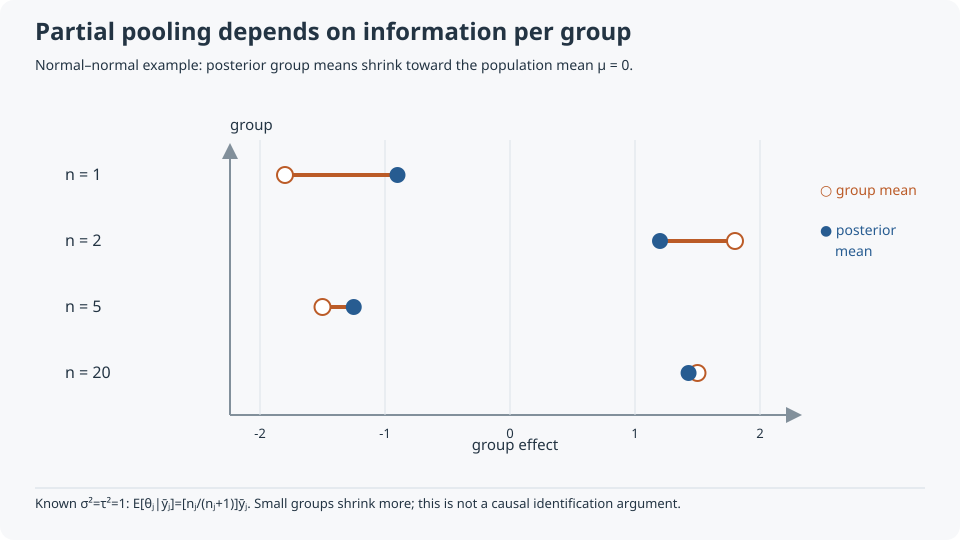

# 37. Hierarchical regression and causal estimands

## Learning goals and prerequisites

This chapter follows a binary-outcome study from a question about a population to a posterior distribution and a policy contrast. By the end, you should be able to specify a multilevel logistic target, explain partial pooling, choose centered or noncentered coordinates, compute population summaries from *joint* posterior draws, and state the assumptions needed before a standardized association can be interpreted causally. We use [Bayesian targets](03-bayesian-targets.md), [Metropolis–Hastings](09-metropolis-hastings.md), [Monte Carlo error](13-mc-error.md), [diagnostics](14-diagnostics.md), [geometry](16-geometry.md), and [Bayesian workflow](17-workflow.md). Chapters [20](20-hmc.md)–[22](22-hmc-diagnostics.md) develop HMC tools suitable for larger fits.

The running example is invented. A regional service records whether a resident takes up a support appointment, $Y=1$, after either receiving an assistance offer, $A=1$, or not, $A=0$. Residents live in districts $g=1,\ldots,G$ and have a measured, pre-offer risk stratum $X$. The study recruits unevenly across districts and strata; the target population's composition is known from a register. The statistical model will predict uptake conditional on these variables. Whether the offer *causes* uptake requires a separate argument about how offers were assigned and how the study population relates to the target.

## 37.1 Begin with the quantity to report

Several reasonable questions have different answers. A manager might ask for the probability of uptake among high-risk residents in district 2 if offered assistance. A planning office might ask for the expected fraction of the target population that would take up appointments under a specified offer policy. A policy team might ask for the target-population risk difference if everyone were offered assistance versus if no one were offered it. A coefficient on $A$ is a conditional log odds ratio; it is none of these probabilities or risk differences.

Let $S=1$ denote entry into the study and $T$ denote membership in the target population. Write $c=(g,x)$ for a district by pre-offer stratum cell. If the target contains $M_c$ people in cell $c$, its weight is $q_c=M_c/M_+$, where $M_+=\sum_c M_c>0$. For a specified policy $a(c)$, define the model-based expected uptake fraction

$$
\psi_{a(\cdot)}=\sum_c q_c\Pr(Y=1\mid A=a(c),c,S=1,\theta).
$$

The conditioning on $\theta$ makes this a functional of the fitted outcome model. Posterior uncertainty in $\theta$ makes $\psi$ uncertain. Later we will ask when the same calculation identifies a target-population causal quantity. The distinction matters even when the numerical formula looks identical. A realized finite-population uptake fraction has additional Bernoulli outcome variation beyond uncertainty in expected uptake; it may also include people already observed, for whom a coherent finite-population prediction would condition on their observed outcomes.

Districts in the register are the *observed* districts, whose effects are informed by the study. A future district is a different prediction problem: its unknown district effect must be drawn from the fitted group distribution. Changing this target silently changes the estimand.

## 37.2 Specify a proper multilevel logistic model

For study resident $i$, let $x_i$ be a vector of pre-offer predictors and let $g_i$ identify the district. Conditional on the parameters and recorded predictors, assume independent Bernoulli outcomes with

$$
Y_i\mid\theta,x_i,a_i,g_i,S=1\sim\operatorname{Bernoulli}(p_i),\qquad
\operatorname{logit}(p_i)=\alpha+u_{g_i}+x_i^\top\beta+a_i\gamma.
$$

Here $\operatorname{logit}^{-1}(t)=1/(1+e^{-t})$. The shared intercept $\alpha$ describes baseline log odds at the reference or centered covariate values; $\beta$ and $\gamma$ are conditional log odds coefficients. The district terms satisfy $u_g\mid\tau\stackrel{\mathrm{ind}}{\sim}N(0,\tau^2)$ with $\tau>0$. This is conditional exchangeability of district *effects under this model*, not exchangeability of the treated and untreated residents. District attributes capable of explaining systematic differences should be predictors rather than left to a generic random intercept. The historical combination of hierarchical binary regression and population weighting is described by [Gelman and Little (1997)](https://sites.stat.columbia.edu/gelman/research/published/poststrat3.pdf).

For a concrete proper target, take independent $\alpha\sim N(0,s_\alpha^2)$, $\beta_j\sim N(0,s_{\beta j}^2)$, $\gamma\sim N(0,s_\gamma^2)$, and $\tau\sim\operatorname{HalfNormal}(s_\tau)$. The scales must be chosen for the particular outcome and coding of $x$. Ignoring constants independent of the parameters, the *centered-coordinate* log posterior is

$$
\begin{aligned}
\ell_c(\alpha,\beta,\gamma,u,\tau)
={}&\sum_{i=1}^{n}\left[y_i\eta_i-\log(1+e^{\eta_i})\right]
-\frac{\alpha^2}{2s_\alpha^2}
-\sum_j\frac{\beta_j^2}{2s_{\beta j}^2}
-\frac{\gamma^2}{2s_\gamma^2}\\
&-G\log\tau-\frac{\sum_g u_g^2}{2\tau^2}
-\frac{\tau^2}{2s_\tau^2},\qquad \tau>0,
\end{aligned}
$$

where $\eta_i=\alpha+u_{g_i}+x_i^\top\beta+a_i\gamma$. The $-G\log\tau$ term comes from the normal density of $G$ district effects; omitting it changes the target. The Bernoulli log likelihood is numerically evaluated with a stable softplus function for $\log(1+e^\eta)$. Aggregating observations into a binomial count is valid when members of a cell share the modeled probability and are conditionally independent. Simply aggregating all residents of a district would lose the variation in $X$ and $A$.

Proper priors matter especially when small cells have all successes or all failures. Such cells can drive an unregularized logistic coefficient toward an infinite estimate. A proper prior with a bounded Bernoulli likelihood yields a proper posterior for this finite-dimensional model, although it does not manufacture information missing from the data. An offer effect that plausibly varies by district can be represented by $\gamma_g=\gamma+v_g$; correlated $(u_g,v_g)$ need a joint covariance model and enough groups to learn it. We keep a common $\gamma$ here so that the calculations stay visible.

## 37.3 See partial pooling before sampling

The mechanism is easiest to derive in a normal analogue. Suppose $\bar Y_g\mid b_g\sim N(b_g,s_g^2)$ and $b_g\sim N(\mu,\tau^2)$, with $\mu,\tau,s_g$ fixed and positive. Multiplying densities and collecting quadratic terms gives posterior precision $s_g^{-2}+\tau^{-2}$ and posterior mean

$$
E(b_g\mid\bar Y_g,\mu,\tau)
=\frac{\bar Y_g/s_g^2+\mu/\tau^2}{1/s_g^2+1/\tau^2}
=w_g\bar Y_g+(1-w_g)\mu,
\qquad w_g=\frac{\tau^2}{\tau^2+s_g^2}.
$$

Thus the noisier group receives more influence from the shared mean. For $\mu=0$, $\tau=1$, and two groups both reporting $\bar Y_g=2$, a group with $s_1=2$ has $w_1=1/5$ and posterior mean $0.4$. A more precise group with $s_2=0.5$ has $w_2=4/5$ and posterior mean $1.6$. These are exact calculations under the *normal* model at fixed hyperparameters. The logistic model also shares information across groups, but its posterior district means do not have this fixed weighted-average formula. Averaging over uncertain $\tau$ introduces additional variation and dependence across groups. Replacing it with one point estimate discards these contributions; because the conditional variance also changes with $\tau$, it need not understate every marginal variance for every choice of plug-in value.

Pooling also affects prediction. For an observed district, each posterior draw uses its $u_g^{(s)}$. For a new district, sample $u_{\mathrm{new}}^{(s)}\sim N(0,(\tau^{(s)})^2)$ conditional on that draw. Reusing the average observed district effect would understate uncertainty about a new district. This distinction is an application of the general predictive logic in [Chapter 3](03-bayesian-targets.md).

## 37.4 Choose priors on the probability scale

There is no universally harmless “wide” normal prior on a logistic coefficient. For example, a large standard deviation on the log odds scale can put much prior mass near uptake probabilities zero and one. Centering and scaling $X$ makes $\alpha$ interpretable and lets a proposed prior be checked against plausible baseline rates. Before looking at the outcomes, draw $(\alpha,\beta,\gamma,\tau,u)$ from the prior and calculate the minimum and maximum cell probabilities. If the prior regularly predicts nearly all or nearly no residents attending, ask whether those are realistic possibilities for this service.

The scale $\tau$ can be weakly learned from only a few districts. A half-normal or half-$t$ prior may be suitable, but its scale and tail are substantive choices; compare prior predictive district ranges under plausible alternatives. [Gelman (2006)](https://sites.stat.columbia.edu/gelman/research/published/taumain.pdf) explains why purportedly “noninformative” inverse-gamma variance priors can behave poorly when the number of groups is small. Neither a half-normal nor a half-$t$ prior is automatically safe. Sensitivity to the upper tail is a result to report, not merely a tuning nuisance.

One sometimes constrains $\sum_g u_g=0$ to identify an intercept. Under the proper independent normal group prior above, the model is already probabilistically specified. Imposing that exact sum constraint changes the joint prior unless the model is reformulated accordingly. It is not a free numerical repair. Likewise, if $X$ is centered in the study but the target has a different mix, poststratification must still use the original target values after applying the same transformation.

## 37.5 Choose coordinates for computation

In *noncentered* coordinates, set $u_g=\tau z_g$ with independent $z_g\sim N(0,1)$. For $\tau>0$ this is exactly the same generative model. To see the density transformation, start with the centered prior $\tau^{-G}\exp[-\sum_g u_g^2/(2\tau^2)]$ and substitute $u=\tau z$. The Jacobian for $z\mapsto u$ is $\tau^G$, so the powers cancel. If instead we specify $z_g\sim N(0,1)$ directly, we do not add a second Jacobian for $u$.

An unconstrained sampler may use $r=\log\tau$. The half-normal density on $\tau$ contributes $-e^{2r}/(2s_\tau^2)+r$ in $r$ coordinates because $d\tau/dr=e^r$. The full noncentered log target, up to a constant, is

$$
\ell_{nc}(\alpha,\beta,\gamma,z,r)
=\sum_i\left[y_i\eta_i-\operatorname{softplus}(\eta_i)\right]
-\frac{\alpha^2}{2s_\alpha^2}
-\sum_j\frac{\beta_j^2}{2s_{\beta j}^2}
-\frac{\gamma^2}{2s_\gamma^2}
-\frac12\sum_g z_g^2
-\frac{e^{2r}}{2s_\tau^2}+r,
$$

with $\eta_i=\alpha+e^rz_{g_i}+x_i^\top\beta+a_i\gamma$. There is no leftover $-Gr$ term. Weakly informed group effects often make these coordinates easier to explore; when each district has much data, centered coordinates can work better. [Stan's efficiency tuning guide](https://mc-stan.org/docs/stan-users-guide/efficiency-tuning.html) develops this information-dependent choice. HMC can be a good practical tool, but posterior geometry and its diagnostics still need inspection.

The supplied figure visualizes the normal-analogue shrinkage from Section 37.3: a noisy group mean moves farther toward the shared mean than a precise one. It is a pooling calculation, not an identification argument.

In the geometry lab, vary the scale of $v$ and compare the scatterplots of independent draws in centered $(v,x)$ and noncentered $(v,z)$ coordinates, where $x=e^{v/2}z$. Observe how the conditional spread of $x$ narrows for negative $v$, while the spread of $z$ remains constant. These are direct prior draws, so the display illustrates geometry without measuring sampler speed. It does not fit this logistic study or assess causal assumptions.

## 37.6 Check computation and model fit separately

For a serious analysis, run several dispersed chains, inspect rank plots and split $\widehat R$, effective sample sizes, and Monte Carlo standard errors for $\tau$, the least informed district, and the population summaries you will report. A small MCSE relative to posterior standard deviation means the *reported posterior summary* is numerically stable to the precision checked; it does not certify the target model. A chain trapped in the same wrong region as other chains can still appear reassuring. [Chapter 14](14-diagnostics.md) develops these limitations. If HMC is used, inspect divergences and energy behavior as in [Chapter 22](22-hmc-diagnostics.md). Random-walk Metropolis has no HMC divergence statistic.

Then ask whether the model can reproduce features of the data. For each posterior draw, simulate replicated uptake counts within district, risk, and offer cells using the corresponding $p_i^{(s)}$. Compare observed and replicated district totals, extreme cells, and differences between offer and non-offer strata. Such posterior predictive checks are conditional on the fitted model; repeated mismatch is evidence to revise the model. A good visual match does not establish that assignment of the offer is unconfounded. Nor does longer MCMC remove bias from a missing predictor or unsupported extrapolation.

The [companion script](examples/ch37.py) uses only the Python standard library. Running `python examples/ch37.py` generates an invented four-district data set, checks the target transformation, simulates prior predictions, fits the noncentered model with fixed-step coordinate Metropolis, checks posterior predictions, and refits under an alternative district-scale prior. Both fits use four independent random streams, each with 2,500 warmup and 5,000 retained sweeps. The normal prior scales and proposal steps are stated in the file; its batch-means MCSE combines within-chain variance estimates for equal-length independent chains and remains an approximate teaching diagnostic. Its fixed finite run and one tuning choice are no substitute for multiple diagnostic plots and a production fit. No discretization is used in Metropolis: with a correct target and proposal, each coordinate transition preserves the posterior, as does their sequential composition. Warmup, finite-run error, and poor exploration can still affect the displayed estimates.

With the seed in the file, the illustrative fit gave expected target uptake $0.270$ if no one received an offer and $0.423$ if everyone did, for a standardized risk difference of $0.153$ with a retained-draw 95% interval about $(0.101,0.204)$. The approximate batch-means MCSE of the risk-difference mean was $0.0007$. The district scale $\tau$ was harder to summarize: its mean was $0.780$ and its approximate MCSE was $0.034$, with individual chain means from $0.727$ to $0.907$. These differences are a reminder to inspect and improve exploration before treating that parameter's tail as settled. All retained risk differences were positive; this does not establish that the posterior probability of a negative difference is exactly zero. These are synthetic-data, model-conditional numbers, not evidence that a real assistance offer works.

### 37.6a Execute the predictive checks

The prior simulation keeps the observed cell sizes and predictors fixed. For each of 1,000 independent prior draws it generates all 16 binomial counts. It also evaluates baseline district probabilities at the same $X=0,A=0$, so their range measures district heterogeneity without mixing in different district compositions. With the original $\operatorname{HalfNormal}(1)$ scale prior, the median baseline range is $0.134$, with a central 90% interval $(0.008,0.703)$. The median range of *replicated observed district uptake rates* is $0.135$; this second quantity also contains binomial variability and composition effects. About 29% of prior draws give at least one of the 16 cell probabilities below $0.01$ or above $0.99$. Whether this is plausible is a scientific judgment to make before using the outcomes to choose a prior.

Posterior replication uses the fitted effects of these four observed districts. It generates counts from every tenth retained state, giving 2,000 replicated datasets; spacing limits computation and does not establish independence. All retained states still contribute to population estimates. The script prints observed counts and marginal 90% predictive intervals for each cell and district. For example, observed district totals $(39,92,120,169)$ are compared with intervals $(29,55)$, $(76,109)$, $(101,138)$, and $(148,189)$. These are separate predictive intervals, not a simultaneous coverage statement.

To check cells jointly, write $k=(g,x,a)$ and define

$$
D(y,\theta)=\sum_k\frac{(y_k-n_kp_k(\theta))^2}{n_kp_k(\theta)\{1-p_k(\theta)\}}.
$$

At the same posterior draw compute both $D(y,\theta)$ and $D(y^{\mathrm{rep}},\theta)$. The average indicator that the replicated value exceeds the observed value estimates a posterior predictive tail area. Here it is $0.436$, with approximate batch MCSE $0.014$. Repeating the comparison for the maximum absolute standardized cell residual gives $0.463$, with MCSE $0.012$. Neither discrepancy is unusually extreme under these replications. The [Stan predictive-checking guide](https://mc-stan.org/docs/stan-users-guide/posterior-predictive-checks.html) explains this simulation construction and why such tail areas are not classically calibrated $p$-values: the observed outcomes also informed the posterior. They do not give a probability that the model is true. These checks concern outcomes in observed districts; checking the distribution of new district effects requires a different replication scheme.

## 37.7 Poststratify joint posterior draws

Suppose the target register supplies mutually exclusive, exhaustive cells $c$ with known, nonnegative sizes $M_c$, and at least one positive size. For retained posterior draw $s$, predict each cell's probability under the *same* policy and form

$$
\psi^{(s)}=\sum_c q_c p_c^{(s)},\qquad q_c=\frac{M_c}{\sum_d M_d}.
$$

The collection of $\psi^{(s)}$ is the posterior distribution of expected population uptake under that policy. This is the draw-wise regression and poststratification construction in the [Stan User's Guide](https://mc-stan.org/docs/stan-users-guide/poststratification.html). Using the same draw index across cells preserves posterior covariance. The weighted mean of separate cell posterior means equals the posterior mean of $\psi$ by linearity, but weighted cell medians generally do *not* give its posterior median or interval.

**Worked example: composition changes the answer.** For one illustrative draw, suppose predicted uptake is $0.2$ in a low-risk cell and $0.8$ in a high-risk cell. With study shares $(0.8,0.2)$, the composition-weighted prediction is $0.8(0.2)+0.2(0.8)=0.32$. If the target shares are $(0.3,0.7)$, its expected uptake is $0.3(0.2)+0.7(0.8)=0.62$. Nothing about the conditional cell probabilities changed; the population being summarized changed. These are arithmetic illustrations, not estimates from the companion fit.

Poststratification needs the *joint* counts for the variables defining cells. District totals and separate risk-stratum totals do not generally determine district-by-risk counts. A cell with zero study observations can receive a model prediction through shared coefficients and pooling, but that is extrapolation under the model, not new evidence. A cell outside the support of the study deserves a prominent qualification. If register counts are estimated rather than known, the analysis must also propagate uncertainty in $M_c$ or $q_c$. Treating noisy counts as exact discards that uncertainty; the effect on a particular interval depends on the joint model. For a realized target total, one must additionally generate outcomes under an explicit predictive model, subject to any finite-population sampling information already observed.

## 37.8 State the causal identification argument

Let $Y_i(1)$ and $Y_i(0)$ be the uptake outcomes person $i$ would have under a well-defined offer and no offer. The target-population average effect on the risk scale is

$$
\Delta_T=E_T\{Y(1)-Y(0)\}.
$$

The outcome regression learns $E(Y\mid A=a,C=c,S=1)$, where $C$ includes pre-offer risk variables, district, and any other pre-offer variables needed for adjustment and transport. To equate its standardized prediction with $E_T[Y(a)]$, one sufficient set of assumptions is:

1. **Consistency and intervention definition:** observed $Y$ equals $Y(a)$ for a person who receives offer $a$; different versions of “offer” do not have materially different effects hidden inside $A$. There is no relevant interference between residents, or the intervention and potential outcomes are redefined to include it.
2. **Treatment exchangeability in the study:** $Y(a)\perp A\mid C,S=1$ for $a=0,1$. Assignment may be randomized within $C$, or observational confounders must have been measured and adjusted for. This is a scientific/design assumption, not a sampler diagnostic.
3. **Treatment positivity:** for every target cell whose conditional outcome mean is needed, both offer states occur with positive probability among comparable study residents: $\Pr(A=a\mid C=c,S=1)>0$.
4. **Outcome transport and sample support:** $E[Y(a)\mid C=c,T]=E[Y(a)\mid C=c,S=1]$ for every target cell with $q_c>0$, and such cells have study support. This conditional mean equality is stronger than merely knowing the target cell counts. A stronger distributional selection condition, $Y(a)\perp S\mid C$, can imply it in a suitable study/target setup.

Under these assumptions and a correctly specified conditional mean model, iterated expectation gives

$$
E_T[Y(a)]
=\sum_c q_c E_T[Y(a)\mid C=c]
=\sum_c q_c E[Y\mid A=a,C=c,S=1].
$$

The first equality uses the target distribution of $C$, the second uses outcome transport, treatment exchangeability, positivity, and consistency. [Hernán and Robins, *Causal Inference: What If*](https://miguelhernan.org/whatifbook) develop the standardization argument and its identifying assumptions; [Dahabreh and colleagues' study-design paper](https://arxiv.org/abs/1905.07764) addresses extending effects to target populations. A district random effect alone is not an adjustment for every district-level confounder. Conditioning on a post-offer mediator can remove part of the total effect; conditioning on a collider can introduce bias. The adjustment set follows the causal question, not whichever variables happen to predict $Y$ best.

These conditions are about identification from the available data. Even exact independent draws from the posterior would leave them unproved. A credible interval conditional on them describes model and parameter uncertainty, not uncertainty over whether the assumptions themselves hold.

## 37.9 Compute a population risk difference

With a common conditional offer coefficient, let $\eta_c^{(s)}=\alpha^{(s)}+u_g^{(s)}+x_c^\top\beta^{(s)}$ be the baseline logit in cell $c$. For each *joint* posterior draw, calculate

$$
\Delta^{(s)}=\sum_c q_c\left[\operatorname{logit}^{-1}(\eta_c^{(s)}+\gamma^{(s)})
-\operatorname{logit}^{-1}(\eta_c^{(s)})\right].
$$

This posterior distribution is a distribution over the standardized risk difference under the model; it is a posterior for $\Delta_T$ only under the identification argument above. It can be summarized by a mean, credible interval, and $\Pr(\Delta_T>0\mid\text{data, model, assumptions})$. The Monte Carlo error of a reported mean or probability also deserves checking, particularly when it will drive a decision in [Chapter 44](44-decisions.md).

**Worked example: an odds coefficient is not a risk difference.** Suppose two target cells have baseline logits $-2$ and $0$, common offer coefficient $\gamma=1$, and weights $(0.75,0.25)$. The untreated risks are $\operatorname{logit}^{-1}(-2)=0.1192$ and $\operatorname{logit}^{-1}(0)=0.5000$. Offered risks are $\operatorname{logit}^{-1}(-1)=0.2689$ and $\operatorname{logit}^{-1}(1)=0.7311$. Thus $\psi_0=0.75(0.1192)+0.25(0.5)\approx0.2144$ and $\psi_1=0.75(0.2689)+0.25(0.7311)\approx0.3845$, giving $\Delta\approx0.1701$. The conditional odds ratio in either cell is $e^1\approx2.72$, but the cell risk differences are about $0.1497$ and $0.2311$. They are on different scales and answer different questions.

Even for one posterior draw, $\operatorname{logit}^{-1}(\sum_c q_c\eta_c)$ generally differs from $\sum_c q_c\operatorname{logit}^{-1}(\eta_c)$. Averaging logits before transformation cannot replace poststratification of probabilities. Logistic odds ratios are also noncollapsible: a marginal odds ratio may differ from a common conditional one even without confounding. This mathematical fact does not excuse failure to adjust for real confounding.

## 37.10 Stress-test and report the analysis

A useful report compares a few defensible $\tau$ priors, checks whether including a plausible pre-offer common cause of offer and uptake changes $\Delta$, and examines an offer-by-risk interaction if a common $\gamma$ is doubtful. It also displays study counts for $A=0$ and $A=1$ in target-weighted cells. A target cell with no treated observations is a support warning; a smooth fitted surface does not repair it. A sensitivity analysis may posit a hypothetical unmeasured confounder and vary its association with assignment and outcome, but those sensitivity values are supplied externally rather than identified by the observed data.

### 37.10a Refit the same model under a substantive alternative

The script changes only $s_\tau$ from $1$ to $0.5$, expressing stronger prior concentration toward similar districts while retaining the original coefficient priors, likelihood, and target population. For orientation, these half-normal priors place 95% of their mass below approximately $1.96$ and $0.98$, respectively, on the district log odds standard deviation. Such a change should be motivated by knowledge of district differences. With only four districts, the sensitivity of group-scale inference deserves particular attention; see [Gelman (2006), Section 4](https://sites.stat.columbia.edu/gelman/research/published/taumain.pdf).

| Group-scale prior | Risk-difference mean (95% interval) | Mean MCSE | $\tau$ mean | $\tau$ mean MCSE |
|---|---|---|---|---|
| Half-normal, scale 1 | 0.153 (0.101, 0.204) | 0.0007 | 0.780 | 0.0343 |
| Half-normal, scale 0.5 | 0.153 (0.102, 0.205) | 0.0007 | 0.582 | 0.0149 |

The alternative-minus-original risk-difference mean is about $0.0003$. Because the two fits use independent streams, the approximate MCSE of their difference is the square root of the sum of their squared MCSEs, here $0.0010$. The observed change is smaller than the resolved Monte Carlo precision. This supports limited sensitivity of this population summary to this particular prior comparison; it does not settle the scale tail or establish robustness to confounding, interactions, or other priors.

Keep the deliberately broad $\operatorname{HalfNormal}(3)$ prior predictive variant as a warning about calling a prior harmlessly vague. It yields a median baseline district probability range of $0.392$ and at least one extreme cell probability in about 60% of draws. It is simulated before fitting and is not a third posterior fit. The narrower scale-$0.5$ variant reduces that frequency to about 22%; the coefficient priors still allow extreme probabilities. Thus changing a scale prior resolves only part of a possible prior-predictive concern. Whether any variant is acceptable needs substantive information absent from this invented service. This sequence of proposing, checking, and revising models follows the applied workflow illustrated by [Gelman and colleagues (2020), Section 10](https://arxiv.org/pdf/2011.01808); the numerical study here is original.

An end-to-end report states the population and intervention, the target-cell counts, adjustment variables, priors, likelihood, parameterization, computation and diagnostics, predictive checks, standardized results, and remaining limits. Keep three error sources separate. **Monte Carlo error** comes from finite posterior sampling and can be reduced with a better or longer computation. **Model error** comes from an inadequate outcome, district, or population-count model and calls for model criticism and new information. **Identification error** comes from violated exchangeability, positivity, consistency, or transport conditions and may require a different design or a narrower claim. No passing diagnostic converts the latter two into Monte Carlo error. The larger project structure in [Chapter 48](48-capstone.md) uses the same separation.

## Exercises

1. Under the normal analogue of Section 37.3, derive the posterior variance and mean by completing the square. What happens to the mean as $s_g\to\infty$?

Solution

The quadratic coefficient in $b_g$ is $s_g^{-2}+\tau^{-2}$, so the variance is $(s_g^{-2}+\tau^{-2})^{-1}$. The linear coefficient is $\bar Y_g/s_g^2+\mu/\tau^2$; divide it by the precision to obtain the stated mean. As $s_g\to\infty$, the observation has vanishing precision and the mean tends to $\mu$.

2. Derive the prior terms in the noncentered density when $r=\log\tau$ and $\tau\sim\operatorname{HalfNormal}(s_\tau)$. Explain why there is no $-Gr$ term.

Solution

The $z_g$ prior contributes $-\tfrac12\sum_gz_g^2$; the half-normal contributes $-e^{2r}/(2s_\tau^2)$; the $\tau=e^r$ change of variable contributes $+r$. If one starts from centered coordinates, the Jacobian $e^{Gr}$ for $u=e^rz$ cancels the $e^{-Gr}$ density factor of $u\mid\tau$.

3. In the composition example with probabilities $(0.2,0.8)$, replace target weights by $(0.6,0.4)$. Calculate expected target uptake and say which inputs changed.

Solution

The answer is $0.6(0.2)+0.4(0.8)=0.44$. Only the population weights changed. The conditional probabilities and the posterior draw that supplied them did not.

4. Why is a weighted average of separate cell posterior medians generally not the posterior median of the weighted mean? Give a two-draw or three-draw numerical illustration.

Solution

Median is nonlinear, and the joint dependence among cells matters. For three posterior draws of two cell probabilities, take $(0.1,0.9)$, $(0.9,0.1)$, and $(0.9,0.9)$, with equal population cell weights. The draw-wise population values are $(0.5,0.5,0.9)$, whose median is $0.5$. Each cell's median is $0.9$, whose weighted average is $0.9$. Compute the functional draw-wise before taking quantiles.

5. Suppose pre-offer risk $X$ affects both offer assignment and uptake. State sufficient within-study and study-to-target identification conditions for the target risk difference and write its standardized form. Why does $\gamma$ alone not give the answer?

Solution

Assume consistency, $Y(a)\perp A\mid X,g,S=1$, treatment positivity in every target-supported $(X,g)$ cell, conditional outcome transport, sample support, and a correct conditional outcome model. Then $\Delta_T=\sum_{x,g}q_{xg}\{E[Y\mid A=1,x,g,S=1]-E[Y\mid A=0,x,g,S=1]\}$. The coefficient $\gamma$ is a conditional log odds difference; inverse-logit transformation and target weighting are needed for a marginal risk difference.

6. One target cell contains many residents but no study residents who received an offer. Design a failure audit and give two defensible responses. Would doubling MCMC iterations solve the problem?

Solution

Tabulate study and target counts by adjustment cell and offer, inspect whether comparable offered residents exist in nearby model-supported strata, and assess whether the cell is absent by design or chance. One response is to collect offered outcomes in that cell or redesign assignment; another is to narrow the target population to supported cells and state the changed estimand. A hierarchical prediction for the empty arm is model extrapolation, so it needs a transparent assumption and sensitivity analysis. More iterations only reduce sampling error for the specified posterior; they cannot create treatment support.

7. Two independent prior-sensitivity fits each report approximate mean MCSE $0.0007$ for the population risk difference. Their posterior means differ by $0.0003$. Calculate the approximate MCSE of that difference. Does the comparison justify reporting a resolved prior effect, or establish causal identification?

Solution

Independence of the fitting streams makes the variances add, giving $\sqrt{0.0007^2+0.0007^2}\approx0.00099$. The observed difference is only about $0.30$ of this MCSE. It is not resolved at this numerical precision, assuming the batch estimates and exploration are adequate. This is Monte Carlo uncertainty about a difference between posterior means, not a credible interval for an individual treatment effect. Even agreement of exact posterior means under these two priors would not establish exchangeability or transport.

## Key takeaways

- Specify the population, intervention, and scale of the answer before fitting a regression.
- A multilevel prior shares information across districts; its scale and the data jointly determine pooling.
- Noncentering changes coordinates, not the model, when its Jacobians are handled correctly.
- Poststratify probabilities from each joint draw using the target's joint cell counts.
- Causal interpretation needs consistency, exchangeability, positivity, and transport in addition to a sound posterior computation.
