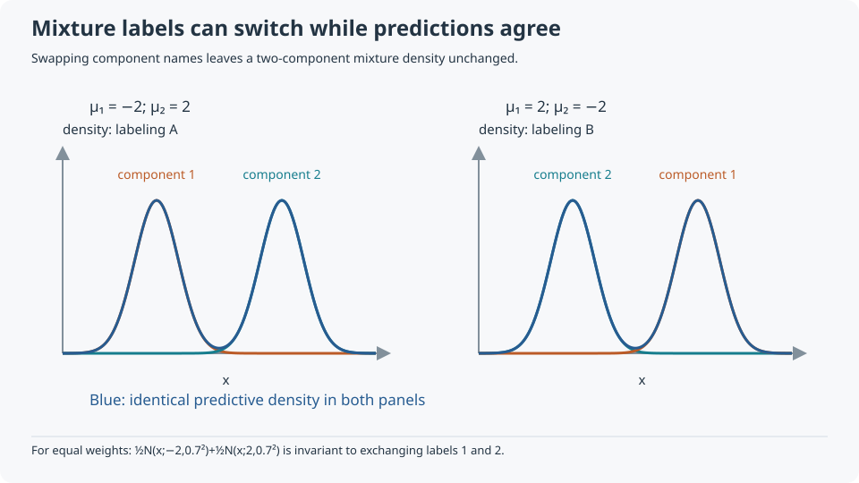

# 38. Mixtures, latent variables, and missing data

## Learning goals and prerequisites

This chapter turns a finite Gaussian mixture into a complete Bayesian computation: from the observed-data likelihood to allocation Gibbs sampling, a collapsed alternative, and summaries that survive label switching. It then uses missing measurements to show a second role for latent quantities. After reading, you should be able to derive both allocation conditionals, explain what a mixture component does and does not mean, state when a response mechanism may be ignored, and distinguish Monte Carlo uncertainty from sensitivity to an untestable missingness assumption.

You will use conditional probability from [Chapter 02](02-probability.md), posterior construction from [Chapter 03](03-bayesian-targets.md), stable arithmetic from [Chapter 04](04-numerics.md), and Gibbs sampling from [Chapter 10](10-gibbs.md). [Chapters 13](13-mc-error.md), [14](14-diagnostics.md), and [17](17-workflow.md) supply the error and workflow ideas needed to report a fit responsibly.

## 38.1 A mixture distribution and the question it answers

Suppose $y_1,\ldots,y_n$ are conditionally independent measurements. With a fixed number $K$ of components, positive known variance $\sigma^2$, weights $w_k>0$ summing to one, and component means $\mu_k$, the sampling density is

$$
p(y_i\mid w,\mu)=\sum_{k=1}^K w_k\phi(y_i;\mu_k,\sigma^2),
\qquad
\phi(y;m,v)=\frac{1}{\sqrt{2\pi v}}\exp\!\left[-\frac{(y-m)^2}{2v}\right].
$$

The model first chooses a component with probabilities $w$, then draws a measurement from that component. The result can describe a distribution with shoulders, skewness, or several peaks. A component is a term in this density representation. Treating it as a real biological type, patient class, or causal mechanism requires additional subject-matter evidence. A visibly two-peaked sample can arise from more than two latent groups, and two components can overlap into one visible peak. The [Stan finite-mixture guide](https://mc-stan.org/docs/stan-users-guide/finite-mixtures.html) makes the same distinction between a mixture density and its clustering interpretation.

Before fitting, draw $(w,\mu)$ from the prior and then replicate a dataset. Does it put plausible mass on the observed scale and range? With weak data, the posterior can inherit surprising behavior from component priors, especially for nearly empty components. Throughout the derivation we take

$$
w\sim\operatorname{Dirichlet}(\alpha_1,\ldots,\alpha_K),\quad
\mu_k\stackrel{\mathrm{ind}}{\sim}N(m_0,s_0^2),\quad
\alpha_k>0,\ s_0^2>0.
$$

Proper priors keep even empty components well-defined. The model describes the distribution of future outcomes through $p(y_{\mathrm{new}}\mid y)$, but it can also answer a tail question such as $\Pr(Y_{\mathrm{new}}>t\mid y)$ or a clustering question such as the posterior probability that observations $i$ and $j$ share a component. Decide which of these is scientifically relevant before looking at label-specific means.

## 38.2 Allocations turn a sum into conditional updates

Introduce $z_i\in\{1,\ldots,K\}$ with $\Pr(z_i=k\mid w)=w_k$ and $y_i\mid z_i=k,\mu\sim N(\mu_k,\sigma^2)$. The augmented posterior has kernel

$$
p(w,\mu,z\mid y)\ \propto\ p(w)\prod_{k=1}^Kp(\mu_k)
\prod_{i=1}^n w_{z_i}\phi(y_i;\mu_{z_i},\sigma^2).
$$

Summing the joint density over the $K^n$ possible $z$ vectors gives $\prod_i\sum_k w_k\phi(y_i;\mu_k,\sigma^2)$, exactly the original likelihood. Thus augmentation changes the computational representation, not the statistical model. Tanner and Wong's [data-augmentation paper](https://www.stat.cmu.edu/~brian/905-2009/all-papers/tanner-wong-1987-with-disc.pdf) is a foundational account of building posterior calculations from such conditional steps.

Conditional on current parameters, the allocation probabilities are

$$
r_{ik}=\Pr(z_i=k\mid y_i,w,\mu)
=\frac{w_k\phi(y_i;\mu_k,\sigma^2)}
{\sum_{h=1}^K w_h\phi(y_i;\mu_h,\sigma^2)}.
$$

These $r_{ik}$ resemble the responsibilities in expectation-maximization, but a Gibbs step *draws* $z_i$ from them. Replacing each $z_i$ by $\arg\max_k r_{ik}$ is a classification operation and is not a posterior draw. For stable computation form log scores $a_{ik}=\log w_k+\log\phi(y_i;\mu_k,\sigma^2)$, subtract $a_i^*=\max_k a_{ik}$, exponentiate, and normalize. This avoids underflow when a measurement is far from all component centers; see [Chapter 04](04-numerics.md).

## 38.3 A full conjugate Gibbs sweep

Write $n_k=\#\{i:z_i=k\}$ and $S_k=\sum_{i:z_i=k}y_i$. Multiplying the Dirichlet density by $\prod_iw_{z_i}=\prod_kw_k^{n_k}$ shows immediately that

$$
w\mid z,y\sim\operatorname{Dirichlet}(\alpha_1+n_1,\ldots,\alpha_K+n_K).
$$

For one mean, the terms involving $\mu_k$ have log kernel

$$
-\frac{(\mu_k-m_0)^2}{2s_0^2}
-\frac{1}{2\sigma^2}\sum_{i:z_i=k}(y_i-\mu_k)^2.
$$

Collecting its quadratic and linear coefficients gives precision $s_0^{-2}+n_k\sigma^{-2}$ and precision-weighted center $m_0s_0^{-2}+S_k\sigma^{-2}$. Completing the square yields

$$
v_k=(s_0^{-2}+n_k\sigma^{-2})^{-1},\qquad
m_k=v_k(m_0s_0^{-2}+S_k\sigma^{-2}),\qquad
\mu_k\mid z,y\sim N(m_k,v_k).
$$

If $n_k=0$, these expressions reduce to $m_k=m_0$ and $v_k=s_0^2$: an empty component is redrawn from its prior. It does not disappear, and its weight still has a positive posterior Dirichlet parameter. This is a concrete reason to inspect the prior for its predictive implications.

One valid systematic sweep, with current state $(z,w,\mu)$, is:

```text
for i = 1,...,n: draw z_i from categorical(r_i1,...,r_iK)
compute n_k and S_k from the new z
draw w from Dirichlet(alpha_k+n_k)
for k = 1,...,K: draw mu_k from N(m_k,v_k)
retain the full state (z,w,mu) after the sweep
```

Each line is a conditional update for the same joint posterior; their composition preserves that posterior. The assertion concerns the invariant distribution. It says nothing about whether a finite run crossed partitions separated by low posterior probability. [Chapter 10](10-gibbs.md) develops this distinction for Gibbs kernels generally.

## 38.4 Collapsing weights and means

We can instead integrate $w$ and $\mu$ out, sample $z$ from its marginal posterior, and reconstruct parameters afterward. This is a different exact-invariant transition for the same model, with no numerical discretization. For observation $i$, **first remove its current allocation**. Let $n_{k,-i}$ and $S_{k,-i}$ summarize the other observations assigned to $k$, and set

$$
v_{k,-i}=(s_0^{-2}+n_{k,-i}\sigma^{-2})^{-1},\qquad
m_{k,-i}=v_{k,-i}(m_0s_0^{-2}+S_{k,-i}\sigma^{-2}).
$$

Integrating $w$ gives the leave-one-out prior allocation probability $(n_{k,-i}+\alpha_k)/(n-1+\sum_h\alpha_h)$. Integrating $\mu_k$ gives $y_i\mid z_i=k,z_{-i},y_{-i}\sim N(m_{k,-i},\sigma^2+v_{k,-i})$: independent observation noise and uncertainty about the shared mean add their variances. Hence

$$
\Pr(z_i=k\mid z_{-i},y)
\propto(n_{k,-i}+\alpha_k)
\phi(y_i;m_{k,-i},\sigma^2+v_{k,-i}).
$$

The common denominator in the weight factor cancels when normalizing over $k$. Using $\sigma^2$ alone in the normal density would overstate certainty. Counting $i$ in its old component would produce a transition that depends spuriously on its previous label. In a small implementation, recomputing counts and sums is clear; for large $n$, maintain them carefully as each observation is removed and reassigned.

After a collapsed sweep, a coherent draw from the full joint posterior is obtained by drawing $w\mid z$ and then each $\mu_k\mid z,y$. You may also integrate these quantities analytically for selected summaries. Avoid inserting a marginalized update into an arbitrary sequence of conditional steps while retaining stale parameters: separately reasonable-looking conditional distributions can fail to define the desired joint transition. Van Dyk and Park's [partially collapsed Gibbs analysis](https://www.ma.imperial.ac.uk/~dvandyk/Research/08-jasa-pcg.pdf) studies why order and conditioning matter. Collapsing may reduce dependence for some observables, but extra computation can offset that benefit; compare Monte Carlo precision per unit time for the actual estimand.

### Worked example A: two allocation probabilities

Set $K=2$, $\sigma^2=1$, $\alpha=(1,1)$, and $\mu_k\sim N(0,4)$. For an uncollapsed step let $w=(1/2,1/2)$, $\mu=(-2,2)$, and $y_i=1$. The log odds of component 2 over component 1 are

$$
\log\frac{r_{i2}}{r_{i1}}
=-\tfrac12(1-2)^2+\tfrac12(1+2)^2=4,
\quad r_{i2}=\frac{e^4}{1+e^4}\approx0.9820.
$$

Now suppose the *other* observations are $-2,-1$ in component 1 and $1,2$ in component 2. Each group has two observations, posterior mean variance $v_{k,-i}=(1/4+2)^{-1}=4/9$, posterior means $m_{1,-i}=-4/3$ and $m_{2,-i}=4/3$, and predictive variance $1+4/9=13/9$. Equal counts cancel, so for $y_i=1$,

$$
\log\frac{\Pr(z_i=2\mid z_{-i},y)}{\Pr(z_i=1\mid z_{-i},y)}
=\frac{(1+4/3)^2-(1-4/3)^2}{2(13/9)}
=\frac{24}{13},
$$

giving probability about $0.8637$. Two changes soften this particular comparison: the centers move from $\mp2$ to $\mp4/3$, and integrating their uncertainty increases the predictive variance. To isolate the second effect, plug in $\mp4/3$ with variance one: the log odds would be $8/3$, giving $0.9350$. Increasing that variance to $13/9$ reduces the log odds to $24/13$. Collapsing need not always make probabilities closer to one half; the data, counts, and resulting centers also matter. Swapping both component names leaves this probability attached to the corresponding *group* and leaves the predictive mixture unchanged.

## 38.5 Integrating allocations instead

For a sampler on continuous parameters, retain $w$ and $\mu$ but sum over each discrete $z_i$. The log posterior, up to a constant, is

$$
\log p(w)+\sum_k\log p(\mu_k)
+\sum_{i=1}^n\log\!\left[\sum_{k=1}^K w_k\phi(y_i;\mu_k,\sigma^2)\right].
$$

The sum over components is **inside** the sum over observations. Moving it outside would assert that one shared component generated the entire dataset. A log-sum-exp calculation handles the inner sum stably. With a suitable unconstrained transformation of the simplex and its Jacobian, this marginal target can be handled by continuous-parameter methods such as HMC. The [Stan finite-mixture guide](https://mc-stan.org/docs/stan-users-guide/finite-mixtures.html) gives the corresponding implementation pattern. Marginalizing $z$ removes discrete coordinates, but does not remove label symmetry or all difficult posterior geometry. If allocations are needed after sampling, calculate $r_{ik}$ at each retained parameter draw and sample or average over the resulting conditional distribution.

## 38.6 Label switching and what is identifiable

When all $\alpha_k$ are equal and all component-mean priors are identical, any simultaneous permutation of $(w_1,\ldots,w_K)$, $(\mu_1,\ldots,\mu_K)$, and the allocation labels leaves the prior and likelihood unchanged. For $K=2$, $(w_1,w_2,\mu_1,\mu_2,z)$ and the fully swapped tuple describe the same observable distribution. More generally, a generic parameter point with distinct components has $K!$ equivalent names. This symmetry does not mean that every posterior has $K!$ isolated peaks: modes can overlap or merge, and some components may be indistinguishable.

The posterior mean of raw $\mu_1$ can then mix incompatible meanings. Under a perfectly symmetric posterior its marginal is the same as that of $\mu_2$, even when each individual draw has well-separated means. Stephens's [label-switching paper](https://stephenslab.uchicago.edu/assets/papers/Stephens2000b.pdf) explains this inferential issue and develops decision-based relabeling. Sorting each draw by mean is a legitimate way to study the *smaller* and *larger* component means, but these order statistics are new estimands, not recovered intrinsic identities. Under this exchangeable continuous prior, restricting to $\mu_1<\cdots<\mu_K$ and multiplying the prior density on that region by $K!$ gives the distribution induced by sorting entire component tuples. Ties have probability zero. Because each permutation region contributes equally, this restriction preserves every permutation-invariant posterior summary; it changes the meaning of a component index to its rank. The [Stan finite-mixture guide](https://mc-stan.org/docs/stan-users-guide/finite-mixtures.html) describes this symmetry condition for ordering. Arbitrary ordered priors or an ordering imposed on nonexchangeable components need not preserve those summaries. Sorting means while leaving their weights or allocations unsorted is incorrect. Genuine component names require information that connects labels to an external feature or measurement.



Permutation-invariant targets are often more useful. The predictive density

$$
p(y_*\mid y)=E\!\left[\sum_{k=1}^K w_k\phi(y_*;\mu_k,\sigma^2)\mid y\right]
$$

and the mixture mean $E[\sum_kw_k\mu_k\mid y]$ are unchanged by relabeling. So is the co-clustering probability $C_{ij}=\Pr(z_i=z_j\mid y)$. A matrix of $C_{ij}$ values communicates uncertainty that a hard assignment conceals. For fixed $w,\mu$, distinct allocations are conditionally independent, giving $\Pr(z_i=z_j\mid w,\mu,y)=\sum_kr_{ik}r_{jk}$ for $i\ne j$; averaging this expression over posterior parameter draws is a Rao–Blackwellized estimate of $C_{ij}$. In an allocation sampler, simply average $1\{z_i=z_j\}$.

### 38.6.1 Worked decision: pair probabilities need a valid partition {#sec-3861-worked-decision-pair-probabilities-need-a-valid-partition}

A co-clustering matrix describes uncertainty. If a report requires one partition, we also need a loss specifying which mistakes matter. Here the loss and posterior are small enough to examine every action. [Chapter 44](44-decisions.md) develops posterior risk more generally; the definitions needed here are local.

Let $\Pi$ be the uncertain partition of three fixed items, after conditioning on fixed data $y$. The items 1, 2 and 3 are not component names. Both the true partition and the reported action $a$ may be any element of

$$
\mathcal P_3=\{123,\;12\mid3,\;13\mid2,\;1\mid23,\;1\mid2\mid3\}.
$$

For example, $12\mid3$ groups items 1 and 2 and leaves item 3 separate. This is a separate finite partition decision problem with stipulated posterior probabilities. Its laws are not the posterior from the six-measurement, fixed-$K=2$ example below; all five partitions are allowed here.

Write $A_{ij}(a)=1\{i\sim_a j\}$ and $B_{ij}(\Pi)=1\{i\sim_\Pi j\}$ for unordered pairs $i<j$. Give each incorrect pair decision unit cost:

$$
L(a,\Pi)=\sum_{i<j}|A_{ij}(a)-B_{ij}(\Pi)|,
\qquad R(a)=E[L(a,\Pi)\mid y].
$$

This is unit-cost Binder loss. Loss counts pair errors from zero to three, and risk is an expected count, not a probability. A Bayes action minimizes $R(a)$ over the five valid partitions.

Suppose the posterior puts probability $2/5$ on each of $12\mid3$ and $1\mid23$, probability $1/5$ on $123$, and zero on the other two partitions. Predict whether declaring a pair together whenever $C_{ij}>1/2$ gives a valid partition. If it fails, does joining everything connected by the selected joins minimize the loss?

<details>
<summary>Hint: encode each partition by its three pair decisions</summary>

Use pair order $12,13,23$. A partition cannot join 1 to 2 and 2 to 3 while separating 1 from 3. Average the loss under the complete stipulated posterior; independence of pair indicators is unnecessary.

</details>

For a fixed action bit $A$ and a Bernoulli truth bit $B$ with expectation $C$, $E|A-B|=A(1-C)+(1-A)C$. Linearity therefore gives

$$
R(a)=\sum_{i<j}\{A_{ij}(a)(1-C_{ij})+[1-A_{ij}(a)]C_{ij}\}.
$$

No independence assumption enters this identity. Summing the masses of partitions that join each pair yields

$$
(C_{12},C_{13},C_{23})=(3/5,1/5,3/5).
$$

The majority decisions are $(1,0,1)$. They violate transitivity: items 1 and 3 must also be together if both are joined to item 2. A binary partition relation must satisfy

$$
A_{12}+A_{23}-A_{13}\le1
$$

and the two other versions obtained by choosing a different middle item. For three items, a bit triple with exactly two joins violates one of these inequalities; the other five triples are precisely the five partitions. The probability matrix itself is coherent: it came from an explicit joint partition law, and its averaged inequality is $3/5+3/5-1/5=1$. Thresholding creates the invalid binary relation.

Ignoring the partition constraint gives the lower bound $\sum_{i<j}\min(C_{ij},1-C_{ij})=1$. All three probabilities differ from one half, so the unique unconstrained minimizer is the invalid $(1,0,1)$. No valid partition attains that bound. Instead compute:

| Action | Pair bits $12,13,23$ | Expected pair loss |
|---|---|---:|
| $123$ | $111$ | $8/5$ |
| $12\mid3$ | $100$ | $6/5$ |
| $13\mid2$ | $010$ | $2$ |
| $1\mid23$ | $001$ | $6/5$ |
| $1\mid2\mid3$ | $000$ | $7/5$ |

The two Bayes actions are $12\mid3$ and $1\mid23$. Closing the majority relation transitively produces $123$, whose regret is $8/5-6/5=2/5$. Relative to the invalid pairwise minimum, dropping either majority join costs only $1/5$, while adding the missing join costs $3/5$. Validity alone does not make the closure optimal.

If a chosen set of pairwise minima already forms a partition, it attains the lower bound. Thus majority thresholding can succeed; its output still needs the partition constraint. A point decision also does not replace reporting posterior uncertainty. Lau and Green's [author manuscript, Section 4 and equations (14)–(15)](https://people.maths.bris.ac.uk/~mapjg/papers/LauGreenJCGS.pdf) develops the posterior pair-loss objective and binary partition constraints. Dahl, Johnson and Müller's [Section 2.1, equation (3)](https://arxiv.org/html/2105.04451v1#S2.SS1) states the unordered-pair Binder-loss convention used here with both costs set to one. The three-item laws and risk calculations here are finite teaching fixtures.

## 38.7 Diagnose the quantity you intend to report

Label traces may jump because names exchanged while the predictive distribution barely changed. Conversely, chains can share similar label-specific averages but stay in different, scientifically distinct partitions. Plot invariant traces such as mixture mean, predictive density at several consequential $y_*$ values, tail probability, and selected $C_{ij}$. Compare several dispersed starting allocations and inspect component occupancy counts and very small weights. Use [Chapter 13](13-mc-error.md) to estimate Monte Carlo standard error for each reported scalar, and [Chapter 14](14-diagnostics.md) for chain comparisons. When a rare cluster drives a decision, a global density check alone is insufficient.

The runnable [chapter example](examples/ch38.py) uses six measurements and two components. It enumerates all $2^6$ allocation states, integrates their weights and means analytically, and compares exact invariant summaries to four short collapsed chains started from separated, single-group, and alternating allocations. The script retains every post-warmup sweep and reports approximate batch-means MCSEs, using batches of 200 sweeps within each chain. Their validity is asymptotic: the finite batch size and discarded warmup do not certify stationarity. This small benchmark detects coding mistakes that a plausible trace plot might miss. The example is deliberately small: an exact check of this toy posterior does not validate a larger model or prove that a finite run explored every substantive mode. There is no discretization bias in its conditional transition; remaining errors come from finite simulation, floating-point arithmetic, and the adequacy of the model itself.

The interactive Gibbs lab lets you vary dependence and see why conditional moves can be slow. It is a generic Gibbs illustration, **not** a mixture-fitting program. Increase the target correlation $\rho$ toward one and examine the $x$ trace, scatterplot, and lag-one autocorrelation; the stationary theoretical lag-one correlation for $x$ is $\rho^2$. The widget starts at zero and removes no warmup. Relate its slow movement to strongly coupled allocations and means.

<div class="mcmc-lab" data-lab="gibbs"></div>

### 38.7.1 Exact enumeration and prior sensitivity of occupied groups

Fixing $K$ does not fix how many components receive observations. Write $T(z)=\sum_{k=1}^K1\{n_k>0\}$ for the number of occupied groups. It describes the allocation of this finite sample, while $K$ counts the available mixture components, including empty ones. Miller and Harrison's [finite-mixture analysis, Sections 2–3](https://arxiv.org/pdf/1502.06241) develops this distinction and the induced distribution on partitions. Here we keep $K=2$ fixed and derive a small sensitivity calculation directly from our conjugate model.

Let $\alpha_0=\sum_k\alpha_k$ and $Q_k=\sum_{i:z_i=k}y_i^2$. Integrating the weights and completing the square for each mean gives the following fully normalized joint mass-density for one allocation vector and the data:

$$
p(z,y)=\frac{\Gamma(\alpha_0)}{\Gamma(\alpha_0+n)}
\prod_{k=1}^K\left[
\frac{\Gamma(\alpha_k+n_k)}{\Gamma(\alpha_k)}
(2\pi\sigma^2)^{-n_k/2}\sqrt{\frac{v_k}{s_0^2}}
\exp\!\left\{-\frac12\left(
\frac{Q_k}{\sigma^2}+\frac{m_0^2}{s_0^2}-\frac{m_k^2}{v_k}
\right)\right\}\right].
$$

An empty component contributes one. There is no multinomial coefficient: $z$ specifies every individual's label, not just the counts. Normalize these masses over all $2^6$ vectors to obtain the toy posterior. Grouping only by counts would lose information about which outcomes share a mean. The companion script independently checks the Gaussian integral using each group's covariance $\sigma^2 I+s_0^2\mathbf{1}\mathbf{1}^{\mathsf T}$.

For symmetric weights $(\alpha_1,\alpha_2)=(a,a)$ and $n\ge1$, exactly one group is occupied when all labels are one or all are two. Thus, before seeing outcomes,

$$
\Pr(T=1)=2E(w_1^n)
=2\prod_{j=0}^{n-1}\frac{a+j}{2a+j}.
$$

This follows by integrating $w_1^n$ against its $\operatorname{Beta}(a,a)$ density. For $a=1$ it is $2/(n+1)$; as $a$ tends to zero it tends to one, and as $a$ grows without bound it tends to $2^{1-n}$. Small $a$ favors highly unequal weights, so an empty component can be unsurprising even before sampling.

For the example data $(-2.4,-1.5,-1.1,1.0,1.7,2.2)$, $\sigma^2=1$, and component priors $N(0,4)$, exact enumeration gives:

| Each weight parameter $a$ | Prior $\Pr(T=1)$ | Posterior $\Pr(T=1\mid y)$ | Posterior predictive density at zero |
|---|---:|---:|---:|
| 0.05 | 0.89673 | 0.33830 | 0.24415 |
| 1 | 0.28571 | 0.01855 | 0.17492 |
| 10 | 0.05652 | 0.00212 | 0.16186 |

These are finite enumerations rounded to five decimals, with no Monte Carlo error. Both occupancy and prediction respond to the weight prior. The data favor splitting the sample compared with each prior, but they do not make the prior irrelevant. An empty component in a trace can reflect posterior support for $T=1$, poor exploration, or both; exact enumeration separates these possibilities in this toy case. This calculation does not estimate $\Pr(K=1\mid y)$: $K$ remains two in every row. Changing $K$ requires specifying a model prior and its parameter priors, as in [Chapter 30](30-reversible-jump.md).

## 38.8 Missing measurements add an observation process

An allocation $z_i$ is a computationally useful latent variable introduced by the model. A missing $Y_i$ is an unobserved measurement whose absence may itself depend on its value. Let $R_i=1$ mean the outcome was observed, and write $Y=(Y_{\mathrm{obs}},Y_{\mathrm{mis}})$. With outcome parameters $\theta$ and response parameters $\psi$, the observed-data likelihood is

$$
L(\theta,\psi;Y_{\mathrm{obs}},R)
=\int p(Y_{\mathrm{obs}},Y_{\mathrm{mis}}\mid\theta)
\,p(R\mid Y_{\mathrm{obs}},Y_{\mathrm{mis}},\psi)
\,dY_{\mathrm{mis}}.
$$

Fully observed covariates $X$ can be conditioned on in both factors; any missing covariates require their own model. *Missing completely at random* (MCAR) means the response distribution does not depend on outcome values, given the fixed design. *Missing at random* (MAR) means that, for the realized response pattern, $p(R\mid Y_{\mathrm{obs}},Y_{\mathrm{mis}},X,\psi)$ is constant as $Y_{\mathrm{mis}}$ varies. Response may still depend on $Y_{\mathrm{obs}}$ and $X$. *Missing not at random* (MNAR) allows dependence on unobserved values even after conditioning on observed information. These names concern a probabilistic response mechanism, not how random the missing entries look in a spreadsheet.

Under MAR for the observed pattern, distinct outcome and response parameter spaces, and an independent prior $p(\theta,\psi)=p(\theta)p(\psi)$, the response factor can be taken outside the integral. The MAR equality must hold throughout the response model's parameter space. Its remaining factor depends on observed quantities and $\psi$, but not $\theta$. Integrating $\psi$ then leaves inference for $\theta$ based on $\int p(Y_{\mathrm{obs}},Y_{\mathrm{mis}}\mid\theta)dY_{\mathrm{mis}}$. This is the Bayesian ignorability argument associated with Rubin's [inference and missing-data paper](https://people.csail.mit.edu/jrennie/trg/papers/rubin-missing-76.pdf); [Seaman and colleagues, Theorem 2](https://arxiv.org/pdf/1306.2812), state the realized-MAR and independent-prior conditions explicitly. The assumptions matter: a shared parameter or dependent prior can spoil the factorization. MAR generally cannot be proved from the observed values alone, because its defining comparison involves values that are missing.

## 38.9 Imputation is posterior simulation, not new evidence

In the ignorable case, one can alternately draw

$$
Y_{\mathrm{mis}}\mid\theta,Y_{\mathrm{obs}},R,
\qquad
\theta\mid Y_{\mathrm{obs}},Y_{\mathrm{mis}},R,
$$

where the $R$ terms drop from the two conditionals after the ignorability factorization. The first draw propagates uncertainty about unobserved values; the second temporarily treats a completed dataset as given. Marginally, however, the posterior for $\theta$ is determined by observed outcomes only. Under MNAR, the first conditional includes $p(R\mid Y_{\mathrm{obs}},Y_{\mathrm{mis}},\psi)$, and unknown $\psi$ must be included in the posterior simulation. The [Stan missing-data guide](https://mc-stan.org/docs/stan-users-guide/missing-data.html) illustrates how missing quantities can be explicit unknowns and how observed marginals can sometimes be used instead.

Fixed mean imputation replaces a random missing value by a point and discards its posterior spread and dependence with other missing values. An imputed draw from a finite completed dataset is also different from a future observation: the former occupies a known missing slot, while the latter is a new random unit under the sampling model. If downstream analysis uses multiple completed datasets, account for dependence among MCMC draws; formulas premised on independent imputations cannot simply be applied to adjacent chain states. When integration is tractable, sampling $\theta$ directly from the observed-data posterior and generating missing values only for reporting may be simpler.

### Worked example B: an exact missing-normal benchmark

Let five conditionally independent outcomes follow $Y_j\mid\mu\sim N(\mu,1)$, with $\mu\sim N(0,4)$. Observe $(1,2,3)$; two outcomes are missing. Assume their response pattern is ignorable under the conditions above. The observed sum is six, so conjugacy gives

$$
\operatorname{Var}(\mu\mid Y_{\mathrm{obs}})=(1/4+3)^{-1}=4/13,
\qquad E(\mu\mid Y_{\mathrm{obs}})=(4/13)6=24/13.
$$

Given $\mu$, the two missing values are independent $N(\mu,1)$ draws. Integrating $\mu$ makes each marginally $N(24/13,17/13)$: the variance is $1+4/13$. They are *not* marginally independent, because both share the same uncertain $\mu$. The law of total covariance gives $\operatorname{Cov}(Y_{\mathrm{mis},1},Y_{\mathrm{mis},2}\mid Y_{\mathrm{obs}})=\operatorname{Var}(\mu\mid Y_{\mathrm{obs}})=4/13$. An augmentation chain targeting this model must recover the $N(24/13,4/13)$ marginal for $\mu$. Filling the two slots cannot create two additional observed data points.

To inspect an MNAR-sensitive conclusion, stipulate a *pattern-mixture* model in which each missing outcome has conditional mean $\mu+\delta$ and variance one, while the observed-outcome model and prior for $\mu$ remain as above. Here $\delta$ is fixed externally: these observed outcomes do not identify it. The posterior mean of the completed five-person average is

$$
E(\bar Y_{\mathrm{complete}}\mid Y_{\mathrm{obs}},\delta)
=\frac{6+2(24/13+\delta)}{5}
=\frac{126}{65}+\frac{2\delta}{5}.
$$

Thus $\delta=-1,0,1$ gives approximately $1.5385,1.9385,2.3385$. The changes are model sensitivity, not Monte Carlo error. A full selection-model account of why responses occurred would require a response mechanism; the shift here is a transparent sensitivity construction, not a claim that $\delta$ was learned.

## 38.10 When mixtures and missingness meet

Under ignorable missingness and conditional on current mixture parameters, a partially observed multivariate outcome's component responsibility uses the density of the **observed coordinates** under that component. It must not use a fabricated complete vector. After drawing the allocation, draw missing coordinates from that component's conditional distribution given its observed coordinates. For a multivariate normal component with mean split into observed and missing blocks and covariance blocks $\Sigma_{oo},\Sigma_{mo},\Sigma_{mm}$, if $\Sigma_{oo}$ is invertible, the missing-coordinate conditional mean and covariance are

$$
\mu_m+\Sigma_{mo}\Sigma_{oo}^{-1}(y_o-\mu_o),
\qquad
\Sigma_{mm}-\Sigma_{mo}\Sigma_{oo}^{-1}\Sigma_{om}.
$$

These are conditional Gaussian formulas; the allocation probability still depends on $p(y_o\mid z=k)$. If observation depends on an unobserved coordinate, the response likelihood must enter both allocation and imputation calculations. Unknown component variances bring additional concerns: a component with one or zero observations may have a posterior dominated by its scale prior, and diffuse scale priors can produce extreme likelihoods near individual observations. The known-variance exercise here avoids those issues; an unknown-scale analysis needs proper priors and separate sensitivity checks.

## 38.11 A reporting workflow

Start with a prior predictive check and a clear statement of what a component is intended to represent. Specify $K$, variance assumptions, priors, and the response process. Run several dispersed starts, monitor occupancy and invariant summaries, and compare posterior predictions with observed features that matter to the application. Report Monte Carlo standard errors for key invariant estimates, with diagnostics tied to those same estimates. Where missingness assumptions are consequential, give a table over plausible externally chosen sensitivity parameters rather than hiding the choice in a single imputation. Separate a finite-run computational discrepancy, a poor predictive model, and conclusions that change because missing outcomes are unidentified. [Chapter 30](30-reversible-jump.md) treats changing dimension when $K$ is unknown; [Chapter 39](39-state-space.md) develops dependent latent states over time.

## Exercises

<div class="exercise" id="mcmc-38-mixtures-ex-1">

### 1. Derive the component-mean conditional

Starting from the proper $N(m_0,s_0^2)$ prior and $n_k$ normal observations with known variance $\sigma^2$, complete the square in $\mu_k$. What happens when $n_k=0$?

<details>
<summary>Solution</summary>

The coefficient of $-\mu_k^2/2$ is $s_0^{-2}+n_k\sigma^{-2}$. The coefficient of $\mu_k$ is $m_0s_0^{-2}+S_k\sigma^{-2}$. Thus the conditional variance is the reciprocal of the first coefficient, and its mean is that variance times the second coefficient. If $n_k=0$ then $S_k=0$ and the result is exactly $N(m_0,s_0^2)$.

</details>

</div>

<div class="exercise" id="mcmc-38-mixtures-ex-2">

### 2. Check the two allocation calculations

Recompute both component-2 probabilities in Worked example A. Explain the role of the $13/9$ variance.

<details>
<summary>Solution</summary>

With current means $-2,2$, equal weights and unit variance, the log odds are $[-(1-2)^2+(1+2)^2]/2=4$, so the probability is $1/(1+e^{-4})\approx0.9820$. Collapsing yields $v=4/9$, means $\mp4/3$, predictive variance $13/9$, and log odds $24/13$, so the probability is $1/(1+e^{-24/13})\approx0.8637$. Replacing $13/9$ by one would ignore uncertainty in the component mean.

</details>

</div>

<div class="exercise" id="mcmc-38-mixtures-ex-3">

### 3. Prove invariance under relabeling {#sec-3-prove-invariance-under-relabeling}

Let $\pi$ permute component names. Prove that $\sum_kw_k\phi(y_*;\mu_k,\sigma^2)$ and $1\{z_i=z_j\}$ are unchanged. Does the same hold for $\mu_1$?

<details>
<summary>Solution</summary>

Relabeling replaces each term indexed by $k$ with the same term indexed by $\pi(k)$, so the mixture sum is identical after a change of summation index. A one-to-one permutation preserves equality of two labels: $z_i=z_j$ if and only if $\pi(z_i)=\pi(z_j)$. Raw $\mu_1$ becomes a different component mean under a nontrivial permutation and is not invariant.

</details>

#### Changed task: a posterior mode and a pair-loss decision

Keep the three items, five allowed partitions and unit unordered-pair loss from Section 38.6.1. In the order $(123,12\mid3,13\mid2,1\mid23,1\mid2\mid3)$, replace the posterior probabilities by

$$
P(\Pi\mid y)=\frac1{100}(32,31,6,27,4).
$$

All five masses are positive, including the three-group partition. Compute the pair probabilities, majority relation and its transitive closure. Find all five pair-loss risks, the unique Bayes action and the closure's regret. Find the unique MAP partition. Does its disagreement with the pair-loss action make MAP mathematically wrong? Define and solve the whole-partition 0–1-loss decision.

<details>
<summary>Hint for the changed partition task</summary>

Sum the masses of all partitions joining a pair; do not replace the joint partition law by independent pair events. For whole-partition 0–1 loss, assign zero to the correct entire partition and one to every wrong partition.

</details>

<details>
<summary>Solution to the changed partition task</summary>

The probabilities are $(C_{12},C_{13},C_{23})=(63/100,38/100,59/100)$. The majority vector is again $(1,0,1)$, and its transitive closure is $123$. The unconstrained pairwise lower bound is $37/100+38/100+41/100=29/25$, which no valid partition attains.

In the stated five-action order, the expected pair losses are

$$
(7/5,\;67/50,\;46/25,\;71/50,\;8/5).
$$

The unique pair-loss Bayes action is $12\mid3$. The closure's regret is $7/5-67/50=3/50$. The unique MAP partition is $123$, with posterior probability $32/100$, but it has that same positive pair-loss regret.

MAP answers a different loss question. Define $L_{01}(a,\Pi)=1\{a\ne\Pi\}$. Then

$$
R_{01}(a)=1-P(\Pi=a\mid y),
$$

so the risks in the same order are $(17/25,69/100,47/50,73/100,24/25)$. The unique minimum is at $123$. MAP is therefore optimal for whole-partition mismatch loss, while $12\mid3$ is optimal for the stated pair-error count. Different losses can select different actions from the same posterior. These exact finite calculations contain no Monte Carlo error.

</details>

</div>

<div class="exercise" id="mcmc-38-mixtures-ex-4">

### 4. Repair a broken collapsed sweep

A program computes the predictive mean using all observations currently in component $k$, including observation $i$, then redraws $z_i$. After a collapsed sweep it draws a new $w$ but keeps the previous $\mu$ and records $(z,w,\mu)$ as a joint posterior draw. Identify the problems and give a coherent update order. Would merely storing an unused old $\mu$ affect the allocation-only sampler?

<details>
<summary>Solution</summary>

Remove $i$ before computing $n_{k,-i}$, $S_{k,-i}$, and the resulting predictive mean and variance. Otherwise the old label influences its own full conditional. For a fully collapsed allocation sweep, use only $z$ and the fixed data throughout; after the sweep, draw $w\mid z$ and $\mu\mid z,y$ if joint draws are required. An old $\mu$ generally lacks the correct dependence on the new allocation, so recording that tuple as a joint draw is invalid. Merely storing an old value that is neither used nor reported does not affect the allocation-only transition. A partially collapsed order requires its own target-based derivation.

</details>

</div>

<div class="exercise" id="mcmc-38-mixtures-ex-5">

### 5. Shared uncertainty in missing outcomes

In Worked example B, derive the covariance of the two missing observations after conditioning only on the observed values. Why is sampling each independently from its marginal $N(24/13,17/13)$ distribution wrong for a completed dataset?

<details>
<summary>Solution</summary>

Conditional on $\mu$ their covariance is zero and both conditional expectations equal $\mu$. Total covariance is therefore $0+\operatorname{Var}(\mu\mid Y_{\mathrm{obs}})=4/13$. Independent marginal draws would set this covariance to zero. Draw one shared $\mu\sim N(24/13,4/13)$, then draw both missing outcomes conditionally independently given it.

</details>

</div>

<div class="exercise" id="mcmc-38-mixtures-ex-6">

### 6. A sensitivity table

For $\delta=-1,0,1$, calculate the expected completed average in Worked example B. State what uncertainty repeated MCMC draws could reduce and what they could not identify.

<details>
<summary>Solution</summary>

The baseline is $126/65\approx1.9385$. Add $2\delta/5$ to obtain approximately $1.5385,1.9385,2.3385$. Longer or more effective simulation can reduce Monte Carlo error at each fixed $\delta$. It cannot select $\delta$ from this observed-data likelihood; that requires outside information or an additional, justified response model.

</details>

</div>

<div class="exercise" id="mcmc-38-mixtures-ex-7">

### 7. Occupancy without changing model dimension

For $K=2$, six allocations, and $w\sim\operatorname{Dirichlet}(1,1)$, derive the prior probability that only one group is occupied. Does a posterior draw with $T=1$ mean that $K=1$? Explain why the exact allocation mass above contains no factor $\binom{6}{n_1}$.

<details>
<summary>Solution</summary>

Since $w_1$ is uniform on $(0,1)$, the probability of six labels all equal to one is $\int_0^1w_1^6\,dw_1=1/7$. The all-two event has the same probability and is disjoint, so $\Pr(T=1)=2/7$. The empty component still exists, with a positive weight almost surely and a mean governed by its prior conditional on that allocation. Thus $K=2$ even when $T=1$. A binomial coefficient counts the different label vectors with the same counts; each such vector is already included separately in enumeration, and its data integral generally differs from the others'. Adding that factor to each vector would count allocations repeatedly.

</details>

</div>

## Key takeaways

- Augmentation and collapsing are exact representations of a specified mixture posterior when their conditionals are derived from one joint model.
- Allocation updates must use stable probabilities; collapsed updates must exclude the observation being reassigned and include mean uncertainty in prediction.
- Predictive densities, mixture moments, and co-clustering probabilities retain meaning under label permutations. Diagnose and report the estimands you actually use.
- Missing-data inference depends on the response mechanism. Imputed values carry uncertainty but supply no new observed evidence.
- Monte Carlo error, mixture model assumptions, and sensitivity to unidentified missingness parameters are separate parts of the final report.
