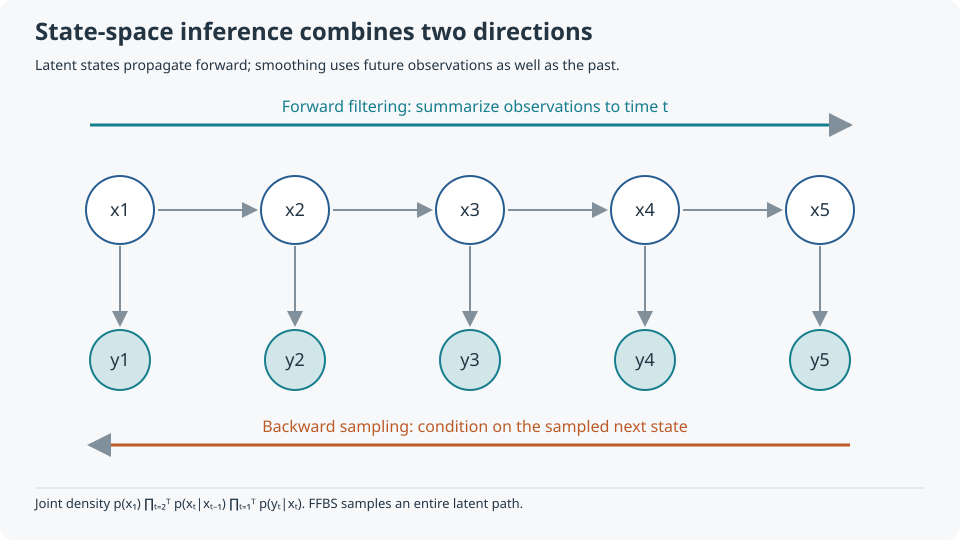

# 39. State-space models and time series

**Learning goals.** By the end of this chapter you should be able to distinguish a filtered state, a smoothed state, and a forecast; derive and implement a scalar forward-filtering backward-sampling (FFBS) update; account correctly for an initial-state distribution in parameter inference; and choose a sampling strategy when the observation model is not Gaussian. The main prerequisites are Gaussian conditioning in [Chapter 02](02-probability.md), posterior construction in [Chapter 03](03-bayesian-targets.md), Gibbs and Metropolis updates in [Chapters 09–10](09-metropolis-hastings.md), and estimand-specific checks in [Chapters 13–14](13-mc-error.md). [Chapter 28](28-particle-mcmc.md) supplies the extended-target arguments for particle MCMC.

## 39.1 A hidden process and its measurements

Imagine a sensor reporting a noisy position each minute. A reported position is neither the true position nor an independent replicate: the physical position evolves, and consecutive reports share information through that evolution. Let $x_t$ denote the latent position at calendar time $t$, $y_t$ its measurement, and $\theta$ the model parameters. A general state-space model specifies an initial law $p_\theta(x_0)$, a Markov transition $f_\theta(x_t\mid x_{t-1})$, and an observation law $g_\theta(y_t\mid x_t)$. Assuming measurements are conditionally independent given the states, its posterior is

$$
p(\theta,x_{0:T}\mid y_{1:T})\propto p(\theta)p_\theta(x_0)
\prod_{t=1}^{T}f_\theta(x_t\mid x_{t-1})g_\theta(y_t\mid x_t).
$$

The factorization is a scientific claim. A persistent calibration error shared by all readings, for example, violates the stated conditional independence unless it becomes another state or parameter. A transition with large process variance describes genuinely volatile motion; large observation variance describes an unreliable sensor. Both make the observations jagged, so a short series may identify their separate sizes poorly. Prior information, replicate sensors, or varied sampling intervals can help, but none is automatically present.

The time index $t$ will always denote the modeled process. If we run MCMC, its iteration index is $n$. Confusing them can make an autocorrelation plot almost uninterpretable: serial correlation in the observed series is part of the model, whereas serial correlation across MCMC iterations affects simulation efficiency. Särkkä's [treatment of Bayesian filtering and smoothing](https://users.aalto.fi/~ssarkka/pub/cup_book_online_20131111.pdf) develops this distinction between the evolving state and inference about it.

## 39.2 Three questions answered by different distributions

**Filtering** asks for $p(x_t\mid y_{1:t},\theta)$, using measurements available by time $t$. **Smoothing** asks for $p(x_t\mid y_{1:T},\theta)$ with $T>t$; a later reading can revise our account of an earlier position. **Forecasting** asks for a future quantity, such as $p(y_{T+1:T+h}\mid y_{1:T})$, and integrates over uncertain current state and parameters. These distributions answer different questions even when the same algorithm computes them.

For a concrete picture, suppose today's reading is much higher than yesterday's. Yesterday's filtered estimate had no access to today's reading. A smoothed path can move yesterday's estimate upward, because a persistent process makes part of today's elevation likely to have begun yesterday. That revision is appropriate for retrospective reconstruction; it is information leakage if reported as the forecast one could have issued yesterday.

If a reading is absent and the absence is ignorable conditional on modeled information, the filter performs its transition but skips that observation update. If missingness itself signals a sensor overload or a state threshold, its probability must enter the likelihood. The missingness discussion in [Chapter 38](38-mixtures.md) applies here. To assess a one-step forecast at each historical cutoff, fit or update using only observations available at that cutoff. A full-data posterior for $\theta$ cannot simply be reused at earlier cutoffs: it has already learned from the future.

## 39.3 Filtering a scalar Gaussian model

Consider the scalar model

$$
x_0\sim N(m_0,C_0),\qquad x_t=\phi x_{t-1}+\eta_t,\quad
\eta_t\sim N(0,q),\qquad y_t=x_t+\epsilon_t,\quad
\epsilon_t\sim N(0,r),
$$

where $C_0,q,r>0$ and all innovations and measurement errors are mutually independent and independent of $x_0$. Here $q$ and $r$ are **variances**. We do not need $|\phi|<1$ for a finite series with this proper $x_0$ prior. That restriction appears only if we additionally require a stationary autoregression.

Suppose $x_{t-1}\mid y_{1:t-1},\theta\sim N(m_{t-1},C_{t-1})$. Propagating through the transition gives the one-step state prediction

$$
a_t=\phi m_{t-1},\qquad R_t=\phi^2 C_{t-1}+q,
\qquad x_t\mid y_{1:t-1},\theta\sim N(a_t,R_t).
$$

Consequently $y_t\mid y_{1:t-1},\theta\sim N(a_t,S_t)$ with $S_t=R_t+r$. The covariance of $x_t$ and $y_t$ under this prediction is $R_t$. Gaussian conditioning, as derived in [Chapter 02](02-probability.md), therefore gives the gain and update

$$
K_t=\frac{R_t}{S_t},\qquad
m_t=a_t+K_t(y_t-a_t),\qquad
C_t=R_t-\frac{R_t^2}{S_t}=(1-K_t)R_t.
$$

The innovation $e_t=y_t-a_t$ is a prediction error, and $e_t/\sqrt{S_t}$ is its standardized version. The same forward pass evaluates the *marginal* data likelihood without sampling states:

$$
\log p_\theta(y_{1:T})=
-\frac12\sum_{t=1}^T\left\{\log(2\pi S_t)+\frac{(y_t-a_t)^2}{S_t}\right\}.
$$

Each factor is conditional on past observations; they are not independent unconditional measurements. In scalar arithmetic $C_t=(1-K_t)^2R_t+K_t^2r$ is a roundoff-resistant equivalent of the covariance update. In a vector model, form the gain with a linear solve against the innovation covariance, avoid an explicit matrix inverse, and use a suitable positive-semidefinite covariance update. With fixed state dimension, the number of filter steps grows linearly with $T$; the matrix work per step can still be substantial. These recursions are the linear Gaussian special case of the [Kalman filter](https://users.aalto.fi/~ssarkka/pub/cup_book_online_20131111.pdf).

### Missing reports keep their place in time

Let $\mathcal O$ contain the observed time indices. For ignorable missingness, integrating an absent measurement gives $\int g_\theta(y_t\mid x_t)\,dy_t=1$. Thus every time still has a transition, while only $t\in\mathcal O$ contributes a measurement factor. Applying the [Bayesian prediction/update equations](https://users.aalto.fi/~ssarkka/pub/cup_book_online_20131111.pdf), at an unobserved time set $m_t=a_t$, $C_t=R_t$, and add zero to the log likelihood. This follows directly by removing the measurement factor from the update; no synthetic reading is needed. A missing report is represented by `None` in the example, preserving its index.

For $\phi=q=r=C_0=1$, $m_0=0$, and $(y_1,y_2,y_3)=(1,\text{missing},0)$, the first filter is $(2/3,2/3)$. At time 2 it becomes $(2/3,5/3)$ without an update. At time 3 the prediction is $(2/3,8/3)$, the gain is $8/11$, and $(m_3,C_3)=(2/11,8/11)$. Deleting the middle time and filtering $(1,0)$ instead would give $(1/4,5/8)$: it mistakenly removes one unit of process noise. The next reading has variance $8/11+1+1=30/11$.

Missing readings also change a variance conditional: when missing observations have been integrated out, the update for $r$ in Section 39.5 uses $|\mathcal O|/2$ and residuals only at observed times. The update for $q$ still uses every transition in the sampled path. An informative absence requires its own observation mechanism, as discussed in Section 39.2.

### Worked example: two reports

Take $\phi=q=r=1$, $x_0\sim N(0,1)$, and measurements $(y_1,y_2)=(1,0)$. The first prediction is $(a_1,R_1)=(0,2)$, so $S_1=3$, $K_1=2/3$, and $(m_1,C_1)=(2/3,2/3)$. The next prediction is $(a_2,R_2)=(2/3,5/3)$; thus $S_2=8/3$, $K_2=5/8$, and

$$
m_2=\frac23+\frac58\left(0-\frac23\right)=\frac14,
\qquad C_2=\left(1-\frac58\right)\frac53=\frac58.
$$

The second report pulls the time-2 estimate down. It should also revise our account of time 1, which requires smoothing.

## 39.4 Backward sampling joins the states into paths

The filter supplies $p(x_t\mid y_{1:t},\theta)$ for every $t$. To draw a *whole* path from $p(x_{0:T}\mid y_{1:T},\theta)$, start with $x_T\sim N(m_T,C_T)$ and work backward. The relevant joint conditional Gaussian law before seeing $y_{t+1}$ has mean $(m_t,a_{t+1})$, variance $C_t$ for $x_t$, variance $R_{t+1}$ for $x_{t+1}$, and covariance $C_t\phi$. Define

$$
J_t=\frac{C_t\phi}{R_{t+1}}.
$$

Gaussian conditioning gives the backward draw

$$
x_t\mid x_{t+1},y_{1:T},\theta\sim
N\!\left(m_t+J_t(x_{t+1}-a_{t+1}),\ C_t-J_t^2R_{t+1}\right).
$$

The variance is $C_t-C_t^2\phi^2/R_{t+1}$, **not** $C_t-J_t^2 C_{t+1}$: the denominator and covariance in the conditioning step are the *predicted* variance $R_{t+1}$. Once $x_{t+1}$ is fixed, later observations give no extra information about $x_t$ under the Markov and observation assumptions. This conditional independence proves the backward factorization

$$
p(x_{0:T}\mid y_{1:T},\theta)
=p(x_T\mid y_{1:T},\theta)
\prod_{t=0}^{T-1}p(x_t\mid x_{t+1},y_{1:t},\theta).
$$

It is the factorization, not merely the correct one-time moments, that makes FFBS a joint smoothing draw. The data-augmentation approach to dynamic linear models is described by [Frühwirth-Schnatter (1994)](https://onlinelibrary.wiley.com/doi/10.1111/j.1467-9892.1994.tb00184.x).

The scalar backward variance simplifies to $C_tq/R_{t+1}$. The example uses this positive expression, because subtracting two almost equal terms can erase uncertainty when $q$ is tiny. In a vector transition $x_{t+1}=F_{t+1}x_t+\eta_{t+1}$, the corresponding gain satisfies $J_tR_{t+1}=C_tF_{t+1}^{\mathsf T}$ and the conditional covariance is $C_t-J_tR_{t+1}J_t^{\mathsf T}$. The transpose and order matter; use a linear solve. These are the matrix conditioning identities in [Särkkä, equations 8.7–8.11](https://users.aalto.fi/~ssarkka/pub/cup_book_online_20131111.pdf). The scalar shortcut does not transfer to matrices by simply rearranging factors.

The diagram starts at $x_1$; its initial density can be obtained by integrating $x_0$ out of the model above. The horizontal arrows represent calendar time and conditional sampling direction, not MCMC iterations.

Continue the two-report example. $J_1=(2/3)/(5/3)=2/5$, so $x_1\mid x_2,y_{1:2}$ has mean $2/3+(2/5)(x_2-2/3)=2/5+(2/5)x_2$ and variance $2/5$. Integrating over $x_2\mid y_{1:2}\sim N(1/4,5/8)$ gives

$$
E(x_1\mid y)=\frac12,\quad
\operatorname{Var}(x_1\mid y)=\frac25+\left(\frac25\right)^2\frac58=\frac12,
\quad \operatorname{Cov}(x_1,x_2\mid y)=\frac25\frac58=\frac14.
$$

Drawing $x_1$ and $x_2$ independently from their correct smoothed marginals would force that last covariance to zero. It would misrepresent increments and event probabilities about a path. At fixed $\theta$, separate FFBS runs using independent random numbers are independent conditional path draws. In a Gibbs chain with changing parameters, complete posterior draws are generally correlated across MCMC iterations.

## 39.5 Learning process and measurement variances

FFBS becomes a Gibbs block when parameters are unknown. Suppose $\phi$ is fixed, $x_0\sim N(m_0,C_0)$ independently of $q$ and $r$, and use inverse-gamma priors with the convention

$$
p(q)\propto q^{-a_q-1}\exp(-b_q/q),\qquad
p(r)\propto r^{-a_r-1}\exp(-b_r/r).
$$

Take $a_q,b_q,a_r,b_r>0$ so both priors are proper, and assume they are independent. Given the sampled path, there are $T$ transition residuals $d_t=x_t-\phi x_{t-1}$. Their model density factors into Gaussian innovation terms, each contributing $q^{-1/2}\exp[-d_t^2/(2q)]$. Multiplication by the prior yields

$$
q\mid x_{0:T},\phi,y_{1:T}\sim
\operatorname{IG}\!\left(a_q+\frac T2, b_q+\frac12\sum_{t=1}^{T}d_t^2\right).
$$

The measurements similarly give $r\mid x_{0:T},y_{1:T}\sim\operatorname{IG}(a_r+T/2,b_r+\sum_t(y_t-x_t)^2/2)$. These are full conditionals only under the stated prior factorization and observation model. If $x_0$ itself depends on $q$, its density also belongs in the conditional.

For example, a stationary, zero-mean initialization $x_1\sim N(0,q/(1-\phi^2))$ requires $|\phi|<1$. When the state series is indexed from 1 and the transitions start at $t=2$, the contribution to the $q$ sum is then $(1-\phi^2)x_1^2+\sum_{t=2}^T(x_t-\phi x_{t-1})^2$, with a total shape increment $T/2$. The conditional for $\phi$ includes the normalizing factor $\sqrt{1-\phi^2}$ and the initial quadratic term. An unconstrained regression update that discards these terms is not its full conditional. With a nonzero stationary mean $\mu$, replace $x_1$ by $x_1-\mu$ and transition residuals by $x_t-\mu-\phi(x_{t-1}-\mu)$. The stationary parameterization is useful only if stationarity is scientifically defensible.

If $\phi$ is learned under stationarity, specify a proper prior supported on $(-1,1)$, independently of $q$ and $r$ if retaining the conditionals above. For example, $(\phi+1)/2\sim\operatorname{Beta}(a_\phi,b_\phi)$ with positive shape parameters specifies one such family; its shapes express beliefs about persistence. If computation uses $\xi=\operatorname{atanh}(\phi)$ while the prior was defined on $\phi$, the transformed log target includes $\log(1-\tanh^2\xi)$. This Jacobian is separate from the stationary initial-density factor. A prior defined directly on $\xi$ instead induces its own prior on $\phi$.

One alternative samples $\theta$ by Metropolis–Hastings using the Kalman likelihood above and then samples $x_{0:T}$ by FFBS conditional on the current $\theta$, including after a rejected parameter proposal. Marginalizing the states can reduce parameter–path dependence, though each proposal needs a filter pass. A conditional-state Gibbs or MH scheme can be cheaper per parameter step but harder to mix. These are distinct kernels with the same intended joint posterior when their conditional and acceptance calculations are correct. Neither removes finite-run Monte Carlo error.

## 39.6 Why blocking matters

Consider a single interior state $x_t$, with $1\leq t<T$, conditional on its neighbors, its own observation, and fixed parameters. The terms containing $x_t$ in the log density are

$$
-\frac{(x_t-\phi x_{t-1})^2}{2q}
-\frac{(x_{t+1}-\phi x_t)^2}{2q}
-\frac{(y_t-x_t)^2}{2r}.
$$

Completing the square gives conditional precision $P_t=(1+\phi^2)/q+1/r$ and mean $P_t^{-1}\{\phi(x_{t-1}+x_{t+1})/q+y_t/r\}$. The endpoint $x_T$ has no forward-transition factor, and $x_0$ has its prior rather than an observation factor. This is why one generic interior formula cannot update every coordinate.

When $\phi$ is near one and $q$ small, neighboring states are tightly linked. A coordinate Gibbs sweep can only adjust a path through many local changes. FFBS instead draws a whole path from its exact conditional distribution in one block, so successive paths are independent *conditional on fixed parameters*. Yet a sampled path can still strongly determine $q$ or $\phi$, and parameter changes can be slow. Evaluate effective sample size per unit time for quantities you will report: a path average, a terminal state, and $\phi$ may tell different stories. [Chapter 16](16-geometry.md) discusses centered and innovation parameterizations; an innovation representation can help when states are weakly measured, while a centered representation can help when observations pin states down. These are tendencies to test for a particular model, not universal ranking rules.

The Gibbs lab offers a small analogy. Increase the correlation of its two-dimensional Gaussian target and compare coordinate-update movement at the same number of iterations. It illustrates local-update slowing; it does not implement a temporal model or FFBS.

## 39.7 Stochastic volatility crosses the Gaussian boundary

For financial returns, a latent log variance is often more natural than a latent level. A basic stochastic-volatility model is

$$
y_t=\exp(h_t/2)\epsilon_t,\qquad
h_t=\mu+\phi(h_{t-1}-\mu)+\sigma\eta_t,
$$

with the state recursion applied for $t=2,\ldots,T$, independent standard normal shocks $\epsilon_t,\eta_t$, $\sigma>0$, and, if stationarity is assumed, $|\phi|<1$ and $h_1\sim N(\mu,\sigma^2/(1-\phi^2))$. Conditional on $h_t$, the return variance is $\exp(h_t)$ and its standard deviation is $\exp(h_t/2)$. The observation log likelihood contribution, up to a term independent of $h_t$, is

$$
\log g(y_t\mid h_t)=-\frac12\left[h_t+y_t^2\exp(-h_t)\right].
$$

This is not quadratic in $h_t$, so a Kalman filter or Gaussian FFBS applied directly to this observation law is not exact. The distinction matters even when a smoothed line looks plausible. The [Kim, Shephard, and Chib stochastic-volatility study](https://www.nuff.ox.ac.uk/economics/papers/1996/w26/chib8.pdf) uses a Gaussian-mixture approximation to a transformed observation density and discusses correction. A finite mixture alone changes the likelihood. Importance reweighting can estimate expectations under the original posterior when its support and integrability conditions hold; a finite self-normalized estimate still has Monte Carlo error and generally finite-sample bias. It does not create independent exact posterior draws. A suitable Metropolis correction instead builds a kernel with the original invariant target.

For an evaluable likelihood, one may update the latent path with Metropolis or HMC using its joint log density. Conditional on $\theta$, a Gaussian prior for $h_{1:T}$ also permits elliptical slice sampling with the non-Gaussian observation likelihood. Those methods can target the stated posterior without a Gaussian observation approximation, subject to their usual kernel conditions and finite-run error. Their efficiency depends on path geometry, persistence, and observation informativeness; the fact that a method has a correct invariant target does not certify good exploration.

### Worked example: one volatility forecast

Suppose a particular posterior draw has $h_T=0$, $\mu=0$, $\phi=0.9$, and $\sigma=0.2$. Then $h_{T+1}\sim N(0,0.04)$. The next return has mean zero, while its conditional-on-this-draw predictive variance is

$$
E\{\exp(h_{T+1})\mid h_T,\theta\}
=\exp(0+0.04/2)=\exp(0.02)\approx1.0202.
$$

The expected next conditional **standard deviation** is $E\{\exp(h_{T+1}/2)\}=\exp(0.04/8)=\exp(0.005)\approx1.0050$. The standard deviation of the predictive return is instead $\sqrt{\exp(0.02)}=\exp(0.01)\approx1.0101$. These differ because averaging a standard deviation and taking the square root of an averaged variance are different operations. The calculation uses $E[e^{aH}]=e^{am+a^2v/2}$ for $H\sim N(m,v)$. It still conditions on one parameter/state draw; posterior prediction averages across many such draws.

## 39.8 Choosing a path update

The transition and observation laws together determine which block updates are available. Gaussian observation noise alone is insufficient if the state transition is nonlinear. The following choices refer to their intended invariant target. All require separate checks of numerical implementation and finite-run exploration.

| Model structure | Possible update | Main practical concern |
| --- | --- | --- |
| Linear Gaussian conditional on parameters | Kalman likelihood and exact conditional FFBS | Parameter–state dependence; covariance numerics |
| Evaluable smooth non-Gaussian likelihood | Path MH/HMC, or elliptical slice with a Gaussian path prior | Geometry and long-path computational cost |
| Transition simulation and observation weighting convenient | Particle marginal MH or particle Gibbs | Weight collapse and path genealogy |

Particle marginal MH uses a suitable nonnegative unbiased likelihood estimate on an augmented space; particle Gibbs uses **conditional** sequential Monte Carlo that retains a reference trajectory. Replacing the current path with an unrelated output from an ordinary finite-particle filter is not a Gibbs conditional draw. Under the extended-target conditions explained in [Chapter 28](28-particle-mcmc.md) and by [Andrieu, Doucet, and Holenstein](https://www.stats.ox.ac.uk/~doucet/andrieu_doucet_holenstein_PMCMC.pdf), finite particle counts can still give a kernel with the desired posterior marginal as invariant distribution. That statement concerns the target, not the quality of a finite run. [Ancestor sampling](https://jmlr.org/papers/v15/lindsten14a.html) reconnects the retained trajectory to earlier particle ancestors and can ease genealogical sticking, but highly informative observations or nearly deterministic transitions can still make alternatives scarce. We do not need its extended-target proof to choose a sensible baseline here.

## 39.9 Forecasting with every layer of uncertainty

Given posterior draws $(\theta^{(n)},x_T^{(n)})$, a simulation forecast propagates each draw through future transitions and then future observations. For the Gaussian model, at horizon one and fixed draw,

$$
x_{T+1}^{(n)}\sim N(\phi^{(n)}x_T^{(n)},q^{(n)}),\qquad
y_{T+1}^{(n)}\sim N(x_{T+1}^{(n)},r^{(n)}).
$$

The collection of latent draws answers a question about future true levels; the collection of $y$ draws answers a question about future readings. Predictive intervals for readings generally include both process and measurement uncertainty and thus are wider than intervals for latent states. Repeating the process to horizon $h$ also carries parameter uncertainty through every transition. A plug-in forecast at posterior mean parameters discards that variation and can be especially misleading for nonlinear tail quantities.

For the volatility model, conditional on $(h_T,\theta)$, the $h$-step log variance is Gaussian with mean $m_h=\mu+\phi^h(h_T-\mu)$ and variance $v_h=\sigma^2\sum_{j=0}^{h-1}\phi^{2j}$. Therefore the conditional predictive return variance is $\exp(m_h+v_h/2)$, not $\exp(m_h)$. Posterior averaging must then include uncertainty about $h_T$ and $\theta$. State a horizon and a functional before computing Monte Carlo error: the mean forecast, a 95% interval endpoint, and the probability of an extreme return require different precision. Rare-event forecasts need many effective posterior and predictive draws, not merely a large raw count.

### Preserve joint posterior draws when averaging forecasts

The predictive integral in [Särkkä's equation 2.10](https://users.aalto.fi/~ssarkka/pub/cup_book_online_20131111.pdf) averages conditional predictions over the posterior. Applying total variance directly to the one-step model gives, whenever the moments exist,

$$
E(y_{T+1}\mid y)=E(\phi x_T\mid y),\qquad
\operatorname{Var}(y_{T+1}\mid y)=E(q+r\mid y)+\operatorname{Var}(\phi x_T\mid y).
$$

The second term contains uncertainty about the current state and persistence, including their posterior dependence. Keep each $(\phi,x_T)$ pair together; replacing them by separate posterior means can even change the forecast mean. These conditional moments also avoid adding unnecessary future-simulation noise when only a mean or variance is wanted.

For an illustrative equally weighted two-point posterior approximation, let $(\phi,x_T)$ equal $(1/2,-2)$ or $(1/4,4)$, with $q=1/4$ and $r=3/4$ in both components. The predictive distribution is $\tfrac12N(-1,1)+\tfrac12N(1,1)$: mean zero, variance $1+1=2$. Substituting the separate posterior means $\bar\phi=3/8$, $\bar x_T=1$ instead gives $N(3/8,1)$, changing both moments. This arithmetic example is not a posterior fitted to the sensor series. For a fitted chain, averaging conditional moments still requires MCMC error assessment; predictive quantiles require the full mixture or predictive simulation.

## 39.10 Validation and distinct error sources

A useful first check is simulated recovery: generate from known parameters, fit the model, and ask whether intervals and forecasts behave as intended across repeated data sets. For the Gaussian model, compare any proposed sampler's fixed-parameter moments and innovation likelihood with the Kalman calculations. The [runnable example](examples/ch39.py) makes this comparison for $T=40$ using independent FFBS draws at fixed parameters. Agreement within Monte Carlo error checks the block sampler's basic arithmetic; it cannot validate a later parameter MCMC implementation by itself.

With unknown parameters, run multiple dispersed chains and inspect parameter traces and estimand-specific effective sample sizes. Inspect path summaries too: a chain may agree on a global mean while remaining sticky in the terminal state or process variance. Diagnostics are evidence about these runs, never proof of convergence. Separately examine model fit: standardized Gaussian innovations should lack systematic patterns under the assumed model; for stochastic volatility, residual return and squared-return behavior can expose missing mean or volatility structure. An attractive smoothed path can hide a poor predictive distribution. If $q$ and $r$ remain weakly identified, state that uncertainty instead of treating a fitted path as a direct measurement of process noise.

There are several distinct errors to report. A correct FFBS draw at fixed parameters has no discretization bias from time integration, but finite random draws have Monte Carlo error. MCMC adds dependence and possible incomplete exploration. A Gaussian-mixture volatility approximation can introduce target bias unless corrected. The transition and measurement assumptions create modeling error even if inference is numerically exact. Forecast calibration probes the combined result, but a single successful forecast does not isolate which layer was right.

## 39.11 A reproducible laboratory and extensions

Run `python examples/ch39.py`. It verifies the two-report arithmetic, generates a seeded 40-step sensor series, filters it, and makes 12,000 independent conditional path draws with FFBS. It prints the filtered terminal mean and variance beside the empirical terminal moments, then the analytic one-step forecast mean and variance. It also checks a missing-report likelihood against batch Gaussian conditioning, reconstructs the missing state by FFBS, and tests a small-process-noise case where subtractive variance arithmetic fails. A final two-component calculation checks the forecast decomposition in Section 39.9. These are fixed-parameter benchmarks and an illustrative mixture, not a fitted parameter chain. Change $q/r$ or $\phi$ and observe how the path and forecast uncertainty respond; if you later add parameter sampling, retain this fixed-parameter test.

The same decomposition extends to a local trend by enlarging the Gaussian state, to seasonal components through transition matrices, and to counts by changing the observation law. Regime-switching states introduce finite latent labels, connecting to [Chapter 29](29-discrete.md); spatially coupled latent fields connect to [Chapter 40](40-spatial.md). Keep the first reliable analytic special case available as a check when moving to a more elaborate model.

## Exercises

1. **Factorization.** Starting from the chain rule, derive the posterior factorization in Section 39.1. State the conditional independences needed.

Solution

The prior factors as $p(\theta)p_\theta(x_0)$. The Markov assumption replaces $p(x_t\mid x_{0:t-1},\theta)$ by $f_\theta(x_t\mid x_{t-1})$. Conditional measurement independence replaces $p(y_t\mid y_{1:t-1},x_{0:T},\theta)$ by $g_\theta(y_t\mid x_t)$. Multiplying these factors and dividing by the finite positive evidence $p(y_{1:T})$ gives the posterior. If the observation mechanism shares an unmodeled error, the last replacement fails.

2. **Two reports.** Recompute the two-report filter and the smoothing mean and variance of $x_1$ for $\phi=q=r=1$, $x_0\sim N(0,1)$, $y=(1,0)$.

Solution

The first prediction is $(0,2)$, gain $2/3$, and filter $(m_1,C_1)=(2/3,2/3)$. The second prediction is $(2/3,5/3)$, gain $5/8$, and filter $(m_2,C_2)=(1/4,5/8)$. The backward gain is $J_1=2/5$. Thus $E(x_1\mid y)=m_1+J_1(m_2-a_2)=1/2$. Total variance is $C_1-J_1^2R_2+J_1^2C_2=2/5+1/10=1/2$. The next observed forecast is $N(1/4,21/8)$.

3. **Pointwise correctness is insufficient.** Why does independently sampling each smoothed marginal fail to sample a trajectory? Give one affected quantity in the two-report example.

Solution

The independent construction gets each one-time marginal right but sets all cross-time covariance to zero. The actual $\operatorname{Cov}(x_1,x_2\mid y)=J_1C_2=1/4$. Consequently the true variance of $x_2-x_1$ is $5/8+1/2-2(1/4)=5/8$, whereas independent marginal draws give $9/8$. Probabilities of large path increments are therefore wrong. A joint conditional draw preserves the dependence.

4. **Variance conditional.** Derive the inverse-gamma conditional for $q$ when $x_0$ has a prior independent of $q$ and $\phi$ is fixed. Explain the change under stationary $x_1$ initialization.

Solution

Multiplying the $T$ transition densities produces $q^{-T/2}\exp[-\sum_{t=1}^T(x_t-\phi x_{t-1})^2/(2q)]$. Combining it with $q^{-a_q-1}e^{-b_q/q}$ gives $\operatorname{IG}(a_q+T/2,b_q+\sum d_t^2/2)$. For stationary $x_1\sim N(0,q/(1-\phi^2))$, transitions start at $t=2$, and the initial density adds one normal factor and residual $(1-\phi^2)x_1^2$. The shape increment remains $T/2$, because there are $T-1$ transitions and one initial Gaussian density. The scale is $b_q+\{(1-\phi^2)x_1^2+\sum_{t=2}^T(x_t-\phi x_{t-1})^2\}/2$. The initial density also adds the $\phi$-dependent factor $\sqrt{1-\phi^2}$, which matters if $\phi$ is updated.

5. **Volatility at horizon $h$.** Conditional on $h_T,\mu,\phi,\sigma$, derive the return variance at horizon $h$ for the stochastic-volatility model.

Solution

Repeated substitution gives $h_{T+h}=\mu+\phi^h(h_T-\mu)+\sigma\sum_{j=0}^{h-1}\phi^j\eta_{T+h-j}$. Independence of shocks makes its variance $v_h=\sigma^2\sum_{j=0}^{h-1}\phi^{2j}$ and mean $m_h=\mu+\phi^h(h_T-\mu)$. Conditional returns have zero mean and variance $e^{h_{T+h}}$, so total variance is $E(e^{h_{T+h}})=e^{m_h+v_h/2}$. Average this quantity over posterior draws to include parameter and current-state uncertainty.

6. **Design a fair assessment.** Design a one-step forecast evaluation and a sampler comparison for a 100-point series. Name quantities whose errors you would check.

Solution

Choose chronological cutoffs, for example $t=60,\ldots,99$. At each cutoff, fit or validly update using only $y_{1:t}$, forecast $y_{t+1}$, and record a preselected score such as log predictive density and interval coverage. For sampler comparison, use equal compute budgets and compare Monte Carlo error or effective sample size for $\phi$, $q$, the terminal state, and a path average, while also checking multiple-chain behavior. Inspect forecast calibration separately: it tests modeling plus computation, whereas sampler diagnostics address only the numerical posterior approximation. Avoid using a full-series parameter posterior at an earlier cutoff.

7. **Smoothing across a missing report.** In the missing-report example from Section 39.3, derive the conditional mean and variance of $x_2$ given $y_1=1,y_3=0$. Verify the answer by conditioning a joint Gaussian directly, and identify which variance update loses a residual.

Solution

At time 2, $(m_2,C_2)=(2/3,5/3)$, while $R_3=8/3$ and $J_2=5/8$. Hence $x_2\mid x_3,y$ has mean $1/4+(5/8)x_3$ and variance $5/8$. Averaging over $x_3\mid y\sim N(2/11,8/11)$ gives mean $4/11$ and variance $5/8+(5/8)^2(8/11)=10/11$.

Independently, the random-walk prior gives $\operatorname{Var}(x_2)=3$, $\operatorname{Cov}(x_2,(y_1,y_3))=(2,3)$, and

$$
V=\operatorname{Var}\!\begin{pmatrix}y_1\\y_3\end{pmatrix}
=\begin{pmatrix}3&2\\2&5\end{pmatrix},\qquad
V^{-1}
=\frac1{11}\begin{pmatrix}5&-2\\-2&3\end{pmatrix}.
$$

Gaussian conditioning therefore yields mean $(2,3)(5,-2)^{\mathsf T}/11=4/11$ and variance $3-23/11=10/11$. The displayed inverse is for hand verification; numerical implementations should solve linear systems. With the missing reading integrated out, $r$ has two measurement residuals and shape increment $1$, while $q$ has three transition residuals and increment $3/2$ under the independent $x_0$ prior.

## Key takeaways

- Filtering uses past observations, smoothing uses the full available series, and forecasting propagates state and parameter uncertainty forward.
- Kalman filtering computes Gaussian state marginals and a marginal likelihood; FFBS uses the *predicted* covariance to draw a dependent path from the joint smoothing law.
- Parameter conditionals depend on the initial-state law. A stationary prior changes both variance and persistence updates.
- Conditional Gaussian structure permits exact FFBS blocks. Non-Gaussian observations require a different exact-target kernel or an explicitly acknowledged approximation.
- Numerical correctness, finite-run Monte Carlo error, and model adequacy are separate questions.

## Sources

1. Simo Särkkä (2013), [*Bayesian Filtering and Smoothing*](https://users.aalto.fi/~ssarkka/pub/cup_book_online_20131111.pdf), Chapters 2, 4, 8, and 12: prediction, filtering, smoothing, and parameter inference.
2. Sylvia Frühwirth-Schnatter (1994), [“Data Augmentation and Dynamic Linear Models”](https://onlinelibrary.wiley.com/doi/10.1111/j.1467-9892.1994.tb00184.x): path augmentation in dynamic linear models.
3. Sangjoon Kim, Neil Shephard, and Siddhartha Chib (1998), [“Stochastic Volatility: Likelihood Inference and Comparison with ARCH Models”](https://www.nuff.ox.ac.uk/economics/papers/1996/w26/chib8.pdf): volatility model and historical mixture approach.
4. Christophe Andrieu, Arnaud Doucet, and Roman Holenstein (2010), [“Particle Markov chain Monte Carlo methods”](https://www.stats.ox.ac.uk/~doucet/andrieu_doucet_holenstein_PMCMC.pdf): extended-target particle MCMC.
5. Fredrik Lindsten, Michael I. Jordan, and Thomas B. Schön (2014), [“Particle Gibbs with Ancestor Sampling”](https://jmlr.org/papers/v15/lindsten14a.html): ancestor-sampling construction.
