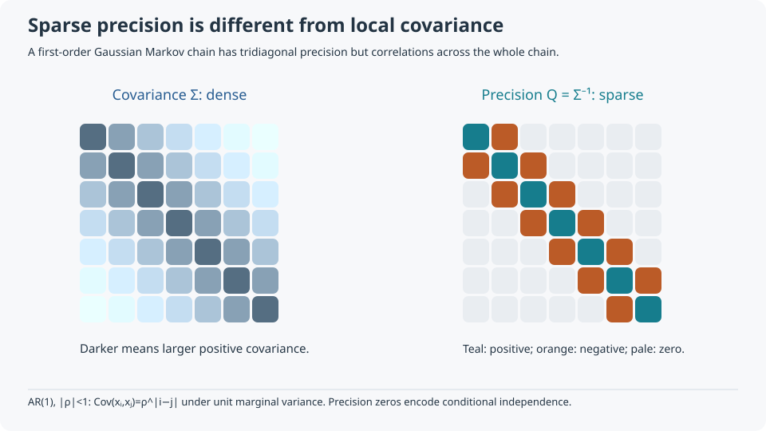
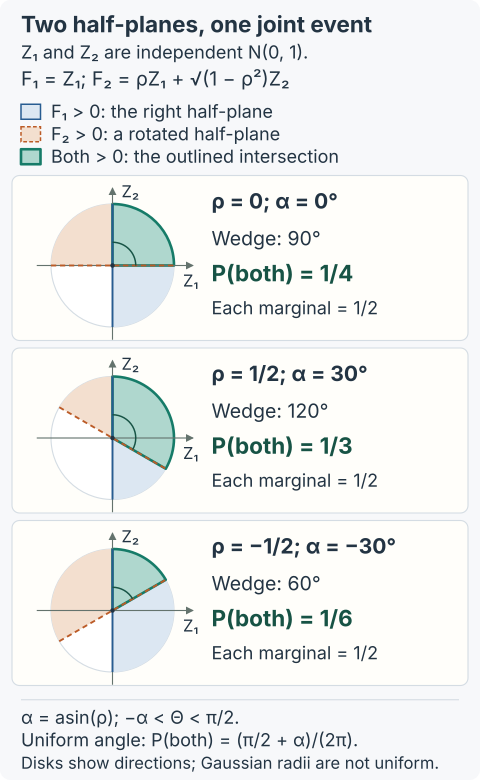

# 40. Spatial models and Gaussian processes

## Learning goals and prerequisites

This chapter asks how to infer an unobserved spatial surface from measurements and how the computational method changes with the observation model. By the end, you should be able to derive a Gaussian field posterior, evaluate a covariance-parameter density with its determinant, implement an elliptical slice update, interpret a sparse precision matrix, and separate Monte Carlo error from spatial approximation error.

We use Gaussian conditioning from [Chapter 02](02-probability.md), posterior construction from [Chapter 03](03-bayesian-targets.md), stable arithmetic from [Chapter 04](04-numerics.md), and the slice-sampling principle from [Chapter 11](11-slice.md). [Chapter 13](13-mc-error.md) supplies the Monte Carlo error vocabulary; [Chapter 16](16-geometry.md) explains reparameterization. A spatial field resembles the temporal latent process in [Chapter 39](39-state-space.md), but its neighborhoods need not follow a line in time.

## 40.1 From a map to a probability model

Suppose monitors at irregular positions $s_1,\ldots,s_n$ report pollutant concentrations $y_i$. A scientific question might concern $P(f(s_*)>c\mid y)$ at a school, or the average concentration over a district. Neither is answered by a map of fitted means alone. We need uncertainty at individual places and dependence *between* places: the uncertainty of an average depends on all cross-location covariances.

Let $f_i=f(s_i)$ be a latent process and let $X\beta$ represent known covariates. A useful hierarchy is

$$
p(y,f,\beta,\theta)=p(y\mid f,\beta)\,p(f\mid\theta)\,p(\beta,\theta).
$$

The covariance or precision parameter $\theta$ describes spatial dependence; the likelihood describes measurement. For a monitor, $y_i$ may be a noisy point measurement of $f_i+x_i^\mathsf T\beta$. For a count reported for a region $A_i$, the intensity may instead involve an integral of a spatial risk surface over $A_i$. Treating the regional count as a point observation at its centroid silently changes the model. Write the observation operator before choosing a sampler.

| Latent representation | Typical index | Dependence specified by | Useful observation examples |
| --- | --- | --- | --- |
| Gaussian process (GP) | Geographic coordinates | Covariance between site values | Noisy monitor values, site detections |
| Gaussian Markov random field (GMRF) | Areal graph or mesh nodes | Sparse conditional-dependence precision | Regional counts, mesh-based surfaces |

These are model representations, not competing MCMC algorithms. A finite GP may have a dense covariance; a GMRF's sparse precision offers different linear algebra. Both may be paired with Gaussian or non-Gaussian observations.

## 40.2 A finite Gaussian process and its spatial assumptions

A GP is a collection $f(s)$ for which every finite vector of evaluations has a jointly Gaussian distribution, with finite distributions consistent under dropping locations. We write $f\sim\operatorname{GP}(m,k_\theta)$. For fixed sites, $f=(f(s_1),\ldots,f(s_n))^\mathsf T$ has distribution $N(m,K_\theta)$, where $(K_\theta)_{ij}=k_\theta(s_i,s_j)$. This finite density is what most computational methods manipulate. For zero mean and strictly positive definite $K_\theta$,

$$
p(f\mid\theta)=(2\pi)^{-n/2}|K_\theta|^{-1/2}
\exp\left(-\tfrac12 f^\mathsf T K_\theta^{-1}f\right).
$$

The determinant is part of the density. It changes when $\theta$ changes, even if the field $f$ stays fixed. A squared exponential covariance, for example, is

$$
k_\theta(s,t)=a^2\exp\left(-\frac{\|s-t\|^2}{2\ell^2}\right),
\qquad a>0,\ \ell>0.
$$

The amplitude $a$ controls marginal standard deviation and the length scale $\ell$ controls how fast correlation falls with distance. The exponential covariance $a^2\exp(-\|s-t\|/\ell)$ gives rougher fields. Both are stationary here: dependence is determined by the displacement, rather than by absolute position. Stationarity can be scientifically wrong near a coastline or boundary; rescaling geographic coordinates without rescaling $\ell$ also changes the prior. The covariance must be valid for the locations and dimension under study. Duplicate sites make the pure process covariance singular, and some kernels or limiting parameter values can do likewise. Measurement noise can make the covariance of observations positive definite without making the latent process covariance itself invertible.

Draw prior fields before fitting. With a tiny $\ell$, neighboring predictions can vary almost independently on the observation scale; with a very large $\ell$, the prior strongly favors nearly constant departures from the mean. In either case the data may be too sparse to determine $\ell$ well. The GP regression equations below follow the finite Gaussian construction in [Rasmussen and Williams, Chapter 2](https://gaussianprocess.org/gpml/chapters/RW2.pdf).

## 40.3 Gaussian observations give an exact benchmark

First fix $\theta$ and suppose $f\sim N(0,K)$ and $y\mid f\sim N(f,\sigma^2I)$, with $\sigma^2>0$. The joint vector $(f,y)$ is Gaussian with $\operatorname{Cov}(f,y)=K$ and $\operatorname{Var}(y)=C=K+\sigma^2I$. Gaussian conditioning gives

$$
f\mid y,\theta\sim N\left(KC^{-1}y,\ K-KC^{-1}K\right).
$$

The inverse notation describes a solve: an implementation factors $C$ and solves systems, rather than forming $C^{-1}$. The formula also equals a precision formulation with $V=(K^{-1}+\sigma^{-2}I)^{-1}$ and mean $V\sigma^{-2}y$, provided $K$ is invertible. It is worth computing this benchmark even if the real analysis uses a harder likelihood, because it checks covariance ordering, noise variance, and prediction code.

For new sites $s_*$, let $K_*=\operatorname{Cov}(f_*,f)$ and $K_{**}=\operatorname{Var}(f_*)$. Then

$$
f_*\mid y,\theta\sim N\left(K_*C^{-1}y,\ K_{**}-K_*C^{-1}K_*^\mathsf T\right).
$$

A *future noisy observation* at those sites has an additional observation-error covariance. A latent-surface interval and a future-measurement interval answer different questions.

### Worked example A: two monitoring sites

Take $K=\begin{pmatrix}1&1/2\\1/2&1\end{pmatrix}$, $\sigma^2=1/4$, and $y=(1,-1)^\mathsf T$. The normalized vectors $u_+=(1,1)^\mathsf T/\sqrt2$ and $u_-=(1,-1)^\mathsf T/\sqrt2$ are eigenvectors of $K$ with eigenvalues $3/2$ and $1/2$. Because $y$ lies along $u_-$, its posterior mean is the observation multiplied by the shrinkage factor $(1/2)/(1/2+1/4)=2/3$:

$$
E(f\mid y)=(2/3,-2/3)^\mathsf T.
$$

In either eigen-direction, the conditional variance is $\lambda(1/4)/(\lambda+1/4)$. The two values are $3/14$ and $1/6$. Transforming back to site coordinates gives

$$
\operatorname{Var}(f\mid y)=
\begin{pmatrix}4/21&1/42\\1/42&4/21\end{pmatrix}.
$$

Thus the two posterior sites retain a small positive covariance even though the observed values have opposite signs. The executable [Chapter 40 example](examples/ch40.py) draws independently from this *known* Gaussian conditional and compares empirical moments with these exact values. With fixed hyperparameters, direct Gaussian draws solve the sampling problem; MCMC is unnecessary for this part.

## 40.4 Marginalizing the field to learn covariance parameters

When $\theta$ is unknown, integrating out $f$ under the Gaussian observation model yields $y\mid\theta\sim N(0,C_\theta)$, where $C_\theta=K_\theta+\sigma^2I$ and $\sigma$ may itself be part of $\theta$. Therefore the actual target for a hyperparameter update is

$$
\log p(\theta\mid y)=
-\frac n2\log(2\pi)-\frac12\log|C_\theta|
-\frac12y^\mathsf TC_\theta^{-1}y+\log p(\theta)+\text{constant}.
$$

If a mean $X\beta$ is present, replacing $y$ by $y-X\beta$ gives the likelihood conditional on $\beta$; multiplying by $p(\beta,\theta)$ gives the joint parameter target. This does not integrate out $\beta$. For an independent Gaussian prior $\beta\sim N(b,B)$, integrating it out instead gives $y\mid\theta\sim N(Xb,C_\theta+XBX^\mathsf T)$. Omitting the log determinant produces the wrong target: it rewards covariance changes based only on the quadratic fit, without accounting for how much volume those covariances assign to possible data. The marginal-likelihood expression and Cholesky evaluation are standard GP computations [Rasmussen and Williams](https://gaussianprocess.org/gpml/chapters/RW2.pdf).

For positive definite $C_\theta=LL^\mathsf T$, solve $Lv=y$, then compute $y^\mathsf TC_\theta^{-1}y=v^\mathsf Tv$ and $\log|C_\theta|=2\sum_i\log L_{ii}$. A dense factorization costs order $n^3$ arithmetic, so a proposal that changes $\theta$ can be expensive. Factors may be reused only when their covariance is unchanged. A numerical diagonal “jitter” added to $K$ changes the finite covariance used by the program; it is not the same as an independently specified measurement-noise variance.

Prior definitions also need care under transformation. If $\eta=\log\ell$ but the prior density $p_\ell$ was specified with respect to $d\ell$, then $p_\eta(\eta)=p_\ell(e^\eta)e^\eta$. The $+\eta$ term in its log density is required. If the prior was specified directly on $\eta$, there is no second Jacobian. Likewise, a joint prior $p(a,\ell,\sigma)$ should not be quietly replaced by three independent priors.

Amplitude, measurement noise, mean coefficients, and length scale may compensate for one another with sparse sites. A smooth posterior mean does not establish a precise length-scale estimate. Compare prior predictive fields and posterior predictive quantities, and inspect the joint hyperparameter posterior. [Murray and Adams](https://www.cs.princeton.edu/~rpa/pubs/murray2010hyper.pdf) study why covariance-parameter updates coupled to latent Gaussian values can be difficult; a field update alone does not solve hyperparameter mixing.

## 40.5 Non-Gaussian likelihoods and whitening

Spatial occurrence data might use $y_i\mid f_i\sim\operatorname{Bernoulli}(\operatorname{logit}^{-1}(f_i))$. Count data with known exposure $e_i>0$ might use $y_i\mid f_i\sim\operatorname{Poisson}(e_i e^{f_i})$. In the latter case, terms depending on $f$ in the log likelihood are

$$
\log L(f)=\sum_i\left(y_if_i-e_ie^{f_i}\right),
$$

with $y_i\log e_i-\log(y_i!)$ omitted because they are constant for a field update. A count for an area requires a defensible area-level intensity or integration rule; this site-level formula is not automatically such a model. Neither Bernoulli nor Poisson observations give the Gaussian conditional of the preceding section.

With a positive definite finite $K_\theta=L_\theta L_\theta^\mathsf T$, one may write $f=L_\theta z$, $z\sim N(0,I)$. The transformed posterior is

$$
p(z,\theta\mid y)\propto L(y\mid L_\theta z)
\exp(-z^\mathsf Tz/2)\,p(\theta),
$$

with the standard normal normalization constant suppressed because the dimension is fixed. To see why no $|K_\theta|^{-1/2}$ remains, the Gaussian field density contributes $|K_\theta|^{-1/2}=|L_\theta|^{-1}$, while $df=|L_\theta|dz$. These cancel. Adding a covariance determinant to this whitened density would count it twice. This is the finite-dimensional form of the reparameterization discussed in [Chapter 16](16-geometry.md); the [Stan GP guide](https://mc-stan.org/docs/stan-users-guide/gaussian-processes.html) gives implementation context for latent and marginalized GP forms.

Whitening makes the *prior* geometry independent of $\theta$, yet likelihood geometry can become more coupled because $L_\theta z$ changes with $\theta$. Centered $f$ can work better where data pin down the field strongly; whitened $z$ can help when the prior dominates. Try both on the estimands and data at hand. For a centered parameterization, the normalized Gaussian density and its determinant must be retained when updating $\theta$ at fixed $f$.

## 40.6 Elliptical slice updates at fixed covariance

Suppose the finite field prior is $N(0,K_\theta)$ and $L(f)=p(y\mid f,\theta)$ can be evaluated up to a positive multiplicative constant. The conditional target, with density relative to $df$, is $p(f\mid y,\theta)=L(f)\phi_{K_\theta}(f)/\int L(g)\phi_{K_\theta}(g)\,dg$, where $\phi_{K_\theta}$ is the normalized Gaussian prior density. At *fixed* $\theta$, draw an independent $\nu\sim N(0,K_\theta)$ and consider

$$
f(\phi)=f\cos\phi+\nu\sin\phi.
$$

The pair $(f,\nu)$ consists of two independent draws from the same Gaussian prior when averaged under the prior. Rotation by an angle preserves their joint Gaussian law. Elliptical slice sampling (ESS) restricts this prior-preserving curve to angles whose likelihood exceeds a random slice level, then samples a valid angle by bracket shrinkage. The auxiliary-variable and bracket argument is developed by [Murray, Adams, and MacKay](https://proceedings.mlr.press/v9/murray10a/murray10a.pdf); see [Chapter 11](11-slice.md) for the general slice logic.

```text
Given current f, fixed theta, and log likelihood log L:
  draw nu ~ N(0,K_theta), U ~ Uniform(0,1)
  h = log L(f) + log U
  draw phi ~ Uniform(0,2 pi); set [lo,hi] = [phi-2 pi, phi]
  repeat:
      proposal = f cos(phi) + nu sin(phi)
      if log L(proposal) > h: return proposal
      if phi < 0: lo = phi
      else:       hi = phi
      draw phi ~ Uniform(lo,hi)
```

The randomized initial bracket is part of this update, and angle zero remains within the bracket. ESS has no random-walk proposal scale to tune, but each attempted angle evaluates the likelihood and the method does not remove difficult covariance-parameter updates. For a nonzero prior mean $m$, rotate $f-m$ and add $m$ back. The standard argument requires a proper Gaussian prior and a nonnegative measurable likelihood with finite positive posterior normalizer. In practical continuous likelihoods that are positive near a valid current point, bracket shrinkage finds an acceptable neighborhood; pathological discontinuous supports require more care. The ESS transition leaves the *chosen finite-model conditional* $p(f\mid y,\theta)$ invariant. That property does not imply independent draws or fast finite-run mixing.

### Worked example B: a rejected angle, then an accepted one

Take the same two-site $K$ as Example A, but observe Bernoulli-logit outcomes $(1,0)$. Set the current state $f=(0,0)$ and, just to trace a possible update, suppose the auxiliary Gaussian draw realized $\nu=(1,-1)$. The current likelihood is $L(f)=1/4$. If the slice draw is $U=1/2$, the threshold is $1/8$. Let the initial angle be $3\pi/2$, giving the initial bracket $[-\pi/2,3\pi/2]$. Its field value is $(-1,1)$, with likelihood $\operatorname{logit}^{-1}(-1)^2\approx0.0723$, below threshold. This first rejection leaves the upper endpoint at $3\pi/2$. Suppose the next angle is $-\pi/4$. Its likelihood is $\operatorname{logit}^{-1}(-1/\sqrt2)^2\approx0.109$, again below threshold, so the lower endpoint moves from $-\pi/2$ to $-\pi/4$. Now $\pi/2$ lies in the shrunken bracket. It gives $(1,-1)$ and likelihood $\operatorname{logit}^{-1}(1)^2\approx0.5344$, so it is accepted. The named angles illustrate possible uniform draws (individual exact values have probability zero), and $\nu$ is an illustrative possible Gaussian realization, not a deterministic substitute for that draw. The executable example uses the full randomized update.

## 40.7 GMRFs and sparse precision

For areal data, adjacency can be more natural than Euclidean distance. A proper GMRF has $f\sim N(0,Q^{-1})$ with symmetric positive definite precision $Q$. Its normalized density is

$$
p(f\mid Q)=(2\pi)^{-n/2}|Q|^{1/2}
\exp\left(-\tfrac12 f^\mathsf TQf\right).
$$

Thus $+\tfrac12\log|Q|$ is required when precision parameters change; sparsity does not license dropping it. Completing the square in this density, while holding all other components fixed, gives

$$
f_i\mid f_{-i}\sim N\left(-\frac{1}{Q_{ii}}
\sum_{j\ne i}Q_{ij}f_j,\ \frac{1}{Q_{ii}}\right).
$$

A zero $Q_{ij}$ means $f_i$ and $f_j$ are conditionally independent given all other field values in this proper Gaussian model. It does *not* mean their marginal covariance is zero. Let $W$ be symmetric nonnegative graph-edge weights, $D_{ii}=\sum_jW_{ij}$, and $Q=\tau(D-W)+\kappa I$ with $\tau>0$ and $\kappa>0$. Then, for any nonzero $v$,

$$
v^\mathsf TQv=\tau\sum_{i<j}W_{ij}(v_i-v_j)^2+\kappa\sum_iv_i^2>0.
$$

The graph locality makes $Q$ sparse when each node has relatively few neighbors. Sparse matrix factorization can help with Gaussian draws and likelihood calculations, but eliminating nodes creates *fill-in*: a Cholesky factor may contain more nonzeros than $Q$. Single-site Gibbs updates use the displayed conditional cheaply, while a joint Gaussian update may move broad spatial patterns more effectively. Neither option is universally faster per effective draw. [Rue and Held's publisher preview](https://api.pageplace.de/preview/DT0400.9780203492024_A25107770/preview-9780203492024_A25107770.pdf) introduces the proper and intrinsic GMRF distinction and sparse viewpoint.



The figure uses a stationary Gaussian chain with positive correlation and unit marginal variance. Its covariance reaches beyond neighboring sites, while precision zeros encode conditional independence. This illustrates the same distinction for a line graph before considering a general spatial graph.

For the three-node path with unit edge weights, take $\tau=\kappa=1$. Then

$$
Q=\begin{pmatrix}2&-1&0\\-1&3&-1\\0&-1&2\end{pmatrix}.
$$

At $f_1=1,f_3=-1$, the middle conditional has mean $(f_1+f_3)/3=0$ and variance $1/3$. The endpoints are conditionally independent given the middle node, although the full joint field usually correlates them. This is the graph half of Example B: it describes local conditional dependence, whereas the elliptical update above moves a covariance-defined block.

### Joint simulation from posterior precision

Suppose the graph field has proper precision $Q$ and the observation model is $y\mid f\sim N(Hf,R)$ with $R$ positive definite. Expanding $(y-Hf)^\mathsf TR^{-1}(y-Hf)+f^\mathsf TQf$ and completing the square gives

$$
Q_y=Q+H^\mathsf TR^{-1}H,\qquad
Q_y m=H^\mathsf TR^{-1}y,\qquad
f\mid y\sim N(m,Q_y^{-1}).
$$

With a lower Cholesky factor $Q_y=GG^\mathsf T$, draw $z\sim N(0,I)$ and solve $G^\mathsf T\delta=z$. Then $f=m+\delta$ has the required covariance because $\operatorname{Cov}(\delta)=G^{-\mathsf T}G^{-1}=Q_y^{-1}$. Using $Gz$ would produce covariance $Q_y$, and solving $G\delta=z$ generally gives the wrong covariance too. This triangular-solve construction is described in [Rue and Held, Section 1.2.1, equation (1.6)](https://api.pageplace.de/preview/DT0400.9780203492024_A25107770/preview-9780203492024_A25107770.pdf).

For the three-node path above, observe every node with independent noise variance $1/4$, and set $y=(1,0,-1)^\mathsf T$. Our original small example gives

$$
Q_y=\begin{pmatrix}6&-1&0\\-1&7&-1\\0&-1&6\end{pmatrix},\qquad
m=(2/3,0,-2/3)^\mathsf T,\qquad
Q_y^{-1}=\frac1{240}\begin{pmatrix}41&6&1\\6&36&6\\1&6&41\end{pmatrix}.
$$

Check these identities by multiplying $Q_y m=4y$ and $Q_yQ_y^{-1}=I$. The average $A=(f_1+f_2+f_3)/3$ has mean zero and variance $1/15$. Omitting its cross-node covariances gives $59/1080$, about 18% too small. The executable example implements the factorization and triangular solves and compares independent draws with these targets. It uses dense lists for this tiny matrix; large problems need a sparse implementation. Sparsity of $Q_y$ also depends on the observation operator: a regional average can couple several nodes through $H^\mathsf TR^{-1}H$ even when $Q$ is sparse.

## 40.8 Intrinsic fields, constraints, and intercepts

Setting $\kappa=0$ gives $Q=\tau(D-W)$, a graph Laplacian. On a connected graph, $Q\mathbf1=0$. The expression $\exp(-f^\mathsf TQf/2)$ does not integrate to a finite value over $\mathbb R^n$ because adding any constant to every node leaves its value unchanged. It is an *intrinsic* field specification, not the proper Gaussian density written in Section 40.7. The precision normalization there uses $|Q|^{1/2}$; here it vanishes and cannot normalize this nonintegrable kernel.

If the linear predictor is $\alpha+f_i$, the transformation $f_i\mapsto f_i+c$, $\alpha\mapsto\alpha-c$ leaves its likelihood unchanged. A sum-to-zero constraint $\sum_i f_i=0$ on a connected graph removes that particular arbitrary level and gives a proper Gaussian law on the $(n-1)$-dimensional constrained subspace when the Laplacian has rank $n-1$. On a disconnected graph, each connected component has its own constant null direction and requires an independent constraint or a proper prior for that level. An alternative is $\kappa>0$, which specifies shrinkage for the global and component levels. The constraint is a modeling choice with consequences for interpreting $\alpha$; it does not, by itself, prove a whole hierarchy proper under any likelihood or hyperprior. Always check posterior propriety for the complete model.

### Which measure normalizes a constrained field?

To make the constraint explicit, put $L_G=D-W$ on a connected graph and choose an $n\times(n-1)$ matrix $B$ whose orthonormal columns span $\{f:\mathbf1^\mathsf Tf=0\}$. Write $f=Bu$. Then $A=B^\mathsf TL_GB$ is positive definite and $u\mid\tau\sim N(0,(\tau A)^{-1})$. The induced field density, with respect to Euclidean volume **on that subspace**, is

$$
p_S(f\mid\tau)=(2\pi)^{-(n-1)/2}\tau^{(n-1)/2}
|A|^{1/2}\exp\left(-\frac\tau2 f^\mathsf TL_Gf\right).
$$

Here $|A|$ is the product of the nonzero eigenvalues of $L_G$, sometimes called its pseudodeterminant. There is still no density with respect to $n$-dimensional Lebesgue measure. This derives the lower-dimensional normalization behind the intrinsic-field discussion in [Rue and Held's introductory chapter](https://api.pageplace.de/preview/DT0400.9780203492024_A25107770/preview-9780203492024_A25107770.pdf). For a fixed graph with $c$ connected components and a sum constraint in each, replace $n-1$ by $n-c$ and restrict to that subspace.

On the three-node path, take columns $b_1=(1,0,-1)^\mathsf T/\sqrt2$ and $b_2=(1,-2,1)^\mathsf T/\sqrt6$. Direct multiplication gives $A=\operatorname{diag}(1,3)$. Therefore the normalization is $\sqrt3\tau/(2\pi)$, and independent $u_1\sim N(0,1/\tau)$, $u_2\sim N(0,1/(3\tau))$ generate a constrained draw $f=b_1u_1+b_2u_2$. If instead we use free coordinates $(a,b)$ with $f=(a,b,-a-b)$, the surface-volume element is $\sqrt3\,da\,db$. The density with respect to $da\,db$ consequently has normalization $3\tau/(2\pi)$. Naming the reference measure prevents these correct but different constants from appearing contradictory.

This matters when learning $\tau$. With a shape–rate prior $\tau\sim\operatorname{Gamma}(a_0,b_0)$, $a_0,b_0>0$, and a likelihood depending on $\tau$ only through $f$, its conditional is

$$
\tau\mid f,y\sim\operatorname{Gamma}\left(a_0+\frac{n-1}{2},\ b_0+\frac12 f^\mathsf TL_Gf\right).
$$

Dropping the factor $\tau^{(n-1)/2}$ changes the shape and the posterior. Constraining the field does not permit discarding its parameter-dependent normalization.

## 40.9 Sparse approximations and which target they change

Large dense GP covariance factors can be impractical. One strategy constructs a finite-element field on a spatial mesh whose coefficients have sparse GMRF precision. The SPDE approach links suitable Gaussian spatial models with such Markov representations; [Lindgren, Rue, and Lindström](https://lup.lub.lu.se/search/publication/aa9806a6-1f3e-49cf-8464-9e4e97d2139d) give the underlying construction. This is a high-level description, not a claim that any arbitrary GP has an exact sparse discretization at any mesh size.

Another strategy uses inducing variables or a prescribed neighbor structure to build an approximate finite covariance or likelihood. These choices define a different computational target unless an exact correction is supplied. MCMC may then be exact-invariant *for that approximate target* while the target differs from the intended continuous-field posterior. Mesh resolution, mesh boundaries, observation integration, and the chosen covariance family can all affect the scientific estimate. Run a sensitivity comparison of a key functional under plausible refinements; an ESS or HMC chain that samples its finite target well cannot diagnose discretization bias. Approximate deterministic schemes such as INLA answer still another computational question and should not be presented as MCMC or as an automatic exact reference.

## 40.10 Prediction, checks, and a useful lab

For uncertain $\theta$, average predictions over posterior hyperparameter draws rather than selecting one convenient value. For a scalar latent prediction $F_*$, the law of total variance gives

$$
\operatorname{Var}(F_*\mid y)=
E_\theta[\operatorname{Var}(F_*\mid\theta,y)\mid y]
+\operatorname{Var}_\theta(E[F_*\mid\theta,y]\mid y).
$$

The first term measures within-parameter field uncertainty; the second captures changing predictive means across plausible covariance parameters. A plug-in prediction omits the second and evaluates the first conditional variance at one parameter value instead of averaging it. Its variance therefore need not always be smaller than the full predictive variance. For a spatial average $A=\sum_jw_jf(s_j)$, compute $\operatorname{Var}(A\mid y)=w^\mathsf T\operatorname{Cov}(f_*\mid y)w$. Averaging pointwise standard deviations, or pretending the sites are independent, gives a different quantity. For an exceedance probability, average indicators or conditional probabilities over posterior draws, with Monte Carlo error assessed for *that probability*.

Use held-out geographic blocks if deployment concerns new regions; a random held-out monitor near a training monitor tests an easier interpolation problem. Also check replicated measurements or counts against the observed data, prior sensitivity, and the effect of mesh or covariance choices. Report chain diagnostics across dispersed starts and the Monte Carlo standard error of the actual target functional, following [Chapter 14](14-diagnostics.md). A reassuring diagnostic is evidence about a finite run, never proof of convergence. Distinguish four layers: an exact-invariant transition for its specified finite target, finite-run Monte Carlo error, approximation error from a mesh or sparse surrogate, and modeling error from an unsuitable likelihood or covariance.

### 40.10.1 Pointwise probabilities do not determine simultaneous exceedance {#sec-40101-pointwise-probabilities-do-not-determine-simultaneous-exceedance}

**Predict first.** Two fixed sites each have posterior probability $1/2$ of exceeding a threshold. Does multiplying these probabilities give the chance that both exceed it? If the expected number of exceedances is one, have we determined the chance that at least one site exceeds it? Preserve the joint predictive law before answering either question.

For this benchmark, stipulate the conditional law of two latent predictions at fixed sites, with the observations $y$ held fixed:

$$
(F_1,F_2)\mid y\sim N\left(\begin{pmatrix}0\\0\end{pmatrix},
\begin{pmatrix}1&\rho\\\rho&1\end{pmatrix}\right),\qquad |\rho|<1.
$$

Use the same threshold zero at both sites. This is a separate, stipulated prediction benchmark conditional on fixed observations $y$; it is not the distribution from Example A's particular monitor values or the Bernoulli-logit ESS run. Integrating uncertain covariance parameters can instead give a Gaussian mixture, for which this Gaussian benchmark is not automatically the predictive law. Changing $\rho$ changes the within-draw dependence and hence this predictive law, rather than tuning a sampler for one fixed law. It is distinct from autocorrelation between MCMC iterations. Each marginal is standard normal, so $\Pr(F_j>0\mid y)=1/2$ for every permitted $\rho$.

Define the exceedance indicators $I_j=\mathbf1\{F_j>0\}$ and the count $C=I_1+I_2$. Linearity gives $E[C\mid y]=1$ without an independence assumption. The simultaneous exceedance probability instead depends on the correlation:

$$
q_\rho:=\Pr(F_1>0,F_2>0\mid y)
=\frac14+\frac{\arcsin\rho}{2\pi}.
$$

**Derive it from a Gaussian wedge.** Take independent standard normals $Z_1,Z_2$ and set $F_1=Z_1$, $F_2=\rho Z_1+\sqrt{1-\rho^2}Z_2$. This linear map gives the stated covariance. The density of $(Z_1,Z_2)$ depends only on its radius, so its angle is uniform on a full circle. The conditions $Z_1>0$ and $\rho Z_1+\sqrt{1-\rho^2}Z_2>0$ define intersecting half-planes through the origin. Their unit normal vectors have angle $\phi=\arccos\rho$. Their overlap is a wedge of angle $\pi-\phi=\pi/2+\arcsin\rho$; divide that angle by $2\pi$ to obtain $q_\rho$. Boundary lines have Gaussian probability zero.



Text equivalent of the figure: the first half-plane is $Z_1>0$ and the second is $\rho Z_1+\sqrt{1-\rho^2}Z_2>0$. For $\rho=0,1/2,-1/2$, their overlap angles are respectively $\pi/2,2\pi/3,\pi/3$, giving probabilities $1/4,1/3,1/6$. The drawing is in independent-noise coordinates, not a geographic map.

In this centered zero-threshold law, symmetry under $(F_1,F_2)\mapsto(-F_1,-F_2)$ gives $\Pr(C=0\mid y)=\Pr(C=2\mid y)=q_\rho$. The full count distribution and its variance are

$$
\Pr(C=0,1,2\mid y)=(q_\rho,\ 1-2q_\rho,\ q_\rho),\qquad
\operatorname{Var}(C\mid y)=2q_\rho.
$$

Indeed $E[C^2]=(1-2q_\rho)+4q_\rho=1+2q_\rho$ and $E[C]=1$. Inclusion–exclusion also gives $\Pr(I_1=1\text{ or }I_2=1\mid y)=1/2+1/2-q_\rho=1-q_\rho$. This last equality uses the stipulated marginals; the events “both exceed” and “at least one exceeds” are **not complements**. Their actual complements are “at least one fails to exceed” and “neither exceeds,” respectively.

| Correlation $\rho$ | Both exceed | At least one exceeds | Count variance |
| --- | ---: | ---: | ---: |
| $0$ | $1/4$ | $3/4$ | $1/2$ |
| $1/2$ | $1/3$ | $2/3$ | $2/3$ |
| $-1/2$ | $1/6$ | $5/6$ | $1/3$ |

Every row still has marginal exceedance probabilities $1/2$ and expected count one. Sampling the two correct marginal distributions independently replaces the intended dependence by the $\rho=0$ law. It preserves those marginal summaries and the expected count while changing both simultaneous event probabilities.

### Compute each event on each joint draw

For every joint draw, retain the pair and calculate $I_1$, $I_2$, $C$, $J_{\mathrm{both}}=I_1I_2$, and $J_{\mathrm{any}}=\max(I_1,I_2)$. In particular, **do not use $1-I_1I_2$ for the any-site event**. On each draw the identity is $J_{\mathrm{any}}+J_{\mathrm{both}}=C$. Their sample means therefore sum to the sample mean count, which need not be exactly one even though its expectation is one. Multiplying the two empirical marginal probabilities likewise discards the paired information required for the joint event.

For $R\ge2$ independent joint draws and any one of these functions $g$, use its own sample mean and iid MCSE,

$$
\bar g=\frac1R\sum_{r=1}^R g(F^{(r)}),\qquad
\widehat{\operatorname{MCSE}}_g
=\sqrt{\frac{1}{R(R-1)}\sum_{r=1}^R\{g(F^{(r)})-\bar g\}^2}.
$$

The analytic per-draw variances are $1/4$ for each site indicator, $q_\rho(1-q_\rho)$ for either simultaneous event indicator, and $2q_\rho$ for the count. Dividing each by $R$ gives the corresponding theoretical variance of its iid sample mean. Equal theoretical event variances here do not justify reusing one event's empirical MCSE for another, or imply equal long-run variances under an MCMC kernel. Correlated MCMC draws require dependence-aware MCSE for each function instead of this iid formula. A small MCSE addresses sampling error for the law actually drawn; it cannot diagnose independently sampled marginals that define the wrong joint law.

The distinction between pointwise exceedance and simultaneous statements over a region is central to [Bolin and Lindgren's excursion-set formulation, introduction and Definition 2.3](https://arxiv.org/pdf/1211.3946), and [their software account, Sections 2.1–2.2](https://www.jstatsoft.org/article/view/v086i05/1242). The two-site wedge is an elementary benchmark derived here. It does not certify an excursion statement over every point of a continuous spatial domain. For a mesh comparison, keep the prediction sites, threshold, and event fixed; adding sites to an “at least one” event expands the event itself. Under one consistent joint field law that expansion cannot decrease its probability. Approximating a continuous-domain event additionally requires control of behavior between evaluated sites.

The geometry lab below draws a Gaussian scale hierarchy directly, using $v\sim N(0,s^2)$, $z\sim N(0,1)$, and $x=e^{v/2}z$. Vary the scale of $v$ and compare the centered $(v,x)$ scatterplot with the noncentered $(v,z)$ scatterplot. This is a low-dimensional analogy for whitening a field whose covariance depends on unknown parameters. It generates independent prior draws and does not measure sampler speed or implement GP inference or ESS. Run `python examples/ch40.py` separately to compare independent Gaussian conditional draws and correlated ESS field draws. The script also reports approximate batch-means MCSEs and a deterministic quadrature comparison for its Bernoulli target, then runs the precision and constrained-field calculations above. Its final, separately seeded experiment draws independent joint predictions under each stipulated two-site law and reports each event or count estimate with its own iid MCSE and analytic reference. The quadrature has grid and truncation error; agreement and MCSE estimates are numerical checks, not convergence certificates.

<div class="mcmc-lab" data-lab="geometry"></div>

## Exercises

<div class="exercise" id="mcmc-40-spatial-ex-1">

1. **Gaussian conditioning.** Repeat Example A with $\sigma^2=1$. Give the mean and covariance in site coordinates.

<details>
<summary>Solution</summary>

The minus-direction shrinkage is $(1/2)/(1/2+1)=1/3$, so the mean is $(1/3,-1/3)$. The plus- and minus-direction posterior variances are $(3/2)/(3/2+1)=3/5$ and $(1/2)/(1/2+1)=1/3$. Thus the diagonal site variance is $(3/5+1/3)/2=7/15$, and the off-diagonal covariance is $(3/5-1/3)/2=2/15$.

</details>

</div>

<div class="exercise" id="mcmc-40-spatial-ex-2">

2. **Hyperparameter uncertainty.** Two equally probable posterior parameter states yield predictive means $0$ and $2$, with conditional variance $1$ in each state. Find the mixture mean and variance. What does retaining only the conditional variance miss?

<details>
<summary>Solution</summary>

The mean is $(0+2)/2=1$. The mean conditional variance is $1$; the variance of the two conditional means around $1$ is $[(0-1)^2+(2-1)^2]/2=1$. Total variance is $2$. Keeping only the within-state term reports $1$ and misses uncertainty from the changing mean.

</details>

</div>

<div class="exercise" id="mcmc-40-spatial-ex-3">

3. **Precision conditionals.** Derive all full conditionals for the three-node path $Q$ in Section 40.7 and show $Q$ is positive definite.

<details>
<summary>Solution</summary>

The endpoints have $f_1\mid f_2,f_3\sim N(f_2/2,1/2)$ and $f_3\mid f_1,f_2\sim N(f_2/2,1/2)$. The middle has $f_2\mid f_1,f_3\sim N((f_1+f_3)/3,1/3)$. Since $Q=D-W+I$, $v^\mathsf TQv=(v_1-v_2)^2+(v_2-v_3)^2+\sum_i v_i^2>0$ for every nonzero $v$.

</details>

</div>

<div class="exercise" id="mcmc-40-spatial-ex-4">

4. **Intrinsic confounding.** Remove $I$ from this $Q$ and add a free intercept $\alpha$ to the observation predictor. Identify the ambiguity and one way to remove it. Does that alone establish posterior propriety?

<details>
<summary>Solution</summary>

The Laplacian sends $(1,1,1)^\mathsf T$ to zero. Adding $c$ to every field value and subtracting $c$ from $\alpha$ preserves both the quadratic field penalty and the predictor. Constraining $f_1+f_2+f_3=0$ removes this constant direction on the connected path; choosing $\kappa>0$ is another model. Neither step proves the whole posterior proper without checking all likelihood and prior components.

</details>

</div>

<div class="exercise" id="mcmc-40-spatial-ex-5">

5. **Whitening Jacobian.** With $K_\theta=L_\theta L_\theta^\mathsf T$ positive definite, transform $f=L_\theta z$. Derive the field part of $p(z,\theta\mid y)$ and say where the determinant goes.

<details>
<summary>Solution</summary>

The centered field density is $(2\pi)^{-n/2}|L_\theta|^{-1}\exp(-f^\mathsf TK_\theta^{-1}f/2)$. Under $f=L_\theta z$, the quadratic becomes $z^\mathsf Tz$ and the volume element contributes $|L_\theta|$. The factors cancel, leaving $\phi_n(z)L(y\mid L_\theta z)p(\theta)$ up to a normalizer. The hyperprior remains present and must be transformed separately if its coordinates change.

</details>

</div>

<div class="exercise" id="mcmc-40-spatial-ex-6">

6. **Approximation audit and a changed joint event.** First, a refined mesh changes an exceedance estimate by $0.08$, while both chain runs report Monte Carlo standard errors near $0.002$. What must be held fixed to interpret this as an approximation comparison, and what action addresses the main observed discrepancy? Distinguish changing the approximation from adding prediction sites to an “at least one” event. Next use Section 40.10.1's two fixed sites, threshold zero, and $\rho=-1/2$. Derive the count law, expected count, count variance, and probabilities of both and at least one exceedance. Compare with a program that draws both correct marginal normals independently. Which answers remain correct and what are the signed errors in its two simultaneous event probabilities? Explain why neither two-site calculation certifies a continuous-domain exceedance statement.

<details>
<summary>Solution</summary>

Hold the prediction sites, threshold, observation model, and event definition fixed. Longer runs reduce Monte Carlo uncertainty around each mesh's target but do not remove the observed mesh sensitivity. Inspect mesh resolution, boundaries, the observation-to-mesh operator, and the field model; compare additional refinements of that same exceedance estimand. If the runs are coupled or reuse randomness, account for correlation when measuring uncertainty in their difference. Adding sites to an any-site event changes the estimand; under one consistent joint law it can only increase or preserve its probability. Report approximation sensitivity separately from that event expansion.

For the changed correlation, $\arcsin(-1/2)=-\pi/6$, so $q=1/6$. The count law is $(1/6,2/3,1/6)$ on $0,1,2$, with mean one and variance $1/3$. Both sites exceed with probability $1/6$, while at least one exceeds with probability $5/6$. Independent correct marginals instead give count law $(1/4,1/2,1/4)$ and variance $1/2$, with probabilities $1/4$ for both and $3/4$ for any. Each site's marginal probability and the expected count remain correct. The program's both-site error is $+1/12$ and its any-site error is $-1/12$, despite matching those simpler summaries.

Per draw, calculate the any indicator as $\max(I_1,I_2)$; it is not $1-I_1I_2$. Preserve joint draws and assess each function's Monte Carlo error separately. These statements concern two specified sites. An event over every point of a continuous domain additionally requires control between sites; increasing a grid does not by itself prove that control.

</details>

</div>

<div class="exercise" id="mcmc-40-spatial-ex-7">

7. **Constrained precision parameter.** On the three-node path, use the sum constraint and $\tau\sim\operatorname{Gamma}(2,1)$ in shape–rate form. At $f=(1,-1,0)$, find the full conditional of $\tau$ assuming the likelihood has no further $\tau$ dependence. What changes if you incorrectly normalize as a three-dimensional proper Gaussian?

<details>
<summary>Solution</summary>

The energy is $(f_1-f_2)^2+(f_2-f_3)^2=4+1=5$. The subspace dimension is two, so the field density contributes $\tau^{2/2}e^{-5\tau/2}$. Multiplying by the prior gives $\operatorname{Gamma}(3,7/2)$, with mean $6/7$. Treating the field as three dimensional would incorrectly produce shape $2+3/2=7/2$; dropping the normalization entirely would incorrectly leave shape $2$.

</details>

</div>

## Key takeaways

- A covariance or precision model states spatial assumptions; it does not determine the sampling algorithm.
- Gaussian observations at fixed parameters permit exact conditional simulation. Covariance-parameter updates require the Gaussian log determinant and the correctly transformed hyperprior.
- Elliptical slice sampling preserves the chosen finite conditional field posterior at fixed covariance, while a sparse GMRF expresses local conditional independence through precision.
- Report uncertainty for spatial functionals, including covariance across locations and uncertainty across hyperparameters. Examine Monte Carlo error, approximation sensitivity, and model fit separately.
