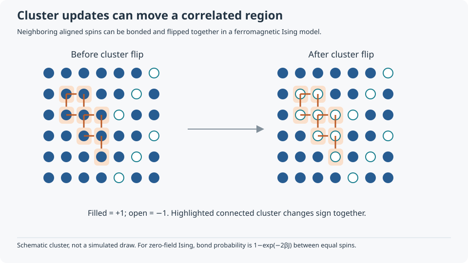

# 41. Statistical physics and lattice systems

## Learning goals and prerequisites

This chapter turns MCMC from a generic integration method into a finite lattice experiment. You will construct an Ising Gibbs measure, derive local and cluster transitions, measure physical observables with uncertainty, and separate sampling error from finite lattice effects. You should know expectations from [Chapter 2](02-probability.md), finite Markov chains from [Chapter 7](07-finite-chains.md), Metropolis and Gibbs updates from [Chapters 9](09-metropolis-hastings.md) and [10](10-gibbs.md), and autocorrelation from [Chapter 13](13-mc-error.md). [Chapter 29](29-discrete.md) develops discrete kernels more generally.

The central question is deceptively simple: what does a picture of aligned spins tell us? It shows one configuration. Physical claims concern expectations under a specified equilibrium distribution, uncertainty in estimated expectations, and often a limit as the lattice grows. Those require different arguments.

## 41.1 A finite Gibbs measure

Let a finite graph have $N_s$ vertices and undirected edges $E_G$. Each vertex carries $s_i\in\{-1,+1\}$. The ferromagnetic Ising energy is

$$
H(s)=-J\sum_{\{i,j\}\in E_G}s_i s_j-h\sum_i s_i,\qquad J>0,
$$

where each edge appears exactly once. Aligned neighbors lower the energy; a positive field favors plus spins. At temperature $T>0$, write $\beta=1/(k_B T)$. The equilibrium measure is

$$
\pi_\beta(s)=\frac{\exp[-\beta H(s)]}{Z(\beta,h)},\qquad
Z(\beta,h)=\sum_{s\in\{-1,+1\}^{N_s}}\exp[-\beta H(s)].
$$

The finite sum is positive, so every configuration has positive probability. We use $N_s=L^2$ for an $L$ by $L$ square lattice and $N$ for the number of retained measurements. On a periodic square lattice with $L\geq3$, give each site a right and down bond; this lists each of the $2L^2$ bonds once. For $L=2$, periodic neighbors create a multigraph ambiguity, so our exact control will instead be a plainly defined four-spin ring.

The partition function is too large to enumerate for an interesting lattice: there are $2^{L^2}$ states. Yet a proposed move from $s$ to $s'$ needs only $\pi_\beta(s')/\pi_\beta(s)=\exp[-\beta(H(s')-H(s))]$; $Z$ cancels. This computational convenience does not make $Z$ physically irrelevant. Its derivatives generate energy and response quantities. The [Rutgers Ising notes](https://web.physics.rutgers.edu/grad/509/Ising%20model.html) provide additional lattice simulation context.

## 41.2 Observables and response

For a configuration, define total energy $E=H(s)$, total magnetization $M=\sum_i s_i$, energy per site $e=E/N_s$, and magnetization per site $m=M/N_s$. The notation $E$ for an observable should not be confused with the edge set $E_G$. Differentiating a finite sum is legitimate:

$$
\frac{\partial\log Z}{\partial\beta}=-\mathbb E_\pi[E],
\qquad
\frac{\partial^2\log Z}{\partial\beta^2}=\operatorname{Var}_\pi(E),
$$

with $J,h$ fixed. The heat capacity $C_V=\partial\mathbb E_\pi[E]/\partial T$ therefore obeys

$$
\frac{C_V}{N_s}=\frac{k_B\beta^2}{N_s}\operatorname{Var}_\pi(E).
$$

Similarly, because $\partial_h H=-M$, the magnetic response per site, for a field measured in energy units, is

$$
\chi=\frac{\partial\mathbb E_\pi[m]}{\partial h}
=\frac{\beta}{N_s}\operatorname{Var}_\pi(M).
$$

These expressions retain $k_B$ and the units of $h$. A convention setting $k_B=J=1$ is useful for code, but should be declared. At $h=0$, the map $s\mapsto-s$ preserves energy and changes $M$ to $-M$, hence $\mathbb E_\pi[M]=0$ on every finite lattice, even at low temperature. The quantity $\mathbb E_\pi[|m|]$ records strong order without cancellation; it is a different estimand. Replacing $\mathbb E[M]^2$ in $\operatorname{Var}(M)$ with $\mathbb E[|M|]^2$ does **not** give the exact finite-system susceptibility. Spontaneous nonzero magnetization is defined through an order of limits, taking $L\to\infty$ before $h\to0^+$, rather than by a nonzero finite-volume mean at exactly zero field.

## 41.3 Local transitions from one energy difference

Suppose only site $i$ is flipped. The terms touching it change sign, giving

$$
\Delta H=H(s^{(i)})-H(s)
=2s_i\left(J\sum_{j\sim i}s_j+h\right).
$$

If the site is chosen uniformly, the proposal is symmetric. Metropolis accepts with $\min\{1,\exp(-\beta\Delta H)\}$. For the two configurations differing at $i$, the forward and reverse acceptances have ratio $\exp(-\beta\Delta H)=\pi(s^{(i)})/\pi(s)$; the common site-selection factor cancels. This proves detailed balance for this pair, while self-transition probabilities complete each transition row.

Alternatively, hold the other spins fixed and sample the exact conditional. With local field $a_i=J\sum_{j\sim i}s_j+h$, the two unnormalized weights are $\exp(\beta a_i)$ and $\exp(-\beta a_i)$, so

$$
\Pr(s_i=+1\mid s_{-i})=\frac{1}{1+\exp(-2\beta a_i)}.
$$

A uniformly chosen site followed by this heat-bath draw is random-scan Gibbs sampling. Conditional sampling satisfies detailed balance for configurations differing only at that site. At every finite $\beta$, either sign has positive probability. Thus any finite spin configuration can be reached through site assignments, and the chain also has a positive chance of remaining unchanged. It is irreducible and aperiodic. Always-proposed single-spin Metropolis at $\beta=0$, in contrast, flips on every step and alternates the parity of the number of plus spins; adding a hold probability repairs that period-two chain.

A **sweep** is $N_s$ attempted local updates, not $N_s$ accepted changes nor necessarily one update at each site. Count a repeated state as a measurement if measurement is scheduled there: deleting it changes the empirical distribution. These are equilibrium samplers, not by themselves models of physical spin-flip kinetics. The [Boston University statistical-physics lectures](https://physics.bu.edu/~py502/lectures5/mc.pdf) discuss local updates and the distinction between simulation steps and physical interpretation.

## 41.4 Worked example: an exactly enumerable ring

Connect four labeled sites in a ring, with edges $\{0,1\},\{1,2\},\{2,3\},\{3,0\}$. Set $h=0$ and $\beta J=0.5$. A spin configuration has an even number of domain walls around the ring. Zero walls gives the two fully aligned states with $E=-4J$. Four walls gives the two alternating states with $E=+4J$. The remaining twelve have two walls and $E=0$. Therefore, with $x=4\beta J$,

$$
Z=2e^x+12+2e^{-x},\qquad
\mathbb E[E]=-\frac{\partial\log Z}{\partial\beta}
=-\frac{16J\sinh(x)}{Z}.
$$

The last numerator comes from differentiating $2e^{4\beta J}+2e^{-4\beta J}$: each extreme state contributes its full energy magnitude $4J$. For $M^2$, the aligned states contribute $2(4^2)e^x=32e^x$. Eight one-minority states have $|M|=2$, contributing $8(2^2)=32$; the other six states have $M=0$. Thus

$$
\mathbb E[M^2]=\frac{32e^x+32}{Z},
\qquad
\mathbb E[|M|]=\frac{8e^x+16}{Z}.
$$

At $\beta J=0.5$, enumeration gives $Z=27.048783$, $\mathbb E[E]/J=-2.145374$, $\mathbb E[M^2]=9.924653$, and $\mathbb E[|M|]=2.776925$. From the all-plus state, flipping one spin makes two domain walls: $\Delta H=4J$, so its Metropolis acceptance is $e^{-2}\approx0.1353$. Heat bath instead resamples that chosen spin to minus with probability $1/(1+e^2)\approx0.1192$; these are different correct kernels.

Run [the executable example](examples/ch41.py) to enumerate all sixteen states, check all 64 state-site energy increments, and sample 80,000 retained heat-bath sweeps after 2,000 warmup sweeps. With the fixed seed, the sample estimates are approximately $-2.1461$, $9.9221$, and $2.7752$. Agreement tests implementation on this finite target. It cannot certify exploration on a much larger lattice; the chain's finite-run error still needs assessment.

## 41.5 Spatial domains and temporal slowing

At low temperature, aligned neighboring spins form domains. Near a continuous transition, the spatial correlation length $\xi$ can grow: spins separated by many lattice spacings remain statistically related. A Markov chain has a different correlation, across **simulation time**. If a local update changes one site while an ordered domain must reorganize, successive measurements can be highly dependent. For a specified observable $f$, kernel, and time unit, critical slowing is often summarized asymptotically as $\tau_f\propto\xi^z$, or $\tau_f(L)\propto L^z$ near criticality on finite lattices. The exponent is algorithm and observable dependent; a short run cannot establish it.

For the infinite, two-dimensional, nearest-neighbor, zero-field square-lattice Ising model, the exact reference point is $k_B T_c/J=2/\log(1+\sqrt2)\approx2.2692$. That number is not the transition temperature of an arbitrary graph, field, or finite sample. At a finite $L$, observables vary smoothly; apparent sharpness can be a finite-size crossover. The [Wolff paper](https://harvest.aps.org/v2/journals/articles/10.1103/PhysRevLett.62.361/fulltext) reports cluster performance near the square-lattice reference point, under its stated models and work conventions.

## 41.6 Swendsen–Wang: sample bonds, then signs

At $h=0$ with ferromagnetic $J$, define $p=1-e^{-2\beta J}$. For each edge,

$$
e^{\beta J s_i s_j}
=e^{\beta J}\big[(1-p)+p\,\mathbf1_{\{s_i=s_j\}}\big].
$$

If neighbors disagree, the right side is $e^{\beta J}(1-p)=e^{-\beta J}$; if they agree, it is $e^{\beta J}$. Expanding the product over edges introduces binary occupied bonds. Conditional on spins, each aligned edge is occupied independently with probability $p$, while unlike-spin edges are never occupied. Conditional on the occupied bonds, every connected component must have a common sign; at zero field, its sign is independently and fairly chosen. This is Gibbs sampling on an augmented joint distribution. Marginalizing the bonds returns $\pi_\beta(s)$, so the spin transition preserves the intended measure.

For example, on a line of four plus spins, suppose bonds $0\!-\!1$ and $2\!-\!3$ are occupied and the middle bond is empty. The two components can each be recolored plus or minus independently, producing $++++$, $++--$, $--++$, or $----$ with equal conditional probability. The empty middle bond must be sampled with its correct probability; merely finding an attractive geometric domain and flipping it with acceptance one would generally violate the Gibbs measure. The original [Swendsen–Wang article](https://doi.org/10.1103/PhysRevLett.58.86) introduced the cluster approach. The derivation here assumes no field and no frustrated couplings. Those settings require different constructions.

## 41.7 Worked example: a local flip and a Wolff boundary

Take a plus spin on a square lattice with three plus neighbors and one minus neighbor, $h=0$, and $\beta J=0.4$. Its local field is $2J$, so flipping it gives $\Delta H=4J$. Metropolis accepts with $e^{-1.6}\approx0.2019$. Heat bath sets it to plus with $1/(1+e^{-1.6})\approx0.8320$. The corresponding cluster bond probability is $p=1-e^{-0.8}\approx0.5507$. These three probabilities answer distinct questions.

Wolff chooses a uniform seed and grows **one** cluster through equal-spin neighboring sites, testing each eligible edge with probability $p$, then flips the completed cluster. For a precise implementation, mark a site on first addition, inspect each incident edge from a cluster site once, and never retest an edge to an already visited site. The current spin values used for all growth tests are those *before* the final flip. In pseudocode:

```text
choose seed uniformly; cluster = {seed}; frontier = [seed]
while frontier is nonempty:
    remove one site i
    for each neighbor j of i not yet in cluster:
        if old_spin[j] == old_spin[i] and uniform() < p:
            add j to cluster and frontier
flip every spin in cluster, simultaneously
```

The rule must be read with an edge convention: if an unadded neighbor is reached from more than one cluster site, each distinct boundary edge is tested once; an edge whose other endpoint is already in the cluster is irrelevant. On a simple graph, that is equivalent to revealing independent bond variables only as needed.

To see why a boundary matters, fix a completed cluster $C$. Let $n_{\rm same}$ and $n_{\rm opposite}$ count boundary edges whose exterior spin initially agrees or disagrees with the cluster sign. Internal edges do not change energy; flipping $C$ yields $\Delta H=2J(n_{\rm same}-n_{\rm opposite})$. The forward construction had to refuse every same-sign boundary bond, contributing $(1-p)^{n_{\rm same}}$; in reverse the roles exchange, contributing $(1-p)^{n_{\rm opposite}}$. Their ratio is

$$
(1-p)^{n_{\rm same}-n_{\rm opposite}}
=e^{-\beta\Delta H}.
$$

Seed selection and internal bond construction factors match in forward and reverse paths, completing the detailed-balance argument under the stated zero-field ferromagnetic assumptions. Wolff selects a component with probability proportional to its size and flips it; it is **not** the same Gibbs step as recoloring every Swendsen–Wang component. This distinction and the original boundary proof appear in [Wolff (1989)](https://harvest.aps.org/v2/journals/articles/10.1103/PhysRevLett.62.361/fulltext). At $\beta=0$, clusters are single spins and every Wolff update flips one, causing period two; a lazy mixture that sometimes holds the state fixes this.

One cluster update can flip one site or much of the lattice. Compare methods using both statistical efficiency and work: cluster updates, mean cluster size, examined edges, and elapsed time or a consistent count of site visits. A lower autocorrelation *per update* need not mean a lower cost *per effective draw*. Nor do cluster methods erase critical slowing in every model.



The panels show equilibrium configuration changes. Their arrows represent algorithmic transitions, not physical time evolution.

## 41.8 Monte Carlo uncertainty for physical quantities

Let $f_t$ be a stationary series of retained measurements and $\rho_f(k)$ its lag-$k$ correlation. We use the convention from [Chapter 13](13-mc-error.md),

$$
\tau_{\mathrm{int},f}=1+2\sum_{k\geq1}\rho_f(k),
\qquad
\operatorname{Var}(\bar f_N)\approx
\frac{\operatorname{Var}_\pi(f)\tau_{\mathrm{int},f}}{N},
$$

when a suitable Markov-chain central limit theorem holds and the sum is well behaved. Some physics sources define integrated time as half of this quantity; check before comparing reported values. The rough effective sample size is $N/\tau_{\mathrm{int},f}$, with uncertainty of its own.

Compute or inspect dependence separately for $E$, $M$, $|M|$, and $M^2$. Energy can look settled while a low-temperature chain never changes magnetization sign. A stable running average is not proof of convergence. Use dispersed starts, such as all-plus, all-minus, and random configurations, record discarded equilibration and retained sweeps, and compare traces and estimates as in [Chapter 14](14-diagnostics.md). All-plus and all-minus chains agreeing on energy while disagreeing on $M$ is informative. For heat capacity, susceptibility, or the Binder ratio below, naive iid standard errors miss both autocorrelation and the nonlinear combination of sample moments. Block jackknife with blocks much longer than the relevant dependence, or independent replicated chains with adequate exploration, can estimate uncertainty. These procedures remain empirical error estimates, not certificates of equilibrium.

## 41.9 Finite size is another source of error

For any finite lattice, $Z$ is a finite sum of analytic exponentials, so its temperature-dependent expectations are smooth at positive $T$. A genuine nonanalytic phase transition belongs to a thermodynamic limit. One useful dimensionless shape statistic is

$$
U_L=1-\frac{\mathbb E[m^4]}{3\mathbb E[m^2]^2},
$$

provided $\mathbb E[m^2]>0$. To explore a transition, simulate several $L$ values and a temperature grid, estimate $U_L$ with uncertainty, and study where curves approximately cross. Boundary conditions, lattice geometry, scaling corrections, and sampling error affect those crossings. The [Binder finite-size work](https://doi.org/10.1103/PhysRevLett.47.693) is a historical starting point for moment distributions and scaling; its publisher abstract does not by itself supply an error analysis for your run.

More sweeps at fixed $L$ reduce Monte Carlo error but cannot remove finite-size effects. Increasing $L$ while keeping a fixed short run may worsen dependence near criticality. An honest report states the graph and boundaries, $J,h,T$, initialization, seed, kernel, equilibration, retained work, observable definitions, uncertainty method, and how conclusions change across $L$. [Tempering](25-tempering.md) may improve exploration in difficult regimes; it does not replace finite-size analysis.

### 41.9.1 Reusing a temperature run: histogram reweighting

A temperature grid need not require an independent simulation at every plotted point. At fixed graph, $J$, and $h$, put $\delta=\beta-\beta_0$. Substitution of the two Gibbs distributions gives the exact finite-system identity

$$
\mathbb E_\beta[f]
=\frac{\mathbb E_{\beta_0}[f e^{-\delta E}]}{\mathbb E_{\beta_0}[e^{-\delta E}]}.
$$

The denominator is $Z(\beta)/Z(\beta_0)$, not an absolute partition function. For measurements $(E_t,f_t)$ from a run at $\beta_0$, replace both expectations by averages:

$$
\widehat f_\beta=\frac{\sum_{t=1}^N f_t w_t}{\sum_{t=1}^N w_t},
\qquad w_t=e^{-\delta E_t}.
$$

This is the temperature-only version of [Ferrenberg and Swendsen's histogram method](https://harvest.aps.org/v2/journals/articles/10.1103/PhysRevLett.61.2635/fulltext), connected to self-normalized importance sampling in [Chapter 5](05-monte-carlo.md). It is consistent for this finite target under an ergodic sampling kernel, but generally biased at finite $N$. Store energy-bin counts for energy observables; magnetization moments also require their sums within energy bins or the paired original measurements. Subtract the largest log weight before exponentiating. This common rescaling cancels in the ratio.

The exact identity holds across temperatures, but a finite run only contains a limited energy range. We can derive a local warning scale: since $d\mathbb E_\beta[E]/d\beta=-\operatorname{Var}_\beta(E)$, a small shift moves the typical energy by approximately $|\delta|\sigma_E^2$, where $\sigma_E^2=\operatorname{Var}_{\beta_0}(E)$. Relative to the source energy width $\sigma_E$, that shift is $|\delta|\sigma_E$. Values much larger than one warn that the desired energies may be rare in the original run. This is a heuristic based on a small shift and a representative energy width, not a sufficient overlap criterion for distributions with multiple peaks. Where energy variance grows proportionally to $N_s$, this scale narrows as $N_s^{-1/2}$; critical fluctuations can alter that scaling.

Our ring provides an exact control. Reweighting its exact probabilities from $\beta_0J=0.5$ to $\beta J=0.6$ gives $\mathbb E[E]/J=-2.555224$, identical to direct enumeration. Reweighting the existing 80,000-sweep trace gives $-2.555752$. The program estimates its standard error as $0.009189$ using 80 consecutive blocks of 1,000 sweeps. For each block, delete it, recompute the entire ratio, and call the resulting estimate $r_b$. With $B$ blocks and $\bar r=B^{-1}\sum_b r_b$, the jackknife variance estimate is $(B-1)B^{-1}\sum_b(r_b-\bar r)^2$. Blocks of 500 sweeps give standard error $0.008790$. These empirical estimates require blocks long relative to dependence and adequate exploration; agreement across two lengths does not establish either condition.

The weight concentration count $(\sum_t w_t)^2/\sum_t w_t^2$ ignores temporal dependence and unseen energies. As a deliberately censored counterexample, retain only 100 ring ground states with $E=-4J$ and reweight to $\beta=0$. Every weight is equal: the count is 100 and the jackknife error is zero, but the estimated energy is $-4J$ instead of the exact zero. This artificial dataset illustrates why neither statistic can discover missing energy levels. Check overlap using independent runs at nearby temperatures, and resample whole time blocks when estimating uncertainty in reweighted response curves. Points reweighted from one trace are correlated with each other. Refining that curve never changes the lattice size.

## 41.10 A reproducible lattice laboratory

The supplied [ring program](examples/ch41.py) makes exact enumeration a control before a larger experiment. To extend it, implement a periodic $L\geq3$ square lattice; count only right and down bonds in the energy. Compare a recomputed energy after a trial flip with the local $\Delta H$ formula on random configurations. Then choose an observable, several initial states, and a work budget. Keep the full trace including repeated states. Inspect whether results depend on equilibration and measurement spacing before computing uncertainty. For a cluster comparison, normalize work as discussed above, and do not compare one Wolff flip to one whole-lattice heat-bath sweep as though they cost the same.

The interactive lab below implements **only** random-site heat-bath updates on a $16\times16$ periodic square lattice with $J=k_B=1$. It starts spins randomly, makes 256 attempted updates per sweep, and shows the final configuration and magnetization trace over a short run. Change temperature from high (for example $T=4$) to near $2.3$ and low (for example $T=1.3$); inspect both domains and the trace. Change the seed to obtain another run at each temperature: repeating identical settings reproduces the same trace. The samples/iterations control sets the number of sweeps, defaulting to 300. No warmup is discarded, so the displayed mean absolute magnetization includes initialization effects. Ask whether a final ordered snapshot implies that the chain explored both signs. The control does not expose an initial-state choice or a cluster toggle; for hot and cold starts, use your own program. This finite educational simulation cannot establish an infinite-volume transition.

<div class="mcmc-lab" data-lab="ising"></div>

## 41.11 Orientation: quantum path integrals

Quantum equilibrium begins with $Z=\operatorname{Tr}e^{-\beta\widehat H}$, where $\widehat H=\widehat T+\widehat V$. Under suitable self-adjointness and domain assumptions, a Trotter product yields

$$
e^{-\beta(\widehat T+\widehat V)}
=\lim_{P\to\infty}
\left(e^{-\beta\widehat T/P}e^{-\beta\widehat V/P}\right)^P.
$$

The equality is a **limit**, in an appropriate operator sense; the factors do not generally commute, and finite $P$ creates discretization error. Trace convergence and interchange of operations require further conditions. [Ceperley's path-integral review](https://people.physics.illinois.edu/Ceperley/papers/095.pdf) is deeper reading, and its [author errata](https://people.physics.illinois.edu/Ceperley/papers/095e.htm) specifically warn against an unjustified operator identity. The displayed limit and its precise hypotheses merit expert review for any new Hamiltonian.

For one distinguishable particle in one spatial dimension, of physical mass $m_{\rm phys}$ in a regular confining potential $V$, a primitive $P$-slice coordinate representation has a cyclic path $q_P=q_0$ and a weight proportional to

$$
\exp\left[-\sum_{k=0}^{P-1}
\left\{\frac{m_{\rm phys}P(q_{k+1}-q_k)^2}{2\beta\hbar^2}
+\frac{\beta}{P}V(q_k)\right\}\right].
$$

The omitted free-particle prefactor is $(m_{\rm phys}P/(2\pi\beta\hbar^2))^{P/2}$ for the integral over $dq_0\cdots dq_{P-1}$; it follows by multiplying the $P$ Gaussian kinetic kernels, as in [Vesely's path-integral notes, equations 7.24 and 7.32–7.34](https://homepage.univie.ac.at/Franz.Vesely/cp0102/dx/node111.html). It cancels in configuration ratios at fixed $\beta,P$, but must be retained when computing $Z$ or temperature derivatives. Thus quantum energy estimators cannot simply reuse the classical energy-fluctuation calculation with the displayed path action as a temperature-independent energy.

An MCMC method can sample these **imaginary-time** configurations on a classical computer. The ring's coordinate is not a real-time particle trajectory. There are now separate approximations: finite $P$ path discretization, finite-run Monte Carlo error, finite physical system size where relevant, and modeling assumptions about $V$. Bosonic exchange introduces permutation cycles and needs appropriate moves. Fermionic antisymmetry can create signed weights, which cannot themselves be used as probabilities; sign reweighting may suffer severe cancellation. The [Troyer–Wiese complexity result](https://arxiv.org/abs/cond-mat/0408370) concerns a generic sign-problem solution and does not say every fermionic model is hard. Fixed-node methods, where used, add an approximation to the nodes. Quantum hardware is not required to run these classical path-integral samplers.

## Exercises

<div class="exercise" id="mcmc-41-physics-ex-1">

### 1. Heat-bath reachability

Derive the heat-bath probability from the two local Boltzmann weights. Prove that random-scan heat bath is irreducible and aperiodic on any finite graph at finite temperature.

<details>
<summary>Solution</summary>

Holding other spins fixed gives weights $e^{\beta a_i}$ and $e^{-\beta a_i}$, with $a_i=J\sum_{j\sim i}s_j+h$. Dividing the plus weight by their sum gives $1/(1+e^{-2\beta a_i})$. Both sign probabilities are strictly between zero and one for finite $a_i,\beta$. Choose a sequence of sites and assign each its value in any desired target state; the probability of that sequence is positive. Choosing a site and redrawing its current sign has positive probability, hence every state has a self-transition and the irreducible chain is aperiodic.

</details>

</div>

<div class="exercise" id="mcmc-41-physics-ex-2">

### 2. Ring moments

For the four-spin ring, derive the energy degeneracies and the formulas for $\mathbb E[M^2]$ and $\mathbb E[|M|]$, classifying states by domain walls and magnetization.

<details>
<summary>Solution</summary>

Periodic closure forces an even number of walls. Zero walls: two states, $E=-4J$, $|M|=4$. Four walls: two alternating states, $E=4J$, $M=0$. Two walls: twelve states, $E=0$; eight have a single minority spin, $|M|=2$, and four have two adjacent spins of each sign, $M=0$. Weight these groups by $e^{4\beta J},e^{-4\beta J},1$, respectively. Thus $Z=2e^{4\beta J}+12+2e^{-4\beta J}$, $\mathbb E[M^2]=(32e^{4\beta J}+32)/Z$, and $\mathbb E[|M|]=(8e^{4\beta J}+16)/Z$.

</details>

</div>

<div class="exercise" id="mcmc-41-physics-ex-3">

### 3. Response derivatives

Derive heat capacity per site and zero-field susceptibility per site from $\log Z$, keeping $k_B$ and the units of $h$ explicit.

<details>
<summary>Solution</summary>

At fixed $J,h$, $\partial_\beta\log Z=-\mathbb E[E]$ and $\partial_\beta^2\log Z=\operatorname{Var}(E)$. Since $d\beta/dT=-1/(k_BT^2)=-k_B\beta^2$, $C_V=d\mathbb E[E]/dT=k_B\beta^2\operatorname{Var}(E)$, so $C_V/N_s=k_B\beta^2\operatorname{Var}(E)/N_s$. Also $\partial_h\log Z=\beta\mathbb E[M]$ and $\partial_h\mathbb E[M]=\beta\operatorname{Var}(M)$, giving $\chi=\beta\operatorname{Var}(M)/N_s$. A field in energy units makes $\chi$ have reciprocal-energy units.

</details>

</div>

<div class="exercise" id="mcmc-41-physics-ex-4">

### 4. Bond augmentation

Check the edge-factor identity for both aligned and opposed spins. Derive both conditional distributions of the Swendsen–Wang augmentation at $h=0$.

<details>
<summary>Solution</summary>

For aligned spins the bracket is $(1-p)+p=1$, so the factor is $e^{\beta J}$. For opposed spins it is $1-p=e^{-2\beta J}$, so the factor is $e^{-\beta J}$. Given spins, an aligned edge selects the occupied term with probability $p$; an opposed edge can only be empty. Given bonds, occupied edges force equal endpoint signs. Each connected component may independently take either sign, and zero field gives the two choices equal weight.

</details>

</div>

<div class="exercise" id="mcmc-41-physics-ex-5">

### 5. Cost and estimands

Two kernels have the same estimated energy effective sample size per stored state, but a stored state from kernel A costs ten times as much as one from B. Which would you choose? State what further evidence matters.

<details>
<summary>Solution</summary>

For energy under equal total work and comparable equilibration, B provides roughly ten times the energy ESS per cost, so B is the initial choice. The comparison is incomplete if the target includes $M$, $|M|$, or response moments; their autocorrelations may differ. Compare initialization sensitivity, ESS uncertainty, total warmup cost, and a consistent measurement schedule. An estimated ESS is not a convergence proof.

</details>

</div>

<div class="exercise" id="mcmc-41-physics-ex-6">

### 6. Two limits

A path-integral simulation at $P=8$ has a tiny Monte Carlo standard error, and an Ising run at $L=16$ has stable energy. Do these determine the continuum quantum answer or the thermodynamic Ising answer?

<details>
<summary>Solution</summary>

No. Tiny Monte Carlo error addresses sampling variability for the $P=8$ discretized target; compare increasing $P$ under the operator and potential assumptions while controlling MC error. Stable energy at $L=16$ addresses one finite-lattice observable imperfectly; compare multiple larger $L$, other observables, initializations, and uncertainty while holding geometry and boundaries specified. Each extrapolation has its own assumptions and error.

</details>

</div>

<div class="exercise" id="mcmc-41-physics-ex-7">

### 7. Reweighting cannot create unobserved energies

Derive the temperature reweighting identity at fixed Hamiltonian. A ring dataset contains only ground states. What happens to its estimated energy, weight concentration count, and block jackknife error when reweighted to $\beta=0$? What measurement would help detect the failure?

<details>
<summary>Solution</summary>

Multiply $\pi_{\beta_0}(s)$ by $e^{-(\beta-\beta_0)H(s)}$. Summing gives $Z(\beta)/Z(\beta_0)$, and division restores $\pi_\beta$. With every measured energy equal to $-4J$, weights are identical, the energy estimate stays $-4J$, the weight count equals the number of retained measurements, and every delete-block estimate is identical, giving zero jackknife error. At $\beta=0$ the sixteen configurations are equiprobable, so the energy mean is $[2(-4J)+12(0)+2(4J)]/16=0$. An independent equilibrated high-temperature run visits the missing energy levels and exposes the discrepancy; comparing only the weights within the censored dataset cannot do so.

</details>

</div>

## Key takeaways

The Ising measure is simple to state yet separates several scientific tasks. Local heat-bath and carefully constructed clusters preserve the finite-volume target; they can have very different costs and autocorrelation. Response functions use fluctuations of their stated observables, and finite zero-field magnetization averages to zero by symmetry. Exact small-system enumeration checks code, while replicated traces and MCSE assess finite runs. Neither more sweeps at fixed $L$ nor a convincing domain picture removes finite-size effects. Quantum path integrals add a distinct discretization limit and, for some particle statistics, a sign problem.

## Sources and further reading

- [Sandvik, *Monte Carlo simulations in classical statistical physics*](https://physics.bu.edu/~py502/lectures5/mc.pdf), course lectures on local methods, clusters, and finite-size analysis.
- [Haule, *Ising model*](https://web.physics.rutgers.edu/grad/509/Ising%20model.html), university teaching notes on Ising simulation.
- [Swendsen and Wang (1987)](https://doi.org/10.1103/PhysRevLett.58.86) and [Wolff (1989)](https://harvest.aps.org/v2/journals/articles/10.1103/PhysRevLett.62.361/fulltext), original cluster methods.
- [Binder (1981)](https://doi.org/10.1103/PhysRevLett.47.693), finite-size moment-distribution work.
- [Ferrenberg and Swendsen (1988)](https://harvest.aps.org/v2/journals/articles/10.1103/PhysRevLett.61.2635/fulltext), histogram reweighting between nearby simulation parameters.
- [Ceperley (1995)](https://people.physics.illinois.edu/Ceperley/papers/095.pdf) and [author errata](https://people.physics.illinois.edu/Ceperley/papers/095e.htm), path-integral orientation and corrections.
- [Troyer and Wiese (2005)](https://arxiv.org/abs/cond-mat/0408370), limits of a generic fermion sign-problem solution.
