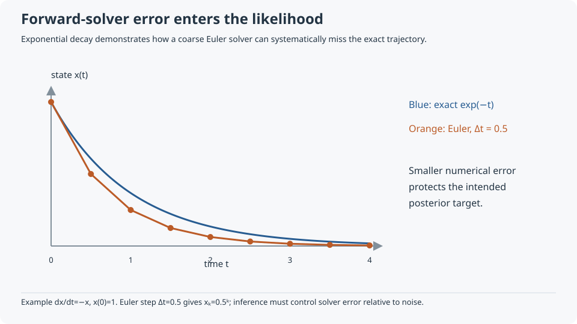

# 42. Bayesian inverse problems in science

**Learning goals.** By the end of this chapter you should be able to turn a differential-equation model and an observation protocol into a posterior; distinguish identifiable scientific quantities from poorly identified parameters; separate forward-solver error from sampling error; and report predictions with their modeling limits. The main prerequisites are [Bayesian targets](03-bayesian-targets.md), [numerical computation](04-numerics.md), [Metropolis–Hastings](09-metropolis-hastings.md), [Monte Carlo error](13-mc-error.md), [diagnostics](14-diagnostics.md), and [Bayesian workflow](17-workflow.md). [Function-space inverse problems](24-function-space.md) develops the infinite-dimensional counterpart.

## 42.1 From experiment to forward map

Consider a concentration $z(t)$ after a dose. The scientific model says how its state evolves; an instrument says which function of that state is observed. Write the two stages separately:

$$
\frac{dz}{dt}=F(t,z,\theta),\qquad z(0)=z_0(\theta),\qquad
G_i(\theta)=H_i\{z(t_i;\theta),\theta\}.
$$

The parameter $\theta$ may contain a decay rate, initial concentration, forcing coefficients, and instrument calibration. $G_i$ is a prediction in the units of the *measurement*, not necessarily in the units of every state component. Observation times $t_i$ are part of the experimental design. If a sensor records a time average, $H_i$ must represent that average; evaluating the state at the interval midpoint is another approximation. A reader should be able to trace each arrow from physical parameter to state to recorded datum. This is the finite-dimensional inverse-problem setting of [Dashti and Stuart's lecture notes](https://arxiv.org/abs/1302.6989).

For a local existence and uniqueness argument, it is enough, for example, that $F$ be continuous in time and locally Lipschitz in $z$. Those conditions do not ensure that the solution exists until the last observation time. A model needs a well-defined $G_i(\theta)$ for parameters in its support, or an explicit restriction to parameters for which the solution exists. If numerical integration fails at an otherwise valid parameter, that is a computational failure rather than a new scientific constraint.

The desired answer can also differ from the parameter vector. A rate $k$ may be uncertain while a prediction such as time to half-concentration is stable, or the reverse can hold under extrapolation. State the estimand before choosing a sampler: a parameter, a future concentration, a threshold-crossing time, or a decision based on those quantities.

## 42.2 The likelihood describes observations

An ODE supplies a deterministic trajectory conditional on $\theta$. It does not supply a probability law for measured data. If independent additive instrument errors have standard deviation $\sigma$,

$$
y_i=G_i(\theta)+\epsilon_i,\quad \epsilon_i\sim N(0,\sigma^2),\qquad
\log p(y\mid\theta,\sigma)=-\frac{1}{2\sigma^2}\sum_i[y_i-G_i(\theta)]^2-n\log\sigma+C.
$$

The $-n\log\sigma$ term matters when $\sigma$ is inferred. Known correlated normal errors with positive-definite covariance $\Gamma$ instead give the negative log likelihood, up to a constant,

$$
\Phi(\theta)=\tfrac12\{y-G(\theta)\}^{T}\Gamma^{-1}\{y-G(\theta)\}.
$$

If $\Gamma=\Gamma(\theta)$, retain $\tfrac12\log\det\Gamma(\theta)$ as well. Otherwise a parameter can be rewarded merely for inflating its own error variance. Replicate measurements and instrument knowledge help decide whether an independence assumption is credible.

Positive measurements with roughly constant *relative* error suggest $\log y_i=\log G_i(\theta)+\epsilon_i$, $\epsilon_i\sim N(0,\tau^2)$, provided $G_i>0$. This is a lognormal observation model on the original scale; it is not obtained by taking logs of an additive-normal model. Its density with respect to $dy_1\cdots dy_n$ is

$$
p(y\mid\theta,\tau)=\prod_i\frac{1}{y_i\tau\sqrt{2\pi}}\exp\left\{-\frac{[\log y_i-\log G_i(\theta)]^2}{2\tau^2}\right\}.
$$

The data Jacobian $\prod_i y_i^{-1}$ is constant in $\theta$ and $\tau$, so it drops out of this posterior calculation; it remains part of the original-scale density. Here $G_i$ is the conditional median, while $E[y_i\mid\theta,\tau]=G_i e^{\tau^2/2}$. Counts from a counting process might instead use $y_i\sim\operatorname{Poisson}(G_i)$, where $G_i$ must be an expected count. Limits of detection call for interval or censored likelihood contributions. Irregular sampling times simply enter $G_i$ at their actual values.

One more distinction matters. Random residuals around a deterministic path represent *measurement noise*. Random shocks that change the path itself represent *process noise*, which makes the latent state stochastic and can induce residual dependence. [State-space methods](39-state-space.md) address the latter. Calling independent residuals “process error” does not make the deterministic ODE a state-space model.

## 42.3 Priors, units, and coordinates

For decay, let $k>0$ have units of inverse time and $A>0$ concentration units. Priors must refer to a declared time and concentration unit. A prior mean of $1$ for $k$ means something different per hour and per day. Prior predictive curves, produced by drawing $(A,k)$ before seeing data and plotting $A e^{-kt}$, reveal whether the chosen scale allows physically plausible trajectories. A proper prior can regularize weak directions, but a concentrated posterior in such a direction may mostly reflect the prior.

Log coordinates simplify positive-parameter proposals: $\eta=\log k$ and $\alpha=\log A$. Their density bookkeeping depends on where the prior is defined. If $p_k(k)$ is a density with respect to $dk$, the density in $\eta$ contains $p_k(e^\eta)e^\eta$; the extra $e^\eta$ is the Jacobian. If instead $\eta\sim N(m,s^2)$ is the prior statement, its normal density is already the target contribution in $\eta$. Adding another Jacobian would define a different prior. For any joint prior $p_{A,k}(A,k)$ in physical coordinates, the transformed density is $p_{A,k}(e^\alpha,e^\eta)e^{\alpha+\eta}$. Prior dependence changes the joint density, but not this Jacobian. See [geometry and reparameterization](16-geometry.md) for the general rule.

For fixed known Gaussian covariance, a proper prior and finite forward map on a set of positive prior mass produce a finite, positive posterior normalizer: the likelihood is bounded above, and its integral is positive. This simple argument does not transfer automatically to every unknown-noise model, where the likelihood may become unbounded as a scale approaches zero. Posterior propriety then deserves its own check.

## 42.4 Worked example A: a soluble decay benchmark

Let $z'=-kz$, $z(0)=A$. Direct integration gives $z(t)=A e^{-kt}$. Suppose positive observations have lognormal error. Put $a=\log A$ and $\ell_i=\log y_i$; then

$$
\ell_i=a-kt_i+\epsilon_i,\qquad \epsilon_i\overset{\mathrm{iid}}{\sim}N(0,\tau^2).
$$

This becomes linear regression with row $X_i=(1,-t_i)$ and coefficient $\beta=(a,k)^T$. First use the computational benchmark $\beta\sim N(m_0,V_0)$ on all of $\mathbb R^2$, with $\tau$ known. Completing the square in $\beta$ yields

$$
V=(V_0^{-1}+X^T X/\tau^2)^{-1},\qquad
m=V(V_0^{-1}m_0+X^T\ell/\tau^2),\qquad
\beta\mid\ell\sim N(m,V).
$$

The assumptions here are independent Gaussian log errors, fixed $\tau$, and an unconstrained Gaussian prior on both coefficients. A Gaussian prior on $k$ assigns some mass to negative rates, which describe growth, not physical decay. Imposing $k>0$ truncates the Gaussian posterior and changes its moments. With these data the negative-rate probability is tiny, but the distinction remains exact. A normal prior on $\log k$ would be a different, nonconjugate model.

Take $t=(0,1,2)$, $\ell=(0,-0.5,-1)$, $\tau=0.1$, $m_0=0$, and $V_0=100I$. The precision and linear term are

$$
V^{-1}=\begin{pmatrix}300.01&-300\\-300&500.01\end{pmatrix},\qquad
X^T\ell/\tau^2=\begin{pmatrix}-150\\250\end{pmatrix}.
$$

Inverting the $2\times2$ matrix gives $E[a\mid\ell]=-0.000025$, $E[k\mid\ell]=0.499975$, $\operatorname{SD}(k\mid\ell)=0.070707$, and $\operatorname{Cov}(a,k\mid\ell)=0.004999$. The positive covariance has a physical interpretation: a larger starting concentration can be paired with a faster decay to fit later measurements. The script [examples/ch42.py](examples/ch42.py) computes these values. This analytic posterior is an excellent check of code that samples the *same* unconstrained target; agreement alone would not validate the observation model.

## 42.5 Identification precedes computation

Structural identifiability asks whether distinct parameters can produce the same ideal observations under the specified map. With only one concentration at $t_*>0$, $G(A,k)=Ae^{-kt_*}$. For any $k'>0$, choosing $A'=A e^{(k'-k)t_*}$ gives $A'e^{-k't_*}=Ae^{-kt_*}$. Thus no amount of precision at that one time separates $A$ and $k$. A sampler may cross or fail to cross the ridge, but longer sampling cannot add the missing information.

Two distinct times with exact positive concentrations do identify both parameters in this simple model: $\log y_1-\log y_2=k(t_2-t_1)$, then $A=y_1e^{kt_1}$. Noisy measurements can still leave large uncertainty. If the times are nearly equal relative to the decay time, the estimated slope divides by a small time difference and amplifies noise. This is *practical* weakness despite structural identification. Time points spanning the period of appreciable decay usually distinguish intercept from rate better than a tight cluster, provided measurements remain detectable.

Locally, the sensitivity matrix for additive observations has rows

$$
J_i(A,k)=\left(e^{-kt_i},\ -At_i e^{-kt_i}\right).
$$

The matrix $J^T\Gamma^{-1}J$ is the Gauss–Newton curvature, and the expected Fisher information for this Gaussian observation model with fixed $\Gamma$. It is not generally the observed Hessian: with $r=y-G$,

$$
\nabla^2\Phi=J^T\Gamma^{-1}J-\sum_i(\Gamma^{-1}r)_i\nabla^2G_i.
$$

The second term vanishes for a linear map or zero residual, and has zero expectation under the model at the true parameter. A near-zero eigenvalue of $J^T\Gamma^{-1}J$ indicates a weak local sensitivity direction in the chosen parameter units; the corresponding eigenvector suggests which parameter combination may be uncertain. Full local rank does not prove global identification, especially for nonlinear models with symmetries or separated modes. Inspect profiles, posterior plots, and prior sensitivity as well. An early measurement anchors $A$; an appropriately later one reveals $k$. The experiment, measurement units, and detection floor set what “appropriately” means.

The geometry lab illustrates how a coordinate change can alter a distribution's shape. Increase the scale of $v$ and compare the funnel in $(v,x)$ with the noncentered coordinates $(v,z)$, where $x=e^{v/2}z$. The points are independent prior draws; the lab does not run a sampler or expose a correlation control. Its connection here is the value of inspecting parameter geometry before choosing coordinates. It does not simulate the decay ridge, solve an ODE, or test identifiability; the Python example below handles the actual decay map.

## 42.6 Sensitivities and gradient-based sampling

If $F$, $z_0$, and the solution depend differentiably on $\theta$, and differentiation can be interchanged with solving over the time interval, the state sensitivity $S_j(t)=\partial z(t;\theta)/\partial\theta_j$ obeys

$$
S_j'=F_z(t,z,\theta)S_j+F_{\theta_j}(t,z,\theta),\qquad
S_j(0)=\frac{\partial z_0}{\partial\theta_j}.
$$

The observation derivative is $\partial_{\theta_j}G_i=(\partial_z H_i)S_j(t_i)+\partial_{\theta_j}H_i$, evaluated at the solution; retain the direct term when instrument calibration depends on $\theta$. For fixed $\Gamma$, $\nabla_\theta\log p(y\mid\theta)=J^T\Gamma^{-1}(y-G)$; add the prior gradient, and apply the chain rule through $k=e^\eta$ if sampling in log coordinates. In the decay example with fixed $A$, $S_k(t)=-tAe^{-kt}$ solves $S_k'=-z-kS_k$, $S_k(0)=0$. This identity is a compact test for a sensitivity implementation.

Forward sensitivities append equations for each parameter, which is convenient for a modest number of parameters. Adjoint sensitivities use a backward problem and can be advantageous when the parameter count is large relative to the number of requested outputs. The [Stan ODE guide](https://mc-stan.org/docs/stan-users-guide/odes.html) describes both and emphasizes that tolerances should reflect state scales and observation precision. HMC needs gradients of the *implemented numerical target*, accurate enough for its dynamics. A stable state solve does not establish accurate sensitivities. ODE stiffness concerns the solver's difficulty with disparate dynamical time scales; a narrow posterior ridge is a separate statistical geometry problem.

## 42.7 The forward solver changes the target

Suppose a numerical method produces $G_h(\theta)$ in place of $G(\theta)$. With a fixed prior $p(\theta)$ and Gaussian errors, the implemented target is $\pi_h(\theta)\propto p(\theta)e^{-\Phi_h(\theta)}$. A correctly implemented MH kernel can preserve $\pi_h$, subject to the ordinary support and proposal conditions from [Chapter 9](09-metropolis-hastings.md). It cannot turn $\pi_h$ into $\pi$ merely by running longer. This separation of posterior approximation and sampling is central in [Cotter, Dashti, and Stuart's study of Bayesian inverse-problem approximation](https://arxiv.org/abs/0909.2126); their quantitative stability conclusions have hypotheses, and the elementary calculation below stands on its own.

Let $r=y-G(\theta)$ and $e=G_h(\theta)-G(\theta)$. Since the approximate residual is $r-e$, expansion gives the exact identity

$$
\Phi_h-\Phi=-r^T\Gamma^{-1}e+\tfrac12 e^T\Gamma^{-1}e.
$$

By Cauchy–Schwarz in noise-scaled coordinates,

$$
|\Phi_h-\Phi|\leq
\|\Gamma^{-1/2}r\|\,\|\Gamma^{-1/2}e\|
+\tfrac12\|\Gamma^{-1/2}e\|^2.
$$

The bound applies at each $\theta$ where both maps are defined. It shows why “small” solver error must be judged against measurement noise and all observations, not just against the state magnitude. It does not, by itself, give a global distance between normalized posteriors. Stronger uniform or integrable control plus conditions on normalizers are needed for that conclusion.

Numerical error need not be constant across parameter space. An adaptive solver may take many more steps for some $\theta$, or return a rough approximation near a rapid transition. Thus checking one forward trajectory at a posterior mean is weak evidence: the posterior may also depend on tails, ridges, and alternative modes. A practical refinement study evaluates a set of prior-relevant and posterior-relevant parameters, compares predictions in the units of every observation, and reruns inference if the likelihood changes appreciably. Comparing posterior summaries only after this point makes the difference interpretable. A tolerance is a requested local error control, not a certified global bound on $G_h-G$; validate it against a tighter solve, an independent method, or an analytic solution where available.

Keep ODE tolerances or mesh width separate from an HMC leapfrog step size: they approximate different computations. Solver failures also need an audit. Recording every failed solve as log density $-\infty$ may silently remove valid parameters and change the model support. Distinguish a mathematical blow-up under the declared model from an exhausted step budget, bad tolerance, or nonphysical intermediate numerical value. Track failure locations and rerun with a suitable solver or refined settings before treating them as impossible physics.

### 42.7.1 From an error budget to posterior probabilities

The approximation theory of [Cotter, Dashti, and Stuart, Section 2](https://arxiv.org/pdf/0909.2126) controls normalized posteriors under suitable integrability conditions. Here is an elementary finite-dimensional alternative with stronger, transparent assumptions. Suppose both maps are measurable and finite on the same prior support, the prior is proper, $\Gamma$ is fixed positive definite, and for prior-almost-every $\theta$,

$$
\|\Gamma^{-1/2}(y-G)\|\leq R,\qquad
\|\Gamma^{-1/2}(G_h-G)\|\leq q.
$$

Then $|\Phi_h-\Phi|\leq b:=Rq+q^2/2$ uniformly. Write $Z=\int p e^{-\Phi}$ and similarly $Z_h$. Integrating $e^{-b}e^{-\Phi}\leq e^{-\Phi_h}\leq e^b e^{-\Phi}$ gives

$$
e^{-b}\leq Z_h/Z\leq e^b,\qquad
e^{-2b}\leq\frac{\pi_h(\theta)}{\pi(\theta)}\leq e^{2b}.
$$

Consequently, using $d_{\mathrm{TV}}(\pi_h,\pi)=\tfrac12\int|\pi_h-\pi|$,

$$
d_{\mathrm{TV}}(\pi_h,\pi)\leq B(b):=\min\{1,\tfrac12(e^{2b}-1)\}.
$$

This bound is conservative but immediately interpretable: any event probability changes by at most $B(b)$, and any quantity $L\leq f\leq U$ satisfies $|E_{\pi_h}f-E_\pi f|\leq(U-L)B(b)$. The latter follows by writing $f-L$ as the integral of its threshold indicators. No unbounded-moment claim follows from total variation alone. Applying the same conditional predictive law to both posteriors also bounds predictive event probabilities by $B(b)$; an additional numerical approximation in that predictive law needs its own error assessment.

For independent noise with standard deviation $\sigma$ and $m$ observations, a uniform componentwise prediction error $|e_i|\leq d\sigma$ yields $q\leq\sqrt m\,d$. A chosen potential budget $b_*$ is met if

$$
d\leq\frac{\sqrt{R^2+2b_*}-R}{\sqrt m}
=\frac{2b_*}{\sqrt m\,[\sqrt{R^2+2b_*}+R]}.
$$

The rationalized form avoids numerical cancellation. Thus a fixed fraction of one observation's noise is not a universal solver tolerance: the residual scale and number of observations also enter. For $m=100$, $R=10$, and $b_*=0.01$, the sufficient per-observation budget is approximately $d=0.000100$, and $B(b_*)\approx0.01010$.

Uniformity is the demanding step. A finite collection of posterior draws does not establish these assumptions. If the bounds hold only on a region $K$ with positive mass under both posteriors, they instead control the two posteriors conditioned on $K$. By the triangle inequality the full distance is at most $B(b)+\pi(K^c)+\pi_h(K^c)$, capped at one. Both omitted masses need justification; failure to sample a region is not a tail bound. A parameter-independent constant in $\Phi_h-\Phi$ cancels on normalization, so centering that difference can also give a much tighter bound than bounding its absolute size.

## 42.8 Worked example B: an excellent chain for the wrong posterior

Fix $A=1$, observe $y=e^{-1}=0.367879$ at $t=1$, and use additive $N(0,0.02^2)$ measurement error. Under the exact map $G(k)=e^{-k}$, the likelihood peaks at $k=1$. Explicit Euler with $n$ steps of size $h=1/n$ instead returns $G_h(k)=(1-hk)^n$ when $1-hk>0$. At $n=2$ and $k=1$, the numerical prediction is $0.25$. Its error, $0.117879$, is about $5.89$ measurement standard deviations: a large likelihood change caused entirely by integration.

The figure shows the same systematic forward error over a longer time interval.

Solving $G_h(k_h)=e^{-1}$ gives

$$
k_h=\frac{1-e^{-h}}{h}.
$$

For $h=0.5$, $k_h=0.786939$; for $h=0.25$, it is $0.884797$. Since $e^{-h}>1-h$ for $h>0$, $k_h<1$, and $k_h\to1$ as $h\to0$. These are likelihood peaks under different forward maps, not posterior means. The distinction matters once a prior and finite noise are included.

The executable [refinement experiment](examples/ch42.py) uses a $N(1,0.5^2)$ prior restricted to $0<k<2$, one datum, and a seeded random-walk MH chain for each map. It also computes a deterministic midpoint-quadrature mean for each same approximate target. One execution yielded:

| Forward map | Likelihood peak | Quadrature $E[k]$ | MH $E[k]$ | Batch MCSE |
| --- | ---: | ---: | ---: | ---: |
| Euler, 2 steps | 0.786939 | 0.789208 | 0.788623 | 0.000463 |
| Euler, 4 steps | 0.884797 | 0.888197 | 0.889616 | 0.000827 |
| Euler, 8 steps | 0.940025 | 0.943968 | 0.942878 | 0.001002 |
| Euler, 16 steps | 0.969391 | 0.973569 | 0.974017 | 0.000969 |
| Euler, 32 steps | 0.984536 | 0.988816 | 0.987733 | 0.000983 |
| Exact | 1.000000 | 1.004369 | 1.003038 | 0.001285 |

The table is an algorithm check, not an empirical scientific result: the datum was deliberately chosen from the exact curve. The quadrature and chain agree to the scale of the rough batch MCSE, while solver refinement moves the target mean by far more. The exact posterior mean exceeds $1$ slightly because the likelihood is asymmetric as a function of $k$ and the prior acts on $k$. The script's 40-batch MCSE is illustrative; inspect multiple independent chains and stronger diagnostics for a real study. Even perfect $\widehat R$ for the coarse target would not fix its forward error. Re-evaluating stored draws with a finer solver can reveal discrepancies, but importance reweighting is reliable only with sufficient overlap and controlled weights.

### 42.8.1 A bound over the entire decay prior

This benchmark also allows the uniform assumptions of Section 42.7.1 to be verified analytically. For $n>2$ and every $0<k<2$, put

$$
D_n(k)=-n\log(1-k/n)-k\geq0,\qquad
G_n(k)=e^{-k}e^{-D_n(k)}.
$$

The power series $-\log(1-x)-x=\sum_{j\geq2}x^j/j\leq x^2/[2(1-x)]$ for $0\leq x<1$ gives $D_n(k)\leq k^2/[2n(1-k/n)]$. Since $1-e^{-D}\leq D$ and $k^2e^{-k}$ is increasing on $[0,2]$,

$$
0\leq e^{-k}-G_n(k)\leq
\frac{k^2e^{-k}}{2n(1-k/n)}\leq\frac{2e^{-2}}{n-2}.
$$

For the datum and noise above, $R=(1-e^{-1})/0.02$, $q_n=2e^{-2}/[0.02(n-2)]$, and $b_n=Rq_n+q_n^2/2$ therefore bound the potential error over the *whole* declared prior support. Substituting them into $B$ gives a posterior bound without inspecting sampled draws. The script computes both this analytic bound and direct numerical integrations of $\tfrac12\int|\pi_n-\pi|$:

| Euler steps | Potential bound $b_n$ | TV bound $B(b_n)$ | Quadrature TV | Quadrature $E_{\pi_n}k-E_\pi k$ |
| --- | ---: | ---: | ---: | ---: |
| 1,024 | 0.418621 | 0.654994 | 0.00359295 | −0.00049070 |
| 8,192 | 0.052229 | 0.055054 | 0.00044905 | −0.00006135 |
| 65,536 | 0.006527 | 0.006570 | 0.00005613 | −0.00000767 |

The guaranteed bound is deliberately conservative because it protects the full prior support, including large-residual parameters with negligible posterior weight. At 65,536 steps it guarantees that any posterior event probability shifts by at most about $0.00657$ in exact arithmetic. The quadrature estimates are much smaller; doubling the integration grid from 8,000 to 16,000 midpoints changed these TV estimates by less than $10^{-8}$. This refinement comparison is numerical evidence, not a quadrature proof. The analytic bound concerns the mathematical Euler map; floating-point roundoff is a further numerical error. The example evaluates $\exp\{n\log(1-k/n)\}$ with `log1p` to avoid cancellation near one. These step counts illustrate a sufficient bound for this intentionally simple method; they are not recommendations for an adaptive ODE solver.

## 42.9 Prediction, discrepancy, and extrapolation

For posterior draw $\theta^{(s)}$, compute a latent trajectory $G(t;\theta^{(s)})$. Its pointwise quantiles express uncertainty about the deterministic path conditional on the chosen model. For additive zero-mean errors this path is the conditional observation mean; for the lognormal model of Section 42.2 it is the conditional median. To predict a *new measured value*, draw fresh observation noise according to the likelihood. This includes additional variation: with fixed independent additive Gaussian noise, $\operatorname{Var}(y_{\mathrm{new}}\mid y)=\operatorname{Var}(G(t;\theta)\mid y)+\sigma^2$. Observation intervals are usually wider, though arbitrary equal-tail interval widths need not obey a universal ordering. Neither band automatically includes uncertainty about whether the ODE itself is adequate.

Check the fit in the scale where the observation model lives. Under additive Gaussian noise, residuals $y_i-G_i(\theta)$ should be inspected against time, predicted level, and replicate group. Persistent late-time signs suggest missed forcing, a second time scale, or correlated errors. Holding out later times probes prediction, especially extrapolation; a random split among dense nearby times is easier. [Bayesian workflow](17-workflow.md) develops prior and posterior predictive checks more generally.

A discrepancy model writes $y_i=G_i(\theta)+\delta(t_i)+\epsilon_i$. It can acknowledge an imperfect simulator, but a flexible $\delta$ can mimic changes in $\theta$. Good fit then need not imply that a physical calibration parameter is well recovered. The papers by [Tuo and Wu on imperfect-model calibration](https://arxiv.org/abs/1507.07280) and [calibration target definitions](https://arxiv.org/abs/1508.07155) motivate making the scientific meaning of $\theta$ explicit when discrepancy is allowed. This chapter does not assume their particular calibration criterion. Prior sensitivity for $\delta$, held-out measurements, and independent physical measurements can reveal confounding; none can conjure information absent from the experiment.

## 42.10 An auditable inference report

A defensible report starts with the target: for example, “the rate per hour and concentration after eight hours under this decay model.” Give the actual times and units, instrument protocol, treatment of nondetects, likelihood and covariance assumptions, prior on each declared coordinate, and prior predictive range. State the ODE and observation map, solver family, absolute and relative tolerances or step size, and how failed solves were counted. State chain initialization, warmup, independent-chain diagnostics, relevant MCSEs, and any geometric warnings. Then compare posterior quantities and predictions after solver refinement, and show residual or held-out predictive checks.

Report uncertainty for the quantity the scientist will use. A posterior interval for $k$ alone does not tell a laboratory when concentration will cross a safety threshold, because the crossing time also depends on $A$ and on the model. For the exact decay equation with $k>0$ and threshold $0<c<A$, the crossing time is $T_c=\log(A/c)/k$. Compute $T_c$ for each joint posterior draw, preserving the correlation between $A$ and $k$; plugging separate posterior means into the formula generally gives neither its posterior mean nor its median. If some draws start below $c$, define how those cases enter the estimand. If observations stop before the predicted crossing, state that the interval relies on extrapolation and the single-rate decay assumption. This converts a parameter calculation into an auditable scientific claim.

| Uncertainty or error | What it changes | A useful check |
| --- | --- | --- |
| Weak identification | Which parameter combinations data distinguish | Vary observation times; inspect ridges and prior sensitivity |
| Forward numerical error | The likelihood and therefore the posterior target | Refine solver settings at posterior and prior-relevant parameters |
| Finite-run Monte Carlo error | Estimates for a fixed implemented target | Independent chains, trace inspection, MCSE |
| Model discrepancy | Scientific meaning and extrapolation of the target | Residual structure, held-out data, alternate model assumptions |

These checks answer different questions. A smaller MCSE cannot repair a biased forward map; a refined solver cannot repair a missing biological or physical mechanism. When models become expensive, [delayed acceptance](27-pseudo-marginal.md) can use a cheap approximation as a screening stage while retaining an exact final correction. Field-valued unknowns call for the measure-aware methods of [Chapter 24](24-function-space.md). If a usable likelihood is unavailable, [simulator-based inference](46-likelihood-free.md) changes the inferential problem and brings its own approximation choices.

## Exercises

**1. Gaussian benchmark.** Derive the posterior of $\beta=(a,k)^T$ for $\ell\mid\beta\sim N(X\beta,\tau^2 I)$ and $\beta\sim N(m_0,V_0)$. Explain why replacing a normal prior on $k$ with a normal prior on $\log k$ breaks this conjugate form.

Solution

The quadratic terms in minus twice the log posterior are $(\beta-m_0)^T V_0^{-1}(\beta-m_0)+(\ell-X\beta)^T(\ell-X\beta)/\tau^2$. Collecting terms gives precision $V^{-1}=V_0^{-1}+X^TX/\tau^2$ and linear term $V_0^{-1}m_0+X^T\ell/\tau^2$. Completing the square gives $m=V(V_0^{-1}m_0+X^T\ell/\tau^2)$. A normal prior $\log k\sim N(m_k,s_k^2)$ contributes $-(\log k-m_k)^2/(2s_k^2)-\log k$ to the log density with respect to $dk$, with support $k>0$. It is not quadratic in $k$; the $-\log k$ is the transformation Jacobian.

**2. One observation.** At a single $t_*>0$, prove that ideal observation of $Ae^{-kt_*}$ cannot determine both positive $A$ and $k$. What role does a proper prior play?

Solution

For any $k'>0$, take $A'=A\exp((k'-k)t_*)>0$. Then $A'e^{-k't_*}=Ae^{-kt_*}$. The data constrain only $\log A-kt_*$. A proper prior can make the posterior proper and choose how mass is distributed along this ridge, but that distribution reflects the prior as well as the datum; it does not create separate experimental information about $A$ and $k$.

**3. Sensitivity.** With fixed $A$, derive $S_k(t)$ and verify its sensitivity ODE and initial value.

Solution

Differentiating $z(t)=Ae^{-kt}$ gives $S_k(t)=-tAe^{-kt}=-tz(t)$. Differentiating again in time gives $S_k'=-z+ktz=-z-kS_k$. Since $S_k(0)=0$, it satisfies the stated initial-value problem.

**4. Forward error.** Starting with $r=y-G$ and $e=G_h-G$, derive the potential-error identity and bound for fixed positive-definite $\Gamma$. Why is a small unscaled $e$ insufficient reassurance?

Solution

The approximate residual is $r-e$, so half the difference between $(r-e)^T\Gamma^{-1}(r-e)$ and $r^T\Gamma^{-1}r$ equals $-r^T\Gamma^{-1}e+\tfrac12e^T\Gamma^{-1}e$. Apply Cauchy–Schwarz to $(\Gamma^{-1/2}r)^T(\Gamma^{-1/2}e)$. When measurement standard deviations are small, $\Gamma^{-1/2}e$ can be large even if the state-scale error $e$ seems small.

**5. Coarse Euler fit.** For $n=1/h$ Euler steps over $t=1$ and datum $e^{-1}$, solve for the positive rate $k_h$ within the positive-Euler domain. Show its limit as $h\downarrow0$.

Solution

From $(1-hk_h)^{1/h}=e^{-1}$ and $1-hk_h>0$, take logs or the power $h$ to obtain $1-hk_h=e^{-h}$ and $k_h=(1-e^{-h})/h$. The expansion $e^{-h}=1-h+h^2/2+O(h^3)$ gives $k_h=1-h/2+O(h^2)$, so it approaches $1$ from below.

**6. A late-time miss.** A fitted trajectory matches early observations but systematically overpredicts late observations. Propose checks that separate numerical, Monte Carlo, and model explanations. Does a good $\widehat R$ settle any of them?

Solution

First rerun the forward model with refined tolerances at representative posterior draws and compare late-time predictions; this tests numerical error. Check independent chains, traces, and MCSE for the late-time predictive quantity to assess whether sampling variability explains the apparent miss. Inspect time-ordered residuals and predict held-out late times under the fitted model; repeat under plausible alternative dynamics or an explicitly justified discrepancy term, and examine prior sensitivity. A good $\widehat R$ is evidence about agreement among the monitored chains on the implemented target, not proof of convergence, solver accuracy, or scientific adequacy.

**7. A posterior error budget.** Suppose a fixed-noise Gaussian model has $m=100$ observations, a uniform whitened-residual bound $R=10$, and componentwise numerical errors no greater than $d$ times the measurement standard deviation. Find a sufficient $d$ for potential budget $b_*=0.01$. What does this imply for $P(k>1\mid y)$? What changes if the assumptions hold only on $K$?

Solution

We need $10\sqrt{100}\,d+100d^2/2\leq0.01$. The positive root is

$$
d_* = \frac{0.02}{10[\sqrt{100.02}+10]}\approx 0.000099995.
$$

Any $0\leq d\leq d_*$ suffices. The posterior probability of $k>1$, like every measurable event, changes by at most $(e^{0.02}-1)/2\approx0.0101007$. These are bounds on numerical target error, independent of chain length. If the bounds apply only on $K$, the result initially concerns conditional posteriors. An upper bound for the full posterior difference adds $\pi(K^c)+\pi_h(K^c)$ and is capped at one; neither mass is supplied by a residual bound inside $K$.

## Key takeaways

- The ODE maps parameters to states; the observation mechanism supplies a likelihood.
- Identification is relative to the actual observation times and measurements. A well-mixed chain cannot recover information the experiment never supplied.
- A numerical forward solve defines an approximate posterior. Compare solver error with observation noise and refine the solver independently of sampling.
- Predictive bands conditional on one model do not automatically cover model discrepancy, especially in extrapolation.
