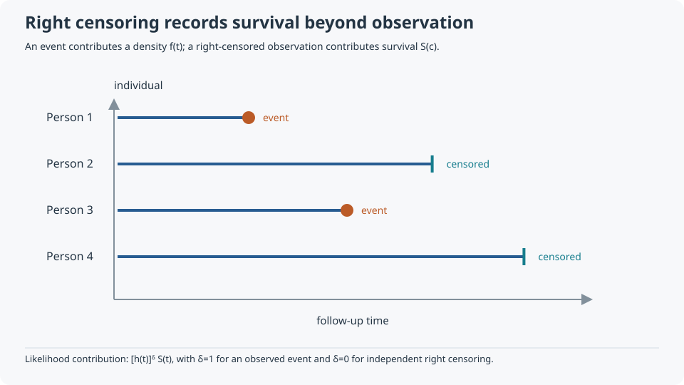

# 43. Survival epidemiology and event data

An event history is often more informative than a single outcome, and less complete than it first appears. A person may leave observation without experiencing the event. A failure may be known only to have happened between inspections. In an epidemic, an unobserved infection may change everyone else's risk before a reported removal occurs. The likelihood has to describe exactly what was observed.

This chapter develops one common accounting rule: **an observed event contributes its instantaneous intensity; time spent waiting contributes accumulated intensity with a negative sign**. We first use independent survival times, where the calculation is transparent, then build the analogous likelihood for a dependent epidemic path. The resulting posterior targets connect directly to Metropolis–Hastings in [Chapter 09](09-metropolis-hastings.md), augmentation in [Chapter 10](10-gibbs.md), and predictive workflow in [Chapter 17](17-workflow.md).

**Learning goals.** By the end, you should be able to derive likelihood contributions for several forms of incomplete follow-up, implement and verify a small survival sampler, distinguish conditional from population survival under frailty, derive a stochastic SIR path likelihood, and specify valid latent infection-time updates.

**Prerequisites.** Conditioning, densities, and transformations from [Chapter 02](02-probability.md), [Chapter 03](03-bayesian-targets.md), and [Chapter 04](04-numerics.md); basic MH and Gibbs updates from Chapters 09–10. Familiarity with [Chapter 42](42-scientific-inference.md) helps when comparing stochastic epidemics with deterministic forward models.

## 43.1 Define the observation before the hazard

Imagine five synthetic devices monitored from a common origin. For each we record the time of last observation $y_i$, an event indicator $\delta_i$, and possibly an entry time $e_i$. An illustrative record is:

| Device | Entry $e_i$ | Last time $y_i$ | Event $\delta_i$ | Group |
|:--|--:|--:|--:|:--|
| A | 0 | 1 | 1 | red |
| B | 0 | 2 | 0 | red |
| C | 0 | 3 | 1 | blue |
| D | 0 | 4 | 0 | blue |
| E | 0 | 5 | 1 | blue |

A zero indicator means that the device was observed to last through $y_i$. It does **not** say its eventual event time is infinity. Here $y_i=\min(T_i,C_i)$ and $\delta_i=\mathbf 1(T_i\leq C_i)$, where $T_i$ is the event time and $C_i$ the end of observation. Administrative censoring, such as a fixed study closing date, is an especially clear example.

The diagram contrasts event endpoints with censoring endpoints for observation from a common origin.

Right censoring says $T>y$. Interval censoring says $L<T\leq R$; periodic inspections commonly create it. Left censoring says $T\leq R$, perhaps because failure was already present at the first inspection. **Delayed entry** is different: an item joins the observed risk set only after surviving to $e$. Sampling only devices still working at day $e$ conditions the observed distribution on $T>e$. These mechanisms cannot all be handled by replacing the unknown time with a convenient endpoint.

Dropping the censoring-process density from a likelihood requires a modeling assumption. One sufficient setup is that, conditional on recorded covariates and parameters, the event and censoring times are independent, the parameters governing censoring are distinct, and the observation schedule itself does not carry additional information about the event parameter. A device that stops reporting because it is about to fail violates this setup. It needs a joint observation model or sensitivity analysis. The [Stan guide to censored and truncated data](https://mc-stan.org/docs/stan-users-guide/truncation-censoring.html) makes the same basic distinction between integrating over an unobserved event and conditioning on selection.

## 43.2 From hazard to observed-data likelihood

For an absolutely continuous nonnegative event time, define $S(t)=P(T>t)$, density $f(t)$, and hazard $h(t)=f(t)/S(t)$ wherever $S(t)>0$. A hazard is a rate per unit time, not a probability. Its value can exceed one if the time unit is sufficiently large. If $H(t)=\int_0^t h(u)\,du$, then $S'(t)=-f(t)=-h(t)S(t)$. With $S(0)=1$, solving this differential equation gives

$$
S(t)=\exp\{-H(t)\},\qquad f(t)=h(t)\exp\{-H(t)\}.
$$

Thus an exact event observed at $y$ contributes $f(y)$, while right censoring at $y$ contributes $S(y)$. Both cases fit

$$
L_i(\theta)=h_i(y_i;\theta)^{\delta_i}\exp\{-H_i(y_i;\theta)\},
\quad
\log L_i=\delta_i\log h_i(y_i)-H_i(y_i).
$$

This assumes follow-up from time zero and ignorable censoring as just described. In a delayed-entry sample conditioned on surviving to $e_i<y_i$, divide by $S_i(e_i)$. This also assumes that, given the modeled covariates, the entry mechanism contributes no event-parameter information beyond survival to entry:

$$
L_i(\theta\mid T_i>e_i)
=h_i(y_i;\theta)^{\delta_i}
\exp\{-[H_i(y_i;\theta)-H_i(e_i;\theta)]\}.
$$

The conditional event density is $f(y_i)/S(e_i)$ and conditional right-censoring probability is $S(y_i)/S(e_i)$. The division is the signature of truncation; right censoring instead integrates over unknown future event times. A time-varying hazard also needs the subject's covariate history over $(e_i,y_i]$.

If an inspection establishes $L<T\leq R$, the likelihood is $S(L)-S(R)$; after entry $e<L$, it becomes $[S(L)-S(R)]/S(e)$. An observation $T\leq R$ contributes $1-S(R)$, or $[S(e)-S(R)]/S(e)$ if known to survive to entry $e<R$. These are probabilities of intervals, not densities at midpoints. On a computer, evaluate

$$
\log\{S(L)-S(R)\}
=\log S(L)+\log\!\left(1-\exp\{\log S(R)-\log S(L)\}\right)
$$

using a stable log-one-minus-exp operation when the endpoints are close. The [Stan survival-model guide](https://mc-stan.org/docs/stan-users-guide/survival.html) gives exponential and Weibull implementations; our formulas follow directly from the definitions above.

### 43.2.1 Worked observational equivalence: same records, different lifetimes {#sec-4321-worked-observational-equivalence-same-records-different-lifetimes}

The censoring assumption can concern information that the records themselves cannot recover. Consider this stipulated joint model. For each subject, independently draw

$$
Y\sim\operatorname{Exp}(2),\qquad
D\sim\operatorname{Bernoulli}(1/2),\qquad
R\sim\operatorname{Exp}(r),
$$

with $Y,D,R$ mutually independent and a fixed $r>0$ shared across subjects. All exponential parameters are rates. Define

$$
(T,C)=
\begin{cases}
(Y,Y+R),&D=1,\\
(Y+R,Y),&D=0.
\end{cases}
$$

Only $(Y,\delta)=(\min(T,C),\mathbf1(T\leq C))$ is recorded. Since $R>0$ almost surely, there are no ties and $\delta=D$. There is no additional potential censoring time recorded after an event, known marginal law for $C$, censoring-design information or validation follow-up that distinguishes the alternatives. Such information would change the inference problem.

**Predict first:** could arbitrarily many of these records validate independence of $T$ and $C$, or determine the latent event-time survival?

On $t<c$, the inverse map is $Y=t,R=c-t,D=1$; on $c<t$, it is $Y=c,R=t-c,D=0$. Each triangular transformation has absolute Jacobian one. Multiplying the Bernoulli, minimum-time and gap densities gives the joint density

$$
f_r(t,c)=r\exp[-2\min(t,c)-r|t-c|],
\qquad t,c>0.
$$

Each triangle integrates to $1/2$, so this is a normalized, absolutely continuous joint law. The diagonal has probability zero. Integrating over the missing coordinate gives

$$
\begin{aligned}
f_{Y,\delta}(y,1)
&=\int_y^\infty f_r(y,c)\,dc=e^{-2y},\\
f_{Y,\delta}(y,0)
&=\int_y^\infty f_r(t,y)\,dt=e^{-2y}.
\end{aligned}
$$

These are joint densities in recorded time and label, not conditional probabilities given a label. Each integrates to $1/2$. Thus $Y\sim\operatorname{Exp}(2)$ independently of $\delta\sim\operatorname{Bernoulli}(1/2)$ for every $r$. For any fixed-size iid recorded sample,

$$
L(r)=\prod_i f_{Y,\delta}(y_i,\delta_i)
=\exp\!\left(-2\sum_i y_i\right).
$$

The entire recorded-sample likelihood is independent of $r$. More records of this same kind cannot distinguish members of the family. This is an identifiability limitation of the observation model, separate from Monte Carlo error.

The latent event time does change. It is an equal mixture of $Y$ and $Y+R$. For $t\geq0$, splitting according to whether the recorded minimum already exceeds $t$ gives

$$
S_{T,r}(t)
=e^{-2t}+\int_0^t e^{-2y}e^{-r(t-y)}\,dy.
$$

Consequently,

$$
\begin{aligned}
S_{T,r}(t)
&=\frac{(r-1)e^{-2t}-e^{-rt}}{r-2},
&&r\ne2,\\
S_{T,2}(t)&=e^{-2t}(1+t).
\end{aligned}
$$

The second line follows because the integrand is then constant in $y$ apart from the common factor $e^{-2t}$. It is also the removable limit of the first line: $r=2$ is a valid model.

At $r=1$, the joint density factors as $e^{-t}e^{-c}$, giving independent unit-rate exponential $T,C$. At $r=3$ the times are dependent, yet the complete recorded law remains the same:

| Gap rate $r$ | Recorded survival $P(Y>\log2)$ | Latent survival $P(T>\log2)$ |
|---:|---:|---:|
| 1 | $1/4$ | $1/2$ |
| 3 | $1/4$ | $3/8$ |

Dependence in the second row can be checked exactly. The joint construction is exchangeable in $T,C$, and

$$
\begin{aligned}
P(T>\log2,C>\log2)&=P(Y>\log2)=1/4,\\
P(T>\log2)P(C>\log2)&=(3/8)^2=9/64.
\end{aligned}
$$

Agreement with every recorded-data probability therefore cannot validate independence or identify the latent survival curve over this family. [Tsiatis (1975), Theorem 2, page 21](https://web.stanford.edu/~lutian/coursepdf/ifcensoring.pdf) establishes the general competing-risk mechanism: admissible observed cause-specific survival functions can be reproduced by an independent system. The exponential-gap family and calculations here are derived directly, rather than taken from that paper's numerical example. Nor does this stipulated latent-time model by itself identify a causal effect of eliminating censoring.

The Python example appends an exact, deterministic comparison of the two main rows, without sampling a new chain. Its Fraction reference uses $t=m\log2$, $q=2^{-m}$, integer $m$ from 0 through 16 and rates $r\in\{1,3,4\}$. It computes the latent branches by integration:

$$
\begin{aligned}
P(T>t,D=1)&=q^2/2,\\
P(T>t,D=0)&=q^2/2+
q^r\int_q^1 x^{1-r}\,dx.
\end{aligned}
$$

Both branches contain $q^2/2$ from $Y>t$; only the censored branch has the extra missing-time contribution. The two recorded joint tails $P(Y>t,\delta=d)$ are each $q^2/2$. These rational calculations check the stated laws; they do not empirically certify a censoring assumption. The valid $r=2$ case has the logarithmic integral $q^2\log(1/q)$ and lies outside this finite rational reference, while remaining part of the derivation above.

The following conjugate example returns to the stated ignorable-censoring setup. Its event hazard $\lambda$ is separate from the gap rate $r$ introduced here. Known administrative censoring or other justified design information can support that setup; the construction above deliberately excludes such extra information.

## 43.3 Worked example: a conjugate check on MCMC

Take the five records in Section 43.1, with a common constant hazard $\lambda>0$. Then $S(t)=e^{-\lambda t}$ and each event contributes $\lambda e^{-\lambda y_i}$, each censored observation $e^{-\lambda y_i}$. Let $D=\sum_i\delta_i=3$ and $E=\sum_i(y_i-e_i)=15$ device-time units. Under the assumption that entry and censoring can be conditioned on, their joint likelihood is

$$
L(\lambda)\propto\lambda^D e^{-\lambda E}.
$$

Give $\lambda$ a Gamma prior in **shape–rate** notation, $p(\lambda)\propto\lambda^{a-1}e^{-b\lambda}$, with $a=2$ and $b=1$ in the matching time unit. Multiplication yields

$$
\lambda\mid\text{data}\sim
\operatorname{Gamma}(a+D,b+E)=\operatorname{Gamma}(5,16).
$$

The posterior mean hazard is $5/16=0.3125$. For a *new* device with the same constant hazard, posterior expected survival to time 2 is a Laplace transform:

$$
P(T_{\mathrm{new}}>2\mid\text{data})
=E[e^{-2\lambda}\mid\text{data}]
=\left(\frac{16}{18}\right)^5\approx0.5549.
$$

This is a probability for a future device after integrating parameter uncertainty. It is not $e^{-2E[\lambda\mid\text{data}]}$, because the exponential is nonlinear. If we wrongly discard the two censored records, $E$ falls to $1+3+5=9$. The incorrect posterior becomes $\operatorname{Gamma}(5,10)$ with mean $0.5$: discarding known exposure makes failures look too frequent.

MCMC is unnecessary for this model, which is exactly why it is a useful benchmark. On $z=\log\lambda$, a symmetric normal random walk targets the density **with respect to $dz$**:

$$
\log\pi_z(z\mid\text{data})
=(a+D)z-(b+E)e^z+\text{constant}.
$$

The coefficient is $a+D$, rather than $a+D-1$, because $d\lambda/dz=e^z$ supplies a Jacobian. Given proposal $z'=z+\epsilon$, $\epsilon\sim N(0,s^2)$, accept with probability $\min\{1,\exp[\log\pi_z(z')-\log\pi_z(z)]\}$. A fixed $s$ gives an exact-invariant MH kernel for this posterior; finite samples still have Monte Carlo error and can start away from equilibrium. The executable [chapter example](examples/ch43.py) reports the sampled mean rate and survival probability beside their exact values. Its batch-means standard errors are elementary teaching estimates, conditional on adequate mixing, not proof that the chain converged.

For each retained draw $\lambda^{(m)}$, one can also compute the restricted mean survival through $\tau$:

$$
\mu_\tau^{(m)}=\int_0^\tau e^{-\lambda^{(m)}t}\,dt
=\frac{1-e^{-\lambda^{(m)}\tau}}{\lambda^{(m)}}.
$$

This finite-horizon quantity is often more stable as a decision summary than an unbounded mean lifetime. Its posterior distribution reflects uncertainty about the hazard; a future individual's lifetime has additional variation.

### 43.3.1 Interval censoring: integrate or augment the missing time

Add a sixth synthetic device, observed from time zero, with failure discovered between inspections at 2 and 4. Inspections follow a fixed schedule; the only new information is $2<T_6\leq4$. The previous posterior becomes the starting distribution for this update:

$$
\pi(\lambda\mid\text{all records})
\propto\lambda^4e^{-16\lambda}(e^{-2\lambda}-e^{-4\lambda})
=\lambda^4(e^{-18\lambda}-e^{-20\lambda}).
$$

This is not a Gamma density. An interval record contributes an integrated probability, so it cannot simply increment the exact-event count while supplying exposure equal to an arbitrarily chosen endpoint. The [Stan censoring guide](https://mc-stan.org/docs/stan-users-guide/truncation-censoring.html) describes the two general approaches: integrate missing values or include them in the sampling state. Here both can be checked analytically.

For integration, let $J_s(c)=\int_0^\infty\lambda^{s-1}e^{-c\lambda}\,d\lambda=\Gamma(s)c^{-s}$. The normalizing integral for our unnormalized posterior is $J_5(18)-J_5(20)$. Consequently,

$$
E[\lambda\mid\text{all records}]
=5\frac{18^{-6}-20^{-6}}{18^{-5}-20^{-5}}
\approx0.3178,
$$

$$
P(T_{\mathrm{new}}>2\mid\text{all records})
=\frac{20^{-5}-22^{-5}}{18^{-5}-20^{-5}}
\approx0.5466.
$$

These differences are convenient for this single interval; expanding many interval factors into alternating sums can suffer severe cancellation. Direct log-likelihood evaluation remains available without such an expansion.

For augmentation, retain the unknown time $t_6$ in the state. The joint posterior density with respect to $d\lambda\,dt_6$ is

$$
\pi(\lambda,t_6\mid\text{all records})
\propto\lambda^5e^{-(16+t_6)\lambda}\,
\mathbf1_{\{2<t_6\leq4\}}.
$$

Integrating over $t_6$ recovers the preceding marginal target. Its two full conditionals give a Gibbs sweep:

$$
p(t_6\mid\lambda,\text{records})
=\frac{\lambda e^{-\lambda t_6}}{e^{-2\lambda}-e^{-4\lambda}}
\mathbf1_{\{2<t_6\leq4\}},
\qquad
\lambda\mid t_6,\text{records}\sim\operatorname{Gamma}(6,16+t_6).
$$

The first conditional is a truncated exponential because we are sampling a missing time **given its recorded interval**. Its normalizing denominator belongs in that conditional; inserting the denominator into the joint target would change the model. With $U\sim\operatorname{Uniform}(0,1)$, invert its CDF using

$$
t_6=2-\frac{1}{\lambda}
\log\left[1-U\{1-e^{-2\lambda}\}\right].
$$

Compute $1-e^{-2\lambda}$ using `-expm1(-2*lambda)` and the logarithm using `log1p`. As $\lambda$ approaches zero, the conditional distribution approaches uniform on $(2,4]$; the stable calculation preserves that limit. Initialize a positive rate, draw the bounded time, then draw the new rate using the updated time. Repeating these full-conditional draws preserves the joint posterior. Retained rates are correlated draws from an MCMC run, whose finite-run accuracy must still be checked.

The Python example runs 2,000 warmup sweeps and 18,000 retained sweeps, reports both rate and survival estimates with batch MCSEs, and compares them with the formulas above. It also tests inverse-CDF recovery for small and large rates. This example assumes a common exponential hazard and fixed inspections; informative visit timing would require an observation likelihood too.

## 43.4 Baseline shapes, covariates, and exposure accounting

A constant hazard is a strong model assumption. One alternative is the Weibull convention

$$
S(t)=\exp\{-(t/s)^k\},\quad
H(t)=(t/s)^k,\quad
h(t)=\frac{k}{s}(t/s)^{k-1},
$$

where $s,k>0$. Hazard rises with age for $k>1$, falls for $k<1$, and is constant for $k=1$. The event/censoring formula is unchanged; only $h$ and $H$ change. For delayed entry, subtract $H(e)$ regardless of the shape. The convention matters because some software calls an inverse scale a “rate”; always write $S(t)$ when presenting parameters.

Piecewise constant hazards make the exposure accounting particularly visible. Let intervals be $[c_{j-1},c_j)$, baseline rate $\lambda_j$, and a proportional covariate multiplier $r_i=\exp(x_i^\top\beta)$. Define $E_{ij}$ as the length of subject $i$'s observed risk interval $(e_i,y_i]$ inside interval $j$, and $D_j$ as the number of events occurring there. Ignoring parameter-free event-time constants, the likelihood is

$$
L(\boldsymbol\lambda,\beta)
\propto
\prod_j \lambda_j^{D_j}
\exp\left\{-\lambda_j\sum_i E_{ij}r_i\right\}
\prod_{i:\delta_i=1}r_i.
$$

The first product counts events and weighted exposure; the last product accounts for covariates at event times. With independent $\lambda_j\sim\operatorname{Gamma}(a_j,b_j)$, the conditional baseline update is

$$
\lambda_j\mid\beta,\text{data}
\sim\operatorname{Gamma}\!\left(a_j+D_j,\ b_j+\sum_iE_{ij}e^{x_i^\top\beta}\right).
$$

A normal prior on $\beta$ usually leaves a nonconjugate update; MH or HMC can target it. The prior on each $\lambda_j$ depends on the time unit: a rate per day has a different numeric scale from a rate per year. Rebinning time also changes what “independent baseline rates” means, so the prior needs a prior-predictive check.

Cox partial likelihood estimates relative covariate effects through risk sets and avoids specifying a baseline for that purpose. A coefficient estimate alone does not yield an absolute survival curve; prediction of $S(t)$ requires a baseline survival estimate or a full baseline model. This difference matters when the estimand is risk by a particular date rather than a hazard ratio. The [Stan survival guide](https://mc-stan.org/docs/stan-users-guide/survival.html) describes the partial-likelihood route.

## 43.5 Frailty and population survival

Subjects in the same group may share unrecorded conditions. A log-normal frailty model writes

$$
h_i(t\mid b_{g(i)})=h_0(t)\exp(x_i^\top\beta+b_{g(i)}),
\qquad b_g\sim N(0,\tau^2).
$$

For a known group frailty, survival is $\exp[-H_0(t)\exp(x_i^\top\beta+b_g)]$. For a **new** group, average this expression over a fresh $b_g$ and the posterior for $\tau,\beta,H_0$. Substituting $b_g=0$ gives survival for a hypothetical group at the center of the frailty distribution, not the population mixture. This distinction is material when event risk is heterogeneous.

Here the new group is drawn from the population at the time origin. A zero-mean **log** frailty has $E[e^{b_g}]=e^{\tau^2/2}$, not one; its baseline is the hazard at $b_g=0$. If a mean-one multiplier is desired, use $e^{b_g-\tau^2/2}$ and state the changed baseline interpretation.

Sparse groups can provide little direct information about their $b_g$. When $\tau$ is near zero, the centered parameters $b_g$ are squeezed into a narrow region, while large $\tau$ allows wide variation. The resulting funnel geometry can hinder MCMC; $b_g=\tau z_g$ with $z_g\sim N(0,1)$ is a useful noncentered alternative ([Chapter 16](16-geometry.md)). Zero-mean frailty and an identified baseline intercept keep the two from being freely shifted against each other. Neither parametrization repairs a poorly identified frailty variance from too few groups. Bayesian survival software and spatial extensions illustrate richer structures, but the same interpretation issue remains ([Brilleman et al.](https://arxiv.org/abs/2002.09633); [Zhou and Hanson](https://arxiv.org/pdf/1705.04584)).

There is a short analytic contrast. If a positive multiplier $Z$ has mean-one Gamma distribution $\operatorname{Gamma}(\kappa,\kappa)$ and conditional cumulative hazard $Zq(t)$, where $q(t)=H_0(t)e^{x^\top\beta}$, its Laplace transform gives

$$
S_{\mathrm{pop}}(t)=E_Z[e^{-Zq(t)}]
=\left(1+\frac{q(t)}{\kappa}\right)^{-\kappa}.
$$

Differentiating $-\log S_{\mathrm{pop}}$ gives population hazard $q'(t)/(1+q(t)/\kappa)$. The denominator grows over time: high-risk members tend to experience events earlier, changing the composition of survivors. Consequently a conditional proportional-hazards coefficient need not imply a constant *marginal* hazard ratio.

Delayed entry makes that selection relevant to prediction. For one individual drawn from a fresh group, fix the model parameters and suppose eligibility is $T>e$. Bayes' rule gives $p(Z\mid T>e)\propto e^{-Zq(e)}p(Z)$, hence $Z\mid T>e\sim\operatorname{Gamma}(\kappa,\kappa+q(e))$. For $t>e$, population survival conditional on eligibility is therefore

$$
P(T>t\mid T>e)
=\frac{S_{\mathrm{pop}}(t)}{S_{\mathrm{pop}}(e)}
=\left(\frac{\kappa+q(e)}{\kappa+q(t)}\right)^\kappa.
$$

Averaging $e^{-Z[q(t)-q(e)]}$ over the original, unselected frailty distribution gives a different answer. For example, $\kappa=1$, $q(e)=1$, $q(t)=2$ give $2/3$ for eligible survivors, whereas that unselected average is $1/2$. Existing groups with observed histories require their posterior frailty distribution; selecting groups through several members' survival requires the corresponding joint selection model. The conditional entry likelihood and flexible frailty models are discussed by [Zhou and Hanson, Sections 2.2 and 2.7](https://arxiv.org/pdf/1705.04584); the Gamma selection calculation here follows directly from Bayes' rule.

## 43.6 Predictions, competing events, and criticism

At each posterior draw, evaluate survival $S(t)$, risk $1-S(t)$, and restricted mean survival $\int_0^\tau S(t)\,dt$ for a specified covariate profile and population. Pointwise posterior intervals for $S(t)$ express uncertainty in the survival curve. Predicting an individual's event time adds outcome randomness; the two intervals answer different questions. Predictions beyond the observed follow-up are especially sensitive to the baseline-hazard assumption.

When several mutually exclusive first events can occur, use cause-specific hazards $h_k(t)$ and their sum $h_\bullet(t)=\sum_kh_k(t)$. Probability of remaining event-free is $S_\bullet(t)=\exp[-\sum_kH_k(t)]$. The probability of cause $k$ by time $t$ is the cumulative incidence

$$
F_k(t)=\int_0^t S_\bullet(u)h_k(u)\,du.
$$

It is generally **not** $1-e^{-H_k(t)}$: competing causes can remove subjects before cause $k$ occurs. Cause labels and censoring rules must therefore be recorded before choosing a likelihood. Recurrent events need a counting-process or event-history model that specifies how prior events change risk; treating them as independent first failures silently changes the target.

Posterior predictive checks should replicate the observation process. For each posterior draw, simulate event times conditional on survival to each recorded entry time for a delayed-entry cohort (or simulate and select the full eligible cohort), apply the follow-up windows or a model for censoring, then compare observed and replicated counts, early and late events, and group summaries. Simulating full lifetimes and comparing their raw distribution with *censored recorded times* creates a mismatch even under a correct event model. Agreement is evidence of limited adequacy for those summaries, not proof of the mechanism; disagreement can point to hazard shape, heterogeneity, censoring, or reporting. Prior predictive checks should catch implausible event scales before fitting.

## 43.7 Epidemic events are dependent

Now consider a closed population of known size $N$ with state $(S(t),I(t),R(t))$, one known initial infective, no births or reinfection, and observation horizon $T$. Under a homogeneous stochastic SIR model, infection and recovery intensities immediately before time $t$ are

$$
q_{\mathrm{inf}}(t)=\beta\frac{S(t-)I(t-)}{N},
\qquad
q_{\mathrm{rec}}(t)=\gamma I(t-),
$$

with $\beta,\gamma>0$. Infectious periods are exponential with rate $\gamma$ in this model. Here a new infection changes future risk for other people. Infection times are therefore **not** independent survival observations conditional only on $\beta$; the whole event path determines the time-varying risk set.

Between events, the state is constant. If the current state has total intensity $q=q_{\mathrm{inf}}+q_{\mathrm{rec}}$, the probability of no event for duration $\Delta$ is $e^{-q\Delta}$, and the density for an event of type $k$ at the endpoint is $q_k e^{-q\Delta}$. Multiplying intervals yields the complete-path likelihood for aggregate event times and types, without individual identities, conditional on the initial state:

$$
L(\beta,\gamma\mid\mathcal P)
=\left[\prod_{j\in\mathcal I}\beta\frac{S(t_j-)I(t_j-)}{N}\right]
\left[\prod_{j\in\mathcal R}\gamma I(t_j-)\right]
\exp\left\{-\beta A-\gamma B\right\},
$$

where $\mathcal I$ and $\mathcal R$ index **subsequent** infections and recoveries, $A=\int_0^T S(t)I(t)/N\,dt$, and $B=\int_0^T I(t)\,dt$. Integrals include the interval after the final event through $T$; it contributes whenever an intensity remains positive. Impossible paths, such as an infection with $S=0$ or $I=0$, have likelihood zero. The epidemic is a continuous-time Markov process describing the data; the MCMC chain introduced to infer its parameters is a separate process. Earlier work on partially observed stochastic epidemics uses this augmentation perspective ([O'Neill and Roberts](https://academic.oup.com/jrsssa/article-abstract/162/1/121/7102318); [Britton and O'Neill](https://staff.math.su.se/tom.britton/papers/J14.pdf)).

A deterministic SIR ODE, fitted using the forward-model framework in [Chapter 42](42-scientific-inference.md), evolves counts or proportions smoothly. Plugging its curve into an observation likelihood is a separate approximation or model, not an algebraic shortcut to the finite-population path likelihood above. Process noise and observation noise then have different meanings.

## 43.8 Worked example: a four-person epidemic

Set $N=4$ and start at $(S,I,R)=(3,1,0)$ at time 0. Observe infection at 1, recovery at 2, infection at 3, and recoveries at 4 and 5; end observation at 5. Use left-limit states to compute event factors and the constant exposure on each interval:

| Interval | State during interval $(S,I,R)$ | $SI/N$ | $I$ | Event at endpoint |
|:--|:--|--:|--:|:--|
| $[0,1)$ | $(3,1,0)$ | $0.75$ | $1$ | infection |
| $[1,2)$ | $(2,2,0)$ | $1$ | $2$ | recovery |
| $[2,3)$ | $(2,1,1)$ | $0.5$ | $1$ | infection |
| $[3,4)$ | $(1,2,1)$ | $0.5$ | $2$ | recovery |
| $[4,5)$ | $(1,1,2)$ | $0.25$ | $1$ | recovery |

Thus $A=0.75+1+0.5+0.5+0.25=3$ and $B=1+2+1+2+1=7$. The two infection factors are $0.75\beta$ and $0.5\beta$; recovery factors are $2\gamma,2\gamma,\gamma$. Their product is $1.5\beta^2\gamma^3$, so

$$
L(\beta,\gamma\mid\mathcal P)
=1.5\,\beta^2\gamma^3e^{-3\beta-7\gamma}.
$$

Give independent shape–rate $\operatorname{Gamma}(2,1)$ priors to $\beta$ and $\gamma$. Conditional on this **complete** path,

$$
\beta\mid\mathcal P\sim\operatorname{Gamma}(4,4),
\qquad
\gamma\mid\mathcal P\sim\operatorname{Gamma}(5,8).
$$

The initial infective is conditioned upon, so it does not add an infection event factor. If surveillance recorded only the recovery times, the infections at 1 and 3 would be latent; these conditional Gamma answers would **not** be the marginal posterior. The sampler must move over feasible paths as well as parameters.

As a small path sensitivity calculation, move the second infection from 3 to 3.5, keeping all other events fixed. During $[2,3.5)$, $(S,I)=(2,1)$ gives $A$ contribution $0.5(1.5)=0.75$ and $B$ contribution $1.5$. During $[3.5,4)$, $(S,I)=(1,2)$ gives $A$ contribution $0.5(0.5)=0.25$ and $B$ contribution $2(0.5)=1$. The old $[2,4)$ contributions were $A=1$ and $B=3$; the new values are $A=1$ and $B=2.5$. Hence total $A$ stays 3 while $B$ falls to 6.5. Pre-event state factors stay the same, so for fixed $(\beta,\gamma)$ the new-to-old path likelihood ratio is $e^{0.5\gamma}$. This coincidental cancellation of infection exposure is peculiar to these states; generally both integrals and event factors change.

## 43.9 Legal latent-time moves and computational checks

Suppose the number of people infected by $T$ and all aggregate recovery times through $T$ are observed, but infection times are missing. For example, complete follow-up through extinction makes the infection count equal to the recovery count, including the initial infective. At an earlier horizon, recovery counts alone do not reveal how many people have been infected. Continue using the unlabelled count-path observation model from Section 43.7; no recovery is assigned to a particular infection. Let $\mathbf t_{\mathrm{inf}}$ denote those times, excluding the fixed initial infection. With priors $p(\beta)p(\gamma)$, the augmented target is

$$
\pi(\beta,\gamma,\mathbf t_{\mathrm{inf}}\mid\mathbf t_{\mathrm{rec}})
\propto p(\beta)p(\gamma)
\mathbf 1_{\{\mathcal P\text{ feasible}\}}
L(\beta,\gamma\mid\mathcal P).
$$

For each feasible path, Gamma updates have shapes prior shape plus the number of subsequent infection or recovery events, and rates prior rate plus $A$ or $B$. A simple latent-time update chooses one infection time, indexed by its order among infections, and proposes a new time between its adjacent infection times (or the fixed endpoints $0,T$). The path must then be **sorted and recomputed**: recoveries may impose tighter feasibility constraints, every intermediate state must remain nonnegative, and the infective count must be positive just before every infection or recovery. Reject an invalid proposed path. For a valid proposal from $q(t'\mid t)$, use

$$
\alpha=\min\left\{1,\,
\frac{L(\mathcal P')\,q(t\mid t')}{L(\mathcal P)\,q(t'\mid t)}
\right\}
$$

when parameters are held fixed. Uniform proposals on a common fixed legal interval cancel; state-dependent interval widths generally do not. If a bounded time is represented by an unconstrained logit coordinate, its target also needs the corresponding Jacobian. The observed infection count constrains the path support: its probability remains in the likelihood rather than being divided out as a sampling-design condition. Fixed infection count is part of this simple augmentation; unknown unreported cases require an expanded state space and appropriate moves. If individual identities and their recovery times are recorded instead, each person must be infected before their own recovery, and the likelihood must use individual event intensities: $\beta I/N$ for a named susceptible and $\gamma$ for a named infective. The aggregate factors $\beta SI/N$ and $\gamma I$ sum over identities and cannot be reused unchanged in that labeled target. Both representations retain the same total integrated hazards, but their event factors differ, which matters when latent times move.

Strong correlations among $\beta$, infectious periods, and missing infection times can make these conditional updates slow even when each parameter draw is easy. Start several chains from dispersed **valid** paths. Examine traces and effective sample sizes for latent times, $A$, $B$, and $R_0=\beta/\gamma$ ([Chapter 13](13-mc-error.md) and [Chapter 14](14-diagnostics.md)). Here $R_0$ is the usual reproduction parameter when the susceptible fraction is near one under this homogeneous mass-action convention; it is not the exact expected number of infections in the four-person population. Check posterior predictions of removal and report times after simulating the stated reporting mechanism. A narrow Monte Carlo error estimate for $R_0$ says little about bias from unmodelled underreporting, heterogeneous contacts, or reporting delays.

When path dimension or observation structure makes simple augmentation ineffective, particle marginal MH can target the parameter posterior if it uses an appropriate nonnegative unbiased likelihood estimator and retains the estimator state in the MH construction; see [Chapter 28](28-particle-mcmc.md). A finite particle count changes computational variance, while an incorrectly specified reporting model changes the target. Diagnostic success alone proves neither stationarity nor epidemiological validity.

## 43.10 Lab, report, and takeaways

Use the lab to change the normal random-walk proposal scale. Observe how very small steps accept readily but move slowly, while very large steps are often rejected. The browser lab has a generic target; it is **not** fitting this chapter's survival records. Then run the chapter Python example and change the censoring indicators, prior rate, and proposal scale. Compare the simulated summaries with the recomputed exact Gamma answers. This checks implementation and finite-run error for the simple model, not the validity of an exponential hazard for real data.

A reproducible event-data report should name the time origin, unit, entry and censoring rules, hazard convention, prior predictive implications, exact posterior target, transition kernel, computational diagnostics, and posterior predictive summaries. State Monte Carlo error separately from uncertainty in model parameters and from sensitivity to event, censoring, and reporting assumptions. For rare-event decisions, continue to [Chapter 44](44-decisions.md); for inference based mainly on forward simulation, see [Chapter 46](46-likelihood-free.md).

**Key takeaways.** A recorded event is a hazard factor plus exposure; a censored record still supplies exposure. Delayed entry conditions on survival to entry. Frailty changes the interpretation of population survival. Epidemic infection hazards depend on the whole preceding path, so missing infection times are latent state variables. MCMC can approximate the posterior for a specified observation model, but cannot make that model true.

## Exercises

### 1. Interval censoring with delayed entry

An individual is enrolled at $e<L$, after surviving to $e$. Its event is later found to have occurred in $(L,R]$. Derive its likelihood and explain the effect of replacing the interval with its midpoint.

Solution

Conditional on $T>e$, the probability is $P(L<T\leq R)/P(T>e)=[S(L)-S(R)]/S(e)$, assuming entry and inspection are ignorable for the event parameter after conditioning on recorded information. A density evaluated at $(L+R)/2$ is a different likelihood. For a narrow interval and a smooth density, $S(L)-S(R)\approx(R-L)f((L+R)/2)$; the fixed width is parameter-free and cancels in posterior ratios. The approximation error comes from density variation across the interval and can matter for wide intervals.

### 2. Check the transformed conjugate target

For the five-device data and $\operatorname{Gamma}(2,1)$ prior, derive both the posterior for $\lambda$ and the log density targeted by a random walk on $z=\log\lambda$.

Solution

There are three events and exposure $15$, so prior times likelihood is proportional to $\lambda^{2-1+3}e^{-(1+15)\lambda}$. This is $\operatorname{Gamma}(5,16)$. Under $\lambda=e^z$, multiply by $e^z$ to obtain $\pi_z(z)\propto e^{5z-16e^z}$. Missing the extra $z$ would instead sample the wrong distribution.

### 3. Split exposure over time intervals

One subject enters at 1, is observed to fail at 4, and has covariate multiplier $r=2$. Baseline rates are $\lambda_1$ on $[0,2)$ and $\lambda_2$ on $[2,5)$. Independent priors are $\lambda_j\sim\operatorname{Gamma}(a_j,b_j)$. Find the conditional posteriors.

Solution

Observed exposure lengths are $E_1=1$ and $E_2=2$; weighted lengths are 2 and 4. The event lies in interval 2, giving counts $D_1=0,D_2=1$. Conditional on the stated multiplier, $\lambda_1\mid\cdots\sim\operatorname{Gamma}(a_1,b_1+2)$ and $\lambda_2\mid\cdots\sim\operatorname{Gamma}(a_2+1,b_2+4)$. The event factor $r$ is constant with respect to the baseline rates.

### 4. Integrate Gamma frailty

Let $Z\sim\operatorname{Gamma}(\kappa,\kappa)$ and conditional survival be $\exp[-Zq(t)]$. Derive population survival and hazard, and explain why a conditional hazard ratio may change after marginalizing over $Z$.

Solution

Integration gives $E[e^{-Zq}]=[\kappa/(\kappa+q)]^\kappa$. Thus $S_{\mathrm{pop}}(t)=(1+q(t)/\kappa)^{-\kappa}$ and $h_{\mathrm{pop}}(t)=q'(t)/(1+q(t)/\kappa)$. If two groups have $q(t)=H_0(t)e^{x^\top\beta}$ with different covariates, their denominators differ and vary with $t$. The marginal hazard ratio generally changes with time even though the conditional ratio is constant.

### 5. Shift a latent infection

In the four-person path, move the infection at 3 to 3.5, holding all other events fixed. Find $A$, $B$, the event-factor ratio, and the new-to-old complete-path likelihood ratio for fixed parameters.

Solution

On $[2,3.5)$, $SI/N=0.5$ and $I=1$; on $[3.5,4)$, $SI/N=0.5$ and $I=2$. The two intervals therefore contribute $A=0.75+0.25=1$ and $B=1.5+1=2.5$, rather than $A=1,B=3$. Totals are $A=3,B=6.5$. The pre-event states at all event times are unchanged, so the event-factor ratio is 1. The integrated infection term cancels and the recovery term gives $\exp(0.5\gamma)$. A different move could change all these factors and could be infeasible.

### 6. Match a predictive check to surveillance

Only removal reports are recorded. Each removal is reported after an independent positive delay. Specify a posterior predictive check and explain why plotting simulated infection times against the observed report dates is inappropriate.

Solution

For each posterior draw, simulate an epidemic path, apply the removal process, draw reporting delays from the fitted reporting model, and retain reports within the actual surveillance window. Compare observed and replicated report counts, timing quantiles, and perhaps intervals between reports. Infections precede removals and reports, so latent infection dates and observed report dates are different variables. A discrepancy between them could reflect the designed delay rather than poor epidemic fit.

**Changed task: unchanged odds, three survival questions.** Use the joint family in Section 43.2.1, but now consider $r\in\{1,4\}$ with prior odds $1:2$. After any fixed-size sample of only the recorded pairs $(Y,\delta)$, derive the posterior odds. At the horizon $\log2$, calculate three predictions: survival of a new person's latent event time $T_{\rm new}$, survival of the next recorded minimum $Y_{\rm new}$, and survival beyond $y+\log2$ for an already censored person whose record is $(Y=y,\delta=0)$. Explain whether a flat likelihood for $r$ makes that individual's record uninformative about their lifetime.

Optional hint for the observational-equivalence task

The recorded likelihood is the same under the two rates. Keep a new latent lifetime, a new recorded minimum and an already censored person's remaining lifetime as separate targets. Under the last condition, $D=0$ is already known and $T=y+R$; a label probability must not be included a second time.

Solution for the changed task

The likelihood ratio is one for every such recorded sample, so posterior odds remain $1:2$ and the weights are $1/3,2/3$. The new $r=4$ component has

$$
S_{T,4}(\log2)
=\frac{3/4-1/16}{2}
=\frac{11}{32}.
$$

For a new person, average the component-specific latent survival:

$$
P(T_{\rm new}>\log2\mid\text{recorded data})
=\frac13\frac12+\frac23\frac{11}{32}
=\frac{19}{48}.
$$

The next recorded minimum has the same $\operatorname{Exp}(2)$ law in both components, giving

$$
P(Y_{\rm new}>\log2\mid\text{recorded data})=\frac14.
$$

**Condition on the recorded label before predicting the missing time.** The specified joint density gives the conditional law at a recorded $y$: within either component, $T-y=R\sim\operatorname{Exp}(r)$ when $\delta=0$. This individual's recorded pair has the same density under both rates, so the component weights remain $1/3,2/3$. The relevant prediction is therefore

$$
\begin{aligned}
&P(T>y+\log2\mid Y=y,\delta=0,\text{recorded data})\\
&\qquad=\frac13\,2^{-1}+\frac23\,2^{-4}
=\frac{5}{24}.
\end{aligned}
$$

There is no further factor $1/2$: censoring is already conditioned on. The record can be informative about the individual's missing time even though it does not update the shared gap-rate weights. For $\delta=1$, the event time is already observed as $T=y$, so survival beyond $y+\log2$ is zero. The three requested targets are different random quantities; exchanging them would be an inference error even with exact computation.

### 7. Check the interval augmentation target

For the sixth device in Section 43.3.1, verify that integrating the joint target over $t_6$ gives the observed-data posterior. If instead its time were fixed at the midpoint 3, what posterior mean would result? Why is a truncated exponential correct for the time update but inappropriate as a normalized factor in the joint target?

Solution

The integral $\int_2^4\lambda^5e^{-(16+t)\lambda}dt$ equals $\lambda^4(e^{-18\lambda}-e^{-20\lambda})$. Fixing $t=3$ would instead give $\operatorname{Gamma}(6,19)$ with mean $6/19\approx0.3158$, compared with $0.3178$ after integrating the interval. The conditional time density divides by the interval probability because $\lambda$ is held fixed during that update. Adding that denominator to the joint density would cancel the interval's marginal likelihood after integration, removing the sixth record's information about $\lambda$. A Gibbs sampler must derive both conditionals from the same joint target.

## References

The original derivations and synthetic calculations here use the following primary sources for model context and implementation conventions:

1. [Stan User's Guide, Survival Models](https://mc-stan.org/docs/stan-users-guide/survival.html), exponential and Weibull survival, censoring, and proportional hazards.
2. [Stan User's Guide, Truncated or Censored Data](https://mc-stan.org/docs/stan-users-guide/truncation-censoring.html), conditioning under truncation and integrating censored observations.
3. [Brilleman, Elci, Novik, and Wolfe, Bayesian Survival Analysis Using the rstanarm R Package](https://arxiv.org/abs/2002.09633), a route to broader Bayesian survival models.
4. [Zhou and Hanson, spBayesSurv: Fitting Bayesian Spatial Survival Models Using R](https://arxiv.org/pdf/1705.04584), frailty and spatial survival extensions.
5. [O'Neill and Roberts, Bayesian Inference for Partially Observed Stochastic Epidemics](https://academic.oup.com/jrsssa/article-abstract/162/1/121/7102318), historical partially observed epidemic inference.
6. [Britton and O'Neill, Bayesian Inference for Stochastic Epidemics in Populations with Random Social Structure](https://staff.math.su.se/tom.britton/papers/J14.pdf), path augmentation in a richer epidemic model.
