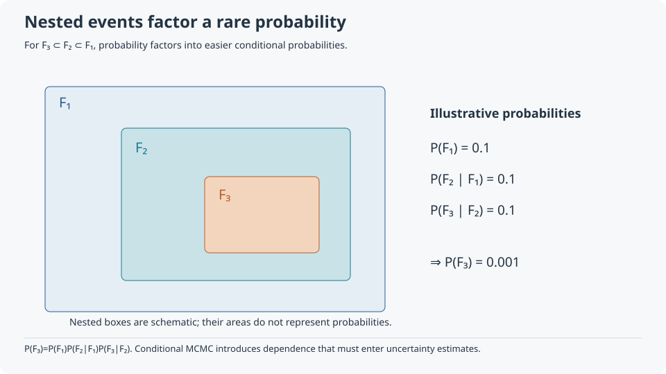

# 44. Decision making, rare events, and reliability

A posterior distribution is useful when it changes what we do. But a small error in a posterior mean can be harmless while the same amount of error in a costly failure probability changes a decision. This chapter follows that distinction from a two-action decision through tail-probability simulation. The running costs and reinforcement effect are hypothetical teaching assumptions, not engineering estimates.

**Learning goals.** Formulate posterior risk for an action; estimate a *paired* difference in risks with its own Monte Carlo standard error (MCSE); distinguish physical failure probability from simulation error; derive and use importance weights; explain what subset simulation's probability product does and does not guarantee; and report a reliability decision with model and numerical limitations.

**Prerequisites.** Posterior prediction in [Chapter 3](03-bayesian-targets.md), integration and variance reduction in [Chapters 5–6](05-monte-carlo.md), Metropolis–Hastings in [Chapter 9](09-metropolis-hastings.md), MCSE in [Chapter 13](13-mc-error.md), and diagnostics in [Chapter 14](14-diagnostics.md). [Chapter 17](17-workflow.md) supplies the model-checking context.

## 1. From uncertainty to action

Let $a$ be an action in a finite set $A$, $\theta$ an uncertain state, $y$ observed data, and $L(a,\theta)$ a loss measured in explicit units. Provided the expected loss is finite, its posterior risk is

$$
R(a)=\mathbb{E}_{\pi(\theta\mid y)}[L(a,\theta)],\qquad
 a^*\in\operatorname*{arg\,min}_{a\in A}R(a).
$$

A decision is therefore an integration problem. The loss specifies *which* posterior functional matters. An accurate estimate of $\mathbb{E}(\theta\mid y)$ need not be an accurate estimate of $\mathbb{E}[L(a,\theta)\mid y]$ when loss is nonlinear or concentrated in a tail. Different plausible losses can lead to different actions from the same posterior. The posterior regret of selecting $a$ is $R(a)-\min_b R(b)$; it is measured in the same units as the loss.

Often the real uncertainty is a future outcome $Z$ as well as an unknown parameter. Then $L(a,\theta,Z)$ must be averaged over the joint posterior predictive law, or first over $Z\mid\theta$ and then over $\theta\mid y$:

$$
R(a)=\mathbb{E}_{\theta\mid y}\{\mathbb{E}[L(a,\theta,Z)\mid\theta,y]\}.
$$

If the action changes the distribution of future outcomes, the inner expectation uses the action-specific predictive law $p(z\mid a,\theta,y)$. The posterior for the pre-action unknown state stays fixed here; the action's consequences enter through this law and the loss.

This nesting separates three ideas. A physical failure can be random even if $\theta$ were known. Our uncertainty about its probability is represented by the posterior for $\theta$. Our finite simulation adds numerical uncertainty to estimates of the resulting risk. None of these is interchangeable with the others. Decision analysis based on posterior predictive expected utility is part of the broader Bayesian workflow; see [Gelman's decision-analysis discussion](https://statmodeling.stat.columbia.edu/2025/10/11/7-reasons-to-use-bayesian-inference/) for that framing.

## 2. Worked decision: reinforce a component

Assume the posterior probability $\theta$ of a future component failure is $\operatorname{Beta}(2,998)$. A failure costs $C=100{,}000$ cost units. Reinforcement costs $c=150$ units and, by assumption, eliminates that failure mechanism. With no reinforcement the outcome loss is $CY$, where $Y\mid\theta\sim\operatorname{Bernoulli}(\theta)$. Conditional expectation removes the future Bernoulli draw:

$$
L(\mathrm{reinforce},\theta)=150,\qquad
L(\mathrm{none},\theta)=100{,}000\theta.
$$

Since $\mathbb{E}(\theta\mid y)=2/1000=0.002$, the posterior risks are $150$ and $200$. Reinforcement has an expected advantage of $50$ units. Equivalently define the paired loss difference $d(\theta)=L(\mathrm{reinforce},\theta)-L(\mathrm{none},\theta)=150-100{,}000\theta$. Its mean is $-50$: a negative number favors reinforcement. Its posterior spread is not the same as our uncertainty about the numerical estimate of its mean. In this example,

$$
\operatorname{Var}(\theta\mid y)=\frac{2\cdot998}{1000^2(1001)},\qquad
\operatorname{SD}(d)\approx141.21.
$$

For $10{,}000$ *independent* posterior draws, the exact standard deviation of the sample mean is about $141.21/\sqrt{10{,}000}=1.41$ cost units. If instead a stationary chain for $d$ has an integrated autocorrelation time of $20$, its asymptotic MCSE would be about $1.41\sqrt{20}=6.32$ units. Twenty is a stipulated illustration, not an estimate from the example's independent draws. The $50$-unit gap is distinct from either MCSE. If the risk gap were $2$ units, numerical precision would have much more influence on the action.

The example also exposes a modeling assumption: reinforcement may reduce rather than eliminate failure, it may have other risks, and $C$ might be uncertain. Any of those changes the loss function and may change the action even if the simulation is perfect.

## 3. Why paired loss differences get their own MCSE

For posterior draws $\theta_1,\ldots,\theta_N$, compute both losses on each draw and then average

$$
\widehat\Delta_{a,b}=\frac1N\sum_{i=1}^N d_i,\qquad
 d_i=L(a,\theta_i)-L(b,\theta_i).
$$

For iid draws, $\operatorname{Var}(d)=\operatorname{Var}(L_a)+\operatorname{Var}(L_b)-2\operatorname{Cov}(L_a,L_b)$. A shared draw commonly makes the losses rise and fall together, reducing the variance of their difference. This is not automatic: negative covariance increases it. Estimating separate MCSEs for each risk and adding them ignores this pairing.

For dependent draws, covariance at every lag matters. Let $\gamma_d(k)=\operatorname{Cov}(d_0,d_k)$ for a stationary chain. When the sum is valid, define the long-run variance

$$
\sigma_d^2=\gamma_d(0)+2\sum_{k=1}^{\infty}\gamma_d(k),\qquad
\operatorname{MCSE}(\widehat\Delta_{a,b})\approx\sqrt{\widehat\sigma_d^2/N}.
$$

Equivalently, the long-run covariance between the two loss series enters with a minus sign. An effective sample size computed for $\theta$ or for one loss is therefore no substitute for the MCSE of $d$. One sufficient CLT setting is a stationary, geometrically ergodic chain with $\mathbb{E}|d|^{2+\delta}<\infty$ for some $\delta>0$; estimating $\sigma_d^2$ consistently requires additional conditions on the chosen batch-means or spectral estimator. [Chapter 13](13-mc-error.md) develops those estimators. For fixed-width stopping theory under explicit functional CLT and variance-estimator assumptions, see [Flegal and Gong](https://www3.stat.sinica.edu.tw/statistica/oldpdf/A25n213.pdf). Their asymptotic theory is not a finite-run certificate for a particular chain.

A practical report gives $\widehat\Delta$ and its MCSE in cost units, checks batch-size sensitivity, and compares the uncertainty with zero and with a *practical* indifference margin $\varepsilon$. An ordinary interval such as $\widehat\Delta\pm1.96\operatorname{MCSE}$ is a provisional large-sample summary. Repeatedly examining it and stopping the moment it excludes zero does not make it a confidence sequence with exact coverage. Specify a minimum run length, precision goal, and checking rule before running if stopping is consequential. With many candidate actions, selecting the smallest noisy estimated risk can itself be optimistic; a fresh simulation can evaluate the selected action.

### 3.1 Selection changes what an unbiased estimate means

Fix the observed data and suppose each estimated risk is integrable and unbiased: $\mathbb{E}_{\rm MC}\widehat R(a)=R(a)$. The expectation here is over simulation, not a new posterior average. For $\widehat a\in\arg\min_a\widehat R(a)$,

$$
\mathbb{E}_{\rm MC}\widehat R(\widehat a)
=\mathbb{E}_{\rm MC}\min_a\widehat R(a)
\leq\min_a R(a)
\leq\mathbb{E}_{\rm MC}R(\widehat a).
$$

The first inequality follows because the minimum is no larger than the estimate for any fixed action; the second holds for every selected action. Independence between action estimates is unnecessary. This is the loss-minimization version of the selection optimism studied by [Smith and Winkler, Proposition 1](https://jimsmith.host.dartmouth.edu/wp-content/uploads/2022/04/The_Optimizers_Curse.pdf). The following finite example makes both the reporting bias and the decision regret computable without a normal approximation.

Suppose $R(A)=100$, $R(B)=110$, and each numerical estimate adds an independent error taking values $-20$ and $20$ with equal probability. These are stipulated simulation errors in cost units. Every row has probability $1/4$.

| Error for $A$ | Error for $B$ | Reported minimum | Selected action | Its true risk |
|---:|---:|---:|:---:|---:|
| $-20$ | $-20$ | $80$ | $A$ | $100$ |
| $-20$ | $20$ | $80$ | $A$ | $100$ |
| $20$ | $-20$ | $90$ | $B$ | $110$ |
| $20$ | $20$ | $120$ | $A$ | $100$ |

The reported minimum averages $92.5$, while the selected action's true risk averages $102.5$. Thus the average optimism is $10$ units and expected regret is $2.5$ units. They measure different effects. If instead both estimates share exactly the same error, their difference is always $-10$: action $A$ is always selected, its reported risk averages $100$, and regret and average optimism are both zero. This illustrates how pairing affects selection as well as precision; it does not assert that all shared randomness is beneficial.

For an unbiased fresh validation estimate $\widehat R_{\rm val}(a)$ independent of the selection simulation,

$$
\mathbb{E}_{\rm MC}[\widehat R_{\rm val}(\widehat a)\mid\text{selection simulation}]
=R(\widehat a).
$$

In the independent-error example, validation therefore averages $102.5$, not the optimal risk $100$. It evaluates the selected action; it does not undo an erroneous selection. Freeze the selected action before validation, and use validation draws paired with a fixed comparator if a risk difference is wanted. Selecting again on validation results reintroduces the same issue. Exact unbiasedness here assumes exact draws or another unbiased estimator; an ordinary finite MCMC run can also have initialization bias. The [script](examples/ch44.py) enumerates every selection and validation error combination and checks these values.

## 4. A rare event is a different integrand

Let $X$ contain uncertain loads, strengths, and possibly future noise. A limit-state function $g(X)$ defines failure $F=\{g(X)\leq0\}$ and probability $p=\Pr(F)$. For iid samples, $\widehat p=N^{-1}\sum_i I_F(X_i)$ has

$$
\operatorname{Var}(\widehat p)=\frac{p(1-p)}N,\qquad
\frac{\operatorname{SD}(\widehat p)}p=\sqrt{\frac{1-p}{Np}}.
$$

At $p=10^{-6}$, roughly $10^8$ iid evaluations are required for a $10\%$ *relative standard error*, ignoring the model cost. This calculation is about the indicator, not about a smooth parameter average. A chain can explore central posterior quantities well while almost never visiting a failure region. For a stationary dependent chain with a justified CLT, replace $p(1-p)$ by the indicator's long-run variance; an ESS for a different function is irrelevant.

Zero observed failures do not establish $p=0$. Under *independent* Bernoulli trials, a one-sided frequentist $1-\alpha$ confidence upper limit from zero failures solves $(1-p_U)^N=\alpha$, giving $p_U=1-\alpha^{1/N}$. It is about $3.0\times10^{-5}$ for $N=100{,}000$ and $\alpha=.05$. Correlated MCMC draws cannot be placed in this iid formula as if each were a new Bernoulli trial. A chain trapped away from $F$ may produce zero for a very long time, and no observed failure supplies no empirical evidence that it mixes into $F$.

## 5. Condition before simulating the tail

Suppose $X=(\theta,Z)$ and the conditional failure probability $q(\theta)=\Pr\{g(\theta,Z)\leq0\mid\theta\}$ is available analytically. Estimate $p=\mathbb{E}_{\theta\mid y}q(\theta)$ by averaging $q(\theta_i)$ instead of generating one $Z_i$ and averaging failure indicators. For iid outer draws, the law of total variance gives

$$
\operatorname{Var}(I_F)=\operatorname{Var}(q(\theta))+
\mathbb{E}\{q(\theta)[1-q(\theta)]\}.
$$

Conditioning removes the second, nonnegative term. In the reinforcement example, averaging $100{,}000\theta_i$ rather than Bernoulli failure costs is exactly this step. One Bernoulli outcome per draw would add very large predictive noise to an estimate whose target is an expected loss. This is the conditional Monte Carlo principle from [Chapter 6](06-variance-reduction.md).

For an unchanged stationary outer chain and *independent* auxiliary $Z_i$ conditional on its states, that added prediction noise affects lag zero but has zero cross-lag covariance; the long-run variance increases by the conditional-noise term. This conclusion does not compare arbitrary modified MCMC kernels. If $q(\theta)$ itself requires inner simulation, more inner draws reduce conditional noise but cost more. One must allocate a fixed computational budget between exploring the outer posterior and simulating future outcomes. A nested value-of-information calculation is a separate, often much more expensive decision problem.

## 6. Importance tilting: more failures, correct weights

If $f$ is a normalized density for $X$ and $q$ is a proposal density positive wherever $f(x)I_F(x)>0$, draw $X_i\sim q$ and compute

$$
\widehat p_{\rm IS}=\frac1N\sum_{i=1}^N I_F(X_i)\frac{f(X_i)}{q(X_i)}.
$$

The identity $\mathbb{E}_q[I_F f/q]=p$ makes this iid estimator unbiased. Its variance is finite only if $\int_F f(x)^2/q(x)\,dx<\infty$. A proposal that makes failures frequent can still be terrible when a few weighted contributions dominate. The oracle $q^*(x)=I_F(x)f(x)/p$ would make every contribution equal to $p$, but it requires knowing $p$ and sampling from the exact failure-conditional distribution. These support and second-moment conditions, along with proposal diagnostics, are developed in [Owen's importance-sampling chapter](https://artowen.su.domains/mc/Ch-var-is.pdf).

If $f$ is known only as $\widetilde f/Z$, the factor $Z$ is missing from ordinary weights. A self-normalized ratio, $\sum I_F\widetilde f/q\,/\,\sum\widetilde f/q$, can estimate $p$ consistently for iid proposal draws when $0<Z<\infty$ and $q>0$ wherever $\widetilde f>0$. This support condition covers the *whole target*, because the denominator must estimate $Z$; covering only $F$ is insufficient. For example, with $f$ uniform on $(0,1)$, $F=(0,1/4)$, and $q$ uniform on $F$, ordinary weighted indicators equal $1/4$, whereas self-normalization always returns $1$. The ratio is generally biased at finite $N$ even with valid support, and its error is assessed differently. See [Owen, Theorem 9.2](https://artowen.su.domains/mc/Ch-var-is.pdf). Do not silently use an unnormalized posterior in the ordinary formula.

### Worked example: a Gaussian overload

Let $X\sim N(0,1)$ and failure mean $X>5$. Its exact probability is $p=\overline\Phi(5)=\tfrac12\operatorname{erfc}(5/\sqrt2)\approx2.8665\times10^{-7}$. Under the shifted proposal $q=N(\mu,1)$, cancellation of the normal-density constants yields

$$
W(x)=\frac{f(x)}{q(x)}=\exp(-\mu x+\mu^2/2).
$$

To check precision without assuming that the number of proposal failures is binomial with probability $p$, complete the square in the weighted second moment:

$$
\begin{aligned}
\mathbb{E}_q[W^2 I_{X>5}]
&=\int_5^\infty\frac{f(x)^2}{q(x)}\,dx\\
&=e^{\mu^2}\overline\Phi(5+\mu),\\
\operatorname{Var}_q(WI_{X>5})
&=e^{\mu^2}\overline\Phi(5+\mu)-p^2.
\end{aligned}
$$

For $\mu=5$, the per-draw variance is about $4.665\times10^{-13}$. At $N=10{,}000$, its exact iid MCSE is about $6.83\times10^{-9}$, or $2.38\%$ of $p$. About half of proposal draws exceed $5$, yet the *weighted indicator* variance determines precision. In the seeded [executable example](examples/ch44.py), a crude sample of $200{,}000$ has zero failures; the $\mu=5$ estimate is $2.9321\times10^{-7}$ with sample MCSE $6.94\times10^{-9}$. A shift to $\mu=9$ makes all $10{,}000$ proposals failures in this run, but the estimate is noisy and its *sample* relative MCSE is $56.1\%$. The exact variance formula gives a much larger $119.5\%$ relative MCSE at that sample size. The proposal undersamples the near-threshold region that carries large weights, so one run can understate its own uncertainty. These are single-run observations; another seed changes them.

In this importance-sampling lab, vary the standard deviation of the centered normal proposal. Compare the normalized weight concentration and estimated $E[X^2]$ with its exact value of one. A narrow proposal can miss important tails while its displayed weight ESS looks reassuring. This lab changes proposal spread, not location, and estimates a second moment rather than a failure probability; the Python example implements the shifted rare-event proposals.

## 7. Subset simulation: an exact identity, estimated factors

When a useful global proposal is difficult to design, divide failure into nested events $F_0=\Omega\supset F_1\supset\cdots\supset F_m=F$. Assuming each preceding event has positive probability, the chain rule gives

$$
p=\prod_{j=1}^{m}\Pr(F_j\mid F_{j-1}).
$$

This is exact probability algebra. For the Gaussian example, $F_j=\{X>j\}$ for $j=1,\ldots,5$ gives the first factor $\overline\Phi(1)$ and subsequent factors $\overline\Phi(j)/\overline\Phi(j-1)$. Multiplication telescopes to $\overline\Phi(5)$. These equally spaced thresholds have very uneven later conditional probabilities, so they are a useful identity check but a poor computational design.

Define $f_j(x)=f(x)I_{F_j}(x)/\Pr(F_j)$. At level $j-1$, estimate $\Pr(F_j\mid F_{j-1})$ by the fraction of draws from $f_{j-1}$ lying in $F_j$. Practical subset simulation uses survivors to initialize conditional chains, so levels share ancestry and their errors are dependent. Multiplying estimated factors is **not automatically unbiased**: marginally accurate factors can have dependent errors, and adaptive thresholds add selection effects. There is, however, an important special case. With fixed thresholds, iid initial particles, multinomial resampling of survivors, and pre-specified transitions that exactly leave each conditional law invariant, the usual product estimator is unbiased *in expectation*, even though descendants are correlated. Its variance can be large, and this theorem says nothing about model correctness or whether one population visits every failure mechanism. This is the standard sequential Monte Carlo normalizing-constant property; [Dau and Chopin, Section 2 and Proposition 2](https://arxiv.org/pdf/2011.02328) explain the particle construction and its connection to unbiased normalization estimates. The exact identity and the properties of a particular sampling algorithm require separate arguments.

The figure sketches the nested-region construction and illustrative conditional probabilities. The box areas are schematic, not probability masses. Conditional sampling stays within the current event; the next factor counts points that also enter the smaller region.

## 8. Conditional MCMC and threshold choice

To sample $f_j$ using Metropolis–Hastings, start at $x\in F_j$, propose $z\sim r(z\mid x)$, and reject immediately if $z\notin F_j$. Otherwise accept with probability

$$
\alpha_j(x,z)=\min\left\{1,\frac{f(z)r(x\mid z)}{f(x)r(z\mid x)}\right\}.
$$

On $F_j$, the unknown normalizing probability cancels. The usual detailed-balance proof applies to $f_j$; proposals outside the event and ordinary MH rejections become self-transitions. This proves invariance of the transition, not that a finite chain started from an arbitrary point is exactly at stationarity. A narrow bottleneck or disconnected failure mechanisms can make a local kernel fail to move between important pieces in any given run. Retaining duplicate states is necessary; dropping rejections changes the chain.

For the fixed-level estimator, the unbiasedness argument can be made explicit. Let $X_{j-1}^{1:N}$ be the current population, $\widehat c_j=N^{-1}\sum_i I_{F_j}(X_{j-1}^i)$ its survival fraction, and $\widehat Z_j=\prod_{k=1}^j\widehat c_k$, with $\widehat Z_0=1$. Resample $N$ survivors independently and uniformly, counting duplicate particle entries separately, and apply a fixed $f_j$-invariant kernel $K_j$ to each. For bounded $h$, write $K_jh(x)=\mathbb{E}[h(X')\mid X=x]$. Conditional on the population and previous factors,

$$
\mathbb{E}\left[\widehat Z_j\frac1N\sum_i h(X_j^i)\,\middle|\,\text{previous history}\right]
=\widehat Z_{j-1}\frac1N\sum_i I_{F_j}(X_{j-1}^i)K_jh(X_{j-1}^i).
$$

The survival fraction cancels the resampling denominator. Starting with iid $f$ particles, induction makes the unconditional right-hand side $\int f(x)I_{F_j}(x)K_jh(x)\,dx$, which equals $\int f(x)I_{F_j}(x)h(x)\,dx$ by invariance. Taking $h=1$ proves $\mathbb{E}\widehat Z_m=\Pr(F)$; final resampling and mutation can be omitted for this constant function. This specializes the SMC construction cited in Section 7 and explains why independent factor estimates are unnecessary here.

The argument requires fixed positive-probability levels, fixed population size, and kernels specified independently of the evolving cloud. Tuning a kernel from that same cloud requires separate justification. On extinction define the weighted average and all later products as zero; there is no need to define a survivor distribution. Discarding extinct runs or restarting until success changes the estimator. The script reports the range of evaluation counts because an extinct run can finish early.

Engineering subset simulation often chooses thresholds adaptively as sample quantiles so that roughly a chosen fraction $p_0$ survives each level. A value near $0.1$ is a common practical choice in [Au, Ching, and Beck's reliability study](https://jimbeck.caltech.edu/papers_pdf/application_of_subset_simulation.pdf), not a universal optimum. Stop at the *specified* final failure threshold, whose final conditional factor is generally partial rather than exactly $p_0$. Quantile selection makes thresholds random; survivor seeds, offspring, within-chain dependence, and cross-level dependence all matter for bias and variance. Multiplying $p_0$ by itself and attaching independent-binomial intervals at each adaptive level ignores these effects.

The [chapter script](examples/ch44.py) instead uses fixed Gaussian thresholds near conditional probability $0.1$ and a final threshold $5$, with short constrained random-walk chains. It uses $16$ independent complete runs of $2{,}000$ particles each. Its seeded mean is $3.1442\times10^{-7}$, compared with the known $2.8665\times10^{-7}$; the between-replication MCSE of the mean is $1.66\times10^{-8}$. Each run uses $82{,}000$ response evaluations, counting proposals that test the boundary. The observed discrepancy is about $1.7$ replication MCSEs and is compatible with run-to-run variability. Under the fixed-level assumptions just stated, the algorithmic estimator is unbiased in expectation; its finite populations and short chains can make its variance large. Replication MCSE measures run-to-run spread, not bias from an incorrectly implemented kernel, an approximate response model, or an adaptive level rule. This is teaching code, not a validated engineering estimator.

## 9. Put the simulation back into the decision

A rare failure matters only through the loss it creates. If $p_a$ is the posterior predictive failure probability under action $a$ and failure incurs cost $C$, a simplified risk might be $R(a)=c_a+Cp_a$. Then a probability error of $10^{-6}$ moves the reported risk by $0.1$ units at $C=100{,}000$, whereas a cost error of $100$ units can dominate the decision. State the action and its cost scale before spending resources on an arbitrarily tiny tail MCSE.

A decision report should state the model for loads and strengths; the failure definition and response solver; the action effects and costs; the risk difference with a loss-specific MCSE; and the reliability method, sample sizes, response evaluations, and sensitivity to its tuning. It should also separate five uncertainties: physical variation in future events, posterior uncertainty about parameters, finite simulation error, numerical approximation in a forward solver or surrogate, and uncertainty in the loss assumptions. [Chapter 42](42-scientific-inference.md) discusses forward-solver error, which can shift a threshold independently of MCSE. Good simulation diagnostics cannot validate an extrapolated failure model, and a small MCSE cannot make a disputed cost credible.

A one-sided importance tilt may miss another disconnected failure mechanism. A constrained chain may stay in one component of $F_j$. Both cases can produce reassuringly stable numbers. Model checks and failure-mode analysis must therefore accompany numerical checks. The useful sequence is: specify the decision; derive its integrand; diagnose error for that integrand; improve tail sampling if necessary; then express the remaining uncertainty in decision units.

## Exercises

**1. Imperfect reinforcement.** Suppose reinforcement costs $c$, a failure costs $C$, and reinforcement multiplies the conditional failure probability $\theta$ by $r\in[0,1]$. Derive the preferred action when both costs are deterministic.

Solution

The risks are $R(\mathrm{reinforce})=c+rC\mathbb{E}(\theta\mid y)$ and $R(\mathrm{none})=C\mathbb{E}(\theta\mid y)$. Reinforce when $c<(1-r)C\mathbb{E}(\theta\mid y)$, with equality giving a tie. The result assumes reinforcement creates no other losses.

**2. No observed failures.** Derive the one-sided $95\%$ upper bound for an iid Bernoulli failure probability after zero failures in $100{,}000$ trials. Explain why it cannot be assigned to $100{,}000$ correlated MCMC iterations.

Solution

Under iid trials, the zero-count probability is $(1-p)^N$. Setting it to $.05$ gives $p_U=1-.05^{1/100000}\approx2.996\times10^{-5}$. Correlated iterations do not have zero-count probability $(1-p)^N$; severe tail trapping can yield zero failures even when the chain nominally targets a distribution with substantial tail mass.

**3. Gaussian weights.** For $f=N(0,1)$, $q=N(\mu,1)$, and $F=\{X>t\}$, derive the weight and the second moment of $I_FW$ under $q$.

Solution

The log density ratio is $-x^2/2+(x-\mu)^2/2=-\mu x+\mu^2/2$, so $W=e^{-\mu x+\mu^2/2}$. Also $f(x)^2/q(x)=e^{\mu^2}\phi(x+\mu)$ by completing the square. Integrating over $x>t$ gives $\mathbb{E}_q[W^2I_F]=e^{\mu^2}\overline\Phi(t+\mu)$. Subtract $\overline\Phi(t)^2$ to obtain per-draw variance; divide by $N$ for the iid sample mean.

**4. Constrained MH.** Prove that the constrained transition in Section 8 preserves $f_j$ when its proposal ratio is defined and the chain starts in $F_j$.

Solution

For $x,z\in F_j$, the off-diagonal probability flow is proportional to $f(x)r(z\mid x)\min\{1,f(z)r(x\mid z)/[f(x)r(z\mid x)]\}$, which is the minimum of the two forward and reverse flows and is symmetric in $x,z$. A proposal outside $F_j$ is rejected, so it only increases the self-transition probability. Detailed balance holds on $F_j$, and hence $f_j$ is invariant. This alone does not prove irreducibility or rapid mixing.

**5. Adaptive subset errors.** An analysis takes the empirical survival fraction $0.1$ at every adaptive level, multiplies those factors, and reports binomial standard errors as though all levels were independent. Identify at least three omissions.

Solution

The thresholds were chosen from the same samples, so their randomness affects the estimator. Descendants share survivor ancestors; within-level chains are correlated; and factors at successive levels are dependent. The final threshold normally has a separate partial factor. Independent complete repetitions can empirically assess variability of the implemented procedure, while bias still requires study or a benchmark.

**6. Paired decision MCSE.** Four successive batch means of the *paired loss difference* in cost units are $(-7,-5,-9,-3)$, each from $m=100$ chain draws. Use the standard nonoverlapping batch-means estimator for the MCSE of the overall difference mean. Would the same calculation from separate action-loss batch means necessarily agree? What else belongs in a report?

Solution

The overall mean is $-6$. The sample variance of the four batch means is $[(-1)^2+1^2+(-3)^2+3^2]/3=20/3$. The batch-means estimate of the variance of the overall mean is $(20/3)/4=5/3$, giving MCSE $\sqrt{5/3}\approx1.29$ cost units. This is only a rough estimate with four batches; check longer runs and batch-size sensitivity. Separate action-loss MCSEs omit their long-run covariance and need not yield this number. Report model, action and loss assumptions, chain diagnostics for the difference, run length, MCSE method, and any practical indifference margin.

**7. Validating a selected action.** In Section 3.1, suppose a new, independent error taking values $-20$ and $20$ with equal probability is added to the selected action's true risk. Compute the mean validation estimate. How do the selection, validation mean, and regret change if the two original action estimates instead share exactly the same error?

Solution

With independent original errors, $A$ is selected with probability $3/4$ and $B$ with probability $1/4$. Conditional on selection, the new error has mean zero, so validation averages $(3/4)100+(1/4)110=102.5$. This removes the ten-unit average optimism of the original reported minimum $92.5$, but expected regret remains $102.5-100=2.5$. With a shared original error, the estimated difference is always $-10$, so $A$ is always selected, validation averages $100$, and regret is zero. All these statements average over the specified numerical error model, not physical failure outcomes.

## Key takeaways

- A decision asks for the posterior mean of a loss *difference*, with an MCSE in loss units.
- Selecting the smallest noisy risk creates optimism; independent validation evaluates the frozen choice but does not guarantee that it is optimal.
- Rare-event indicators can remain poorly estimated when central posterior summaries look precise. Zero observed events is unresolved tail information.
- Conditional expectation removes avoidable predictive noise; importance sampling needs valid complete weights and controlled weighted variance.
- Subset simulation's conditional-probability product is exact. Fixed-level resampling with invariant kernels can yield an unbiased estimator, while ancestry and slow mixing raise variance. Adaptive thresholds and implementation changes require separate bias analysis.
- Numerical precision, forward-model accuracy, and loss assumptions are distinct parts of a reliability decision.

## References

- James E. Smith and Robert L. Winkler, [“The Optimizer's Curse: Skepticism and Postdecision Surprise in Decision Analysis”](https://jimsmith.host.dartmouth.edu/wp-content/uploads/2022/04/The_Optimizers_Curse.pdf) (2006): selection optimism despite unbiased individual estimates.
- Art B. Owen, [*Monte Carlo theory, methods and examples*, Chapter 9](https://artowen.su.domains/mc/Ch-var-is.pdf): importance sampling identities, support, variance, and self-normalization.
- James M. Flegal and Lei Gong, [“Relative fixed-width stopping rules for Markov chain Monte Carlo simulations”](https://www3.stat.sinica.edu.tw/statistica/oldpdf/A25n213.pdf) (2015): asymptotic precision-based stopping under stated conditions.
- S. K. Au, J. Ching, and J. L. Beck, [“Application of subset simulation methods to reliability benchmark problems”](https://jimbeck.caltech.edu/papers_pdf/application_of_subset_simulation.pdf) (2007): conditional-level construction and MCMC sampling in reliability analysis.
- Hai-Dang Dau and Nicolas Chopin, [“Waste-free Sequential Monte Carlo”](https://arxiv.org/pdf/2011.02328) (2021 preprint; 2022 journal article): standard SMC construction and normalizing-constant unbiasedness, alongside their extended algorithm.
- Andrew Gelman, [“7 reasons to use Bayesian inference!”](https://statmodeling.stat.columbia.edu/2025/10/11/7-reasons-to-use-bayesian-inference/) (2025): decision-analysis framing.
