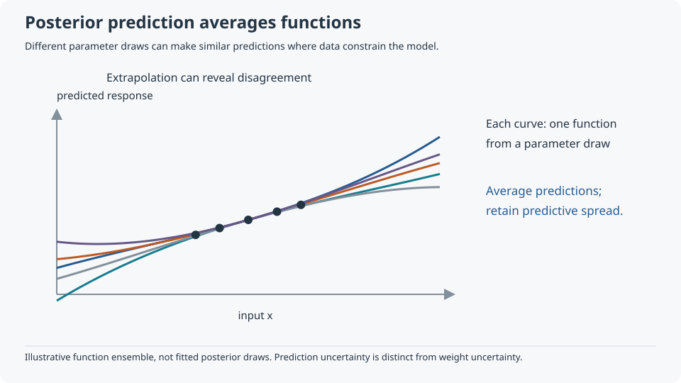

# 45. Probabilistic machine learning

**Learning goals.** Construct a small Bayesian neural-network posterior and its predictive mixture; identify weight symmetries and estimand-specific uncertainty; derive an energy-model likelihood score; explain why parameter inference in an unnormalized model is doubly intractable; and derive an exchange update with its exact auxiliary-sampling requirement. Prerequisites are [Bayesian targets](03-bayesian-targets.md), [Metropolis–Hastings](09-metropolis-hastings.md), [Monte Carlo error](13-mc-error.md), [diagnostics](14-diagnostics.md), [HMC](20-hmc.md), [normalizing constants](26-normalizers.md), [pseudo-marginal methods](27-pseudo-marginal.md), and the [Ising model](41-physics.md). [Stochastic-gradient MCMC](34-scalable.md) and [mixture symmetries](38-mixtures.md) provide useful comparisons.

## 45.1 What is random, and what is being computed?

“Learning a model” may mean finding one parameter vector, averaging predictions over a parameter distribution, or simulating observations from a fitted distribution. These operations answer different questions. For a labeled dataset $D=\{(x_i,y_i)\}_{i=1}^n$, let $w$ denote predictive-model weights. For an energy model, use $\theta$ for its parameters and $z$ for a configuration generated by that model. The observed configuration will be $y$. Keeping $w$, $\theta$, and $z$ distinct prevents a common mistake: sampling data at a fixed parameter is not sampling uncertainty about that parameter.

| Procedure | Computational target | What its output represents |
| --- | --- | --- |
| MAP optimization | $\arg\max_w p(w\mid D)$ | One high-density weight vector |
| Posterior MCMC | $p(w\mid D)$ | Correlated draws whose averages estimate posterior expectations |
| Variational inference | A fitted family $q_\phi(w)$ | Approximation to a specified posterior under an optimization criterion |
| Independent training ensemble | Several fitted $w_k$ | Predictions averaged over a training recipe and its randomness |
| Energy-model simulation | $p_\theta(z)$ for fixed $\theta$ | Configurations from the selected model |

An ensemble of independently trained networks can make useful predictions, including uncertainty estimates, as [Lakshminarayanan, Pritzel, and Blundell](https://papers.neurips.cc/paper/7219-simple-and-scalable-predictive-uncertainty-estimation-using-deep-ensembles.pdf) demonstrated. Its members are not thereby draws from $p(w\mid D)$. Likewise, one posterior draw is a complete model, while the Bayesian predictive distribution is a *mixture* over draws. The distinction matters most when several parameter vectors encode the same function.

## 45.2 A network with an explicit posterior

Consider scalar regression with one hidden layer of $H$ units,

$$
f_w(x)=c+\sum_{j=1}^H a_j\tanh(b_jx+d_j),
\qquad y_i\mid w,x_i\sim N(f_w(x_i),\sigma^2).
$$

Assume a fixed $\sigma>0$, a fixed finite $H$, and independent $N(0,\tau^2)$ priors on every entry of $w=(c,a_1,b_1,d_1,\ldots,a_H,b_H,d_H)$, with $\tau>0$. Conditional independence of observations then gives

$$
\log p(w\mid D)=C-\frac{\|w\|^2}{2\tau^2}
-\frac{1}{2\sigma^2}\sum_{i=1}^n\{y_i-f_w(x_i)\}^2.
$$

The omitted $C$ is independent of $w$. This is a *density* for inference, not merely a training loss: its prior scale, noise scale, and likelihood all determine the posterior. For fixed positive $\sigma$, each Gaussian likelihood factor is bounded as a function of $w$. Multiplying this bounded likelihood by a proper prior yields a finite integral; because the likelihood is positive everywhere, the integral is also positive. Thus the posterior is proper. That quick argument changes if $\sigma$ is itself unknown: an unbounded likelihood near $\sigma=0$ requires analysis of its prior and the data.

The model is simple enough to differentiate without automatic differentiation. Write $r_i=y_i-f_w(x_i)$ and $u_{ij}=b_jx_i+d_j$. For example,

$$
\frac{\partial\log p(w\mid D)}{\partial a_j}
=-\frac{a_j}{\tau^2}+\frac{1}{\sigma^2}\sum_i r_i\tanh(u_{ij}),
$$

and

$$
\frac{\partial\log p(w\mid D)}{\partial b_j}
=-\frac{b_j}{\tau^2}+\frac{1}{\sigma^2}\sum_i r_i a_jx_i\{1-\tanh^2(u_{ij})\}.
$$

The derivatives for $c$ and $d_j$ follow similarly. A finite-difference check on a small dataset is worthwhile before using [HMC](20-hmc.md): a gradient sign error can produce a chain with poor acceptance or misleading numerical behavior. HMC with a Metropolis correction and accurate full-target evaluations preserves the specified posterior under its usual conditions; finite runs still have initialization and Monte Carlo error.

Before fitting, draw $w$ from the prior and plot $f_w(x)$ across the input range. A broad $\tau$ increases the scale of $c$ and the output coefficients $a_j$, while large hidden weights can make the bounded $\tanh$ activations saturate or change sharply. In particular, output size obeys $|f_w(x)|\le |c|+\sum_j|a_j|$; large hidden weights do not multiply output amplitudes without bound. A narrow $\tau$ may put almost all prior mass on nearly flat functions. Rescaling inputs changes what a fixed prior over $b_j$ means. Prior prediction exposes these modeling choices before the observations can conceal them. Neal's [Bayesian neural-network work](https://glizen.com/radfordneal/thesis.abstract.html) established posterior integration over weights as a foundational alternative to using a single fitted network.

## 45.3 Symmetry: different weights, one function

Suppose the hidden-unit priors are identical and independent. Any permutation $P$ of unit labels replaces $(a_j,b_j,d_j)$ by $(a_{P(j)},b_{P(j)},d_{P(j)})$. Reordering a finite sum leaves $f_w(x)$ unchanged for every $x$. The iid prior density is a product of identical factors, so it is unchanged too. The likelihood and posterior density are therefore identical at the permuted vector. With $H$ distinct units, this can create as many as $H!$ equivalent representations; coincident units make the orbit smaller.

There is also a sign symmetry. Since $\tanh(-u)=-\tanh(u)$, replacing one triple by

$$
(a_j,b_j,d_j)\longmapsto(-a_j,-b_j,-d_j)
$$

leaves its summand unchanged: $(-a_j)\tanh(-b_jx-d_j)=a_j\tanh(b_jx+d_j)$. A zero-centered Gaussian prior assigns the same density to both triples. These permutations and sign changes have absolute Jacobian determinant one, so they preserve posterior probability as well as density. They create equivalent weight representations and map local maxima to local maxima; they do not make every weight vector a mode or prove that equivalent maxima are separated by low-density barriers. Other modes may generate genuinely different functions. A chain that never crosses a symmetry barrier might estimate a prediction accurately if the functional has the same value in each copy, but that observation cannot certify it found every distinct predictive mode.

**Worked example 1: averaging weights can erase a prediction.** Set $H=1$, $c=d_1=0$, and compare $(a_1,b_1)=(1,2)$ with $(-1,-2)$. At $x=0.5$, both give $\tanh(1)\approx0.761594$. Their componentwise average is $(0,0)$, whose function is zero everywhere. Averaging *functions* gives $0.761594$; averaging weights first gives zero. If these two states had equal mixture weight and $\sigma=0.2$, the predictive observation mean would be $0.761594$ and its variance $0.2^2=0.04$: the two components contribute no between-function variance at this $x$. These points are algebraic illustrations, not claimed posterior samples. Adding another state that predicts $-0.5$ would create actual function uncertainty and raise the mixture variance.

Consequently, inspect chains in both parameter and function space. Trace predictions at observed inputs, between observed inputs, and beyond their range; compare chain-specific predictive means and intervals. Parameter $\widehat R$ can reveal failure to traverse equivalent modes, while a stable function summary can be more relevant to prediction. Neither stable functions nor attractive diagnostics prove convergence to the full posterior. Ordering hidden units by a weight can collapse some label symmetry for display, but it changes coordinates and introduces boundaries where units exchange order; it is not automatically a smoother sampling geometry. The related issue in mixture models appears in [Chapter 38](38-mixtures.md).

## 45.4 Predictive mixtures and defined uncertainty

For a new input $x_*$, the posterior predictive density under the stated Gaussian observation model is

$$
p(y_*\mid x_*,D)=\int N\!\left(y_*;f_w(x_*),\sigma^2\right)p(w\mid D)\,dw.
$$

With retained posterior states $w_1,\ldots,w_S$, estimate it by averaging the *component densities*, $S^{-1}\sum_s N(y_*;f_{w_s}(x_*),\sigma^2)$. For a log predictive score, compute the logarithm of that average with log-sum-exp arithmetic; the average of component log densities is a different, usually lower, quantity. The same principle applies to classification: average class probabilities such as softmax outputs, then take a logarithm if scoring the observed class. Averaging logits first generally gives another distribution.

Under fixed $\sigma$ and finite second moments, the laws of total expectation and variance give

$$
E(y_*\mid x_*,D)=E_{w\mid D}[f_w(x_*)],\qquad
\operatorname{Var}(y_*\mid x_*,D)=\sigma^2+
\operatorname{Var}_{w\mid D}[f_w(x_*)].
$$

The first term is observation noise; the second is posterior uncertainty about the latent mean at this input. With the Gaussian priors above and $|\tanh|\le1$, $|f_w(x)|\le |c|+\sum_j|a_j|$, so the fixed-$\sigma$ posterior has the needed finite moments. A latent-function interval excludes the new observation's $\sigma$ noise; a predictive observation interval includes it. Both are conditional on the model. They are not automatic coverage guarantees under likelihood misspecification or shifted inputs.

Estimate Monte Carlo error for the actual quantity being reported: $f_w(x_*)$, a predictive tail probability, or a held-out log score. Weight-level effective sample sizes can differ sharply from the effective sample size of these functionals. Correlated draws require time-series or batch estimates of uncertainty as in [Chapter 13](13-mc-error.md). If a tail event is rare, its Monte Carlo uncertainty may remain large after the predictive mean looks stable. Model uncertainty and Monte Carlo uncertainty should appear as separate entries in a report.

For the log predictive score at a fixed held-out pair $(x_*,y_*)$, the per-draw quantity is $g_s=p(y_*\mid x_*,w_s)$ and the estimator is $\log\bar g$. Under a Markov-chain CLT for $g_s$, with $E[g_s]>0$, the delta-method approximation is $\operatorname{MCSE}(\log\bar g)\approx\operatorname{MCSE}(\bar g)/\bar g$. An MCSE calculated from the sequence $\log g_s$ instead describes an average component log score. For a sum over held-out cases, retain covariance across cases because they use the same weight draws.

## 45.5 What larger-network experiments do and do not settle

The toy network makes the target explicit, but full networks add high dimension, correlated scales, and potentially separated function modes. [Izmailov and colleagues](https://proceedings.mlr.press/v139/izmailov21a.html) used large-scale HMC experiments to examine Bayesian neural-network posteriors and compare approximations in their studied settings. Their results motivate careful posterior geometry and predictive evaluation; they do not provide a theorem that one sampler mixes reliably for every architecture. A full-data HMC transition with an acceptance correction has a specified invariant target, subject to implementation conditions. That exact-invariance statement says nothing by itself about how close a finite run is to equilibrium. Minibatch gradients and uncorrected stochastic-gradient procedures discussed in [Chapter 34](34-scalable.md) introduce additional approximation questions.

More concretely, [Section 5.1 and Figure 1 of that study](https://proceedings.mlr.press/v139/izmailov21a/izmailov21a.pdf) compare diagnostics on raw weights with diagnostics on test-set softmax probabilities for CIFAR-10 and IMDB classifiers. The predictive diagnostics were much more favorable in those runs. This supports examining the functions actually used for prediction, while leaving untested inputs and other predictive summaries as separate checks.

Temperature language can obscure the target. Ordinary Bayes uses $p(w)L(w)$, where $L(w)=p(D\mid w)$. A likelihood-tempered target $p(w)L(w)^{1/T}$ keeps the prior fixed. A whole-posterior power target $[p(w)L(w)]^{1/T}$ also powers the prior. For $T\ne1$ these are generally different distributions; a training learning rate specifies neither of them. [Wenzel and colleagues](https://proceedings.mlr.press/v119/wenzel20a.html) studied empirical “cold posterior” behavior in deep networks. Such findings raise questions about priors, likelihoods, data augmentation, optimization, and inference in the studied setups. They do not imply a universal temperature correction.

Independent training ensembles remain a valuable baseline. To compare them with posterior MCMC, state each construction, evaluate the same held-out predictive score, and account for computational cost and Monte Carlo error. Similar test accuracy does not establish that ensemble members follow the posterior, and better accuracy does not by itself locate the source of a Bayesian model's mismatch.

## 45.6 Energy models: learning requires model expectations

Now the random object is a configuration $z$ rather than a network weight. Relative to a fixed reference measure, define

$$
p_\theta(z)=\frac{f_\theta(z)}{Z(\theta)},\qquad
f_\theta(z)=\exp\{-E_\theta(z)\},\qquad
Z(\theta)=\int f_\theta(z)\,dz.
$$

Assume $0<Z(\theta)<\infty$. On a finite state space whose support does not change with $\theta$, differentiating the finite sum is valid. More generally, suppose $E_\theta(z)$ is differentiable and its derivative times $e^{-E_\theta(z)}$ has a locally integrable dominating envelope, so differentiation may pass under the integral. Then

$$
\nabla_\theta\log Z(\theta)
=-E_{p_\theta}[\nabla_\theta E_\theta(Z)],
\qquad
\nabla_\theta\log p_\theta(y)
=-\nabla_\theta E_\theta(y)
+E_{p_\theta}[\nabla_\theta E_\theta(Z)].
$$

The “positive phase” reads a feature from observed data; the “negative phase” averages that feature under the current model. For independent observations, sum their scores. Estimating the model expectation with an MCMC chain at fixed $\theta$ incurs dependence and finite-run error. If $\theta$ changes during optimization, an old chain also starts from a distribution fitted to an older model. A noisy gradient may be useful for training, but its noise and bias need analysis; it is not the exact likelihood score merely because an inner transition has $p_\theta$ as an invariant law.

A minimal bridge to [Chapter 41](41-physics.md) uses two spins $z_1,z_2\in\{-1,+1\}$ and energy $E_\theta(z)=-\theta z_1z_2$. Writing $s(z)=z_1z_2$ gives $f_\theta(z)=e^{\theta s(z)}$ and

$$
Z(\theta)=2e^\theta+2e^{-\theta}=4\cosh\theta,
\qquad E_{p_\theta}[s(Z)]=\tanh\theta.
$$

Thus the observed-data score for one configuration is $s(y)-\tanh\theta$. The simple enumeration will also let us verify the exchange sampler instead of relying on an unknown normalizer.

## 45.7 Short chains are a learning approximation

Contrastive divergence starts a Markov chain at a data configuration, takes $k$ transitions using a kernel invariant for $p_\theta$, and uses the resulting configurations for the negative phase. [Hinton's author-hosted technical report](https://www.cs.toronto.edu/~hinton/absps/tr00-004.pdf) develops this short-chain training construction. If $K_\theta$ is the transition kernel and the start law is $\mu_0$, the resulting law is $\mu_0K_\theta^k$. Invariance states only $p_\theta K_\theta^k=p_\theta$; it does **not** state $\mu_0K_\theta^k=p_\theta$ for arbitrary $\mu_0$ and finite $k$. The negative phase is therefore generally biased for the likelihood score.

There is a second distinction: the usual contrastive-divergence update is not generally the full derivative of $\operatorname{KL}(\mu_0\|p_\theta)-\operatorname{KL}(\mu_0K_\theta^k\|p_\theta)$. Differentiation also acts on the parameter-dependent reconstruction law $\mu_0K_\theta^k$. Hinton's report, Section 3, equations (5)–(6), explicitly identifies the omitted term. Calling the update a likelihood gradient or the exact gradient of that divergence requires additional justification.

Persistent chains carry their final states between parameter updates. They can reduce repeated startup cost when the target changes slowly and mixing is adequate, but their law depends on both initialization and the parameter path. Rapid parameter changes or metastable configurations can leave them stale. Compare results across chain lengths or update schedules to assess sensitivity, without treating the longest tested run as an equilibrium certificate.

The lab below samples a periodic $16\times16$ Ising model with fixed coupling $J=1$. Change its temperature $T$ control, which changes the effective coupling $J/T$, and observe persistence in spin configurations or magnetization. Each sweep comprises 256 random-site heat-bath updates. Relate slow exploration to the difficulty of estimating an energy model's negative-phase expectation. The lab does not train $\theta$, calculate a contrastive-divergence gradient, or run exchange inference.

## 45.8 Why the parameter posterior is doubly intractable

Suppose we observe one configuration $y$ and put a proper prior $p(\theta)$ on the energy-model parameter. Its posterior is

$$
\pi(\theta\mid y)\propto p(\theta)\frac{f_\theta(y)}{Z(\theta)}.
$$

The evidence normalizing this posterior is independent of $\theta$, as in any ordinary Bayesian posterior. The difficulty is different: $Z(\theta)$ belongs to the *likelihood* and changes as $\theta$ moves. For a proposal $\theta'\sim q(\cdot\mid\theta)$, the ordinary Metropolis–Hastings ratio would be

$$
R_{\mathrm{MH}}=
\frac{p(\theta')f_{\theta'}(y)q(\theta\mid\theta')}
{p(\theta)f_\theta(y)q(\theta'\mid\theta)}
\frac{Z(\theta)}{Z(\theta')}.
$$

Evaluating the unnormalized $f_\theta(y)$ is not enough. If there are $m$ independent observed configurations, the likelihood contains $Z(\theta)^{-m}$ and the ratio contains $\{Z(\theta)/Z(\theta')\}^m$. An ordinary expensive likelihood remains evaluable in principle at each proposal; here its parameter-dependent normalizer may be unavailable even for one proposed point. This is the doubly intractable setting studied by [Murray, Ghahramani, and MacKay](https://www.pure.ed.ac.uk/ws/portalfiles/portal/11876063/p359_murray.pdf). It is also distinct from assuming a nonnegative unbiased likelihood estimator for the [pseudo-marginal method](27-pseudo-marginal.md): the exchange construction instead uses an exact auxiliary draw to make the unknown constants cancel.

## 45.9 Exchange sampling and the cancellation

Given current $\theta$, propose $\theta'\sim q(\cdot\mid\theta)$ and generate an auxiliary configuration $z$ **exactly** from $p_{\theta'}(z)=f_{\theta'}(z)/Z(\theta')$. This must be its conditional law given the current proposal and past history, as supplied by a fresh exact draw; a stationary marginal alone does not justify reusing correlated auxiliary values in this algorithm. Accept $\theta'$ with probability $\min(1,R_{\mathrm{ex}})$, where

$$
R_{\mathrm{ex}}=
\frac{p(\theta')f_{\theta'}(y)q(\theta\mid\theta')f_\theta(z)}
{p(\theta)f_\theta(y)q(\theta'\mid\theta)f_{\theta'}(z)}.
$$

Here is the balance argument. For a fixed pair $\theta,\theta'$ and auxiliary value $z$, the forward generation density is

$$
F=\pi(\theta\mid y)q(\theta'\mid\theta)p_{\theta'}(z).
$$

The reversed move swaps the two parameter values while retaining $z$ in the augmented comparison, so its generation density is

$$
B=\pi(\theta'\mid y)q(\theta\mid\theta')p_\theta(z).
$$

Substitute both normalized posterior and model densities into $B/F$. The forward denominator contains $Z(\theta)$ from $\pi(\theta\mid y)$ and $Z(\theta')$ from $p_{\theta'}(z)$; the reverse has the same two factors in opposite roles. They cancel *pointwise*, leaving $B/F=R_{\mathrm{ex}}$. Since $F\min(1,B/F)=B\min(1,F/B)$, accepted forward and reverse flows balance. Integrating over $z$ gives detailed balance for the marginal parameter kernel. This proof assumes a proper posterior, evaluable positive unnormalized densities on compatible support, reciprocal proposal support for moves under consideration, and an exact draw from the proposed model. It does not replace $E[\min(1,R)]$ by $\min(1,E[R])$, an invalid interchange.

Exact auxiliary sampling is practical for some finite models by enumeration; [perfect simulation](32-perfect-simulation.md) is another route when its conditions hold. A finite inner MCMC run started arbitrarily at $\theta'$ generally has law other than $p_{\theta'}$, so inserting its output into the same acceptance formula generally changes the invariant distribution. Longer inner runs offer a sensitivity check, not an exactness theorem at any fixed length. With $m$ independent observations, generate a *joint* auxiliary dataset from the proposed likelihood and replace $f_\theta(z)$ by its product over all auxiliary configurations.

**Worked example 2: an enumerated exchange move.** Observe an aligned pair, so $s(y)=1$, with a uniform prior on $[-2,2]$ and a symmetric random-walk proposal. For $f_\theta(z)=e^{\theta s(z)}$, all prior and proposal factors cancel for inside-support moves, giving

$$
\log R_{\mathrm{ex}}=(\theta'-\theta)\{s(y)-s(z)\}.
$$

Move from $\theta=0.2$ to $\theta'=0.7$. If the exact auxiliary draw is anti-aligned, $s(z)=-1$, the log ratio is $0.5(2)=1$, and acceptance is one. If it is aligned, the log ratio is zero, again acceptance one. The reverse move from $0.7$ to $0.2$ with an anti-aligned auxiliary draw has log ratio $-1$ and acceptance $e^{-1}\approx0.3679$. At the proposed value $0.2$, an auxiliary draw is aligned with probability $e^{0.2}/(e^{0.2}+e^{-0.2})\approx0.5987$; thus the reverse update genuinely sometimes rejects. The chain's target is the posterior with density proportional to $e^\theta/(4\cosh\theta)$ on $[-2,2]$, not a uniform distribution.

The runnable [Chapter 45 example](examples/ch45.py) draws the two-spin statistic through this exact Bernoulli law. It rejects proposals outside the prior support rather than silently truncating the proposal, which preserves the stated symmetric random walk. It compares a seeded exchange-chain mean and second moment to midpoint-grid integration of the known posterior. The grid has quadrature error; the chain has finite-run and autocorrelation error. Its batch-means MCSE is a teaching estimate conditional on adequate batch length and exploration, not a proof of convergence or a production uncertainty assessment.

### 45.9a A finite inner chain with an exactly calculable bias

We can quantify the warning behind the [exchange algorithm's exact-sampling requirement](https://www.pure.ed.ac.uk/ws/portalfiles/portal/11876063/p359_murray.pdf) without any Monte Carlo uncertainty. Keep the two-spin likelihood and the observed configuration $y=(1,1)$, but now give $\theta\in\{0,1\}$ equal prior probabilities. This is a different prior from worked example 2. Put $p_+=P_{\theta=1}\{s(Z)=1\}=1/(1+e^{-2})$. Because each of the two aligned configurations has half the aligned probability, the exact posterior probability of $\theta=1$ is

$$
\pi_1=\frac{p_+/2}{1/4+p_+/2}
=\frac{p_+}{1/2+p_+}\approx0.637890.
$$

Consider the deliberately simple inner kernel $K_\theta$: with probability $1/2$ keep the configuration, and otherwise draw a fresh configuration from $p_\theta$. It is invariant for $p_\theta$. Enumeration makes the refresh possible here; this kernel isolates the effect of incomplete equilibration rather than solving a large-model simulation problem. Reset the inner chain to $y$ at every proposal. After $k$ steps its law is exactly

$$
\mu_{\theta,k}=2^{-k}\delta_y+(1-2^{-k})p_\theta.
$$

To see this, split on whether any refresh occurred: no refresh has probability $2^{-k}$; after at least one refresh, all remaining steps preserve $p_\theta$. This also gives a concrete negative-phase calculation from Section 45.7: its expected score estimate is

$$
1-E_{\mu_{\theta,k}}s(Z)
=(1-2^{-k})(1-\tanh\theta).
$$

At $\theta=1$, one step gives $0.119203$ instead of the likelihood score $0.238406$. Here the bias merely rescales the scalar score; that special behavior should not be extrapolated to other learning problems.

For the outer chain, propose the other parameter with probability $1/2$ and otherwise stay. The proposal is symmetric and includes self transitions. A proposed $0\to1$ move is always accepted. For $1\to0$, the proposed-model auxiliary law puts probability $(1-2^{-k})/2$ on anti-aligned configurations, which have acceptance $e^{-2}$; aligned configurations have acceptance one. Thus the reverse acceptance and outer transition matrix are

$$
A_k=1-\frac{1-2^{-k}}{2}(1-e^{-2}),\qquad
P_k=\begin{pmatrix}1/2&1/2\\ A_k/2&1-A_k/2\end{pmatrix}.
$$

Solving stationary flow balance gives $\widetilde\pi_{1,k}=1/(1+A_k)$, the probability approached by a sufficiently long outer run at this fixed inner length. All entries below are direct finite-state calculations, rounded to six decimals.

| Inner steps $k$ | $\widetilde\pi_{1,k}$ | Difference from exact $\pi_1$ |
| --- | --- | --- |
| 0 | 0.500000 | −0.137890 |
| 1 | 0.560590 | −0.077300 |
| 2 | 0.596747 | −0.041143 |
| 5 | 0.632440 | −0.005450 |
| 10 | 0.637719 | −0.000172 |
| Exact auxiliary draw | 0.637890 | 0 |

Increasing the outer run length reduces Monte Carlo error around $\widetilde\pi_{1,k}$; it leaves this fixed-$k$ bias intact. The geometric decrease here follows from this particular inner kernel. It supplies no universal inner-chain length for other models. The [executable example](examples/ch45.py) constructs the four-state inner transition matrix, propagates its law, and sums auxiliary acceptance probabilities to verify the table independently of the closed-form expression.

## 45.10 A workflow for defensible uncertainty

Start by naming the quantity to estimate. Is it a posterior predictive probability from a neural model, a negative-phase expectation under an energy model, or a posterior expectation of an energy-model parameter? Each requires a different target and a different error analysis. For the neural model, inspect prior functions, scale inputs deliberately, verify gradients on a small case, run dispersed chains, and compare both parameter and function diagnostics. Report predictive quantities with their own Monte Carlo errors at observed, interpolated, and extrapolated inputs. On held-out data, use a proper score such as log predictive density, while checking whether the observation model is plausible. As [Chapter 44](44-decisions.md) emphasizes, computational precision should be chosen for the actual decision functional.

For energy-model learning, measure how estimated negative-phase features depend on chain length, initialization, and movement of $\theta$. For exchange inference, document how auxiliary draws are obtained. If they are from finite inner chains, call the procedure approximate and quantify sensitivity. Keep three limits separate: **model error** from a chosen prior/likelihood/architecture, **finite-run Monte Carlo error** for an exact-invariant kernel, and **algorithmic bias** from changed targets or approximate auxiliary simulation. A diagnostic threshold addresses none of these automatically.

| Method | Distribution actually sampled or approximated | Main limitation to report |
| --- | --- | --- |
| Corrected BNN MCMC | Specified $p(w\mid D)$ as invariant target | Finite-run exploration and model assumptions |
| Independently trained ensemble | Training-recipe distribution over fitted networks | No implied posterior law |
| Short-chain energy-model learning | Finite-transition negative-phase law during optimization | Biased likelihood score in general |
| Exact exchange | Specified $\pi(\theta\mid y)$ as invariant target | Exact auxiliary sampling and finite outer-run error |
| Approximate exchange | Parameter law induced by approximate auxiliary draws | Potential invariant-target bias plus finite-run error |

Large-scale neural networks and lattice models deserve larger benchmark studies; the small examples here establish algebra and a verifiable kernel, not performance guarantees for modern architectures.

## Exercises

**1. Permutation orbit.** Show that swapping any two hidden units in Section 45.2 leaves the posterior density unchanged. Why can the number of distinct points in a permutation orbit be less than $H!$? When does this also count equivalent local maxima?

Solution

The network sum is commutative, so swapping two summands preserves $f_w(x)$ at every $x$ and hence every likelihood factor. The prior is a product of identical Gaussian densities for corresponding coordinates, so reordering its factors preserves the product. If two unit triples coincide, swapping them produces the same parameter vector; other stabilizers can similarly reduce the number of distinct orbit points. An invertible coordinate permutation maps neighborhoods to neighborhoods and preserves density, so an orbit of a local maximum consists of local maxima. Arbitrary orbit points need not be maxima.

**2. Predictive variance.** Two equally weighted posterior states predict means $-1$ and $1$ at $x_*$; the observation-noise variance is $0.25$ in both. Compute the mixture's mean and variance. What does replacing the mixture by one component at the averaged mean lose?

Solution

The mixture mean is $(-1+1)/2=0$. The variance is $0.25+\{(-1)^2+1^2\}/2-0^2=1.25$. A single $N(0,0.25)$ component omits the between-function variance $1$ and understates predictive spread.

**3. Two-spin score.** Enumerate the four two-spin states and derive $\partial_\theta\log p_\theta(y)$.

Solution

Two states are aligned with $s=1$, and two are anti-aligned with $s=-1$. Therefore $Z=2e^\theta+2e^{-\theta}=4\cosh\theta$ and $\partial_\theta\log Z=\tanh\theta$. Since $\log f_\theta(y)=\theta s(y)$, the score is $s(y)-\tanh\theta$. The same result follows from $s(y)-E_{p_\theta}s(Z)$.

**4. Exchange balance.** For a nonsymmetric proposal $q$, write the forward and reverse augmented generation densities and show precisely where both unknown normalizers cancel.

Solution

They are $F=\pi(\theta\mid y)q(\theta'\mid\theta)f_{\theta'}(z)/Z(\theta')$ and $B=\pi(\theta'\mid y)q(\theta\mid\theta')f_\theta(z)/Z(\theta)$. Substituting $\pi(\theta\mid y)\propto p(\theta)f_\theta(y)/Z(\theta)$ puts $Z(\theta)Z(\theta')$ in both $F$ and $B$. Their ratio is $R_{\mathrm{ex}}$ in Section 45.9, including the reverse and forward $q$ factors. Min-ratio acceptance then balances each augmented pair.

**5. A broken auxiliary sampler.** Suppose an implementation always sets $z=y$ and performs zero inner transitions. Simplify the exchange ratio and identify the resulting parameter target when its proposal is otherwise valid.

Solution

Putting $z=y$ makes $f_{\theta'}(y)$ and $f_\theta(y)$ cancel between the observation and auxiliary factors. The remaining ratio is $p(\theta')q(\theta\mid\theta')/[p(\theta)q(\theta'\mid\theta)]$, the ordinary MH ratio for the prior. Subject to irreducibility, the chain targets the prior and ignores the observation. This extreme example shows why “the inner kernel has the right invariant distribution” is insufficient when it has not equilibrated.

**6. An evaluation protocol.** Design a small regression comparison between corrected posterior MCMC and an ensemble of independently optimized networks. Give at least four quantities or checks to report, and state what similar predictive accuracy would not establish.

Solution

Fix the same training and held-out splits and preprocessing; state the neural likelihood, prior, and ensemble regularizer; compare held-out log predictive scores and interval coverage; report compute budgets, chain-specific predictive summaries, and prediction-specific MCSE; and repeat ensemble training seeds. Prior-predictive checks and evaluation at extrapolated inputs expose additional model behavior. Similar accuracy would not show that optimized ensemble weights are posterior draws or that the MCMC chains explored every function mode.

**7. Two lengths, two errors.** In Section 45.9a, derive $\widetilde\pi_{1,k}$ from stationary flow balance and decide whether an infinitely long outer run at $k=1$ recovers the posterior. What changes if the inner chain starts with its exact stationary law?

Solution

Writing $v=P(\theta=1)$, stationary flow from 0 to 1 equals flow from 1 to 0: $(1-v)/2=vA_k/2$. Therefore $v=1/(1+A_k)$. At $k=1$, $A_1=1-(1-e^{-2})/4\approx0.783834$ and $v\approx0.560590$, rather than $0.637890$. This finite irreducible, aperiodic outer chain converges to its own biased law. If the auxiliary start is an exact draw from the proposed model, then $p_{\theta'}K_{\theta'}^k=p_{\theta'}$ for every $k$, including zero, and the original exchange balance argument applies. Such an initialization must be valid conditionally on the current proposal and history; reusing an old auxiliary draw at a different parameter does not supply it.

## Key takeaways

- Posterior integration averages predictions over a specified weight distribution; parameter averaging can destroy a valid prediction under neural-network symmetries.
- An energy-model likelihood score compares an observed feature with its expectation under the current model. Short chains generally change that expectation.
- The parameter posterior of an unnormalized model retains a parameter-dependent partition function. Exchange sampling cancels it through an **exact** auxiliary draw and an augmented balance identity.
- Exact invariant targets, finite-run error, approximate inner simulation, and modeling assumptions require separate checks.
