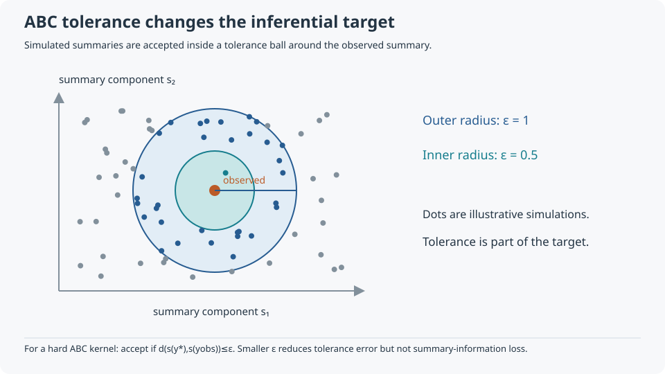

# 46. Likelihood-free and simulator-based inference

**Learning goals.** After this chapter you should be able to state the posterior implied by an approximate Bayesian computation (ABC) rule, derive an MCMC transition that leaves it invariant, distinguish information lost through a summary from smoothing introduced by a tolerance, and explain what finite-replicate synthetic and learned likelihoods target. You should also be able to report simulator cost and approximation checks separately from chain diagnostics.

**Prerequisites.** We use posterior construction from [Chapter 03](03-bayesian-targets.md), Monte Carlo error from [Chapter 05](05-monte-carlo.md), Metropolis–Hastings (MH) from [Chapter 09](09-metropolis-hastings.md), diagnostics from [Chapters 13](13-mc-error.md) and [14](14-diagnostics.md), and calibration from [Chapter 17](17-workflow.md). [Chapter 27](27-pseudo-marginal.md) supplies the retained-estimator argument used below.

## 46.1 A simulator supplies draws, not necessarily probabilities

Suppose a parameter $\theta$ and random input $U$ produce data through a measurable program $Y=G(\theta,U)$. The random input includes any latent trajectories and observation noise. Given $\theta$, we can draw independent $U$ values and run the program. Yet evaluating $p(y_{\mathrm{obs}}\mid\theta)$ may require integrating over paths, event histories, or latent states that the program never exposes as a tractable density. An epidemic simulator, for example, might readily produce infection times and reported cases while the probability of one observed report sequence sums over an enormous set of possible transmissions. This is a computational condition, not a claim that the probability does not exist.

We must specify what the simulator reproduces. If the observed data are counts distorted by delayed reporting, a simulator of latent infections alone is insufficient. Running MCMC longer cannot repair a missing reporting process. Conversely, when a deterministic forward model and observation density are both evaluable, one can often build a conventional likelihood as in [Chapter 42](42-scientific-inference.md). The presence of a computer model does not itself require likelihood-free inference.

It helps to keep an **error ledger**. Scientific model discrepancy concerns whether $G$ describes the world. Summary reduction discards features of $y_{\mathrm{obs}}$. ABC smoothing, a Gaussian synthetic likelihood, or a learned surrogate modifies the statistical target. A finite simulator budget affects numerical quality. A finite MCMC run adds Monte Carlo error. These are different questions even when they all affect the final estimate.

## 46.2 ABC rejection defines a precise posterior

Let $S(y)$ be a summary, $s_{\mathrm{obs}}=S(y_{\mathrm{obs}})$, and $\rho$ a discrepancy. ABC rejection draws $\theta\sim p(\theta)$, then $Y\sim p(dy\mid\theta)$, and retains $\theta$ when $\rho(S(Y),s_{\mathrm{obs}})\leq\epsilon$. The accepted pair is simply a prior-predictive pair conditioned on this event. Its joint law is

$$
\widetilde\pi_\epsilon(d\theta,dy)
=\frac{p(d\theta)p(dy\mid\theta)\,\mathbf 1\{\rho(S(y),s_{\mathrm{obs}})\leq\epsilon\}}{Z_\epsilon},
$$

provided $0<Z_\epsilon<\infty$. Integrating out $y$ gives

$$
\pi_\epsilon(d\theta)\propto p(d\theta)L_\epsilon(\theta),\qquad
L_\epsilon(\theta)=\Pr_\theta\{\rho(S(Y),s_{\mathrm{obs}})\leq\epsilon\}.
$$

Thus rejection ABC is exact sampling from a *defined approximate posterior* if independent accepted draws can be obtained. It is not sampling from the full-data posterior merely because it uses the original simulator. This elementary conditioning derivation is the basis of the likelihood-free MCMC construction of [Marjoram and colleagues (2003)](https://pmc.ncbi.nlm.nih.gov/articles/PMC307566/).

More generally, choose a nonnegative measurable kernel $K_\epsilon(s,s_{\mathrm{obs}})$ whose prior-predictive expectation is positive and finite. Define

$$
L_\epsilon(\theta)=\mathbb E_\theta[K_\epsilon(S(Y),s_{\mathrm{obs}})],\qquad
\widetilde\pi_\epsilon(d\theta,dy)\propto p(d\theta)p(dy\mid\theta)K_\epsilon(S(y),s_{\mathrm{obs}}).
$$

At a *fixed* $\epsilon$, multiplying $K_\epsilon$ by a positive constant independent of $\theta$ leaves $\pi_\epsilon$ unchanged. Across tolerances, however, record whether a kernel is a normalized density or an unnormalized weight. Comparing its numerical value across $\epsilon$ without that convention is misleading.

The discrepancy should reflect the scale and dependence of summaries. A Euclidean distance between raw case counts and rates may be dominated by the count simply because of units. One option is to choose scale estimates in a separate pilot simulation, freeze them, and compare standardized summaries. Data-dependent choices must be included in the analysis record. Choosing $\epsilon$ to obtain a pleasant acceptance rate only controls computation; it does not guarantee a scientifically small approximation.



## 46.3 What the zero-tolerance limit can and cannot recover

The limiting target depends first on $S$. Suppose $S(Y)$ has density $f_\theta(s)$ near $s_{\mathrm{obs}}$. For a normalized translation kernel $K_\epsilon(s,s_{\mathrm{obs}})=\epsilon^{-d}k((s-s_{\mathrm{obs}})/\epsilon)$ on $\mathbb R^d$, local continuity suggests $L_\epsilon(\theta)\to f_\theta(s_{\mathrm{obs}})$. One sufficient set of conditions is: $k$ is nonnegative, integrates to one, and has compact support; $f_\theta$ is continuous at $s_{\mathrm{obs}}$ for prior-almost-every $\theta$; the kernel averages have a prior-integrable dominating function; and the prior predictive density at $s_{\mathrm{obs}}$ is positive and finite. Compact support and continuity give pointwise convergence of the kernel averages; prior-integrable domination then gives convergence of the normalizers and of posterior densities in $L^1$. Thus the normalized ABC posterior converges to $p(\theta\mid S(y_{\mathrm{obs}})=s_{\mathrm{obs}})$. Noncompact kernels, including the Gaussian kernel below, need their own tail or domination argument; its limit is explicit in our Gaussian example. For continuous summaries the exact-match event itself usually has probability zero, so one cannot justify this by literally conditioning on an accepted zero-radius ball.

Sufficiency of $S$ for $\theta$ under the assumed model guarantees that the summary posterior equals $p(\theta\mid y_{\mathrm{obs}})$, up to the relevant version of the conditional distribution. Equality can also occur accidentally at a particular dataset; an arbitrary summary provides no general recovery guarantee. A constant summary makes the point starkly: $S(y)=0$ for all $y$ makes $L_\epsilon(\theta)$ the same for every $\theta$ whenever the kernel weight at zero is nonzero. Even as $\epsilon\downarrow0$, the target remains the prior. Small tolerance cannot reconstruct discarded information. In practice, summaries may be selected for one estimand rather than full posterior recovery. [Fearnhead and Prangle](https://arxiv.org/abs/1004.1112) motivate posterior-mean summaries for parameter estimation under their squared-error and limiting formulation; that does not make them universally sufficient for every posterior question.

For a normalized translation kernel there is a useful, narrower interpretation. If $E$ has density $k_\epsilon$, independent of $S(Y)$, and the kernel is $K_\epsilon(s,s_{\mathrm{obs}})=k_\epsilon(s_{\mathrm{obs}}-s)$, then $L_\epsilon(\theta)$ is the density of $S(Y)+E$ at $s_{\mathrm{obs}}$. This is the exact posterior for a *noise-augmented summary model*. It is not the exact posterior for the original observations unless that added noise is genuinely part of the observation process. For an indicator ball the same algebra does not automatically describe an additive noise density without specifying normalization and geometry.

## 46.4 MCMC on the augmented ABC target

Rejection from the prior can become expensive when the posterior occupies a small prior region. Instead, retain a state $(\theta,y)$ and propose $\theta'\sim q(d\theta'\mid\theta)$, then one fresh $y'\sim p(dy'\mid\theta')$. The MH ratio for the augmented target is

$$
\alpha((\theta,y),(\theta',y'))
=1\wedge\frac{p(\theta')q(\theta\mid\theta')K_\epsilon(S(y'),s_{\mathrm{obs}})}
{p(\theta)q(\theta'\mid\theta)K_\epsilon(S(y),s_{\mathrm{obs}})}.
$$

The simulator factors cancel between target and proposal measures. No numerical evaluation of $p(y\mid\theta)$ is needed. This formal density expression assumes compatible reference measures; the same conclusion follows from the forward and reverse proposal measures. Start with a state having positive target weight and use proposals with reciprocal support on moves that matter. Standard MH detailed balance then proves invariance for $\widetilde\pi_\epsilon$. Convergence from an arbitrary valid start needs additional irreducibility and recurrence conditions from [Chapter 08](08-convergence.md); invariance alone does not provide a mixing rate.

For the indicator kernel, the current state has indicator one. A proposal whose simulated summary misses the ball is rejected. Otherwise the acceptance probability is $1\wedge[p(\theta')q(\theta\mid\theta')]/[p(\theta)q(\theta'\mid\theta)]$. On rejection, **retain both** $\theta$ and $y$. Replacing current $y$ after a rejection changes the transition. Likewise, recording only accepted $\theta$ values gives the jump chain, which overweights states that leave readily unless holding times are restored. A bounded initialization and transition sketch is:

```text
for attempt = 1,...,max_initialization_attempts:
    draw theta from prior; simulate y given theta
    if K_epsilon(S(y), s_obs) > 0: retain (theta,y); break
if no pair was retained: report initialization failure
for t = 1,...,T:
    draw theta' from q(. | theta); simulate y' given theta'
    compute the augmented-target MH probability
    with that probability replace (theta,y) by (theta',y')
    record theta, including repeated values
```

With a Gaussian kernel every finite simulated summary has positive weight, so initialization is easy; very low initial weight can still cause a long transient. With a narrow hard tolerance, initialization can itself be a substantial simulation task. A finite failure report is more honest than an unbounded loop.

## 46.5 Simulation cost and summary dimension

When $S(Y)$ has a regular $d$-dimensional density that is positive near $s_{\mathrm{obs}}$, the probability of landing in a small radius-$\epsilon$ ball is locally proportional to $\epsilon^d$ times that density and the ball's volume. This is a local heuristic, not a universal complexity theorem: support boundaries, highly correlated summaries, discrete components, and non-Euclidean metrics change it. Still, it explains why appending weakly useful summaries can make hard-tolerance ABC prohibitively expensive. One should examine whether each summary informs the estimand and whether its scale and dependence are handled sensibly.

At a fixed parameter proposal, one can run $m$ independent simulations and average their nonnegative kernel evaluations. That average is an unbiased estimator of $L_\epsilon(\theta)$, *the ABC likelihood*, but generally not of $p(y_{\mathrm{obs}}\mid\theta)$. Retaining the complete random estimate as auxiliary state yields a pseudo-marginal chain for the same ABC target, under the usual integrability and support conditions of [Chapter 27](27-pseudo-marginal.md). Recomputing the denominator on every attempt gives a different noisy algorithm. More simulations may stabilize the estimate but consume calls that could have lengthened the chain; compare effective samples per simulator call rather than iterations alone. A sequential sequence of tolerances can focus simulation in promising regions, but its changing particle population, weights, and resampling need their own validity argument; [Chapter 28](28-particle-mcmc.md) develops the SMC machinery.

## 46.6 Worked example: a noisy Gaussian mean

Let $Y_i\mid\theta\overset{\mathrm{iid}}{\sim}N(\theta,1)$ for $n=25$, let $\theta\sim N(0,4)$, and suppose $\bar y_{\mathrm{obs}}=1.2$. The sample mean is sufficient here, so reducing the data to $S(y)=\bar y$ loses no information about $\theta$. Use the **normalized Gaussian** ABC kernel with standard deviation $\epsilon$:

$$
K_\epsilon(s,1.2)=\frac{1}{\sqrt{2\pi}\epsilon}
\exp\left[-\frac{(s-1.2)^2}{2\epsilon^2}\right].
$$

Because $\bar Y\mid\theta\sim N(\theta,1/25)$, convolution with this kernel makes $L_\epsilon(\theta)$ the $N(\theta,v_\epsilon)$ density at $1.2$, with $v_\epsilon=1/25+\epsilon^2$. Completing the square in $p(\theta)L_\epsilon(\theta)$ gives

$$
V_\epsilon=\left(\frac14+\frac1{v_\epsilon}\right)^{-1},\qquad
m_\epsilon=V_\epsilon\frac{1.2}{v_\epsilon}.
$$

At $\epsilon=0$, the full-data posterior is $N(1.188119,0.039604)$. At $\epsilon=0.20$, $v_\epsilon=0.08$, precision is $0.25+12.5=12.75$, and the posterior is $N(1.176471,0.078431)$. At $\epsilon=0.50$, it is $N(1.118881,0.270396)$. The increased uncertainty is smoothing error under the original model, even if the chain exactly samples its smoothed target. The bandwidth here is the *standard deviation of Gaussian kernel noise*, not a hard acceptance radius.

The seeded standard-library program [examples/ch46.py](examples/ch46.py) proposes a random-walk $\theta'$, simulates a new mean, and applies the augmented MH ratio. It holds both state components on rejection. Its $180{,}001$ simulator calls per tolerance include initialization; it uses $30{,}000$ warmup transitions followed by $150{,}000$ recorded transitions. One run produced:

| $\epsilon$ | Analytic $m_\epsilon$ | Chain mean | Analytic $V_\epsilon$ | Chain variance | Acceptance |
|---:|---:|---:|---:|---:|---:|
| 0.10 | 1.185185 | 1.186022 | 0.049383 | 0.049952 | 0.254 |
| 0.20 | 1.176471 | 1.177621 | 0.078431 | 0.078343 | 0.445 |
| 0.50 | 1.118881 | 1.117226 | 0.270396 | 0.274555 | 0.712 |

The table compares each finite chain with its *own* analytic target. Agreement here is a useful implementation check, not proof of convergence. In particular, the $\epsilon=0.50$ chain is close to its smoothed reference while that reference variance is nearly seven times the full-data variance. If we instead define $S(y)=0$, every proposal's kernel factor is constant in $\theta$ and every tolerance produces the prior $N(0,4)$. No amount of simulator work or tolerance reduction repairs that summary choice.

**Lab.** Use the generic Metropolis lab below to vary proposal width and watch repeated states and mixing. A simulator-based ABC proposal has an additional source of rejection when its simulated summary fits poorly. The lab demonstrates fixed-target proposal behavior; it does not run the augmented ABC transition or assess summary adequacy.

<div class="mcmc-lab" data-lab="metropolis"></div>

### 46.6.1 An informative summary that erases the sign

A constant summary is an extreme example. A more instructive choice in the same Gaussian model is $A(Y)=|\bar Y|$. It retains information about the magnitude of the mean, yet cannot distinguish positive from negative means. This original benchmark makes concrete the separation of summary error and tolerance error in [Fearnhead and Prangle, Section 1.2](https://arxiv.org/html/1004.1112).

Write $\varphi(x;\mu,v)$ for a normal density with variance $v$. For $a>0$, the two preimages of the absolute-value map give

$$
f_A(a\mid\theta)=\varphi(a;\theta,1/25)+\varphi(-a;\theta,1/25).
$$

Each preimage has absolute Jacobian one. With the symmetric $N(0,4)$ prior, the prior-predictive densities of $\bar Y=a$ and $\bar Y=-a$ agree. Consequently, after normalizing the two terms,

$$
p(\theta\mid A=a)=\tfrac12\varphi(\theta;m_a,V_0)
+\tfrac12\varphi(\theta;-m_a,V_0),\qquad
m_a=V_0\frac{a}{1/25},\quad V_0=(1/4+25)^{-1}.
$$

At $a=1.2$, the full-data posterior from the actual positive observed mean is $N(1.188119,0.039604)$. The absolute-mean posterior has mean zero and variance $V_0+m_a^2=1.451230$. It gives $\Pr(\theta>0\mid A=1.2)=1/2$, whereas the full-data probability is about $0.999999999$. This summary is informative: it produces two concentrated regions near $\pm1.188$ rather than returning the diffuse prior. It has nevertheless discarded the scientifically important sign.

For the hard kernel $\mathbf1\{|A-a|\leq\epsilon\}$ with $0<\epsilon<a$, divide its likelihood by $2\epsilon$. The average density converges to $f_A(a\mid\theta)$; it is uniformly bounded by $2/\sqrt{2\pi/25}$, so the prior-integrable domination required in Section 46.3 holds. Thus decreasing tolerance really does converge to this mixture, rather than the full-data posterior. The example numerically integrates the folded likelihood times the prior and checks its normalizer and moments against the mixture formula. It also checks the finite-tolerance likelihood using normal CDF differences. An ABC chain visiting only the positive mode could appear to reproduce the full-data answer while failing to explore its own summary target.

### 46.6.2 Modelwise sufficient summaries can lose model probabilities {#sec-4662-modelwise-sufficient-summaries-can-lose-model-probabilities}

**Predict first.** Suppose the same statistic is sufficient for the unknown parameter within each of two candidate models. Must it also preserve their posterior model probabilities? Model comparison asks about the joint unknown consisting of the model tag and that model's parameter. Constants that cancel inside one model can still carry information about which model generated the data.

Consider a fixed known sample size $n\ge1$ and an **ordered** vector of nonnegative counts $y=(y_1,\ldots,y_n)$. Compare

$$
M_P:\quad Y_i\mid\lambda\overset{\mathrm{iid}}{\sim}\operatorname{Poisson}(\lambda),
\quad\lambda\sim\operatorname{Exp}(\text{rate }1),
$$

$$
M_G:\quad \Pr(Y_i=y\mid p)=p(1-p)^y,\quad y=0,1,\ldots,
\quad p\sim\operatorname{Uniform}(0,1).
$$

Under $M_G$ the observations are conditionally iid given $p$, and the geometric distribution counts failures before a success. Both parameter priors are proper; the model probabilities are initially $1/2$ each. Put $s=\sum_i y_i$ and $F(y)=\prod_i y_i!$. The likelihoods are

$$
\ell_P(y\mid\lambda)=\frac{e^{-n\lambda}\lambda^s}{F(y)},
\qquad \ell_G(y\mid p)=p^n(1-p)^s.
$$

Thus $S=\sum_iY_i$ is sufficient within either model. With full data **or** $S=s$, the conditional parameter posteriors are

$$
\lambda\mid M_P,y\sim\operatorname{Gamma}(s+1,\text{rate }n+1),\qquad
p\mid M_G,y\sim\operatorname{Beta}(n+1,s+1).
$$

That agreement does not yet establish correct model weights. Integrating the respective likelihoods against their priors gives the full ordered-data masses

$$
m_P(y)=\frac{s!}{(n+1)^{s+1}F(y)},\qquad
m_G(y)=\frac{n!s!}{(n+s+1)!}.
$$

The first integral is $F(y)^{-1}\int_0^\infty e^{-(n+1)\lambda}\lambda^s\,d\lambda$; the second is $\int_0^1p^n(1-p)^s\,dp$. Their ratio is the full-data Bayes factor $B_{PG}(y)$.

Now sum over **all ordered compositions** of $s$ into $n$ nonnegative counts. For Poisson data the multinomial identity $\sum_{\sum y_i=s}s!/F(y)=n^s$ gives the first summary mass. For geometric data every such vector has the same mass, and there are $\binom{n+s-1}{n-1}$ vectors. Consequently,

$$
m_P(S=s)=\frac{n^s}{(n+1)^{s+1}},\qquad
m_G(S=s)=\frac{n}{(n+s)(n+s+1)}.
$$

For $n=2$, $y=(0,4)$, the full masses are $1/243$ and $1/105$. The full Bayes factor is $35/81$, giving $\Pr(M_P\mid y)=35/116$. Using only $S=4$ gives Bayes factor $112/81$ and posterior probability $112/193$. The favored model reverses under equal model priors. With $y=(2,2)$ the sum is still four, so the summary answer stays fixed, but the full posterior probability is $70/97$. How the total is allocated across observations is model information.

The missing factor can be seen without integrating any parameters. Conditional on $S=s$, the Poisson allocation is multinomial with equal cell probabilities $1/n$, while the geometric allocation is uniform over compositions. Therefore

$$
\frac{B_{PG}(y)}{B_{PG}(S=s)}
=\binom{n+s-1}{n-1}\frac{s!}{n^sF(y)}.
$$

This is the established modelwise-sufficiency mechanism in [Robert, Cornuet, Marin, and Pillai (2011), Eq. 1 and their Poisson–geometric example](https://pmc.ncbi.nlm.nih.gov/articles/PMC3174657/). The small datasets here make it an exact worked benchmark. The warning concerns sufficiency across models; it is not a claim that every ABC model-choice construction fails.

For discrete $S$, exact matching has positive prior-predictive probability. A hard rule $|S(Y)-4|\le\epsilon$ with $0\le\epsilon<1$ already accepts exactly $S(Y)=4$. Shrinking that tolerance or increasing the simulation budget cannot recover the missing allocation factor. Such ABC correctly conditions on the reduced observation; its model posterior differs from the intended full-data answer even while each model's conditional parameter posterior remains correct.

### Repair the summary for this particular model pair

Here $T(y)=(S(y),F(y))$ is sufficient for the **joint** unknown consisting of the model tag and its parameter. Both displayed likelihoods depend on the data only through $T$. More explicitly, every ordered vector in a fixed $T$-fiber has the same likelihood under either model and any of its parameter values. The conditional distribution within that fiber is uniform and independent of both unknowns.

If a fiber has $c_T$ vectors, its prior-predictive masses are $m_P(T)=c_Tm_P(y)$ and $m_G(T)=c_Tm_G(y)$. Their common multiplicity cancels, recovering the full-data Bayes factor. For $(0,4)$ its fiber is $\{(0,4),(4,0)\}$, so both masses double and their ratio stays $35/81$. Parameter posteriors are also preserved.

This completion is justified for these two explicitly specified models. It supplies no generic recipe for repairing summaries in arbitrary simulator families. Joint sufficiency justifies exact discrete matching; kernels that mix different values of $T$ still require their own tolerance analysis. [The chapter executable](examples/ch46.py) enumerates small ordered compositions with exact rational masses, checks both summary targets, and compares the repaired and full posteriors. Exercise 7 changes the sample size and model prior so posterior odds must be recomputed rather than copied.

## 46.7 Synthetic likelihood: a different approximation

ABC compares a simulated summary with the observed one through a kernel. Synthetic likelihood instead models the *distribution* of summaries. Suppose $S(Y)\in\mathbb R^d$, with mean $\mu_\theta$ and covariance $\Sigma_\theta$. The ideal Gaussian synthetic likelihood is

$$
L_{\mathrm{SL}}(\theta)=\varphi_d(s_{\mathrm{obs}};\mu_\theta,\Sigma_\theta),
$$

where $\Sigma_\theta$ must be positive definite. Its log density is

$$
\log L_{\mathrm{SL}}(\theta)=-\frac d2\log(2\pi)-\frac12\log|\Sigma_\theta|
-\frac12(s_{\mathrm{obs}}-\mu_\theta)^T\Sigma_\theta^{-1}(s_{\mathrm{obs}}-\mu_\theta).
$$

The determinant term can depend on $\theta$ through the summary covariance. Dropping it then changes the posterior: in one dimension, a normal distribution with larger variance has a smaller density at its own mean. Only constants independent of the inferred parameter can be removed from a target ratio.

An approximately Gaussian summary can be useful even when the raw observations are non-Gaussian; for example, averaging weakly dependent contributions may yield an approximate normal summary. This is a modeling approximation, not a theorem granted by having many simulator draws. [Wood (2010)](https://pubmed.ncbi.nlm.nih.gov/20703226/) used synthetic likelihood for noisy nonlinear ecological systems; [Price and colleagues (2018)](https://wrap.warwick.ac.uk/id/eprint/85427/) analyze Bayesian synthetic likelihood and its tuning and assumption sensitivity.

Usually $\mu_\theta$ and $\Sigma_\theta$ are unknown. At each $\theta$ we simulate $m$ summaries, calculate their sample mean $\widehat\mu$ and covariance $\widehat\Sigma$, then plug both into the Gaussian density. An unbiased sample covariance does **not** imply that $\varphi_d(s_{\mathrm{obs}};\widehat\mu,\widehat\Sigma)$ is unbiased for $\varphi_d(s_{\mathrm{obs}};\mu_\theta,\Sigma_\theta)$: matrix inversion, determinant, and exponentiation are nonlinear. If this nonnegative random plug-in density $W(\theta,U)$ is retained as auxiliary state in pseudo-marginal MH, the parameter marginal is proportional to $p(\theta)\mathbb E[W(\theta,U)]$, provided that expectation is well defined and its integral against the prior is positive and finite. That is generally neither the ideal Gaussian synthetic posterior nor the original posterior. Refreshing the current $W$ whenever a proposal fails breaks the retained-state proof. Specialized unbiased estimators for a Gaussian synthetic likelihood exist under additional conditions [Price and colleagues (2018)](https://wrap.warwick.ac.uk/id/eprint/85427/); the ordinary plug-in is not one of them.

Here is an exact calculation of plug-in bias, isolating mean estimation. Suppose the summary really is $N(\mu_\theta,\tau^2)$, with known $\tau^2>0$. From $m$ independent simulator draws, $\widehat\mu\sim N(\mu_\theta,\tau^2/m)$. Gaussian convolution gives

$$
\mathbb E[\varphi(s_{\mathrm{obs}};\widehat\mu,\tau^2)]
=\varphi(s_{\mathrm{obs}};\mu_\theta,\tau^2(1+1/m)).
$$

The expected plug-in density is wider than the ideal density despite exact normality and an unbiased mean estimate. For the Gaussian benchmark with $m=4$, replacing $1/25$ by $(1/25)(1+1/4)=0.05$ gives posterior mean $1.185185$ and variance $0.049383$, about 25% more variance than the ideal posterior. Increasing the MCMC run length leaves that difference intact. This calculation illustrates the expected-likelihood target in [Price and colleagues, equations (4)–(5)](https://wrap.warwick.ac.uk/id/eprint/85427/7/WRAP-Bayesian-synthetic-likelihood-Lee-2017.pdf); estimating covariance as well generally gives a different expectation. The program checks the convolution by numerical integration.

## 46.8 Worked example: variance is not automatically Gaussian

Take $X_i\overset{\mathrm{iid}}{\sim}N(\mu,\sigma^2)$ and use the two summaries $(\bar X,S^2)$, with $S^2=\sum_i(X_i-\bar X)^2/(n-1)$. The mean is exactly normal. The variance satisfies

$$
\frac{(n-1)S^2}{\sigma^2}\sim\chi^2_{n-1},
$$

so its skewness is $\sqrt{8/(n-1)}$. At $n=5$ this is $1.414$; at $n=100$ it is about $0.284$. In the executable example, $12{,}000$ simulated datasets give skewness about $1.358$ and $0.318$, respectively. This is Monte Carlo evidence of the shape difference, not an assessment of a particular fitted posterior. At small $n$, a bivariate Gaussian synthetic likelihood puts mass on negative variance summaries, which the simulator can never produce. A transformation such as $\log S^2$ may improve shape, but it defines a new summary approximation whose effect must be checked.

There is a separate numerical obstacle even if Gaussianity is plausible. Suppose four summaries are fitted from only four simulator replicates. The four centered vectors sum to zero, so they span a space of dimension at most three. Thus $\operatorname{rank}(\widehat\Sigma)\leq m-1=3<d=4$ and the inverse in the synthetic density does not exist. Increasing $m$ beyond $d$ removes this *rank obstruction* but may still leave an unstable covariance, and it does nothing to prove normality. Covariance shrinkage can stabilize inversion, but the shrinkage amount changes the fitted likelihood. These are two distinct checks: enough simulations for a usable covariance, and an adequate distributional model for the summary.

## 46.9 Learned likelihoods and what an MH correction corrects

A flexible conditional density estimator may fit $r_\phi(s\mid\theta)$ using simulator pairs $(\theta,S(Y))$. Once training is frozen, the computational target is explicit:

$$
\pi_\phi(\theta\mid s_{\mathrm{obs}})\propto p(\theta)r_\phi(s_{\mathrm{obs}}\mid\theta).
$$

This posterior requires $0<\int p(\theta)r_\phi(s_{\mathrm{obs}}\mid\theta)\,d\theta<\infty$. Normalization of $r_\phi$ over summaries alone does not establish integrability over parameters; a proper prior alone does not establish it either.

An ordinary MH correction can make a chain invariant for this surrogate target, assuming $r_\phi$ is evaluable and the chain meets MH conditions. It cannot correct density-estimation error relative to the unavailable true summary likelihood. This differs from a learned *proposal* for a known target in [Chapter 36](36-learned-proposals.md): there the exact target ratio can correct proposal imperfections. Sequential neural likelihood methods allocate simulations toward regions of interest and then evaluate a learned likelihood within posterior inference [Papamakarios, Sterratt and Murray (2019)](https://proceedings.mlr.press/v89/papamakarios19a.html). Coverage outside the training region, especially when the posterior is multimodal or shifted by a surprising observation, remains a concern.

Related approaches fit different objects. Neural posterior estimation directly approximates $p(\theta\mid s)$ under a specified training distribution over parameters; changing that distribution can require correction. Ratio estimation fits a density ratio or classification-derived surrogate that can enter an MH ratio if it is valid over the relevant parameter region. The words “neural” and “likelihood-free” do not identify a common target. Record the simulated training design, the fitted object, and what density or ratio is actually evaluated at $s_{\mathrm{obs}}$. Held-out simulator pairs can check predictive fit in represented regions; they cannot certify accuracy in regions never simulated.

## 46.10 Calibration and an honest report

For a fixed ABC, synthetic, or learned target, run multiple chains, inspect traces and rank plots, and quantify Monte Carlo uncertainty for estimands as in [Chapters 13](13-mc-error.md) and [14](14-diagnostics.md). Passing diagnostics is evidence about the finite run's exploration of that fixed target, not proof that the target answers the original scientific question. Repeat important estimates across tolerances, summary sets, simulator replicate counts, or surrogate training runs as appropriate. Posterior predictive simulations should reproduce aspects of data not used in fitting the summary; a fit only to $S(y_{\mathrm{obs}})$ can hide systematic failures elsewhere in the data.

Simulation-based calibration (SBC) generates $\theta^{(r)}$ from the prior, data $Y^{(r)}$ from the simulator, runs the *complete* inference pipeline, and ranks $\theta^{(r)}$ among posterior draws. For independent exact conditional draws under that joint model, exchangeability produces uniform ranks for continuous test quantities (randomize ties for discrete quantities); see [Talts and colleagues (2018)](https://arxiv.org/abs/1804.06788) and [Chapter 17](17-workflow.md). If the pipeline targets a smoothed ABC posterior but SBC datasets come from the original unsmoothed model, nonuniformity can reveal the combined approximation and algorithmic effects. If datasets are instead generated from a deliberately noise-augmented summary model, SBC addresses calibration for that *different* model. Correlated chain draws weaken the naive independent-rank interpretation; use sufficiently independent draws or appropriate rank procedures and check finite-run error.

Uniform pooled ranks are not a complete certificate. An algorithm that always returns independent prior draws, ignoring $Y^{(r)}$, has uniform marginal ranks because $\theta^{(r)}$ and the returned values are iid prior draws. Yet its conditional posterior is wrong whenever data are informative. Inspect ranks within groups defined by observed data features, compare against an analytic benchmark where available, and check whether posterior contraction and predictive performance reflect the information in the data. Exact posterior draws remain exchangeable with the generating parameter conditional on the observed data, which justifies uniform ranks within such data-defined groups. Conditioning instead on a range of the generating parameter changes that reference distribution; uniform ranks should not be expected there without a separate derivation.

A useful report states the simulator and observation process; prior; observed data and summaries; discrepancy and its scaling; kernel and tolerance or surrogate likelihood; exact augmented or plug-in computational target; initialization, proposals, simulator calls, chains, and Monte Carlo uncertainty; and sensitivity and predictive/calibration checks. For the Gaussian example one can say: “The chain approximates the $\epsilon=0.20$ Gaussian-kernel summary posterior, with analytic mean $1.176471$ and variance $0.078431$; the full-data posterior variance under the stated Gaussian model is $0.039604$.” That sentence makes target approximation visible alongside computational accuracy.

## 46.11 Exercises

<div class="exercise" id="mcmc-46-likelihood-free-ex-1">

**1. ABC rejection marginal.** Starting from independent prior-predictive draws, derive the accepted parameter distribution for a hard discrepancy ball. State the necessary normalizing condition.

<details>
<summary>Solution</summary>

Let $A=\{\rho(S(Y),s_{\mathrm{obs}})\leq\epsilon\}$. The accepted joint law is $p(d\theta)p(dy\mid\theta)\mathbf 1_A/Z_\epsilon$, where $Z_\epsilon=\int p(d\theta)\Pr_\theta(A)$ must be positive and finite. Integrating $y$ gives $\pi_\epsilon(d\theta)=p(d\theta)\Pr_\theta(A)/Z_\epsilon$.

</details>

</div>

<div class="exercise" id="mcmc-46-likelihood-free-ex-2">

**2. Gaussian smoothing.** In Section 46.6, derive the posterior at $\epsilon=0.20$, then compare its variance with the full-data variance.

<details>
<summary>Solution</summary>

The simulated mean variance is $0.04$ and Gaussian kernel noise adds $0.04$, so $v_{0.20}=0.08$. Prior precision is $0.25$, likelihood precision $12.5$, and posterior precision $12.75$. Hence $V=1/12.75=0.078431$ and $m=V(1.2/0.08)=1.176471$. At zero bandwidth, $V=(0.25+25)^{-1}=0.039604$. The larger variance is a target-level smoothing effect.

</details>

</div>

<div class="exercise" id="mcmc-46-likelihood-free-ex-3">

**3. Destroying information.** Let $S(y)=0$ for every dataset and choose any kernel with $0<K_\epsilon(0,0)<\infty$. What happens as $\epsilon\downarrow0$?

<details>
<summary>Solution</summary>

For every $\theta$, $L_\epsilon(\theta)=K_\epsilon(0,0)$, which cancels from posterior normalization. The ABC target equals the prior at every $\epsilon$ and therefore also in any limit. A smaller tolerance cannot restore information removed by $S$.

</details>

</div>

<div class="exercise" id="mcmc-46-likelihood-free-ex-4">

**4. Covariance rank.** For $m\geq2$, prove that a sample covariance computed from $m$ simulated $d$-dimensional summaries has rank at most $m-1$. What follows if $m\leq d$?

<details>
<summary>Solution</summary>

Write the centered summaries as columns of a $d\times m$ matrix $C$. Their sum is zero, so the columns are linearly dependent and $\operatorname{rank}(C)\leq m-1$. Since $\widehat\Sigma=CC^T/(m-1)$, its rank is at most $m-1$. If $m\leq d$, it cannot have full rank $d$ and is not invertible. At $m=1$ this unbiased covariance estimator is undefined.

</details>

</div>

<div class="exercise" id="mcmc-46-likelihood-free-ex-5">

**5. Recomputed denominator.** A sampler estimates $L_\epsilon(\theta)$ from simulations but recomputes the current-state estimate after every rejection. Why does “the estimate is unbiased” fail to prove that the sampler targets $\pi_\epsilon$?

<details>
<summary>Solution</summary>

The pseudo-marginal target includes the simulator randomness as state. Its MH ratio compares a proposed estimate with the *retained current estimate*. Recomputing that denominator changes the transition on this augmented space, so the detailed-balance calculation no longer applies. Unbiasedness of each separate estimate is insufficient; one must derive an invariant law for the actual noisy transition.

</details>

</div>

<div class="exercise" id="mcmc-46-likelihood-free-ex-6">

**6. Uniform but uninformative SBC.** An algorithm returns independent prior draws for every simulated dataset, and its pooled SBC ranks look uniform. Explain why and propose an additional check.

<details>
<summary>Solution</summary>

In SBC, the generating $\theta$ is itself a prior draw. Its rank among other independent prior draws is uniform by exchangeability, even though the algorithm ignored the data (use randomized ties for discrete quantities). Compare with an analytic posterior on a tractable benchmark, inspect posterior contraction when data become more informative, or stratify ranks by observed data features. Parameter-defined strata need their own reference distribution. Uniform pooled ranks alone do not demonstrate correct conditional inference.

</details>

</div>

<div class="exercise" id="mcmc-46-likelihood-free-ex-7">

**7. A summary can preserve one decision and lose another.** In Section 46.6.1, compare $\mathbb E[\theta^2\mid\bar Y=1.2]$ with $\mathbb E[\theta^2\mid |\bar Y|=1.2]$. Does their equality imply that the summary is sufficient?

Then use Section 46.6.2's count models with $n=3$, observed vector $(0,1,3)$, and prior model probability $\Pr(M_P)=1/3$. Find the full ordered-data masses, Bayes factor, and posterior probability of $M_P$. Compare with conditioning only on $S=4$. State the conditional parameter posteriors and explain why those can agree while model weights differ. Finally enumerate the fiber of $T=(S,\prod_iY_i!)$ and check that its common multiplicity repairs the Bayes factor. Distinguish the Bayes factor from posterior odds under the unequal model prior.

<details>
<summary>Solution</summary>

Both equal $V_0+m_a^2=1.451230$, since the two normal components have the same second moment. In fact, every integrable even function of $\theta$ has the same expectation under the positive-mean posterior and the equal sign mixture. Sufficiency does not follow: the probability of a positive parameter changes from about $0.999999999$ to $1/2$. Preserving a particular posterior decision or moment does not preserve all posterior information.

For the changed count data, $s=4$ and $F=0!1!3!=6$. The full masses are $m_P(y)=1/256$ and $m_G(y)=1/280$, so $B_{PG}(y)=35/32$. Prior odds are $(1/3)/(2/3)=1/2$, giving posterior odds $35/64$ and probability $35/99$.

For the sum alone, $m_P(S=4)=81/1024$ and $m_G(S=4)=3/56$, so the Bayes factor is $189/128$. Its posterior odds are $189/256$, giving probability $189/445$. Within the respective models the parameter posteriors remain $\operatorname{Gamma}(5,\text{rate }4)$ and $\operatorname{Beta}(4,5)$ using full data or $S$: those conditional answers do not determine the model probabilities.

The $T=(4,6)$ fiber consists of the six permutations of $(0,1,3)$. Its masses are $6/256=3/128$ and $6/280=3/140$. Their ratio is again $35/32$, recovering posterior probability $35/99$ with the stated prior odds. Multiplying a Bayes factor by prior odds is necessary before converting odds into a posterior probability. Exact matching of this jointly sufficient $T$ preserves the full answer; matching $S$ alone does not.

</details>

</div>

## Key takeaways

- A likelihood-free algorithm has a definite computational target. Write it down before discussing convergence.
- ABC MCMC is exactly invariant for an augmented $\epsilon$ target when its simulated auxiliary state is retained correctly. Summary loss and tolerance smoothing remain target approximations.
- A finite-replicate Gaussian synthetic likelihood is a random plug-in density. Unbiased moment estimates do not make that density unbiased.
- A learned likelihood can be sampled accurately while its learned target is inaccurate. Report simulator coverage and held-out checks.
- Separate model, summary, surrogate, simulator-budget, and MCMC errors; use calibration and predictive checks for claims beyond fixed-target mixing.
