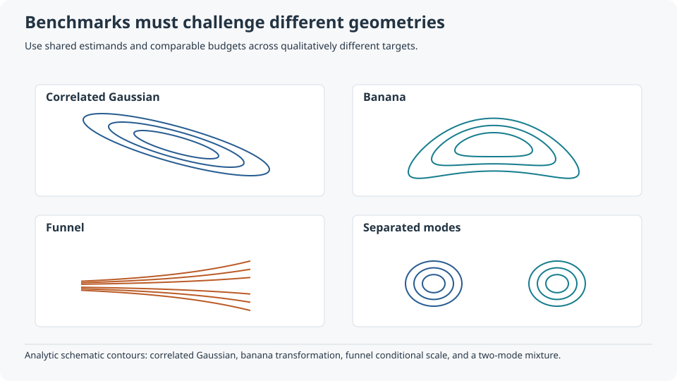

# 47. Comparative sampler laboratory

**Learning goals.** Design a comparison around a target and an estimand; derive independent reference values; account for warmup, proposals, and complete repeated runs; recognize when a good local diagnostic misses a global failure; and report a conclusion that is no broader than the experiment. Prerequisites are [random number computation](04-numerics.md), [Monte Carlo error](05-monte-carlo.md), [Metropolis–Hastings](09-metropolis-hastings.md), [Gibbs sampling](10-gibbs.md), [diagnostics](14-diagnostics.md), and [geometry](16-geometry.md). The HMC extension uses [Chapters 20](20-hmc.md) and [21](21-nuts.md).

## 47.1 A benchmark is an experiment

Two scatterplots can look equally convincing while one sampler estimates a rare event badly. A cloud near each mode of a mixture says little about whether the sampler visits the modes in the right proportions. Likewise, a small error in a coordinate mean can conceal a large error in a tail probability. The experimental unit should therefore be a **complete run**: initialization, any tuning or warmup, retained transitions, and estimator calculation. A comparison of two favorable traces is not an experiment.

Before executing a benchmark, write down six things: the target distribution and its parameterization; the functions whose expectations matter; the initialization distribution; the rules for tuning; the computational budget and cost counters; and the number and handling of complete repetitions. Fix this protocol before inspecting evaluation seeds. A handpicked synthetic suite checks implementation and exposes particular mechanisms. It does not establish a global ranking. The motivation for testing across many model and data targets is also central to [posteriordb](https://arxiv.org/abs/2407.04967), a database with reference Monte Carlo draws. Here we use four small distributions with analytic moments so that the reference itself does not depend on a second, unexamined chain.

There are at least three distinct questions. *Does this implementation reproduce known quantities?* *Which kernels perform better under a specified tuning policy?* *Which software defaults perform better end to end?* The first can use oracle information to detect errors. The second must count tuning and disclose target-specific advantages. The third needs actual software stacks, hardware, compiler or interpreter versions, and their complete initialization costs. This chapter runs the first kind of check and a deliberately narrow version of the second.

## 47.2 Targets with independent answers

We can generate each target without running a Markov chain. That makes its moments useful for checks, though direct generation is an unfair advantage if entered as an ordinary density-only competitor. Let $\phi$ and $\Phi$ be the standard normal density and CDF.

| Target | Generative definition | Exact reference estimands | Main difficulty |
|:--|:--|:--|:--|
| Correlated Gaussian | $(X,Y)\sim N(0,\Sigma)$, $\Sigma=\begin{pmatrix}1&\rho\\\rho&1\end{pmatrix}$, $\vert \rho\vert <1$ | $E[X]=0$, $E[X^2]=1$, $E[XY]=\rho$ | Long, thin ellipse as $\vert \rho\vert \to1$ |
| Banana | $Z_1,Z_2\overset{\mathrm{iid}}\sim N(0,1)$; $X_1=Z_1$, $X_2=Z_2+b(Z_1^2-1)$ | $E[X_2]=0$, $E[X_2^2]=1+2b^2$, $E[X_1X_2]=0$ | Curvature hidden by zero linear covariance |
| Funnel | $V\sim N(0,9)$; $X_i\mid V\sim N(0,e^V)$ independently, $i=1,\ldots,d$ | $E[X_i]=0$, $E[X_i^2]=e^{9/2}$, $P(V<-3)=\Phi(-1)$ | Scale varies enormously with $V$ |
| Symmetric mixture | $X\sim\tfrac12N(-a,1)+\tfrac12N(a,1)$ | $E[X]=0$, $E[X^2]=1+a^2$, $P(X>0)=1/2$ | Separated modes when $a$ is large |

For the Gaussian, the eigenvectors $(1,1)/\sqrt2$ and $(1,-1)/\sqrt2$ have variances $1+\rho$ and $1-\rho$. At $\rho=.99$ their scales differ by a factor of $\sqrt{199}$. A coordinate mean alone may not reveal poor exploration of the narrow direction; include both projections as estimands in a larger test. An exact draw can be made from $X=Z_1$, $Y=\rho Z_1+\sqrt{1-\rho^2}Z_2$ with independent standard normals. This generator knows the covariance factorization. A generic Metropolis kernel sees only the log density.

The banana is an invertible transformation, not merely a curved picture. Its inverse is $z_1=x_1$, $z_2=x_2-b(x_1^2-1)$, whose Jacobian determinant is one. Thus its log density, up to a constant, is

$$
\log\pi(x_1,x_2)=-\frac{x_1^2}{2}-\frac{[x_2-b(x_1^2-1)]^2}{2}.
$$

Because $E[Z_1^2]=1$ and $E[Z_1^4]=3$, $\operatorname{Var}(X_2)=1+b^2\operatorname{Var}(Z_1^2)=1+2b^2$. The covariance $E[Z_1Z_2]+bE[Z_1(Z_1^2-1)]$ is zero by independence and odd normal moments. Zero covariance here does not imply independent coordinates. A useful sweep varies $b$, and compares the same $E[X_2^2]$ in original and transformed coordinates. The transformation is an algorithmic aid and must be named in the comparison.

For the funnel the centered joint log density includes terms that a casual implementation can omit:

$$
\log\pi(v,x)=C-\frac{v^2}{18}-\frac{d v}{2}-\frac{e^{-v}}{2}\sum_{i=1}^d x_i^2.
$$

Since $E[e^V]=e^{9/2}$, the second moment of each $X_i$ is large. Even independent draws may estimate it noisily because rare large $V$ values dominate. The noncentered form $X_i=e^{V/2}Z_i$ has independent standard normal $Z_i$ and $V\sim N(0,9)$ in this *prior-only target*. With data, noncentering can help or hurt depending on the likelihood. [Stan's efficiency guide](https://mc-stan.org/docs/stan-users-guide/efficiency-tuning.html) discusses how parameterization and varying curvature affect sampling. A benchmark should compare the same transformed-back estimands and count the transformation work.

For the mixture use a stable log-sum-exp expression,

$$
\log\pi(x)=C+\max(u_-,u_+)+\log\{e^{u_--m}+e^{u_+-m}\},
\quad u_\pm=-\tfrac12(x\mp a)^2,\quad m=\max(u_-,u_+).
$$

At $a=6$, $E[X^2]=37$ and $P(X>0)=1/2$. Notice how $X^2$ can be accurate even if a chain never leaves one component: both components have exactly the same distribution of squared values. This is why a suite needs several estimands, not just several targets.

These contours illustrate geometry; they are not measured sampler output.

## 47.3 Estimands define accuracy

For a specified function $f$, a run reports $\hat\mu_f=N^{-1}\sum_{t=1}^N f(X_t)$. We will report the mean, a second moment, and, for the mixture, the positive-mode occupancy. In an expanded benchmark use difficult eigenvector projections for the Gaussian, $X_2^2$ for the banana, $\mathbf1\{V<-3\}$ and $X_i^2$ for the funnel, and both occupancy and a tail event for the mixture. These functions interrogate different aspects of a path. [Stan's posterior analysis reference](https://mc-stan.org/docs/reference-manual/analysis.html) explicitly treats effective sample size and Monte Carlo standard error as depending on the quantity being estimated.

For outcomes measured in different units, a standardized error $(\hat\mu_f-\mu_f)/\sqrt{\operatorname{Var}_\pi(f)}$ can be useful when that variance is finite and positive. Keep the unstandardized error beside it. For a probability near zero, relative error is unstable or undefined; an absolute probability error and a decision-specific tolerance are clearer. Do not select an estimand after seeing which sampler looks best. If a scientific conclusion uses a threshold, benchmark the threshold probability or loss directly.

Conditional on a stationary chain satisfying a suitable central limit theorem, define $\sigma_f^2=\operatorname{Var}_\pi(f)+2\sum_{k\ge1}\operatorname{Cov}_\pi(f(X_0),f(X_k))$, when this asymptotic variance exists. Then $\operatorname{MCSE}(\hat\mu_f)^2\approx\sigma_f^2/N$ and $\operatorname{ESS}_f=N\operatorname{Var}_\pi(f)/\sigma_f^2$. This describes stationary sampling variation; it does not remove initialization bias or reveal a wrong invariant law. The derivations and estimators are in [Chapter 13](13-mc-error.md). A reported ESS for $X$ cannot stand in for ESS of $\mathbf1\{X>0\}$.

## 47.4 What is being compared?

The companion [executable](examples/ch47.py) compares a full two-coordinate Gaussian Gibbs sweep, two isotropic Gaussian random-walk Metropolis proposals, and an exact Gaussian generator. Its mixture experiment uses random-walk Metropolis at two fixed scales. These are intentionally simple teaching implementations. In every Metropolis iteration a rejected proposal leaves the current state in the average, and a cached current log density avoids reevaluating it. Each proposal still costs one log-density evaluation; the initial state costs one more. A full Gibbs sweep costs two conditional normal draws. The exact Gaussian generator also costs two normal draws, but requires the analytic factorization.

| Method | Information required | Unit recorded in this chapter | Limitation |
|:--|:--|:--|:--|
| Isotropic random-walk MH | Log density | One joint proposal and accept/reject | One scale cannot match unequal directions |
| Gaussian Gibbs | Both full conditionals | Update $X$, then $Y$ | Not available for arbitrary target |
| Exact Gaussian generator | Covariance factorization | One independent pair | Oracle, not a density-only algorithm |
| Preconditioned MH, optional | Metric or pilot covariance | One joint proposal | Pilot estimation has a cost |
| HMC, optional | Gradient and kinetic metric | One trajectory and correction | Step size, trajectory length, and gradient work need accounting |

Fixed-trajectory HMC can be a useful additional comparator; its proposal is Metropolis corrected when the reversible, volume-preserving integration and acceptance step are implemented as in [Chapter 20](20-hmc.md) and Neal's [HMC chapter](https://arxiv.org/abs/1206.1901). A dynamic NUTS run belongs to a verified implementation, not a short heuristic that merely stops at a U-turn. Gradient calls are not universally convertible to a fixed number of log-density calls. Report them separately. Likewise, transformed and centered versions are different *parameterizations* of the same target; do not attribute their entire difference to the kernel.

Before measuring speed, check that each implementation reproduces simple moments across independent seeds, respects support, retains repeated rejected states, and has stable log arithmetic. These checks can catch coding errors; agreement within an arbitrary tolerance on finite runs does not prove invariance. For a target without analytic references, use an independent reference calculation with documented uncertainty rather than quietly calling a long chain exact.

## 47.5 Budgets, tuning, and repeated runs

The executable fixes **16 independent complete runs**, **500 discarded warmup transitions**, and **4,000 retained transitions** per run. The Gaussian proposal standard deviations are $0.12$ and $1.2$ in each coordinate; the mixture scales are $1.5$ and $8$. These are prespecified interventions, not proposal scales selected to maximize the displayed outcome. Mixture runs begin at $-6$, or alternate $-6$ and $+6$ across independent runs. The direct generator follows the same 500-discard protocol solely to give the same transition count; it does not need warmup. Each method uses distinct, fixed PRNG seeds; the repetitions are treated as independent simulation runs. Distinct seeds are a reproducibility policy, not a mathematical proof of independent streams. The `--research` option increases the repetitions and lengths while keeping the scale policy unchanged.

The table records retained iterations, warmup, log-density evaluations, normal random draws, and median wall time per complete run. Its first two budget numbers are equal by construction, but the work behind them is not. One Gaussian MH run has $4{,}501$ density evaluations, including the initial state, and $9{,}000$ normal draws. One Gibbs run has zero generic density evaluations and $9{,}000$ normal draws because it uses closed-form conditionals. Their call counts cannot be used alone as a cost ranking. The program measures wall time with a local timer; those values depend on machine load, interpreter, and hardware, so the numerical conclusions below emphasize accuracy at these fixed iterations and report timing only as a reproducibility field.

If tuning is required, define a separate pilot budget and objective before evaluation, use pilot seeds distinct from evaluation seeds, freeze settings, and add pilot cost to the **end-to-end** comparison. A sampling-only table may omit that cost if clearly labeled. Counting warmup only for a complicated method or choosing the best evaluation seed would change the question. For parallel tempering, count all replica transitions and swaps, not only cold-chain draws. For a learned proposal, count training and any model evaluations. Accelerator timings need synchronization before stopping the clock. If a method times out or returns undefined values, keep that run as a failure; deleting it rewards fragility.

For $R$ independent complete runs with the same protocol and known $\mu_f$, the empirical root mean squared error is

$$
\widehat{\operatorname{RMSE}}_f=\sqrt{\frac1R\sum_{r=1}^R(\hat\mu_{f,r}-\mu_f)^2}.
$$

It combines finite-run bias and variation. The population identity $E[(\hat\mu-\mu)^2]=\operatorname{Var}(\hat\mu)+\{E[\hat\mu]-\mu\}^2$ requires a finite second moment. The empirical RMSE with 16 runs is itself noisy. To place an interval around it, resample whole runs, not adjacent correlated iterations. If an independent unbiased reference $\tilde\mu$ has variance $v_{\rm ref}$, then $E[(\hat\mu-\tilde\mu)^2]=E[(\hat\mu-\mu)^2]+v_{\rm ref}$. Independence and unbiasedness remove the cross term. A shared noisy reference also makes all apparent errors dependent. Exact moments avoid that issue here.

### 47.5.1 Uncertainty in the benchmark itself

There are two levels of Monte Carlo uncertainty: the error of one chain's estimate and the error in our assessment of the sampler across runs. The program now uses 2,000 bootstrap resamples of the complete-run errors, with separate fixed seeds, to give approximate 95% percentile intervals for Gaussian mean RMSE and mixture occupancy RMSE. Each resample selects $R$ run errors with replacement and recomputes RMSE; the interval uses the 2.5th and 97.5th percentiles with linear interpolation. It never resamples individual correlated chain states. With only 16 runs, these intervals describe limited empirical information and need not have nominal coverage, especially if important kinds of failure were never observed.

For failure probabilities, define the event before inspecting the results. Here we record both no sign change and an absolute occupancy error greater than $0.1$. The latter tolerance is a teaching choice, not a universal convergence threshold. If the failure indicators are independent with common probability $p$, their sum $K$ is binomial with $R$ trials. Inverting the score inequality $|\hat p-p|\le z\sqrt{p(1-p)/R}$, with $\hat p=K/R$ and $z=\Phi^{-1}(0.975)$, gives the approximate 95% Wilson interval

$$
\frac{\hat p+z^2/(2R)\ \pm\ z\sqrt{\hat p(1-\hat p)/R+z^2/(4R^2)}}{1+z^2/R}.
$$

This interval remains nondegenerate when every run succeeds or fails; see [NIST's score-interval derivation](https://www.itl.nist.gov/div898/handbook/prc/section2/prc241.htm). For the same binary outcomes, bootstrapping all zeros would return only zeros and conceal uncertainty about unseen failures.

Independent runs with different fixed starts need not have the same failure probability. Our alternating $-6,+6$ starts are a special case: reflection symmetry of this target and proposal makes both no-crossing and absolute occupancy-error events equally probable from either center. Their binomial treatment is justified by that symmetry, under the independent-run model. In an asymmetric target, either draw starts independently from a specified distribution, or report failure rates separately by start stratum and combine them with prespecified weights. Resample within strata when estimating uncertainty for a fixed stratified design.

These intervals assess the stated finite-budget protocol, conditional on its target and fixed settings. They are not uncertainty intervals for the target's analytically known occupancy of $1/2$, and they say nothing about whether a chain has reached stationarity. If a method has numerical failures, report their count and uncertainty separately; an RMSE computed only from successful runs must be labeled conditional on success.

## 47.6 Worked example: a thin Gaussian ellipse

For $\rho=.99$, systematic Gibbs updates are $X_t\mid Y_{t-1}\sim N(\rho Y_{t-1},1-\rho^2)$ and then $Y_t\mid X_t\sim N(\rho X_t,1-\rho^2)$. At stationarity, successive full-sweep values of $X$ have correlation $\rho^2$: the route from $X_{t-1}$ through $Y_{t-1}$ to $X_t$ multiplies two conditional slopes $\rho$. The independent conditional noises make the lag-$k$ correlation $\rho^{2k}$. Hence

$$
\tau_X=1+2\sum_{k=1}^{\infty}\rho^{2k}=\frac{1+\rho^2}{1-\rho^2}=99.503\ldots,
\qquad \operatorname{ESS}_X\approx\frac{4{,}000}{\tau_X}=40.2.
$$

This exact autocorrelation statement assumes stationarity and the stated sweep order. The ESS is a long-run approximation for the mean, not a prediction that every 4,000-sweep sample contains exactly 40 independent draws. It gives a rough RMSE of $\sqrt{\tau_X/4000}\approx0.158$ for estimating $E[X]=0$ from a stationary run. The executable starts at $(0,0)$, so finite warmup and run-to-run randomness can move the observed result.

For an independent check that avoids the long-run approximation, put $q=\rho^2$. In a stationary window of exactly $N$ sweeps, summing all pairs of covariances gives

$$
\operatorname{Var}(\bar X_N)=\frac{1}{N^2}\left[N+2\sum_{k=1}^{N-1}(N-k)q^k\right].
$$

There are $N-k$ pairs at lag $k$ in each direction. Consequently the exact mean ESS for this stationary window is $1/\operatorname{Var}(\bar X_N)$, since $\operatorname{Var}_\pi(X)=1$. At $N=4{,}000$ it is $40.706$ and the mean RMSE is $0.156736$, slightly below the asymptotic approximation. This calculation verifies the benchmark's scale of error; it does not assert stationarity of the executable's deterministic start. The code also checks the lag sum against a direct double sum of the covariance matrix for a seven-sweep window.

The following results are from running `python examples/ch47.py` in this workspace with its default seed policy on Python 3.14.5, Linux x86_64. RMSE is across the 16 complete runs and reproduced across invocations; the seconds column records one observed median per method. Timers include random-stream and state initialization, initial target evaluation when needed, warmup, retained transitions, and in-loop accumulation; they exclude printing, aggregation across runs, and bootstrap interval calculation. These short timings lack a controlled hardware/load comparison and cannot support a speed claim. The second-moment truth is one.

| Method | RMSE $E[X]$ | RMSE $E[X^2]$ | Acceptance | Density calls/run | Observed median seconds/run |
|:--|--:|--:|--:|--:|--:|
| Exact generator | 0.015 | 0.017 | — | 0 | 0.0024 |
| Gibbs, full sweep | 0.144 | 0.164 | — | 0 | 0.0027 |
| MH, scale 0.12 | 0.485 | 0.485 | 0.653 | 4,501 | 0.0042 |
| MH, scale 1.2 | 0.096 | 0.154 | 0.089 | 4,501 | 0.0044 |

The approximate 95% whole-run bootstrap intervals for mean RMSE are $[0.010,0.018]$ for direct generation, $[0.103,0.180]$ for Gibbs, $[0.316,0.627]$ for scale-$0.12$ MH, and $[0.064,0.125]$ for scale-$1.2$ MH. They quantify how little 16 runs resolve: ordering two point estimates is not a precise estimate of their population error ratio.

The Gibbs mean RMSE is in the neighborhood of its stationary prediction. The larger MH scale has low acceptance but a smaller mean error than the smaller scale in this experiment; acceptance alone would have picked the wrong winner. Even the larger scale's finite-run second-moment error is substantial. The exact generator's small error is the expected advantage of independent draws plus covariance knowledge, and should be read as an oracle check, not a general recommendation. A whitened MH experiment would transform $(X,Y)$ to independent coordinates and count the target-specific metric or pilot covariance used to do so.

## 47.7 Worked example: a convincing single mode

Now set $a=6$. The mixture's log density is very low between the two component centers. A local random walk can move freely inside a component, accept often, and show a plausible trace. Yet if it never crosses zero it gives an occupancy estimate exactly zero or one, half a unit from the truth. This is a different failure from high within-component autocorrelation.

The same executable measured the following. “Zero crossings” counts complete runs with no accepted sign change on retained transitions, including the transition entering the first retained state; it is not a convergence statistic. A dispersed protocol alternates starts at the two known component centers. It uses target information that a real analysis may lack.

| Method and starts | RMSE $E[X]$ | RMSE $E[X^2]$ | RMSE $P(X>0)$ | Acceptance | Zero-crossing runs / 16 |
|:--|--:|--:|--:|--:|--:|
| Local scale 1.5, all at $-6$ | 5.989 | 0.473 | 0.500 | 0.589 | 16 |
| Local scale 1.5, dispersed | 5.984 | 0.429 | 0.500 | 0.590 | 16 |
| Wide scale 8, all at $-6$ | 0.371 | 0.536 | 0.029 | 0.210 | 0 |
| Wide scale 8, dispersed | 0.478 | 0.516 | 0.040 | 0.208 | 0 |

Every local run missed a crossing. Its second-moment RMSE is nevertheless smaller than the wide proposal's in this one small experiment. The function $x^2$ has exactly the same distribution in both components, while the wide proposal also attempts long jumps. These facts explain why occupancy and second-moment accuracy can differ; the observed small RMSE difference also contains variation across the 16 runs. That is precisely why a single score cannot express all scientific needs. Alternating the known starts makes the **pooled** local mean close to zero by cancellation, while each run's mean RMSE stays near six and each occupancy error stays at $0.5$. If the component weights were independently known, pooling deliberately stratified component estimates could be a valid estimator with appropriate weights. These unweighted, trapped chains do not establish those weights.

For both local protocols the two specified failure counts are $16/16$, giving a Wilson interval $[0.806,1.000]$ for each failure probability. Both wide protocols have $0/16$, giving $[0.000,0.194]$. Thus zero observed failures does not establish a reliably tiny failure rate. These are separate marginal intervals, not a simultaneous confidence guarantee across methods and events.

The wide protocols' occupancy RMSE bootstrap intervals are $[0.019,0.039]$ for left starts and $[0.029,0.049]$ for dispersed starts. For local runs the bootstrap returns $[0.500,0.500]$, because all observed occupancy errors have magnitude $0.5$. That degenerate interval cannot account for an unobserved crossing run. This is a concrete reason to show failure-probability intervals alongside RMSE and its empirical bootstrap. A larger replication count is needed to resolve uncommon events; simply resampling these same 16 runs more often adds no new sampler evidence. In an executed `--research` run (40 repetitions, 2,000 warmup and 20,000 retained transitions), the local dispersed protocol had one crossing run and occupancy RMSE $0.494$. This is a different budget, not another confidence check for the default protocol, and demonstrates why the default local bootstrap interval must not be read as certainty about future runs.

The wide proposal crosses and reduces occupancy error at the stated budget, but it has lower acceptance and is not uniformly better for every function. The experiment does not establish its asymptotic superiority or behavior at another separation. [Chapter 25](25-tempering.md) describes tempering as a mode-traversal alternative; a proper tempering comparison would count every temperature replica and examine cold-chain occupancy and round trips.

## 47.8 Diagnostics are evidence with a scope

Use rank-normalized split and folded $\widehat R$, bulk and tail ESS, function-specific MCSE, and sampler-specific indicators when valid implementations are available. [Vehtari and coauthors](https://arxiv.org/abs/1903.08008) motivate rank-based diagnostics and localized efficiency measures; [Chapter 14](14-diagnostics.md) develops their interpretation. The companion executable intentionally prints empirical RMSE from known truths rather than presenting a miniature home-made $\widehat R$ as a production diagnostic.

Starting all chains in the left mixture component can make them agree with each other while all miss the right one. Dispersed starts help expose such a problem, but they are not a guarantee: an especially narrow or unknown component can still be missed. A zero-variance occupancy indicator has no meaningful within-chain ESS estimate. Mark it undefined, preserve the zero-crossing result, and investigate the target. Passing a diagnostic threshold means that its particular check found no clear problem at that resolution. It is not a proof of convergence or model adequacy. Divergences, numerical errors, timeouts, and chains stuck at a boundary should remain in the report.

Try the diagnostics lab by increasing its AR(1) correlation and comparing the empirical autocorrelation with the theoretical curve. Its stationary marginal remains $N(0,1)$, while the displayed exact finite-window mean ESS decreases. The lab also displays the long-run approximation, which need not agree for short, highly correlated runs. Repeat with different seeds to see variation in the estimated mean. This single-chain demonstration does not compute between-chain diagnostics or run the four-target benchmark here.

Try the tempering lab by increasing the hot-replica temperature and inspecting cold-chain switching and positive occupancy. Its two mixture centers are fixed at $-3$ and $+3$, rather than the executable benchmark's $\pm6$. Count both replica updates and the attempted exchange per iteration when imagining a cost comparison with the table above; the lab is a qualitative demonstration, not the measured table.

## 47.9 A report another reader can audit

A reusable report should give one row per target, parameterization, estimand, method, and budget. Store the target formula and data, source revision, exact seed policy, warmup and tuning rule, proposal settings, retained count, log-density and gradient calls, random draws where informative, median and spread of wall times, error summaries across complete runs, diagnostics, and the number of failed runs. Show both sampling-only and end-to-end costs when tuning exists. State the machine and software versions for timing claims. For a realistic posterior benchmark, record the model and data provenance and the uncertainty in its reference draws; [posteriordb's documentation](https://github.com/stan-dev/posteriordb/blob/master/doc/use_cases.md) describes its use for algorithm evaluation. Do not let a high-quality reference chain become an unqualified analytic truth.

Here is a claim the measured data support: *On this one-dimensional mixture with centers at $\pm6$, under 16 independent 500-warmup/4,000-retained runs and the fixed seeds and scales in `examples/ch47.py`, scale-8 random-walk MH had much lower empirical RMSE for positive-mode occupancy than scale-1.5 MH.* The clause about occupancy matters: $E[X^2]$ tells a different story. The scope does not extend to other mixtures, tuned implementations, or equal-time budgets. The natural next step is to repeat on held-out separations and dimensions, then on a documented real target as developed in [Chapter 48](48-capstone.md).

## 47.10 Exercises

**1. A banana with zero correlation.** Starting from the generative definition, derive $\operatorname{Var}(X_2)$ and $\operatorname{Cov}(X_1,X_2)$. Does zero covariance imply independence here when $b\ne0$?

Solution

$E[X_2]=0$. Independence of $Z_2$ and $Z_1$ removes the cross variance term, so $\operatorname{Var}(X_2)=1+b^2E[(Z_1^2-1)^2]=1+b^2(3-2+1)=1+2b^2$. Also $E[X_1X_2]=E[Z_1Z_2]+b(E[Z_1^3]-E[Z_1])=0$. When $b\ne0$, the conditional mean $E[X_2\mid X_1]=b(X_1^2-1)$ changes with $X_1$, so they are dependent.

**2. Gibbs under increasing correlation.** For 10,000 stationary full sweeps, calculate the asymptotic ESS of the Gaussian coordinate mean at $\rho=0$, $0.9$, and $0.99$.

Solution

Use $\operatorname{ESS}\approx N(1-\rho^2)/(1+\rho^2)$. This gives $10{,}000$ at zero correlation, $10{,}000(0.19/1.81)\approx1{,}050$ at $0.9$, and $10{,}000(0.0199/1.9801)\approx100.5$ at $0.99$. These refer to the specified coordinate and stationary, long-run convention.

**3. Efficiency per cost.** Sampler A has twice sampler B's ESS per retained draw for one function but costs five times as much per draw. Compare their long-run ESS per unit cost. Name a finite-run reason the ranking might change.

Solution

The ESS-per-cost ratio A:B is $2/5:1$, so B is better by this measure in the stationary long run. A shorter warmup for A, a larger initialization bias for B, or a different function of interest could reverse a finite end-to-end decision. The calculation alone does not cover those costs or errors.

**4. The pooled-mean trap.** Eight chains stay near $-6$ and eight near $+6$ in an equal mixture. Explain why their pooled mean can look correct and give two summaries that reveal the failure.

Solution

The positive and negative means cancel when pooled, producing a value near the true zero even though no chain estimated the component weights by traversing modes. The RMSE of individual complete-run means is near six, and each chain's positive-mode occupancy is near zero or one instead of $1/2$. A count of accepted sign changes is another direct warning.

**5. A noisy reference.** Let $\tilde\mu$ be unbiased for $\mu$, independent of $\hat\mu$, with variance $v_{\rm ref}$. Derive $E[(\hat\mu-\tilde\mu)^2]$. What assumption fails if both estimates share random numbers?

Solution

Write $\hat\mu-\tilde\mu=(\hat\mu-\mu)-(\tilde\mu-\mu)$ and expand the square. Unbiasedness and independence make the expected cross term zero, giving $E[(\hat\mu-\mu)^2]+v_{\rm ref}$. Shared random numbers can give a nonzero covariance, so the cross term must be retained. A biased reference also contributes its bias and cross terms.

**6. Design a funnel comparison.** Specify a fair centered versus noncentered HMC study for the funnel with data, including a failure policy and an estimand sensitive to the neck.

Solution

Define the same posterior in both coordinates and compute transformed-back $E[X_i^2]$ and $P(V<-3)$. Use independent complete repetitions with a prespecified initialization distribution, adaptation policy, and equivalent end-to-end time or separately reported gradient-call budgets. Count each warmup, gradient, and transformation; retain divergences, timeouts, and failed chains. Report neck occupancy, tail MCSE, rank diagnostics, and empirical accuracy against an independently quantified reference if one exists. A result for this data set cannot imply noncentering wins for every hierarchical model.

**7. How many failure-free runs?** Suppose independent complete runs have a common failure probability $p$. After observing zero failures in $R$ prespecified runs, derive a one-sided 95% upper confidence bound. How many failure-free runs are required for this bound to be below $0.05$?

Solution

The probability of observing zero failures is $(1-p)^R$. Solving $(1-p_U)^R=0.05$ gives $p_U=1-0.05^{1/R}$. At $R=16$ this is approximately $0.17075$; it differs from the two-sided approximate Wilson endpoint because both the construction and the confidence statement differ. Require $1-0.05^{1/R}<0.05$, or $R>\log(0.05)/\log(0.95)\approx58.404$, hence at least 59 runs. This argument assumes the repetition count was fixed beforehand and the runs share a failure probability; repeatedly extending the study until the desired bound appears is a different stopping rule.

## Key takeaways

- A sampler comparison is defined by target, estimand, initialization, tuning, cost, repetitions, and failure policy together.
- Analytic moments make synthetic targets strong implementation checks, while direct generators have privileged information.
- Accuracy must be evaluated for the actual function of interest; acceptance and one ESS or moment are incomplete proxies.
- Repeat complete runs and retain failures. Diagnostics help find problems but cannot certify convergence.
- State conclusions at the target, budget, and implementation scope actually measured.
